# Domain Cheatsheets

**모르는 분야도 AI에게 정확히 시킬 수 있게.** 도메인별 용어 사전입니다.

UI 디자인, 모션, 3D 모델링 같은 기술 분야부터 법, 패션, 건설, 회계 같은 전문 분야까지 담습니다.
용어마다 그림, 한 줄 정의, AI에게 그대로 보낼 수 있는 요청 문장이 붙어 있습니다.
사람은 이 페이지에서 바로 찾아보고, AI 에이전트는 [MCP 서버](mcp-server/README.md)로 같은 내용을 읽습니다.

> 목표는 **사용자와 AI의 싱크업**입니다. 사용자는 정확한 단어로 요청하고, AI는 같은 단어로 확인하고 작업합니다.

## 도메인 목록

<!-- index:start -->
<!-- 이 구역은 자동 생성됩니다. `cd mcp-server && npm run generate` -->

도메인 24개 · 용어 709개

### 기술 · 디자인

<table>
<tr>
<td width="50%" valign="top"><a href="cheatsheets/3d-modeling.md">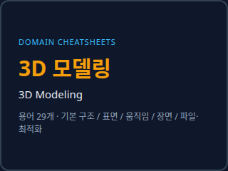</a><br><b><a href="cheatsheets/3d-modeling.md">3D 모델링 · 3D Modeling</a></b> <sub>용어 29개</sub><br><sub>3D 모델·캐릭터·소품을 AI나 3D 아티스트에게 주문하거나 검수할 때 쓰는 형태·표면·움직임·렌더·파일 용어</sub></td>
<td width="50%" valign="top"><a href="cheatsheets/ai-agents.md">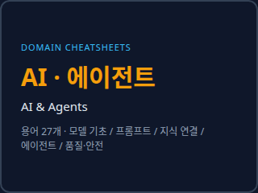</a><br><b><a href="cheatsheets/ai-agents.md">AI · 에이전트 · AI &amp; Agents</a></b> <sub>용어 27개</sub><br><sub>ChatGPT·Claude·Cursor 같은 AI와 에이전트에게 정확히 일을 시키기 위한 모델·프롬프트·RAG·MCP·안전 용어</sub></td>
</tr>
<tr>
<td width="50%" valign="top"><a href="cheatsheets/audio-production.md">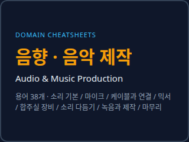</a><br><b><a href="cheatsheets/audio-production.md">음향 · 음악 제작 · Audio &amp; Music Production</a></b> <sub>용어 38개</sub><br><sub>합주실·집 녹음·팟캐스트에서 믹서, 마이크, 모니터, 앰프, 믹스와 마스터링을 AI에게 정확히 묻고 설정하기 위한 소리 장비·제작 용어</sub></td>
<td width="50%" valign="top"><a href="cheatsheets/backend.md">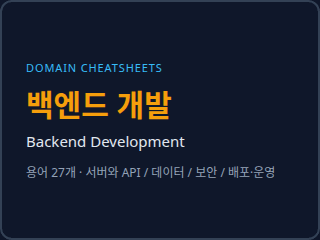</a><br><b><a href="cheatsheets/backend.md">백엔드 개발 · Backend Development</a></b> <sub>용어 27개</sub><br><sub>AI에게 서버·API·데이터베이스·배포를 시킬 때 필요한 백엔드 개발 기본 용어</sub></td>
</tr>
<tr>
<td width="50%" valign="top"><a href="cheatsheets/graphic-branding.md">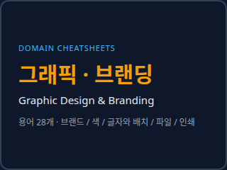</a><br><b><a href="cheatsheets/graphic-branding.md">그래픽 · 브랜딩 · Graphic Design &amp; Branding</a></b> <sub>용어 28개</sub><br><sub>로고·브랜드·포스터·인쇄물을 AI나 디자이너에게 맡길 때 쓰는 브랜드·색·글자·파일·인쇄 용어</sub></td>
<td width="50%" valign="top"><a href="cheatsheets/motion-design.md">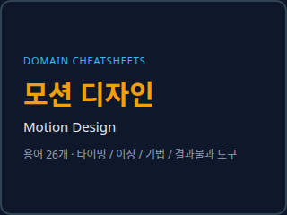</a><br><b><a href="cheatsheets/motion-design.md">모션 디자인 · Motion Design</a></b> <sub>용어 26개</sub><br><sub>앱·웹·영상 인트로·로고에 움직임을 넣고 싶은데 뭐라고 말해야 할지 모를 때 펼치는 타이밍·이징·기법·형식 용어</sub></td>
</tr>
<tr>
<td width="50%" valign="top"><a href="cheatsheets/photography.md">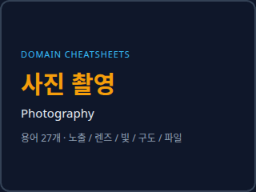</a><br><b><a href="cheatsheets/photography.md">사진 촬영 · Photography</a></b> <sub>용어 27개</sub><br><sub>제품·가게·작품 사진을 찍거나 AI에게 사진 느낌의 이미지를 주문할 때 쓰는 노출·렌즈·빛·구도·보정 용어</sub></td>
<td width="50%" valign="top"><a href="cheatsheets/spreadsheet.md">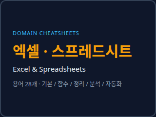</a><br><b><a href="cheatsheets/spreadsheet.md">엑셀 · 스프레드시트 · Excel &amp; Spreadsheets</a></b> <sub>용어 28개</sub><br><sub>엑셀·구글 시트 파일을 AI에게 만들게 하거나 고치게 할 때 쓰는 수식·정리·분석·자동화 용어</sub></td>
</tr>
<tr>
<td width="50%" valign="top"><a href="cheatsheets/ui-design.md">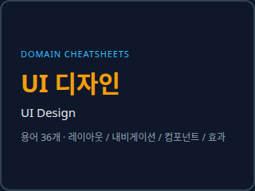</a><br><b><a href="cheatsheets/ui-design.md">UI 디자인 · UI Design</a></b> <sub>용어 34개</sub><br><sub>화면의 레이아웃·내비게이션·컴포넌트·효과를 AI에게 말로 정확히 설명해야 할 때 펼치는 용어집</sub></td>
<td width="50%" valign="top"><a href="cheatsheets/ux-research.md">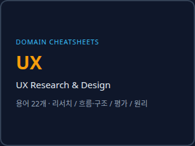</a><br><b><a href="cheatsheets/ux-research.md">UX · UX Research &amp; Design</a></b> <sub>용어 22개</sub><br><sub>사용자를 조사하고, 흐름과 구조를 설계하고, 써 보게 해서 평가할 때 AI와 맞춰 쓰는 UX 리서치·설계 용어</sub></td>
</tr>
<tr>
<td width="50%" valign="top"><a href="cheatsheets/video-production.md">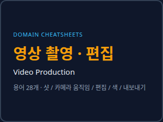</a><br><b><a href="cheatsheets/video-production.md">영상 촬영 · 편집 · Video Production</a></b> <sub>용어 28개</sub><br><sub>유튜브 영상·쇼츠를 찍고 자르고 내보낼 때 AI나 편집자에게 샷·카메라 움직임·컷·색·소리·내보내기 설정을 정확히 말하기 위한 용어</sub></td>
</tr>
</table>

### 기획 · 비즈니스

<table>
<tr>
<td width="50%" valign="top"><a href="cheatsheets/copywriting.md">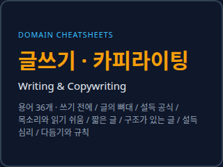</a><br><b><a href="cheatsheets/copywriting.md">글쓰기 · 카피라이팅 · Writing &amp; Copywriting</a></b> <sub>용어 36개</sub><br><sub>광고·상세페이지·뉴스레터·보도자료·유튜브 제목을 AI와 함께 쓸 때 필요한 구성·공식·말투·설득·검수 용어</sub></td>
<td width="50%" valign="top"><a href="cheatsheets/marketing.md"></a><br><b><a href="cheatsheets/marketing.md">마케팅 · 광고 · Marketing &amp; Advertising</a></b> <sub>용어 27개</sub><br><sub>광고·SNS·뉴스레터·랜딩 페이지를 AI와 함께 돌릴 때 필요한 전략·지표·운영·채널·광고 규칙 용어</sub></td>
</tr>
<tr>
<td width="50%" valign="top"><a href="cheatsheets/product-planning.md">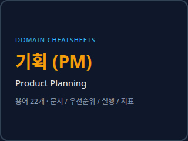</a><br><b><a href="cheatsheets/product-planning.md">기획 (PM) · Product Planning</a></b> <sub>용어 22개</sub><br><sub>아이디어를 문서·우선순위·실행·지표로 풀어 AI와 개발자에게 정확히 전달할 때 쓰는 기획·프로덕트 매니지먼트 용어</sub></td>
<td width="50%" valign="top"><a href="cheatsheets/seo.md">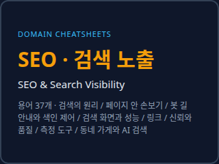</a><br><b><a href="cheatsheets/seo.md">SEO · 검색 노출 · SEO &amp; Search Visibility</a></b> <sub>용어 37개</sub><br><sub>구글·네이버·AI 검색에 내 사이트가 나오게 하려고 AI에게 일을 시킬 때 쓰는 검색 노출 용어</sub></td>
</tr>
<tr>
<td width="50%" valign="top"><a href="cheatsheets/startup-funding.md"></a><br><b><a href="cheatsheets/startup-funding.md">창업 · 투자 유치 · Startup &amp; Fundraising</a></b> <sub>용어 36개</sub><br><sub>시드 투자를 받으며 엔젤·VC·액셀러레이터와 말이 통하고, AI에게 지분표·텀싯·IR 자료를 시킬 때 쓰는 창업·투자 용어</sub></td>
</tr>
</table>

### 돈 · 자산

<table>
<tr>
<td width="50%" valign="top"><a href="cheatsheets/personal-finance.md">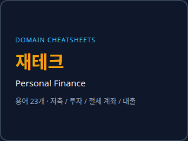</a><br><b><a href="cheatsheets/personal-finance.md">재테크 · Personal Finance</a></b> <sub>용어 23개</sub><br><sub>저축·투자·절세 계좌·대출을 AI에게 물어보기 전에 맞춰 두는 개인 돈 관리 용어</sub></td>
<td width="50%" valign="top"><a href="cheatsheets/real-estate.md">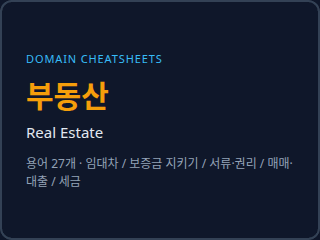</a><br><b><a href="cheatsheets/real-estate.md">부동산 · Real Estate</a></b> <sub>용어 27개</sub><br><sub>전·월세 계약, 전세사기 예방, 내 집 마련 때 AI·공인중개사·세무사와 같은 말로 이야기하기 위한 부동산 기본 용어</sub></td>
</tr>
<tr>
<td width="50%" valign="top"><a href="cheatsheets/stocks.md">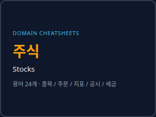</a><br><b><a href="cheatsheets/stocks.md">주식 · Stocks</a></b> <sub>용어 24개</sub><br><sub>국내 주식을 사고팔 때 AI와 말이 통하도록 맞추는 종목·주문·지표·공시·세금 용어</sub></td>
</tr>
</table>

### 전문 분야

<table>
<tr>
<td width="50%" valign="top"><a href="cheatsheets/accounting.md">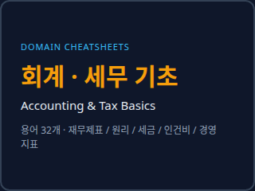</a><br><b><a href="cheatsheets/accounting.md">회계 · 세무 기초 · Accounting &amp; Tax Basics</a></b> <sub>용어 32개</sub><br><sub>재무제표를 읽고, 세무사와 대화하고, AI에게 장부·대시보드를 시킬 때 필요한 회계·세무 기본 용어</sub></td>
<td width="50%" valign="top"><a href="cheatsheets/construction.md">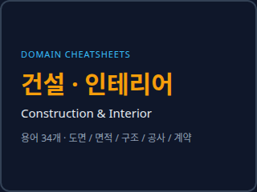</a><br><b><a href="cheatsheets/construction.md">건설 · 인테리어 · Construction &amp; Interior</a></b> <sub>용어 34개</sub><br><sub>가게·집 공사, 작은 건물 신축, 시공사 견적서·도면을 볼 때 쓰는 도면·면적·구조·마감·계약 용어</sub></td>
</tr>
<tr>
<td width="50%" valign="top"><a href="cheatsheets/fashion.md">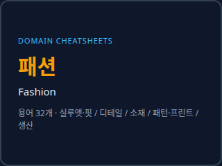</a><br><b><a href="cheatsheets/fashion.md">패션 · Fashion</a></b> <sub>용어 32개</sub><br><sub>옷을 AI 이미지 생성기·스타일리스트·봉제 공장에 정확히 설명해야 할 때 쓰는 실루엣·디테일·소재·무늬·생산 용어</sub></td>
<td width="50%" valign="top"><a href="cheatsheets/labor-hr.md">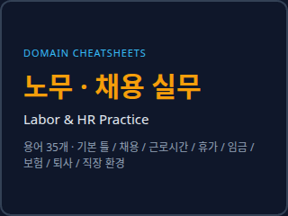</a><br><b><a href="cheatsheets/labor-hr.md">노무 · 채용 실무 · Labor &amp; HR Practice</a></b> <sub>용어 35개</sub><br><sub>직원·알바를 뽑고 급여를 줄 때 AI에게 근로계약서·주휴수당·연장수당·연차·임금명세서를 시키려고 쓰는 노무 용어 (5명 미만 사업장 기준 포함)</sub></td>
</tr>
<tr>
<td width="50%" valign="top"><a href="cheatsheets/law.md">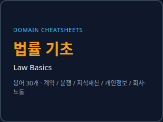</a><br><b><a href="cheatsheets/law.md">법률 기초 · Law Basics</a></b> <sub>용어 30개</sub><br><sub>계약·분쟁·지식재산·개인정보·사업 관련 법률 용어를 모를 때, AI나 변호사에게 정확히 말하기 위해 여는 시트</sub></td>
</tr>
</table>

<!-- index:end -->

## 이렇게 쓰세요

**1. 사람이 직접 볼 때**
도메인 시트를 열고 그림을 훑어 원하는 모양을 찾습니다. 용어 아래 `AI에게 이렇게` 문장을 복사해 AI에게 보냅니다.

**2. AI에게 시트를 같이 주고 싶을 때**
시트 링크나 파일 내용을 대화에 붙이고 이렇게 말합니다.

```text
이 치트시트의 용어로 내 요청을 다시 정리해 줘.
모르는 부분은 시트의 '확인 질문'을 참고해서 먼저 물어보고, 정리가 끝나면 작업을 시작해.
```

**3. 에이전트가 직접 찾게 할 때 (MCP)**
Claude, Cursor, Codex 같은 MCP 클라이언트에 이 저장소의 MCP 서버를 연결하면, 에이전트가 필요한 용어를 스스로 검색합니다.

```json
{
  "mcpServers": {
    "domain-cheatsheets": {
      "command": "node",
      "args": ["/path/to/domain-cheatsheets/mcp-server/dist/src/stdio.js"]
    }
  }
}
```

설치와 HTTP 서버 실행 방법은 [mcp-server/README.md](mcp-server/README.md)에 있습니다.

## 저장소 구조

```text
README.md            ← 지금 이 페이지 (도메인 목록)
cheatsheets/         ← 도메인별 시트. 파일 하나에 그 도메인의 모든 용어
assets/<도메인>/     ← 시트에 들어가는 그림 (SVG)
assets/previews/     ← 위 목록의 시트별 미리보기 GIF (자동 생성)
docs/                ← 작성 규칙(FORMAT), 템플릿, 그림·영상 가이드
mcp-server/          ← AI 에이전트용 MCP 서버 (stdio · Streamable HTTP)
```

## 기여하기

새 도메인이나 용어를 추가하고 싶다면 [CONTRIBUTING.md](CONTRIBUTING.md)와 [작성 규칙](docs/FORMAT.md)을 봐 주세요.
그림과 영상 규칙은 [docs/MEDIA.md](docs/MEDIA.md)에 있습니다.

## 주의

법, 회계, 건설처럼 전문 분야 시트는 용어를 이해하고 대화하기 위한 참고 자료입니다.
법률·세무·회계·안전 판단을 대신하지 않으니, 실제 결정은 해당 분야 전문가와 확인하세요.

## 라이선스

[Apache License 2.0](LICENSE) · Made by [마피아나초](https://mafianacho.com)
