# 3D 모델링 치트시트

> 게임, 웹 3D, 제품 시각화, 3D 프린팅용 모델을 만들거나 주문할 때 펼치세요. "좀 더 부드럽게", "가볍게 해줘" 같은 말을 정확한 용어로 바꿔 줍니다.

## 이렇게 쓰세요

- **나 → AI**: "웹 쇼핑몰에서 돌려볼 의자 3D 모델이 필요해. 폴리카운트는 2만 삼각형 이하, 텍스처는 PBR, 파일은 GLB로 줘."
- **AI → 나**: "게임 엔진용인가요, 웹 뷰어용인가요? 그리고 캐릭터처럼 뼈대(Rigging)와 애니메이션이 필요한가요, 움직이지 않는 소품인가요?"
- **나 → AI**: "지금 모델이 각져 보여. Subdivision Surface로 부드럽게 하되, Polycount는 그대로 두고 싶으면 Smooth Shading만 켜줘."
- **AI → 나**: "각진 건 면 수가 적어서인지(실루엣), 음영 때문인지(셰이딩) 구분이 필요해요. 윤곽선까지 각져 보이면 면을 늘리고, 면만 각져 보이면 Smooth Shading으로 해결됩니다."

## 한눈에 보기

<!-- overview:start -->
<!-- 이 구역은 자동 생성됩니다. 직접 고치지 말고 `cd mcp-server && npm run generate`를 실행하세요. -->

**기본 구조 · Geometry** (8)

<table>
<tr>
<td width="33%" valign="top"><a href="#vertex--꼭짓점-버텍스">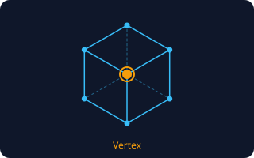</a> <b><a href="#vertex--꼭짓점-버텍스">Vertex</a></b> 꼭짓점 (버텍스) 3D 공간의 점 하나. 모든 3D 모양은 이 점들을 이어서 만든다.</td>
<td width="33%" valign="top"><a href="#edge--모서리-엣지">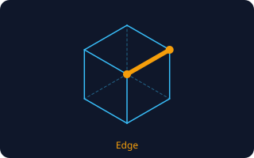</a> <b><a href="#edge--모서리-엣지">Edge</a></b> 모서리 (엣지) 꼭짓점 두 개를 잇는 선. 물건의 각진 경계가 여기서 생긴다.</td>
<td width="33%" valign="top"><a href="#face--polygon--면-폴리곤">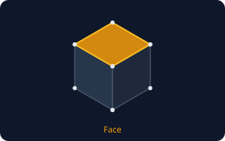</a> <b><a href="#face--polygon--면-폴리곤">Face / Polygon</a></b> 면 (폴리곤) 모서리로 둘러싸인 얇은 판 하나. 3D 모델의 겉면은 이런 판을 수없이 붙여서 만든다. 삼각형(Tri)이나 사각형(Quad)이 많이 쓰인다.</td>
</tr>
<tr>
<td width="33%" valign="top"><a href="#mesh--메시">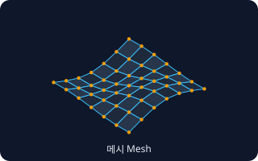</a> <b><a href="#mesh--메시">Mesh</a></b> 메시 꼭짓점·모서리·면이 모여 만든 3D 모양 덩어리. 보통 &quot;3D 모델&quot;이라고 부르는 것의 실체.</td>
<td width="33%" valign="top"><a href="#topology--토폴로지">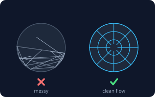</a> <b><a href="#topology--토폴로지">Topology</a></b> 토폴로지 면과 선이 어떤 방향·배치로 깔려 있는지, 그 짜임새. 같은 모양이라도 짜임새가 나쁘면 구부릴 때 찌그러진다.</td>
<td width="33%" valign="top"><a href="#low-poly--high-poly--로우폴리--하이폴리">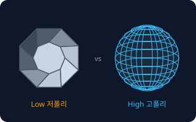</a> <b><a href="#low-poly--high-poly--로우폴리--하이폴리">Low Poly / High Poly</a></b> 로우폴리 / 하이폴리 면이 적고 가벼운 모델이 Low Poly, 면이 아주 많고 정교한 모델이 High Poly. 게임·웹은 가벼운 Low, 영화·조각은 High를 쓴다.</td>
</tr>
<tr>
<td width="33%" valign="top"><a href="#subdivision-surface--서브디비전-서피스">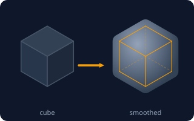</a> <b><a href="#subdivision-surface--서브디비전-서피스">Subdivision Surface</a></b> 서브디비전 서피스 각진 거친 모양의 면을 자동으로 잘게 쪼개 둥글고 매끈하게 만드는 기능. 거친 틀(Cage)을 조금 만지면 매끈한 결과가 바뀐다.</td>
<td width="33%" valign="top"><a href="#normal--노멀-법선">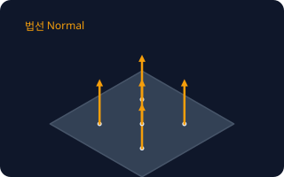</a> <b><a href="#normal--노멀-법선">Normal</a></b> 노멀 (법선) 면이 어느 쪽을 바라보는지 알려주는 화살표. 빛이 어디에 부딪히는지 계산할 때 쓰인다. 뒤집히면 모델이 구멍 난 것처럼 보인다.</td>
</tr>
</table>

**표면 · Surface** (7)

<table>
<tr>
<td width="33%" valign="top"><a href="#uv-unwrapping--uv-펼치기">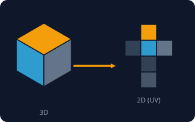</a> <b><a href="#uv-unwrapping--uv-펼치기">UV Unwrapping</a></b> UV 펼치기 입체 모델의 겉면을 종이처럼 평평하게 펼쳐서, 어느 부분에 그림의 어디가 붙을지 정하는 작업. 펼쳐진 판을 UV 맵이라고 한다.</td>
<td width="33%" valign="top"><a href="#texture--텍스처">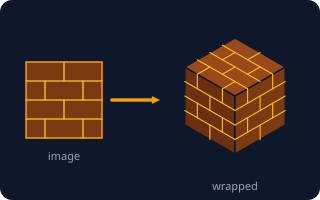</a> <b><a href="#texture--텍스처">Texture</a></b> 텍스처 3D 모델의 겉면에 입히는 그림 파일. 색, 무늬, 얼룩 등을 표현한다.</td>
<td width="33%" valign="top"><a href="#material--머티리얼-재질">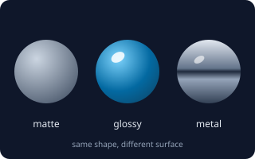</a> <b><a href="#material--머티리얼-재질">Material</a></b> 머티리얼 (재질) 모델의 겉이 어떤 재질로 보일지 정하는 설정 묶음. 색, 반짝임, 금속 느낌, 투명도 등이 들어간다.</td>
</tr>
<tr>
<td width="33%" valign="top"><a href="#pbr--물리-기반-렌더링">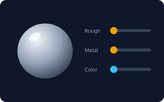</a> <b><a href="#pbr--물리-기반-렌더링">PBR</a></b> 물리 기반 렌더링 실제 물리 법칙에 맞춰 재질을 표현하는 현재 표준 방식. 색(Base Color), 거칠기(Roughness), 금속성(Metallic) 같은 값으로 소재를 정한다.</td>
<td width="33%" valign="top"><a href="#normal-map--노멀-맵">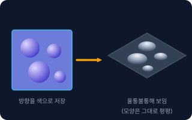</a> <b><a href="#normal-map--노멀-맵">Normal Map</a></b> 노멀 맵 모양은 평평한 채로 빛이 닿을 때만 울퉁불퉁하게 보이게 만드는 그림. 면 수를 늘리지 않고 디테일을 흉내 낸다.</td>
<td width="33%" valign="top"><a href="#baking--베이킹">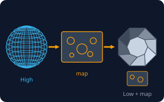</a> <b><a href="#baking--베이킹">Baking</a></b> 베이킹 복잡한 계산 결과(디테일, 그림자, 빛)를 미리 그림 파일로 구워 두는 작업. 정교한 모델의 디테일을 가벼운 모델에 옮길 때 가장 많이 쓴다.</td>
</tr>
<tr>
<td width="33%" valign="top"><a href="#flat--smooth-shading--플랫--스무스-셰이딩">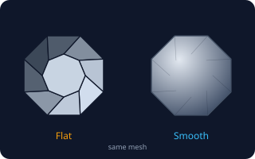</a> <b><a href="#flat--smooth-shading--플랫--스무스-셰이딩">Flat / Smooth Shading</a></b> 플랫 / 스무스 셰이딩 면이 많지 않아도 음영을 어떻게 입히느냐에 따라 각져 보이거나(Flat) 매끈해 보이는(Smooth) 설정. 모양 자체는 바뀌지 않는다.</td>
</tr>
</table>

**움직임 · Rigging & Animation** (5)

<table>
<tr>
<td width="33%" valign="top"><a href="#pivot--origin--피벗--원점">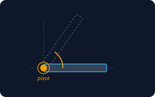</a> <b><a href="#pivot--origin--피벗--원점">Pivot / Origin</a></b> 피벗 / 원점 모델이 회전하고 크기가 바뀌고 놓이는 기준점. 문은 경첩, 바퀴는 중심에 기준점이 있어야 제대로 돌아간다.</td>
<td width="33%" valign="top"><a href="#bone--armature--본--아마추어">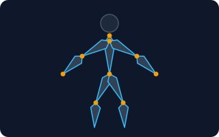</a> <b><a href="#bone--armature--본--아마추어">Bone / Armature</a></b> 본 / 아마추어 모델 안에 넣는 뼈대. 뼈를 구부리면 모델이 따라 움직이므로 캐릭터가 팔다리를 쓸 수 있다. 뼈를 넣는 작업을 리깅(Rigging)이라고 한다.</td>
<td width="33%" valign="top"><a href="#skinning--weight-paint--스키닝--웨이트-페인트">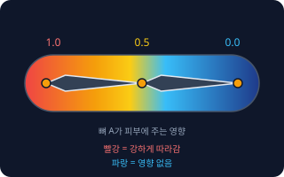</a> <b><a href="#skinning--weight-paint--스키닝--웨이트-페인트">Skinning / Weight Paint</a></b> 스키닝 / 웨이트 페인트 어느 뼈가 피부의 어느 부분을 얼마나 끌고 갈지 정하는 작업. 빨강은 강하게 따라가고 파랑은 무시한다.</td>
</tr>
<tr>
<td width="33%" valign="top"><a href="#blend-shape--블렌드-셰이프"></a> <b><a href="#blend-shape--블렌드-셰이프">Blend Shape</a></b> 블렌드 셰이프 모양 A와 모양 B를 저장해 두고, 슬라이더 값(0~1)으로 둘 사이를 섞는 기능. 표정을 만들 때 가장 많이 쓴다. Shape Key, Morph Target이라고도 부른다.</td>
<td width="33%" valign="top"><a href="#keyframe--키프레임">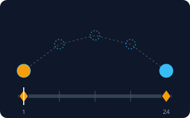</a> <b><a href="#keyframe--키프레임">Keyframe</a></b> 키프레임 애니메이션에서 '여기서는 이 위치·자세'라고 직접 찍어 두는 핵심 순간. 키프레임 사이는 프로그램이 알아서 채운다.</td>
</tr>
</table>

**장면 · Scene & Render** (4)

<table>
<tr>
<td width="33%" valign="top"><a href="#three-point-lighting--3점-조명">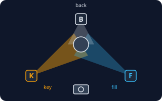</a> <b><a href="#three-point-lighting--3점-조명">Three-Point Lighting</a></b> 3점 조명 메인 빛(Key), 그림자를 부드럽게 해 주는 보조 빛(Fill), 윤곽을 살리는 뒷빛(Back/Rim) 세 개로 물체를 잘 보이게 하는 기본 조명법.</td>
<td width="33%" valign="top"><a href="#hdri--hdri-환경-조명-이미지">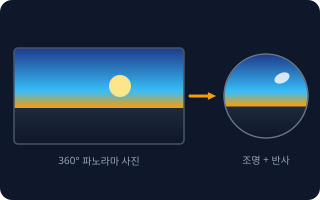</a> <b><a href="#hdri--hdri-환경-조명-이미지">HDRI</a></b> HDRI (환경 조명 이미지) 하늘이나 방 안을 360도로 찍은 고화질 사진으로, 장면의 빛과 반사를 한 번에 정해 준다. 이 사진 한 장으로 해질녘이나 스튜디오 분위기가 바로 난다.</td>
<td width="33%" valign="top"><a href="#field-of-view--시야각-fov">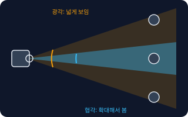</a> <b><a href="#field-of-view--시야각-fov">Field of View</a></b> 시야각 (FOV) 카메라가 한 번에 보는 범위의 각도. 각도가 넓으면 많이 보이고 왜곡이 생기며, 좁으면 확대된 듯 평평하게 보인다.</td>
</tr>
<tr>
<td width="33%" valign="top"><a href="#real-time-vs-offline-render--실시간-렌더--오프라인-렌더">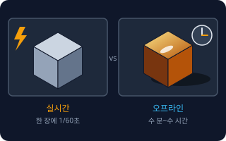</a> <b><a href="#real-time-vs-offline-render--실시간-렌더--오프라인-렌더">Real-time vs Offline Render</a></b> 실시간 렌더 / 오프라인 렌더 실시간 렌더는 게임처럼 1초에 수십 장을 즉시 그려 내는 방식, 오프라인 렌더는 한 장을 몇 분~몇 시간 들여 사실적으로 계산하는 방식.</td>
</tr>
</table>

**파일·최적화 · Files & Optimization** (6)

<table>
<tr>
<td width="33%" valign="top"><a href="#polycount--폴리카운트">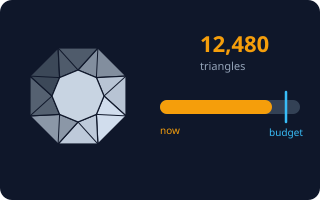</a> <b><a href="#polycount--폴리카운트">Polycount</a></b> 폴리카운트 모델이 가진 면(삼각형)의 개수. 숫자가 클수록 정교하지만 무거워서 느려진다.</td>
<td width="33%" valign="top"><a href="#retopology--리토폴로지">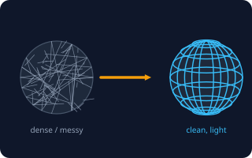</a> <b><a href="#retopology--리토폴로지">Retopology</a></b> 리토폴로지 너무 빽빽하거나 엉망으로 만들어진 모델 위에 깔끔하고 가벼운 면을 새로 깔아 다시 만드는 작업. AI 생성 3D나 스캔 결과를 쓸 수 있게 고칠 때 필수다.</td>
<td width="33%" valign="top"><a href="#lod--레벨-오브-디테일">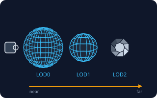</a> <b><a href="#lod--레벨-오브-디테일">LOD</a></b> 레벨 오브 디테일 같은 모델을 정교한 것부터 단순한 것까지 여러 개 만들어, 멀리 있을수록 가벼운 버전으로 바꿔 보여주는 방식. LOD0이 가장 정교하다.</td>
</tr>
<tr>
<td width="33%" valign="top"><a href="#gltf--glb--gltf--glb">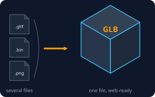</a> <b><a href="#gltf--glb--gltf--glb">glTF / GLB</a></b> glTF / GLB 웹과 AR에 가장 널리 쓰는 3D 파일 형식. glTF는 여러 파일(.gltf + .bin + 이미지)로 나뉘고, GLB는 이를 파일 하나로 묶은 것이라 주고받기 쉽다.</td>
<td width="33%" valign="top"><a href="#fbx--fbx">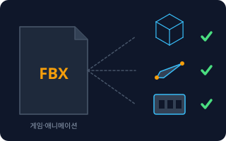</a> <b><a href="#fbx--fbx">FBX</a></b> FBX 게임과 영상 제작에서 많이 쓰는 3D 파일 형식. 모양뿐 아니라 뼈대, 애니메이션, 재질 정보까지 한 번에 담을 수 있다.</td>
<td width="33%" valign="top"><a href="#obj--obj">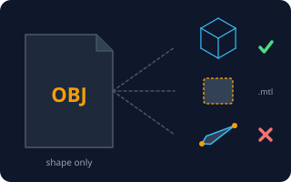</a> <b><a href="#obj--obj">OBJ</a></b> OBJ 오래되고 단순한 3D 파일 형식. 모양(꼭짓점·면)만 확실히 담고, 재질은 별도 .mtl 파일에 둔다. 뼈대와 애니메이션은 담을 수 없다.</td>
</tr>
</table>

<!-- overview:end -->

## 기본 구조 · Geometry

### Vertex · 꼭짓점 (버텍스)

- **정의**: 3D 공간의 점 하나. 모든 3D 모양은 이 점들을 이어서 만든다.
- **AI에게 이렇게**: "이 모델의 꼭짓점 몇 개를 위로 당겨서 코를 더 뾰족하게 만들어줘"
- **언제**: 모양을 아주 세밀하게 고칠 때
- **헷갈림**: Edge, Face — 점은 Vertex, 점 둘을 잇는 선은 Edge, 선으로 둘러싼 판은 Face
- **관련**: Edge, Face / Polygon, Mesh
- **확인 질문**: 어느 부분의 모양을 어떻게 바꾸고 싶은가요? (전체 비율인지, 일부 디테일인지)

### Edge · 모서리 (엣지)

- **정의**: 꼭짓점 두 개를 잇는 선. 물건의 각진 경계가 여기서 생긴다.
- **AI에게 이렇게**: "테이블 가장자리 모서리를 살짝 둥글게 깎아줘 (Bevel)"
- **언제**: 모서리를 둥글리거나 날카롭게 정의할 때
- **헷갈림**: Edge Loop — 모서리가 고리처럼 이어진 한 줄. 얼굴의 입술 둘레처럼 모양의 흐름을 만든다
- **관련**: Vertex, Face / Polygon, Topology
- **확인 질문**: 모서리를 둥글게 할 건가요, 각지게 둘 건가요? 둥글기는 어느 정도인가요?

### Face / Polygon · 면 (폴리곤)

- **정의**: 모서리로 둘러싸인 얇은 판 하나. 3D 모델의 겉면은 이런 판을 수없이 붙여서 만든다. 삼각형(Tri)이나 사각형(Quad)이 많이 쓰인다.
- **AI에게 이렇게**: "모델을 전부 삼각형 면으로 바꿔서 게임 엔진에 넣을 수 있게 내보내줘"
- **언제**: 면 수(폴리카운트)를 세거나 줄일 때
- **헷갈림**: Tri vs Quad — 삼각형 면은 게임 엔진이 바로 쓰고, 사각형 면은 모델링·부드럽게 만들기에 편하다
- **관련**: Polycount, Mesh, Topology
- **확인 질문**: 삼각형(Tri)과 사각형(Quad) 중 어떤 면으로 넘겨야 하나요?

### Mesh · 메시

- **정의**: 꼭짓점·모서리·면이 모여 만든 3D 모양 덩어리. 보통 "3D 모델"이라고 부르는 것의 실체.
- **AI에게 이렇게**: "이 두 메시를 하나로 합쳐서 오브젝트 하나로 내보내줘"
- **언제**: 모델 하나를 가리킬 때, 합치거나 나눌 때
- **헷갈림**: Model, Object — 일상에서는 같은 뜻으로 쓰지만, Mesh는 '모양 데이터', 모델은 모양+재질+뼈대까지 포함한 말
- **관련**: Vertex, Face / Polygon, Topology
- **확인 질문**: 하나로 합칠까요, 부품별로 나눠서 줄까요?

### Topology · 토폴로지

- **정의**: 면과 선이 어떤 방향·배치로 깔려 있는지, 그 짜임새. 같은 모양이라도 짜임새가 나쁘면 구부릴 때 찌그러진다.
- **AI에게 이렇게**: "표정 애니메이션을 넣을 거라 눈과 입 주변은 선이 고리 모양으로 흐르게 토폴로지를 정리해줘"
- **언제**: 캐릭터를 움직이거나 부드럽게 만들 모델을 주문·검수할 때
- **헷갈림**: Polycount — 면의 '개수'는 폴리카운트, '배치와 흐름'은 토폴로지. 개수가 같아도 토폴로지는 다를 수 있다
- **관련**: Retopology, Edge, Subdivision Surface
- **확인 질문**: 이 모델은 움직이거나 변형되나요, 아니면 가만히 있는 소품인가요?

### Low Poly / High Poly · 로우폴리 / 하이폴리

- **정의**: 면이 적고 가벼운 모델이 Low Poly, 면이 아주 많고 정교한 모델이 High Poly. 게임·웹은 가벼운 Low, 영화·조각은 High를 쓴다.
- **AI에게 이렇게**: "모바일 게임용으로 로우폴리 스타일의 나무 모델을 만들어줘. 삼각형 5천 개 이하로"
- **언제**: 성능이 중요한 곳과 화질이 중요한 곳을 구분할 때
- **헷갈림**: 스타일 vs 성능 — '로우폴리 스타일'(일부러 각진 디자인)과 '성능을 위해 면을 줄인 것'은 다른 이야기
- **관련**: Polycount, Baking, Retopology
- **확인 질문**: 로우폴리를 디자인 스타일로 원하나요, 아니면 성능 때문에 가볍게 만들고 싶은 건가요?

### Subdivision Surface · 서브디비전 서피스

- **정의**: 각진 거친 모양의 면을 자동으로 잘게 쪼개 둥글고 매끈하게 만드는 기능. 거친 틀(Cage)을 조금 만지면 매끈한 결과가 바뀐다.
- **AI에게 이렇게**: "이 거친 모델에 Subdivision Surface를 2단계 적용해서 부드럽게 만들어줘"
- **언제**: 캐릭터, 자동차, 제품처럼 곡면이 많은 모델
- **헷갈림**: Smooth Shading — Subdivision은 면을 실제로 늘려 모양을 바꾸고, Smooth Shading은 면 수는 그대로 음영만 부드럽게 보이게 한다
- **관련**: Topology, Polycount, Flat / Smooth Shading
- **확인 질문**: 몇 단계까지 쪼갤까요? 단계가 올라가면 면 수가 4배씩 늘어납니다.

### Normal · 노멀 (법선)

- **정의**: 면이 어느 쪽을 바라보는지 알려주는 화살표. 빛이 어디에 부딪히는지 계산할 때 쓰인다. 뒤집히면 모델이 구멍 난 것처럼 보인다.
- **AI에게 이렇게**: "모델이 일부 어둡게 구멍 난 것처럼 보여. 뒤집힌 노멀을 찾아서 바깥쪽으로 맞춰줘"
- **언제**: 모델에 검은 얼룩이나 투명하게 뚫린 부분이 보일 때
- **헷갈림**: Normal Map — 노멀은 면 하나가 바라보는 방향, 노멀 맵은 가짜 요철을 만들기 위한 그림 파일
- **관련**: Normal Map, Flat / Smooth Shading, Face / Polygon
- **확인 질문**: 어디가 이상하게 보이나요? 어느 각도에서 보이는지 알려주세요.

## 표면 · Surface

### UV Unwrapping · UV 펼치기

- **정의**: 입체 모델의 겉면을 종이처럼 평평하게 펼쳐서, 어느 부분에 그림의 어디가 붙을지 정하는 작업. 펼쳐진 판을 UV 맵이라고 한다.
- **AI에게 이렇게**: "이 캐릭터를 UV 펼치기 해서, 얼굴이 텍스처에서 가장 크게 차지하도록 배치해줘"
- **언제**: 그림이나 색을 3D 모델에 입히기 전
- **헷갈림**: Texture — UV는 '어디에 붙일지 지도', Texture는 '붙일 그림'
- **관련**: Texture, Baking, Material
- **확인 질문**: 텍스처 크기(예: 2048×2048)가 정해져 있나요? 눈에 잘 띄는 부분은 어디인가요?

### Texture · 텍스처

- **정의**: 3D 모델의 겉면에 입히는 그림 파일. 색, 무늬, 얼룩 등을 표현한다.
- **AI에게 이렇게**: "오래된 나무 상자처럼 보이게 텍스처를 입혀줘. 해상도는 2K로"
- **언제**: 단색 모델에 디테일을 더하고 싶을 때
- **헷갈림**: Material — 텍스처는 '그림 한 장', 머티리얼은 그림 여러 장과 반짝임 같은 성질을 묶은 '재질 설정'
- **관련**: UV Unwrapping, Material, PBR
- **확인 질문**: 텍스처가 반복되는 타일형인가요, 모델 하나에 맞춰 그리는 건가요? 해상도는 얼마인가요?

### Material · 머티리얼 (재질)

- **정의**: 모델의 겉이 어떤 재질로 보일지 정하는 설정 묶음. 색, 반짝임, 금속 느낌, 투명도 등이 들어간다.
- **AI에게 이렇게**: "이 컵은 반투명한 유리 재질로, 손잡이는 무광 검정 플라스틱으로 따로 설정해줘"
- **언제**: 같은 모양인데 소재만 바꾸고 싶을 때
- **헷갈림**: Shader — 재질을 계산해 화면에 그려 주는 프로그램. 보통은 머티리얼 설정만 신경 쓰면 된다
- **관련**: Texture, PBR, HDRI
- **확인 질문**: 부분마다 다른 재질이 필요한가요, 모델 전체 하나로 충분한가요?

### PBR · 물리 기반 렌더링

- **정의**: 실제 물리 법칙에 맞춰 재질을 표현하는 현재 표준 방식. 색(Base Color), 거칠기(Roughness), 금속성(Metallic) 같은 값으로 소재를 정한다.
- **AI에게 이렇게**: "PBR 재질로 만들어줘. 거칠기 0.3, 금속성 1.0으로 광택 있는 금속 느낌"
- **언제**: 게임, 웹 3D, AI 3D 생성 결과물 등 대부분의 현대 3D
- **헷갈림**: Roughness와 Glossiness — 서로 반대 값이다. 거칠기가 높으면 흐릿하게 퍼져 보이고, 낮으면 거울처럼 반짝인다
- **관련**: Material, Texture, HDRI
- **확인 질문**: 쓰는 프로그램이 PBR을 지원하나요? 필요한 텍스처 맵은 어떤 것들(Base Color, Roughness, Metallic, Normal)인가요?

### Normal Map · 노멀 맵

- **정의**: 모양은 평평한 채로 빛이 닿을 때만 울퉁불퉁하게 보이게 만드는 그림. 면 수를 늘리지 않고 디테일을 흉내 낸다.
- **AI에게 이렇게**: "돌벽에 거친 질감이 보이도록 노멀 맵을 만들어서 로우폴리 벽에 적용해줘"
- **언제**: 가벼운 모델에 주름·벽돌·가죽 질감을 더할 때
- **헷갈림**: Displacement — 노멀 맵은 빛 계산만 속이고 윤곽은 평평하다. 디스플레이스먼트는 실제로 모양을 변형한다
- **관련**: Normal, Baking, Low Poly / High Poly
- **확인 질문**: 윤곽까지 울퉁불퉁해야 하나요, 표면 질감 정도면 되나요?

### Baking · 베이킹

- **정의**: 복잡한 계산 결과(디테일, 그림자, 빛)를 미리 그림 파일로 구워 두는 작업. 정교한 모델의 디테일을 가벼운 모델에 옮길 때 가장 많이 쓴다.
- **AI에게 이렇게**: "하이폴리 조각 모델의 디테일을 로우폴리 모델로 노멀 맵과 AO 맵으로 베이킹해줘"
- **언제**: 게임용 모델을 만들 때, 실시간 렌더 비용을 줄일 때
- **헷갈림**: Rendering — 렌더링은 최종 화면 이미지를 만드는 것, 베이킹은 나중에 쓸 재료를 미리 만드는 것
- **관련**: Normal Map, UV Unwrapping, Low Poly / High Poly
- **확인 질문**: 어떤 정보를 구울까요? (노멀, 그림자(AO), 색, 거칠기 등) 최종 해상도는요?

### Flat / Smooth Shading · 플랫 / 스무스 셰이딩

- **정의**: 면이 많지 않아도 음영을 어떻게 입히느냐에 따라 각져 보이거나(Flat) 매끈해 보이는(Smooth) 설정. 모양 자체는 바뀌지 않는다.
- **AI에게 이렇게**: "이 로우폴리 돌덩이는 Flat Shading으로 각진 느낌을 살리고, 몸통 둥근 부분만 Smooth Shading으로 바꿔줘"
- **언제**: 로우폴리 스타일을 살리거나 매끈하게 보이게 할 때
- **헷갈림**: Subdivision Surface — 셰이딩은 겉모습 처리, Subdivision은 실제 모양 변경
- **관련**: Normal, Subdivision Surface, Low Poly / High Poly
- **확인 질문**: 각진 느낌을 원하나요, 매끈한 느낌을 원하나요? 부분마다 다르게 할까요?

## 움직임 · Rigging & Animation

### Pivot / Origin · 피벗 / 원점

- **정의**: 모델이 회전하고 크기가 바뀌고 놓이는 기준점. 문은 경첩, 바퀴는 중심에 기준점이 있어야 제대로 돌아간다.
- **AI에게 이렇게**: "문 모델의 피벗을 경첩 쪽 아래 모서리로 옮겨서 문이 90도 열리게 해줘"
- **언제**: 문, 바퀴, 시계 바늘처럼 돌아가는 부품을 만들 때, 엔진에 넣었는데 이상한 위치에서 돌 때
- **헷갈림**: World Origin — 피벗은 모델 하나의 기준점, 월드 원점은 장면 전체의 (0,0,0) 기준점
- **관련**: Bone / Armature, Keyframe
- **확인 질문**: 어느 점을 축으로 회전해야 하나요? 모델이 바닥에 놓일 때 기준은 바닥인가요, 중심인가요?

### Bone / Armature · 본 / 아마추어

- **정의**: 모델 안에 넣는 뼈대. 뼈를 구부리면 모델이 따라 움직이므로 캐릭터가 팔다리를 쓸 수 있다. 뼈를 넣는 작업을 리깅(Rigging)이라고 한다.
- **AI에게 이렇게**: "이 캐릭터에 사람형 리그(휴머노이드 뼈대)를 넣어서 걷기 애니메이션을 쓸 수 있게 해줘"
- **언제**: 캐릭터나 동물, 문어처럼 몸이 휘는 모델
- **헷갈림**: Rig vs Skeleton — 뼈대만 있으면 Skeleton, 뼈대에 조종 장치(손잡이)까지 갖추면 Rig라고 부르는 경우가 많다
- **관련**: Skinning / Weight Paint, Keyframe, Pivot / Origin
- **확인 질문**: 사람형인가요, 동물형인가요? 게임 엔진 표준 뼈대(예: Mixamo, Unity Humanoid)에 맞춰야 하나요?

### Skinning / Weight Paint · 스키닝 / 웨이트 페인트

- **정의**: 어느 뼈가 피부의 어느 부분을 얼마나 끌고 갈지 정하는 작업. 빨강은 강하게 따라가고 파랑은 무시한다.
- **AI에게 이렇게**: "팔꿈치를 구부릴 때 살이 접히며 찌그러져. 팔꿈치 주변 웨이트를 부드럽게 다시 칠해줘"
- **언제**: 관절을 구부렸을 때 모델이 이상하게 늘어나거나 찌그러질 때
- **헷갈림**: Rigging — 뼈를 넣는 단계가 리깅, 뼈와 피부를 연결하는 단계가 스키닝. 둘은 순서대로 한다
- **관련**: Bone / Armature, Topology, Blend Shape
- **확인 질문**: 어느 관절이 어떻게 이상한가요? 어느 동작(팔 올리기, 앉기 등)에서 그런가요?

### Blend Shape · 블렌드 셰이프

- **정의**: 모양 A와 모양 B를 저장해 두고, 슬라이더 값(0~1)으로 둘 사이를 섞는 기능. 표정을 만들 때 가장 많이 쓴다. Shape Key, Morph Target이라고도 부른다.
- **AI에게 이렇게**: "캐릭터 얼굴에 웃음, 눈 깜빡임, 'ㅏ' 입 모양 블렌드 셰이프를 만들어서 슬라이더로 조절하게 해줘"
- **언제**: 표정, 립싱크, 근육 부풀림처럼 뼈로 만들기 어려운 변형
- **헷갈림**: Bone — 뼈는 관절을 회전시키는 움직임, 블렌드 셰이프는 모양 자체를 부드럽게 바꾸는 변형
- **관련**: Bone / Armature, Keyframe, Topology
- **확인 질문**: 어떤 표정이나 동작이 필요한가요? ARKit 표준 52개 표정 같은 규격이 필요한가요?

### Keyframe · 키프레임

- **정의**: 애니메이션에서 '여기서는 이 위치·자세'라고 직접 찍어 두는 핵심 순간. 키프레임 사이는 프로그램이 알아서 채운다.
- **AI에게 이렇게**: "1프레임에서 공이 바닥에 있고, 12프레임에서 가장 높이 올라가고, 24프레임에서 다시 내려오도록 키프레임을 찍어줘. 30fps로"
- **언제**: 로고 회전, 문 열림, 물체 이동 같은 애니메이션을 만들 때
- **헷갈림**: Frame — 프레임은 영상의 한 장면 전체, 키프레임은 그중 사람이 직접 지정한 핵심 장면
- **관련**: Pivot / Origin, Bone / Armature, Blend Shape
- **확인 질문**: 전체 길이는 몇 초이고 초당 몇 프레임(fps)인가요? 반복(루프)되나요?

## 장면 · Scene & Render

### Three-Point Lighting · 3점 조명

- **정의**: 메인 빛(Key), 그림자를 부드럽게 해 주는 보조 빛(Fill), 윤곽을 살리는 뒷빛(Back/Rim) 세 개로 물체를 잘 보이게 하는 기본 조명법.
- **AI에게 이렇게**: "제품 렌더용으로 3점 조명을 세팅해줘. 메인은 왼쪽 위 45도, 보조는 반대편에 약하게, 뒷빛으로 윤곽을 살려줘"
- **언제**: 제품 사진 같은 렌더, 캐릭터 소개 화면
- **헷갈림**: HDRI — 3점 조명은 조명을 직접 놓는 방식, HDRI는 주변 환경 사진 한 장으로 빛을 대신하는 방식
- **관련**: HDRI, Field of View, Material
- **확인 질문**: 분위기는 밝고 깨끗한 쪽인가요, 극적이고 어두운 쪽인가요?

### HDRI · HDRI (환경 조명 이미지)

- **정의**: 하늘이나 방 안을 360도로 찍은 고화질 사진으로, 장면의 빛과 반사를 한 번에 정해 준다. 이 사진 한 장으로 해질녘이나 스튜디오 분위기가 바로 난다.
- **AI에게 이렇게**: "차 모델 렌더에 야외 해질녘 HDRI를 쓰고, 배경은 흰색으로 숨겨서 반사만 남겨줘"
- **언제**: 사실적인 반사와 자연스러운 빛이 필요한 제품·자동차 렌더
- **헷갈림**: 배경 사진 — HDRI는 보이는 배경으로도 쓰지만 본래 목적은 빛을 주는 것. 배경만 숨기고 빛만 쓸 수 있다
- **관련**: Three-Point Lighting, Material, PBR
- **확인 질문**: 배경에도 HDRI가 보여야 하나요, 빛과 반사에만 쓸까요? 실내/야외 중 어떤 분위기인가요?

### Field of View · 시야각 (FOV)

- **정의**: 카메라가 한 번에 보는 범위의 각도. 각도가 넓으면 많이 보이고 왜곡이 생기며, 좁으면 확대된 듯 평평하게 보인다.
- **AI에게 이렇게**: "카메라 FOV를 90도에서 35도로 줄여서 제품이 왜곡 없이 가깝게 보이게 해줘"
- **언제**: 게임 카메라, 제품 렌더, 방 내부를 넓게 보여줄 때
- **헷갈림**: 초점거리(mm) — FOV와 같은 설정을 다른 단위로 말한 것. 초점거리가 짧을수록 FOV가 넓다 (예: 24mm=넓음, 85mm=좁음)
- **관련**: Three-Point Lighting, Real-time vs Offline Render
- **확인 질문**: 넓게 보여줄까요(공간감), 좁게 보여줄까요(제품 중심)? FOV는 도(°)와 mm 중 어느 단위로 드릴까요?

### Real-time vs Offline Render · 실시간 렌더 / 오프라인 렌더

- **정의**: 실시간 렌더는 게임처럼 1초에 수십 장을 즉시 그려 내는 방식, 오프라인 렌더는 한 장을 몇 분~몇 시간 들여 사실적으로 계산하는 방식.
- **AI에게 이렇게**: "웹에서 돌려볼 용도라 실시간 렌더로 가볍게 최적화해줘" / "광고용 정지 이미지라서 오프라인 렌더로 최고 화질로 뽑아줘"
- **언제**: 어느 쪽으로 만들지에 따라 모델의 무게와 재질 설정이 완전히 달라진다
- **헷갈림**: 같은 파일이라도 — 오프라인용 고화질 모델은 실시간 엔진에서 너무 무거울 수 있다. 용도를 먼저 정해야 한다
- **관련**: Polycount, LOD, HDRI
- **확인 질문**: 사용자가 직접 돌려보는 실시간 화면인가요, 완성된 이미지·영상 한 편인가요?

## 파일·최적화 · Files & Optimization

### Polycount · 폴리카운트

- **정의**: 모델이 가진 면(삼각형)의 개수. 숫자가 클수록 정교하지만 무거워서 느려진다.
- **AI에게 이렇게**: "이 소품의 폴리카운트를 삼각형 기준 3천 개 이하로 줄여줘. 윤곽은 최대한 유지하고"
- **언제**: 성능이 중요한 게임, 모바일, 웹 3D의 예산을 정할 때
- **헷갈림**: Tris vs Polys — 사각형 면 1개는 삼각형 2개. 프로그램마다 세는 방식이 다르니 어느 기준인지 꼭 정한다
- **관련**: LOD, Retopology, Low Poly / High Poly
- **확인 질문**: 삼각형 기준 몇 개가 한도인가요? 플랫폼(모바일/PC/웹)은 어디인가요?

### Retopology · 리토폴로지

- **정의**: 너무 빽빽하거나 엉망으로 만들어진 모델 위에 깔끔하고 가벼운 면을 새로 깔아 다시 만드는 작업. AI 생성 3D나 스캔 결과를 쓸 수 있게 고칠 때 필수다.
- **AI에게 이렇게**: "AI가 만든 이 메시는 면이 너무 지저분해. 리토폴로지로 사각형 위주의 깔끔한 모델로 다시 만들어줘"
- **언제**: 스캔 데이터, 조각 모델, AI 생성 모델을 애니메이션이나 게임에 쓸 때
- **헷갈림**: Decimate — 자동으로 면을 줄여 주지만 짜임새는 오히려 더 엉망일 수 있다. 리토폴로지는 짜임새까지 새로 만든다
- **관련**: Topology, Polycount, Baking
- **확인 질문**: 목표 면 수는 얼마인가요? 이 모델을 애니메이션에 쓰나요? (쓰면 관절 주변 선 흐름이 중요하다)

### LOD · 레벨 오브 디테일

- **정의**: 같은 모델을 정교한 것부터 단순한 것까지 여러 개 만들어, 멀리 있을수록 가벼운 버전으로 바꿔 보여주는 방식. LOD0이 가장 정교하다.
- **AI에게 이렇게**: "이 나무를 LOD0은 8천 삼각형, LOD1은 2천, LOD2는 500으로 단계별 버전을 만들어줘"
- **언제**: 게임 숲, 도시처럼 같은 물체가 많이 보이는 장면
- **헷갈림**: Level of Detail vs Level (게임 스테이지) — 여기서의 레벨은 정교함의 단계이지 게임 스테이지가 아니다
- **관련**: Polycount, Low Poly / High Poly, Retopology
- **확인 질문**: 몇 단계가 필요한가요? 각 단계로 바뀌는 거리 기준이 있나요?

### glTF / GLB · glTF / GLB

- **정의**: 웹과 AR에 가장 널리 쓰는 3D 파일 형식. glTF는 여러 파일(.gltf + .bin + 이미지)로 나뉘고, GLB는 이를 파일 하나로 묶은 것이라 주고받기 쉽다.
- **AI에게 이렇게**: "웹 쇼핑몰에 올릴 거라 GLB 파일 하나로 내보내줘. 텍스처는 PBR로 포함하고 용량은 5MB 이하로"
- **언제**: 웹 3D, AR, 모델 뷰어, 대부분의 AI 3D 생성 서비스 결과물
- **헷갈림**: glTF vs GLB — 내용은 같고 포장만 다르다. 하나만 보내야 하면 GLB를 고른다
- **관련**: FBX, OBJ, PBR
- **확인 질문**: 애니메이션이 필요한가요? 최대 용량은 얼마인가요?

### FBX · FBX

- **정의**: 게임과 영상 제작에서 많이 쓰는 3D 파일 형식. 모양뿐 아니라 뼈대, 애니메이션, 재질 정보까지 한 번에 담을 수 있다.
- **AI에게 이렇게**: "Unity에 넣을 거라 캐릭터와 걷기 애니메이션을 FBX로 내보내줘. 축 방향은 Y-up으로"
- **언제**: Unity·Unreal 같은 게임 엔진으로 캐릭터와 애니메이션을 옮길 때
- **헷갈림**: 단위·축 — FBX는 프로그램마다 크기 단위와 위 방향(Y-up/Z-up)이 달라 크기가 100배가 되거나 눕기도 한다
- **관련**: glTF / GLB, OBJ, Bone / Armature
- **확인 질문**: 어느 엔진이나 프로그램에서 열 건가요? 뼈대와 애니메이션도 포함하나요? 크기 단위는요?

### OBJ · OBJ

- **정의**: 오래되고 단순한 3D 파일 형식. 모양(꼭짓점·면)만 확실히 담고, 재질은 별도 .mtl 파일에 둔다. 뼈대와 애니메이션은 담을 수 없다.
- **AI에게 이렇게**: "움직이지 않는 소품이라 OBJ로 내보내줘. 재질 파일(.mtl)과 텍스처 이미지도 같이 줘"
- **언제**: 모양만 정확히 주고받을 때, 거의 모든 3D 프로그램에서 열어야 할 때
- **헷갈림**: STL — 3D 프린터용으로 모양만 담지만 색과 재질은 없다. OBJ는 색과 텍스처를 .mtl 파일로 함께 줄 수 있다
- **관련**: glTF / GLB, FBX, Mesh
- **확인 질문**: 재질과 텍스처도 필요한가요, 모양만 필요한가요?
