# 회계 · 세무 기초 치트시트

> 창업자·프리랜서·작은 가게 사장님이 재무제표를 읽고, 세무사와 말이 통하고, AI에게 엑셀·대시보드를 시킬 때 펼치는 시트입니다. 숫자를 계산하는 법보다 "이 말이 무슨 뜻인지"를 먼저 맞춥니다.

> **참고용입니다.** 대한민국 기준, 2026-11 기준. 세율·기준금액·신고 기한은 바뀔 수 있으니 세무·회계 판단은 세무사·회계사와 확인하세요.

## 이렇게 쓰세요

- **나 → AI**: "우리 카페 월별 매출, 매출원가, 판관비를 넣으면 매출총이익과 영업이익이 나오는 엑셀을 만들어줘. 손익계산서 순서대로."
- **AI → 나**: "매출은 부가세를 뺀 공급가액 기준인가요, 부가세가 포함된 금액인가요? 현금주의(입금일)로 볼까요, 발생주의(거래일)로 볼까요?"
- **나 → AI**: "프리랜서라서 3.3%를 떼고 입금받았어. 이 돈이 5월 종합소득세 신고에서 어떻게 정산되는지 쉬운 말로 설명해줘."
- **AI → 나**: "총 수입이 얼마인지, 경비로 증빙할 수 있는 지출이 있는지(세금계산서·현금영수증·카드 내역), 간이장부 대상인지부터 확인해도 될까요?"
- **나 → AI**: "내 통장 잔액이 줄고 있어. 월 고정비와 현재 현금으로 런웨이를 계산하는 대시보드를 만들어줘."

## 한눈에 보기

<!-- overview:start -->
<!-- 이 구역은 자동 생성됩니다. 직접 고치지 말고 `cd mcp-server && npm run generate`를 실행하세요. -->

**재무제표 · Financial Statements** (9)

<table>
<tr>
<td width="33%" valign="top"><a href="#balance-sheet--재무상태표">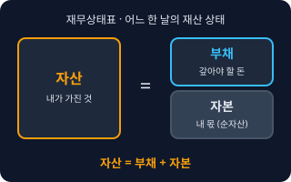</a> <b><a href="#balance-sheet--재무상태표">Balance Sheet</a></b> 재무상태표 어느 하루(결산일) 기준으로 회사가 무엇을 가졌고(자산), 얼마를 빌렸고(부채), 내 몫은 얼마인지(자본)를 보여주는 표. 예전 이름은 대차대조표다.</td>
<td width="33%" valign="top"><a href="#income-statement--손익계산서">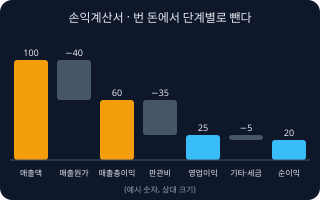</a> <b><a href="#income-statement--손익계산서">Income Statement</a></b> 손익계산서 일정 기간(한 달, 분기, 한 해) 동안 매출에서 비용을 단계별로 빼서 얼마가 남았는지 보여주는 표. 매출 → 매출총이익 → 영업이익 → 순이익 순서로 내려간다.</td>
<td width="33%" valign="top"><a href="#cash-flow-statement--현금흐름표">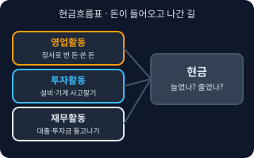</a> <b><a href="#cash-flow-statement--현금흐름표">Cash Flow Statement</a></b> 현금흐름표 일정 기간 동안 현금이 어디서 들어오고 어디로 나갔는지를 영업(장사)·투자(설비 등)·재무(대출·투자금) 세 갈래로 나눠 보여주는 표.</td>
</tr>
<tr>
<td width="33%" valign="top"><a href="#assets-liabilities-equity--자산부채자본">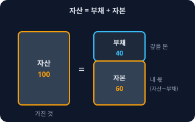</a> <b><a href="#assets-liabilities-equity--자산부채자본">Assets, Liabilities, Equity</a></b> 자산·부채·자본 자산은 회사가 가진 것(현금, 외상으로 받을 돈, 재고, 기계), 부채는 남에게 갚아야 할 돈(대출, 외상으로 산 값), 자본은 자산에서 부채를 뺀 내 몫이다. 항상 &quot;자산 = 부채 + 자본&quot;.</td>
<td width="33%" valign="top"><a href="#revenue--매출액">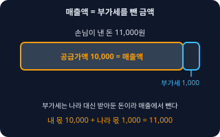</a> <b><a href="#revenue--매출액">Revenue</a></b> 매출액 물건이나 서비스를 팔아서 번 총금액. 비용을 빼기 전의 맨 윗줄 숫자다. 부가세는 나라 대신 받아둔 돈이라 일반적으로 매출에서 뺀 공급가액으로 본다.</td>
<td width="33%" valign="top"><a href="#cogs--매출원가">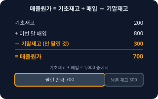</a> <b><a href="#cogs--매출원가">COGS</a></b> 매출원가 판매한 물건을 만들거나 사 오는 데 직접 든 비용. 커피 가게라면 판 만큼의 원두·우유·컵 값. 팔리지 않고 남은 재고는 여기 안 들어간다.</td>
</tr>
<tr>
<td width="33%" valign="top"><a href="#gross-profit--매출총이익">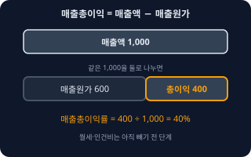</a> <b><a href="#gross-profit--매출총이익">Gross Profit</a></b> 매출총이익 매출액에서 매출원가를 뺀 돈. 물건 자체로 얼마를 남겼는지를 보여주고, 여기서 월세·인건비 같은 운영비를 빼기 전 단계다.</td>
<td width="33%" valign="top"><a href="#operating-income--영업이익">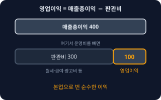</a> <b><a href="#operating-income--영업이익">Operating Income</a></b> 영업이익 매출총이익에서 판매비와관리비(월세, 직원 급여, 광고비 등 운영비)를 뺀 이익. 본업으로 번 순수한 이익이다.</td>
<td width="33%" valign="top"><a href="#net-income--당기순이익">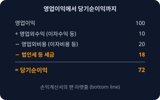</a> <b><a href="#net-income--당기순이익">Net Income</a></b> 당기순이익 모든 수익에서 모든 비용과 세금까지 뺀 뒤 최종으로 남는 이익. 손익계산서의 맨 아랫줄(bottom line)이다. 이번 회계기간에 나온 순이익이라 '당기'를 붙인다.</td>
</tr>
</table>

**원리 · Principles** (6)

<table>
<tr>
<td width="33%" valign="top"><a href="#accrual-vs-cash-basis--발생주의현금주의">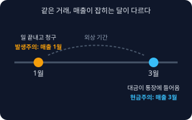</a> <b><a href="#accrual-vs-cash-basis--발생주의현금주의">Accrual vs Cash Basis</a></b> 발생주의·현금주의 발생주의는 거래가 생긴 때(일을 끝낸 때, 물건을 넘긴 때)에 매출·비용을 잡는 방식이고, 현금주의는 돈이 실제로 오간 때에 잡는 방식이다. 기업 회계는 기본적으로 발생주의다.</td>
<td width="33%" valign="top"><a href="#double-entry-bookkeeping--복식부기">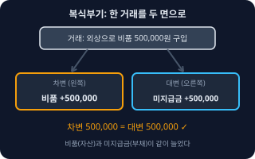</a> <b><a href="#double-entry-bookkeeping--복식부기">Double-entry Bookkeeping</a></b> 복식부기 모든 거래를 &quot;무엇이 늘고(또는 줄고) 그 대신 무엇이 변했는가&quot;의 두 면으로 기록하는 방식. 한 거래의 왼쪽(차변) 합계와 오른쪽(대변) 합계가 항상 같아서 틀린 곳을 찾기 쉽다.</td>
<td width="33%" valign="top"><a href="#debit-and-credit--차변과-대변">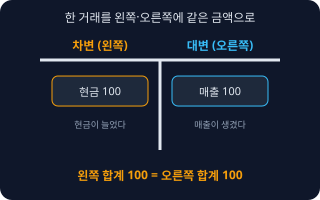</a> <b><a href="#debit-and-credit--차변과-대변">Debit and Credit</a></b> 차변과 대변 장부를 T자로 그렸을 때 왼쪽이 차변(Debit), 오른쪽이 대변(Credit)이다. 좋고 나쁨이 아니라 그냥 방향 이름이다. 자산은 늘면 차변, 부채·자본·수익은 늘면 대변에 적는다.</td>
</tr>
<tr>
<td width="33%" valign="top"><a href="#depreciation--감가상각">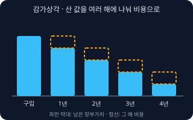</a> <b><a href="#depreciation--감가상각">Depreciation</a></b> 감가상각 오래 쓰는 물건(컴퓨터, 기계, 인테리어)을 샀을 때 산 값을 한 번에 비용으로 쓰지 않고 쓰는 기간에 나눠서 해마다 비용으로 넣는 것.</td>
<td width="33%" valign="top"><a href="#receivables-and-payables--미수금미지급금">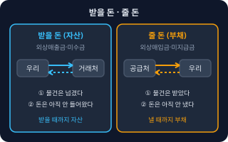</a> <b><a href="#receivables-and-payables--미수금미지급금">Receivables and Payables</a></b> 미수금·미지급금 받을 돈이 아직 안 들어온 것이 외상매출금·미수금(자산), 줄 돈을 아직 안 낸 것이 외상매입금·미지급금(부채)이다. 물건을 파는 본업의 외상이면 '외상', 본업 외 거래(비품 판매·구입 등)면 '미수금·미지급금'이라 부른다.</td>
<td width="33%" valign="top"><a href="#prepaid-vs-unearned--선급선수">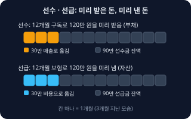</a> <b><a href="#prepaid-vs-unearned--선급선수">Prepaid vs Unearned</a></b> 선급·선수 선급은 아직 쓰지 않은 걸 미리 돈 낸 것(연간 보험료, 보증금 일부), 선수는 아직 일을 하지 않았는데 미리 받은 돈(계약금, 구독 선결제)이다. 선급은 자산, 선수는 부채 성격이다.</td>
</tr>
</table>

**세금 · Tax** (7)

<table>
<tr>
<td width="33%" valign="top"><a href="#vat--부가가치세">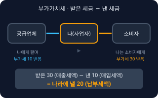</a> <b><a href="#vat--부가가치세">VAT</a></b> 부가가치세 물건·서비스를 팔 때 가격에 붙여 받는 세금(일반적으로 공급가액의 10%). 사업자는 소비자에게 받은 부가세(매출세액)에서 공급업체에 낸 부가세(매입세액)를 뺀 차액을 나라에 낸다.</td>
<td width="33%" valign="top"><a href="#tax-invoice--세금계산서">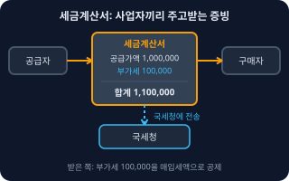</a> <b><a href="#tax-invoice--세금계산서">Tax Invoice</a></b> 세금계산서 사업자끼리 거래할 때 공급가액과 부가세를 따로 적어 주고받는 공식 증빙. 받는 쪽은 이것으로 매입세액을 공제받는다. 법인사업자와 일정 개인사업자는 전자세금계산서로 발급하고 국세청에 전송해야 한다.</td>
<td width="33%" valign="top"><a href="#cash-receipt--현금영수증">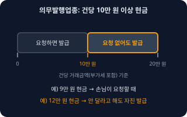</a> <b><a href="#cash-receipt--현금영수증">Cash Receipt</a></b> 현금영수증 현금(계좌이체 포함)으로 결제할 때 발급하는 증빙. 소비자는 소득공제를, 사업자는 매출 증빙을 얻는다. 변호사업·병원 등 의무발행업종은 건당(부가세 포함) 10만 원 이상 현금을 받으면 손님이 요구하지 않아도 발급해야 하고, 번호를 모르면 국세청 지정 코드(010-000-1234)로 현금을 받은 날부터 5일 이내에 자진발급한다.</td>
</tr>
<tr>
<td width="33%" valign="top"> <b><a href="#simplified-vat-taxpayer--간이과세자">Simplified VAT Taxpayer</a></b> 간이과세자 규모가 작은 개인사업자에게 적용하는 부가세 방식. 업종별 부가가치율을 곱해 단순하게 계산하고 신고는 연 1회(다음 해 1월 25일까지)다. 기준은 직전 연도 공급대가(부가세 포함 매출) 합계 1억 400만 원 미만의 개인사업자이다.</td>
<td width="33%" valign="top"><a href="#withholding-tax--원천징수">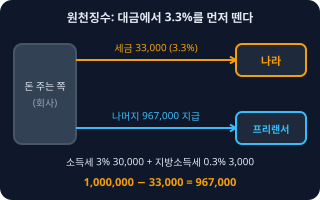</a> <b><a href="#withholding-tax--원천징수">Withholding Tax</a></b> 원천징수 돈을 주는 쪽이 받는 사람의 세금을 미리 떼서 나라에 대신 내는 제도. 월급에서 소득세를 떼는 것, 프리랜서 대금에서 3.3%(소득세 3% + 지방소득세 0.3%)를 떼는 것이 대표적이다.</td>
<td width="33%" valign="top"><a href="#comprehensive-income-tax--종합소득세">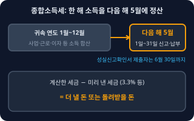</a> <b><a href="#comprehensive-income-tax--종합소득세">Comprehensive Income Tax</a></b> 종합소득세 개인이 1년간 번 사업·근로·이자 등 소득을 합쳐서 내는 세금. 소득이 클수록 세율이 올라가는 누진세다. 개인사업자와 프리랜서는 다음 해 5월에 직접 신고한다.</td>
</tr>
<tr>
<td width="33%" valign="top"><a href="#corporate-tax--법인세">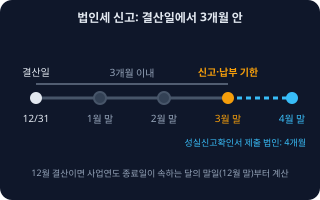</a> <b><a href="#corporate-tax--법인세">Corporate Tax</a></b> 법인세 법인(주식회사 등)이 한 해 번 이익(과세표준)에 내는 세금. 사업연도가 끝나고 3개월 안에 신고·납부하는 것이 원칙이다(12월 결산이면 3월 말, 성실신고확인서를 내는 법인은 4개월).</td>
</tr>
</table>

**인건비 · Payroll** (3)

<table>
<tr>
<td width="33%" valign="top"><a href="#social-insurance--4대보험">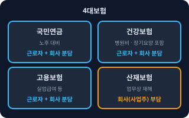</a> <b><a href="#social-insurance--4대보험">Social Insurance</a></b> 4대보험 국민연금, 건강보험(장기요양 포함), 고용보험, 산재보험 네 가지 사회보험을 말한다. 직원을 쓰면 가입해야 하고, 보험료는 월급에서 떼는 몫(근로자)과 회사가 내는 몫(사업주)으로 나뉜다. 산재보험은 사업주가 전액 부담한다.</td>
<td width="33%" valign="top"><a href="#gross-vs-net-pay--세전세후-급여">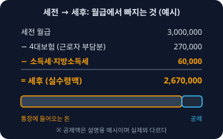</a> <b><a href="#gross-vs-net-pay--세전세후-급여">Gross vs Net Pay</a></b> 세전·세후 급여 세전은 회사가 정한 월급 총액이고, 세후(실수령액)는 4대보험과 소득세·지방소득세 등을 뗀 뒤 실제로 통장에 들어오는 돈이다.</td>
<td width="33%" valign="top"><a href="#severance-pay--퇴직금">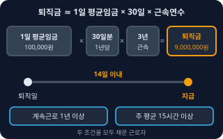</a> <b><a href="#severance-pay--퇴직금">Severance Pay</a></b> 퇴직금 한 직장에서 1년 이상 일하고 주 평균 15시간 이상 근무한 직원이 퇴직할 때 받는 돈. 대략 &quot;1일 평균임금 30일분 × 근속연수&quot;이고, 퇴직일부터 14일 안에 지급해야 하고, 특별한 사정이 있으면 당사자 합의로 기일을 늘릴 수 있다(근로자퇴직급여 보장법).</td>
</tr>
</table>

**경영 지표 · Management Metrics** (7)

<table>
<tr>
<td width="33%" valign="top"><a href="#break-even-point--손익분기점">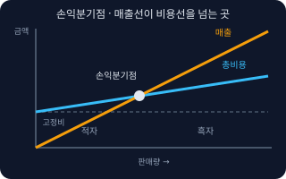</a> <b><a href="#break-even-point--손익분기점">Break-even Point</a></b> 손익분기점 매출과 비용이 딱 같아져서 이익도 손해도 0인 지점. 이보다 팔면 흑자, 덜 팔면 적자다. 간단히 &quot;고정비 ÷ (판매가 − 개당 변동비)&quot;로 몇 개를 팔아야 하는지 구한다.</td>
<td width="33%" valign="top"><a href="#margin--마진이익률">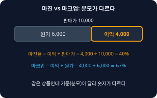</a> <b><a href="#margin--마진이익률">Margin</a></b> 마진·이익률 팔아서 얼마가 남는지를 이익 ÷ 매출(%)로 본 것. 어떤 이익을 쓰느냐에 따라 매출총이익률, 영업이익률, 순이익률로 나뉜다.</td>
<td width="33%" valign="top"><a href="#ebitda--에비타상각-전-영업이익">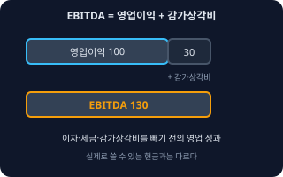</a> <b><a href="#ebitda--에비타상각-전-영업이익">EBITDA</a></b> 에비타(상각 전 영업이익) 이자, 세금, 감가상각비를 빼기 전의 영업 성과. 대략 &quot;영업이익 + 감가상각비&quot;로 계산해서 장비 투자가 큰 회사의 본업 현금 창출력을 비교할 때 쓴다.</td>
</tr>
<tr>
<td width="33%" valign="top"><a href="#burn-rate--번레이트">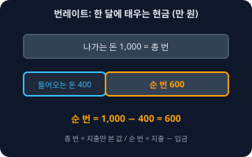</a> <b><a href="#burn-rate--번레이트">Burn Rate</a></b> 번레이트 아직 수익이 안 나는 회사가 한 달에 현금을 얼마나 태우는지. 지출만 보면 총 번, &quot;나가는 돈 − 들어오는 돈&quot;이면 순 번이다.</td>
<td width="33%" valign="top"><a href="#runway--런웨이">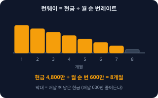</a> <b><a href="#runway--런웨이">Runway</a></b> 런웨이 지금 가진 현금으로 지금 속도대로 돈을 쓰면 몇 달 버틸 수 있는지. &quot;현재 현금 ÷ 월 순 번레이트&quot;로 구한다.</td>
<td width="33%" valign="top"><a href="#unit-economics--유닛-이코노믹스">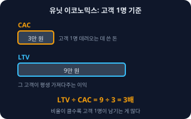</a> <b><a href="#unit-economics--유닛-이코노믹스">Unit Economics</a></b> 유닛 이코노믹스 고객 1명(또는 주문 1건) 기준으로 얼마를 벌고 얼마가 드는지 따지는 방식. 고객 한 명을 데려오는 데 쓴 돈(CAC)과 그 고객이 평생 가져다주는 이익(LTV)을 비교한다.</td>
</tr>
<tr>
<td width="33%" valign="top"><a href="#cash-vs-profit--현금과-이익">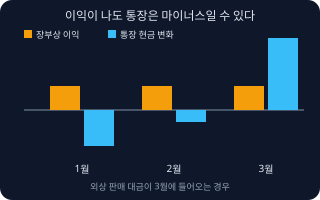</a> <b><a href="#cash-vs-profit--현금과-이익">Cash vs Profit</a></b> 현금과 이익 이익은 장부에 계산된 숫자이고 현금은 통장에 있는 돈이다. 외상 매출, 재고 구입, 대출 상환 등 때문에 이 둘은 자주 다르다. 이익이 나는데도 현금이 떨어져 문을 닫는 일을 흑자도산이라 부른다.</td>
</tr>
</table>

<!-- overview:end -->

## 재무제표 · Financial Statements

### Balance Sheet · 재무상태표

- **정의**: 어느 하루(결산일) 기준으로 회사가 무엇을 가졌고(자산), 얼마를 빌렸고(부채), 내 몫은 얼마인지(자본)를 보여주는 표. 예전 이름은 대차대조표다.
- **AI에게 이렇게**: "올해 12월 31일 기준 재무상태표 양식을 만들어줘. 자산은 현금·외상매출금·재고, 부채는 외상매입금·대출금, 자본은 자본금·이익잉여금으로 나눠서, 자산 합계와 부채+자본 합계가 같은지 자동으로 검산하는 칸도 넣어줘."
- **언제**: 대출·투자 심사, 회사 재산 상태 점검, 결산
- **헷갈림**: 손익계산서 — 재무상태표는 "그날의 사진"(재산 상태), 손익계산서는 "기간의 영화"(그 기간에 번 돈과 쓴 돈)
- **관련**: Assets, Liabilities, Equity, Income Statement
- **확인 질문**: 기준일은 언제인가요? 개인사업자인가요, 법인인가요? 재고나 비품처럼 따로 나눠 보고 싶은 항목이 있나요?

### Income Statement · 손익계산서

- **정의**: 일정 기간(한 달, 분기, 한 해) 동안 매출에서 비용을 단계별로 빼서 얼마가 남았는지 보여주는 표. 매출 → 매출총이익 → 영업이익 → 순이익 순서로 내려간다.
- **AI에게 이렇게**: "월별 손익계산서를 만들어줘. 매출액, 매출원가, 매출총이익, 판매비와관리비, 영업이익, 영업외손익, 세금, 당기순이익 순서로, 각 단계 이익률도 같이 계산해줘."
- **언제**: 장사가 남는지 확인, 월간·분기 보고, 세무사에게 설명할 때
- **헷갈림**: 현금흐름표 — 손익계산서의 이익은 장부 숫자이고, 실제로 통장에 들어온 돈과는 다를 수 있다. 상장사 등이 쓰는 국제회계기준(K-IFRS)에서는 '포괄손익계산서'라고도 부른다.
- **관련**: Revenue, COGS, Gross Profit, Operating Income, Net Income
- **확인 질문**: 기간 단위는 월·분기·연 중 무엇인가요? 매출은 부가세를 뺀 금액인가요? 월세·인건비를 매출원가에 넣을지 판관비에 넣을지 정해둔 기준이 있나요?

### Cash Flow Statement · 현금흐름표

- **정의**: 일정 기간 동안 현금이 어디서 들어오고 어디로 나갔는지를 영업(장사)·투자(설비 등)·재무(대출·투자금) 세 갈래로 나눠 보여주는 표.
- **AI에게 이렇게**: "월초 현금, 영업활동 현금(입금-출금), 투자활동(기계·보증금), 재무활동(대출 받음·상환)으로 나눠서 월말 현금까지 이어지는 현금흐름표 엑셀을 만들어줘."
- **언제**: 이익은 나는데 돈이 부족할 때, 대출 상환 계획, 투자 유치
- **헷갈림**: 손익계산서 — 외상으로 판 매출은 이익에는 들어가지만 돈이 들어오기 전까지 현금흐름에는 안 잡힌다.
- **관련**: Cash vs Profit, Accrual vs Cash Basis, Runway
- **확인 질문**: 은행 거래내역을 기준으로 만들까요, 장부 기준으로 만들까요? 대출 원금 상환과 이자를 따로 볼까요?

### Assets, Liabilities, Equity · 자산·부채·자본

- **정의**: 자산은 회사가 가진 것(현금, 외상으로 받을 돈, 재고, 기계), 부채는 남에게 갚아야 할 돈(대출, 외상으로 산 값), 자본은 자산에서 부채를 뺀 내 몫이다. 항상 "자산 = 부채 + 자본".
- **AI에게 이렇게**: "우리 회사 항목들을 자산·부채·자본으로 분류해서 표로 정리해줘. 헷갈리는 항목은 이유를 같이 적어줘: 현금, 보증금, 직원 가불금, 사업자 대출, 받은 계약금."
- **언제**: 재무상태표를 읽거나 만들 때, 계정과목을 분류할 때
- **헷갈림**: 받은 계약금(선수금)은 내 돈이 아니라 일을 해줘야 정리되는 부채로 본다. 대표가 회사에서 꺼내 쓴 돈도 비용이 아니라 별도로 처리하는 경우가 많다.
- **관련**: Balance Sheet, Prepaid vs Unearned, Receivables and Payables
- **확인 질문**: 개인사업자인가요, 법인인가요? (법인은 대표 자금과 회사 자금을 엄격히 구분합니다)

### Revenue · 매출액

- **정의**: 물건이나 서비스를 팔아서 번 총금액. 비용을 빼기 전의 맨 윗줄 숫자다. 부가세는 나라 대신 받아둔 돈이라 일반적으로 매출에서 뺀 공급가액으로 본다.
- **AI에게 이렇게**: "POS 매출 파일에서 부가세를 뺀 공급가액 기준으로 월별 매출액을 합산해줘. 부가세 포함 금액이 같이 있으면 둘을 따로 열로 나눠줘."
- **언제**: 손익계산서 맨 위, 부가세 신고 자료, 목표 설정
- **헷갈림**: 이익 — 매출이 커도 비용이 더 크면 적자다. 입금액과 매출도 다르다(외상·환불·부가세).
- **관련**: Income Statement, VAT, Gross Profit
- **확인 질문**: 부가세 포함 금액인가요, 공급가액인가요? 환불·할인은 매출에서 빼나요? 카드 수수료는 어디에 넣나요?

### COGS · 매출원가

- **정의**: 판매한 물건을 만들거나 사 오는 데 직접 든 비용. 커피 가게라면 판 만큼의 원두·우유·컵 값. 팔리지 않고 남은 재고는 여기 안 들어간다.
- **AI에게 이렇게**: "기초재고 + 이번 달 매입 − 기말재고로 월별 매출원가를 계산하는 시트를 만들어줘."
- **언제**: 매출총이익을 구할 때, 재고가 있는 업종
- **헷갈림**: 판매비와관리비(판관비) — 월세·광고비·사무직 급여처럼 팔든 안 팔든 쓰는 운영비는 원가가 아니라 판관비로 나누는 것이 일반적이다. 서비스업은 매출원가가 거의 없거나 직접 인건비로 잡기도 한다.
- **관련**: Gross Profit, Margin, Income Statement
- **확인 질문**: 재고를 직접 세나요? 서비스업이면 외주비·강사료 같은 직접 인건비를 원가로 볼까요?

### Gross Profit · 매출총이익

- **정의**: 매출액에서 매출원가를 뺀 돈. 물건 자체로 얼마를 남겼는지를 보여주고, 여기서 월세·인건비 같은 운영비를 빼기 전 단계다.
- **AI에게 이렇게**: "상품별 판매가와 원가를 넣으면 매출총이익과 매출총이익률(%)이 나오는 표를 만들고, 이익률 낮은 순서로 정렬해줘."
- **언제**: 어떤 상품이 돈이 되는지 비교, 가격 책정
- **헷갈림**: 영업이익 — 매출총이익에서 판관비를 더 빼야 영업이익이 된다. 매출총이익이 커도 운영비가 크면 적자다.
- **관련**: Revenue, COGS, Operating Income, Margin
- **확인 질문**: 상품 단위로 볼까요, 전체로 볼까요? 포장·배송비는 원가에 포함하나요?

### Operating Income · 영업이익

- **정의**: 매출총이익에서 판매비와관리비(월세, 직원 급여, 광고비 등 운영비)를 뺀 이익. 본업으로 번 순수한 이익이다.
- **AI에게 이렇게**: "매출총이익에서 판매비와관리비를 빼서 영업이익과 영업이익률을 월별로 보여주는 차트를 만들어줘."
- **언제**: 본업의 건강 상태를 볼 때, 투자자·은행 설명
- **헷갈림**: 당기순이익 — 영업이익에서 이자 수익·비용 같은 영업 밖 손익과 법인세 등을 더하고 뺀 것이 순이익이다.
- **관련**: Gross Profit, Net Income, EBITDA
- **확인 질문**: 대표 급여는 판관비에 포함하나요? 월세·감가상각비도 판관비에 넣을까요?

### Net Income · 당기순이익

- **정의**: 모든 수익에서 모든 비용과 세금까지 뺀 뒤 최종으로 남는 이익. 손익계산서의 맨 아랫줄(bottom line)이다. 이번 회계기간에 나온 순이익이라 '당기'를 붙인다.
- **AI에게 이렇게**: "영업이익에 영업외수익(이자수익)과 영업외비용(이자비용)을 반영하고 법인세 비용을 빼서 당기순이익을 계산해줘."
- **언제**: 배당·이익잉여금 판단, 연간 성과 평가
- **헷갈림**: 현금 — 순이익이 나도 외상 대금을 못 받았다면 통장에는 돈이 없을 수 있다. 개인사업자는 순이익 개념이 소득세 계산의 '사업소득금액'과 비슷하지만 같지 않다.
- **관련**: Operating Income, Cash vs Profit, Corporate Tax
- **확인 질문**: 이자 수입·지출, 대출 이자가 있나요? 법인인가요(법인세 반영) 개인사업자인가요(소득세는 별도)?

## 원리 · Principles

### Accrual vs Cash Basis · 발생주의·현금주의

- **정의**: 발생주의는 거래가 생긴 때(일을 끝낸 때, 물건을 넘긴 때)에 매출·비용을 잡는 방식이고, 현금주의는 돈이 실제로 오간 때에 잡는 방식이다. 기업 회계는 기본적으로 발생주의다.
- **AI에게 이렇게**: "1월에 서비스를 제공하고 3월에 입금받은 건을 발생주의 기준과 현금주의 기준으로 각각 어느 달 매출에 넣는지 표로 보여주고, 월별 손익을 두 방식으로 비교해줘."
- **언제**: 월별 손익을 볼 때, 외상 거래가 많을 때, 결산
- **헷갈림**: 세무상 소득은 현금주의가 아니라 대부분 '권리가 확정된 때'를 기준으로 본다. 사업장 규모나 업종에 따라 방식이 달라질 수 있으니 세무사에게 확인한다.
- **관련**: Cash vs Profit, Receivables and Payables, Prepaid vs Unearned
- **확인 질문**: 가장 궁금한 건 장부상 손익인가요, 통장 잔액인가요? 외상 거래나 선결제 계약이 있나요?

### Double-entry Bookkeeping · 복식부기

- **정의**: 모든 거래를 "무엇이 늘고(또는 줄고) 그 대신 무엇이 변했는가"의 두 면으로 기록하는 방식. 한 거래의 왼쪽(차변) 합계와 오른쪽(대변) 합계가 항상 같아서 틀린 곳을 찾기 쉽다.
- **AI에게 이렇게**: "거래 내역 CSV를 복식부기 분개장으로 바꿔줘. 거래마다 차변 계정과목, 대변 계정과목, 금액을 나눠 쓰고, 차변 합계와 대변 합계가 다르면 표시해줘."
- **언제**: 법인 장부, 일정 규모 이상 개인사업자, 재무제표를 만들 때
- **헷갈림**: 단식부기(가계부·간이장부) — 돈이 들어오고 나간 것만 한 줄로 적는다. 개인사업자는 규모에 따라 복식부기 의무자와 간편장부 대상자로 나뉜다(기준은 매년 확인).
- **관련**: Debit and Credit, Balance Sheet, Closing
- **확인 질문**: 우리는 복식부기 의무자인가요 간편장부 대상자인가요? 회계 프로그램(더존·세무사 장부 등) 계정과목 체계를 따를까요?

### Debit and Credit · 차변과 대변

- **정의**: 장부를 T자로 그렸을 때 왼쪽이 차변(Debit), 오른쪽이 대변(Credit)이다. 좋고 나쁨이 아니라 그냥 방향 이름이다. 자산은 늘면 차변, 부채·자본·수익은 늘면 대변에 적는다.
- **AI에게 이렇게**: "카드로 사무용품 5만 원을 산 거래를 분개해줘. 차변/대변에 어떤 계정과목을 쓰는지 이유를 한 줄씩 붙여서."
- **언제**: 분개할 때, 세무사가 보내준 분개장·총계정원장을 읽을 때
- **헷갈림**: 은행 앱의 '입금(credit)/출금(debit)'은 은행 입장이라 장부의 차변·대변과 반대로 보일 수 있다.
- **관련**: Double-entry Bookkeeping, Assets, Liabilities, Equity
- **확인 질문**: 계정과목 목록이 따로 있나요? 사업자 카드·개인 카드가 섞여 있나요?

### Depreciation · 감가상각

- **정의**: 오래 쓰는 물건(컴퓨터, 기계, 인테리어)을 샀을 때 산 값을 한 번에 비용으로 쓰지 않고 쓰는 기간에 나눠서 해마다 비용으로 넣는 것.
- **AI에게 이렇게**: "500만 원짜리 장비를 5년 정액법으로 감가상각하는 연도별 표를 만들어줘. 연간 감가상각비와 해마다 남는 장부가치를 보여줘."
- **언제**: 장비·차량·인테리어를 샀을 때, 결산
- **헷갈림**: 현금 — 감가상각비는 돈이 나가는 비용이 아니다. 돈은 살 때 이미 나갔다. 세법은 자산 종류별로 내용연수(몇 년에 나눌지)와 방법(정액법·정률법)을 정해 두므로 회계와 세무 숫자가 다를 수 있다.
- **관련**: EBITDA, Assets, Closing
- **확인 질문**: 취득 가격과 구입한 날짜는? 몇 년, 어떤 방법(정액법/정률법)으로 할까요? 세무사가 정한 내용연수가 있나요?

### Receivables and Payables · 미수금·미지급금

- **정의**: 받을 돈이 아직 안 들어온 것이 외상매출금·미수금(자산), 줄 돈을 아직 안 낸 것이 외상매입금·미지급금(부채)이다. 물건을 파는 본업의 외상이면 '외상', 본업 외 거래(비품 판매·구입 등)면 '미수금·미지급금'이라 부른다.
- **AI에게 이렇게**: "거래처별 외상매출금(미수금) 장부를 만들어줘. 청구일, 입금 예정일, 입금 여부를 넣고 30일 넘게 안 들어온 건은 빨간색으로 표시해줘."
- **언제**: 외상 거래가 있을 때, 현금 흐름 관리, 결산
- **헷갈림**: 외상매입금 vs 미지급금 — 상품·원재료 같은 본업 거래는 외상매입금, 그 밖의 비용(광고비·비품)은 미지급금으로 구분한다. 회사마다 계정과목 분류가 조금 다를 수 있다.
- **관련**: Accrual vs Cash Basis, Cash vs Profit, Assets, Liabilities, Equity
- **확인 질문**: 거래처별로 관리할까요? 입금 기한이 거래마다 다른가요? 못 받을 돈이 이미 있나요?

### Prepaid vs Unearned · 선급·선수

- **정의**: 선급은 아직 쓰지 않은 걸 미리 돈 낸 것(연간 보험료, 보증금 일부), 선수는 아직 일을 하지 않았는데 미리 받은 돈(계약금, 구독 선결제)이다. 선급은 자산, 선수는 부채 성격이다.
- **AI에게 이렇게**: "연간 구독료 120만 원을 1월에 선결제로 받았을 때, 매달 얼마씩 매출로 인식하는지 12개월 표로 만들어줘. 남은 선수금도 보여줘."
- **언제**: 연간 구독, 임대료·보험료 선납, 계약금 받기
- **헷갈림**: 받은 날 전부 매출로 잡는 것이 아니다. 서비스를 제공한 만큼 나눠서 매출로 옮긴다.
- **관련**: Accrual vs Cash Basis, Assets, Liabilities, Equity, Receivables and Payables
- **확인 질문**: 서비스 제공 기간이 언제부터 언제까지인가요? 중간에 환불될 수 있나요?

## 세금 · Tax

### VAT · 부가가치세

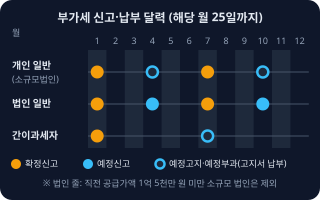

- **정의**: 물건·서비스를 팔 때 가격에 붙여 받는 세금(일반적으로 공급가액의 10%). 사업자는 소비자에게 받은 부가세(매출세액)에서 공급업체에 낸 부가세(매입세액)를 뺀 차액을 나라에 낸다.
- **AI에게 이렇게**: "이번 반기 매출 세금계산서와 매입 세금계산서 목록으로 부가세 납부세액을 계산하는 시트를 만들어줘. 매출세액, 매입세액, 납부세액(환급) 순서로."
- **언제**: 장사할 때 항상. 신고·납부는 사업자 유형별로 다르고 기한은 모두 해당 월 25일이다. ① 개인 일반과세자: 확정신고 1월(7~12월분)·7월(1~6월분), 연 2회. 4월·10월에는 신고 없이, 직전 과세기간 납부세액의 50%가 예정고지서로 나오고 납부한다(고지액이 50만 원 미만이면 고지 없음, 확정신고 때 기납부세액으로 뺀다). ② 법인 일반과세자: 예정신고 4월(1~3월분)·10월(7~9월분) + 확정신고 7월·1월, 연 4회. 단 직전 과세기간 공급가액 합계가 1억 5천만 원 미만인 소규모 법인은 예정신고 대신 개인처럼 4월·10월 예정고지를 받는다. ③ 간이과세자: 1~12월분을 다음 해 1월에 연 1회 신고. 7월에는 직전 납부세액의 50%가 예정부과로 고지된다(50만 원 미만이면 없음). 예정부과기간(1~6월)에 세금계산서를 발급한 간이과세자는 7월 25일까지 신고·납부한다. 휴업·사업 부진이나 조기환급을 받으려는 예정고지 대상자는 예정신고를 할 수 있다(이 경우 예정고지는 취소).
- **헷갈림**: 소득세·법인세 — 부가세는 이익이 아니라 거래 금액에 붙고, 사업자는 소비자 대신 걷어서 내는 역할이다. 부가세 포함 가격인지 아닌지가 가장 흔한 실수 원인이다.
- **관련**: Tax Invoice, Cash Receipt, Simplified VAT Taxpayer
- **확인 질문**: 개인인가요 법인인가요(소규모 법인인지도)? 일반과세자인가요 간이과세자인가요? 면세 품목이 섞여 있나요? 매입 증빙(세금계산서·카드)은 갖추고 있나요?
- **근거**: [부가가치세법 제48조](https://www.law.go.kr/법령/부가가치세법/제48조), [부가가치세법 제49조](https://www.law.go.kr/법령/부가가치세법/제49조), [부가가치세법 제66조](https://www.law.go.kr/법령/부가가치세법/제66조), [국세청 부가가치세 신고납부기한](https://www.nts.go.kr/nts/cm/cntnts/cntntsView.do?mi=2273&cntntsId=7694), [국세청 부가가치세 기본정보](https://www.nts.go.kr/nts/cm/cntnts/cntntsView.do?cntntsId=7693&mi=2272)
- **검증일**: 2026-11-01

### Tax Invoice · 세금계산서

- **정의**: 사업자끼리 거래할 때 공급가액과 부가세를 따로 적어 주고받는 공식 증빙. 받는 쪽은 이것으로 매입세액을 공제받는다. 법인사업자와 일정 개인사업자는 전자세금계산서로 발급하고 국세청에 전송해야 한다.
- **AI에게 이렇게**: "이번 달 전자세금계산서 발행 목록(거래처, 공급가액, 부가세, 발행일)을 엑셀로 정리하고, 거래처별 합계와 월 총합계를 보여줘."
- **언제**: 사업자 간(B2B) 거래, 부가세 신고 준비
- **헷갈림**: 거래명세서·영수증 — 거래명세서는 거래 내역서일 뿐 세금계산서가 아니다. 소비자 대상 사업자나 직전 연도 공급대가 4,800만 원 미만 간이과세자는 세금계산서 대신 영수증을 발급하지만, 거래 상대가 사업자등록증을 내보이며 요구하면 세금계산서를 발급해야 하는 경우가 있다. 세금계산서는 원칙적으로 재화·용역의 공급시기에 발급하고, 월 합계 발급 등 특례는 공급일이 속한 달의 다음 달 10일(토·공휴일이면 다음 영업일)까지 발급할 수 있다.
- **관련**: VAT, Cash Receipt, Simplified VAT Taxpayer
- **확인 질문**: 상대가 사업자등록이 되어 있나요? 공급일과 발행일이 같은 달인가요? 수정(취소) 발행이 필요한 건인가요?
- **근거**: [부가가치세법 제32조](https://www.law.go.kr/법령/부가가치세법/제32조), [부가가치세법 제34조](https://www.law.go.kr/법령/부가가치세법/제34조), [부가가치세법 제36조](https://www.law.go.kr/법령/부가가치세법/제36조)
- **검증일**: 2026-11-01

### Cash Receipt · 현금영수증

- **정의**: 현금(계좌이체 포함)으로 결제할 때 발급하는 증빙. 소비자는 소득공제를, 사업자는 매출 증빙을 얻는다. 변호사업·병원 등 의무발행업종은 건당(부가세 포함) 10만 원 이상 현금을 받으면 손님이 요구하지 않아도 발급해야 하고, 번호를 모르면 국세청 지정 코드(010-000-1234)로 현금을 받은 날부터 5일 이내에 자진발급한다.
- **AI에게 이렇게**: "현금 결제 매출을 현금영수증 발급 여부별로 나눠서 정리하고, 발급 안 된 건 목록을 따로 뽑아줘."
- **언제**: 소매·음식점 등 소비자 대상 매출, 세무조사 위험 줄이기
- **헷갈림**: 세금계산서 — 현금영수증은 소비자용(또는 지출증빙용) 증빙, 세금계산서는 사업자 간 부가세 공제용 증빙이다.
- **관련**: Tax Invoice, VAT
- **확인 질문**: 우리 업종이 의무발행업종인가요? 지출증빙용으로 발급해 달라는 손님이 있나요?
- **근거**: [소득세법 제162조의3](https://www.law.go.kr/법령/소득세법/제162조의3), [국세청 현금영수증 발급의무](https://www.nts.go.kr/nts/cm/cntnts/cntntsView.do?cntntsId=7796&mi=2471)
- **검증일**: 2026-11-01

### Simplified VAT Taxpayer · 간이과세자

- **정의**: 규모가 작은 개인사업자에게 적용하는 부가세 방식. 업종별 부가가치율을 곱해 단순하게 계산하고 신고는 연 1회(다음 해 1월 25일까지)다. 기준은 직전 연도 공급대가(부가세 포함 매출) 합계 1억 400만 원 미만의 개인사업자이다.
- **AI에게 이렇게**: "연 매출 8천만 원 카페가 일반과세자와 간이과세자일 때 부가세 부담이 어떻게 다른지 비교하는 표를 만들어줘. 업종별 부가가치율은 직접 확인한 값을 넣을 수 있게 입력칸으로 빼줘."
- **언제**: 개인사업 시작, 매출이 커졌을 때 과세 유형 점검
- **헷갈림**: 면세사업자 — 간이과세자도 부가세 과세 사업자이고, 면세는 애초에 부가세가 없는 품목(농산물·교육 등)이다. 해당 과세기간 공급대가가 4,800만 원 미만이면 납부는 면제되지만 신고는 해야 한다. 직전 연도 공급대가 4,800만 원 미만이면 세금계산서 대신 영수증을 발급한다. 광업·도매업 등 일부 업종이나 일반과세 사업장을 따로 가진 사업자는 간이과세자가 될 수 없다. 7월 예정부과 등 간이과세자 신고 일정은 VAT 항목을 본다.
- **관련**: VAT, Tax Invoice
- **확인 질문**: 업종은? 올해 예상 매출은? 거래처가 세금계산서를 꼭 받아야 하는 사업자인가요?
- **근거**: [부가가치세법 제61조](https://www.law.go.kr/법령/부가가치세법/제61조), [부가가치세법 시행령 제109조](https://www.law.go.kr/법령/부가가치세법%20시행령/제109조), [부가가치세법 제66조](https://www.law.go.kr/법령/부가가치세법/제66조), [부가가치세법 제69조](https://www.law.go.kr/법령/부가가치세법/제69조), [부가가치세법 제36조](https://www.law.go.kr/법령/부가가치세법/제36조), [국세청 부가가치세 신고납부기한](https://www.nts.go.kr/nts/cm/cntnts/cntntsView.do?mi=2273&cntntsId=7694), [국세청 FAQ: 간이과세자 4,800만 원 미만](https://www.nts.go.kr/nts/na/ntt/selectNttInfo.do?mi=40581&nttSn=1322109)
- **검증일**: 2026-11-01

### Withholding Tax · 원천징수

- **정의**: 돈을 주는 쪽이 받는 사람의 세금을 미리 떼서 나라에 대신 내는 제도. 월급에서 소득세를 떼는 것, 프리랜서 대금에서 3.3%(소득세 3% + 지방소득세 0.3%)를 떼는 것이 대표적이다.
- **AI에게 이렇게**: "프리랜서 5명에게 지급한 용역비에서 3.3%를 원천징수한 지급 내역표를 만들어줘. 지급액, 원천징수액, 실수령액, 신고·납부 마감일(다음 달 10일)을 열로 넣어줘."
- **언제**: 직원 월급 지급, 프리랜서·강사 대금 지급
- **헷갈림**: 최종 세금 아님 — 3.3%는 미리 낸 세금이라 이듬해 5월 종합소득세 신고에서 정산해 환급받거나 더 낼 수 있다. 3.3%는 인적용역 사업소득 기준(국세청)이며 소득 종류마다 다르다.
- **관련**: Comprehensive Income Tax, Gross vs Net Pay
- **확인 질문**: 받는 사람의 소득 종류는 근로·사업·기타 중 무엇인가요? 지급일은 언제인가요? 사업자등록이 된 사람인가요(세금계산서 거래면 원천징수가 아닙니다)?
- **근거**: [소득세법 제128조](https://www.law.go.kr/법령/소득세법/제128조), [소득세법 제129조](https://www.law.go.kr/법령/소득세법/제129조), [국세청 종합소득세 신고와 3.3% 원천징수](https://www.nts.go.kr/nts/cm/cntnts/cntntsView.do?cntntsId=239072), [국세청 원천세 신고납부기한](https://www.nts.go.kr/nts/cm/cntnts/cntntsView.do?cntntsId=7702&mi=2290)
- **검증일**: 2026-11-01

### Comprehensive Income Tax · 종합소득세

- **정의**: 개인이 1년간 번 사업·근로·이자 등 소득을 합쳐서 내는 세금. 소득이 클수록 세율이 올라가는 누진세다. 개인사업자와 프리랜서는 다음 해 5월에 직접 신고한다.
- **AI에게 이렇게**: "작년 총수입, 경비, 이미 떼인 3.3% 원천징수세액을 입력하면 종합소득세 신고 전 대략적인 정산 구조를 정리해주는 시트를 만들어줘. 세율은 입력칸으로 빼줘."
- **언제**: 매년 5월(귀속 다음 해 5월 1일~31일, 성실신고확인서 제출 대상은 6월 말까지 — 국세청 안내)
- **헷갈림**: 법인세·부가세 — 종합소득세는 '개인'의 소득에 붙는 세금이고, 법인은 법인세를 낸다. 부가세와는 계산 구조가 전혀 다르다. 개인지방소득세는 따로 신고한다.
- **관련**: Withholding Tax, Net Income, Corporate Tax
- **확인 질문**: 소득 종류(사업·근로·기타)는? 증빙 가능한 경비는? 복식부기 의무자인가요 간편장부 대상자인가요? 세무사에게 맡길 건가요 직접 신고할 건가요?
- **근거**: [소득세법 제5조](https://www.law.go.kr/법령/소득세법/제5조), [소득세법 제70조](https://www.law.go.kr/법령/소득세법/제70조), [국세청 종합소득세 개요](https://www.nts.go.kr/nts/cm/cntnts/cntntsView.do?cntntsId=7664&mi=2224), [국세청 종합소득세 세율](https://www.nts.go.kr/nts/cm/cntnts/cntntsView.do?mi=2227&cntntsId=7667)
- **검증일**: 2026-11-01

### Corporate Tax · 법인세

- **정의**: 법인(주식회사 등)이 한 해 번 이익(과세표준)에 내는 세금. 사업연도가 끝나고 3개월 안에 신고·납부하는 것이 원칙이다(12월 결산이면 3월 말, 성실신고확인서를 내는 법인은 4개월).
- **AI에게 이렇게**: "법인 결산 후 법인세 신고까지 준비할 서류 체크리스트를 만들어줘. 재무제표, 부가세 신고 내역, 원천징수 내역, 세무조정에 필요한 증빙 순서로."
- **언제**: 법인 결산, 세무조정, 중간예납 시점
- **헷갈림**: 종합소득세 — 법인 이익에는 법인세, 대표가 받는 급여·배당에는 별도로 소득세가 붙는다. 회사 돈을 대표가 마음대로 쓰면 세무 문제가 될 수 있다.
- **관련**: Comprehensive Income Tax, Net Income, VAT
- **확인 질문**: 결산월은 언제인가요? 직전 사업연도 신고 내역이 있나요? 세무조정은 세무사가 하나요?
- **근거**: [법인세법 제60조](https://www.law.go.kr/법령/법인세법/제60조), [국세청 신고납부기한](https://nts.go.kr/nts/cm/cntnts/cntntsView.do?cntntsId=8649&mi=13323)
- **검증일**: 2026-11-01

## 인건비 · Payroll

### Social Insurance · 4대보험

- **정의**: 국민연금, 건강보험(장기요양 포함), 고용보험, 산재보험 네 가지 사회보험을 말한다. 직원을 쓰면 가입해야 하고, 보험료는 월급에서 떼는 몫(근로자)과 회사가 내는 몫(사업주)으로 나뉜다. 산재보험은 사업주가 전액 부담한다.
- **AI에게 이렇게**: "직원 월급 300만 원 기준으로 4대보험 근로자 부담분과 사업주 부담분을 나눠서 계산하는 시트를 만들어줘. 요율은 별도 입력칸으로 빼서 내가 최신 값을 넣을 수 있게 해줘."
- **언제**: 첫 직원 채용, 월급 계산, 퇴사 정산
- **헷갈림**: 원천징수 소득세 — 4대보험은 사회보험료, 소득세는 세금으로 서로 다르다. 보험료율은 해마다 바뀌므로 공단 최신 안내를 기준으로 한다.
- **관련**: Gross vs Net Pay, Severance Pay
- **확인 질문**: 정규직·단시간·프리랜서 중 누구인가요? 입사일은 언제인가요? 해당 연도의 보험료율은 확인했나요?
- **근거**: [4대사회보험 정보연계센터 보험료 모의계산](https://www.4insure.or.kr/pbiz/ntcn/inscSmlCalcView.do), [찾기쉬운 생활법령정보: 산재보험료 징수](https://www.easylaw.go.kr/CSP/CnpClsMain.laf?ccfNo=2&cciNo=2&cnpClsNo=3&csmSeq=570&popMenu=ov)
- **검증일**: 2026-11-01

### Gross vs Net Pay · 세전·세후 급여

- **정의**: 세전은 회사가 정한 월급 총액이고, 세후(실수령액)는 4대보험과 소득세·지방소득세 등을 뗀 뒤 실제로 통장에 들어오는 돈이다.
- **AI에게 이렇게**: "월 세전 급여, 비과세 식대, 공제 항목(4대보험, 소득세, 지방소득세)을 입력하면 실수령액이 나오는 급여명세서 엑셀 양식을 만들어줘."
- **언제**: 채용 제안, 연봉 협상, 급여 지급
- **헷갈림**: 연봉 5천만 원이라는 말이 세전인지 세후인지 반드시 확인한다. 한국 채용공고의 연봉은 보통 세전이며 퇴직금이 포함되는지(포괄임금)도 따로 확인해야 한다.
- **관련**: Social Insurance, Withholding Tax, Severance Pay
- **확인 질문**: 제시 금액이 세전인가요 세후인가요? 연봉에 퇴직금이나 각종 수당이 포함된 금액인가요? 비과세 항목이 있나요?

### Severance Pay · 퇴직금

- **정의**: 한 직장에서 1년 이상 일하고 주 평균 15시간 이상 근무한 직원이 퇴직할 때 받는 돈. 대략 "1일 평균임금 30일분 × 근속연수"이고, 퇴직일부터 14일 안에 지급해야 하고, 특별한 사정이 있으면 당사자 합의로 기일을 늘릴 수 있다(근로자퇴직급여 보장법).
- **AI에게 이렇게**: "입사일, 퇴사일, 최근 3개월 급여와 상여금 내역을 넣으면 평균임금과 퇴직금을 계산하는 시트를 만들어줘. 계산 근거 수식을 같이 보여줘."
- **언제**: 직원 퇴사, 퇴직연금(DB/DC) 도입 검토
- **헷갈림**: 퇴직금 vs 퇴직연금 — 퇴직연금은 회사가 매년 금융기관에 적립해 두는 제도이고, 퇴직금은 퇴직 시 회사가 직접 지급하는 방식이다. 평균임금은 통상임금과 다르므로 계산이 어렵다면 노무사에게 확인한다.
- **관련**: Gross vs Net Pay, Social Insurance
- **확인 질문**: 입사일·퇴사일은? 최근 3개월 급여와 상여·연차수당 내역은? 퇴직연금에 가입돼 있나요? 계속 근로 1년 미만이거나 주 15시간 미만인가요?
- **근거**: [근로자퇴직급여 보장법 제4조](https://www.law.go.kr/법령/근로자퇴직급여%20보장법/제4조), [근로자퇴직급여 보장법 제8조](https://www.law.go.kr/법령/근로자퇴직급여%20보장법/제8조), [근로자퇴직급여 보장법 제9조](https://www.law.go.kr/법령/근로자퇴직급여%20보장법/제9조)
- **검증일**: 2026-11-01

## 경영 지표 · Management Metrics

### Break-even Point · 손익분기점

- **정의**: 매출과 비용이 딱 같아져서 이익도 손해도 0인 지점. 이보다 팔면 흑자, 덜 팔면 적자다. 간단히 "고정비 ÷ (판매가 − 개당 변동비)"로 몇 개를 팔아야 하는지 구한다.
- **AI에게 이렇게**: "월 고정비 400만 원, 개당 판매가 5천 원, 개당 변동비 2천 원일 때 손익분기 판매량과 매출액을 계산하고 판매량에 따른 손익 그래프를 그려줘."
- **언제**: 창업 전 사업성 검토, 가격 변경, 가게 임대 계약 전
- **헷갈림**: 고정비 vs 변동비 — 월세·정규직 급여처럼 안 팔아도 나가는 것이 고정비, 재료비·카드수수료처럼 팔수록 느는 것이 변동비다. 세금과 대표 급여를 고정비에 넣는지에 따라 값이 달라진다.
- **관련**: Margin, Unit Economics, COGS
- **확인 질문**: 고정비 항목에는 무엇이 들어가나요? 대표 급여를 비용으로 볼까요? 판매가는 부가세 포함인가요?

### Margin · 마진·이익률

- **정의**: 팔아서 얼마가 남는지를 이익 ÷ 매출(%)로 본 것. 어떤 이익을 쓰느냐에 따라 매출총이익률, 영업이익률, 순이익률로 나뉜다.
- **AI에게 이렇게**: "매출, 매출원가, 판관비 열이 있는 시트에 매출총이익률, 영업이익률, 순이익률을 월별로 추가하고 어느 달에 이익률이 급락했는지 알려줘."
- **언제**: 가격 책정, 업계 평균과 비교, 상품 믹스 점검
- **헷갈림**: 마크업 — 마진율은 이익을 판매가로 나눈 값이고 마크업(원가 대비 가산율)은 이익을 원가로 나눈 값이라, 같은 상품이어도 마크업이 더 크게 나온다(그림의 예시 참고). '마진이 얼마'라는 말이 어느 쪽인지 확인한다.
- **관련**: Gross Profit, Operating Income, Break-even Point
- **확인 질문**: 어느 이익 기준(매출총이익·영업이익·순이익)인가요? 판매가는 부가세를 뺀 금액인가요?

### EBITDA · 에비타(상각 전 영업이익)

- **정의**: 이자, 세금, 감가상각비를 빼기 전의 영업 성과. 대략 "영업이익 + 감가상각비"로 계산해서 장비 투자가 큰 회사의 본업 현금 창출력을 비교할 때 쓴다.
- **AI에게 이렇게**: "손익계산서에서 영업이익에 감가상각비와 무형자산상각비를 더해 EBITDA를 계산하고, 영업이익과 나란히 비교하는 차트를 만들어줘."
- **언제**: 투자 유치, 기업가치 평가, 장비가 많은 사업 비교
- **헷갈림**: 현금흐름 — EBITDA에는 이자, 세금, 설비 투자, 운전자본 변화가 빠져 있어 실제로 쓸 수 있는 현금과는 다르다. 회계기준상 공식 이익 항목이 아니라 회사마다 계산이 조금씩 다르다.
- **관련**: Operating Income, Depreciation, Cash vs Profit
- **확인 질문**: 어떤 정의로 계산하나요? 일회성 손익을 빼고 볼까요?

### Burn Rate · 번레이트

- **정의**: 아직 수익이 안 나는 회사가 한 달에 현금을 얼마나 태우는지. 지출만 보면 총 번, "나가는 돈 − 들어오는 돈"이면 순 번이다.
- **AI에게 이렇게**: "최근 6개월 은행 거래 내역으로 월별 총 번레이트와 순 번레이트를 계산해서 추이 차트로 보여줘."
- **언제**: 스타트업, 투자 유치 후 자금 관리
- **헷갈림**: 손실(적자) — 번레이트는 현금 기준이라 감가상각처럼 돈이 안 나가는 비용은 빠진다. 월 지출이 늘고 있는지도 같이 봐야 한다.
- **관련**: Runway, Cash Flow Statement, Cash vs Profit
- **확인 질문**: 총 번(지출)인가요 순 번(지출−매출 입금)인가요? 일회성 큰 지출은 뺄까요?

### Runway · 런웨이

- **정의**: 지금 가진 현금으로 지금 속도대로 돈을 쓰면 몇 달 버틸 수 있는지. "현재 현금 ÷ 월 순 번레이트"로 구한다.
- **AI에게 이렇게**: "현재 현금 4,000만 원, 최근 3개월 평균 월 순 번레이트로 런웨이를 개월 수로 계산하고, 매출이 매달 5%씩 늘 때와 늘지 않을 때를 나란히 보여줘."
- **언제**: 투자 유치 시점 판단, 비용 줄일 시점 결정
- **헷갈림**: 한 달 지출만 보지 말고 몇 달 평균을 쓴다. 번레이트가 변하면 런웨이도 바로 달라지고, 곧 갚을 대출·세금 납부 일정은 따로 반영해야 한다.
- **관련**: Burn Rate, Cash Flow Statement
- **확인 질문**: 쓸 수 있는 현금에 대출 한도나 예정된 투자금도 포함하나요? 납부 예정인 세금과 부가세 환급이 있나요?

### Unit Economics · 유닛 이코노믹스

- **정의**: 고객 1명(또는 주문 1건) 기준으로 얼마를 벌고 얼마가 드는지 따지는 방식. 고객 한 명을 데려오는 데 쓴 돈(CAC)과 그 고객이 평생 가져다주는 이익(LTV)을 비교한다.
- **AI에게 이렇게**: "광고비, 신규 고객 수, 평균 주문금액, 재구매율, 마진율로 CAC와 LTV를 계산하고 LTV/CAC 비율이 3 이상인지 판단해줘."
- **언제**: 광고를 늘릴지 결정, 구독·커머스 사업성 검토
- **헷갈림**: 전체 손익 — 전체 매출이 늘어도 고객 한 명당 손해라면 키울수록 손해다. LTV를 매출로 잡을지 이익으로 잡을지 반드시 맞춘다.
- **관련**: Margin, Break-even Point, Burn Rate
- **확인 질문**: LTV는 매출 기준인가요 이익 기준인가요? 평균 이용 기간은 얼마인가요? 광고비 외에 영업 인건비도 CAC에 넣을까요?

### Cash vs Profit · 현금과 이익

- **정의**: 이익은 장부에 계산된 숫자이고 현금은 통장에 있는 돈이다. 외상 매출, 재고 구입, 대출 상환 등 때문에 이 둘은 자주 다르다. 이익이 나는데도 현금이 떨어져 문을 닫는 일을 흑자도산이라 부른다.
- **AI에게 이렇게**: "월별 이익과 월말 현금 잔액을 한 차트에 같이 그려주고, 이익은 나는데 현금이 줄어든 달의 원인을 외상매출금·재고·대출 상환 항목별로 분해해줘."
- **언제**: 장사는 되는데 돈이 없을 때, 자금 계획
- **헷갈림**: 매출 vs 입금, 비용 vs 지출 — 감가상각비는 비용인데 현금이 안 나가고, 대출 원금 상환은 비용이 아닌데 현금이 나간다.
- **관련**: Cash Flow Statement, Accrual vs Cash Basis, Receivables and Payables
- **확인 질문**: 외상 거래가 많나요? 재고를 미리 사두나요? 대출 원금 상환이 있나요?
