# 2D 애니메이션 치트시트

> 유튜브 채널이나 작은 스튜디오가 캐릭터 애니메이션, 설명 영상, 립싱크를 AI나 애니메이터에게 맡길 때 펼치는 시트입니다. "자연스럽게 움직이게 해줘" 대신 **원화는 몇 장, 투스로, 호를 그리며, 입모양은 이 차트로**처럼 제작 현장의 말로 요청하게 해 줍니다.
> 그림은 GitHub에서 직접 움직입니다. 순서는 사전 제작 → 그리기 → 타이밍 → 움직임 원리 → 캐릭터 → 컷아웃 → 마무리로, 영상 챕터 순서와 같습니다.

## 이렇게 쓰세요

- **나 → AI**: "90초 설명 영상 대본을 컷 12개짜리 콘티로 나누고, 컷마다 화면 설명, 대사, 카메라(전체 샷·클로즈업), 예상 길이를 표로 써줘. 그다음 애니매틱 타이밍표로 바꿔줘."
- **AI → 나**: "캐릭터가 손그림처럼 한 장씩 그려지는 프레임 바이 프레임인가요, 조각을 돌려 움직이는 컷아웃인가요? 둘은 작업량과 비용이 크게 다릅니다."
- **나 → AI**: "걷기 사이클을 접촉·내려감·지나감·올라감 4개 포즈로 설계하고, 24fps 투스(on twos)로 한 걸음에 몇 장이 필요한지 타이밍 시트로 써줘."
- **AI → 나**: "대사는 한국어 녹음인가요? 입모양 차트를 모음 중심으로 만들까요, 영어 기준 표준 차트를 쓸까요?"
- **나 → AI**: "이 컷아웃 캐릭터에 어깨-팔꿈치-손 본 계층을 만들고, 눈과 손은 교체 그림으로 처리하는 리그 구조를 제안해줘."

타이밍·이징 같은 UI 모션 용어는 [모션 디자인 시트](motion-design.md)에, 선화·밑색 같은 그림 그리기 용어는 일러스트 시트에, 영상 편집(컷·팬)은 영상 제작 시트에 있습니다.

## 한눈에 보기

<!-- overview:start -->
<!-- 이 구역은 자동 생성됩니다. 직접 고치지 말고 `cd mcp-server && npm run generate`를 실행하세요. -->

**사전 제작 · Pre-production** (4)

<table>
<tr>
<td width="33%" valign="top"><a href="#storyboard--콘티-스토리보드">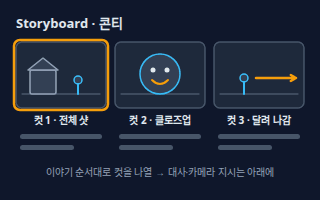</a> <b><a href="#storyboard--콘티-스토리보드">Storyboard</a></b> 콘티 (스토리보드) 대본을 컷 단위 그림으로 미리 그려 놓은 것. 컷마다 화면, 대사, 카메라 위치, 효과음 메모가 붙는다.</td>
<td width="33%" valign="top"><a href="#animatic--애니매틱">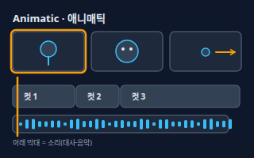</a> <b><a href="#animatic--애니매틱">Animatic</a></b> 애니매틱 콘티 그림을 컷마다 필요한 시간만큼 보여 주고 대사·음악을 얹은 영상. 본 작업 전에 박자와 길이를 확인한다.</td>
<td width="33%" valign="top"><a href="#model-sheet--모델-시트">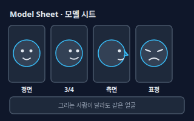</a> <b><a href="#model-sheet--모델-시트">Model Sheet</a></b> 모델 시트 캐릭터의 모양, 비율, 색, 대표 표정을 정리한 기준 그림. 그리는 사람이 달라도 같은 캐릭터로 보이게 한다.</td>
</tr>
<tr>
<td width="33%" valign="top"><a href="#layout--레이아웃">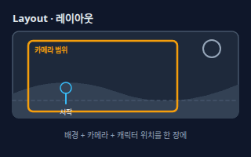</a> <b><a href="#layout--레이아웃">Layout</a></b> 레이아웃 한 컷의 배경, 카메라 틀, 캐릭터가 서는 위치와 움직임 방향을 한 장에 정리한 밑그림. 이 위에서 원화가 그려진다.</td>
</tr>
</table>

**그리기 · Drawing** (10)

<table>
<tr>
<td width="33%" valign="top"><a href="#key-animation--원화">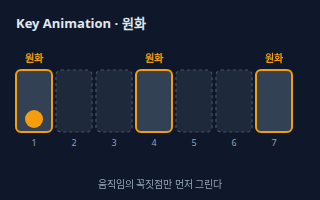</a> <b><a href="#key-animation--원화">Key Animation</a></b> 원화 움직임의 시작·끝·정점 같은 핵심 순간을 그린 그림. 그림 사이의 빈 칸은 동화로 채운다.</td>
<td width="33%" valign="top"><a href="#in-between--동화">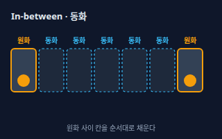</a> <b><a href="#in-between--동화">In-between</a></b> 동화 원화 사이에 들어가 움직임을 이어 주는 그림. 간격과 속도는 원화 옆에 적힌 타이밍 지시를 따른다.</td>
<td width="33%" valign="top"><a href="#breakdown--브레이크다운">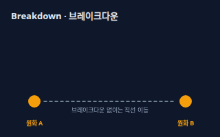</a> <b><a href="#breakdown--브레이크다운">Breakdown</a></b> 브레이크다운 원화 사이의 중요한 중간 자세. 이것이 있으면 동화가 직선 대신 호를 그리며 자연스러운 길을 따라간다.</td>
</tr>
<tr>
<td width="33%" valign="top"><a href="#pose-to-pose-vs-straight-ahead--포즈-투-포즈와-스트레이트-어헤드">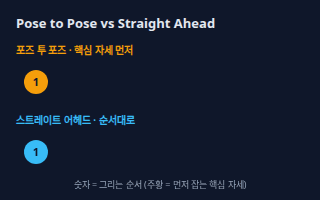</a> <b><a href="#pose-to-pose-vs-straight-ahead--포즈-투-포즈와-스트레이트-어헤드">Pose to Pose vs Straight Ahead</a></b> 포즈 투 포즈와 스트레이트 어헤드 포즈 투 포즈는 핵심 자세를 먼저 잡고 사이를 채우는 계획형, 스트레이트 어헤드는 첫 장부터 끝 장까지 순서대로 그려 가는 즉흥형이다.</td>
<td width="33%" valign="top"><a href="#frame-by-frame--프레임-바이-프레임">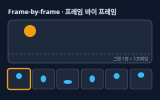</a> <b><a href="#frame-by-frame--프레임-바이-프레임">Frame-by-frame</a></b> 프레임 바이 프레임 움직임의 각 장면을 그림 한 장씩 따로 그려 이어 붙이는 전통 방식. 자유로운 변형이 가능하지만 작업량이 많다.</td>
<td width="33%" valign="top"><a href="#onion-skin--오니언-스킨">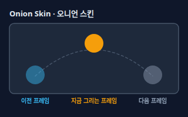</a> <b><a href="#onion-skin--오니언-스킨">Onion Skin</a></b> 오니언 스킨 디지털 애니메이션 프로그램에서 지금 그리는 프레임 앞뒤의 그림을 반투명하게 겹쳐 보여 주는 기능. 다음 그림이 얼마나 움직였는지 눈으로 확인할 수 있다.</td>
</tr>
<tr>
<td width="33%" valign="top"><a href="#light-table--라이트-테이블">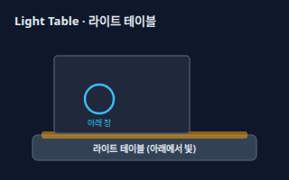</a> <b><a href="#light-table--라이트-테이블">Light Table</a></b> 라이트 테이블 유리판 아래에서 빛이 나오는 작업대. 얇은 종이를 겹치면 아래 장의 그림이 비쳐서 위치를 맞춰 다음 장을 그릴 수 있다.</td>
<td width="33%" valign="top"><a href="#cel--셀">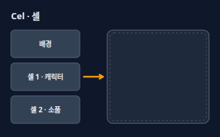</a> <b><a href="#cel--셀">Cel</a></b> 셀 투명한 필름 위에 윤곽선을 그리고 뒷면에서 색을 칠한 한 장. 배경 위에 겹쳐 촬영해 캐릭터만 다시 그리면 되도록 했다.</td>
<td width="33%" valign="top"><b><a href="motion-design.md#keyframe--키프레임">Keyframe</a></b> 키프레임 움직임의 중요한 순간을 직접 지정해 두는 표시. 2D 손그림의 원화에 해당하는 디지털 도구의 개념이다. → motion-design 시트</td>
</tr>
<tr>
<td width="33%" valign="top"><b><a href="motion-design.md#tween--트윈">Tween</a></b> 트윈 처음과 끝 모양만 정하면 중간 장면을 컴퓨터가 계산해 채우는 방식. 손그림의 동화를 자동화한 것에 가깝다. → motion-design 시트</td>
</tr>
</table>

**타이밍 · Timing** (6)

<table>
<tr>
<td width="33%" valign="top"><a href="#timing-sheet--타이밍-시트-엑스시트">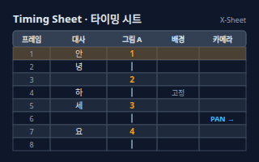</a> <b><a href="#timing-sheet--타이밍-시트-엑스시트">Timing Sheet</a></b> 타이밍 시트 (엑스시트) 프레임(한 줄 = 한 프레임)마다 쓸 그림 번호, 대사 소리, 배경, 카메라 지시를 적은 표. X-Sheet, 노출표(Exposure Sheet)라고도 부른다.</td>
<td width="33%" valign="top"><a href="#on-ones--twos--threes--원스투스쓰리스">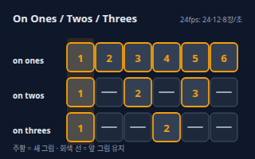</a> <b><a href="#on-ones--twos--threes--원스투스쓰리스">On Ones / Twos / Threes</a></b> 원스·투스·쓰리스 On twos는 그림 한 장을 2프레임 연속으로 보여 주는 것, on ones는 매 프레임 새 그림, on threes는 3프레임마다 새 그림이다. 24fps 기준 한 초에 필요한 그림이 24장, 12장, 8장으로 줄어든다.</td>
<td width="33%" valign="top"><a href="#timing--타이밍">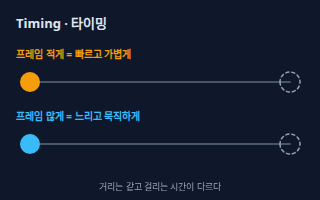</a> <b><a href="#timing--타이밍">Timing</a></b> 타이밍 움직임이 걸리는 프레임 수. 같은 거리라도 프레임이 적으면 빠르고 가볍게, 많으면 느리고 묵직하게 보인다.</td>
</tr>
<tr>
<td width="33%" valign="top"><a href="#spacing--스페이싱">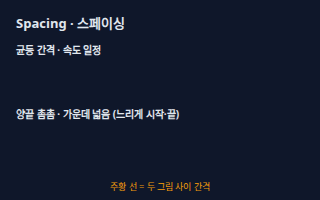</a> <b><a href="#spacing--스페이싱">Spacing</a></b> 스페이싱 연속한 그림들이 놓인 간격. 같은 프레임 수라도 간격을 좁게/넓게 배치하면 시작이 느린 움직임, 끝이 느린 움직임 등이 된다.</td>
<td width="33%" valign="top"><a href="#hold--홀드와-무빙-홀드">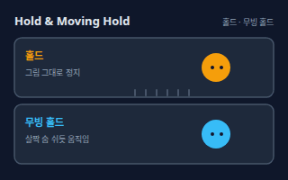</a> <b><a href="#hold--홀드와-무빙-홀드">Hold</a></b> 홀드와 무빙 홀드 홀드는 같은 그림을 몇 프레임 그대로 보여 주는 것, 무빙 홀드는 숨 쉬듯 아주 조금씩 움직여 정지한 느낌이 죽지 않게 하는 것이다.</td>
<td width="33%" valign="top"><b><a href="motion-design.md#ease-in-out--이즈-인-아웃">Ease-in-out</a></b> 이즈 인 아웃 천천히 시작해서 중간에 빨라지고 끝에서 다시 천천히 멈추는 움직임. 손그림에서는 '슬로 인 / 슬로 아웃'이라 부르며, 양 끝에 그림을 촘촘히 놓아 만든다. → motion-design 시트</td>
</tr>
</table>

**움직임 원리 · Motion Principles** (8)

<table>
<tr>
<td width="33%" valign="top"><a href="#arcs--아크-호">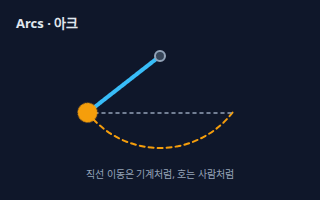</a> <b><a href="#arcs--아크-호">Arcs</a></b> 아크 (호) 살아 있는 생물의 움직임이 직선이 아니라 둥근 호를 따라 가는 성질. 그림을 그릴 때 손과 머리의 경로를 호로 잡으면 자연스러워진다.</td>
<td width="33%" valign="top"><a href="#overlapping-action--오버래핑-액션-겹치기-동작">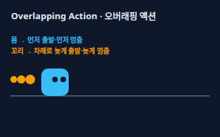</a> <b><a href="#overlapping-action--오버래핑-액션-겹치기-동작">Overlapping Action</a></b> 오버래핑 액션 (겹치기 동작) 몸의 각 부분이 서로 다른 시점에 시작하고 멈추도록 해서 겹쳐 보이게 하는 원리. 몸통이 먼저, 팔·옷·꼬리가 차례로 늦게 따른다.</td>
<td width="33%" valign="top"><a href="#secondary-action--보조-동작-세컨더리-액션">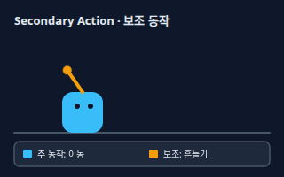</a> <b><a href="#secondary-action--보조-동작-세컨더리-액션">Secondary Action</a></b> 보조 동작 (세컨더리 액션) 주된 동작을 방해하지 않고 곁들여 캐릭터의 기분이나 성격을 보여 주는 작은 동작. 걸으며 휘파람을 불거나 손을 흔드는 것이다.</td>
</tr>
<tr>
<td width="33%" valign="top"><a href="#staging--스테이징-연출">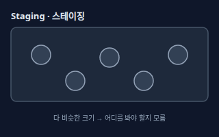</a> <b><a href="#staging--스테이징-연출">Staging</a></b> 스테이징 (연출) 보는 사람이 지금 봐야 할 것을 한눈에 알아보도록 구도, 실루엣, 크기, 밝기, 움직임의 순서를 정리하는 연출. 한 번에 한 가지 일이 가장 눈에 띄게 한다.</td>
<td width="33%" valign="top"><a href="#smear-frame--스미어-프레임">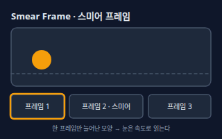</a> <b><a href="#smear-frame--스미어-프레임">Smear Frame</a></b> 스미어 프레임 빠른 동작의 중간 프레임에 물체를 길게 늘이거나 번지게 그려 넣은 그림. 한 프레임만 지나가므로 관객은 속도감으로 읽는다.</td>
<td width="33%" valign="top"><b><a href="motion-design.md#squash-and-stretch--스쿼시-앤-스트레치">Squash and Stretch</a></b> 스쿼시 앤 스트레치 움직이는 물체가 눌리고 늘어나서 무게와 탄력을 느끼게 하는 기법. → motion-design 시트</td>
</tr>
<tr>
<td width="33%" valign="top"><b><a href="motion-design.md#anticipation--예비-동작">Anticipation</a></b> 예비 동작 큰 동작 전에 반대 방향으로 먼저 움직여 다음 동작을 알려 주는 준비 동작. → motion-design 시트</td>
<td width="33%" valign="top"><b><a href="motion-design.md#follow-through--팔로스루">Follow-through</a></b> 팔로스루 몸이 멈춘 뒤에도 달린 부분이 관성으로 조금 더 움직이다 멈추게 하는 기법. → motion-design 시트</td>
</tr>
</table>

**캐릭터 연기 · Character** (4)

<table>
<tr>
<td width="33%" valign="top"> <b><a href="#walk-cycle--걷기-사이클">Walk Cycle</a></b> 걷기 사이클 걷는 한 걸음을 접촉(Contact), 내려감(Down), 지나감(Passing), 올라감(Up) 자세로 나누어 제자리에서 반복하도록 만든 동작. 배경을 반대로 흘리면 앞으로 걷는 것처럼 보인다.</td>
<td width="33%" valign="top"><a href="#run-cycle--달리기-사이클">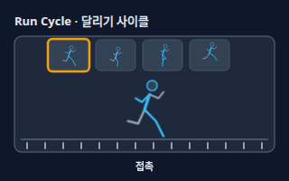</a> <b><a href="#run-cycle--달리기-사이클">Run Cycle</a></b> 달리기 사이클 달리는 동작을 반복하도록 설계한 것. 걷기와 달리 두 발이 모두 땅에서 떨어지는 공중 자세가 있고, 몸이 앞으로 기울며 팔을 굽혀 흔든다.</td>
<td width="33%" valign="top"><a href="#lip-sync--립싱크">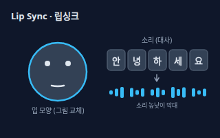</a> <b><a href="#lip-sync--립싱크">Lip Sync</a></b> 립싱크 녹음된 대사의 소리에 맞춰 입 모양 그림을 갈아 끼워 캐릭터가 직접 말하는 것처럼 보이게 하는 작업. 모든 글자를 맞추기보다 강하게 들리는 소리를 중심으로 맞춘다.</td>
</tr>
<tr>
<td width="33%" valign="top"><a href="#mouth-chart--입모양-차트">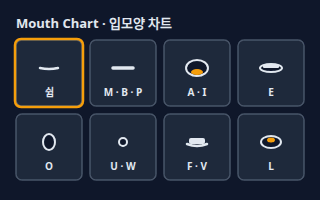</a> <b><a href="#mouth-chart--입모양-차트">Mouth Chart</a></b> 입모양 차트 같아 보이는 소리끼리 묶어 대표 입 모양을 그려 놓은 표. 보통 6~9개 정도를 쓰고, 쉼(닫힌 입), M·B·P, A·I, O, U 같은 묶음으로 나눈다. 시각적으로 구분되는 입 모양을 비세임(viseme)이라고도 한다.</td>
</tr>
</table>

**컷아웃 · Cut-out** (4)

<table>
<tr>
<td width="33%" valign="top"><a href="#cut-out-animation--컷아웃-애니메이션">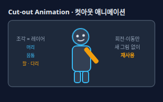</a> <b><a href="#cut-out-animation--컷아웃-애니메이션">Cut-out Animation</a></b> 컷아웃 애니메이션 캐릭터를 머리, 몸통, 팔, 다리 같은 조각으로 나누어 만들고, 조각을 옮기고 돌려서 움직이는 방식. 원래는 종이 조각을 한 장씩 찍는 기법이었고 지금은 프로그램에서 쓴다.</td>
<td width="33%" valign="top"><a href="#puppet-rig--퍼펫-리그-2d-본-리깅">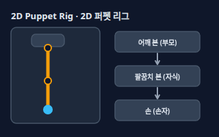</a> <b><a href="#puppet-rig--퍼펫-리그-2d-본-리깅">Puppet Rig</a></b> 퍼펫 리그 (2D 본 리깅) 컷아웃 조각들을 뼈대(본) 계층으로 연결한 장치. 어깨 본을 돌리면 팔꿈치와 손이 같이 움직이고, 팔꿈치만 돌리면 팔뚝과 손만 움직인다.</td>
<td width="33%" valign="top"><a href="#replacement-animation--교체-애니메이션">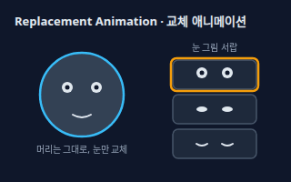</a> <b><a href="#replacement-animation--교체-애니메이션">Replacement Animation</a></b> 교체 애니메이션 눈, 입, 손처럼 모양이 크게 바뀌는 부분을 미리 여러 장 그려 두고 프레임마다 다른 그림으로 바꿔 끼우는 방식. 눈 깜빡임과 입 모양에 쓴다.</td>
</tr>
<tr>
<td width="33%" valign="top"><a href="#mesh-deformation--메시-변형">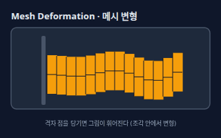</a> <b><a href="#mesh-deformation--메시-변형">Mesh Deformation</a></b> 메시 변형 이미지 한 장에 삼각형 그물(메시)을 씌우고 그물 점을 당겨 그림을 휘거나 비틀어서 움직이는 기술. 머리카락 흔들림, 옷자락 펄럭임, 표정 변화에 쓴다.</td>
</tr>
</table>

**마무리 · Finishing** (4)

<table>
<tr>
<td width="33%" valign="top"><a href="#compositing--컴포지팅-합성">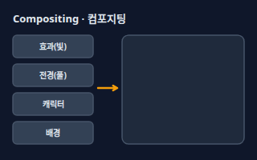</a> <b><a href="#compositing--컴포지팅-합성">Compositing</a></b> 컴포지팅 (합성) 배경, 캐릭터, 전경, 빛과 그림자 같은 층을 쌓고 카메라 움직임과 효과를 더해 최종 화면으로 완성하는 작업.</td>
<td width="33%" valign="top"><a href="#camera-move--카메라-이동-팬줌">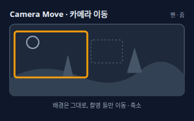</a> <b><a href="#camera-move--카메라-이동-팬줌">Camera Move</a></b> 카메라 이동 (팬·줌) 배경을 크게 그려 두고 카메라 틀을 옮기거나(팬) 키우고 줄여서(줌) 카메라가 움직이는 효과를 내는 것. 카메라 틀을 움직이는 방법은 컴포지팅 단계에서 지정한다.</td>
<td width="33%" valign="top"><a href="#multiplane--멀티플레인-다층-촬영">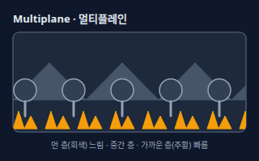</a> <b><a href="#multiplane--멀티플레인-다층-촬영">Multiplane</a></b> 멀티플레인 (다층 촬영) 배경을 먼 층, 중간 층, 가까운 층으로 나누어 서로 다른 속도로 움직이는 방식. 가까운 층이 빠르게 지나가 깊이가 느껴진다.</td>
</tr>
<tr>
<td width="33%" valign="top"><a href="#image-sequence--이미지-시퀀스">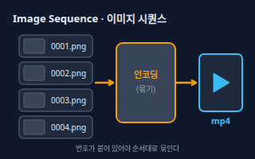</a> <b><a href="#image-sequence--이미지-시퀀스">Image Sequence</a></b> 이미지 시퀀스 영상 대신 프레임마다 한 장씩 번호가 붙은 이미지 파일(0001.png, 0002.png …)로 내보내는 방식. 투명 배경이 필요하거나 중간에 끊겨도 이어서 만들 수 있다.</td>
</tr>
</table>

<!-- overview:end -->

## 사전 제작 · Pre-production

### Storyboard · 콘티 (스토리보드)

- **정의**: 대본을 컷 단위 그림으로 미리 그려 놓은 것. 컷마다 화면, 대사, 카메라 위치, 효과음 메모가 붙는다.
- **AI에게 이렇게**: "내 90초짜리 설명 영상 대본을 컷 12개짜리 콘티로 나눠줘. 컷마다 화면 설명, 대사, 카메라(전체 샷·클로즈업), 예상 길이를 표로 써줘."
- **언제**: 그림을 그리기 전에 이야기 흐름과 컷 수를 확정할 때. 외주에 일을 맡기기 전 합의 문서로
- **헷갈림**: Animatic(애니매틱) — 콘티는 정지 그림 모음이고, 애니매틱은 그 그림에 시간과 소리를 붙인 거친 영상
- **관련**: Animatic, Layout, Model Sheet, 대본
- **확인 질문**: 컷 수와 총 길이의 목표는 얼마인가요? 화면 비율(16:9 가로, 9:16 세로)은 무엇인가요?

### Animatic · 애니매틱

- **정의**: 콘티 그림을 컷마다 필요한 시간만큼 보여 주고 대사·음악을 얹은 영상. 본 작업 전에 박자와 길이를 확인한다.
- **AI에게 이렇게**: "방금 만든 콘티를 애니매틱으로 바꾸려고 해. 컷별 시작 시간과 길이를 표로 만들고, 대사 길이에 맞춰 늘어지는 컷을 알려줘."
- **언제**: 그림을 비싸게 그리기 전에 늘어지거나 급한 부분을 찾을 때
- **헷갈림**: Storyboard(콘티) — 콘티는 정지 그림 모음, 애니매틱은 시간이 붙은 영상. Rough Animation(러프 작화)과도 다르다: 애니매틱의 그림은 아직 움직이지 않는다
- **관련**: Storyboard, Timing Sheet, Image Sequence, 가녹음
- **확인 질문**: 가녹음(임시 목소리)이 있나요, 아니면 대본 글자 수로 길이를 추정할까요?

### Model Sheet · 모델 시트

- **정의**: 캐릭터의 모양, 비율, 색, 대표 표정을 정리한 기준 그림. 그리는 사람이 달라도 같은 캐릭터로 보이게 한다.
- **AI에게 이렇게**: "우리 캐릭터의 모델 시트 기준을 정리해줘. 정면·측면·3/4 각도, 표정 4개, 머리와 몸 비율, 색상 코드를 항목별로 써줘."
- **언제**: 여러 사람이 같은 캐릭터를 그리거나 AI 이미지로 일관된 캐릭터를 만들 때
- **헷갈림**: Turnaround(턴어라운드) — 턴어라운드는 돌려본 각도 그림이고, 모델 시트는 그것에 표정·비율·색 규칙까지 합친 기준표 (그림 그리기 쪽 용어는 일러스트 시트 참고)
- **관련**: Turnaround, 표정표, 캐릭터 시트, Layout
- **확인 질문**: 스타일은 단순한 선인가요 입체감 있는 채색인가요? 필요한 표정과 포즈 목록이 있나요?

### Layout · 레이아웃

- **정의**: 한 컷의 배경, 카메라 틀, 캐릭터가 서는 위치와 움직임 방향을 한 장에 정리한 밑그림. 이 위에서 원화가 그려진다.
- **AI에게 이렇게**: "컷 5의 레이아웃을 설명해줘. 배경 구도, 카메라 틀 위치, 캐릭터가 오른쪽으로 걸어가며 서는 시작·끝 위치를 글로 정리해줘."
- **언제**: 콘티를 실제로 그리기 시작하는 첫 단계, 배경 화가와 원화가에게 컷을 넘길 때
- **헷갈림**: Storyboard(콘티) — 콘티는 컷의 아이디어를 보여 주고, 레이아웃은 실제 작업 크기와 카메라 틀에 맞춘 정밀한 설계도
- **관련**: Storyboard, Camera Move, Staging, 배경(Background)
- **확인 질문**: 카메라가 고정인가요, 팬이나 줌이 있나요? 배경은 한 장으로 끝나나요, 길게 이어지나요?

## 그리기 · Drawing

### Key Animation · 원화

- **정의**: 움직임의 시작·끝·정점 같은 핵심 순간을 그린 그림. 그림 사이의 빈 칸은 동화로 채운다.
- **AI에게 이렇게**: "점프 동작을 원화 4장으로 설계해줘. 준비 자세, 도약 순간, 최고점, 착지 순서로 각 원화의 자세를 글로 설명해줘."
- **언제**: 동작의 뼈대를 먼저 잡고 감독 확인을 받을 때
- **헷갈림**: Keyframe(키프레임) — 키프레임은 프로그램에서 값(위치·크기 등)을 찍어 두는 점이고, 원화는 손으로 그린 핵심 그림 한 장
- **관련**: In-between, Breakdown, Keyframe, Pose to Pose
- **확인 질문**: 동작은 몇 초인가요? 꼭 보여 주고 싶은 순간(감정, 타격 등)이 있나요?

### In-between · 동화

- **정의**: 원화 사이에 들어가 움직임을 이어 주는 그림. 간격과 속도는 원화 옆에 적힌 타이밍 지시를 따른다.
- **AI에게 이렇게**: "원화 1번과 2번 사이를 동화 3장으로 채우려고 해. 가운데가 느리게 지나가도록 간격(스페이싱)을 정해줘."
- **언제**: 원화 확정 후 움직임을 부드럽게 이을 때. 동화만 따로 외주하기도 한다
- **헷갈림**: Tween(트윈) — 트윈은 프로그램이 자동으로 채우는 중간 값이고, 동화는 사람이 한 장씩 그리는 중간 그림
- **관련**: Key Animation, Breakdown, Spacing, Tween
- **확인 질문**: 원화 사이에 몇 장을 넣을까요? 어느 쪽이 먼저 빠르게 움직이나요?

### Breakdown · 브레이크다운

- **정의**: 원화 사이의 중요한 중간 자세. 이것이 있으면 동화가 직선 대신 호를 그리며 자연스러운 길을 따라간다.
- **AI에게 이렇게**: "공을 던지는 팔 동작에서 원화 두 장 사이에 브레이크다운 자세를 하나 추가해서 팔이 호를 그리게 해줘."
- **언제**: 원화만으로는 움직임이 기계처럼 직선으로 보일 때
- **헷갈림**: In-between(동화) — 동화는 자잘한 중간 칸 전체, 브레이크다운은 그중 경로를 정하는 핵심 한 장. 컷아웃에서는 "캐릭터를 조각으로 나누는 작업"을 브레이크다운이라고도 부른다
- **관련**: Key Animation, In-between, Arcs
- **확인 질문**: 이 동작이 지나가는 경로는 어떤 호인가요? 속도가 빨라지는 쪽은 어디인가요?

### Pose to Pose vs Straight Ahead · 포즈 투 포즈와 스트레이트 어헤드

- **정의**: 포즈 투 포즈는 핵심 자세를 먼저 잡고 사이를 채우는 계획형, 스트레이트 어헤드는 첫 장부터 끝 장까지 순서대로 그려 가는 즉흥형이다.
- **AI에게 이렇게**: "이 폭발 장면은 스트레이트 어헤드로 자유롭게 그리고, 대사 있는 연기 장면은 포즈 투 포즈로 원화를 먼저 잡는 순서로 작업 계획을 짜줘."
- **언제**: 대사·연기는 포즈 투 포즈, 불·연기·물결처럼 흐르는 효과는 스트레이트 어헤드로 정할 때
- **헷갈림**: Frame-by-frame(프레임 바이 프레임) — 프레임 바이 프레임은 그림을 한 장씩 새로 그리는 제작 방식이고, 이 용어는 그리는 순서(계획 vs 즉흥)에 대한 것
- **관련**: Key Animation, In-between, Frame-by-frame
- **확인 질문**: 움직임이 정확한 비율 유지가 중요한가요, 자유로운 흐름이 중요한가요?

### Frame-by-frame · 프레임 바이 프레임

- **정의**: 움직임의 각 장면을 그림 한 장씩 따로 그려 이어 붙이는 전통 방식. 자유로운 변형이 가능하지만 작업량이 많다.
- **AI에게 이렇게**: "이 캐릭터 연기는 프레임 바이 프레임으로 하고 싶어. 3초 컷에 투스로 필요한 그림 수와 대략의 작업 시간을 계산해줘."
- **언제**: 표정이나 몸의 형태가 계속 바뀌는 연기, 불·액션 효과에서
- **헷갈림**: Tween-based(트윈 기반) — 트윈 기반은 몇 개의 포즈를 두고 프로그램이 사이를 채우고, 프레임 바이 프레임은 사이 그림도 사람이 직접 그림
- **관련**: Onion Skin, On Twos, Tween, 컷아웃
- **확인 질문**: 예산과 일정에 비해 작업량이 괜찮은가요? 컷아웃이나 트윈으로 줄일 수 있는 컷이 있나요?

### Onion Skin · 오니언 스킨

- **정의**: 디지털 애니메이션 프로그램에서 지금 그리는 프레임 앞뒤의 그림을 반투명하게 겹쳐 보여 주는 기능. 다음 그림이 얼마나 움직였는지 눈으로 확인할 수 있다.
- **AI에게 이렇게**: "어니언 스킨을 앞 2프레임, 뒤 1프레임으로 설정하는 방법을 내가 쓰는 프로그램 기준으로 알려줘."
- **언제**: 동화를 그릴 때 이전 그림과 간격이 맞는지 확인할 때
- **헷갈림**: Light Table(라이트 테이블) — 라이트 테이블은 종이를 아래에서 비추는 실제 도구이고, 어니언 스킨은 그것을 화면에서 흉내 낸 소프트웨어 기능
- **관련**: Light Table, In-between, Frame-by-frame
- **확인 질문**: 어떤 프로그램(Clip Studio, Toon Boom, Krita, Procreate 등)을 쓰나요?

### Light Table · 라이트 테이블

- **정의**: 유리판 아래에서 빛이 나오는 작업대. 얇은 종이를 겹치면 아래 장의 그림이 비쳐서 위치를 맞춰 다음 장을 그릴 수 있다.
- **AI에게 이렇게**: "종이로 애니메이션을 그리는 중이야. 라이트 테이블 없이 쓸 수 있는 대체 방법(태블릿, 앱)과 장단점을 알려줘."
- **언제**: 종이 작업, 타공판(핀바)에 종이를 고정해 여러 장을 겹쳐 그릴 때
- **헷갈림**: Onion Skin(오니언 스킨) — 라이트 테이블은 종이 작업용 하드웨어, 오니언 스킨은 디지털 프로그램의 같은 기능
- **관련**: Onion Skin, 타공판(Peg bar), 동화
- **확인 질문**: 종이 작업인가요, 태블릿 작업인가요? 스캔해서 디지털로 마무리하나요?

### Cel · 셀

- **정의**: 투명한 필름 위에 윤곽선을 그리고 뒷면에서 색을 칠한 한 장. 배경 위에 겹쳐 촬영해 캐릭터만 다시 그리면 되도록 했다.
- **AI에게 이렇게**: "셀 애니메이션 스타일로 보이는 영상을 만들고 싶어. 투명 레이어 구성(배경, 캐릭터, 소품)과 윤곽선 질감을 어떻게 흉내 낼지 정리해줘."
- **언제**: 손그림 풍 캐릭터를 레이어로 분리해서 배경과 합칠 때, 또는 "셀화 느낌"을 요청할 때
- **헷갈림**: Cel Shading(셀 셰이딩) — 셀 셰이딩은 3D를 만화처럼 보이게 하는 그림 기법이고, 셀은 전통 2D의 투명 필름 한 장 (명암 기법은 일러스트 시트 참고)
- **관련**: Compositing, Layout, 레이어, Frame-by-frame
- **확인 질문**: 배경과 캐릭터를 레이어로 분리해서 받으면 되나요? 디지털 채색 후 PNG로 전달할까요?

### Keyframe · 키프레임

- **정의**: 움직임의 중요한 순간을 직접 지정해 두는 표시. 2D 손그림의 원화에 해당하는 디지털 도구의 개념이다.
- **원본**: [모션 디자인 · Keyframe](motion-design.md#keyframe--키프레임)

### Tween · 트윈

- **정의**: 처음과 끝 모양만 정하면 중간 장면을 컴퓨터가 계산해 채우는 방식. 손그림의 동화를 자동화한 것에 가깝다.
- **원본**: [모션 디자인 · Tween](motion-design.md#tween--트윈)

## 타이밍 · Timing

### Timing Sheet · 타이밍 시트 (엑스시트)

- **정의**: 프레임(한 줄 = 한 프레임)마다 쓸 그림 번호, 대사 소리, 배경, 카메라 지시를 적은 표. X-Sheet, 노출표(Exposure Sheet)라고도 부른다.
- **AI에게 이렇게**: "이 3초 컷의 타이밍 시트를 만들어줘. 24fps 투스로, 그림 A는 1~6번, 대사 "안녕하세요"를 프레임별로 나눠서 표로 써줘."
- **언제**: 애니메이터, 채색, 촬영(컴포지팅) 담당이 같은 약속으로 컷을 이어 붙일 때
- **헷갈림**: Storyboard(콘티) — 콘티는 컷의 그림 계획이고, 타이밍 시트는 한 컷 안의 프레임 단위 시간표
- **관련**: On Twos, Hold, Lip Sync, Compositing, 노출표
- **확인 질문**: 프레임레이트는 몇 fps인가요? 소리(대사)는 이미 녹음되어 있나요?

### On Ones / Twos / Threes · 원스·투스·쓰리스

- **정의**: On twos는 그림 한 장을 2프레임 연속으로 보여 주는 것, on ones는 매 프레임 새 그림, on threes는 3프레임마다 새 그림이다. 24fps 기준 한 초에 필요한 그림이 24장, 12장, 8장으로 줄어든다.
- **AI에게 이렇게**: "이 캐릭터 걷기는 24fps 투스로, 눈 깜빡임은 원스로, 배경 흔들림은 쓰리스로 처리하는 타이밍 계획을 표로 정리해줘."
- **언제**: 작업량과 부드러움 사이에서 고를 때. 보통 연기는 투스, 빠른 동작은 원스
- **헷갈림**: Frame Rate(프레임레이트) — 프레임레이트는 1초에 보이는 프레임 수이고, 원스·투스는 그 프레임 중 새 그림이 들어가는 간격
- **관련**: Frame Rate, Timing Sheet, Hold, Frame-by-frame
- **확인 질문**: 프레임레이트는 24fps인가요 30fps인가요? 빠른 액션 컷은 원스로 올려도 되나요?

### Timing · 타이밍

- **정의**: 움직임이 걸리는 프레임 수. 같은 거리라도 프레임이 적으면 빠르고 가볍게, 많으면 느리고 묵직하게 보인다.
- **AI에게 이렇게**: "이 문 닫기 동작을 가볍게 보이는 버전(8프레임)과 묵직하게 보이는 버전(20프레임)으로 타이밍을 나눠서 제안해줘."
- **언제**: 캐릭터의 성격, 무게, 기분을 속도로 표현할 때
- **헷갈림**: Duration(지속 시간) — 지속 시간은 UI 모션의 초 단위 값이고, 애니메이션의 타이밍은 프레임 수와 간격이 함께 만드는 연기 도구
- **관련**: Spacing, On Twos, Timing Sheet, Hold
- **확인 질문**: 이 동작은 가볍고 빠른가요, 무겁고 느린가요? 전체 길이 제한이 있나요?

### Spacing · 스페이싱

- **정의**: 연속한 그림들이 놓인 간격. 같은 프레임 수라도 간격을 좁게/넓게 배치하면 시작이 느린 움직임, 끝이 느린 움직임 등이 된다.
- **AI에게 이렇게**: "공이 굴러가다 멈추는 동작을 7프레임으로 그릴 때 각 그림 사이의 간격(스페이싱)을 점점 좁아지게 숫자로 제안해줘."
- **언제**: 느리게 시작하거나 느리게 끝나는 움직임, 점프의 정점에서의 느림을 만들 때
- **헷갈림**: Timing(타이밍) — 타이밍은 프레임 수(시간)이고, 스페이싱은 그림이 놓인 거리(공간). 시간이 같아도 간격이 다르면 다른 움직임
- **관련**: Timing, In-between, Ease-in-out, Arcs
- **확인 질문**: 움직임이 시작과 끝에서 느려지나요, 중간에 가장 빠른가요?

### Hold · 홀드와 무빙 홀드

- **정의**: 홀드는 같은 그림을 몇 프레임 그대로 보여 주는 것, 무빙 홀드는 숨 쉬듯 아주 조금씩 움직여 정지한 느낌이 죽지 않게 하는 것이다.
- **AI에게 이렇게**: "대사 사이에 캐릭터가 멈춰 있는 5프레임 구간을 무빙 홀드로 처리해서 숨 쉬는 정도의 미세한 움직임을 추가해줘."
- **언제**: 감정 포인트를 강조하거나, 말하지 않는 캐릭터가 죽어 보이지 않게 할 때
- **헷갈림**: Freeze Frame(프리즈 프레임) — 프리즈 프레임은 영상 전체를 멈추는 편집 효과이고, 홀드는 캐릭터의 자세만 유지하는 작화 기법
- **관련**: Timing Sheet, Staging, Anticipation, On Twos
- **확인 질문**: 멈추는 길이는 몇 프레임인가요? 멈춘 동안 눈 깜빡임이나 숨쉬기를 넣을까요?

### Ease-in-out · 이즈 인 아웃

- **정의**: 천천히 시작해서 중간에 빨라지고 끝에서 다시 천천히 멈추는 움직임. 손그림에서는 '슬로 인 / 슬로 아웃'이라 부르며, 양 끝에 그림을 촘촘히 놓아 만든다.
- **원본**: [모션 디자인 · Ease-in-out](motion-design.md#ease-in-out--이즈-인-아웃)

## 움직임 원리 · Motion Principles

### Arcs · 아크 (호)

- **정의**: 살아 있는 생물의 움직임이 직선이 아니라 둥근 호를 따라 가는 성질. 그림을 그릴 때 손과 머리의 경로를 호로 잡으면 자연스러워진다.
- **AI에게 이렇게**: "머리를 오른쪽으로 돌리는 동작에서 코 끝이 지나가는 호의 경로를 그림으로 설명하고, 호를 따라 중간 그림 위치를 알려줘."
- **언제**: 고개 돌리기, 팔 휘두르기, 공 던지기, 눈 이동 등 몸의 거의 모든 움직임
- **헷갈림**: Path Animation(패스 애니메이션) — 패스 애니메이션은 정해진 경로를 따라 이동시키는 기술이고, 아크는 어떤 경로로 움직이는 것이 자연스러운지에 대한 원리
- **관련**: Breakdown, Spacing, In-between, Follow-through
- **확인 질문**: 움직이는 부분은 어디(팔, 머리, 시선)인가요? 호의 방향이 위로 향하나요 아래로 향하나요?

### Overlapping Action · 오버래핑 액션 (겹치기 동작)

- **정의**: 몸의 각 부분이 서로 다른 시점에 시작하고 멈추도록 해서 겹쳐 보이게 하는 원리. 몸통이 먼저, 팔·옷·꼬리가 차례로 늦게 따른다.
- **AI에게 이렇게**: "달리다가 멈추는 캐릭터의 몸통, 팔, 망토가 서로 다른 타이밍에 멈추도록 오버래핑 액션을 적용한 타이밍을 제안해줘."
- **언제**: 옷자락, 머리카락, 꼬리, 긴 팔처럼 몸에 달린 부분을 움직일 때
- **헷갈림**: Follow-through(팔로스루) — 팔로스루는 몸이 멈춘 뒤 달린 부분이 계속 움직이다 멈추는 것에 초점이 있고, 오버래핑은 각 부분이 시작·정지하는 시점이 서로 겹치며 어긋나는 것 전체를 가리킨다
- **관련**: Follow-through, Secondary Action, Timing
- **확인 질문**: 움직이는 몸에 달린 부분은 무엇(옷, 머리카락, 꼬리)인가요? 얼마나 무거운 재질인가요?

### Secondary Action · 보조 동작 (세컨더리 액션)

- **정의**: 주된 동작을 방해하지 않고 곁들여 캐릭터의 기분이나 성격을 보여 주는 작은 동작. 걸으며 휘파람을 불거나 손을 흔드는 것이다.
- **AI에게 이렇게**: "걷고 있는 캐릭터에게 주 동작을 해치지 않는 보조 동작 3가지(예: 어깨 으쓱, 휘파람, 주변 두리번)를 제안해줘."
- **언제**: 대사가 없어도 캐릭터 성격을 보여 주거나 연기에 풍부함을 더할 때
- **헷갈림**: Overlapping Action(오버래핑 액션) — 오버래핑은 같은 동작의 부분들이 어긋나는 것이고, 보조 동작은 별개의 작은 동작을 추가하는 것
- **관련**: Overlapping Action, Staging, Hold, Walk Cycle
- **확인 질문**: 캐릭터는 어떤 성격과 기분인가요? 주 동작이 눈에 잘 띄어야 하는 컷인가요?

### Staging · 스테이징 (연출)

- **정의**: 보는 사람이 지금 봐야 할 것을 한눈에 알아보도록 구도, 실루엣, 크기, 밝기, 움직임의 순서를 정리하는 연출. 한 번에 한 가지 일이 가장 눈에 띄게 한다.
- **AI에게 이렇게**: "이 컷에서 시선이 주인공에게 먼저 가도록 구도와 밝기, 주변 인물의 움직임을 줄이는 스테이징 방안을 제안해줘."
- **언제**: 컷마다 가장 중요한 연기나 정보를 강조해야 할 때. 설명 영상에서 핵심 도형/글자를 보여 줄 때
- **헷갈림**: Composition(구도) — 구도는 화면 안 요소의 배치이고, 스테이징은 구도에 더해 움직임의 순서와 강조 방법까지 포함한 연출 전체 (구도는 사진·일러스트 시트 참고)
- **관련**: Layout, Hold, Smear Frame, 실루엣
- **확인 질문**: 이 컷에서 시청자가 꼭 봐야 할 한 가지는 무엇인가요? 동시에 움직이는 요소가 몇 개인가요?

### Smear Frame · 스미어 프레임

- **정의**: 빠른 동작의 중간 프레임에 물체를 길게 늘이거나 번지게 그려 넣은 그림. 한 프레임만 지나가므로 관객은 속도감으로 읽는다.
- **AI에게 이렇게**: "팔을 휘두르는 빠른 동작의 중간 한 프레임에 스미어를 넣으려고 해. 어떤 모양으로 번지게 그리면 되는지 설명해줘."
- **언제**: 펀치, 빠른 고개 돌리기, 점프 순간 등 한두 프레임만 지나가는 빠른 동작
- **헷갈림**: Motion Blur(모션 블러) — 모션 블러는 렌더 효과로 만들어지는 번짐이고, 스미어는 작화가 손으로 그리는 변형 그림
- **관련**: Squash and Stretch, Timing, On Ones, Anticipation
- **확인 질문**: 이 동작은 몇 프레임 안에 일어나나요? 스미어를 넣을 프레임을 정해야 할까요?

### Squash and Stretch · 스쿼시 앤 스트레치

- **정의**: 움직이는 물체가 눌리고 늘어나서 무게와 탄력을 느끼게 하는 기법.
- **원본**: [모션 디자인 · Squash and Stretch](motion-design.md#squash-and-stretch--스쿼시-앤-스트레치)

### Anticipation · 예비 동작

- **정의**: 큰 동작 전에 반대 방향으로 먼저 움직여 다음 동작을 알려 주는 준비 동작.
- **원본**: [모션 디자인 · Anticipation](motion-design.md#anticipation--예비-동작)

### Follow-through · 팔로스루

- **정의**: 몸이 멈춘 뒤에도 달린 부분이 관성으로 조금 더 움직이다 멈추게 하는 기법.
- **원본**: [모션 디자인 · Follow-through](motion-design.md#follow-through--팔로스루)

## 캐릭터 연기 · Character

### Walk Cycle · 걷기 사이클

- **정의**: 걷는 한 걸음을 접촉(Contact), 내려감(Down), 지나감(Passing), 올라감(Up) 자세로 나누어 제자리에서 반복하도록 만든 동작. 배경을 반대로 흘리면 앞으로 걷는 것처럼 보인다.
- **AI에게 이렇게**: "24fps 투스로 1초에 두 걸음 걷는 걷기 사이클의 포즈를 접촉·내려감·지나감·올라감 순서로 그려줘. 팔은 다리와 반대로 흔들리게 해줘."
- **언제**: 캐릭터가 길게 걸어가는 컷을 적은 그림으로 만들 때, 게임 캐릭터의 기본 움직임
- **헷갈림**: Loop(반복) — 루프는 어떤 반복이든 가리키는 일반 용어이고, 걷기 사이클은 끝과 처음이 이어지도록 설계된 걷기 한정 반복 구조
- **관련**: Run Cycle, Loop, On Twos, Sprite Sheet
- **확인 질문**: 캐릭터는 어떤 성격으로 걷나요(씩씩함, 지침, 살금살금)? 옆모습인가요 정면에서 보나요?

### Run Cycle · 달리기 사이클

- **정의**: 달리는 동작을 반복하도록 설계한 것. 걷기와 달리 두 발이 모두 땅에서 떨어지는 공중 자세가 있고, 몸이 앞으로 기울며 팔을 굽혀 흔든다.
- **AI에게 이렇게**: "원스 12프레임 안쪽으로 끝나는 달리기 사이클을 접촉·내려감·올라감·공중 자세로 설계해줘. 몸은 앞으로 기울이고 팔은 굽혀줘."
- **언제**: 추격 장면, 달려 나가는 캐릭터, 러닝 게임 캐릭터
- **헷갈림**: Walk Cycle(걷기 사이클) — 걷기는 항상 한 발이 땅에 있고, 달리기는 두 발이 모두 뜨는 순간이 있다. 이 차이가 속도감을 만든다
- **관련**: Walk Cycle, Loop, Smear Frame, Sprite Sheet
- **확인 질문**: 달리는 속도는 얼마나 빠른가요(조깅, 전력 질주)? 몸의 기울기를 크게 할까요?

### Lip Sync · 립싱크

- **정의**: 녹음된 대사의 소리에 맞춰 입 모양 그림을 갈아 끼워 캐릭터가 직접 말하는 것처럼 보이게 하는 작업. 모든 글자를 맞추기보다 강하게 들리는 소리를 중심으로 맞춘다.
- **AI에게 이렇게**: "대사 "오늘은 내가 만들어 볼게요"를 음절별로 쪼개고, 입모양 차트에서 어떤 모양을 어느 프레임에 쓸지 타이밍 표로 만들어줘."
- **언제**: 캐릭터가 말하는 모든 컷. 목소리가 먼저 녹음되고 나서 입을 맞추는 것이 보통이다
- **헷갈림**: Mouth Chart(입모양 차트) — 입모양 차트는 입 모양 그림 모음이고, 립싱크는 그 그림을 소리에 맞춰 언제 쓸지 정하는 작업
- **관련**: Mouth Chart, Timing Sheet, Replacement Animation, Hold
- **확인 질문**: 대사는 한국어인가요 영어인가요? 오디오가 이미 있나요? 입 모양은 몇 개로 단순화할까요?

### Mouth Chart · 입모양 차트

- **정의**: 같아 보이는 소리끼리 묶어 대표 입 모양을 그려 놓은 표. 보통 6~9개 정도를 쓰고, 쉼(닫힌 입), M·B·P, A·I, O, U 같은 묶음으로 나눈다. 시각적으로 구분되는 입 모양을 비세임(viseme)이라고도 한다.
- **AI에게 이렇게**: "한국어 대사용 입모양 차트를 7개로 만들어줘. 쉼, 닫힘(ㅁㅂㅍ), ㅏ, ㅣ, ㅜ, ㅗ, ㅔ 모양을 글로 설명하고 우리 캐릭터 스타일에 맞게 단순화해줘."
- **언제**: 립싱크를 시작하기 전에 캐릭터마다 입 모양 세트를 한 번 정해 둘 때
- **헷갈림**: Phoneme(음소) — 음소는 소리의 단위이고, 입모양은 눈에 보이는 모양. 소리가 달라도 입 모양이 같은 것이 있어 하나로 묶는다 (영어 기준 차트는 한국어에 그대로 쓰기 어려워 모음 중심으로 다시 맞추는 경우가 많다)
- **관련**: Lip Sync, Replacement Animation, Model Sheet, Rhubarb
- **확인 질문**: 캐릭터 얼굴이 단순한 점 눈인가요 자세한 입인가요? 영어/한국어 중 대사 언어는?

## 컷아웃 · Cut-out

### Cut-out Animation · 컷아웃 애니메이션

- **정의**: 캐릭터를 머리, 몸통, 팔, 다리 같은 조각으로 나누어 만들고, 조각을 옮기고 돌려서 움직이는 방식. 원래는 종이 조각을 한 장씩 찍는 기법이었고 지금은 프로그램에서 쓴다.
- **AI에게 이렇게**: "유튜브 설명 영상용 컷아웃 캐릭터를 만들려고 해. 머리, 몸통, 팔, 손, 눈, 입을 어떤 레이어로 나누면 좋을지 구조를 제안해줘."
- **언제**: 적은 그림으로 많은 컷을 만들 때. 예산이 작고 설명이 많은 영상에서
- **헷갈림**: Frame-by-frame(프레임 바이 프레임) — 프레임 바이 프레임은 그림을 매번 새로 그리고, 컷아웃은 한 번 만든 조각을 재사용하며 움직임. 둘을 섞어 쓰기도 한다
- **관련**: Puppet Rig, Replacement Animation, Compositing, Sprite Sheet
- **확인 질문**: 캐릭터가 옆모습 위주인가요 정면 위주인가요? 도구는 무엇(After Effects, Harmony, Moho, Spine, Live2D 등)인가요?

### Puppet Rig · 퍼펫 리그 (2D 본 리깅)

- **정의**: 컷아웃 조각들을 뼈대(본) 계층으로 연결한 장치. 어깨 본을 돌리면 팔꿈치와 손이 같이 움직이고, 팔꿈치만 돌리면 팔뚝과 손만 움직인다.
- **AI에게 이렇게**: "이 컷아웃 캐릭터에 어깨-팔꿈치-손 순서의 본 계층을 짜고, 회전의 중심점(피벗)을 어디에 둘지 알려줘."
- **언제**: 컷아웃 캐릭터에 걷기·손 흔들기 같은 반복 동작을 효율적으로 만들 때
- **헷갈림**: Rigging/Bone(3D 리깅) — 3D의 본은 입체 모델에 심고 2D 퍼펫 리그는 평면 조각을 연결한다. 3D 모델링 시트의 Bone / Armature 참고
- **관련**: Cut-out Animation, Mesh Deformation, Pivot, Forward/Inverse Kinematics
- **확인 질문**: 손목·팔꿈치처럼 꺾이는 곳이 있나요? 피벗 위치를 직접 정해 줄 수 있나요?

### Replacement Animation · 교체 애니메이션

- **정의**: 눈, 입, 손처럼 모양이 크게 바뀌는 부분을 미리 여러 장 그려 두고 프레임마다 다른 그림으로 바꿔 끼우는 방식. 눈 깜빡임과 입 모양에 쓴다.
- **AI에게 이렇게**: "눈 뜬 상태, 반쯤 감은 상태, 감은 상태 3장으로 눈 깜빡임을 교체 애니메이션으로 만들어줘. 몇 프레임 간격으로 바꿀지도 제안해줘."
- **언제**: 컷아웃에서 회전만으로는 어려운 입, 손, 표정을 처리할 때
- **헷갈림**: Morphing(모핑) — 모핑은 한 모양이 다른 모양으로 부드럽게 변하는 효과이고, 교체는 중간 과정 없이 그림이 통째로 바뀌는 방식
- **관련**: Mouth Chart, Lip Sync, Cut-out Animation, Sprite Sheet
- **확인 질문**: 교체할 부분은 눈, 입, 손 중 무엇인가요? 몇 가지 모양이 필요한가요?

### Mesh Deformation · 메시 변형

- **정의**: 이미지 한 장에 삼각형 그물(메시)을 씌우고 그물 점을 당겨 그림을 휘거나 비틀어서 움직이는 기술. 머리카락 흔들림, 옷자락 펄럭임, 표정 변화에 쓴다.
- **AI에게 이렇게**: "이 캐릭터 일러스트를 레이어로 나눠서 머리카락과 옷자락에 메시 변형으로 가볍게 흔들리는 움직임을 주는 작업 순서를 알려줘."
- **언제**: 한 장의 일러스트를 크게 다시 그리지 않고 살아 움직이게 하고 싶을 때, 버튜버·소규모 영상
- **헷갈림**: Morphing(모핑) — 모핑은 두 모양 사이를 바꾸는 효과이고, 메시 변형은 한 모양을 격자 점으로 휘게 하는 방식
- **관련**: Puppet Rig, Cut-out Animation, Follow-through, Live2D
- **확인 질문**: 일러스트는 레이어로 분리되어 있나요? 움직이고 싶은 부분은 어디인가요(머리카락, 눈, 가슴)?

## 마무리 · Finishing

### Compositing · 컴포지팅 (합성)

- **정의**: 배경, 캐릭터, 전경, 빛과 그림자 같은 층을 쌓고 카메라 움직임과 효과를 더해 최종 화면으로 완성하는 작업.
- **AI에게 이렇게**: "배경, 캐릭터, 전경 풀, 빛 효과 레이어를 합성해서 컷 하나를 만드는 순서를 알려줘. 레이어를 쌓는 순서도 포함해줘."
- **언제**: 작화가 끝난 컷을 최종 영상으로 만드는 마지막 단계
- **헷갈림**: Editing(편집) — 편집은 컷을 길게 이어 붙이는 일이고, 컴포지팅은 컷 하나의 화면 안에서 층을 쌓는 일
- **관련**: Cel, Camera Move, Multiplane, Image Sequence
- **확인 질문**: 사용하는 도구는 무엇인가요(After Effects, Harmony, Premiere 등)? 투명 PNG 레이어로 받을 수 있나요?

### Camera Move · 카메라 이동 (팬·줌)

- **정의**: 배경을 크게 그려 두고 카메라 틀을 옮기거나(팬) 키우고 줄여서(줌) 카메라가 움직이는 효과를 내는 것. 카메라 틀을 움직이는 방법은 컴포지팅 단계에서 지정한다.
- **AI에게 이렇게**: "컷 7은 왼쪽에서 오른쪽으로 느리게 팬 하다가 마지막에 캐릭터 얼굴로 줌 인 하도록 카메라 이동을 설계해줘. 필요한 배경 폭도 알려줘."
- **언제**: 긴 배경을 보여 주거나 감정 포인트로 시선을 모을 때
- **헷갈림**: Pan(팬) — 영상 제작 시트의 Pan은 실제 카메라를 좌우로 돌리는 촬영 기법이고, 2D 애니메이션의 카메라 이동은 배경 그림 위에서 촬영 틀을 움직이는 효과를 가리킨다
- **관련**: Layout, Compositing, Multiplane, Staging
- **확인 질문**: 팬 방향과 시작·끝 위치를 정했나요? 배경을 카메라가 지나갈 만큼 크게 그릴 수 있나요?

### Multiplane · 멀티플레인 (다층 촬영)

- **정의**: 배경을 먼 층, 중간 층, 가까운 층으로 나누어 서로 다른 속도로 움직이는 방식. 가까운 층이 빠르게 지나가 깊이가 느껴진다.
- **AI에게 이렇게**: "이 2D 장면을 먼 산, 중간 나무, 가까운 풀 3층으로 나누고 카메라 팬에 맞춰 층마다 이동 속도를 다르게 만드는 방법을 알려줘."
- **언제**: 2D인데 입체감 있는 배경 이동을 만들고 싶을 때. 걷는 캐릭터 뒤 배경 스크롤
- **헷갈림**: Parallax Scrolling(패럴랙스 스크롤) — UI 시트의 패럴랙스는 웹 화면 스크롤에 쓰는 효과이고, 멀티플레인은 애니메이션 촬영에서 같은 원리를 쓰는 방식
- **관련**: Camera Move, Compositing, Layout, Parallax
- **확인 질문**: 층을 몇 개로 나눌까요? 배경 그림이 층별로 분리되어 있나요?

### Image Sequence · 이미지 시퀀스

- **정의**: 영상 대신 프레임마다 한 장씩 번호가 붙은 이미지 파일(0001.png, 0002.png …)로 내보내는 방식. 투명 배경이 필요하거나 중간에 끊겨도 이어서 만들 수 있다.
- **AI에게 이렇게**: "컷 12를 PNG 시퀀스(투명 배경)로 내보내고, 이어서 편집 프로그램에서 24fps 영상으로 합치는 순서를 알려줘."
- **언제**: 투명 배경이 필요한 영상, 긴 컷의 렌더 안정성, 다른 사람에게 컷을 넘길 때
- **헷갈림**: GIF vs MP4(GIF와 MP4/WebM) — 이미지 시퀀스는 최종 파일이 아니라 중간 상태이고, GIF/MP4는 합쳐진 결과 형식 (비교는 모션 디자인 시트에)
- **관련**: Compositing, Frame Rate, Animatic, Loop
- **확인 질문**: 결과물은 투명 배경이 필요한가요? 해상도와 프레임레이트는 어떻게 하나요?

## 참고 자료

- [Exposure sheet — Wikipedia](https://en.wikipedia.org/wiki/Exposure_sheet)
- [Toon Boom Glossary](https://docs.toonboom.com/help/glossary/glossary/glossary.html)
- [Toon Boom Learn — Traditional Animation Workflow](http://learn.toonboom.com/modules/animation-workflow/topic/traditional-animation-workflow)
- [Toon Boom Harmony — How to Rig a Cut-out Character](https://docs.toonboom.com/help/harmony-27/essentials/getting-started/character-building.html)
- [Godot Docs — Cutout animation](https://docs.godotengine.org/en/stable/tutorials/animation/cutout_animation.html)
- [Adobe — 12 Principles of Animation](https://adobe.com/creativecloud/animation/discover/principles-of-animation.html)
- [Animperia — Lip sync animation guide and mouth chart](https://animperia.com/learn/lip-sync-animation)
- [Marionette Studio — How to animate a Walk Cycle](https://marionettestudio.com/how-to-animate-a-walk-cycle)
- [Motifmotion — What Is an Animatic?](https://motifmotion.com/what-is-an-animatic)
