# 음향 · 음악 제작 치트시트

> "소리가 이상해요", "좀 더 빵빵하게 해줘"만으로는 AI도 엔지니어도 어디를 만져야 하는지 알 수 없습니다. 이 시트의 용어로 **어떤 소리를 어떤 마이크로 받고(마이크·연결) → 믹서에서 어떻게 섞고 → 연주자와 관객에게 어떻게 들려주고(합주실 장비) → 어떻게 다듬어 → 어떤 설정으로 녹음하고 마무리할지**를 말하면 한 번에 통합니다.
> 순서는 소리가 들어와서 나가는 흐름이라 영상 챕터 순서와 같습니다. 그림은 GitHub에서 직접 움직입니다.

> **참고용입니다.** 장비 모델·가격 추천은 다루지 않습니다. 스트리밍 플랫폼의 소리 크기(LUFS) 기준처럼 바뀔 수 있는 숫자에는 2026-11-02에 공식 안내에서 확인한 근거를 붙였으니, 음원을 올리기 전에 해당 플랫폼의 최신 안내를 한 번 더 확인하세요. 영상 속 소리 크기와 방 소리는 영상 촬영·편집 시트의 `Audio Levels`, `Room Tone`을 함께 보세요.

## 이렇게 쓰세요

- **나 → AI**: "합주실 믹서에 다이내믹 마이크(보컬)와 기타 앰프 마이크가 꽂혀 있어. 보컬 마이크에서 하울링이 나는데, 확인할 순서와 보컬 모니터를 AUX로 따로 만드는 방법을 알려줘."
- **AI → 나**: "하울링은 '삐—'(높은 소리)인가요, '웅—'(낮은 소리)인가요? 모니터 스피커는 마이크 앞쪽에 있나요, 뒤쪽에 있나요?"
- **나 → AI**: "집에서 유튜브 나레이션을 녹음할 거야. 콘덴서 마이크를 오디오 인터페이스에 연결하고, 게인을 맞춰서 클리핑 없이 녹음하는 순서를 알려줘."
- **AI → 나**: "인터페이스 모델과 사용하는 DAW가 무엇인가요? 팬텀 파워(48V)는 켜져 있나요? 헤드폰은 인터페이스에 꽂으셨나요?"
- **나 → AI**: "믹스를 끝낸 곡을 스포티파이에 올리려고 해. 통합 LUFS와 트루피크를 공식 안내 기준으로 어떻게 맞출지 알려줘."

## 한눈에 보기

<!-- overview:start -->
<!-- 이 구역은 자동 생성됩니다. 직접 고치지 말고 `cd mcp-server && npm run generate`를 실행하세요. -->

**소리 기본 · Sound Basics** (6)

<table>
<tr>
<td width="33%" valign="top"><a href="#decibel--데시벨">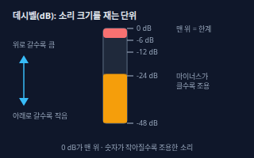</a> <b><a href="#decibel--데시벨">Decibel</a></b> 데시벨 소리 크기를 비교하는 단위(dB). 믹서와 녹음 프로그램의 미터는 맨 위를 0 dB로 두고 −6, −12처럼 마이너스 숫자로 세므로, 숫자가 작아질수록(마이너스가 클수록) 조용한 소리다.</td>
<td width="33%" valign="top"><a href="#gain--게인">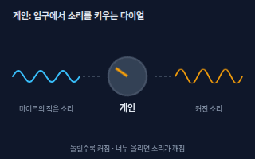</a> <b><a href="#gain--게인">Gain</a></b> 게인 마이크나 악기에서 들어오는 약한 신호를 믹서·인터페이스 입구에서 키우는 정도. 소리를 크게 만드는 노브처럼 보이지만 목적은 입력 크기를 알맞게 맞추는 것이다.</td>
<td width="33%" valign="top"><a href="#gain-staging--게인-스테이징">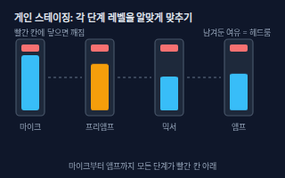</a> <b><a href="#gain-staging--게인-스테이징">Gain Staging</a></b> 게인 스테이징 마이크 → 믹서 → 이펙트 → 출력으로 이어지는 단계마다, 소리가 깨지지도 않고 너무 작아 잡음에 묻히지도 않도록 레벨을 차례로 맞추는 일. 깨지기 전까지 남겨 둔 여유를 헤드룸이라 부른다.</td>
</tr>
<tr>
<td width="33%" valign="top"><a href="#clipping--클리핑">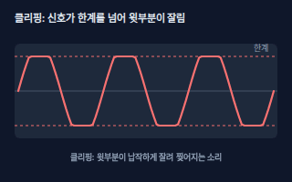</a> <b><a href="#clipping--클리핑">Clipping</a></b> 클리핑 신호가 장비가 받을 수 있는 한계를 넘어서 파형의 윗부분이 납작하게 잘리는 현상. 소리가 찢어지고 지직거리며, 한 번 잘린 녹음은 나중에 고치기 어렵다.</td>
<td width="33%" valign="top"><b><a href="video-production.md#audio-levels--오디오-레벨">Audio Levels</a></b> 오디오 레벨 소리의 크기. 영상에서는 목소리가 가장 크고 배경음악은 그 아래에 깔리게 맞춘다. → video-production 시트</td>
<td width="33%" valign="top"><b><a href="video-production.md#room-tone--룸-톤">Room Tone</a></b> 룸 톤 말하지 않을 때도 그 장소에 깔려 있는 조용한 배경 소리. 따로 녹음해 두었다가 말 사이 빈틈에 깐다. → video-production 시트</td>
</tr>
</table>

**마이크 · Microphones** (5)

<table>
<tr>
<td width="33%" valign="top"><a href="#dynamic-and-condenser-mic--다이내믹--콘덴서-마이크">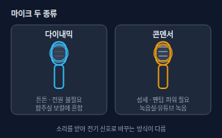</a> <b><a href="#dynamic-and-condenser-mic--다이내믹--콘덴서-마이크">Dynamic and Condenser Mic</a></b> 다이내믹 / 콘덴서 마이크 다이내믹 마이크는 튼튼하고 큰 소리에 강하며 따로 전원이 필요 없어 합주실의 보컬·드럼·앰프 앞에 많이 쓴다. 콘덴서 마이크는 작고 높은 소리까지 섬세하게 담지만 팬텀 파워(전원)가 필요하다.</td>
<td width="33%" valign="top"><a href="#polar-pattern--지향성">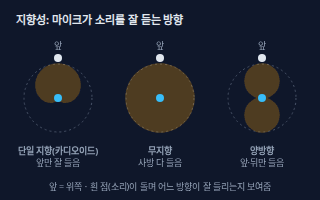</a> <b><a href="#polar-pattern--지향성">Polar Pattern</a></b> 지향성 마이크가 어느 방향의 소리를 잘 받는지를 모양으로 나타낸 것. 앞쪽만 잘 듣는 단일 지향(카디오이드), 사방을 듣는 무지향, 앞과 뒤를 듣는 양방향이 대표적이다.</td>
<td width="33%" valign="top"><a href="#proximity-effect--근접효과">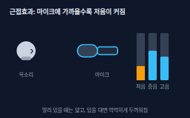</a> <b><a href="#proximity-effect--근접효과">Proximity Effect</a></b> 근접효과 방향성이 있는 마이크에 입을 가까이 댈수록 저음이 커져서 소리가 두껍고 먹먹해지는 현상. 마이크와의 거리에 따라 목소리 톤이 달라진다.</td>
</tr>
<tr>
<td width="33%" valign="top"><a href="#phantom-power--팬텀-파워">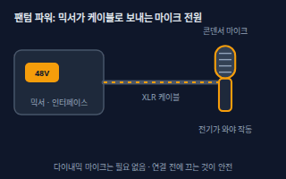</a> <b><a href="#phantom-power--팬텀-파워">Phantom Power</a></b> 팬텀 파워 믹서나 오디오 인터페이스가 마이크 케이블(XLR)을 통해 마이크에 보내 주는 전원. 콘덴서 마이크에 필요하며, 스튜디오 마이크는 대부분 48V를 쓰고 장비에 48V 버튼이 있다.</td>
<td width="33%" valign="top"><a href="#drum-miking--드럼-마이킹">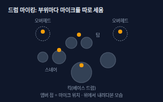</a> <b><a href="#drum-miking--드럼-마이킹">Drum Miking</a></b> 드럼 마이킹 드럼 세트의 킥(베이스 드럼)·스네어·탐·심벌마다 마이크를 따로 세워 소리를 담는 방법. 위에서 전체를 담는 마이크를 오버헤드라고 하며, 마이크 개수와 위치에 따라 드럼 소리가 크게 달라진다.</td>
</tr>
</table>

**케이블과 연결 · Cables and Connections** (4)

<table>
<tr>
<td width="33%" valign="top"><a href="#xlr-trs-and-ts-cables--xlr--trs--ts-케이블">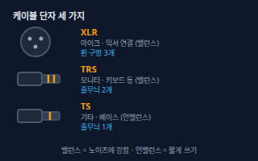</a> <b><a href="#xlr-trs-and-ts-cables--xlr--trs--ts-케이블">XLR, TRS and TS Cables</a></b> XLR / TRS / TS 케이블 XLR은 핀 구멍이 3개인 둥근 단자로 마이크와 믹서를 잇는 밸런스 케이블이다. TRS와 TS는 둥근 기타 잭 모양이며 줄무늬(링)가 2개면 TRS(밸런스 또는 스테레오), 1개면 TS(언밸런스, 기타·베이스 선)다.</td>
<td width="33%" valign="top"><a href="#di-box--di-박스">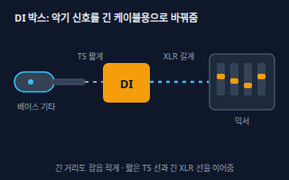</a> <b><a href="#di-box--di-박스">DI Box</a></b> DI 박스 기타·베이스·키보드처럼 약하고 잡음에 약한 악기 신호(언밸런스)를 마이크와 같은 밸런스 신호로 바꿔, 긴 XLR 케이블로 믹서까지 잡음 적게 보내는 작은 상자(다이렉트 박스).</td>
<td width="33%" valign="top"><a href="#ground-hum--험-노이즈">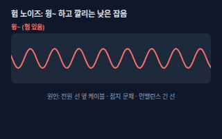</a> <b><a href="#ground-hum--험-노이즈">Ground Hum</a></b> 험 노이즈 스피커에서 '웅~' 하고 일정하게 깔리는 낮은 잡음. 전원선 옆을 지나가는 케이블, 접지 문제, 긴 언밸런스 케이블, 서로 다른 콘센트에 꽂은 장비 사이의 전기 차이 때문에 생긴다.</td>
</tr>
<tr>
<td width="33%" valign="top"><a href="#audio-interface--오디오-인터페이스">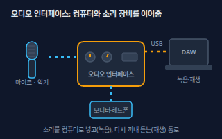</a> <b><a href="#audio-interface--오디오-인터페이스">Audio Interface</a></b> 오디오 인터페이스 컴퓨터에 마이크·악기를 연결해 녹음하고, 컴퓨터의 소리를 모니터 스피커·헤드폰으로 내보내는 외장 장치(보통 USB 연결). 마이크 입력, 게인 노브, 팬텀 파워, 헤드폰 단자가 들어 있다.</td>
</tr>
</table>

**믹서 · Mixer** (5)

<table>
<tr>
<td width="33%" valign="top"><a href="#mixer-and-channel-strip--믹서와-채널-스트립">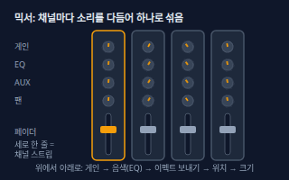</a> <b><a href="#mixer-and-channel-strip--믹서와-채널-스트립">Mixer and Channel Strip</a></b> 믹서와 채널 스트립 마이크·악기 여러 개의 소리를 받아 소리마다 크기·음색·위치를 정하고 하나로 섞어 내보내는 장비. 위에서 아래로 놓인 세로 한 줄이 채널 하나(채널 스트립)이며 게인, EQ, AUX, 팬, 페이더가 들어 있다.</td>
<td width="33%" valign="top"><a href="#fader--페이더">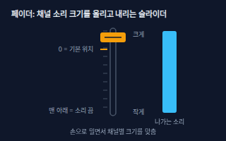</a> <b><a href="#fader--페이더">Fader</a></b> 페이더 채널 소리의 크기를 밀어서 조절하는 슬라이더. 위로 올리면 커지고 아래로 내리면 작아지며, 눈금의 0 근처가 기본(소리를 키우지도 줄이지도 않는) 위치다.</td>
<td width="33%" valign="top"><a href="#panning--패닝">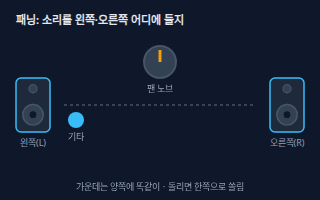</a> <b><a href="#panning--패닝">Panning</a></b> 패닝 소리를 스테레오의 왼쪽과 오른쪽 사이 어디에 놓을지 정하는 일. 노브를 가운데 두면 양쪽 스피커에서 똑같이 나온다.</td>
</tr>
<tr>
<td width="33%" valign="top"><a href="#aux-send--aux-센드">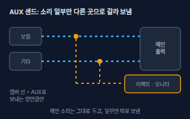</a> <b><a href="#aux-send--aux-센드">Aux Send</a></b> AUX 센드 채널 소리의 일부를 메인 출력과 별도로 다른 곳(리버브 같은 이펙트, 연주자용 모니터, 인이어)으로 갈라 보내는 출력. 노브로 보내는 양을 정한다.</td>
<td width="33%" valign="top"><a href="#bus--버스">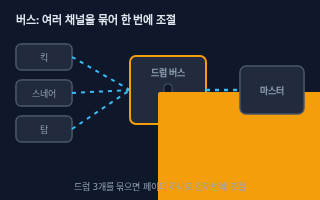</a> <b><a href="#bus--버스">Bus</a></b> 버스 여러 채널을 한데 모아 하나의 줄(그룹)로 만든 경로. 드럼 마이크 여러 개를 드럼 버스로 묶으면 페이더 하나로 드럼 전체 크기를 조절하고 컴프레서도 한 번에 걸 수 있다.</td>
</tr>
</table>

**합주실 장비 · Rehearsal Room Gear** (9)

<table>
<tr>
<td width="33%" valign="top"><a href="#backline--백라인">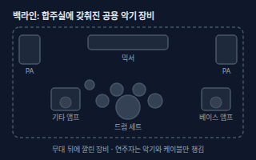</a> <b><a href="#backline--백라인">Backline</a></b> 백라인 합주실이나 공연장에 미리 갖춰 둔 공용 악기 장비. 보통 드럼 세트와 기타·베이스 앰프, 키보드 앰프를 말하며, 연주자는 악기·페달·스틱 같은 개인 장비만 들고 간다.</td>
<td width="33%" valign="top"><a href="#instrument-amp--악기-앰프">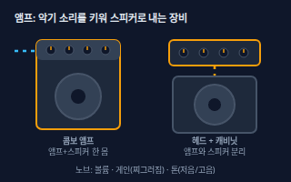</a> <b><a href="#instrument-amp--악기-앰프">Instrument Amp</a></b> 악기 앰프 기타·베이스·키보드의 약한 신호를 키워 스피커로 소리를 내는 장비로, 합주실에서는 줄여서 '앰프'라고 부른다. 앰프와 스피커가 한 몸인 콤보와, 따로 나뉜 헤드 + 캐비닛이 있고 볼륨·게인(찌그러짐 정도)·톤(저음·중음·고음) 노브가 있다.</td>
<td width="33%" valign="top"><a href="#pa-system--pa-시스템">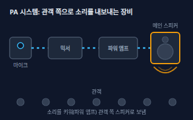</a> <b><a href="#pa-system--pa-시스템">PA System</a></b> PA 시스템 마이크·악기 소리를 믹서로 섞고, 파워 앰프로 힘을 실어 메인 스피커로 방 전체에 크게 내보내는 시스템(Public Address). 합주실에서는 보컬 마이크 소리를 내는 믹서와 스피커 한 벌을 가리킨다.</td>
</tr>
<tr>
<td width="33%" valign="top"><a href="#stage-monitor-and-studio-monitor--무대-모니터--스튜디오-모니터">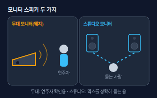</a> <b><a href="#stage-monitor-and-studio-monitor--무대-모니터--스튜디오-모니터">Stage Monitor and Studio Monitor</a></b> 무대 모니터 / 스튜디오 모니터 둘 다 '모니터'라 부르지만 용도가 다르다. 무대 모니터(웨지)는 바닥에 비스듬히 두어 연주자가 자기 소리를 듣게 하는 스피커이고, 스튜디오 모니터는 믹스할 때 소리를 정확하게 확인하려고 책상 앞에 두는 스피커다.</td>
<td width="33%" valign="top"><a href="#monitor-mix--모니터-믹스">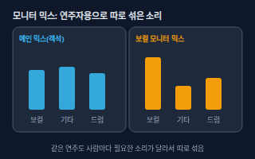</a> <b><a href="#monitor-mix--모니터-믹스">Monitor Mix</a></b> 모니터 믹스 관객에게 나가는 소리와는 별도로, 연주자가 듣기 좋게 따로 섞은 소리. 보컬은 자기 목소리와 기타를, 드러머는 베이스와 메트로놈을 크게 받는 식으로 사람마다 다르게 만든다.</td>
<td width="33%" valign="top"> <b><a href="#in-ear-monitor--인이어-모니터">In-Ear Monitor</a></b> 인이어 모니터 연주자가 귀에 꽂은 이어폰으로 모니터 믹스를 듣는 장치(IEM). 믹서 AUX 신호를 송신기로 보내 허리 수신기에 무선으로 전하는 방식이 흔하고, 선으로 직접 연결하는 방식도 있다.</td>
</tr>
<tr>
<td width="33%" valign="top"><a href="#acoustic-feedback--하울링">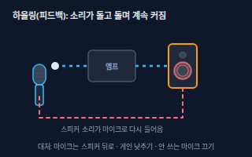</a> <b><a href="#acoustic-feedback--하울링">Acoustic Feedback</a></b> 하울링 스피커에서 나온 소리를 마이크가 다시 잡아 증폭하는 일이 반복되어 '삐—' 하거나 '웅—' 하고 점점 커지는 소리. 마이크 → 앰프 → 스피커가 고리를 이룰 때 생긴다.</td>
<td width="33%" valign="top"><a href="#soundproofing-and-acoustic-treatment--차음과-흡음">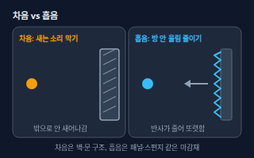</a> <b><a href="#soundproofing-and-acoustic-treatment--차음과-흡음">Soundproofing and Acoustic Treatment</a></b> 차음과 흡음 차음은 소리가 방 밖으로 새거나 안으로 들어오는 것을 막는 일(두꺼운 벽·문, 틈 막기)이고, 흡음은 방 안에서 울리는 소리를 줄이는 일(흡음 패널, 커튼)이다. 목적이 달라 쓰는 재료도 다르다.</td>
<td width="33%" valign="top"><a href="#metronome-and-bpm--메트로놈과-bpm">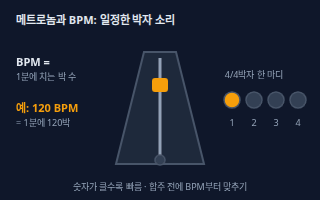</a> <b><a href="#metronome-and-bpm--메트로놈과-bpm">Metronome and BPM</a></b> 메트로놈과 BPM 메트로놈은 일정한 박자 소리를 내는 기계나 앱이고, BPM(Beats Per Minute)은 1분에 박이 몇 번 오는지 나타내는 빠르기 숫자다. 120 BPM이면 1분에 120박, 즉 1초에 2박이다.</td>
</tr>
</table>

**소리 다듬기 · Sound Processing** (5)

<table>
<tr>
<td width="33%" valign="top"><a href="#eq--이퀄라이저">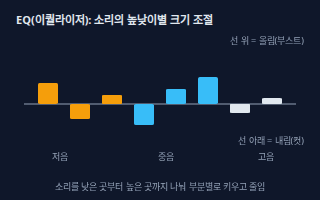</a> <b><a href="#eq--이퀄라이저">EQ</a></b> 이퀄라이저 소리를 저음·중음·고음 영역으로 나눠 부분마다 키우거나(부스트) 줄이는(컷) 도구. 먹먹한 소리는 특정 영역을 줄이고 답답한 소리는 고음을 살리는 식으로 음색을 다듬는다.</td>
<td width="33%" valign="top"><a href="#high-pass-filter--하이패스-필터">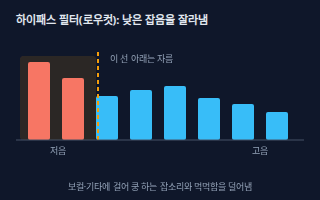</a> <b><a href="#high-pass-filter--하이패스-필터">High-pass Filter</a></b> 하이패스 필터 정해 둔 지점보다 낮은 소리를 잘라내고 높은 소리만 통과시키는 필터(로우컷이라고도 부른다). 마이크 스탠드 진동, 바닥 울림, 숨소리 같은 쿵 하는 저음 잡음을 지운다.</td>
<td width="33%" valign="top"><a href="#compressor--컴프레서">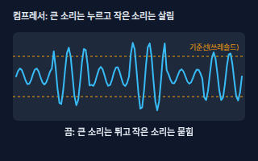</a> <b><a href="#compressor--컴프레서">Compressor</a></b> 컴프레서 기준선(스레숄드)을 넘는 큰 소리를 눌러서 큰 소리와 작은 소리의 차이를 줄이는 도구. 크기가 들쭉날쭉한 보컬을 고르게 들리게 만든다. 스레숄드, 비율(레시오), 어택, 릴리즈 노브가 있다.</td>
</tr>
<tr>
<td width="33%" valign="top"><a href="#reverb-and-delay--리버브--딜레이">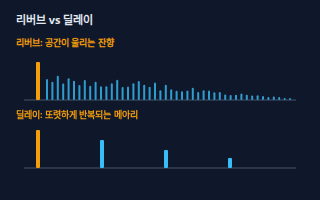</a> <b><a href="#reverb-and-delay--리버브--딜레이">Reverb and Delay</a></b> 리버브 / 딜레이 리버브는 소리가 방이나 홀에서 퍼지며 울리는 잔향을, 딜레이는 같은 소리를 시간 간격을 두고 되풀이하는 메아리를 만드는 효과다.</td>
<td width="33%" valign="top"><a href="#latency--레이턴시">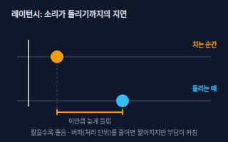</a> <b><a href="#latency--레이턴시">Latency</a></b> 레이턴시 소리를 내는 순간과 그 소리가 컴퓨터를 거쳐 헤드폰에서 들리기까지의 지연 시간. 녹음하면서 내 연주가 늦게 들리면 박자를 맞추기 어렵다.</td>
</tr>
</table>

**녹음과 제작 · Recording and Production** (4)

<table>
<tr>
<td width="33%" valign="top"><a href="#daw--음악-제작-프로그램">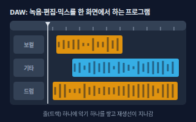</a> <b><a href="#daw--음악-제작-프로그램">DAW</a></b> 음악 제작 프로그램 컴퓨터에서 녹음, 편집, 믹스, 가상악기 연주까지 한 화면에서 하는 음악·소리 제작 프로그램(Digital Audio Workstation). 프로젝트 안에 트랙이 줄로 쌓이고 시간 순서대로 재생선이 지나간다.</td>
<td width="33%" valign="top"><a href="#track-and-stem--트랙--스템">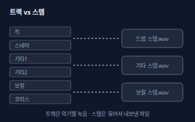</a> <b><a href="#track-and-stem--트랙--스템">Track and Stem</a></b> 트랙 / 스템 트랙은 DAW나 믹서에서 악기나 소리 하나를 담은 한 줄(보컬 트랙, 기타 트랙)이다. 스템은 여러 트랙을 같은 종류끼리 묶어 따로 내보낸 파일(드럼 스템, 보컬 스템)이다.</td>
<td width="33%" valign="top"><a href="#midi--미디">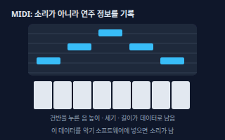</a> <b><a href="#midi--미디">MIDI</a></b> 미디 어떤 음을 언제, 얼마나 세게, 얼마나 길게 눌렀는지 같은 연주 정보를 기록한 데이터로, 소리 자체가 아니다. 이 정보를 가상악기에 넣으면 피아노·드럼 소리가 나고, 나중에 음이나 악기를 마음대로 바꿀 수 있다.</td>
</tr>
<tr>
<td width="33%" valign="top"><a href="#sample-rate-and-bit-depth--샘플레이트와-비트-뎁스">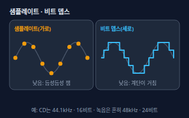</a> <b><a href="#sample-rate-and-bit-depth--샘플레이트와-비트-뎁스">Sample Rate and Bit Depth</a></b> 샘플레이트와 비트 뎁스 디지털 녹음 품질을 정하는 두 숫자. 샘플레이트는 1초에 소리를 몇 번 재는지(가로), 비트 뎁스는 한 번 잴 때 크기를 얼마나 잘게 나누는지(세로)다. CD는 44.1kHz·16비트이고, 녹음 작업에서는 24비트가 보통이며 48kHz 이상도 널리 쓰인다.</td>
</tr>
</table>

**마무리 · Finishing** (2)

<table>
<tr>
<td width="33%" valign="top"><a href="#mastering--마스터링">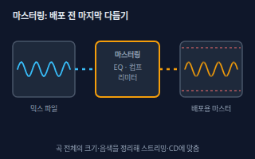</a> <b><a href="#mastering--마스터링">Mastering</a></b> 마스터링 믹스가 끝난 곡을 마지막으로 다듬어 배포용 파일로 만드는 일. 곡 전체의 소리 크기와 음색을 정리하고, 앨범이면 곡마다 크기와 음색이 비슷하게 들리도록 맞추고 곡 사이 간격도 정한다.</td>
<td width="33%" valign="top"><a href="#lufs--라우드니스lufs">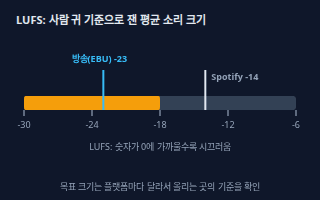</a> <b><a href="#lufs--라우드니스lufs">LUFS</a></b> 라우드니스(LUFS) 곡 전체의 평균 소리 크기를 사람 귀가 느끼는 방식으로 잰 단위로, 0에 가까울수록 시끄럽다. Spotify는 재생할 때 −14 LUFS를 기준으로 곡 크기를 맞추고, 유럽 방송 권고 EBU R 128은 −23 LUFS를 목표로 한다. 플랫폼마다 기준이 다르다.</td>
</tr>
</table>

<!-- overview:end -->

## 소리 기본 · Sound Basics

### Decibel · 데시벨

- **정의**: 소리 크기를 비교하는 단위(dB). 믹서와 녹음 프로그램의 미터는 맨 위를 0 dB로 두고 −6, −12처럼 마이너스 숫자로 세므로, 숫자가 작아질수록(마이너스가 클수록) 조용한 소리다.
- **AI에게 이렇게**: "믹서 미터가 −12 dB 근처에서 움직이는데 괜찮은 건지, 어디까지 올려도 되는지 설명해줘."
- **언제**: 믹서나 녹음 프로그램의 레벨 미터를 읽을 때
- **헷갈림**: 볼륨 — 볼륨은 스피커에서 나는 소리를 돌리는 다이얼이고, dB는 크기를 재는 단위다. 같은 dB 숫자라도 디지털 미터(0이 맨 위)와 소음 측정기(실제 공간의 소리 세기)는 기준이 달라 뜻이 다르다.
- **관련**: Gain, Clipping, LUFS
- **확인 질문**: 이 숫자가 믹서·녹음 프로그램의 미터인가요, 소음 측정기로 잰 실제 공간의 소리 크기인가요?

### Gain · 게인

- **정의**: 마이크나 악기에서 들어오는 약한 신호를 믹서·인터페이스 입구에서 키우는 정도. 소리를 크게 만드는 노브처럼 보이지만 목적은 입력 크기를 알맞게 맞추는 것이다.
- **AI에게 이렇게**: "보컬 마이크 소리가 너무 작아서 게인을 올리려는데, 미터가 어디까지 올라가게 맞추면 되는지 순서대로 알려줘."
- **언제**: 마이크를 꽂고 처음 소리를 확인할 때, 연주자가 바뀌었을 때
- **헷갈림**: Fader(페이더) — 게인은 입구에서 신호 크기를 맞추는 것이고, 페이더는 그 뒤에서 섞을 때 크기를 정하는 것이다. 게인을 너무 올리면 소리가 깨지고 잡음도 함께 커진다.
- **관련**: Gain Staging, Clipping, Fader, Mixer and Channel Strip
- **확인 질문**: 어떤 마이크나 악기이고, 평소 연주할 때 가장 큰 소리를 내 본 상태에서 맞추나요?

### Gain Staging · 게인 스테이징

- **정의**: 마이크 → 믹서 → 이펙트 → 출력으로 이어지는 단계마다, 소리가 깨지지도 않고 너무 작아 잡음에 묻히지도 않도록 레벨을 차례로 맞추는 일. 깨지기 전까지 남겨 둔 여유를 헤드룸이라 부른다.
- **AI에게 이렇게**: "마이크, 프리앰프, 믹서, 앰프 순서로 게인 스테이징하는 방법을 단계별로 알려줘. 각 단계에서 미터가 어디쯤 오게 하면 돼?"
- **언제**: 장비를 처음 연결할 때, 소리가 찌그러지거나 쉬쉬 잡음이 많을 때
- **헷갈림**: Gain(게인) — 게인은 노브 하나이고, 게인 스테이징은 연결된 모든 단계의 레벨을 서로 맞추는 계획이다.
- **관련**: Gain, Clipping, Fader, Audio Levels
- **확인 질문**: 장비가 어떤 순서로 연결되어 있나요(마이크 → ? → ? → 스피커)? 소리가 찌그러지는 곳이 어느 단계인지 아시나요?

### Clipping · 클리핑

- **정의**: 신호가 장비가 받을 수 있는 한계를 넘어서 파형의 윗부분이 납작하게 잘리는 현상. 소리가 찢어지고 지직거리며, 한 번 잘린 녹음은 나중에 고치기 어렵다.
- **AI에게 이렇게**: "녹음한 보컬에서 큰 소리 부분이 찢어지는데 클리핑인지 확인하는 방법과 다음 녹음에서 막는 방법을 알려줘."
- **언제**: 미터에 빨간 불이 들어올 때, 녹음 파형의 윗부분이 납작할 때
- **헷갈림**: 디스토션 이펙트 — 기타 앰프의 디스토션은 일부러 만든 찌그러짐이고, 클리핑은 한계를 넘어서 생기는 원치 않는 찌그러짐이다.
- **관련**: Gain Staging, Decibel, Compressor
- **확인 질문**: 빨간 불이 어느 단계에서 켜졌나요(마이크 입력, 믹서 출력, 녹음 프로그램의 마스터)?

### Audio Levels · 오디오 레벨

- **정의**: 소리의 크기. 영상에서는 목소리가 가장 크고 배경음악은 그 아래에 깔리게 맞춘다.
- **원본**: [영상 촬영 · 편집 · Audio Levels](video-production.md#audio-levels--오디오-레벨)

### Room Tone · 룸 톤

- **정의**: 말하지 않을 때도 그 장소에 깔려 있는 조용한 배경 소리. 따로 녹음해 두었다가 말 사이 빈틈에 깐다.
- **원본**: [영상 촬영 · 편집 · Room Tone](video-production.md#room-tone--룸-톤)

## 마이크 · Microphones

### Dynamic and Condenser Mic · 다이내믹 / 콘덴서 마이크

- **정의**: 다이내믹 마이크는 튼튼하고 큰 소리에 강하며 따로 전원이 필요 없어 합주실의 보컬·드럼·앰프 앞에 많이 쓴다. 콘덴서 마이크는 작고 높은 소리까지 섬세하게 담지만 팬텀 파워(전원)가 필요하다.
- **AI에게 이렇게**: "합주실에서 보컬과 기타 앰프에는 다이내믹, 방에서 목소리 녹음에는 콘덴서를 많이 쓴다던데 이유를 설명하고 내 상황에 맞게 골라줘."
- **언제**: 마이크를 고를 때, 녹음 환경에 맞는 종류를 정할 때
- **헷갈림**: Polar Pattern(지향성) — 다이내믹·콘덴서는 소리를 전기로 바꾸는 방식이고, 지향성은 어느 방향의 소리를 받는지다. 둘은 서로 독립이라 콘덴서에도 앞만 듣는 것과 사방을 듣는 것이 있다.
- **관련**: Phantom Power, Polar Pattern, Audio Interface
- **확인 질문**: 어디서(합주실·집·무대) 무엇을(보컬·악기·나레이션) 녹음하나요? 주변 소음이 많은 방인가요?
- **근거**: [Shure — Microphone Basics](https://www.shure.com/en-IN/insights/microphone-basics-transducers-polar-patterns-frequency-response)
- **검증일**: 2026-11-02

### Polar Pattern · 지향성

- **정의**: 마이크가 어느 방향의 소리를 잘 받는지를 모양으로 나타낸 것. 앞쪽만 잘 듣는 단일 지향(카디오이드), 사방을 듣는 무지향, 앞과 뒤를 듣는 양방향이 대표적이다.
- **AI에게 이렇게**: "합주실에서 옆 악기 소리가 보컬 마이크에 너무 많이 들어오는데, 지향성 때문인지 확인하고 마이크를 어떻게 세워야 할지 알려줘."
- **언제**: 주변 소리가 섞일 때, 하울링을 줄일 때, 마이크를 고를 때
- **헷갈림**: 주파수 응답 — 지향성은 '어느 방향'을 잘 듣는지, 주파수 응답은 '어느 높낮이'를 잘 듣는지다.
- **관련**: Dynamic and Condenser Mic, Proximity Effect, Acoustic Feedback
- **확인 질문**: 마이크 주변에 소리가 새어 들어오는 다른 악기나 스피커가 있나요? 마이크에 지향성 전환 스위치가 있나요?

### Proximity Effect · 근접효과

- **정의**: 방향성이 있는 마이크에 입을 가까이 댈수록 저음이 커져서 소리가 두껍고 먹먹해지는 현상. 마이크와의 거리에 따라 목소리 톤이 달라진다.
- **AI에게 이렇게**: "마이크에 입을 가까이 대면 목소리가 먹먹해지는데, 근접효과를 이용하는 방법과 줄이는 방법(거리, 로우컷)을 알려줘."
- **언제**: 보컬·나레이션을 녹음할 때, 소리가 먹먹하거나 얇을 때
- **헷갈림**: EQ — EQ는 일부러 저음을 올리는 조작이고, 근접효과는 거리 때문에 저절로 생기는 변화다. 무지향 마이크는 거의 나타나지 않는다.
- **관련**: Polar Pattern, High-pass Filter, EQ
- **확인 질문**: 입과 마이크 사이 거리가 어느 정도이고 어떤 마이크인가요?

### Phantom Power · 팬텀 파워

- **정의**: 믹서나 오디오 인터페이스가 마이크 케이블(XLR)을 통해 마이크에 보내 주는 전원. 콘덴서 마이크에 필요하며, 스튜디오 마이크는 대부분 48V를 쓰고 장비에 `48V` 버튼이 있다.
- **AI에게 이렇게**: "콘덴서 마이크를 인터페이스에 연결했는데 소리가 안 나. 팬텀 파워(48V)를 켜는 순서와 주의사항을 알려줘."
- **언제**: 콘덴서 마이크를 쓸 때, 소리가 안 나거나 아주 작을 때
- **헷갈림**: USB 마이크 — USB 마이크는 컴퓨터에서 전원을 받으므로 팬텀 파워가 필요 없다. 다이내믹 마이크도 필요 없으며, 리본 마이크는 켜기 전에 제조사 설명서를 확인해야 한다. 마이크를 꽂거나 뽑을 때는 팬텀 파워를 끄는 것이 안전하다.
- **관련**: Dynamic and Condenser Mic, XLR, TRS and TS Cables, Audio Interface
- **확인 질문**: 마이크 모델이 무엇이고 설명서에 팬텀 파워가 필요하다고 적혀 있나요? 리본 마이크는 아닌가요?
- **근거**: [Shure — What is Phantom Power & Why Do I Need It?](https://www.shure.com/en-US/insights/what-is-phantom-power-why-do-i-need-it) (표준은 11~52V DC, 스튜디오 마이크는 보통 48V)
- **검증일**: 2026-11-02

### Drum Miking · 드럼 마이킹

- **정의**: 드럼 세트의 킥(베이스 드럼)·스네어·탐·심벌마다 마이크를 따로 세워 소리를 담는 방법. 위에서 전체를 담는 마이크를 오버헤드라고 하며, 마이크 개수와 위치에 따라 드럼 소리가 크게 달라진다.
- **AI에게 이렇게**: "합주실에서 드럼을 녹음하려는데 마이크가 4개야. 킥, 스네어, 오버헤드 2개로 어디에 어떻게 세울지 알려줘."
- **언제**: 합주 녹음, 공연에서 드럼 소리를 PA로 내보낼 때
- **헷갈림**: 룸 마이크 — 오버헤드는 심벌과 드럼 전체를 위에서 담고, 룸 마이크는 방의 울림까지 담으려고 멀리 둔다. 킥·스네어에 가까이 세우는 것은 스팟(근접) 마이크다.
- **관련**: Dynamic and Condenser Mic, Polar Pattern, Backline, Mixer and Channel Strip
- **확인 질문**: 마이크가 몇 개이고 어떤 종류인가요? 라이브용인가요, 녹음용인가요? 방은 많이 울리나요?
- **근거**: [Shure — Microphone Techniques for Drums](https://content-files.shure.com/Pubs/microphone-techniques-for-drums/microphone_techniques_for_drums_english.pdf)
- **검증일**: 2026-11-02

## 케이블과 연결 · Cables and Connections

### XLR, TRS and TS Cables · XLR / TRS / TS 케이블

- **정의**: XLR은 핀 구멍이 3개인 둥근 단자로 마이크와 믹서를 잇는 밸런스 케이블이다. TRS와 TS는 둥근 기타 잭 모양이며 줄무늬(링)가 2개면 TRS(밸런스 또는 스테레오), 1개면 TS(언밸런스, 기타·베이스 선)다.
- **AI에게 이렇게**: "내 믹서 입력과 모니터 스피커 입력 단자를 보고 어떤 케이블(XLR, TRS, TS)을 사야 하는지 알려줘. 기타에서 앰프까지는 어떤 케이블이야?"
- **언제**: 케이블을 살 때, 잡음이 날 때, 장비를 처음 연결할 때
- **헷갈림**: 이어폰 잭 — 같은 TRS 모양이어도 이어폰은 왼쪽·오른쪽(스테레오)을 나르고, 밸런스 TRS는 잡음을 줄이려고 신호 하나를 두 선으로 보낸다. 모양이 같아 헷갈리므로 장비 설명서를 확인한다.
- **관련**: DI Box, Ground Hum, Audio Interface
- **확인 질문**: 양쪽 장비의 단자 모양(XLR, 큰 잭, 작은 잭, RCA)과 케이블 길이가 어떻게 되나요?
- **근거**: [Focusrite — Differences between balanced and unbalanced audio](https://support.focusrite.com/hc/en-gb/articles/115005178585-Differences-between-balanced-and-unbalanced-audio)
- **검증일**: 2026-11-02

### DI Box · DI 박스

- **정의**: 기타·베이스·키보드처럼 약하고 잡음에 약한 악기 신호(언밸런스)를 마이크와 같은 밸런스 신호로 바꿔, 긴 XLR 케이블로 믹서까지 잡음 적게 보내는 작은 상자(다이렉트 박스).
- **AI에게 이렇게**: "베이스를 합주실 믹서에 바로 연결하려는데 케이블이 길어. DI 박스가 필요한지, 어디에 어떻게 연결하는지 알려줘."
- **언제**: 믹서가 악기에서 멀 때, 앰프 없이 악기 소리를 직접 믹서로 보낼 때(키보드, 어쿠스틱 기타)
- **헷갈림**: 오디오 인터페이스의 Hi-Z 입력 — Hi-Z 입력은 악기를 짧은 선으로 바로 꽂는 입구이고, DI 박스는 긴 거리를 보내기 위한 변환기다. 기타 같은 신호는 선을 짧게(제조사는 8m 이내 권장) 쓰는 것이 좋다.
- **관련**: XLR, TRS and TS Cables, Audio Interface, Ground Hum, Instrument Amp
- **확인 질문**: 어떤 악기(전기 기타·베이스·키보드·어쿠스틱)이고 믹서까지 거리가 얼마인가요? 그라운드 리프트 스위치가 있는 DI인가요?
- **근거**: [Radial Engineering — What is a Direct Box?](https://www.radialeng.com/what-is-a-direct-box)
- **검증일**: 2026-11-02

### Ground Hum · 험 노이즈

- **정의**: 스피커에서 '웅~' 하고 일정하게 깔리는 낮은 잡음. 전원선 옆을 지나가는 케이블, 접지 문제, 긴 언밸런스 케이블, 서로 다른 콘센트에 꽂은 장비 사이의 전기 차이 때문에 생긴다.
- **AI에게 이렇게**: "앰프를 켜면 '웅~' 하는 낮은 소리가 계속 나. 험 노이즈 원인을 콘센트, 케이블, DI 박스의 그라운드 리프트 순서로 확인하는 방법을 알려줘."
- **언제**: 연주하지 않아도 잡음이 계속 날 때, 조명 조절기 근처에서 잡음이 날 때
- **헷갈림**: Acoustic Feedback(하울링) — 하울링은 마이크가 스피커 소리를 다시 잡아 점점 커지는 소리이고, 험은 연주와 상관없이 일정하게 깔리는 낮은 소리다.
- **관련**: XLR, TRS and TS Cables, DI Box, Gain Staging
- **확인 질문**: 잡음은 언제 나나요(앰프를 켤 때만? 특정 케이블을 꽂을 때만?) 장비들이 같은 멀티탭에 꽂혀 있나요?

### Audio Interface · 오디오 인터페이스

- **정의**: 컴퓨터에 마이크·악기를 연결해 녹음하고, 컴퓨터의 소리를 모니터 스피커·헤드폰으로 내보내는 외장 장치(보통 USB 연결). 마이크 입력, 게인 노브, 팬텀 파워, 헤드폰 단자가 들어 있다.
- **AI에게 이렇게**: "마이크 1개와 기타 1개를 동시에 녹음하려고 해. 입력이 2개 이상인 오디오 인터페이스를 고를 때 확인할 점을 알려줘."
- **언제**: 집·합주실에서 컴퓨터로 녹음할 때, 유튜브 목소리를 녹음할 때
- **헷갈림**: Mixer(믹서) — 믹서는 여러 소리를 섞어 내보내는 장비이고, 인터페이스는 소리를 컴퓨터에 넣고 빼는 통로다(USB 믹서처럼 둘을 겸한 제품도 있다). USB 마이크는 마이크와 인터페이스가 한 몸이라 입력이 하나뿐이다.
- **관련**: DAW, Latency, Phantom Power, Sample Rate and Bit Depth
- **확인 질문**: 동시에 녹음할 입력이 몇 개이고 종류는 무엇인가요(마이크·기타·키보드)? 컴퓨터 종류와 단자(USB-C 등)는 무엇인가요?

## 믹서 · Mixer

### Mixer and Channel Strip · 믹서와 채널 스트립

- **정의**: 마이크·악기 여러 개의 소리를 받아 소리마다 크기·음색·위치를 정하고 하나로 섞어 내보내는 장비. 위에서 아래로 놓인 세로 한 줄이 채널 하나(채널 스트립)이며 게인, EQ, AUX, 팬, 페이더가 들어 있다.
- **AI에게 이렇게**: "합주실 믹서에 보컬, 기타 앰프 마이크, 드럼이 연결돼 있어. 채널마다 게인, EQ, 페이더를 어떤 순서로 만지며 균형을 맞출지 알려줘."
- **언제**: 합주 중 소리 균형을 맞출 때, 라이브 공연
- **헷갈림**: Instrument Amp(악기 앰프) — 믹서는 여러 소리를 섞는 장비이고, 앰프는 소리를 키워 스피커를 울리는 장비다. 믹서에 앰프가 들어 있는 파워드 믹서도 있다.
- **관련**: Gain, Fader, Panning, Aux Send, Bus
- **확인 질문**: 믹서 모델(채널 수, 아날로그인지 디지털인지)과 연결된 장비는 무엇인가요? 파워드 믹서인가요?

### Fader · 페이더

- **정의**: 채널 소리의 크기를 밀어서 조절하는 슬라이더. 위로 올리면 커지고 아래로 내리면 작아지며, 눈금의 0 근처가 기본(소리를 키우지도 줄이지도 않는) 위치다.
- **AI에게 이렇게**: "페이더를 어디쯤 두고 시작해서 보컬, 기타, 드럼 크기를 맞추면 좋은지 순서를 알려줘."
- **언제**: 소리를 섞을 때, 곡마다 크기를 바꿀 때, 서서히 줄이는 페이드 아웃
- **헷갈림**: Gain(게인) — 게인은 입구에서 신호를 알맞게 맞추는 것이고, 페이더는 그 다음 섞는 단계의 크기다. 게인에서 이미 깨졌다면 페이더를 내려도 해결되지 않는다.
- **관련**: Gain, Mixer and Channel Strip, Bus
- **확인 질문**: 지금 어느 채널이 너무 크거나 작게 들리나요? 게인은 이미 맞춰 두었나요?

### Panning · 패닝

- **정의**: 소리를 스테레오의 왼쪽과 오른쪽 사이 어디에 놓을지 정하는 일. 노브를 가운데 두면 양쪽 스피커에서 똑같이 나온다.
- **AI에게 이렇게**: "기타 두 대는 좌우로 나누고 보컬·베이스·킥은 가운데에 두는 패닝 기본 배치를 알려줘."
- **언제**: 소리의 위치와 공간을 만들 때, 악기가 한가운데에 겹쳐 답답할 때
- **헷갈림**: Pan(팬, 카메라) — 영상 시트의 Pan은 카메라를 좌우로 돌리는 움직임이고, 오디오 패닝은 소리의 좌우 위치다. 이름만 비슷하다.
- **관련**: Mixer and Channel Strip, EQ, Bus
- **확인 질문**: 최종 재생이 스테레오인가요, 모노(작은 PA, 스마트폰 스피커 한 대)인가요?

### Aux Send · AUX 센드

- **정의**: 채널 소리의 일부를 메인 출력과 별도로 다른 곳(리버브 같은 이펙트, 연주자용 모니터, 인이어)으로 갈라 보내는 출력. 노브로 보내는 양을 정한다.
- **AI에게 이렇게**: "보컬 채널의 AUX 1은 리버브로, AUX 2는 보컬 모니터 스피커로 보내는 설정을 순서대로 알려줘."
- **언제**: 리버브를 걸 때, 연주자별 모니터 믹스를 만들 때
- **헷갈림**: Bus(버스) — AUX 센드는 소리 일부를 다른 목적지로 '갈라서' 보내는 것이고, 버스는 여러 채널을 '묶어' 한 줄로 만드는 것이다. 모니터용은 페이더와 무관하게 보내는 프리(Pre), 이펙트용은 페이더를 따라가는 포스트(Post)를 흔히 쓴다.
- **관련**: Monitor Mix, Reverb and Delay, In-Ear Monitor, Bus
- **확인 질문**: 보내는 곳이 이펙트인가요, 모니터인가요? 믹서의 AUX 몇 번이 어디에 연결되어 있나요? 프리/포스트 스위치가 있나요?
- **근거**: [Yamaha — Aux Sends and Returns](https://hub.yamaha.com/proaudio/livesound/aux-sends-and-returns/)
- **검증일**: 2026-11-02

### Bus · 버스

- **정의**: 여러 채널을 한데 모아 하나의 줄(그룹)로 만든 경로. 드럼 마이크 여러 개를 드럼 버스로 묶으면 페이더 하나로 드럼 전체 크기를 조절하고 컴프레서도 한 번에 걸 수 있다.
- **AI에게 이렇게**: "킥, 스네어, 탐, 오버헤드를 드럼 버스로 묶어서 한 번에 컴프레서를 걸고 크기를 조절하는 설정을 알려줘."
- **언제**: 악기 그룹을 한꺼번에 다룰 때, 믹서의 서브그룹을 쓸 때
- **헷갈림**: Track and Stem(스템) — 버스는 믹스 안에서 소리가 지나가는 경로이고, 스템은 그렇게 묶은 소리를 파일로 내보낸 것이다.
- **관련**: Aux Send, Track and Stem, Compressor, Mixer and Channel Strip
- **확인 질문**: 어떤 채널들을 묶을 건가요? 묶은 뒤에는 어디(메인 믹스 등)로 보내나요?

## 합주실 장비 · Rehearsal Room Gear

### Backline · 백라인

- **정의**: 합주실이나 공연장에 미리 갖춰 둔 공용 악기 장비. 보통 드럼 세트와 기타·베이스 앰프, 키보드 앰프를 말하며, 연주자는 악기·페달·스틱 같은 개인 장비만 들고 간다.
- **AI에게 이렇게**: "다음 주 합주실을 예약하려는데, 백라인으로 드럼 세트와 기타·베이스 앰프가 제공되는지 물어볼 질문 목록을 만들어줘."
- **언제**: 합주실을 예약하거나 공연장을 섭외할 때 무엇을 가져가야 하는지 확인할 때
- **헷갈림**: PA System(PA) — 백라인은 연주자 쪽 악기 장비(앰프·드럼)이고, PA는 소리를 방 전체나 관객에게 내보내는 시스템(믹서·스피커)이다.
- **관련**: Instrument Amp, PA System, Drum Miking
- **확인 질문**: 합주실에 드럼 스네어·심벌·페달까지 포함되어 있나요? 앰프는 어떤 종류(콤보·헤드+캐비닛)인가요?

### Instrument Amp · 악기 앰프

- **정의**: 기타·베이스·키보드의 약한 신호를 키워 스피커로 소리를 내는 장비로, 합주실에서는 줄여서 '앰프'라고 부른다. 앰프와 스피커가 한 몸인 콤보와, 따로 나뉜 헤드 + 캐비닛이 있고 볼륨·게인(찌그러짐 정도)·톤(저음·중음·고음) 노브가 있다.
- **AI에게 이렇게**: "합주실 기타 앰프 노브가 게인, 볼륨, 베이스, 미들, 트레블이야. 깨끗한 소리에서 시작해서 곡에 맞게 조절하는 순서를 알려줘."
- **언제**: 합주실에서 기타·베이스·키보드를 연주할 때
- **헷갈림**: 파워 앰프 — 악기 앰프는 악기 소리를 만드는 톤 조절까지 들어 있고, 파워 앰프는 PA 스피커를 울릴 힘만 주는 장비다. 둘 다 합주실에서 그냥 '앰프'라고 불려 헷갈린다.
- **관련**: Backline, DI Box, Gain, EQ
- **확인 질문**: 어떤 악기이고 앰프가 콤보인가요, 헤드 + 캐비닛인가요? 원하는 소리는 깨끗한 쪽인가요, 찌그러진 쪽인가요?

### PA System · PA 시스템

- **정의**: 마이크·악기 소리를 믹서로 섞고, 파워 앰프로 힘을 실어 메인 스피커로 방 전체에 크게 내보내는 시스템(Public Address). 합주실에서는 보컬 마이크 소리를 내는 믹서와 스피커 한 벌을 가리킨다.
- **AI에게 이렇게**: "합주실 PA에 마이크 2개와 키보드 DI 1개를 연결하고, 보컬이 잘 들리게 전체를 설정하는 순서를 알려줘."
- **언제**: 보컬·키보드 소리를 키울 때, 공연할 때
- **헷갈림**: Stage Monitor(무대 모니터) — PA 메인 스피커는 관객 쪽을 향하고, 모니터 스피커는 연주자를 향한다. 스피커에 앰프가 들어 있는 것(파워드)과 별도 파워 앰프가 필요한 것(패시브)도 구분해야 한다.
- **관련**: Mixer and Channel Strip, Stage Monitor and Studio Monitor, Acoustic Feedback, Backline
- **확인 질문**: 스피커가 앰프 내장(파워드)인가요, 패시브인가요? 마이크는 몇 개이고 방 크기는 어느 정도인가요?

### Stage Monitor and Studio Monitor · 무대 모니터 / 스튜디오 모니터

- **정의**: 둘 다 '모니터'라 부르지만 용도가 다르다. 무대 모니터(웨지)는 바닥에 비스듬히 두어 연주자가 자기 소리를 듣게 하는 스피커이고, 스튜디오 모니터는 믹스할 때 소리를 정확하게 확인하려고 책상 앞에 두는 스피커다.
- **AI에게 이렇게**: "합주실에서 보컬이 자기 목소리를 못 듣는다고 해. 무대 모니터 스피커를 어디에 어떻게 놓아야 하는지 알려줘."
- **언제**: 합주 중 연주자가 소리를 못 들을 때, 집에서 믹싱용 스피커를 고를 때
- **헷갈림**: 컴퓨터 모니터(화면) — 소리에서 '모니터'는 스피커나 헤드폰으로 듣는다는 뜻이고 화면과 상관없다. 스튜디오 모니터는 소리를 꾸미지 않고 들려주는 것이 목적이라 일반 홈 스피커와도 다르다.
- **관련**: Monitor Mix, In-Ear Monitor, PA System, Acoustic Feedback
- **확인 질문**: 합주·무대용인가요, 믹싱용인가요? 몇 명이 들어야 하나요?

### Monitor Mix · 모니터 믹스

- **정의**: 관객에게 나가는 소리와는 별도로, 연주자가 듣기 좋게 따로 섞은 소리. 보컬은 자기 목소리와 기타를, 드러머는 베이스와 메트로놈을 크게 받는 식으로 사람마다 다르게 만든다.
- **AI에게 이렇게**: "보컬은 자기 목소리와 기타를 크게, 드러머는 베이스와 메트로놈을 크게 듣게 AUX로 모니터 믹스를 만드는 방법을 알려줘."
- **언제**: 합주 중 "내 소리가 안 들려요"라는 말이 나올 때
- **헷갈림**: 메인 믹스 — 메인 믹스는 관객이 듣는 균형이고, 모니터 믹스는 연주자가 듣는 균형이다. 모두가 "내 소리 더 크게"를 요구하면 전체 소리가 커져 하울링 위험도 커진다.
- **관련**: Aux Send, Stage Monitor and Studio Monitor, In-Ear Monitor, Acoustic Feedback
- **확인 질문**: 모니터 스피커나 AUX 출력이 몇 개인가요? 각자 무엇을 더 듣고 싶어 하나요?
- **근거**: [Shure — An Introduction to In-Ear Monitoring](https://www.shure.com/en-US/insights/an-introduction-to-in-ear-monitoring) ('more me' 현상 설명)
- **검증일**: 2026-11-02

### In-Ear Monitor · 인이어 모니터

- **정의**: 연주자가 귀에 꽂은 이어폰으로 모니터 믹스를 듣는 장치(IEM). 믹서 AUX 신호를 송신기로 보내 허리 수신기에 무선으로 전하는 방식이 흔하고, 선으로 직접 연결하는 방식도 있다.
- **AI에게 이렇게**: "드러머가 클릭과 반주를 이어폰으로만 듣고 싶어. 합주실 믹서 AUX에서 인이어(유선)로 내보내는 연결 방법을 알려줘."
- **언제**: 무대 스피커 소리를 줄이고 하울링 위험을 낮추고 싶을 때, 클릭을 들어야 할 때
- **헷갈림**: 일반 이어폰 — 일반 이어폰은 소리 차단이 약하고 전용 믹스를 받는 시스템이 아니다. 인이어 모니터는 믹서에서 연주자 전용 믹스를 보내 주는 시스템이다.
- **관련**: Monitor Mix, Aux Send, Metronome and BPM, Acoustic Feedback
- **확인 질문**: 몇 명이 쓰나요? 무선인가요, 유선인가요? 클릭도 같이 들어야 하나요?
- **근거**: [Shure — An Introduction to In-Ear Monitoring](https://www.shure.com/en-US/insights/an-introduction-to-in-ear-monitoring)
- **검증일**: 2026-11-02

### Acoustic Feedback · 하울링

- **정의**: 스피커에서 나온 소리를 마이크가 다시 잡아 증폭하는 일이 반복되어 '삐—' 하거나 '웅—' 하고 점점 커지는 소리. 마이크 → 앰프 → 스피커가 고리를 이룰 때 생긴다.
- **AI에게 이렇게**: "보컬 마이크에서 하울링이 나는 이유를 합주실 환경(모니터 스피커 위치, 마이크 위치) 기준으로 확인할 순서와 해결법을 알려줘."
- **언제**: 마이크 소리를 크게 키울 때, 마이크가 스피커 앞으로 갈 때
- **헷갈림**: Ground Hum(험) — 하울링은 스스로 점점 커지는 소리이고, 험은 연주와 상관없이 일정하게 깔리는 낮은 잡음이다. 대처 순서: ① 마이크 게인·볼륨 낮추기 ② 마이크를 스피커 뒤쪽에 두기 ③ 안 쓰는 마이크 끄기 ④ 마이크를 소리 내는 사람 입에 가깝게 ⑤ 마지막으로 EQ에서 울리는 높낮이만 살짝 줄이기.
- **관련**: Polar Pattern, Stage Monitor and Studio Monitor, In-Ear Monitor, EQ
- **확인 질문**: 어느 마이크에서, 어떤 소리('삐—' 높은 소리/'웅—' 낮은 소리)로 나나요? 모니터 스피커가 마이크 앞쪽에 있나요?
- **근거**: [Shure — How to Control Feedback in a Sound System](https://www.shure.com/en-US/insights/how-to-control-feedback-in-a-sound-system)
- **검증일**: 2026-11-02

### Soundproofing and Acoustic Treatment · 차음과 흡음

- **정의**: 차음은 소리가 방 밖으로 새거나 안으로 들어오는 것을 막는 일(두꺼운 벽·문, 틈 막기)이고, 흡음은 방 안에서 울리는 소리를 줄이는 일(흡음 패널, 커튼)이다. 목적이 달라 쓰는 재료도 다르다.
- **AI에게 이렇게**: "합주실 옆방으로 드럼 소리가 새는 문제와 방 안이 울려서 보컬이 뭉개지는 문제를 각각 차음과 흡음으로 나눠서 해결 방법을 알려줘."
- **언제**: 집에서 연습·녹음 공간을 만들 때, 이웃에게 소리가 새거나 방이 울릴 때
- **헷갈림**: 방음 — 일상에서 '방음'은 차음과 흡음을 섞어 쓰는 말이라, AI에게는 '밖으로 새는 소리'인지 '방 안 울림'인지 구분해서 말해야 한다. 얇은 스펀지나 계란판을 붙이는 것은 울림을 조금 줄일 뿐 소리가 새는 것을 막는 차음은 아니다.
- **관련**: Room Tone, Drum Miking, Acoustic Feedback
- **확인 질문**: 문제가 '옆집·옆방으로 소리가 샌다'인가요, '방 안에서 울린다'인가요? 건물은 아파트·상가·주택 중 무엇인가요?

### Metronome and BPM · 메트로놈과 BPM

- **정의**: 메트로놈은 일정한 박자 소리를 내는 기계나 앱이고, BPM(Beats Per Minute)은 1분에 박이 몇 번 오는지 나타내는 빠르기 숫자다. 120 BPM이면 1분에 120박, 즉 1초에 2박이다.
- **AI에게 이렇게**: "이 곡은 92 BPM이야. DAW 프로젝트 템포를 92로 맞추고 4/4 박자 클릭을 들으며 녹음하도록 설정하는 방법을 알려줘."
- **언제**: 합주 전에 템포를 정할 때, 클릭을 들으며 녹음할 때
- **헷갈림**: 박자표(4/4, 3/4) — BPM은 빠르기이고, 박자표는 한 마디에 몇 박이 들어가는지다. 녹음할 때 헤드폰으로 듣는 메트로놈 소리를 클릭 트랙이라고 부른다.
- **관련**: DAW, In-Ear Monitor, Monitor Mix, MIDI
- **확인 질문**: BPM 숫자와 박자표(4/4 등)가 무엇인가요? 클릭은 누가 어디(헤드폰·모니터)로 듣나요?

## 소리 다듬기 · Sound Processing

### EQ · 이퀄라이저

- **정의**: 소리를 저음·중음·고음 영역으로 나눠 부분마다 키우거나(부스트) 줄이는(컷) 도구. 먹먹한 소리는 특정 영역을 줄이고 답답한 소리는 고음을 살리는 식으로 음색을 다듬는다.
- **AI에게 이렇게**: "보컬이 먹먹하게 들려. EQ에서 어떤 영역을 컷하거나 부스트하면 좋은지 단계별로 알려줘."
- **언제**: 믹싱할 때, 악기끼리 소리가 겹쳐 뭉칠 때, 하울링 잡을 때
- **헷갈림**: 볼륨 — 볼륨은 소리 전체의 크기이고, EQ는 특정 높낮이만 조절한다. 하이패스 필터와 달리 EQ는 일부 영역만 올리고 내릴 수 있다.
- **관련**: High-pass Filter, Compressor, Acoustic Feedback
- **확인 질문**: 어떤 소리(보컬·기타·드럼)이고 어떻게 들리나요(먹먹함·날카로움·얇음)? 믹서 EQ(3밴드)인가요, 프로그램 EQ인가요?

### High-pass Filter · 하이패스 필터

- **정의**: 정해 둔 지점보다 낮은 소리를 잘라내고 높은 소리만 통과시키는 필터(로우컷이라고도 부른다). 마이크 스탠드 진동, 바닥 울림, 숨소리 같은 쿵 하는 저음 잡음을 지운다.
- **AI에게 이렇게**: "보컬 채널에 하이패스(로우컷) 필터를 걸어 쿵 하는 잡소리를 줄이고 싶어. 시작 지점을 어떻게 찾는지 알려줘."
- **언제**: 보컬·기타·키보드 채널, 마이크 스탠드 진동이나 저음 하울링이 있을 때
- **헷갈림**: EQ의 저음 컷 — 비슷하지만 하이패스는 지점 아래를 가파르게 잘라내는 필터이고, EQ 컷은 원하는 영역만 부드럽게 줄인다. 베이스·킥에 걸면 필요한 저음까지 사라지므로 주의한다.
- **관련**: EQ, Proximity Effect, Acoustic Feedback
- **확인 질문**: 어떤 소리(보컬·기타·베이스·킥)에 거나요? 어떤 잡음을 없애려고 하나요?

### Compressor · 컴프레서

- **정의**: 기준선(스레숄드)을 넘는 큰 소리를 눌러서 큰 소리와 작은 소리의 차이를 줄이는 도구. 크기가 들쭉날쭉한 보컬을 고르게 들리게 만든다. 스레숄드, 비율(레시오), 어택, 릴리즈 노브가 있다.
- **AI에게 이렇게**: "보컬 컴프레서의 스레숄드, 레시오, 어택, 릴리즈를 처음에 어떻게 설정하고 어떤 기준으로 조정하는지 알려줘."
- **언제**: 보컬·베이스·드럼 버스·나레이션을 고르게 만들 때
- **헷갈림**: 리미터 — 컴프레서는 기준선을 넘는 소리를 비율로 부드럽게 누르고, 리미터는 한계선을 절대 넘지 못하게 막는다(마스터링 마지막에 흔히 쓴다).
- **관련**: Clipping, Gain Staging, Bus, Mastering
- **확인 질문**: 어떤 소리이고 얼마나 고르게(자연스럽게/세게) 만들고 싶나요? 컴프 뒤에 줄어든 크기를 다시 키우는 메이크업 게인이 있나요?

### Reverb and Delay · 리버브 / 딜레이

- **정의**: 리버브는 소리가 방이나 홀에서 퍼지며 울리는 잔향을, 딜레이는 같은 소리를 시간 간격을 두고 되풀이하는 메아리를 만드는 효과다.
- **AI에게 이렇게**: "보컬에 리버브를 AUX로 보내서 걸고 싶어. 작은 방 정도의 울림 설정과 박자에 맞춘 딜레이 간격을 알려줘."
- **언제**: 보컬에 공간감을 줄 때, 건조한 녹음에 깊이를 더할 때
- **헷갈림**: 에코 — 일상에서는 둘 다 '에코'라 부르지만 믹싱에서는 구분한다. 리버브는 뭉쳐서 서서히 사라지고, 딜레이는 또렷하게 반복된다.
- **관련**: Aux Send, Bus, Metronome and BPM, EQ
- **확인 질문**: 어떤 느낌(작은 방·큰 홀·메아리)을 원하나요? 보컬에만 걸까요, 전체에 걸까요?

### Latency · 레이턴시

- **정의**: 소리를 내는 순간과 그 소리가 컴퓨터를 거쳐 헤드폰에서 들리기까지의 지연 시간. 녹음하면서 내 연주가 늦게 들리면 박자를 맞추기 어렵다.
- **AI에게 이렇게**: "녹음할 때 내 목소리가 헤드폰에서 늦게 들려. 버퍼 크기 조정과 인터페이스의 다이렉트 모니터링으로 레이턴시를 줄이는 방법을 알려줘."
- **언제**: 컴퓨터로 녹음할 때, 가상악기를 연주할 때, 라이브 방송할 때
- **헷갈림**: 딜레이 이펙트 — 레이턴시는 원치 않는 처리 지연이고, 딜레이는 의도해서 넣는 메아리 효과다. 버퍼를 줄이면 지연이 줄지만 컴퓨터 부담이 커져 소리가 끊길 수 있다.
- **관련**: Audio Interface, DAW, Sample Rate and Bit Depth
- **확인 질문**: 어떤 인터페이스와 DAW를 쓰고 버퍼 크기는 얼마인가요? 윈도우라면 전용 드라이버(ASIO)를 쓰고 있나요?

## 녹음과 제작 · Recording and Production

### DAW · 음악 제작 프로그램

- **정의**: 컴퓨터에서 녹음, 편집, 믹스, 가상악기 연주까지 한 화면에서 하는 음악·소리 제작 프로그램(Digital Audio Workstation). 프로젝트 안에 트랙이 줄로 쌓이고 시간 순서대로 재생선이 지나간다.
- **AI에게 이렇게**: "DAW를 처음 열었어. 보컬 트랙을 하나 만들고 마이크 입력을 골라 녹음 버튼을 누르는 과정을 순서대로 알려줘. 내 DAW는 ○○야."
- **언제**: 녹음, 믹싱, 작곡, 팟캐스트 편집
- **헷갈림**: 영상 편집 프로그램 — DAW는 여러 소리 트랙을 쌓아 음악을 만드는 데 특화되어 있고, 영상 편집 프로그램의 Timeline은 영상과 소리를 함께 자르고 붙이는 데 쓴다.
- **관련**: Track and Stem, MIDI, Audio Interface, Latency
- **확인 질문**: 사용하는 DAW 이름과 버전은 무엇인가요? 녹음 목적은 음악인가요, 팟캐스트·영상 나레이션인가요? 오디오 인터페이스가 있나요?

### Track and Stem · 트랙 / 스템

- **정의**: 트랙은 DAW나 믹서에서 악기나 소리 하나를 담은 한 줄(보컬 트랙, 기타 트랙)이다. 스템은 여러 트랙을 같은 종류끼리 묶어 따로 내보낸 파일(드럼 스템, 보컬 스템)이다.
- **AI에게 이렇게**: "곡을 드럼, 베이스, 기타, 보컬 네 개 스템으로 내보내서 믹스 전문가에게 보내려고 해. 내보내기 설정과 주의점을 알려줘."
- **언제**: 믹싱·마스터링을 맡길 때, 리믹스하거나 공연용 반주 파일을 만들 때
- **헷갈림**: 완성된 스테레오 곡 — 스템은 그룹별로 나뉜 파일이라 받는 사람이 크기를 다시 조절할 수 있고, 완성된 스테레오 곡은 이미 모두 섞인 한 파일이다. 버스는 믹스 안의 경로, 스템은 그것을 내보낸 파일이다.
- **관련**: DAW, Bus, Mastering
- **확인 질문**: 받는 사람이 필요한 단위가 트랙 전부인가요, 그룹별 스템인가요? 이펙트를 포함해서 내보낼까요? 모든 파일의 시작 위치를 0초에 맞출까요?

### MIDI · 미디

- **정의**: 어떤 음을 언제, 얼마나 세게, 얼마나 길게 눌렀는지 같은 연주 정보를 기록한 데이터로, 소리 자체가 아니다. 이 정보를 가상악기에 넣으면 피아노·드럼 소리가 나고, 나중에 음이나 악기를 마음대로 바꿀 수 있다.
- **AI에게 이렇게**: "MIDI 키보드를 DAW에 연결해 피아노 소리를 녹음하고, 박자가 흔들린 음을 보정(퀀타이즈)하는 방법을 알려줘."
- **언제**: 작곡, 건반·드럼 패드 연주, 가상악기 사용
- **헷갈림**: 오디오 파일(WAV·MP3) — 오디오는 실제 소리를 녹음한 파일이고, MIDI는 악보처럼 '무엇을 연주했는지'만 적은 신호라 용량이 매우 작고 소리가 없다.
- **관련**: DAW, Track and Stem, Metronome and BPM
- **확인 질문**: MIDI 장치(건반·드럼 패드)가 있나요? 어떤 가상악기를 쓰나요?

### Sample Rate and Bit Depth · 샘플레이트와 비트 뎁스

- **정의**: 디지털 녹음 품질을 정하는 두 숫자. 샘플레이트는 1초에 소리를 몇 번 재는지(가로), 비트 뎁스는 한 번 잴 때 크기를 얼마나 잘게 나누는지(세로)다. CD는 44.1kHz·16비트이고, 녹음 작업에서는 24비트가 보통이며 48kHz 이상도 널리 쓰인다.
- **AI에게 이렇게**: "유튜브 영상용 목소리를 녹음하려고 해. 샘플레이트를 48kHz, 24비트로 DAW와 인터페이스에서 똑같이 맞추는 방법을 알려줘."
- **언제**: 새 프로젝트를 만들 때, 영상에 넣을 소리나 CD를 만들 때
- **헷갈림**: Bitrate(비트레이트, 영상 시트) — 샘플레이트·비트 뎁스는 녹음된 원본의 품질 설정이고, 비트레이트는 MP3·AAC로 압축했을 때 초당 데이터량이다.
- **관련**: Audio Interface, Latency, Mastering
- **확인 질문**: 프로젝트와 인터페이스의 샘플레이트가 같게 설정되어 있나요? 최종 용도(CD·영상·스트리밍)는 무엇인가요?
- **근거**: [Apple Digital Masters — 기술 개요(PDF)](https://www.apple.com/apple-music/apple-digital-masters/docs/apple-digital-masters.pdf) (CD 표준 16비트·44.1kHz, 녹음 작업은 24비트와 48kHz 이상이 표준화됨)
- **검증일**: 2026-11-02

## 마무리 · Finishing

### Mastering · 마스터링

- **정의**: 믹스가 끝난 곡을 마지막으로 다듬어 배포용 파일로 만드는 일. 곡 전체의 소리 크기와 음색을 정리하고, 앨범이면 곡마다 크기와 음색이 비슷하게 들리도록 맞추고 곡 사이 간격도 정한다.
- **AI에게 이렇게**: "믹스다운한 스테레오 파일을 스트리밍 업로드용으로 마스터링할 때 EQ, 컴프레서, 리미터를 어떤 순서로 쓰고 무엇을 확인해야 하는지 알려줘."
- **언제**: 음원을 발매하기 직전, 앨범의 곡 소리를 맞출 때
- **헷갈림**: 믹싱 — 믹싱은 여러 트랙을 섞어 한 곡으로 만드는 일이고, 마스터링은 이미 섞인 그 곡을 마지막으로 다듬는 일이다. 단순히 소리를 키우는 일이 아니다.
- **관련**: LUFS, Compressor, EQ, Track and Stem
- **확인 질문**: 믹스 파일에 이미 리미터가 걸려 있나요(헤드룸을 남겨 두었나요)? 어디에 올릴 건가요?

### LUFS · 라우드니스(LUFS)

- **정의**: 곡 전체의 평균 소리 크기를 사람 귀가 느끼는 방식으로 잰 단위로, 0에 가까울수록 시끄럽다. Spotify는 재생할 때 −14 LUFS를 기준으로 곡 크기를 맞추고, 유럽 방송 권고 EBU R 128은 −23 LUFS를 목표로 한다. 플랫폼마다 기준이 다르다.
- **AI에게 이렇게**: "내 곡의 통합 라우드니스가 −9 LUFS야. 스포티파이 공식 안내 기준으로 어떻게 처리되는지, 리미터와 트루피크를 어떻게 맞출지 알려줘."
- **언제**: 마스터링 마지막, 스트리밍·방송에 올리기 전
- **헷갈림**: 피크 dB — 피크는 가장 큰 한 순간의 크기이고, LUFS는 곡 전체의 평균적인 크기 감각이다. 피크가 같아도 LUFS는 다를 수 있다. 영상 소리 크기는 영상 시트의 Audio Levels도 함께 본다.
- **관련**: Mastering, Decibel, Compressor
- **확인 질문**: 어디에 올리나요(Spotify, 방송 등)? 통합 LUFS와 트루피크 측정값이 얼마인가요?
- **근거**: [Spotify for Artists — Spotify의 라우드니스 정규화](https://support.spotify.com/kr-ko/artists/article/loudness-normalization/) (−14 LUFS 기준 정규화, 마스터링 권장 통합 −14 LUFS·트루피크 −1 dB 이하), [EBU R 128 — 라우드니스 정규화 권고](https://tech.ebu.ch/publications/r128) (평균 프로그램 라우드니스 −23 LUFS)
- **검증일**: 2026-11-02

## 참고 자료

- [Shure — What is Phantom Power & Why Do I Need It?](https://www.shure.com/en-US/insights/what-is-phantom-power-why-do-i-need-it)
- [Shure — How to Control Feedback in a Sound System](https://www.shure.com/en-US/insights/how-to-control-feedback-in-a-sound-system)
- [Shure — Microphone Basics: Transducers, Polar Patterns, & Frequency Response](https://www.shure.com/en-IN/insights/microphone-basics-transducers-polar-patterns-frequency-response)
- [Shure — Microphone Techniques for Drums](https://content-files.shure.com/Pubs/microphone-techniques-for-drums/microphone_techniques_for_drums_english.pdf)
- [Shure — An Introduction to In-Ear Monitoring](https://www.shure.com/en-US/insights/an-introduction-to-in-ear-monitoring)
- [Focusrite — Differences between balanced and unbalanced audio](https://support.focusrite.com/hc/en-gb/articles/115005178585-Differences-between-balanced-and-unbalanced-audio)
- [Radial Engineering — What is a Direct Box?](https://www.radialeng.com/what-is-a-direct-box)
- [Yamaha — Aux Sends and Returns](https://hub.yamaha.com/proaudio/livesound/aux-sends-and-returns/)
- [Yamaha — Mixing 101](https://au.yamaha.com/en/education/greatstart/articles/music-technology/mixing101.html)
- [Apple Digital Masters — 기술 개요(PDF)](https://www.apple.com/apple-music/apple-digital-masters/docs/apple-digital-masters.pdf)
- [Spotify for Artists — Spotify의 라우드니스 정규화](https://support.spotify.com/kr-ko/artists/article/loudness-normalization/)
- [EBU R 128 — Loudness normalisation and permitted maximum level](https://tech.ebu.ch/publications/r128)
- [HillPoint — Acoustic Treatment vs Soundproofing](https://www.hillpointglobal.com/blog/acoustic-treatment-vs-soundproofing-difference-explained)
