# 백엔드 개발 치트시트

> 화면 뒤에서 일하는 부분(서버, API, 데이터베이스, 배포)을 AI에게 시키려는 바이브 코더·창업자를 위한 시트입니다. 코드를 읽는 법보다 "이 말이 무슨 뜻이고, AI가 뭘 되물어야 하는지"를 먼저 맞춥니다.

> **참고용입니다.** 보안·결제·개인정보가 걸린 서비스는 배포 전에 개발자나 보안 전문가의 검토를 받으세요. 아래 설명은 일반적인 웹 서비스 기준이며, 사용하는 언어·클라우드마다 세부 방식은 다를 수 있습니다.

## 이렇게 쓰세요

- **나 → AI**: "회원가입·로그인이 되는 백엔드를 만들어줘. 로그인은 세션 방식으로 하고, 비밀번호는 평문으로 저장하지 마."
- **AI → 나**: "데이터베이스는 PostgreSQL로 갈까요? 로그인 방식은 세션과 JWT 중 무엇을 원하세요? 배포는 어디에 할 계획인가요?"
- **나 → AI**: "주문 목록을 돌려주는 REST API를 만들어줘. GET /orders, POST /orders 두 개, 응답은 JSON, 없는 주문은 404로."
- **AI → 나**: "한 번에 몇 건씩 보여줄까요(페이지네이션)? 로그인한 본인 주문만 볼 수 있게 인가 규칙을 걸까요?"
- **나 → AI**: "API 키는 코드에 쓰지 말고 환경 변수로 읽게 하고, .env는 git에 안 올라가게 해줘."
- **나 → AI**: "서버가 죽었을 때 원인을 알 수 있게 로그를 남기고, 에러가 나면 알림이 오게 해줘."

## 한눈에 보기

<!-- overview:start -->
<!-- 이 구역은 자동 생성됩니다. 직접 고치지 말고 `cd mcp-server && npm run generate`를 실행하세요. -->

**서버와 API · Server & API** (8)

<table>
<tr>
<td width="33%" valign="top"><a href="#server--서버">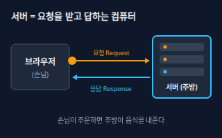</a> <b><a href="#server--서버">Server</a></b> 서버 다른 컴퓨터(브라우저·앱)의 요청을 기다렸다가 처리해서 답을 돌려주는 컴퓨터 또는 프로그램. 식당으로 치면 주문을 받아 음식을 내주는 주방이다.</td>
<td width="33%" valign="top"><a href="#api--api-애플리케이션-프로그래밍-인터페이스">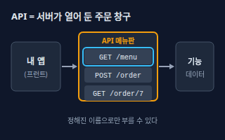</a> <b><a href="#api--api-애플리케이션-프로그래밍-인터페이스">API</a></b> API (애플리케이션 프로그래밍 인터페이스) 한 프로그램이 다른 프로그램의 기능을 부를 수 있게 서버가 열어 둔 정해진 창구. 웹에서는 보통 '주소 + 메서드'로 불러서 데이터를 받는다. 이 주소 하나하나를 엔드포인트라고 부른다.</td>
<td width="33%" valign="top"><a href="#rest--rest-api">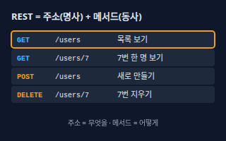</a> <b><a href="#rest--rest-api">REST</a></b> REST API 웹 API를 '주소는 자원(명사), 하고 싶은 일은 HTTP 메서드(동사)'로 설계하는 가장 흔한 방식. 예: GET /users/7 은 7번 사용자를 보여 달라는 뜻이다.</td>
</tr>
<tr>
<td width="33%" valign="top"><a href="#http-method--http-메서드">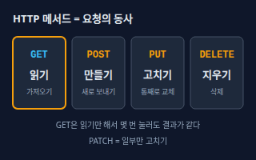</a> <b><a href="#http-method--http-메서드">HTTP Method</a></b> HTTP 메서드 요청이 '무엇을 하려는지'를 알리는 동사. 읽기는 GET, 새로 만들기는 POST, 통째 교체는 PUT, 일부만 수정은 PATCH, 삭제는 DELETE를 쓴다.</td>
<td width="33%" valign="top"><a href="#status-code--상태-코드">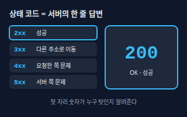</a> <b><a href="#status-code--상태-코드">Status Code</a></b> 상태 코드 서버가 응답 맨 앞에 붙이는 세 자리 숫자로, 요청 결과를 알려준다. 2xx는 성공, 3xx는 다른 주소로 이동, 4xx는 요청한 쪽의 문제, 5xx는 서버 쪽의 문제다.</td>
<td width="33%" valign="top"><a href="#json--json">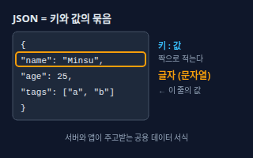</a> <b><a href="#json--json">JSON</a></b> JSON 데이터를 '키: 값' 짝으로 적는 글자 형식. 서버와 앱이 데이터를 주고받을 때 가장 흔히 쓰는 공용 서식이다. 중괄호 { }는 묶음(객체), 대괄호 [ ]는 목록(배열)이다.</td>
</tr>
<tr>
<td width="33%" valign="top"><a href="#webhook--웹훅">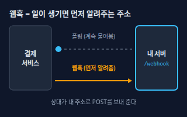</a> <b><a href="#webhook--웹훅">Webhook</a></b> 웹훅 어떤 일이 생겼을 때 상대 서비스가 내 서버의 주소로 먼저 알림(HTTP 요청)을 보내 주는 방식. 내가 '왔어?' 하고 계속 물어보는 폴링과 반대다.</td>
<td width="33%" valign="top"><a href="#cors--cors-교차-출처-리소스-공유">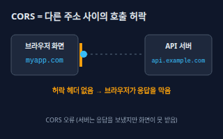</a> <b><a href="#cors--cors-교차-출처-리소스-공유">CORS</a></b> CORS (교차 출처 리소스 공유) 한 사이트의 화면이 다른 주소의 서버를 부를 때 브라우저가 지키는 보안 규칙. 서버가 '이 주소는 허락한다'는 헤더를 응답에 붙여야 브라우저가 응답을 화면 코드에 넘겨준다.</td>
</tr>
</table>

**데이터 · Data** (6)

<table>
<tr>
<td width="33%" valign="top"><a href="#database--데이터베이스">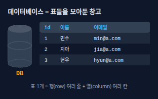</a> <b><a href="#database--데이터베이스">Database</a></b> 데이터베이스 서비스의 데이터(회원, 주문, 글)를 표(테이블) 단위로 오래 안전하게 저장하고 빠르게 찾게 해 주는 시스템. 서버를 껐다 켜도 데이터가 남는다.</td>
<td width="33%" valign="top"><a href="#sql--sql">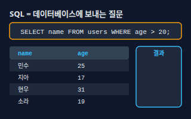</a> <b><a href="#sql--sql">SQL</a></b> SQL 데이터베이스에게 '이 조건의 데이터를 찾아줘/넣어줘/고쳐줘/지워줘'라고 말하는 질문 언어. SELECT(조회), INSERT(추가), UPDATE(수정), DELETE(삭제)가 기본이다.</td>
<td width="33%" valign="top"><a href="#index--인덱스">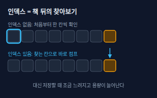</a> <b><a href="#index--인덱스">Index</a></b> 인덱스 데이터베이스가 특정 열(예: 이메일)로 행을 빨리 찾도록 미리 만들어 두는 찾아보기. 책 뒤의 색인과 같다. 없으면 표 전체를 한 줄씩 훑는다.</td>
</tr>
<tr>
<td width="33%" valign="top"><a href="#migration--마이그레이션">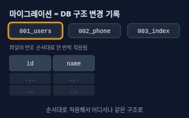</a> <b><a href="#migration--마이그레이션">Migration</a></b> 마이그레이션 데이터베이스 구조 변경(테이블·열·인덱스 추가)을 번호 붙은 파일로 기록해 두고 순서대로 한 번씩 적용하는 방식. 내 컴퓨터·테스트·실서비스 DB가 같은 구조를 갖게 해 준다.</td>
<td width="33%" valign="top"><a href="#transaction--트랜잭션">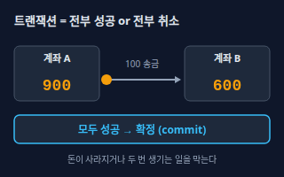</a> <b><a href="#transaction--트랜잭션">Transaction</a></b> 트랜잭션 여러 데이터 변경을 하나로 묶어 '전부 성공하거나 전부 없던 일로 되돌리거나' 중 하나로 끝내는 단위. 중간 상태는 다른 사용자에게 보이지 않는다.</td>
<td width="33%" valign="top"><a href="#cache--캐시">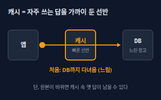</a> <b><a href="#cache--캐시">Cache</a></b> 캐시 자주 쓰는 결과를 빠른 곳(메모리 등)에 잠깐 복사해 두고 다음 요청에 재사용하는 것. 느린 DB 조회나 외부 API 호출을 줄여 응답을 빠르게 한다.</td>
</tr>
</table>

**보안 · Security** (5)

<table>
<tr>
<td width="33%" valign="top"><a href="#authentication-vs-authorization--인증과-인가">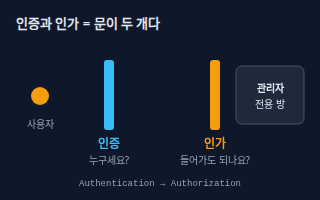</a> <b><a href="#authentication-vs-authorization--인증과-인가">Authentication vs Authorization</a></b> 인증과 인가 인증은 '당신이 누구인지' 확인하는 것(로그인), 인가는 '그 사람이 이것을 해도 되는지' 확인하는 것(권한)이다. 인증이 먼저, 인가가 그다음이다.</td>
<td width="33%" valign="top"><a href="#session-vs-jwt--세션과-jwt">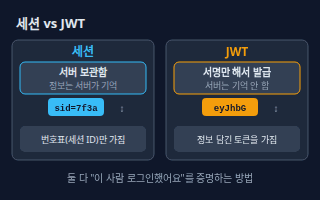</a> <b><a href="#session-vs-jwt--세션과-jwt">Session vs JWT</a></b> 세션과 JWT 로그인 상태를 유지하는 두 방식. 세션은 서버가 로그인 정보를 보관하고 브라우저에는 번호표(세션 ID, 보통 쿠키)만 준다. JWT는 정보를 담은 서명된 토큰을 사용자가 들고 다니며 매 요청에 보낸다.</td>
<td width="33%" valign="top"><a href="#environment-variable--환경-변수">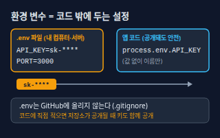</a> <b><a href="#environment-variable--환경-변수">Environment Variable</a></b> 환경 변수 코드 밖에 두고 실행할 때 앱에 넘기는 설정 값. API 키·DB 비밀번호 같은 비밀(시크릿)과, 개발용·실서비스용으로 달라지는 값을 여기에 둔다.</td>
</tr>
<tr>
<td width="33%" valign="top"><a href="#rate-limit--요청-제한">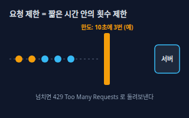</a> <b><a href="#rate-limit--요청-제한">Rate Limit</a></b> 요청 제한 한 사용자(또는 IP)가 정해진 시간 안에 보낼 수 있는 요청 횟수에 한도를 두는 것. 한도를 넘기면 서버는 429 상태 코드로 '잠시 후 다시'라고 답한다.</td>
<td width="33%" valign="top"><a href="#https--https">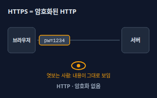</a> <b><a href="#https--https">HTTPS</a></b> HTTPS 브라우저와 서버 사이의 모든 통신을 TLS로 암호화한 HTTP. 중간에서 엿보거나 바꿔치기하기 어렵다. 주소창에 자물쇠가 보이면 HTTPS다.</td>
</tr>
</table>

**배포·운영 · Deploy & Ops** (8)

<table>
<tr>
<td width="33%" valign="top"><a href="#deployment--배포">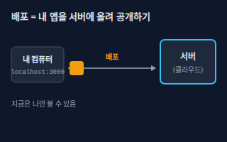</a> <b><a href="#deployment--배포">Deployment</a></b> 배포 내 컴퓨터에서 돌아가던 앱을 인터넷에 열린 서버에 올려 다른 사람이 쓸 수 있게 만드는 일. 완성된 결과를 서버에 올려 실행하는 것까지 포함한다.</td>
<td width="33%" valign="top"><a href="#domain-and-dns--도메인과-dns">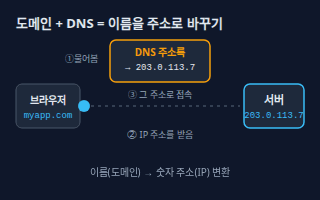</a> <b><a href="#domain-and-dns--도메인과-dns">Domain and DNS</a></b> 도메인과 DNS 도메인은 사람이 기억하기 쉬운 이름(myapp.com), DNS는 그 이름을 서버의 숫자 주소(IP)로 바꿔 주는 인터넷의 주소록이다. 도메인 설정이란 '이 이름은 이 서버로 연결'이라고 DNS에 적는 일이다.</td>
<td width="33%" valign="top"><a href="#container--컨테이너">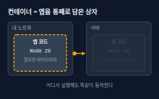</a> <b><a href="#container--컨테이너">Container</a></b> 컨테이너 앱과 실행에 필요한 것(런타임·라이브러리)을 한 상자에 담아 다른 것들과 분리해서 실행하는 방식. 내 컴퓨터에서 되던 것이 서버에서도 똑같이 돌게 해 준다. 대표 도구가 Docker다.</td>
</tr>
<tr>
<td width="33%" valign="top"><a href="#cicd--cicd">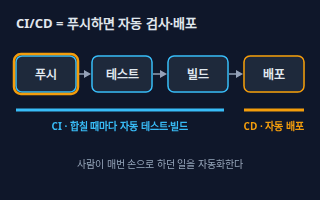</a> <b><a href="#cicd--cicd">CI/CD</a></b> CI/CD 코드를 올릴 때마다 테스트·빌드를 자동으로 돌리는 것이 CI(지속적 통합), 통과한 결과를 자동으로 서버에 올리는 것이 CD(지속적 배포·전달)다.</td>
<td width="33%" valign="top"><a href="#logging--로깅">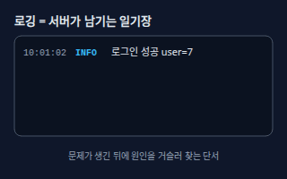</a> <b><a href="#logging--로깅">Logging</a></b> 로깅 서버가 실행 중에 일어난 일(요청, 오류, 느린 처리)을 시간과 함께 한 줄씩 기록으로 남기는 것. 문제가 생긴 뒤에 원인을 찾는 가장 기본적인 단서다.</td>
<td width="33%" valign="top"><a href="#monitoring--모니터링">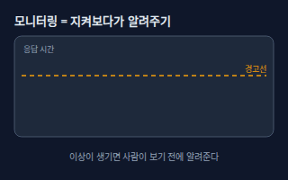</a> <b><a href="#monitoring--모니터링">Monitoring</a></b> 모니터링 서버의 상태(살아 있는지, 응답이 느린지, 오류가 늘었는지)를 계속 지켜보다가 이상하면 알림을 보내는 것.</td>
</tr>
<tr>
<td width="33%" valign="top"><a href="#cron--크론">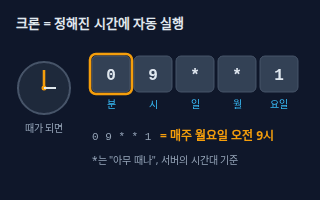</a> <b><a href="#cron--크론">Cron</a></b> 크론 정해진 시간마다 작업을 자동으로 실행하는 예약 기능. 시간은 '분 시 일 월 요일' 다섯 칸으로 적는다. 예: 0 9   1 은 매주 월요일 9시 0분이다.</td>
<td width="33%" valign="top"><a href="#queue--큐">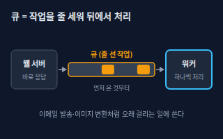</a> <b><a href="#queue--큐">Queue</a></b> 큐 오래 걸리는 일을 바로 처리하지 않고 줄(대기열)에 넣어 두면, 뒤에서 워커(일꾼 프로그램)가 앞에서부터 하나씩 꺼내 처리하게 하는 구조. 사용자에게는 먼저 빠르게 응답한다.</td>
</tr>
</table>

<!-- overview:end -->

## 서버와 API · Server & API

### Server · 서버

- **정의**: 다른 컴퓨터(브라우저·앱)의 요청을 기다렸다가 처리해서 답을 돌려주는 컴퓨터 또는 프로그램. 식당으로 치면 주문을 받아 음식을 내주는 주방이다.
- **AI에게 이렇게**: "Node.js로 3000번 포트에서 요청을 받는 서버를 만들어줘. /health 주소로 접속하면 'ok'를 돌려주게 해줘."
- **언제**: 웹사이트·앱의 데이터와 로직을 처리할 때, 로그인·결제·저장 기능이 필요할 때
- **헷갈림**: 프런트엔드 — 프런트엔드는 사용자 화면에서 실행되는 코드, 서버(백엔드)는 사용자가 볼 수 없는 곳에서 실행되는 코드다.
- **관련**: API, HTTP Method, Status Code, Deployment
- **확인 질문**: 어떤 언어·프레임워크를 쓸까요? 포트 번호와 실행 환경(내 컴퓨터/클라우드)은 무엇인가요?

### API · API (애플리케이션 프로그래밍 인터페이스)

- **정의**: 한 프로그램이 다른 프로그램의 기능을 부를 수 있게 서버가 열어 둔 정해진 창구. 웹에서는 보통 '주소 + 메서드'로 불러서 데이터를 받는다. 이 주소 하나하나를 엔드포인트라고 부른다.
- **AI에게 이렇게**: "상품 목록을 주는 API를 만들어줘. 엔드포인트는 GET /products, 응답은 JSON 배열이고, 문서(요청·응답 예시)도 같이 써줘."
- **언제**: 프런트엔드와 서버를 나눠 만들 때, 외부 서비스(결제·지도·AI)의 기능을 가져다 쓸 때
- **헷갈림**: UI — 사람이 누르는 화면이 UI, 프로그램끼리 부르는 창구가 API다. 같은 서버가 둘 다 제공할 수 있다.
- **관련**: REST, Endpoint, JSON, HTTP Method, Rate Limit
- **확인 질문**: 누가 이 API를 부르나요(내 프런트/외부 사용자)? 로그인이 필요한 API와 누구나 부를 수 있는 API는 어느 것인가요?

### REST · REST API

- **정의**: 웹 API를 '주소는 자원(명사), 하고 싶은 일은 HTTP 메서드(동사)'로 설계하는 가장 흔한 방식. 예: GET /users/7 은 7번 사용자를 보여 달라는 뜻이다.
- **AI에게 이렇게**: "게시글 CRUD를 REST 규칙으로 만들어줘. 목록 GET /posts, 상세 GET /posts/:id, 작성 POST /posts, 삭제 DELETE /posts/:id."
- **언제**: 대부분의 웹·모바일 앱 서버를 설계할 때
- **헷갈림**: GraphQL·RPC — REST는 '자원마다 주소'가 있고, GraphQL은 주소 하나에 질문을 보내 필요한 값만 받는 방식이다. 현실에서 'REST API'라 부르는 것 중에는 엄격한 REST 규칙을 다 지키지 않는 것도 많다.
- **관련**: API, HTTP Method, Status Code, JSON
- **확인 질문**: 다루는 자원(사용자·주문·상품 등)은 무엇이고 서로 어떻게 연결되나요? 주소에 버전(/v1)을 붙일까요?
- **근거**: [MDN Glossary: REST](https://developer.mozilla.org/en-US/docs/Glossary/REST)
- **검증일**: 2026-11-02

### HTTP Method · HTTP 메서드

- **정의**: 요청이 '무엇을 하려는지'를 알리는 동사. 읽기는 GET, 새로 만들기는 POST, 통째 교체는 PUT, 일부만 수정은 PATCH, 삭제는 DELETE를 쓴다.
- **AI에게 이렇게**: "프로필 수정 API는 PATCH로, 계정 삭제는 DELETE로 만들어줘. 조회(GET)는 데이터를 바꾸면 안 돼."
- **언제**: API 주소를 설계할 때, 같은 요청을 실수로 두 번 보내도 안전해야 할 때(재시도)
- **헷갈림**: PUT vs PATCH — PUT은 자원 전체를 새 내용으로 바꾸고, PATCH는 보낸 부분만 바꾼다. POST는 같은 요청을 두 번 보내면 두 개가 만들어질 수 있지만 GET·PUT·DELETE는 여러 번 보내도 결과가 같게(멱등) 설계한다.
- **관련**: REST, API, Status Code, Endpoint
- **확인 질문**: 이 동작은 데이터를 바꾸나요, 읽기만 하나요? 같은 요청이 두 번 들어와도 괜찮아야 하나요?
- **근거**: [MDN: HTTP request methods](https://developer.mozilla.org/en-US/docs/Web/HTTP/Reference/Methods), [MDN Glossary: Idempotent](https://developer.mozilla.org/en-US/docs/Glossary/Idempotent)
- **검증일**: 2026-11-02

### Status Code · 상태 코드

- **정의**: 서버가 응답 맨 앞에 붙이는 세 자리 숫자로, 요청 결과를 알려준다. 2xx는 성공, 3xx는 다른 주소로 이동, 4xx는 요청한 쪽의 문제, 5xx는 서버 쪽의 문제다.
- **AI에게 이렇게**: "성공하면 200, 새로 만들면 201, 없는 글이면 404, 로그인 안 했으면 401, 권한이 없으면 403, 서버 오류는 500으로 일관되게 응답해줘."
- **언제**: 오류 원인을 찾을 때(404인지 500인지에 따라 고칠 곳이 다르다), API 응답 규칙을 정할 때
- **헷갈림**: 401 vs 403 — 401은 '누구인지 확인이 안 됨(로그인 필요)', 403은 '누군지는 알지만 권한이 없음'이다. 404는 주소나 자원이 없을 때, 400은 요청 내용 자체가 잘못됐을 때다.
- **관련**: HTTP Method, REST, Authentication vs Authorization, Rate Limit, Logging
- **확인 질문**: 오류 응답에 사용자에게 보여줄 메시지도 넣을까요? 내부 오류 내용은 숨겨도 되나요?
- **근거**: [MDN: HTTP response status codes](https://developer.mozilla.org/en-US/docs/Web/HTTP/Reference/Status), [MDN: 401 Unauthorized](https://developer.mozilla.org/en-US/docs/Web/HTTP/Reference/Status/401), [MDN: 403 Forbidden](https://developer.mozilla.org/en-US/docs/Web/HTTP/Reference/Status/403)
- **검증일**: 2026-11-02

### JSON · JSON

- **정의**: 데이터를 '키: 값' 짝으로 적는 글자 형식. 서버와 앱이 데이터를 주고받을 때 가장 흔히 쓰는 공용 서식이다. 중괄호 { }는 묶음(객체), 대괄호 [ ]는 목록(배열)이다.
- **AI에게 이렇게**: "응답은 JSON으로 줘. 필드는 id(숫자), name(문자열), tags(문자열 배열)이고, 값이 없으면 null로 줘."
- **언제**: API 요청·응답, 설정 파일, 데이터 내보내기·가져오기
- **헷갈림**: CSV·엑셀 — CSV/엑셀은 행·열 표 모양, JSON은 안에 목록이 또 들어갈 수 있는 계층 구조다. JavaScript 객체와 비슷해 보이지만 키에 반드시 큰따옴표를 쓰고 주석을 쓸 수 없다.
- **관련**: API, REST, Database
- **확인 질문**: 필드 이름은 camelCase와 snake_case 중 무엇으로 통일할까요? 날짜는 어떤 형식으로 줄까요?

### Webhook · 웹훅

- **정의**: 어떤 일이 생겼을 때 상대 서비스가 내 서버의 주소로 먼저 알림(HTTP 요청)을 보내 주는 방식. 내가 '왔어?' 하고 계속 물어보는 폴링과 반대다.
- **AI에게 이렇게**: "결제 서비스가 결제 완료를 알려주는 웹훅을 받는 POST /webhooks/payment 엔드포인트를 만들어줘. 서명을 검증하고, 같은 알림이 두 번 와도 주문이 한 번만 처리되게 해줘."
- **언제**: 결제 완료, 깃허브 푸시, 메시지 수신처럼 외부에서 일이 생길 때 내 서버가 반응해야 할 때
- **헷갈림**: API 호출 — API는 내가 상대에게 요청하는 것, 웹훅은 상대가 나에게 요청하는 것이다. 웹훅 주소는 인터넷에 열려 있으니 서명 검증이 필수다.
- **관련**: API, Endpoint, Queue, Authentication vs Authorization
- **확인 질문**: 알림을 보내는 서비스는 어디인가요? 서명 방식과 재전송 정책은 무엇이고, 처리에 실패하면 어떻게 할까요?
- **근거**: [GitHub Docs: About webhooks](https://docs.github.com/en/webhooks/about-webhooks)
- **검증일**: 2026-11-02

### CORS · CORS (교차 출처 리소스 공유)

- **정의**: 한 사이트의 화면이 다른 주소의 서버를 부를 때 브라우저가 지키는 보안 규칙. 서버가 '이 주소는 허락한다'는 헤더를 응답에 붙여야 브라우저가 응답을 화면 코드에 넘겨준다.
- **AI에게 이렇게**: "프런트(https://myapp.com)에서 이 API를 부를 수 있게 CORS를 설정해줘. 모든 주소(*)가 아니라 myapp.com만 허용해줘."
- **언제**: 브라우저 콘솔에 'blocked by CORS policy'가 뜰 때, 프런트와 API의 주소(도메인·포트)가 다를 때
- **헷갈림**: 서버 방화벽 — CORS는 서버가 요청을 막는 것이 아니라 브라우저가 응답을 화면 코드에 못 주게 막는 것이다. 그래서 같은 요청이 터미널(curl)에서는 잘 되는데 브라우저에서만 실패할 수 있다.
- **관련**: API, HTTP Method, Authentication vs Authorization, Domain and DNS
- **확인 질문**: 프런트와 API의 정확한 주소(포트 포함)는 무엇인가요? 로그인 쿠키도 함께 보내야 하나요?
- **근거**: [MDN Glossary: CORS](https://developer.mozilla.org/en-US/docs/Glossary/CORS), [MDN: Cross-Origin Resource Sharing](https://developer.mozilla.org/en-US/docs/Web/HTTP/Guides/CORS)
- **검증일**: 2026-11-02

## 데이터 · Data

### Database · 데이터베이스

- **정의**: 서비스의 데이터(회원, 주문, 글)를 표(테이블) 단위로 오래 안전하게 저장하고 빠르게 찾게 해 주는 시스템. 서버를 껐다 켜도 데이터가 남는다.
- **AI에게 이렇게**: "PostgreSQL에 users 테이블(id, 이메일, 이름, 가입일)과 orders 테이블(id, user_id, 금액, 상태)을 설계하고, 둘이 user_id로 연결되게 해줘."
- **언제**: 회원·주문·게시글처럼 앱을 껐다 켜도 남아야 하는 정보가 있을 때
- **헷갈림**: 파일(JSON·엑셀) 저장 — 파일은 동시에 여러 명이 쓰거나 검색할 때 꼬이기 쉽고, 데이터베이스는 동시 접근·검색·복구를 대신 처리해 준다. 서버 메모리에만 두면 서버가 재시작될 때 사라진다.
- **관련**: SQL, Index, Transaction, Migration, Cache
- **확인 질문**: 어떤 종류를 쓸까요(PostgreSQL/MySQL/SQLite/NoSQL)? 데이터는 어디에 두고 백업은 어떻게 할까요?

### SQL · SQL

- **정의**: 데이터베이스에게 '이 조건의 데이터를 찾아줘/넣어줘/고쳐줘/지워줘'라고 말하는 질문 언어. SELECT(조회), INSERT(추가), UPDATE(수정), DELETE(삭제)가 기본이다.
- **AI에게 이렇게**: "최근 7일 안에 가입한 회원의 이메일을 가입일 순으로 뽑는 SQL을 써줘. 사용자 입력은 문자열로 이어 붙이지 말고 파라미터로 넣어줘."
- **언제**: 데이터 조회·집계, 리포트 뽑기, 잘못된 데이터 수정
- **헷갈림**: 엑셀 필터 — 엑셀은 사람이 눈으로 걸러내고, SQL은 조건을 글로 적어 수백만 행에서도 찾는다. 사용자가 입력한 글을 SQL 문장에 그대로 붙이면 공격(SQL 인젝션)에 뚫릴 수 있어 파라미터 바인딩을 쓴다.
- **관련**: Database, Index, Transaction, Migration
- **확인 질문**: 어느 테이블의 어떤 조건인가요? UPDATE·DELETE는 먼저 SELECT로 대상 행을 확인하고, 백업이 있는 상태에서 실행할까요?

### Index · 인덱스

- **정의**: 데이터베이스가 특정 열(예: 이메일)로 행을 빨리 찾도록 미리 만들어 두는 찾아보기. 책 뒤의 색인과 같다. 없으면 표 전체를 한 줄씩 훑는다.
- **AI에게 이렇게**: "orders 테이블에서 user_id로 자주 조회해. 느려졌으니 user_id에 인덱스를 추가하는 마이그레이션을 만들어줘."
- **언제**: 데이터가 많아져 조회가 느릴 때, WHERE·JOIN·정렬에 자주 쓰는 열이 있을 때
- **헷갈림**: 기본키(PK) — 기본키는 행을 구분하는 고유 번호이고 보통 자동으로 인덱스가 걸린다. 인덱스는 모든 열에 붙이는 게 아니다. 붙일수록 저장·수정이 느려지고 용량이 늘어난다.
- **관련**: Database, SQL, Migration
- **확인 질문**: 느린 쿼리는 어느 것이고 어떤 열로 찾나요? 쓰기가 많은 테이블인가요?
- **근거**: [PostgreSQL 문서: Indexes — Introduction](https://www.postgresql.org/docs/current/indexes-intro.html)
- **검증일**: 2026-11-02

### Migration · 마이그레이션

- **정의**: 데이터베이스 구조 변경(테이블·열·인덱스 추가)을 번호 붙은 파일로 기록해 두고 순서대로 한 번씩 적용하는 방식. 내 컴퓨터·테스트·실서비스 DB가 같은 구조를 갖게 해 준다.
- **AI에게 이렇게**: "users 테이블에 phone 열(선택값)을 추가하는 마이그레이션 파일을 만들어줘. 되돌리는(rollback) 파일도 같이 만들고, 기존 데이터는 그대로 두어야 해."
- **언제**: 열이나 테이블을 추가·변경할 때, 팀이나 여러 환경이 같은 DB 구조를 써야 할 때
- **헷갈림**: 데이터 이전(이사) — 일상 말로는 서버를 옮기는 것도 마이그레이션이라 하지만, 여기서는 'DB 구조 변경 기록'을 뜻한다. 이미 적용한 마이그레이션 파일은 고치지 않고 새 파일을 추가한다.
- **관련**: Database, SQL, Index, Deployment
- **확인 질문**: 실서비스 DB에 이미 데이터가 있나요? 변경 전에 백업을 받았나요? 되돌리는 방법이 필요한가요?

### Transaction · 트랜잭션

- **정의**: 여러 데이터 변경을 하나로 묶어 '전부 성공하거나 전부 없던 일로 되돌리거나' 중 하나로 끝내는 단위. 중간 상태는 다른 사용자에게 보이지 않는다.
- **AI에게 이렇게**: "주문 생성 시 재고 차감, 주문 저장, 결제 기록 저장을 한 트랜잭션으로 묶어줘. 하나라도 실패하면 모두 롤백해야 해."
- **언제**: 송금, 주문+재고처럼 두 가지 이상을 함께 바꿔야 할 때
- **헷갈림**: 결제(거래) — 일상에서 '거래'를 뜻하는 transaction과 달리, 여기서는 DB 변경 묶음을 뜻한다. 커밋(commit)은 확정, 롤백(rollback)은 되돌림이다.
- **관련**: Database, SQL, Queue
- **확인 질문**: 어떤 변경들이 함께 성공해야 하나요? 외부 결제처럼 되돌릴 수 없는 작업이 섞여 있나요?
- **근거**: [PostgreSQL 문서: Transactions](https://www.postgresql.org/docs/current/tutorial-transactions.html)
- **검증일**: 2026-11-02

### Cache · 캐시

- **정의**: 자주 쓰는 결과를 빠른 곳(메모리 등)에 잠깐 복사해 두고 다음 요청에 재사용하는 것. 느린 DB 조회나 외부 API 호출을 줄여 응답을 빠르게 한다.
- **AI에게 이렇게**: "상품 목록 조회 결과를 Redis에 10분간 캐시해줘. 상품이 수정되면 해당 캐시는 지워지게 해줘."
- **언제**: 같은 질문이 반복되는데 답이 자주 안 바뀔 때, 외부 API 호출 횟수·비용을 줄이고 싶을 때
- **헷갈림**: 데이터베이스 — DB는 원본을 보관하고, 캐시는 복사본을 임시로 둔다. 원본이 바뀌었는데 캐시를 안 지우면 옛 값이 보이는 문제가 생긴다.
- **관련**: Database, Index, Rate Limit
- **확인 질문**: 옛 값이 잠깐 보여도 괜찮은가요? 캐시를 얼마 동안 유지하고, 언제 지워야 하나요? 로그인한 사용자별 값을 섞지 않게 할까요?
- **근거**: [MDN: HTTP caching](https://developer.mozilla.org/en-US/docs/Web/HTTP/Guides/Caching)
- **검증일**: 2026-11-02

## 보안 · Security

### Authentication vs Authorization · 인증과 인가

- **정의**: 인증은 '당신이 누구인지' 확인하는 것(로그인), 인가는 '그 사람이 이것을 해도 되는지' 확인하는 것(권한)이다. 인증이 먼저, 인가가 그다음이다.
- **AI에게 이렇게**: "로그인한 사용자만 주문을 만들 수 있게 하고(인증), 주문 조회는 본인 주문만, 전체 조회는 관리자만 가능하게 해줘(인가)."
- **언제**: 로그인 기능, 관리자 페이지, 남의 데이터를 못 보게 해야 할 때
- **헷갈림**: 401 vs 403 — 로그인(인증)이 안 되면 401, 로그인은 했지만 권한(인가)이 없으면 403이다. 로그인만 확인하고 '이 글이 내 글인지'를 확인하지 않으면 남의 데이터를 볼 수 있다.
- **관련**: Session vs JWT, Status Code, HTTPS, Rate Limit
- **확인 질문**: 사용자 역할은 어떻게 나눌까요(일반/관리자 등)? 소셜 로그인(구글·카카오)을 쓸까요?
- **근거**: [MDN: HTTP authentication](https://developer.mozilla.org/en-US/docs/Web/HTTP/Guides/Authentication), [MDN: 403 Forbidden](https://developer.mozilla.org/en-US/docs/Web/HTTP/Reference/Status/403)
- **검증일**: 2026-11-02

### Session vs JWT · 세션과 JWT

- **정의**: 로그인 상태를 유지하는 두 방식. 세션은 서버가 로그인 정보를 보관하고 브라우저에는 번호표(세션 ID, 보통 쿠키)만 준다. JWT는 정보를 담은 서명된 토큰을 사용자가 들고 다니며 매 요청에 보낸다.
- **AI에게 이렇게**: "로그인은 서버 세션 + HttpOnly 쿠키 방식으로 만들어줘. 로그아웃하면 서버에서 세션이 바로 삭제되어야 해."
- **언제**: 로그인 유지 방식을 정할 때, 모바일 앱·외부 서비스와 같은 로그인을 공유할 때
- **헷갈림**: 암호화 — JWT는 '서명'되어 위조는 막지만 내용은 base64로 누구나 읽을 수 있으니 비밀번호 같은 값을 넣지 않는다. 이미 발급한 JWT를 서버가 즉시 무효로 만들기는 세션보다 어렵다.
- **관련**: Authentication vs Authorization, HTTPS, Environment Variable
- **확인 질문**: 웹만 쓰나요, 모바일 앱도 있나요? 강제 로그아웃이 필요한가요? 토큰 만료 시간은 얼마로 할까요?
- **근거**: [MDN: Using HTTP cookies](https://developer.mozilla.org/en-US/docs/Web/HTTP/Guides/Cookies), [RFC 7519: JSON Web Token (JWT)](https://datatracker.ietf.org/doc/html/rfc7519)
- **검증일**: 2026-11-02

### Environment Variable · 환경 변수

- **정의**: 코드 밖에 두고 실행할 때 앱에 넘기는 설정 값. API 키·DB 비밀번호 같은 비밀(시크릿)과, 개발용·실서비스용으로 달라지는 값을 여기에 둔다.
- **AI에게 이렇게**: "DB 주소와 결제 API 키는 코드에 적지 말고 환경 변수(DATABASE_URL, PAYMENT_API_KEY)로 읽게 해줘. .env.example 파일과 .gitignore도 만들어줘."
- **언제**: 비밀 키를 다룰 때, 내 컴퓨터와 실서비스의 설정이 다를 때
- **헷갈림**: 코드 안 상수 — 코드에 적은 값은 저장소(GitHub)와 함께 퍼지지만 환경 변수는 코드와 따로 관리된다. 브라우저에서 실행되는 프런트 코드에 넣은 값은 사용자에게 보이므로 비밀로 쓸 수 없다. 이미 올라간 키는 삭제만 하지 말고 새 키로 교체해야 한다.
- **관련**: Deployment, Container, Session vs JWT
- **확인 질문**: 어떤 값이 비밀인가요? 배포할 곳(Vercel/Cloudflare/서버)에서는 환경 변수를 어디에 입력하나요?
- **근거**: [The Twelve-Factor App: Config](https://12factor.net/config)
- **검증일**: 2026-11-02

### Rate Limit · 요청 제한

- **정의**: 한 사용자(또는 IP)가 정해진 시간 안에 보낼 수 있는 요청 횟수에 한도를 두는 것. 한도를 넘기면 서버는 429 상태 코드로 '잠시 후 다시'라고 답한다.
- **AI에게 이렇게**: "로그인 API에 IP당 1분에 5번까지만 허용하는 요청 제한을 걸어줘. 넘으면 429와 Retry-After 헤더를 돌려줘."
- **언제**: 로그인·인증번호 발송처럼 악용되기 쉬운 곳, 유료 외부 API 비용을 지켜야 할 때, 봇 접속이 많을 때
- **헷갈림**: 방화벽·차단 — 차단은 접속 자체를 막고, 요청 제한은 '너무 자주'만 막는다. 외부 서비스의 요청 제한에 걸렸을 때는 429를 받으니 재시도 간격을 늘려야 한다.
- **관련**: Status Code, Authentication vs Authorization, Cache, Queue
- **확인 질문**: 어떤 주소에 한도를 걸까요? 한도 기준은 IP인가요 로그인한 사용자인가요? 한도 숫자는 몇 번으로 할까요?
- **근거**: [MDN: 429 Too Many Requests](https://developer.mozilla.org/en-US/docs/Web/HTTP/Reference/Status/429)
- **검증일**: 2026-11-02

### HTTPS · HTTPS

- **정의**: 브라우저와 서버 사이의 모든 통신을 TLS로 암호화한 HTTP. 중간에서 엿보거나 바꿔치기하기 어렵다. 주소창에 자물쇠가 보이면 HTTPS다.
- **AI에게 이렇게**: "실서비스는 HTTPS로만 접속되게 해줘. http로 들어오면 https로 자동 이동시키고, 인증서는 자동 갱신되는 방식으로 설정해줘."
- **언제**: 로그인·결제·개인정보가 오가는 모든 서비스(사실상 모든 공개 서비스)
- **헷갈림**: 인증/인가 — HTTPS는 통신을 숨기는 것이고, 로그인 여부나 권한과는 별개다. HTTPS라도 서버 코드가 안전하다는 뜻은 아니다.
- **관련**: Domain and DNS, Authentication vs Authorization, Deployment
- **확인 질문**: 도메인은 이미 있나요? 인증서는 호스팅 서비스가 자동으로 발급해 주나요?
- **근거**: [MDN Glossary: HTTPS](https://developer.mozilla.org/en-US/docs/Glossary/HTTPS)
- **검증일**: 2026-11-02

## 배포·운영 · Deploy & Ops

### Deployment · 배포

- **정의**: 내 컴퓨터에서 돌아가던 앱을 인터넷에 열린 서버에 올려 다른 사람이 쓸 수 있게 만드는 일. 완성된 결과를 서버에 올려 실행하는 것까지 포함한다.
- **AI에게 이렇게**: "이 서버를 Fly.io(또는 내가 쓰는 호스팅)에 배포하는 순서를 단계별로 알려주고, 환경 변수 설정과 DB 연결 확인까지 포함해줘. 배포 후 확인할 주소도 알려줘."
- **언제**: 앱을 처음 공개할 때, 기능을 고쳐서 새 버전을 올릴 때
- **헷갈림**: 개발 서버 — 내 컴퓨터에서 도는 localhost 서버는 나만 볼 수 있다. 배포는 이를 공개 주소로 올리는 일이다. 스테이징(연습용)과 프로덕션(실서비스)을 나누면 안전하다.
- **관련**: CI/CD, Container, Environment Variable, Domain and DNS, Migration
- **확인 질문**: 어디에 배포하나요? 스테이징 환경이 따로 있나요? 문제가 생기면 이전 버전으로 돌아갈 방법이 필요한가요?

### Domain and DNS · 도메인과 DNS

- **정의**: 도메인은 사람이 기억하기 쉬운 이름(myapp.com), DNS는 그 이름을 서버의 숫자 주소(IP)로 바꿔 주는 인터넷의 주소록이다. 도메인 설정이란 '이 이름은 이 서버로 연결'이라고 DNS에 적는 일이다.
- **AI에게 이렇게**: "myapp.com을 Vercel 배포에 연결하려면 DNS에 어떤 레코드(A/CNAME)를 추가해야 하는지 알려줘. www도 같이 연결하고 싶어."
- **언제**: 내 서비스에 고유 주소를 붙일 때, 이메일·서브도메인(api.myapp.com)을 설정할 때
- **헷갈림**: 호스팅 — 도메인은 주소(이름), 호스팅은 서비스가 실제로 돌아가는 장소다. 도메인을 사는 곳과 서버를 빌리는 곳이 달라도 된다. DNS를 바꾸면 전 세계에 반영되는 데 시간이 걸릴 수 있다.
- **관련**: HTTPS, Deployment, CORS
- **확인 질문**: 도메인은 어디서 샀나요? 연결할 서비스(호스팅)는 무엇이고, www와 루트 도메인 모두 연결할까요?
- **근거**: [MDN Glossary: DNS](https://developer.mozilla.org/en-US/docs/Glossary/DNS)
- **검증일**: 2026-11-02

### Container · 컨테이너

- **정의**: 앱과 실행에 필요한 것(런타임·라이브러리)을 한 상자에 담아 다른 것들과 분리해서 실행하는 방식. 내 컴퓨터에서 되던 것이 서버에서도 똑같이 돌게 해 준다. 대표 도구가 Docker다.
- **AI에게 이렇게**: "이 서버를 Docker로 실행할 수 있게 Dockerfile과 docker-compose.yml을 만들어줘. DB도 컨테이너로 같이 띄우고, 환경 변수는 .env에서 읽게 해줘."
- **언제**: '내 컴퓨터에서는 되는데 서버에서는 안 돼요' 문제를 줄이고 싶을 때, 앱과 DB를 한 번에 띄우고 싶을 때
- **헷갈림**: 가상 머신(VM) — VM은 운영체제까지 통째로 흉내 내고, 컨테이너는 격리된 프로세스라 훨씬 가볍다. 컨테이너 안에 저장한 파일은 컨테이너를 지우면 같이 사라지므로 DB 데이터는 별도 저장 공간(볼륨)을 쓴다.
- **관련**: Deployment, CI/CD, Environment Variable
- **확인 질문**: 어떤 서비스들을 컨테이너로 묶나요? 데이터는 어디에 보관하고 서버는 어떤 호스팅이 컨테이너를 지원하나요?
- **근거**: [Docker 문서: What is a container?](https://docs.docker.com/get-started/docker-concepts/the-basics/what-is-a-container/)
- **검증일**: 2026-11-02

### CI/CD · CI/CD

- **정의**: 코드를 올릴 때마다 테스트·빌드를 자동으로 돌리는 것이 CI(지속적 통합), 통과한 결과를 자동으로 서버에 올리는 것이 CD(지속적 배포·전달)다.
- **AI에게 이렇게**: "GitHub Actions로 main에 푸시하면 테스트를 돌리고, 통과하면 자동으로 배포하는 워크플로를 만들어줘. 테스트가 실패하면 배포하지 마."
- **언제**: 수동 배포가 잦거나 실수가 걱정될 때, 여러 사람이 같은 코드를 고칠 때
- **헷갈림**: Git — Git은 코드의 변경 이력을 관리하는 도구, CI/CD는 그 코드가 올라올 때 자동으로 검사·배포하는 파이프라인이다. 비밀 키는 CI의 시크릿 저장소에 넣고 코드에는 적지 않는다.
- **관련**: Deployment, Container, Environment Variable, Logging
- **확인 질문**: 어떤 브랜치가 올라오면 배포하나요? 테스트가 있나요? 배포 대상(서버/호스팅)과 접속 방법은 무엇인가요?
- **근거**: [GitHub Docs: Understanding GitHub Actions](https://docs.github.com/en/actions/get-started/understand-github-actions)
- **검증일**: 2026-11-02

### Logging · 로깅

- **정의**: 서버가 실행 중에 일어난 일(요청, 오류, 느린 처리)을 시간과 함께 한 줄씩 기록으로 남기는 것. 문제가 생긴 뒤에 원인을 찾는 가장 기본적인 단서다.
- **AI에게 이렇게**: "요청마다 시간, 주소, 상태 코드, 처리 시간을 로그로 남겨줘. 비밀번호·토큰·카드번호는 로그에 절대 남기지 말고, 오류는 ERROR 단계로 구분해줘."
- **언제**: 오류 원인을 찾을 때, 누가 언제 무엇을 했는지 추적해야 할 때
- **헷갈림**: 모니터링 — 로그는 지나간 일의 기록, 모니터링은 지금 상태를 지켜보다가 이상하면 알려주는 것이다. INFO(보통) → WARN(주의) → ERROR(오류) 같은 단계로 중요도를 나눈다.
- **관련**: Monitoring, Status Code, Deployment
- **확인 질문**: 로그는 어디에 저장·확인하나요? 개인정보가 로그에 섞이지 않게 해야 할 항목은 무엇인가요? 얼마나 오래 보관할까요?

### Monitoring · 모니터링

- **정의**: 서버의 상태(살아 있는지, 응답이 느린지, 오류가 늘었는지)를 계속 지켜보다가 이상하면 알림을 보내는 것.
- **AI에게 이렇게**: "/health 주소를 1분마다 확인해서 응답이 없으면 슬랙으로 알려줘. 오류 비율이 평소보다 많이 늘면 알림이 오게 해줘."
- **언제**: 서비스를 실제 사용자에게 공개한 뒤, 밤사이 서버가 죽는 일을 빨리 알고 싶을 때
- **헷갈림**: 로깅 — 로깅은 일어난 일을 기록해 두는 것, 모니터링은 숫자(응답 시간·오류율)를 그래프로 보고 기준을 넘으면 알리는 것이다.
- **관련**: Logging, Rate Limit, Deployment
- **확인 질문**: 어떤 상태가 '이상'인가요(예: 응답 3초 이상)? 알림은 어디로 받고, 밤에도 받을까요?

### Cron · 크론

- **정의**: 정해진 시간마다 작업을 자동으로 실행하는 예약 기능. 시간은 '분 시 일 월 요일' 다섯 칸으로 적는다. 예: 0 9 * * 1 은 매주 월요일 9시 0분이다.
- **AI에게 이렇게**: "매일 새벽 3시에 만료된 세션을 지우는 작업을 크론으로 등록해줘. 서버 시간대가 UTC인지 확인하고, 실패하면 로그를 남겨줘."
- **언제**: 매일 백업, 정기 리포트, 만료 데이터 정리, 주기적 알림 메일
- **헷갈림**: 큐 — 크론은 '정해진 시간에' 일을 시작하고, 큐는 '일이 생기는 대로' 줄 세워 처리한다. 서버의 시간대(UTC/KST)에 따라 실행 시각이 달라진다. *는 '아무 때나'라는 뜻이다.
- **관련**: Queue, Logging, Monitoring, Deployment
- **확인 질문**: 어떤 시간대 기준으로 언제 실행할까요? 이전 실행이 끝나기 전에 다음 시간이 되면 어떻게 할까요?
- **근거**: [crontab(5) 설명서 (FreeBSD man page)](https://man.freebsd.org/cgi/man.cgi?crontab%285%29)
- **검증일**: 2026-11-02

### Queue · 큐

- **정의**: 오래 걸리는 일을 바로 처리하지 않고 줄(대기열)에 넣어 두면, 뒤에서 워커(일꾼 프로그램)가 앞에서부터 하나씩 꺼내 처리하게 하는 구조. 사용자에게는 먼저 빠르게 응답한다.
- **AI에게 이렇게**: "회원가입 후 환영 이메일 발송은 큐에 넣어서 워커가 처리하게 해줘. 실패하면 3번까지 다시 시도하고, 그래도 안 되면 실패 목록에 남겨줘."
- **언제**: 이메일 발송, 이미지·영상 변환, 외부 API 호출처럼 오래 걸리거나 실패할 수 있는 일
- **헷갈림**: 크론 — 크론은 시간 기준 예약, 큐는 일이 생긴 순서대로 처리. 같은 작업이 두 번 실행돼도 문제가 없도록(중복 처리 방지) 만들어야 안전하다.
- **관련**: Cron, Webhook, Transaction, Rate Limit
- **확인 질문**: 처리 순서가 중요한가요? 실패하면 몇 번 다시 시도하고, 끝내 실패하면 누구에게 알릴까요? 어떤 큐 서비스를 쓸까요(Redis, SQS 등)?

## 참고 자료

- [MDN: HTTP response status codes](https://developer.mozilla.org/en-US/docs/Web/HTTP/Reference/Status)
- [MDN: HTTP request methods](https://developer.mozilla.org/en-US/docs/Web/HTTP/Reference/Methods)
- [MDN Glossary: Idempotent](https://developer.mozilla.org/en-US/docs/Glossary/Idempotent)
- [MDN: HTTP authentication](https://developer.mozilla.org/en-US/docs/Web/HTTP/Guides/Authentication)
- [MDN: Using HTTP cookies](https://developer.mozilla.org/en-US/docs/Web/HTTP/Guides/Cookies)
- [MDN: HTTP caching](https://developer.mozilla.org/en-US/docs/Web/HTTP/Guides/Caching)
- [MDN: Cross-Origin Resource Sharing (CORS)](https://developer.mozilla.org/en-US/docs/Web/HTTP/Guides/CORS)
- [MDN Glossary: REST](https://developer.mozilla.org/en-US/docs/Glossary/REST)
- [MDN Glossary: DNS](https://developer.mozilla.org/en-US/docs/Glossary/DNS)
- [MDN Glossary: HTTPS](https://developer.mozilla.org/en-US/docs/Glossary/HTTPS)
- [RFC 7519: JSON Web Token (JWT)](https://datatracker.ietf.org/doc/html/rfc7519)
- [PostgreSQL 문서: Transactions](https://www.postgresql.org/docs/current/tutorial-transactions.html)
- [PostgreSQL 문서: Indexes — Introduction](https://www.postgresql.org/docs/current/indexes-intro.html)
- [Docker 문서: What is a container?](https://docs.docker.com/get-started/docker-concepts/the-basics/what-is-a-container/)
- [The Twelve-Factor App: Config](https://12factor.net/config)
- [GitHub Docs: About webhooks](https://docs.github.com/en/webhooks/about-webhooks)
- [GitHub Docs: Understanding GitHub Actions](https://docs.github.com/en/actions/get-started/understand-github-actions)
- [crontab(5) 설명서 (FreeBSD man page)](https://man.freebsd.org/cgi/man.cgi?crontab%285%29)
