# 클라우드 · 인프라 치트시트

> AWS·Google Cloud·Azure·Cloudflare·Vercel 같은 곳에 앱을 올리고, 트래픽이 늘면 키우고, 비용을 관리하도록 AI에게 시킬 창업자·바이브 코더를 위한 시트입니다. 업체마다 서비스 이름은 달라도 개념은 같으므로, 개념 이름으로 말하면 AI가 업체별 제품을 찾아냅니다.

> **참고용입니다.** 요금, 무료 한도, 성능 수치는 업체와 시점에 따라 달라 이 시트에 적지 않았습니다. 실제 비용과 약속은 각 업체의 공식 문서와 요금 페이지에서 확인하세요. 서버를 만들거나 지우는 작업은 비용 폭탄이나 장애로 이어질 수 있으니, AI에게 맡길 때는 "실행 전에 계획(plan)과 예상 비용 항목을 먼저 보여줘"라고 덧붙이세요.

## 이렇게 쓰세요

- **나 → AI**: "우리 서비스를 클라우드에 올리려고 해. 서버리스 함수, 관리형 앱 호스팅, 가상 서버(VM) 중 어떤 방식이 맞을지 내가 관리해야 하는 범위 기준으로 비교해줘."
- **AI → 나**: "사용자는 어느 나라에 많나요(리전)? 트래픽이 갑자기 몰릴 수 있나요(오토스케일링)? 월 예산 상한을 정하고 예산 알림을 켤까요?"
- **나 → AI**: "웹 서버는 로드 밸런서 뒤에 두 대로 나누고, DB는 비공개 서브넷의 관리형 데이터베이스로 만들어줘. 보안 그룹은 필요한 문만 열어줘."
- **AI → 나**: "서버 한 대가 멈추면 서비스도 멈추는 구조(단일 장애점)가 있어요. 가용 영역을 둘 이상 쓰고 헬스 체크로 고장 난 서버를 빼는 구성으로 갈까요?"
- **나 → AI**: "이미지 다운로드가 많아 요금이 걱정돼. 정적 파일은 CDN으로 서비스하고, 데이터가 클라우드 밖으로 나가는 경로를 찾아줘."
- **나 → AI**: "지금 클릭으로 만든 인프라를 Terraform 같은 IaC로 옮겨줘. 적용 전에 변경 계획을 보여주고, 지우는 리소스가 있으면 따로 알려줘."

## 한눈에 보기

<!-- overview:start -->
<!-- 이 구역은 자동 생성됩니다. 직접 고치지 말고 `cd mcp-server && npm run generate`를 실행하세요. -->

**클라우드 기본 · Cloud Basics** (4)

<table>
<tr>
<td width="33%" valign="top"><a href="#cloud-vs-on-premise--클라우드와-온프레미스">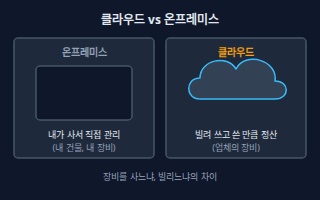</a> <b><a href="#cloud-vs-on-premise--클라우드와-온프레미스">Cloud vs On-premise</a></b> 클라우드와 온프레미스 클라우드는 업체가 가진 서버·저장소·네트워크를 인터넷으로 빌려 쓰고 쓴 만큼 내는 방식이고, 온프레미스는 내 건물에 장비를 직접 사서 설치·운영하는 방식이다. 미국 표준기술연구소(NIST)도 필요할 때 바로 꺼내 쓰고 사용량을 재서 정산하는 자원 공유 모델로 정의한다.</td>
<td width="33%" valign="top"><a href="#iaas--paas--saas--서비스형-인프라플랫폼소프트웨어">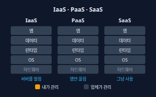</a> <b><a href="#iaas--paas--saas--서비스형-인프라플랫폼소프트웨어">IaaS / PaaS / SaaS</a></b> 서비스형 인프라·플랫폼·소프트웨어 클라우드를 어디까지 업체가 맡아 주느냐로 나눈 세 단계. IaaS는 서버를 빌려 OS부터 내가 관리하고, PaaS는 코드만 올리면 실행 환경은 업체가 맡고, SaaS는 완성된 앱을 쓰기만 한다.</td>
<td width="33%" valign="top"><a href="#region-and-availability-zone--리전과-가용-영역">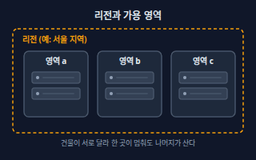</a> <b><a href="#region-and-availability-zone--리전과-가용-영역">Region and Availability Zone</a></b> 리전과 가용 영역 리전은 클라우드 업체가 데이터센터를 모아 둔 지리적 지역(예: 서울)이고, 가용 영역은 한 리전 안에서 전력·냉각·네트워크가 따로 분리된 데이터센터 묶음이다. 한 영역이 멈춰도 다른 영역은 계속 동작한다.</td>
</tr>
<tr>
<td width="33%" valign="top"><a href="#managed-service--관리형-서비스">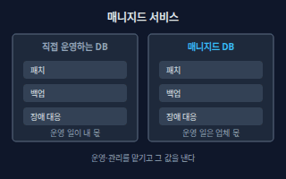</a> <b><a href="#managed-service--관리형-서비스">Managed Service</a></b> 관리형 서비스 설치, 패치, 백업, 장애 대응 같은 운영을 업체가 대신 해 주는 서비스. 예를 들어 DB를 직접 깔지 않고 업체의 관리형 데이터베이스를 쓰는 것이다.</td>
</tr>
</table>

**컴퓨팅 · Compute** (7)

<table>
<tr>
<td width="33%" valign="top"><a href="#vm--instance--가상-서버--인스턴스">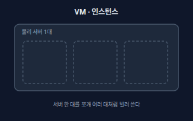</a> <b><a href="#vm--instance--가상-서버--인스턴스">VM / Instance</a></b> 가상 서버 / 인스턴스 물리 서버 한 대를 쪼개 만든 가상의 컴퓨터. CPU·메모리·디스크 크기를 고르면 인스턴스(VM) 한 대가 만들어지며, AWS는 EC2, GCP는 Compute Engine, Azure는 Virtual Machines라고 부른다.</td>
<td width="33%" valign="top"><a href="#serverless-faas--서버리스-함수-실행-서비스">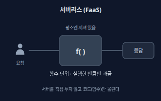</a> <b><a href="#serverless-faas--서버리스-함수-실행-서비스">Serverless (FaaS)</a></b> 서버리스 (함수 실행 서비스) 서버를 직접 두지 않고 코드(함수)만 올리면 요청이 올 때 실행되고 실행한 만큼만 과금되는 방식. 서버가 없는 게 아니라 업체가 알아서 관리하며, AWS Lambda·Azure Functions·Cloudflare Workers·Vercel Functions 등이 있다.</td>
<td width="33%" valign="top"><a href="#cold-start--콜드-스타트">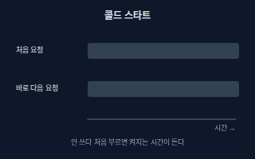</a> <b><a href="#cold-start--콜드-스타트">Cold Start</a></b> 콜드 스타트 한동안 쓰지 않던 서버리스 함수를 처음 부를 때, 실행 환경을 준비하느라 응답이 평소보다 느려지는 현상. 준비가 끝난 뒤의 요청은 빠르다.</td>
</tr>
<tr>
<td width="33%" valign="top"><a href="#edge-computing--엣지-컴퓨팅">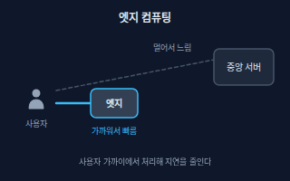</a> <b><a href="#edge-computing--엣지-컴퓨팅">Edge Computing</a></b> 엣지 컴퓨팅 멀리 있는 중앙 서버 대신 사용자와 가까운 곳(엣지 위치)에서 코드를 실행해 응답 지연을 줄이는 방식. Cloudflare Workers나 Vercel의 엣지 실행이 대표적이다.</td>
<td width="33%" valign="top"><b><a href="backend.md#container--컨테이너">Container</a></b> 컨테이너 앱과 실행에 필요한 것을 한 상자로 묶어 어디서나 똑같이 돌리게 하는 방식. → backend 시트</td>
<td width="33%" valign="top"><a href="#container-registry--컨테이너-레지스트리">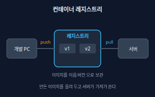</a> <b><a href="#container-registry--컨테이너-레지스트리">Container Registry</a></b> 컨테이너 레지스트리 컨테이너 이미지를 이름과 버전(태그)으로 보관하고 필요한 서버가 내려받게 해 주는 저장소. AWS는 ECR, GCP는 Artifact Registry, Azure는 ACR, 그 밖에 Docker Hub·GitHub Container Registry가 있다.</td>
</tr>
<tr>
<td width="33%" valign="top"><a href="#kubernetes--쿠버네티스-컨테이너-오케스트레이션">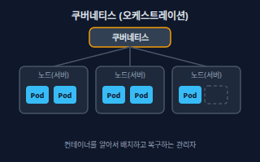</a> <b><a href="#kubernetes--쿠버네티스-컨테이너-오케스트레이션">Kubernetes</a></b> 쿠버네티스 (컨테이너 오케스트레이션) 컨테이너 여러 개를 여러 서버에 알아서 배치하고, 죽으면 다시 띄우고, 부하에 따라 늘리고 줄이는 오픈소스 관리 시스템. K8s라고도 부르며, AWS EKS·GCP GKE·Azure AKS처럼 관리형으로도 쓴다.</td>
</tr>
</table>

**저장소 · Storage** (3)

<table>
<tr>
<td width="33%" valign="top"><a href="#object-storage--오브젝트-스토리지">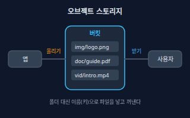</a> <b><a href="#object-storage--오브젝트-스토리지">Object Storage</a></b> 오브젝트 스토리지 파일(오브젝트)을 폴더 구조 대신 이름(키)으로 보관하고 인터넷 주소로 올리고 받는 대용량 저장소. 이미지·영상·문서·백업 파일에 쓰며, AWS S3·Google Cloud Storage·Azure Blob Storage·Cloudflare R2가 대표적이다.</td>
<td width="33%" valign="top"><a href="#block-storage--블록-스토리지">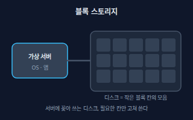</a> <b><a href="#block-storage--블록-스토리지">Block Storage</a></b> 블록 스토리지 VM에 디스크처럼 붙여 쓰는 저장소. 작은 블록 칸으로 나뉘어 필요한 칸만 읽고 쓸 수 있어 OS와 데이터베이스에 맞고, AWS EBS·GCP Persistent Disk·Azure Managed Disks가 있다.</td>
<td width="33%" valign="top"><a href="#snapshot--스냅샷">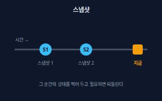</a> <b><a href="#snapshot--스냅샷">Snapshot</a></b> 스냅샷 디스크나 데이터베이스의 특정 시점 상태를 찍어 둔 복사본. 문제가 생기면 그 시점으로 되돌릴 수 있다.</td>
</tr>
</table>

**네트워크와 전달 · Network & Delivery** (7)

<table>
<tr>
<td width="33%" valign="top"><a href="#cdn--cdn-콘텐츠-전송-네트워크">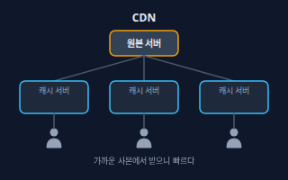</a> <b><a href="#cdn--cdn-콘텐츠-전송-네트워크">CDN</a></b> CDN (콘텐츠 전송 네트워크) 전 세계 곳곳의 캐시 서버에 이미지·스크립트·영상 같은 파일 사본을 두고, 사용자에게 가장 가까운 곳에서 전달해 주는 전달망. Amazon CloudFront, Cloud CDN, Azure Front Door, Cloudflare 등이 있다.</td>
<td width="33%" valign="top"><a href="#origin-server--오리진-서버-원본-서버">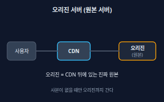</a> <b><a href="#origin-server--오리진-서버-원본-서버">Origin Server</a></b> 오리진 서버 (원본 서버) CDN이나 프록시 뒤에 있는 진짜 원본 서버. CDN에 사본이 없거나 만료되면 오리진에서 파일을 가져와 사용자에게 주고 사본으로 저장한다.</td>
<td width="33%" valign="top"><a href="#cache-hit-ratio--캐시-적중률">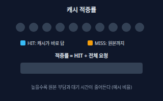</a> <b><a href="#cache-hit-ratio--캐시-적중률">Cache Hit Ratio</a></b> 캐시 적중률 전체 요청 중에서 캐시가 바로 답한 요청의 비율. 높을수록 원본 서버로 가는 요청이 줄어 빠르고 비용 부담이 작아진다.</td>
</tr>
<tr>
<td width="33%" valign="top"><a href="#load-balancer--로드-밸런서">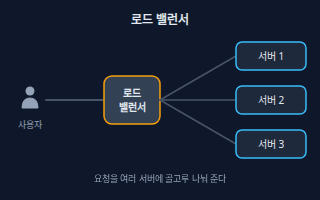</a> <b><a href="#load-balancer--로드-밸런서">Load Balancer</a></b> 로드 밸런서 들어오는 요청을 서버 여러 대에 나눠 전달하는 문지기. 서버가 늘고 줄어도 사용자는 같은 주소로 접속하며, AWS Elastic Load Balancing·Google Cloud Load Balancing·Azure Load Balancer 등이 있다.</td>
<td width="33%" valign="top"><a href="#health-check--헬스-체크">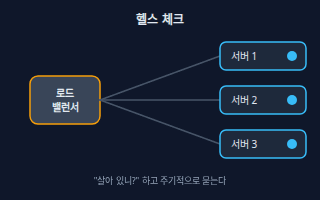</a> <b><a href="#health-check--헬스-체크">Health Check</a></b> 헬스 체크 로드 밸런서나 관리 시스템이 서버에 주기적으로 &quot;살아 있니?&quot; 하고 물어보고, 응답이 없으면 그 서버로 보내는 요청을 멈추는 점검.</td>
<td width="33%" valign="top"><a href="#reverse-proxy--리버스-프록시">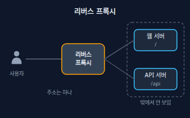</a> <b><a href="#reverse-proxy--리버스-프록시">Reverse Proxy</a></b> 리버스 프록시 서버 앞에 서서 요청을 대신 받아 알맞은 뒤쪽 서버로 전달하는 중개자. 뒤쪽 서버의 주소를 숨기고 경로별로 나누며 HTTPS 처리나 캐시를 맡기도 하고, Nginx와 Caddy가 흔한 예다.</td>
</tr>
<tr>
<td width="33%" valign="top"><b><a href="backend.md#domain-and-dns--도메인과-dns">Domain and DNS</a></b> 도메인과 DNS 사람이 읽는 도메인 주소를 서버의 IP 주소로 바꿔 주는 체계. → backend 시트</td>
</tr>
</table>

**사설 네트워크 · Private Network** (4)

<table>
<tr>
<td width="33%" valign="top"><a href="#vpc--vpc-가상-사설-클라우드">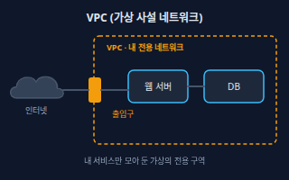</a> <b><a href="#vpc--vpc-가상-사설-클라우드">VPC</a></b> VPC (가상 사설 클라우드) 클라우드 안에 만드는 나만의 가상 네트워크 구역으로, IP 주소 범위와 길(라우팅), 출입 규칙을 내가 정한다. AWS와 Google Cloud는 VPC, Azure는 Virtual Network(VNet)라고 부른다.</td>
<td width="33%" valign="top"><a href="#subnet--서브넷">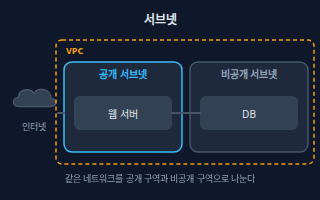</a> <b><a href="#subnet--서브넷">Subnet</a></b> 서브넷 VPC를 더 잘게 나눈 구역. 인터넷과 직접 통신하는 공개 서브넷과 안쪽에서만 통신하는 비공개 서브넷으로 나눠 쓴다.</td>
<td width="33%" valign="top"><a href="#firewall--security-group--방화벽--보안-그룹">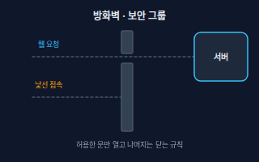</a> <b><a href="#firewall--security-group--방화벽--보안-그룹">Firewall / Security Group</a></b> 방화벽 / 보안 그룹 어디서(출발지), 어떤 문(포트·프로토콜)으로 들어오는 접속을 허용할지 정하는 규칙. 허용한 것만 열고 나머지는 닫는 게 기본이며, AWS는 보안 그룹, Azure는 네트워크 보안 그룹, GCP는 방화벽 규칙이라고 부른다.</td>
</tr>
<tr>
<td width="33%" valign="top"><a href="#nat--nat-네트워크-주소-변환">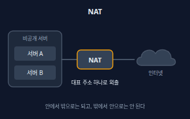</a> <b><a href="#nat--nat-네트워크-주소-변환">NAT</a></b> NAT (네트워크 주소 변환) 인터넷 주소가 없는 비공개 서버가 업데이트 내려받기처럼 바깥으로 나갈 수 있게 대표 주소로 바꿔 내보내 주는 장치. 밖에서 먼저 걸어오는 접속은 받지 않으며, AWS에서는 NAT Gateway라고 부른다.</td>
</tr>
</table>

**확장과 안정성 · Scaling & Reliability** (5)

<table>
<tr>
<td width="33%" valign="top"><a href="#auto-scaling--오토스케일링">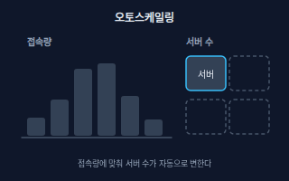</a> <b><a href="#auto-scaling--오토스케일링">Auto Scaling</a></b> 오토스케일링 접속량이나 CPU 사용률 같은 지표를 보고 서버 수를 자동으로 늘리고 줄이는 기능. 몰릴 때는 늘려 버티고 한가할 때는 줄여 낭비를 막는다.</td>
<td width="33%" valign="top"><a href="#horizontal-vs-vertical-scaling--수평-확장과-수직-확장">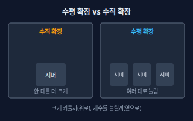</a> <b><a href="#horizontal-vs-vertical-scaling--수평-확장과-수직-확장">Horizontal vs Vertical Scaling</a></b> 수평 확장과 수직 확장 수직 확장(scale up)은 서버 한 대의 사양을 키우는 것이고, 수평 확장(scale out)은 같은 서버를 여러 대로 늘리는 것이다. 수평 확장을 하려면 로그인 정보 같은 상태를 서버 밖(DB)에 두어야 한다.</td>
<td width="33%" valign="top"><a href="#high-availability--고가용성">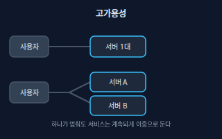</a> <b><a href="#high-availability--고가용성">High Availability</a></b> 고가용성 부품 하나가 고장나도 서비스가 멈추지 않게 이중으로 설계하는 것. 서버·DB·가용 영역을 둘 이상 두어 하나가 단독으로 서비스를 멈추게 하는 지점(단일 장애점)을 없앤다.</td>
</tr>
<tr>
<td width="33%" valign="top"><a href="#failover--페일오버">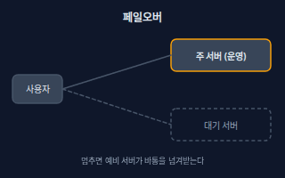</a> <b><a href="#failover--페일오버">Failover</a></b> 페일오버 주 시스템이 고장나면 대기 중인 예비 시스템이 자동으로 운영을 넘겨받는 것. 사용자는 거의 눈치채지 못하고 계속 서비스를 쓴다.</td>
<td width="33%" valign="top"><a href="#sla--sla-서비스-수준-협약">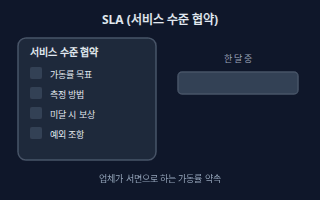</a> <b><a href="#sla--sla-서비스-수준-협약">SLA</a></b> SLA (서비스 수준 협약) 업체가 서비스의 가동률 같은 수준을 문서로 약속하고, 못 지키면 보상(보통 이용료 크레딧)해 주겠다는 조건. 서비스마다 다르고 약속은 배치 방식(예: 여러 가용 영역에 나눠 띄움)에 따라 달라지기도 한다.</td>
</tr>
</table>

**배포와 운영 · Operations** (5)

<table>
<tr>
<td width="33%" valign="top"><a href="#iac--iac-코드형-인프라">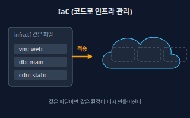</a> <b><a href="#iac--iac-코드형-인프라">IaC</a></b> IaC (코드형 인프라) 서버·네트워크·DB 같은 인프라를 클릭이 아니라 코드나 설정 파일로 적어 만들고 바꾸는 방식. 같은 파일이면 같은 환경이 다시 만들어지고 변경 기록도 남으며, Terraform·AWS CloudFormation·Azure Bicep·Pulumi 등이 있다.</td>
<td width="33%" valign="top"><b><a href="backend.md#deployment--배포">Deployment</a></b> 배포 만든 앱을 실제 사용자가 쓸 서버에 올려 공개하는 일. → backend 시트</td>
<td width="33%" valign="top"><b><a href="backend.md#monitoring--모니터링">Monitoring</a></b> 모니터링 서비스가 잘 돌고 있는지 지표를 계속 살피고 이상하면 알려 주는 일. → backend 시트</td>
</tr>
<tr>
<td width="33%" valign="top"><a href="#observability--관측-가능성">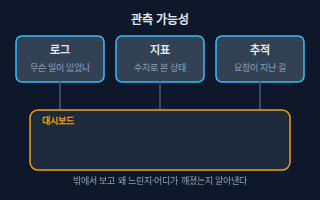</a> <b><a href="#observability--관측-가능성">Observability</a></b> 관측 가능성 로그(기록), 지표(수치), 추적(요청이 지나간 길)을 충분히 남겨 시스템 안에서 무슨 일이 일어나는지 밖에서 알아낼 수 있게 하는 성질. 문제가 났을 때 &quot;왜&quot;를 찾는 힘이다.</td>
<td width="33%" valign="top"><a href="#uptime-and-status-page--가동률과-상태-페이지">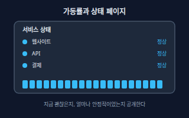</a> <b><a href="#uptime-and-status-page--가동률과-상태-페이지">Uptime and Status Page</a></b> 가동률과 상태 페이지 가동률(업타임)은 일정 기간 중 서비스가 정상으로 동작한 시간의 비율이다. 상태 페이지는 지금 장애가 있는지와 과거 사고 기록을 사용자에게 공개하는 페이지다.</td>
</tr>
</table>

**비용과 전략 · Cost & Strategy** (5)

<table>
<tr>
<td width="33%" valign="top"><a href="#pay-as-you-go--종량제-과금">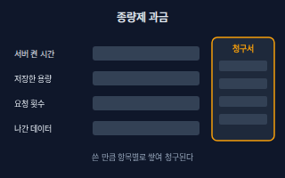</a> <b><a href="#pay-as-you-go--종량제-과금">Pay-as-you-go</a></b> 종량제 과금 서버 켠 시간, 저장 용량, 요청 수, 전송량처럼 쓴 만큼 항목별로 요금이 붙는 방식. 서비스마다 과금 단위가 다르다.</td>
<td width="33%" valign="top"><a href="#egress-cost--이그레스-비용-데이터-전송비">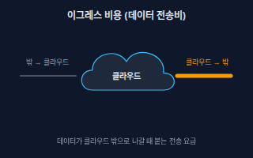</a> <b><a href="#egress-cost--이그레스-비용-데이터-전송비">Egress Cost</a></b> 이그레스 비용 (데이터 전송비) 데이터가 클라우드 밖(인터넷, 다른 클라우드, 다른 리전)으로 나갈 때 붙는 전송 요금. 업체와 경로마다 규칙이 달라 요금표를 직접 확인해야 한다.</td>
<td width="33%" valign="top"><a href="#reserved-vs-spot--예약과-스팟">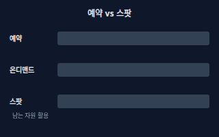</a> <b><a href="#reserved-vs-spot--예약과-스팟">Reserved vs Spot</a></b> 예약과 스팟 예약은 일정 기간 쓰겠다고 약속하고 할인받는 방식이고(AWS Reserved Instances·Savings Plans, GCP 약정 사용 할인, Azure Reservations), 스팟은 남는 서버를 싸게 쓰는 대신 업체가 언제든 회수할 수 있는 방식이다. 둘 다 아닌 기본 방식이 온디맨드다.</td>
</tr>
<tr>
<td width="33%" valign="top"><a href="#free-tier--프리-티어-무료-한도">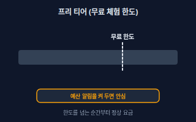</a> <b><a href="#free-tier--프리-티어-무료-한도">Free Tier</a></b> 프리 티어 (무료 한도) 업체가 일정 범위까지 무료로 쓰게 해 주는 제도. 신규 가입 후 기간 한정인지, 계속 주는 무료 한도인지, 체험용 크레딧인지는 업체와 서비스마다 다르고 바뀔 수 있어 공식 안내를 확인해야 한다.</td>
<td width="33%" valign="top"><a href="#vendor-lock-in--벤더-락인-멀티-클라우드">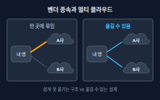</a> <b><a href="#vendor-lock-in--벤더-락인-멀티-클라우드">Vendor Lock-in</a></b> 벤더 락인 (멀티 클라우드) 한 업체만의 고유 서비스나 데이터 방식에 깊게 의존해, 다른 업체로 옮기는 비용과 노력이 너무 커진 상태. 표준 기술(컨테이너, 오픈소스 DB, IaC)로 만들거나 여러 업체를 함께 쓰는 멀티 클라우드로 줄일 수 있지만 운영은 더 복잡해진다.</td>
</tr>
</table>

<!-- overview:end -->

## 클라우드 기본 · Cloud Basics

### Cloud vs On-premise · 클라우드와 온프레미스

- **정의**: 클라우드는 업체가 가진 서버·저장소·네트워크를 인터넷으로 빌려 쓰고 쓴 만큼 내는 방식이고, 온프레미스는 내 건물에 장비를 직접 사서 설치·운영하는 방식이다. 미국 표준기술연구소(NIST)도 필요할 때 바로 꺼내 쓰고 사용량을 재서 정산하는 자원 공유 모델로 정의한다.
- **AI에게 이렇게**: "우리 서비스를 직접 서버를 사지 않고 올리고 싶어. 클라우드와 온프레미스 중 우리 상황(개발자 두 명, 트래픽 예측 불가)에 맞는 쪽을 장단점과 함께 비교해줘."
- **언제**: 서비스를 어디에 둘지 처음 정할 때, 사무실 서버실이나 전용 장비가 이미 있는 회사와 논의할 때
- **헷갈림**: Server(서버) — 서버는 요청을 처리하는 컴퓨터 자체이고, 클라우드·온프레미스는 그 컴퓨터를 누가 소유하고 어디서 운영하느냐의 방식이다.
- **관련**: IaaS / PaaS / SaaS, Region and Availability Zone, Pay-as-you-go
- **확인 질문**: 이미 가진 서버나 데이터를 특정 장소에만 둬야 한다는 규정이 있나요? 트래픽이 얼마나 들쭉날쭉한가요?

### IaaS / PaaS / SaaS · 서비스형 인프라·플랫폼·소프트웨어

- **정의**: 클라우드를 어디까지 업체가 맡아 주느냐로 나눈 세 단계. IaaS는 서버를 빌려 OS부터 내가 관리하고, PaaS는 코드만 올리면 실행 환경은 업체가 맡고, SaaS는 완성된 앱을 쓰기만 한다.
- **AI에게 이렇게**: "이 앱을 IaaS(가상 서버), PaaS(앱 호스팅), 서버리스 중 어디에 올리는 게 좋을지 내가 관리해야 하는 범위 기준으로 비교해줘."
- **언제**: 호스팅 방식을 고를 때, "서버 관리는 하기 싫다"와 "세부 설정은 직접 하고 싶다" 사이를 정할 때
- **헷갈림**: Managed Service(관리형 서비스) — 위 세 단계는 큰 분류이고, 관리형 서비스는 그 안에서 DB·캐시 같은 개별 부품의 운영을 맡기는 상품이다.
- **관련**: VM / Instance, Serverless (FaaS), Managed Service
- **확인 질문**: 서버 설정(OS·보안 패치)까지 직접 다룰 팀원이 있나요? 아니면 코드만 올리고 싶으신가요?

### Region and Availability Zone · 리전과 가용 영역

- **정의**: 리전은 클라우드 업체가 데이터센터를 모아 둔 지리적 지역(예: 서울)이고, 가용 영역은 한 리전 안에서 전력·냉각·네트워크가 따로 분리된 데이터센터 묶음이다. 한 영역이 멈춰도 다른 영역은 계속 동작한다.
- **AI에게 이렇게**: "서비스 지연을 줄이려고 사용자가 많은 나라와 가까운 리전에 배포하고, 서버는 가용 영역 두 곳 이상에 나눠 띄워줘."
- **언제**: 서버를 만들 때 위치를 고를 때, 장애에 버티는 구성을 짤 때, 데이터 보관 위치 규정을 확인할 때
- **헷갈림**: CDN — CDN은 전 세계 가까운 곳에 파일 사본을 두는 전달망이고, 리전은 내 서버와 데이터가 실제로 있는 곳이다.
- **관련**: High Availability, Failover, CDN, Edge Computing
- **확인 질문**: 사용자는 주로 어느 나라에 있나요? 데이터를 특정 국가 안에만 보관해야 하나요?

### Managed Service · 관리형 서비스

- **정의**: 설치, 패치, 백업, 장애 대응 같은 운영을 업체가 대신 해 주는 서비스. 예를 들어 DB를 직접 깔지 않고 업체의 관리형 데이터베이스를 쓰는 것이다.
- **AI에게 이렇게**: "DB를 서버에 직접 설치하지 말고 이 클라우드의 관리형 PostgreSQL로 만들어줘. 자동 백업도 켜줘."
- **언제**: DB·캐시·메시지 큐처럼 운영이 까다로운 부품을 쓸 때, 혼자서 운영 인력이 없을 때
- **헷갈림**: Self-hosted(직접 운영) — 직접 설치해 쓰면 자유도는 높지만 패치·백업·장애 대응이 모두 내 일이다. 관리형은 그 일을 값을 내고 맡긴다.
- **관련**: IaaS / PaaS / SaaS, Vendor Lock-in, Snapshot
- **확인 질문**: 직접 설치와 관리형 중 어느 쪽인가요? 관리형이라면 어떤 업체의 어떤 제품(예: 관리형 DB)으로 할까요?

## 컴퓨팅 · Compute

### VM / Instance · 가상 서버 / 인스턴스

- **정의**: 물리 서버 한 대를 쪼개 만든 가상의 컴퓨터. CPU·메모리·디스크 크기를 고르면 인스턴스(VM) 한 대가 만들어지며, AWS는 EC2, GCP는 Compute Engine, Azure는 Virtual Machines라고 부른다.
- **AI에게 이렇게**: "웹 서버용 VM(인스턴스) 한 대를 만들고 웹 접속과 관리용 접속만 열어줘. 만들기 전에 어떤 사양으로 만들지 계획을 먼저 보여줘."
- **언제**: 서버에 직접 접속해 프로그램을 설치하고 싶을 때, 기존 서버를 그대로 옮길 때
- **헷갈림**: Container(컨테이너) — VM은 OS까지 통째로 가상화한 한 대의 컴퓨터이고, 컨테이너는 OS를 공유하는 더 가벼운 포장이다.
- **관련**: IaaS / PaaS / SaaS, Block Storage, Auto Scaling
- **확인 질문**: 운영체제는 무엇으로 할까요? 사양(CPU·메모리)과 켜 둘 시간은 어느 정도인가요?

### Serverless (FaaS) · 서버리스 (함수 실행 서비스)

- **정의**: 서버를 직접 두지 않고 코드(함수)만 올리면 요청이 올 때 실행되고 실행한 만큼만 과금되는 방식. 서버가 없는 게 아니라 업체가 알아서 관리하며, AWS Lambda·Azure Functions·Cloudflare Workers·Vercel Functions 등이 있다.
- **AI에게 이렇게**: "이 API 하나를 서버리스 함수로 올려줘. 평소엔 요청이 거의 없고 가끔 몰려. 실행 시간 제한과 콜드 스타트가 문제 되는지도 알려줘."
- **언제**: 트래픽이 들쭉날쭉하거나 가끔만 실행되는 작업, 웹훅 받기, 간단한 API를 만들 때
- **헷갈림**: Container(컨테이너) — 컨테이너는 내가 올린 프로그램이 계속 떠 있는 방식이고, 서버리스는 요청이 올 때만 실행되는 방식이다.
- **관련**: Cold Start, Edge Computing, Pay-as-you-go
- **확인 질문**: 함수 하나가 얼마나 오래 걸리나요? 데이터베이스 연결이나 파일 저장이 필요한가요?

### Cold Start · 콜드 스타트

- **정의**: 한동안 쓰지 않던 서버리스 함수를 처음 부를 때, 실행 환경을 준비하느라 응답이 평소보다 느려지는 현상. 준비가 끝난 뒤의 요청은 빠르다.
- **AI에게 이렇게**: "처음 접속할 때만 응답이 느려. 서버리스 콜드 스타트 때문인지 확인하고, 줄일 방법(코드 크기, 미리 켜 두기)을 알려줘."
- **언제**: 서버리스 API가 가끔 첫 요청에서만 느릴 때, 지연이 중요한 서비스에 서버리스를 쓸지 고민할 때
- **헷갈림**: 느린 쿼리 — 느린 쿼리는 DB 작업 자체가 느린 것이고, 콜드 스타트는 실행 준비 시간 때문에 처음만 느린 것이다.
- **관련**: Serverless (FaaS), Health Check, Edge Computing
- **확인 질문**: 느린 건 처음 요청뿐인가요, 항상인가요? 사용자 로그인처럼 지연에 민감한 경로인가요?

### Edge Computing · 엣지 컴퓨팅

- **정의**: 멀리 있는 중앙 서버 대신 사용자와 가까운 곳(엣지 위치)에서 코드를 실행해 응답 지연을 줄이는 방식. Cloudflare Workers나 Vercel의 엣지 실행이 대표적이다.
- **AI에게 이렇게**: "로그인 상태 확인처럼 가벼운 처리는 엣지에서 실행하고, DB가 필요한 무거운 처리는 중앙 서버로 보내는 구조로 나눠줘."
- **언제**: 전 세계 사용자에게 빠른 응답이 필요할 때, 리디렉션·A/B 분기·간단한 검증을 요청 가장 앞단에서 처리할 때
- **헷갈림**: CDN — CDN은 주로 이미 만들어진 파일 사본을 가까이에 두는 것이고, 엣지 컴퓨팅은 가까운 곳에서 코드를 실행한다는 점이 다르다.
- **관련**: CDN, Serverless (FaaS), Region and Availability Zone
- **확인 질문**: 엣지에서 DB를 직접 읽어야 하나요? 사용자 분포는 어느 지역에 몰려 있나요?

### Container · 컨테이너

- **정의**: 앱과 실행에 필요한 것을 한 상자로 묶어 어디서나 똑같이 돌리게 하는 방식.
- **원본**: [백엔드 개발 · Container](backend.md#container--컨테이너)

### Container Registry · 컨테이너 레지스트리

- **정의**: 컨테이너 이미지를 이름과 버전(태그)으로 보관하고 필요한 서버가 내려받게 해 주는 저장소. AWS는 ECR, GCP는 Artifact Registry, Azure는 ACR, 그 밖에 Docker Hub·GitHub Container Registry가 있다.
- **AI에게 이렇게**: "이 앱의 컨테이너 이미지를 빌드해서 레지스트리에 올리는 단계를 CI/CD에 추가해줘. 버전 태그는 커밋 해시로 붙여줘."
- **언제**: 컨테이너로 배포할 때, 서버나 쿠버네티스가 최신 이미지를 가져가야 할 때
- **헷갈림**: Git 저장소 — Git은 소스 코드를 보관하고, 레지스트리는 그 코드로 빌드한 실행용 이미지를 보관한다.
- **관련**: Container, Kubernetes, CI/CD
- **확인 질문**: 이미지는 비공개로 둘까요? 오래된 이미지 정리 규칙이 필요한가요?

### Kubernetes · 쿠버네티스 (컨테이너 오케스트레이션)

- **정의**: 컨테이너 여러 개를 여러 서버에 알아서 배치하고, 죽으면 다시 띄우고, 부하에 따라 늘리고 줄이는 오픈소스 관리 시스템. K8s라고도 부르며, AWS EKS·GCP GKE·Azure AKS처럼 관리형으로도 쓴다.
- **AI에게 이렇게**: "컨테이너 서비스 세 개를 쿠버네티스에 배포하는 설정을 만들어줘. 먼저 쿠버네티스까지 필요한지, 더 단순한 호스팅으로 충분한지도 판단해줘."
- **언제**: 컨테이너가 많고 자동 복구·무중단 배포가 필요한 서비스를 운영할 때
- **헷갈림**: Docker — 도커는 컨테이너를 만들고 실행하는 도구이고, 쿠버네티스는 그 컨테이너 무리를 관리하는 시스템이다. 작은 서비스에는 쿠버네티스가 과할 수 있다.
- **관련**: Container, Container Registry, Auto Scaling
- **확인 질문**: 컨테이너가 몇 종류이고 팀에 쿠버네티스를 운영할 사람이 있나요? 더 단순한 방식으로 충분하지 않을까요?

## 저장소 · Storage

### Object Storage · 오브젝트 스토리지

- **정의**: 파일(오브젝트)을 폴더 구조 대신 이름(키)으로 보관하고 인터넷 주소로 올리고 받는 대용량 저장소. 이미지·영상·문서·백업 파일에 쓰며, AWS S3·Google Cloud Storage·Azure Blob Storage·Cloudflare R2가 대표적이다.
- **AI에게 이렇게**: "사용자가 올린 프로필 사진은 서버 디스크 말고 오브젝트 스토리지에 저장해줘. 비공개 버킷에 두고 보여 줄 때만 임시 주소를 만들어줘."
- **언제**: 업로드 파일, 정적 사이트 파일, 로그·백업을 쌓아 둘 때
- **헷갈림**: Block Storage(블록 스토리지) — 오브젝트 스토리지는 파일을 통째로 넣고 꺼내는 방식이라 일부만 고치기엔 맞지 않고, 블록 스토리지는 서버에 붙이는 디스크처럼 쓴다.
- **관련**: Block Storage, CDN, Snapshot
- **확인 질문**: 파일을 공개로 볼 수 있게 할까요, 로그인한 사람만 볼 수 있게 할까요? 파일을 얼마나 오래 보관하나요?

### Block Storage · 블록 스토리지

- **정의**: VM에 디스크처럼 붙여 쓰는 저장소. 작은 블록 칸으로 나뉘어 필요한 칸만 읽고 쓸 수 있어 OS와 데이터베이스에 맞고, AWS EBS·GCP Persistent Disk·Azure Managed Disks가 있다.
- **AI에게 이렇게**: "DB 서버 VM에 데이터용 디스크를 하나 따로 붙이고, 서버를 지워도 디스크는 남도록 설정해줘."
- **언제**: VM의 부팅 디스크, DB 데이터를 서버에 붙은 디스크에 저장할 때
- **헷갈림**: Object Storage — 블록 스토리지는 서버 한 대에 붙여 빠르게 읽고 쓰는 디스크이고, 오브젝트 스토리지는 주소로 파일을 주고받는 창고다.
- **관련**: VM / Instance, Snapshot, Object Storage
- **확인 질문**: 디스크 용량을 나중에 늘릴 수 있게 할까요? VM을 지울 때 디스크도 같이 지워도 되나요?

### Snapshot · 스냅샷

- **정의**: 디스크나 데이터베이스의 특정 시점 상태를 찍어 둔 복사본. 문제가 생기면 그 시점으로 되돌릴 수 있다.
- **AI에게 이렇게**: "서비스 업데이트 전에 DB 디스크 스냅샷을 먼저 찍고, 문제가 생기면 그 스냅샷으로 복원하는 순서를 정리해줘."
- **언제**: 배포나 설정 변경처럼 위험한 작업 직전, 테스트용 환경을 같은 상태로 복제할 때
- **헷갈림**: Backup(백업) — 스냅샷은 같은 클라우드 안에서 빠르게 되돌리기 위한 시점 복사본이고, 백업은 원본과 따로 떨어진 곳에 보관하는 복구용 사본이다(보안 시트의 Backup 3-2-1).
- **관련**: Block Storage, Managed Service, Deployment
- **확인 질문**: 어느 디스크·DB를 찍을까요? 복원 연습을 해 본 적이 있나요? 스냅샷을 다른 리전에도 복사할까요?

## 네트워크와 전달 · Network & Delivery

### CDN · CDN (콘텐츠 전송 네트워크)

- **정의**: 전 세계 곳곳의 캐시 서버에 이미지·스크립트·영상 같은 파일 사본을 두고, 사용자에게 가장 가까운 곳에서 전달해 주는 전달망. Amazon CloudFront, Cloud CDN, Azure Front Door, Cloudflare 등이 있다.
- **AI에게 이렇게**: "정적 파일(이미지, JS, CSS)은 CDN을 거쳐 내려가게 설정하고, 파일이 바뀌면 오래된 캐시가 남지 않게 하는 방법도 알려줘."
- **언제**: 사이트가 느릴 때, 해외 사용자가 있을 때, 서버 부담과 전송 요금을 줄이고 싶을 때
- **헷갈림**: Load Balancer(로드 밸런서) — 로드 밸런서는 내 서버들 사이에 요청을 나누고, CDN은 파일 사본을 사용자 가까이에 둔다.
- **관련**: Origin Server, Cache Hit Ratio, Domain and DNS, Edge Computing
- **확인 질문**: 무엇을 캐시해도 되나요(개인별로 다른 화면은 제외)? 캐시를 얼마나 오래 유지할까요?

### Origin Server · 오리진 서버 (원본 서버)

- **정의**: CDN이나 프록시 뒤에 있는 진짜 원본 서버. CDN에 사본이 없거나 만료되면 오리진에서 파일을 가져와 사용자에게 주고 사본으로 저장한다.
- **AI에게 이렇게**: "CDN 오리진을 우리 S3 버킷으로 지정하고, 오리진에는 CDN을 통해서만 접근되도록 막아줘."
- **언제**: CDN을 처음 연결할 때, "원본에는 요청이 얼마나 들어오나"를 줄이고 싶을 때
- **헷갈림**: CORS의 Origin(출처) — 브라우저 보안 규칙의 출처는 주소의 프로토콜·도메인·포트 묶음이다. 이름만 같고 다른 개념이다.
- **관련**: CDN, Cache Hit Ratio, Reverse Proxy
- **확인 질문**: 오리진이 서버인가요, 오브젝트 스토리지인가요? 오리진 주소를 외부에 그대로 공개해도 되나요?

### Cache Hit Ratio · 캐시 적중률

- **정의**: 전체 요청 중에서 캐시가 바로 답한 요청의 비율. 높을수록 원본 서버로 가는 요청이 줄어 빠르고 비용 부담이 작아진다.
- **AI에게 이렇게**: "CDN 캐시 적중률이 낮아. 어떤 경로가 매번 캐시를 건너뛰는지 찾고 캐시 규칙을 개선해줘."
- **언제**: CDN이 효과를 내고 있는지 볼 때, 원본 서버 부하와 전송 요금이 예상보다 클 때
- **헷갈림**: Cache(캐시) — 캐시는 사본을 두는 방법 자체이고, 적중률은 그 방법이 얼마나 잘 먹히는지를 재는 수치다.
- **관련**: CDN, Origin Server
- **확인 질문**: 쿼리 문자열이나 쿠키 때문에 같은 파일이 다른 요청으로 취급되고 있지 않나요? 어떤 파일을 캐시할 수 있나요?

### Load Balancer · 로드 밸런서

- **정의**: 들어오는 요청을 서버 여러 대에 나눠 전달하는 문지기. 서버가 늘고 줄어도 사용자는 같은 주소로 접속하며, AWS Elastic Load Balancing·Google Cloud Load Balancing·Azure Load Balancer 등이 있다.
- **AI에게 이렇게**: "웹 서버 세 대 앞에 로드 밸런서를 두고 HTTPS는 로드 밸런서에서 처리해줘. 고장 난 서버는 자동으로 제외되게 해줘."
- **언제**: 서버가 두 대 이상일 때, 무중단 배포나 오토스케일링을 할 때
- **헷갈림**: Reverse Proxy(리버스 프록시) — 둘은 겹치지만 로드 밸런서는 분산이 핵심이고, 리버스 프록시는 대신 받아 알맞은 곳으로 전달·경로 분기가 핵심이다. 실제 제품은 두 역할을 함께 하기도 한다.
- **관련**: Health Check, Auto Scaling, Reverse Proxy
- **확인 질문**: 요청을 어떤 규칙으로 나눌까요(번갈아, 가장 한가한 서버 우선)? 로그인 상태를 서버마다 따로 들고 있나요?

### Health Check · 헬스 체크

- **정의**: 로드 밸런서나 관리 시스템이 서버에 주기적으로 "살아 있니?" 하고 물어보고, 응답이 없으면 그 서버로 보내는 요청을 멈추는 점검.
- **AI에게 이렇게**: "/health 주소를 만들어서 서버가 정상일 때만 성공 응답을 주게 하고, 로드 밸런서가 그 주소로 헬스 체크하게 설정해줘."
- **언제**: 고장 난 서버를 자동으로 빼고 싶을 때, 새 서버가 준비되기 전에 요청이 가지 않게 하고 싶을 때
- **헷갈림**: Monitoring(모니터링) — 모니터링은 사람이 보는 지표와 알림이고, 헬스 체크는 요청을 보낼지 말지를 시스템이 바로 결정하는 자동 점검이다.
- **관련**: Load Balancer, Failover, Auto Scaling
- **확인 질문**: 무엇을 정상으로 볼까요(서버만 켜져 있으면 되나요, DB 연결까지 되어야 하나요)? 점검 주기와 실패 허용 횟수는요?

### Reverse Proxy · 리버스 프록시

- **정의**: 서버 앞에 서서 요청을 대신 받아 알맞은 뒤쪽 서버로 전달하는 중개자. 뒤쪽 서버의 주소를 숨기고 경로별로 나누며 HTTPS 처리나 캐시를 맡기도 하고, Nginx와 Caddy가 흔한 예다.
- **AI에게 이렇게**: "Nginx를 리버스 프록시로 두고 /api는 API 서버로, 나머지는 웹 서버로 전달하도록 설정해줘."
- **언제**: 여러 서비스를 하나의 도메인 뒤에 두고 싶을 때, 뒤쪽 서버를 밖에 직접 노출하고 싶지 않을 때
- **헷갈림**: Forward Proxy(포워드 프록시) — 포워드 프록시는 사용자 쪽에서 바깥으로 나갈 때 대신 나가 주고, 리버스 프록시는 서버 쪽에서 들어오는 요청을 대신 받는다.
- **관련**: Load Balancer, Origin Server, Domain and DNS
- **확인 질문**: 경로별로 어느 서버로 보낼까요? HTTPS 인증서는 프록시에서 처리할까요?

### Domain and DNS · 도메인과 DNS

- **정의**: 사람이 읽는 도메인 주소를 서버의 IP 주소로 바꿔 주는 체계.
- **원본**: [백엔드 개발 · Domain and DNS](backend.md#domain-and-dns--도메인과-dns)

## 사설 네트워크 · Private Network

### VPC · VPC (가상 사설 클라우드)

- **정의**: 클라우드 안에 만드는 나만의 가상 네트워크 구역으로, IP 주소 범위와 길(라우팅), 출입 규칙을 내가 정한다. AWS와 Google Cloud는 VPC, Azure는 Virtual Network(VNet)라고 부른다.
- **AI에게 이렇게**: "서비스 전용 VPC를 새로 만들고, 웹 서버는 공개 구역에 DB는 비공개 구역에 두는 네트워크 구성을 만들어줘."
- **언제**: 서버와 DB를 외부에서 바로 닿지 않게 감싸 두고 싶을 때, 여러 서비스를 한 네트워크 안에서 쓸 때
- **헷갈림**: VPN — VPN은 밖에서 안으로 안전하게 들어오는 터널이고, VPC는 클라우드 안에 내 구역을 만드는 것이다(VPN은 보안 시트).
- **관련**: Subnet, Firewall / Security Group, NAT
- **확인 질문**: 이 구역에 어떤 서버·DB가 들어가나요? 회사 내부망이나 다른 VPC와 연결해야 하나요?

### Subnet · 서브넷

- **정의**: VPC를 더 잘게 나눈 구역. 인터넷과 직접 통신하는 공개 서브넷과 안쪽에서만 통신하는 비공개 서브넷으로 나눠 쓴다.
- **AI에게 이렇게**: "공개 서브넷에는 로드 밸런서만, 비공개 서브넷에는 앱 서버와 DB를 두고 DB 서브넷은 인터넷에서 닿지 않게 구성해줘."
- **언제**: DB를 인터넷에서 숨길 때, 가용 영역마다 구역을 나눠 이중화할 때
- **헷갈림**: VPC — VPC가 전체 울타리이고, 서브넷은 그 안의 작은 구역이다.
- **관련**: VPC, NAT, Firewall / Security Group
- **확인 질문**: 공개해야 하는 서버는 무엇이고 숨겨야 하는 서버는 무엇인가요? 가용 영역마다 서브넷을 하나씩 둘까요?

### Firewall / Security Group · 방화벽 / 보안 그룹

- **정의**: 어디서(출발지), 어떤 문(포트·프로토콜)으로 들어오는 접속을 허용할지 정하는 규칙. 허용한 것만 열고 나머지는 닫는 게 기본이며, AWS는 보안 그룹, Azure는 네트워크 보안 그룹, GCP는 방화벽 규칙이라고 부른다.
- **AI에게 이렇게**: "웹 서버 보안 그룹은 웹 접속만 모두에게 열고, 관리용 접속은 우리 사무실 IP에서만 허용해줘. 지금 열린 규칙도 점검해줘."
- **언제**: 서버를 만들 때, "전 세계에 열려 있는 문"이 있는지 점검할 때
- **헷갈림**: Authentication(인증) — 방화벽은 "어디서 온 접속이냐"를 보고, 인증은 "누구냐"를 확인한다. 둘 다 있어야 안전하다.
- **관련**: VPC, Subnet, NAT
- **확인 질문**: 누가(어느 IP) 어떤 서비스에 접속해야 하나요? 관리용 포트를 인터넷 전체에 열어도 되나요?

### NAT · NAT (네트워크 주소 변환)

- **정의**: 인터넷 주소가 없는 비공개 서버가 업데이트 내려받기처럼 바깥으로 나갈 수 있게 대표 주소로 바꿔 내보내 주는 장치. 밖에서 먼저 걸어오는 접속은 받지 않으며, AWS에서는 NAT Gateway라고 부른다.
- **AI에게 이렇게**: "비공개 서브넷의 앱 서버가 외부 API를 호출할 수 있게 NAT를 설정해줘. 밖에서 직접 들어오는 접속은 막은 채로."
- **언제**: 비공개 서버가 패키지를 받거나 외부 API를 호출해야 할 때
- **헷갈림**: Internet Gateway — 인터넷 게이트웨이는 공개 서브넷과 인터넷 사이의 양방향 출입구이고, NAT는 안에서 밖으로만 나가게 해 준다.
- **관련**: Subnet, VPC, Egress Cost
- **확인 질문**: 비공개 서버가 밖으로 어디까지 나가야 하나요? 나가는 주소를 고정(허용 목록용)해야 하나요?

## 확장과 안정성 · Scaling & Reliability

### Auto Scaling · 오토스케일링

- **정의**: 접속량이나 CPU 사용률 같은 지표를 보고 서버 수를 자동으로 늘리고 줄이는 기능. 몰릴 때는 늘려 버티고 한가할 때는 줄여 낭비를 막는다.
- **AI에게 이렇게**: "CPU 사용률을 기준으로 서버가 자동으로 늘고 줄게 설정해줘. 최소·최대 대수를 정하고, 늘어날 때 비용이 폭주하지 않게 상한도 걸어줘."
- **언제**: 이벤트나 방송 노출로 트래픽이 갑자기 몰릴 수 있는 서비스, 평소엔 한가한 서비스
- **헷갈림**: Load Balancer — 로드 밸런서는 요청을 나눠 주고, 오토스케일링은 서버 수를 조절한다. 보통 함께 쓴다.
- **관련**: Load Balancer, Horizontal vs Vertical Scaling, Pay-as-you-go
- **확인 질문**: 어떤 지표(CPU, 요청 수)를 기준으로 할까요? 최소·최대 대수는 몇 대로 제한할까요?

### Horizontal vs Vertical Scaling · 수평 확장과 수직 확장

- **정의**: 수직 확장(scale up)은 서버 한 대의 사양을 키우는 것이고, 수평 확장(scale out)은 같은 서버를 여러 대로 늘리는 것이다. 수평 확장을 하려면 로그인 정보 같은 상태를 서버 밖(DB)에 두어야 한다.
- **AI에게 이렇게**: "이 서비스가 느려졌어. 서버 사양을 올리는 쪽(수직)과 서버 대수를 늘리는 쪽(수평)의 장단점을 우리 구조 기준으로 비교해줘."
- **언제**: 서버 성능이 한계에 부딪혔을 때, 서비스를 키울 방법을 정할 때
- **헷갈림**: Auto Scaling — 수평·수직은 늘리는 방향이고, 오토스케일링은 늘리고 줄이는 일을 자동으로 하는 기능이다.
- **관련**: Auto Scaling, VM / Instance, Load Balancer
- **확인 질문**: 서버가 로그인 정보를 메모리에 들고 있나요? 한 대를 더 키우는 것만으로 충분한 규모인가요?

### High Availability · 고가용성

- **정의**: 부품 하나가 고장나도 서비스가 멈추지 않게 이중으로 설계하는 것. 서버·DB·가용 영역을 둘 이상 두어 하나가 단독으로 서비스를 멈추게 하는 지점(단일 장애점)을 없앤다.
- **AI에게 이렇게**: "우리 서비스에서 한 곳이 고장나면 전체가 멈추는 단일 장애점이 어디인지 찾아서, 고가용성을 위한 개선 순서를 제안해줘."
- **언제**: 결제·예약처럼 멈추면 손해가 큰 서비스를 설계할 때
- **헷갈림**: Backup(백업) — 백업은 데이터를 되살리기 위한 사본이고, 고가용성은 서비스가 애초에 멈추지 않게 하는 설계다. 재난 복구(DR)는 큰 사고 뒤 되살리는 계획이라 또 다르다.
- **관련**: Failover, Region and Availability Zone, Load Balancer
- **확인 질문**: 서비스가 멈추면 어떤 손해가 나나요? 얼마까지의 중단은 허용되나요? 비용이 더 들어도 이중화할까요?

### Failover · 페일오버

- **정의**: 주 시스템이 고장나면 대기 중인 예비 시스템이 자동으로 운영을 넘겨받는 것. 사용자는 거의 눈치채지 못하고 계속 서비스를 쓴다.
- **AI에게 이렇게**: "DB 주 서버가 멈추면 다른 가용 영역의 대기 서버로 자동 전환되게 설정하고, 전환 훈련 절차도 문서로 정리해줘."
- **언제**: 장애에 자동으로 대응해야 하는 DB·서버, 점검 때 일부러 전환해 볼 때
- **헷갈림**: Rollback(롤백) — 롤백은 배포를 이전 버전으로 되돌리는 것이고, 페일오버는 고장난 시스템 대신 예비 시스템으로 갈아타는 것이다.
- **관련**: High Availability, Health Check, Region and Availability Zone
- **확인 질문**: 전환은 자동이어야 하나요, 사람이 확인한 뒤인가요? 전환 중 잠깐 끊겨도 되나요?

### SLA · SLA (서비스 수준 협약)

- **정의**: 업체가 서비스의 가동률 같은 수준을 문서로 약속하고, 못 지키면 보상(보통 이용료 크레딧)해 주겠다는 조건. 서비스마다 다르고 약속은 배치 방식(예: 여러 가용 영역에 나눠 띄움)에 따라 달라지기도 한다.
- **AI에게 이렇게**: "우리가 쓰는 DB와 서버의 SLA 문서를 찾아서, 약속하는 가동률과 보상 조건, 예외 조항을 쉬운 말로 요약해줘."
- **언제**: 서비스 중단이 사업에 미치는 영향을 따질 때, 업체를 비교하거나 고객에게 가용성을 약속할 때
- **헷갈림**: Uptime(실제 가동률) — SLA는 약속한 목표와 보상이고, 업타임은 실제로 측정된 결과다. 약속이 지켜져도 내 손해를 모두 메워 주는 것은 아니다.
- **관련**: Uptime and Status Page, High Availability, Region and Availability Zone
- **확인 질문**: 이 서비스가 멈추면 우리 손해는 어느 정도인가요? 약속 수준이 우리 목표를 만족하나요?

## 배포와 운영 · Operations

### IaC · IaC (코드형 인프라)

- **정의**: 서버·네트워크·DB 같은 인프라를 클릭이 아니라 코드나 설정 파일로 적어 만들고 바꾸는 방식. 같은 파일이면 같은 환경이 다시 만들어지고 변경 기록도 남으며, Terraform·AWS CloudFormation·Azure Bicep·Pulumi 등이 있다.
- **AI에게 이렇게**: "지금 콘솔에서 클릭해서 만든 서버·DB 구성을 Terraform 코드로 옮겨줘. 적용하기 전에 변경 계획(plan)을 먼저 보여줘."
- **언제**: 개발·운영 환경을 똑같이 만들고 싶을 때, 인프라 변경을 리뷰하고 되돌리고 싶을 때
- **헷갈림**: CI/CD — CI/CD는 앱 코드를 빌드하고 배포하는 자동화이고, IaC는 앱이 돌아가는 인프라 자체를 코드로 만드는 것이다.
- **관련**: Deployment, CI/CD, Snapshot
- **확인 질문**: 어떤 도구(Terraform 등)를 쓸까요? 상태 파일은 어디에 안전하게 보관할까요? 적용 전에 변경 계획을 확인할까요?

### Deployment · 배포

- **정의**: 만든 앱을 실제 사용자가 쓸 서버에 올려 공개하는 일.
- **원본**: [백엔드 개발 · Deployment](backend.md#deployment--배포)

### Monitoring · 모니터링

- **정의**: 서비스가 잘 돌고 있는지 지표를 계속 살피고 이상하면 알려 주는 일.
- **원본**: [백엔드 개발 · Monitoring](backend.md#monitoring--모니터링)

### Observability · 관측 가능성

- **정의**: 로그(기록), 지표(수치), 추적(요청이 지나간 길)을 충분히 남겨 시스템 안에서 무슨 일이 일어나는지 밖에서 알아낼 수 있게 하는 성질. 문제가 났을 때 "왜"를 찾는 힘이다.
- **AI에게 이렇게**: "요청이 느려진 원인을 찾을 수 있게 로그, 응답 시간 지표, 요청 추적을 남기도록 설정하고 한 화면에서 볼 대시보드를 만들어줘."
- **언제**: 여러 서비스가 얽혀 장애 원인을 찾기 어려울 때, 사용자 불만 뒤에 숨은 병목을 찾을 때
- **헷갈림**: Monitoring — 모니터링은 정해 둔 지표를 지켜보고 이상하면 알리는 일이고, 관측 가능성은 처음 보는 문제도 원인을 파고들 수 있게 신호를 충분히 남기는 것이다.
- **관련**: Monitoring, Logging, Health Check
- **확인 질문**: 무엇이 가장 걱정되나요(느려짐, 오류, 비용)? 로그와 지표를 얼마나 오래 보관할까요?

### Uptime and Status Page · 가동률과 상태 페이지

- **정의**: 가동률(업타임)은 일정 기간 중 서비스가 정상으로 동작한 시간의 비율이다. 상태 페이지는 지금 장애가 있는지와 과거 사고 기록을 사용자에게 공개하는 페이지다.
- **AI에게 이렇게**: "외부에서 우리 사이트를 주기적으로 확인해 가동률을 기록하고, 장애가 나면 알림을 보내고 상태 페이지에 표시해줘."
- **언제**: 사용자에게 장애를 알릴 때, 고객에게 안정성을 보여 줘야 할 때
- **헷갈림**: SLA — 업타임은 실제로 잰 결과이고, SLA는 업체가 문서로 한 약속이다. 상태 페이지는 그 결과를 알리는 창구다.
- **관련**: SLA, Monitoring, Health Check
- **확인 질문**: 무엇을 정상으로 볼까요(첫 화면, 로그인, 결제)? 누구에게 장애를 알릴까요(내부, 고객 전체)?

## 비용과 전략 · Cost & Strategy

### Pay-as-you-go · 종량제 과금

- **정의**: 서버 켠 시간, 저장 용량, 요청 수, 전송량처럼 쓴 만큼 항목별로 요금이 붙는 방식. 서비스마다 과금 단위가 다르다.
- **AI에게 이렇게**: "이 구성에서 요금이 붙는 항목(서버 시간, 저장, 요청, 데이터 전송)을 과금 단위별로 표로 정리하고, 요금은 공식 요금 페이지 링크로 알려줘."
- **언제**: 구성을 정하기 전 예상 비용을 따질 때, 청구서가 예상보다 클 때
- **헷갈림**: Subscription(정액제) — 정액제는 쓰든 안 쓰든 같은 금액이고, 종량제는 쓴 만큼 변한다. 트래픽이 갑자기 늘면 청구도 같이 는다.
- **관련**: Egress Cost, Reserved vs Spot, Free Tier
- **확인 질문**: 월 예산 상한은 얼마인가요? 예산 알림과 사용량 상한을 설정할까요?

### Egress Cost · 이그레스 비용 (데이터 전송비)

- **정의**: 데이터가 클라우드 밖(인터넷, 다른 클라우드, 다른 리전)으로 나갈 때 붙는 전송 요금. 업체와 경로마다 규칙이 달라 요금표를 직접 확인해야 한다.
- **AI에게 이렇게**: "우리 서비스에서 데이터가 클라우드 밖으로 나가는 경로(이미지 다운로드, API 응답, 다른 리전 복제)를 찾아 전송 요금이 붙을 만한 곳을 알려줘."
- **언제**: 영상·이미지·파일 다운로드가 많은 서비스, 다른 클라우드로 옮기거나 데이터를 내보낼 때
- **헷갈림**: Bandwidth(대역폭) — 대역폭은 한 번에 얼마나 빠르게 보낼 수 있는지의 속도이고, 이그레스는 나간 데이터 양에 붙는 요금 항목이다.
- **관련**: Pay-as-you-go, CDN, Vendor Lock-in
- **확인 질문**: 사용자가 큰 파일을 많이 내려받나요? 다른 리전이나 다른 클라우드로 데이터를 복제하나요?

### Reserved vs Spot · 예약과 스팟

- **정의**: 예약은 일정 기간 쓰겠다고 약속하고 할인받는 방식이고(AWS Reserved Instances·Savings Plans, GCP 약정 사용 할인, Azure Reservations), 스팟은 남는 서버를 싸게 쓰는 대신 업체가 언제든 회수할 수 있는 방식이다. 둘 다 아닌 기본 방식이 온디맨드다.
- **AI에게 이렇게**: "항상 켜 둘 DB 서버는 예약, 중간에 끊겨도 되는 이미지 변환 작업은 스팟으로 돌리는 구성을 제안해줘."
- **언제**: 비용을 줄이고 싶지만 서비스 안정성은 지켜야 할 때, 배치 작업·테스트 서버를 돌릴 때
- **헷갈림**: Free Tier(무료 한도) — 예약·스팟은 요금을 낮추는 구매 방식이고, 프리 티어는 일정 범위를 무료로 주는 제도다.
- **관련**: Pay-as-you-go, Auto Scaling, Failover
- **확인 질문**: 이 작업이 중간에 끊겨도 괜찮은가요? 앞으로 계속 쓸 거라고 약속할 수 있나요?

### Free Tier · 프리 티어 (무료 한도)

- **정의**: 업체가 일정 범위까지 무료로 쓰게 해 주는 제도. 신규 가입 후 기간 한정인지, 계속 주는 무료 한도인지, 체험용 크레딧인지는 업체와 서비스마다 다르고 바뀔 수 있어 공식 안내를 확인해야 한다.
- **AI에게 이렇게**: "이 구성을 프리 티어 안에서 돌릴 수 있는지 서비스별 무료 조건을 공식 문서 링크와 함께 확인해줘. 한도를 넘으면 알려주는 예산 알림도 켜줘."
- **언제**: 개인 프로젝트·시제품을 처음 올릴 때, 비용 걱정 없이 시험하고 싶을 때
- **헷갈림**: 무료 체험 크레딧 — 크레딧은 정해진 금액을 다 쓰거나 기간이 끝나면 요금이 붙고, 프리 티어는 서비스별 사용량 범위가 정해져 있다.
- **관련**: Pay-as-you-go, Reserved vs Spot
- **확인 질문**: 한도를 넘으면 자동으로 요금이 붙어도 되나요? 예산 알림과 사용량 상한을 켤까요?

### Vendor Lock-in · 벤더 락인 (멀티 클라우드)

- **정의**: 한 업체만의 고유 서비스나 데이터 방식에 깊게 의존해, 다른 업체로 옮기는 비용과 노력이 너무 커진 상태. 표준 기술(컨테이너, 오픈소스 DB, IaC)로 만들거나 여러 업체를 함께 쓰는 멀티 클라우드로 줄일 수 있지만 운영은 더 복잡해진다.
- **AI에게 이렇게**: "지금 구조에서 특정 클라우드에만 있는 서비스에 의존하는 부분을 찾아서, 나중에 옮기기 쉽게 바꾸는 방법과 그만한 가치가 있는지 알려줘."
- **언제**: 업체를 고를 때, 요금 정책이 바뀔 때, 이전을 고민할 때
- **헷갈림**: Multi-cloud(멀티 클라우드) — 멀티 클라우드는 락인을 줄이는 한 가지 전략이고, 락인은 옮기기 어려운 상태 자체를 말한다. 락인이 항상 나쁜 것은 아니다.
- **관련**: Managed Service, IaC, Egress Cost
- **확인 질문**: 지금 업체의 고유 기능을 얼마나 쓰고 있나요? 옮길 가능성이 실제로 있나요, 아니면 빨리 만드는 게 우선인가요?

## 참고 자료

- [NIST SP 800-145 — The NIST Definition of Cloud Computing](https://csrc.nist.gov/pubs/sp/800/145/final)
- [AWS — Types of cloud computing](https://docs.aws.amazon.com/whitepapers/latest/aws-overview/types-of-cloud-computing.html)
- [Google Cloud — Geography and regions](https://cloud.google.com/docs/geography-and-regions)
- [Microsoft Azure — What are availability zones?](https://learn.microsoft.com/en-us/azure/reliability/availability-zones-overview)
- [AWS — What is Amazon VPC?](https://docs.aws.amazon.com/AmazonVPC/latest/UserGuide/what-is-amazon-vpc.html)
- [AWS — Security groups](https://docs.aws.amazon.com/vpc/latest/userguide/vpc-security-groups.html)
- [AWS — NAT gateways](https://docs.aws.amazon.com/vpc/latest/userguide/vpc-nat-gateway.html)
- [AWS — What is Elastic Load Balancing?](https://docs.aws.amazon.com/elasticloadbalancing/latest/userguide/what-is-load-balancing.html)
- [Google Cloud — Health check concepts](https://cloud.google.com/load-balancing/docs/health-check-concepts)
- [AWS — What is Amazon EC2 Auto Scaling?](https://docs.aws.amazon.com/autoscaling/ec2/userguide/what-is-amazon-ec2-auto-scaling.html)
- [AWS — What is Infrastructure as Code?](https://aws.amazon.com/what-is/iac/)
- [Kubernetes — Overview](https://kubernetes.io/docs/concepts/overview/)
- [AWS — Amazon ECR: What is Amazon ECR?](https://docs.aws.amazon.com/AmazonECR/latest/userguide/what-is-ecr.html)
- [AWS Lambda — Execution environment lifecycle (cold start 배경)](https://docs.aws.amazon.com/lambda/latest/dg/lambda-runtime-environment.html)
- [Cloudflare — Workers overview](https://developers.cloudflare.com/workers/)
- [Vercel — Functions](https://vercel.com/docs/functions)
- [Cloudflare — Origin Cache Control](https://developers.cloudflare.com/cache/concepts/cache-control/)
- [Amazon S3 — What is Amazon S3?](https://docs.aws.amazon.com/AmazonS3/latest/userguide/Welcome.html)
- [Google Cloud Storage — Introduction](https://cloud.google.com/storage/docs/introduction)
- [AWS — What is Amazon EBS?](https://docs.aws.amazon.com/ebs/latest/userguide/what-is-ebs.html)
- [AWS — Amazon EBS snapshots](https://docs.aws.amazon.com/AWSEC2/latest/UserGuide/ebs-snapshots.html)
- [Microsoft Azure — Virtual machines overview](https://learn.microsoft.com/en-us/azure/virtual-machines/overview)
- [Google Cloud — Spot VMs](https://cloud.google.com/compute/docs/instances/spot)
- [AWS — Amazon Compute Service Level Agreement](https://aws.amazon.com/compute/sla/)
- [Microsoft Azure Well-Architected — Reliability targets](https://learn.microsoft.com/en-us/azure/well-architected/reliability/metrics)
- [Google Cloud — What is multicloud?](https://cloud.google.com/learn/what-is-multicloud)
- [Microsoft Azure Monitor — Overview (관측 가능성 참고)](https://learn.microsoft.com/en-us/azure/azure-monitor/overview)
