# 건설 · 인테리어 치트시트

> 가게나 집을 고치거나 작은 건물을 지을 때, 시공사 견적서와 도면을 받았는데 무슨 말인지 모를 때 펼치는 시트입니다. 같은 단어로 AI·시공사와 이야기하면 오해가 줄어듭니다.

> **참고용 · 대한민국 기준 · 2026-11 기준.** 구조·안전·인허가 판단은 건축사·구조기술사·시공사와 확인하세요. 이 시트는 용어를 이해하기 위한 안내이며 법률·구조 판단을 대신하지 않습니다. 법 기준은 지역·건물 종류·규모에 따라 달라지고 바뀔 수 있어 구체적인 숫자는 일부러 적지 않았습니다.

## 이렇게 쓰세요

- **나 → AI**: "내 가게 평면도야. 벽 위치는 그대로 두고, 입구 쪽 칸막이벽만 없애면 안 되는지 알려줘. 철거 전에 시공사에게 물어볼 질문도 정리해줘."
- **AI → 나**: "그 벽이 내력벽인지 칸막이벽인지 먼저 확인해야 합니다. 구조 도면이나 건축물대장이 있나요? 최종 판단은 건축사나 구조기술사에게 받으세요."
- **나 → AI**: "시공사가 준 견적서야. 방수·단열·목공·전기가 항목별로 빠짐없이 들어 있는지 내역서 기준으로 비교해줘."
- **AI → 나**: "견적서에 수량과 단가가 있나요, 아니면 '일식'으로만 적혀 있나요? 철거 폐기물 처리비와 부가세 포함 여부도 알려주세요."

## 한눈에 보기

<!-- overview:start -->
<!-- 이 구역은 자동 생성됩니다. 직접 고치지 말고 `cd mcp-server && npm run generate`를 실행하세요. -->

**도면 · Drawings** (6)

<table>
<tr>
<td width="33%" valign="top"><a href="#floor-plan--평면도">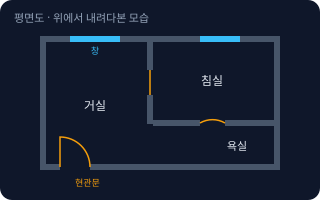</a> <b><a href="#floor-plan--평면도">Floor Plan</a></b> 평면도 건물을 창문 높이쯤에서 수평으로 자른 뒤 위에서 내려다본 그림. 벽·문·창·방 이름과 치수가 들어 있다.</td>
<td width="33%" valign="top"><a href="#elevation--입면도">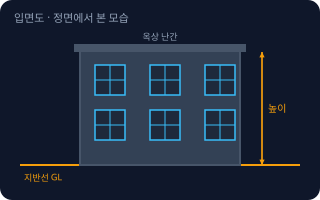</a> <b><a href="#elevation--입면도">Elevation</a></b> 입면도 건물을 정면·옆면에서 바라본 모습의 그림. 외벽 모양, 창문·문 위치, 건물 높이를 볼 수 있다.</td>
<td width="33%" valign="top"><a href="#section-drawing--단면도">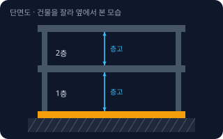</a> <b><a href="#section-drawing--단면도">Section Drawing</a></b> 단면도 건물을 수직으로 싹둑 잘라서 옆에서 본 그림. 층 높이, 천장 높이, 바닥·지붕이 몇 겹인지 알 수 있다.</td>
</tr>
<tr>
<td width="33%" valign="top"><a href="#detail-drawing--상세도">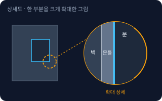</a> <b><a href="#detail-drawing--상세도">Detail Drawing</a></b> 상세도 문틀·창틀·바닥 경계처럼 작은 부분이 어떻게 만들어지는지 크게 확대해서 그린 그림. 재료와 두께가 구체적으로 적힌다.</td>
<td width="33%" valign="top"><a href="#reflected-ceiling-plan--천장도">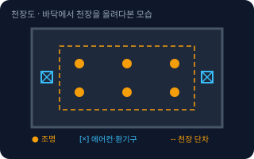</a> <b><a href="#reflected-ceiling-plan--천장도">Reflected Ceiling Plan</a></b> 천장도 바닥에 거울을 놓고 천장을 비춰 본다고 생각하고 그린 도면. 조명, 에어컨, 환기구, 천장 높이 차이가 표시된다.</td>
<td width="33%" valign="top"><a href="#scale--축척">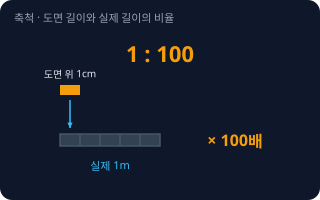</a> <b><a href="#scale--축척">Scale</a></b> 축척 도면에 그린 길이와 실제 길이의 비율. 1:100이면 도면에서 1cm가 실제로는 100cm(1m)다.</td>
</tr>
</table>

**면적 · 규정 · Area & Regulations** (8)

<table>
<tr>
<td width="33%" valign="top"><a href="#exclusive-area--전용면적">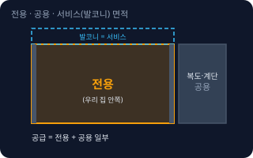</a> <b><a href="#exclusive-area--전용면적">Exclusive Area</a></b> 전용면적 내 집 문 안쪽에서 실제로 쓰는 바닥 면적. 벽 안쪽 기준이며 복도·계단 같은 공용 공간은 빠진다.</td>
<td width="33%" valign="top"><b><a href="#supply-area--공급면적">Supply Area</a></b> 공급면적 전용면적에 계단·복도·엘리베이터 홀처럼 같은 층·동 사람이 같이 쓰는 공용 면적 일부를 더한 면적. 분양할 때 '몇 평형'이라고 부르는 기준이다.</td>
<td width="33%" valign="top"><b><a href="#service-area--서비스면적">Service Area</a></b> 서비스면적 분양 때 면적에 따로 잡히지 않고 덤처럼 딸려 오는 공간. 대표적으로 발코니가 있다.</td>
</tr>
<tr>
<td width="33%" valign="top"><a href="#building-coverage-ratio--건폐율">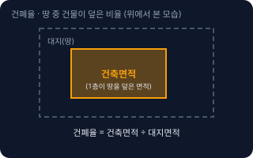</a> <b><a href="#building-coverage-ratio--건폐율">Building Coverage Ratio</a></b> 건폐율 땅(대지)을 위에서 내려다볼 때 건물이 땅을 덮은 비율. 건축면적 ÷ 대지면적이다. 땅에 마당·공지를 얼마나 남겨야 하는지 정하는 숫자다.</td>
<td width="33%" valign="top"><a href="#floor-area-ratio--용적률">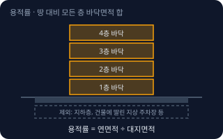</a> <b><a href="#floor-area-ratio--용적률">Floor Area Ratio</a></b> 용적률 건물 모든 층 바닥면적의 합(연면적)을 땅(대지) 면적으로 나눈 비율. 높게 지을 수 있는 정도를 정하는 숫자다. 지하층과 건물에 딸린 지상 주차장 면적 등은 계산에서 빠진다.</td>
<td width="33%" valign="top"><b><a href="#building-permit--건축허가--신고">Building Permit</a></b> 건축허가 · 신고 건물을 새로 짓거나 늘리거나 구조를 크게 바꾸기 전에 관청(시·군·구)에 받는 허락(허가) 또는 알리는 절차(신고). 어느 쪽인지는 공사 규모와 종류에 따라 다르다.</td>
</tr>
<tr>
<td width="33%" valign="top"><b><a href="#use-approval--사용승인">Use Approval</a></b> 사용승인 허가나 신고를 받은 공사를 다 끝낸 뒤, 도면대로 지었는지 관청이 확인하고 건물을 써도 된다고 인정하는 절차. 사용승인을 받아야 건물을 쓸 수 있다.</td>
<td width="33%" valign="top"><b><a href="#change-of-use--용도변경">Change of Use</a></b> 용도변경 건물의 쓰임새(주택, 상가, 사무실, 음식점 등)를 다른 것으로 바꾸는 일. 쓰임새를 비슷한 그룹(시설군)으로 묶고, 어느 그룹으로 바뀌느냐에 따라 허가·신고·장부 변경으로 나뉜다.</td>
</tr>
</table>

**구조 · Structure** (5)

<table>
<tr>
<td width="33%" valign="top"><a href="#foundation--기초">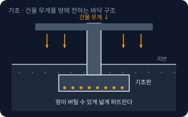</a> <b><a href="#foundation--기초">Foundation</a></b> 기초 건물 맨 아래에서 건물 무게를 땅으로 고르게 전달하는 부분. 땅이 약하면 더 넓고 튼튼하게 만든다.</td>
<td width="33%" valign="top"><a href="#slab--슬래브">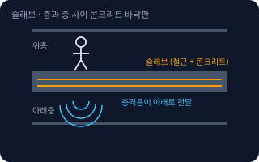</a> <b><a href="#slab--슬래브">Slab</a></b> 슬래브 층과 층 사이를 나누는 두꺼운 콘크리트 판. 위층의 바닥이자 아래층의 천장이다.</td>
<td width="33%" valign="top"><a href="#column-and-beam--기둥과-보">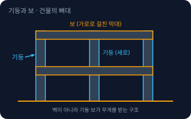</a> <b><a href="#column-and-beam--기둥과-보">Column and Beam</a></b> 기둥과 보 기둥은 세로로 서서 위의 무게를 받는 부재, 보는 가로로 걸쳐서 바닥의 무게를 기둥에 전하는 부재다. 둘이 만든 뼈대가 건물을 지탱한다.</td>
</tr>
<tr>
<td width="33%" valign="top"><a href="#load-bearing-wall--내력벽">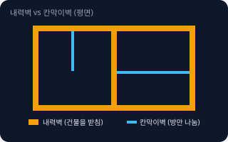</a> <b><a href="#load-bearing-wall--내력벽">Load-bearing Wall</a></b> 내력벽 위층과 지붕의 무게를 받아 기초로 전달하는 벽. 건물이 서 있게 하는 구조 부재라서 마음대로 허물면 안 된다.</td>
<td width="33%" valign="top"><a href="#reinforced-concrete--철근콘크리트">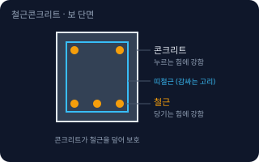</a> <b><a href="#reinforced-concrete--철근콘크리트">Reinforced Concrete</a></b> 철근콘크리트 콘크리트 안에 철근을 넣어서 만든 재료·구조(RC). 콘크리트는 누르는 힘에, 철근은 당기는 힘에 강해서 합치면 튼튼하다.</td>
</tr>
</table>

**공사 · 마감 · Works & Finishes** (8)

<table>
<tr>
<td width="33%" valign="top"><b><a href="#demolition--철거">Demolition</a></b> 철거 기존 벽·바닥·천장·설비를 뜯어내는 공사. 인테리어 공사의 첫 단계다. 뜯어낸 폐기물 처리도 함께 포함된다.</td>
<td width="33%" valign="top"><a href="#waterproofing--방수">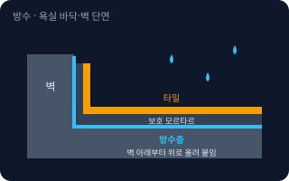</a> <b><a href="#waterproofing--방수">Waterproofing</a></b> 방수 물이 스며들어 아래층이나 벽 속으로 새지 않게 막는 층을 만드는 공사. 욕실·베란다·옥상·외벽에서 한다.</td>
<td width="33%" valign="top"><a href="#insulation--단열">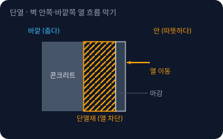</a> <b><a href="#insulation--단열">Insulation</a></b> 단열 안의 열이 밖으로 빠지거나 바깥 열이 안으로 들어오는 것을 막는 층. 겨울에 덜 춥고 여름에 덜 덥게 하며 냉난방비를 줄인다.</td>
</tr>
<tr>
<td width="33%" valign="top"><a href="#drywall--석고보드">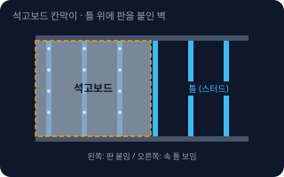</a> <b><a href="#drywall--석고보드">Drywall</a></b> 석고보드 석고를 종이로 감싼 판. 가벼운 철제 틀(스터드)에 붙여서 칸막이벽·천장을 빠르게 만든다. 그 위에 도배나 페인트로 마감한다.</td>
<td width="33%" valign="top"><a href="#floor-heating-build-up--온돌-바닥-층-구성">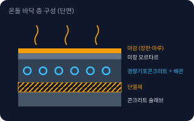</a> <b><a href="#floor-heating-build-up--온돌-바닥-층-구성">Floor Heating Build-up</a></b> 온돌 바닥 층 구성 한국식 바닥 난방(온돌)이 들어가는 바닥 층 구성. 콘크리트 슬래브 위에 단열재, 난방 배관, 배관을 덮는 경량 콘크리트와 미장, 마감재 순으로 쌓는다.</td>
<td width="33%" valign="top"><a href="#tile-grout--줄눈">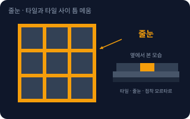</a> <b><a href="#tile-grout--줄눈">Tile Grout</a></b> 줄눈 타일과 타일 사이 틈을 메우는 재료 또는 그 선. 타일이 움직이거나 물이 스며드는 것을 막고 모양을 정리한다.</td>
</tr>
<tr>
<td width="33%" valign="top"><a href="#baseboard-and-molding--걸레받이--몰딩">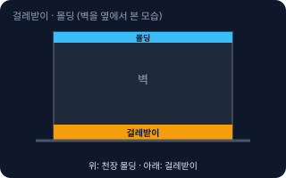</a> <b><a href="#baseboard-and-molding--걸레받이--몰딩">Baseboard and Molding</a></b> 걸레받이 · 몰딩 걸레받이는 벽과 바닥이 만나는 아랫부분에 대는 띠로 벽을 보호한다. 몰딩은 벽과 천장이 만나는 윗부분에 대는 띠로 모서리를 깔끔하게 마감한다.</td>
<td width="33%" valign="top"><b><a href="#trades--공종">Trades</a></b> 공종 공사를 일의 종류별로 나눈 구분. 철거, 설비(배관), 전기, 목공, 타일, 방수, 도장(페인트), 도배, 바닥재, 가구 같은 일들이다. 보통 공종마다 담당 기술자가 다르다.</td>
</tr>
</table>

**계약 · 관리 · Contract & Management** (7)

<table>
<tr>
<td width="33%" valign="top"><b><a href="#bill-of-quantities--내역서--견적서">Bill of Quantities</a></b> 내역서 · 견적서 견적서는 공사 비용 전체를 적은 문서, 내역서는 항목별로 수량·단가·금액을 자세히 적은 문서. 시공사가 '무엇을 얼마나 할지'를 적은 약속이다.</td>
<td width="33%" valign="top"><a href="#schedule--공정표">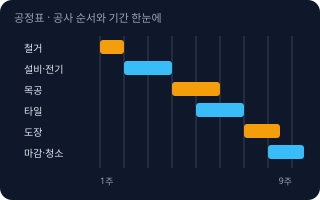</a> <b><a href="#schedule--공정표">Schedule</a></b> 공정표 어떤 공사를 언제부터 언제까지 할지 순서와 기간을 막대로 나타낸 일정표.</td>
<td width="33%" valign="top"><b><a href="#supervision--감리">Supervision</a></b> 감리 공사가 도면과 기준대로 되고 있는지 시공사와 별도로 지켜보며 확인하는 일, 또는 그 사람. 법에서 감리를 두도록 정한 공사가 있고, 건축주가 따로 맡길 수도 있다.</td>
</tr>
<tr>
<td width="33%" valign="top"><b><a href="#subcontracting--하도급">Subcontracting</a></b> 하도급 공사를 맡은 시공사(원도급)가 그중 일부를 다른 업체나 기술자(하도급)에게 다시 맡기는 것. 인테리어에서는 목공·타일·전기 팀이 하도급인 경우가 흔하다.</td>
<td width="33%" valign="top"><b><a href="#defect-repair--하자보수">Defect Repair</a></b> 하자보수 공사를 끝낸 뒤 약속한 기간 안에 생긴 결함(누수, 갈라짐, 들뜸 등)을 시공사가 고쳐 주는 것.</td>
<td width="33%" valign="top"><b><a href="#change-order--설계변경">Change Order</a></b> 설계변경 공사 도중 도면이나 범위를 바꾸는 것. 바꾸면 비용과 일정이 함께 변하므로 문서로 합의한다. 인테리어에서는 흔히 '추가 공사', '변경 공사'라고 부른다.</td>
</tr>
<tr>
<td width="33%" valign="top"><b><a href="#as-built-drawing--준공도면">As-built Drawing</a></b> 준공도면 공사가 끝난 뒤 실제로 지어진 모습대로 고쳐 그린 도면. 설계 도면과 달라진 부분이 반영되어 있다.</td>
</tr>
</table>

<!-- overview:end -->

## 도면 · Drawings

### Floor Plan · 평면도

- **정의**: 건물을 창문 높이쯤에서 수평으로 자른 뒤 위에서 내려다본 그림. 벽·문·창·방 이름과 치수가 들어 있다.
- **AI에게 이렇게**: "이 평면도에서 방 구획과 문 위치를 읽어서 목록으로 정리해줘. 문이 열리는 방향과 동선이 불편한 곳도 알려줘."
- **언제**: 공사 범위를 정할 때, 가구·설비 위치를 정할 때, 견적을 받을 때
- **헷갈림**: 배치도 — 배치도는 땅 위에서 건물이 앉은 위치를 보여주고, 평면도는 건물 안의 방 구성을 보여준다
- **관련**: Elevation, Section Drawing, Scale
- **확인 질문**: 이 도면은 현재 상태인가요, 공사 후 계획인가요? 치수 단위(mm/m)와 축척이 적혀 있나요?

### Elevation · 입면도

- **정의**: 건물을 정면·옆면에서 바라본 모습의 그림. 외벽 모양, 창문·문 위치, 건물 높이를 볼 수 있다.
- **AI에게 이렇게**: "이 입면도를 보고 창문 개수와 위치, 간판을 달 만한 벽면을 알려줘."
- **언제**: 외벽 마감, 간판, 창문 교체, 건물 높이를 확인할 때
- **헷갈림**: 평면도와 달리 방 구성은 안 보이고, 바깥에서 본 모양과 높이 정보가 중심이다
- **관련**: Floor Plan, Section Drawing
- **확인 질문**: 어느 방향(정면·좌측·우측·배면) 입면도인가요? 간판·외벽 변경이 포함되나요?

### Section Drawing · 단면도

- **정의**: 건물을 수직으로 싹둑 잘라서 옆에서 본 그림. 층 높이, 천장 높이, 바닥·지붕이 몇 겹인지 알 수 있다.
- **AI에게 이렇게**: "단면도에서 층고와 천장 높이를 읽어줘. 천장에 덕트나 배관이 지나갈 공간이 충분한지 봐줘."
- **언제**: 천장 높이, 바닥 두께, 배관·덕트 공간, 계단·경사를 확인할 때
- **헷갈림**: 평면도는 수평으로, 단면도는 수직으로 자른 그림이다. 층고(바닥~바로 위 바닥)와 천장고(바닥~천장 마감)는 다르다
- **관련**: Floor Plan, Detail Drawing, Slab
- **확인 질문**: 어느 위치를 자른 단면인가요? 층고와 천장고 중 어느 쪽을 알고 싶으세요?

### Detail Drawing · 상세도

- **정의**: 문틀·창틀·바닥 경계처럼 작은 부분이 어떻게 만들어지는지 크게 확대해서 그린 그림. 재료와 두께가 구체적으로 적힌다.
- **AI에게 이렇게**: "이 상세도의 재료 이름과 두께를 표로 정리하고, 시공사가 흔히 생략하거나 바꾸는 부분이 있으면 알려줘."
- **언제**: 마감 품질이 중요한 부분, 시공사와 '이렇게 해달라'를 약속할 때
- **헷갈림**: 평면도·단면도는 전체 그림이고, 상세도는 그 일부를 확대한 것이다. 상세도가 없으면 현장에서 시공자 판단으로 정해진다
- **관련**: Section Drawing, Scale, Baseboard and Molding
- **확인 질문**: 어느 부위의 상세인가요? 해당 부위에 쓸 재료를 이미 정하셨나요?

### Reflected Ceiling Plan · 천장도

- **정의**: 바닥에 거울을 놓고 천장을 비춰 본다고 생각하고 그린 도면. 조명, 에어컨, 환기구, 천장 높이 차이가 표시된다.
- **AI에게 이렇게**: "천장도 기준으로 조명 개수와 종류를 정리해줘. 에어컨·환기구와 조명이 서로 겹치는 곳도 찾아줘."
- **언제**: 조명 계획, 에어컨·환기 위치, 천장 높이를 바꿀 때
- **헷갈림**: 평면도에서 위를 올려다본 모양이지만 좌우가 뒤집히지 않고 평면도와 같은 방향으로 그린다. 천장 마감(석고보드·텍스)과는 다른 말이다
- **관련**: Floor Plan, Drywall
- **확인 질문**: 천장을 새로 만드나요, 기존 천장에 조명만 바꾸나요? 소방시설(스프링클러·감지기)이 있나요?

### Scale · 축척

- **정의**: 도면에 그린 길이와 실제 길이의 비율. 1:100이면 도면에서 1cm가 실제로는 100cm(1m)다.
- **AI에게 이렇게**: "이 도면은 축척이 1:100이야. 도면에서 재니까 방 가로가 5cm인데 실제 길이는 몇 m야?"
- **언제**: 도면을 인쇄했거나 사진으로 찍어서 길이를 가늠할 때
- **헷갈림**: 도면을 A4로 줄여 인쇄하거나 사진으로 확대하면 축척이 달라진다. 도면에 적힌 치수 숫자를 우선 믿고, 자로 잰 값은 참고만 한다
- **관련**: Floor Plan, Detail Drawing
- **확인 질문**: 도면에 치수 숫자가 적혀 있나요? 원본 크기(A1·A3 등)로 인쇄한 것인가요?

## 면적 · 규정 · Area & Regulations

### Exclusive Area · 전용면적

- **정의**: 내 집 문 안쪽에서 실제로 쓰는 바닥 면적. 벽 안쪽 기준이며 복도·계단 같은 공용 공간은 빠진다.
- **AI에게 이렇게**: "분양 광고에 공급면적이 84㎡라고 되어 있어. 전용면적은 대략 어느 정도이고, 인테리어 견적은 어느 면적 기준으로 비교해야 하는지 알려줘."
- **언제**: 아파트·오피스텔 비교, 인테리어 견적을 평수 기준으로 받을 때
- **헷갈림**: 공급면적 — 전용면적에 복도·엘리베이터 같은 공용 일부를 더한 값. 광고의 '몇 평형'은 보통 공급면적이다
- **관련**: Supply Area, Service Area
- **확인 질문**: 견적의 '평수'는 전용·공급·실제 시공 면적 중 무엇인가요? 건축물대장 기준인가요?

### Supply Area · 공급면적

- **정의**: 전용면적에 계단·복도·엘리베이터 홀처럼 같은 층·동 사람이 같이 쓰는 공용 면적 일부를 더한 면적. 분양할 때 '몇 평형'이라고 부르는 기준이다.
- **AI에게 이렇게**: "공급면적, 계약면적, 전용면적의 차이를 아파트 분양 예시로 표로 정리해줘."
- **언제**: 분양 광고와 계약서를 읽을 때
- **헷갈림**: 계약면적 — 공급면적에 지하주차장·관리사무소 등 건물 전체 공용 면적까지 더한 값. 공급면적과 계약면적은 서로 다르다
- **관련**: Exclusive Area, Service Area
- **확인 질문**: 지금 보는 숫자가 분양 광고의 면적인가요, 건축물대장의 면적인가요?

### Service Area · 서비스면적

- **정의**: 분양 때 면적에 따로 잡히지 않고 덤처럼 딸려 오는 공간. 대표적으로 발코니가 있다.
- **AI에게 이렇게**: "발코니 확장 공사를 하면 실제로 쓰는 방 크기가 얼마나 늘어나는지, 챙겨야 할 법적·시공 주의점을 알려줘."
- **언제**: 아파트 발코니 확장, 방이 좁아 보이는 이유를 따질 때
- **헷갈림**: 확장해서 방처럼 써도 대개 공식 전용면적이 늘어나는 것은 아니다. 단열·결로·난방은 확장 뒤에 따로 챙겨야 한다
- **관련**: Exclusive Area, Insulation
- **확인 질문**: 확장 가능한 발코니인가요? 관리사무소·관리규약에서 정한 절차를 확인했나요?

### Building Coverage Ratio · 건폐율

- **정의**: 땅(대지)을 위에서 내려다볼 때 건물이 땅을 덮은 비율. 건축면적 ÷ 대지면적이다. 땅에 마당·공지를 얼마나 남겨야 하는지 정하는 숫자다.
- **AI에게 이렇게**: "대지면적이 200㎡이고 건폐율 한도가 (예시로) 60%면, 1층에 지을 수 있는 건축면적은 최대 얼마야? 우리 지역의 실제 한도는 어디서 확인해?"
- **언제**: 작은 건물 신축, 증축 가능 여부 검토
- **헷갈림**: 용적률 — 건폐율은 땅을 덮은 비율(바닥 1층 기준), 용적률은 모든 층 바닥을 합친 크기 비율이다
- **관련**: Floor Area Ratio, Building Permit
- **확인 질문**: 땅의 용도지역은 어디인가요? 한도는 지자체 조례로 다를 수 있습니다. 토지이음(eum.go.kr)에서 확인했나요?

### Floor Area Ratio · 용적률

- **정의**: 건물 모든 층 바닥면적의 합(연면적)을 땅(대지) 면적으로 나눈 비율. 높게 지을 수 있는 정도를 정하는 숫자다. 지하층과 건물에 딸린 지상 주차장 면적 등은 계산에서 빠진다.
- **AI에게 이렇게**: "대지면적 200㎡에 용적률 한도가 (예시로) 200%면 연면적을 최대 몇 ㎡까지 지을 수 있어? 지하층과 주차장이 계산에 어떻게 들어가는지도 알려줘."
- **언제**: 몇 층까지, 총 몇 ㎡까지 지을 수 있는지 볼 때
- **헷갈림**: 건폐율은 1층이 땅을 덮은 비율, 용적률은 전체 층을 합산한 비율. 둘 다 지켜야 한다
- **관련**: Building Coverage Ratio, Section Drawing
- **확인 질문**: 지하층·주차장·옥탑 면적을 어떻게 계획했나요? 용도지역별 한도와 지자체 조례를 확인했나요?

### Building Permit · 건축허가 · 신고

- **정의**: 건물을 새로 짓거나 늘리거나 구조를 크게 바꾸기 전에 관청(시·군·구)에 받는 허락(허가) 또는 알리는 절차(신고). 어느 쪽인지는 공사 규모와 종류에 따라 다르다.
- **AI에게 이렇게**: "2층 단독주택 일부를 증축하려고 해. 건축허가인지 신고인지, 설계는 누구에게 맡겨야 하는지 확인해야 할 순서를 알려줘."
- **언제**: 신축·증축·개축·대수선(구조에 영향 주는 큰 수선), 공사 전 계획 단계
- **헷갈림**: 벽지·바닥재·칸막이 같은 단순 마감 인테리어는 보통 허가 대상이 아니지만, 내력벽을 건드리면 대수선이 될 수 있다. 아파트는 관리사무소·관리규약 절차가 따로 있다. 반드시 지자체 건축과에 확인한다
- **관련**: Use Approval, Change of Use, Load-bearing Wall
- **확인 질문**: 새로 짓나요, 늘리나요, 구조를 바꾸나요, 마감만 바꾸나요? 건축물대장상 용도와 면적은 얼마인가요?

### Use Approval · 사용승인

- **정의**: 허가나 신고를 받은 공사를 다 끝낸 뒤, 도면대로 지었는지 관청이 확인하고 건물을 써도 된다고 인정하는 절차. 사용승인을 받아야 건물을 쓸 수 있다.
- **AI에게 이렇게**: "건물이 다 지어졌는데 사용승인을 받으려면 어떤 서류와 검사가 필요한지, 지금 입주하거나 장사를 시작해도 되는지 알려줘."
- **언제**: 신축·증축 공사가 끝난 직후, 입주·영업 시작 전
- **헷갈림**: 준공 — 공사가 끝났다는 말. 사용승인은 관청이 인정해 주는 절차라서 둘은 같지 않다. 영업 인허가(식품·소방 등)는 별도로 필요할 수 있다
- **관련**: Building Permit, Supervision, As-built Drawing
- **확인 질문**: 감리가 있었나요? 소방·전기·가스 등 다른 검사도 끝났나요?

### Change of Use · 용도변경

- **정의**: 건물의 쓰임새(주택, 상가, 사무실, 음식점 등)를 다른 것으로 바꾸는 일. 쓰임새를 비슷한 그룹(시설군)으로 묶고, 어느 그룹으로 바뀌느냐에 따라 허가·신고·장부 변경으로 나뉜다.
- **AI에게 이렇게**: "주택 1층을 카페로 쓰고 싶어. 용도변경이 필요한지, 허가인지 신고인지, 소방·주차 기준은 어떻게 확인하면 되는지 알려줘."
- **언제**: 주택을 가게로, 사무실을 음식점으로 쓰는 등 쓰임새가 달라질 때. 임대 전에 꼭 확인
- **헷갈림**: 사업자등록이나 영업신고와 다르다. 건축물대장의 용도가 먼저 맞아야 영업 허가가 나오는 경우가 많다
- **관련**: Building Permit, Use Approval
- **확인 질문**: 건축물대장의 현재 용도는 무엇이고 어떤 용도로 쓰려고 하나요? 면적은 얼마인가요?

## 구조 · Structure

### Foundation · 기초

- **정의**: 건물 맨 아래에서 건물 무게를 땅으로 고르게 전달하는 부분. 땅이 약하면 더 넓고 튼튼하게 만든다.
- **AI에게 이렇게**: "소규모 건물의 기초 종류(독립기초·줄기초·매트기초)를 쉬운 말로 비교해줘. 지반조사가 왜 필요한지도 알려줘."
- **언제**: 신축·증축, 건물에 금이 가거나 기울었을 때
- **헷갈림**: 바닥 콘크리트(토간콘크리트)와 다르다. 기초는 건물을 받치는 구조 부재다
- **관련**: Reinforced Concrete, Column and Beam
- **확인 질문**: 지반조사를 했나요? 증축이라면 기존 기초가 추가 하중을 버틸 수 있는지 구조 검토를 받았나요?

### Slab · 슬래브

- **정의**: 층과 층 사이를 나누는 두꺼운 콘크리트 판. 위층의 바닥이자 아래층의 천장이다.
- **AI에게 이렇게**: "슬래브를 뚫어서 배관이나 계단을 내려면 어떤 구조 검토가 필요한지 알려줘. 코어 타공 전에 확인할 점도 정리해줘."
- **언제**: 층간소음, 바닥 타공, 계단 신설, 바닥 하중이 걱정될 때
- **헷갈림**: 바닥 마감(장판·마루)은 슬래브가 아니다. 슬래브 위에 단열·난방·마감이 겹겹이 올라간다. 슬래브 속에는 철근이 있어 함부로 뚫으면 위험하다
- **관련**: Reinforced Concrete, Floor Heating Build-up
- **확인 질문**: 슬래브에 구멍을 뚫거나 하중이 큰 물건(수조·서가)을 올리나요? 철근 위치 탐지를 했나요?

### Column and Beam · 기둥과 보

- **정의**: 기둥은 세로로 서서 위의 무게를 받는 부재, 보는 가로로 걸쳐서 바닥의 무게를 기둥에 전하는 부재다. 둘이 만든 뼈대가 건물을 지탱한다.
- **AI에게 이렇게**: "가게 안에 기둥이 있어서 동선이 막혀. 기둥을 옮기거나 없앨 수 있는지, 구조 검토 때 필요한 자료를 알려줘."
- **언제**: 넓은 공간을 만들거나 천장을 올릴 때, 구조 변경 가능 여부 검토
- **헷갈림**: 기둥식 구조에서는 벽을 없애도 되는 경우가 많지만, 기둥과 보는 건드리면 안 된다. 보는 천장 안쪽에 숨어 있을 수 있다
- **관련**: Load-bearing Wall, Reinforced Concrete
- **확인 질문**: 건물이 기둥식 구조인가요, 벽식 구조인가요? 구조 도면을 구할 수 있나요?

### Load-bearing Wall · 내력벽

- **정의**: 위층과 지붕의 무게를 받아 기초로 전달하는 벽. 건물이 서 있게 하는 구조 부재라서 마음대로 허물면 안 된다.
- **AI에게 이렇게**: "이 도면에서 내력벽으로 보이는 벽과 칸막이벽을 구분해줘. 단, 최종 판단은 구조 전문가가 해야 한다는 점도 같이 알려줘."
- **언제**: 벽을 허물거나 문을 넓힐 때, 거실과 방을 합칠 때
- **헷갈림**: 칸막이벽(비내력벽) — 방만 나누는 벽으로 무게를 받지 않는다. 겉모습만으로는 구분하기 어렵고 두께가 같아도 다를 수 있다. 벽을 두드려 보거나 소리로 판단하지 않는다
- **관련**: Column and Beam, Building Permit, Demolition
- **확인 질문**: 건물 구조 형식(벽식·기둥식)을 아나요? 구조 도면과 건축사 검토 의견이 있나요?

### Reinforced Concrete · 철근콘크리트

- **정의**: 콘크리트 안에 철근을 넣어서 만든 재료·구조(RC). 콘크리트는 누르는 힘에, 철근은 당기는 힘에 강해서 합치면 튼튼하다.
- **AI에게 이렇게**: "우리 건물이 철근콘크리트(RC) 구조인지 철골 구조인지 구분하는 방법과, 구조별로 벽을 뚫을 때 주의할 점을 알려줘."
- **언제**: 건물 구조 형식을 파악할 때, 코어 타공·앵커 작업 전
- **헷갈림**: 철골조(Steel Frame)는 강철 기둥·보로 뼈대를 만든 구조로 RC와 다르다. 한 건물에 둘이 섞인 경우도 있다. RC 벽에 드릴로 구멍을 뚫으면 철근을 건드릴 수 있다
- **관련**: Slab, Column and Beam, Foundation
- **확인 질문**: 건축물대장에 구조 형식(철근콘크리트구조, 철골구조 등)이 적혀 있나요? 타공 위치를 철근 탐지기로 확인할 수 있나요?

## 공사 · 마감 · Works & Finishes

### Demolition · 철거

- **정의**: 기존 벽·바닥·천장·설비를 뜯어내는 공사. 인테리어 공사의 첫 단계다. 뜯어낸 폐기물 처리도 함께 포함된다.
- **AI에게 이렇게**: "상가 철거 공사 견적을 비교하려고 해. 철거 범위, 폐기물 처리, 소음·분진 대책, 석면 확인이 항목에 들어 있는지 체크리스트로 만들어줘."
- **언제**: 공사 시작 단계, 오래된 건물 리모델링
- **헷갈림**: 철거 범위를 넓게 잡으면 구조나 배관을 건드릴 수 있다. 오래된 건물은 석면 자재가 있을 수 있어 조사가 필요한 경우가 있다
- **관련**: Load-bearing Wall, Trades
- **확인 질문**: 어디까지 뜯나요? 내력벽·배관·전기선이 지나는 부분은 없나요? 건물이 오래되어 석면 조사가 필요한가요?

### Waterproofing · 방수

- **정의**: 물이 스며들어 아래층이나 벽 속으로 새지 않게 막는 층을 만드는 공사. 욕실·베란다·옥상·외벽에서 한다.
- **AI에게 이렇게**: "욕실 방수 공사 시 확인할 순서(방수 재료, 바닥 및 벽 올림 높이, 담수 시험, 보증 기간)를 체크리스트로 만들어줘."
- **언제**: 욕실·주방·베란다 공사, 누수가 생겼을 때
- **헷갈림**: 타일이나 실리콘 마감은 방수 '층'이 아니다. 방수층은 타일 밑에 있어서 한번 덮으면 눈으로 확인할 수 없으니, 타일 붙이기 전에 담수 시험과 사진 기록을 남긴다
- **관련**: Tile Grout, Defect Repair
- **확인 질문**: 어떤 방수 재료(도막·시트·시멘트계)를 쓰나요? 벽을 얼마나 올려 방수하나요? 방수 후 물을 채워 새는지 시험하나요? 하자 보증은 몇 년인가요?

### Insulation · 단열

- **정의**: 안의 열이 밖으로 빠지거나 바깥 열이 안으로 들어오는 것을 막는 층. 겨울에 덜 춥고 여름에 덜 덥게 하며 냉난방비를 줄인다.
- **AI에게 이렇게**: "오래된 상가 외벽 쪽에 곰팡이가 생기는데, 단열이 원인일 수 있어? 내단열과 외단열 차이와 비용·공간 손실을 비교해줘."
- **언제**: 벽·지붕·창문 공사, 곰팡이·결로·난방비 문제가 있을 때
- **헷갈림**: 결로 — 따뜻한 실내 공기가 차가운 벽에 닿아 물방울이 맺히는 현상. 단열이 부족하면 생기고 곰팡이의 원인이 된다. 단열과 방음(소리 차단)은 같은 말이 아니다
- **관련**: Service Area, Floor Heating Build-up, Drywall
- **확인 질문**: 안쪽에 덧대는 내단열인가요, 바깥에 하는 외단열인가요? 곰팡이는 어느 계절·어느 벽에 생기나요?

### Drywall · 석고보드

- **정의**: 석고를 종이로 감싼 판. 가벼운 철제 틀(스터드)에 붙여서 칸막이벽·천장을 빠르게 만든다. 그 위에 도배나 페인트로 마감한다.
- **AI에게 이렇게**: "석고보드 칸막이벽 견적에서 일반 석고보드, 방습 석고보드, 방화 석고보드 중 어디에 뭘 써야 하는지 알려줘."
- **언제**: 방을 나누거나 천장을 새로 만들 때
- **헷갈림**: 벽체 속 틀이 보이지 않아도 벽지 아래는 석고보드일 수 있다. 석고보드 벽은 무거운 물건을 걸 때 보강 목재가 필요하다. 구조를 받치는 내력벽이 아니다
- **관련**: Reflected Ceiling Plan, Insulation, Trades
- **확인 질문**: 물이 닿는 곳이나 방화가 필요한 곳이 있나요? TV·선반처럼 무거운 물건을 걸 자리를 미리 정했나요?

### Floor Heating Build-up · 온돌 바닥 층 구성

- **정의**: 한국식 바닥 난방(온돌)이 들어가는 바닥 층 구성. 콘크리트 슬래브 위에 단열재, 난방 배관, 배관을 덮는 경량 콘크리트와 미장, 마감재 순으로 쌓는다.
- **AI에게 이렇게**: "우리 집 바닥을 뜯고 난방 배관을 다시 깔려고 해. 층 구성 순서와 바닥이 몇 cm 정도 높아질 수 있는지, 확인할 점을 알려줘."
- **언제**: 난방 배관 교체, 바닥 높이를 맞출 때, 층간소음 보강
- **헷갈림**: 마루나 장판만 바꾸는 공사와 다르다. 층 구성을 바꾸면 바닥 높이와 문턱, 현관 단차가 달라진다. 층간소음 완충재도 이 층 안에 있다
- **관련**: Slab, Insulation
- **확인 질문**: 배관만 새로 까나요, 바닥 마감만 바꾸나요? 보일러 종류(가스·전기)와 난방 방식(온수·전기)은 무엇인가요?

### Tile Grout · 줄눈

- **정의**: 타일과 타일 사이 틈을 메우는 재료 또는 그 선. 타일이 움직이거나 물이 스며드는 것을 막고 모양을 정리한다.
- **AI에게 이렇게**: "욕실 타일 줄눈에 시멘트 줄눈과 에폭시 줄눈 중 뭘 쓰는 게 좋아? 가격 차이, 곰팡이, 보수 방법을 비교해줘."
- **언제**: 타일 공사 마감, 욕실 곰팡이·검은 줄눈이 신경 쓰일 때
- **헷갈림**: 실리콘 — 벽과 바닥이 만나는 모서리처럼 움직이는 부분에 쓰는 신축성 재료. 줄눈은 단단하게 굳는 재료를 쓰므로 둘을 구분해서 쓴다
- **관련**: Waterproofing, Trades
- **확인 질문**: 줄눈 색상은 무엇인가요? 줄눈 폭, 재료(시멘트·에폭시), 모서리 실리콘 마감 포함 여부를 견적서에서 확인했나요?

### Baseboard and Molding · 걸레받이 · 몰딩

- **정의**: 걸레받이는 벽과 바닥이 만나는 아랫부분에 대는 띠로 벽을 보호한다. 몰딩은 벽과 천장이 만나는 윗부분에 대는 띠로 모서리를 깔끔하게 마감한다.
- **AI에게 이렇게**: "거실 벽 하단에 걸레받이, 천장에는 간접조명용 몰딩을 하고 싶어. 높이·색상·재료를 몇 가지 안으로 추천해줘."
- **언제**: 벽·바닥 마감 마지막 단계, 인테리어 분위기를 바꿀 때
- **헷갈림**: 몰딩은 천장 몰딩, 문틀 몰딩 등 위치에 따라 이름이 다르게 불린다. 걸레받이는 '굽도리'라고도 한다
- **관련**: Detail Drawing, Drywall
- **확인 질문**: 어느 위치(바닥·천장·문틀)의 띠를 말하나요? 높이와 재료(MDF·PVC·목재)를 정했나요? 몰딩 위에 조명을 넣을 건가요?

### Trades · 공종

- **정의**: 공사를 일의 종류별로 나눈 구분. 철거, 설비(배관), 전기, 목공, 타일, 방수, 도장(페인트), 도배, 바닥재, 가구 같은 일들이다. 보통 공종마다 담당 기술자가 다르다.
- **AI에게 이렇게**: "작은 가게 인테리어의 공종을 작업 순서대로 나열하고, 각 공종 사이에 반드시 확인해야 할 점도 알려줘."
- **언제**: 견적서를 읽을 때, 공사 순서와 일정을 짤 때
- **헷갈림**: 목공 — 나무·석고보드로 벽·천장·문틀을 만드는 일. 도장 — 페인트칠. 설비 — 배관·급배수·환기·에어컨 같은 기계 설비. 전기와 설비는 다른 공종이다
- **관련**: Schedule, Bill of Quantities, Subcontracting
- **확인 질문**: 어떤 공종이 견적서에 포함되고 어떤 것은 별도(건축주 직접 발주)인가요? 가구·간판·에어컨은 누가 발주하나요?

## 계약 · 관리 · Contract & Management

### Bill of Quantities · 내역서 · 견적서

- **정의**: 견적서는 공사 비용 전체를 적은 문서, 내역서는 항목별로 수량·단가·금액을 자세히 적은 문서. 시공사가 '무엇을 얼마나 할지'를 적은 약속이다.
- **AI에게 이렇게**: "시공사 두 곳이 준 견적서를 항목별로 비교해줘. 빠진 항목, 수량이 다른 항목, '일식'이라고만 적힌 항목을 찾아줘."
- **언제**: 시공사를 고를 때, 계약 전, 추가 비용이 생겼을 때
- **헷갈림**: '일식'은 수량·단가 없이 한 덩어리로 적은 항목으로, 무엇이 포함되었는지 알기 어렵다. 부가세·철거 폐기물·자재 등급이 포함인지 별도인지 꼭 확인한다
- **관련**: Trades, Change Order, Schedule
- **확인 질문**: 면적(평수) 기준은 무엇인가요? 자재 브랜드와 등급이 적혀 있나요? 부가세·철거 폐기물·공과금(전기·수도 증설)은 포함인가요?

### Schedule · 공정표

- **정의**: 어떤 공사를 언제부터 언제까지 할지 순서와 기간을 막대로 나타낸 일정표.
- **AI에게 이렇게**: "시공사가 준 공정표에서 순서가 이상한 곳(예: 도장 전에 가구가 설치되는 일정)을 찾고, 지연되기 쉬운 공종을 알려줘."
- **언제**: 계약 전 일정 확인, 공사 중 진행 점검, 영업 오픈일 맞추기
- **헷갈림**: 공사 기간(총 며칠)과 공정표는 다르다. 비·건조 시간 같은 대기 기간이 빠지면 일정이 밀린다. 지연 시 책임은 계약서에 따른다
- **관련**: Trades, Change Order
- **확인 질문**: 오픈·입주 희망일이 언제인가요? 자재 주문 후 도착까지 걸리는 기간은 반영했나요?

### Supervision · 감리

- **정의**: 공사가 도면과 기준대로 되고 있는지 시공사와 별도로 지켜보며 확인하는 일, 또는 그 사람. 법에서 감리를 두도록 정한 공사가 있고, 건축주가 따로 맡길 수도 있다.
- **AI에게 이렇게**: "소규모 인테리어 공사에 감리를 따로 두면 비용 대비 효과가 있을지, 하자가 많이 생기는 단계에서 건축주가 직접 확인할 체크리스트를 알려줘."
- **언제**: 신축·큰 공사, 시공사를 믿기 어렵거나 하자 분쟁을 줄이고 싶을 때
- **헷갈림**: 감리는 시공사와 별개 입장에서 점검하는 사람이다. 시공사 현장소장은 감독이지만 감리가 아니다. 감리 의무 대상은 공사 규모·용도로 정해져 있다
- **관련**: Use Approval, Defect Repair
- **확인 질문**: 법적 감리 대상 공사인가요? 감리자를 건축주가 직접 지정하나요? 보고서나 사진 기록을 받을 수 있나요?

### Subcontracting · 하도급

- **정의**: 공사를 맡은 시공사(원도급)가 그중 일부를 다른 업체나 기술자(하도급)에게 다시 맡기는 것. 인테리어에서는 목공·타일·전기 팀이 하도급인 경우가 흔하다.
- **AI에게 이렇게**: "계약서에 하도급 관련 조항이 있어? 하도급업체에 대금이 제대로 안 가서 현장이 멈추거나 분쟁이 생기는 상황을 막으려면 뭘 확인해야 해?"
- **언제**: 시공사와 계약하기 전, 공사 대금 지급 시점
- **헷갈림**: 하도급이 곧 불법은 아니다. 다만 공사를 통째로 넘기는 것처럼 법이 제한하는 경우가 있다. 내가 계약한 업체와 현장에서 일하는 업체가 다를 수 있다
- **관련**: Trades, Bill of Quantities, Defect Repair
- **확인 질문**: 어느 공종을 직접 시공하고 어느 공종을 하도급 주나요? 공사 대금을 단계별로 어떻게 나눠 지급하나요?

### Defect Repair · 하자보수

- **정의**: 공사를 끝낸 뒤 약속한 기간 안에 생긴 결함(누수, 갈라짐, 들뜸 등)을 시공사가 고쳐 주는 것.
- **AI에게 이렇게**: "공사한 지 6개월 된 욕실에 누수가 생겼어. 하자보수를 요구하는 방법, 증거로 남길 것, 시공사가 거부할 때 쓸 수 있는 방법을 알려줘."
- **언제**: 공사 후 누수·갈라짐·들뜸이 생겼을 때, 계약서에 보증 기간을 쓸 때
- **헷갈림**: 하자와 사용 중 파손은 다르다. 하자담보책임 기간은 공종·건물 종류별로 법령이나 계약으로 정해지니 계약서에 적힌 기간을 확인한다
- **관련**: Waterproofing, Supervision, Subcontracting
- **확인 질문**: 하자가 언제 처음 발견됐나요? 사진·영상과 계약서, 준공일을 가지고 있나요? 하자보수 보증서가 있나요?

### Change Order · 설계변경

- **정의**: 공사 도중 도면이나 범위를 바꾸는 것. 바꾸면 비용과 일정이 함께 변하므로 문서로 합의한다. 인테리어에서는 흔히 '추가 공사', '변경 공사'라고 부른다.
- **AI에게 이렇게**: "공사 중에 콘센트 위치를 바꾸고 싶어. 추가 비용과 일정 영향을 확인하는 문서 양식을 만들어줘."
- **언제**: 공사 중 마음이 바뀌었을 때, 철거해 보니 예상 못한 문제가 나왔을 때
- **헷갈림**: 말로만 합의하면 나중에 금액 분쟁이 생긴다. 변경 전에 금액·일정을 서면으로 받고, 도면도 같이 고친다
- **관련**: Bill of Quantities, Schedule, As-built Drawing
- **확인 질문**: 변경 내용과 추가 금액, 늘어나는 공사 기간을 서면으로 받았나요? 변경 때문에 다른 공종에 영향이 있나요?

### As-built Drawing · 준공도면

- **정의**: 공사가 끝난 뒤 실제로 지어진 모습대로 고쳐 그린 도면. 설계 도면과 달라진 부분이 반영되어 있다.
- **AI에게 이렇게**: "공사가 끝나면 시공사에게 받아야 할 서류 목록(준공도면, 자재 사양서, 보증서, 배관·전기 배선도 등)을 알려줘."
- **언제**: 공사 완료 시, 나중에 수리·재공사를 할 때
- **헷갈림**: 설계도(공사 전 계획)와 다르다. 배관·전기선이 벽 속 어디를 지나가는지는 준공도면이 있어야 나중에 알 수 있다
- **관련**: Use Approval, Change Order
- **확인 질문**: 공사 중 변경된 내용이 도면에 반영되었나요? 배관·전기 배선 위치를 사진으로도 남겼나요?
