# 글쓰기 · 카피라이팅 치트시트

> 작은 가게 사장님, 창업자, 크리에이터가 AI에게 광고 문구, 상세페이지, 뉴스레터, 보도자료, 유튜브 제목을 시킬 때 펼치는 시트입니다. "누구에게, 무엇을 약속하고, 어떤 순서와 말투로 쓰고, 무엇을 확인하고 내보내는가"를 AI와 같은 말로 맞추는 것이 목표입니다.

> **참고용입니다.** 광고 문구 입증과 저작권 설명은 대한민국 법령 기준(2026-11-02 확인)이며 법률 판단을 대신하지 않습니다. 광고 플랫폼의 글자 수 한도와 화면은 자주 바뀌니 실제로 올리기 전에 해당 플랫폼 도움말과 전문가를 확인하세요.

## 이렇게 쓰세요

- **나 → AI**: "우리는 서울 연남동의 수제 쿠키 가게야. 어린이날 선물 세트 상세페이지를 써줘. 누구에게: 30대 육아맘 / 핵심 메시지: 설탕 없이 구운 아이 간식 / 말투: 다정하고 짧게. AIDA 순서로, 헤드라인 후보 5개와 CTA 버튼 문구 3개도 같이."
- **AI → 나**: "이 글을 읽고 나서 사람이 해야 할 행동은 무엇인가요(구매·문의·저장)? 쓸 수 있는 후기나 숫자(판매 수, 재구매율)가 있나요? '무설탕'처럼 사실이어야 하는 표현은 근거 자료가 있나요?"
- **나 → AI**: "쓴 글은 바로 올리지 말고, 교정(오탈자·띄어쓰기)과 팩트체크(숫자·'최고' 같은 주장) 목록을 먼저 뽑아줘."
- **AI → 나**: "광고 글자 수 한도가 있는 채널인가요? 구글 검색 광고라면 한글 기준 제목 15자·설명 45자 안으로 맞춰 쓸까요?"
- **나 → AI**: "보도자료는 제목 1개, 리드 3줄, 본문, 대표 인용문, 회사 소개, 연락처 순서로. 사실만 쓰고 과장은 빼줘."

## 한눈에 보기

<!-- overview:start -->
<!-- 이 구역은 자동 생성됩니다. 직접 고치지 말고 `cd mcp-server && npm run generate`를 실행하세요. -->

**쓰기 전에 · Before Writing** (4)

<table>
<tr>
<td width="33%" valign="top"><a href="#copy-brief--카피-브리프">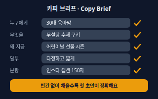</a> <b><a href="#copy-brief--카피-브리프">Copy Brief</a></b> 카피 브리프 글을 쓰기 전에 누구에게, 무엇을, 왜 지금, 어떤 말투와 분량으로 쓸지 한 장에 적은 요청서. AI에게 건네는 첫 지시문이 되기도 한다.</td>
<td width="33%" valign="top"><a href="#core-message--핵심-메시지">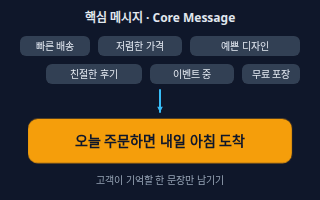</a> <b><a href="#core-message--핵심-메시지">Core Message</a></b> 핵심 메시지 독자가 글을 거의 다 잊어도 하나만 기억한다면 남기고 싶은 한 문장. 장점이 여러 개여도 한 글에서는 하나만 크게 말한다.</td>
<td width="33%" valign="top"><a href="#writing-for-one-reader--한-사람에게-쓰기">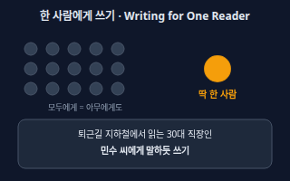</a> <b><a href="#writing-for-one-reader--한-사람에게-쓰기">Writing for One Reader</a></b> 한 사람에게 쓰기 불특정 다수 대신 구체적인 한 사람(나이·상황·걱정)을 떠올리며 쓰는 방법. 말투·예시·단어가 저절로 또렷해진다.</td>
</tr>
<tr>
<td width="33%" valign="top"><b><a href="marketing.md#usp--차별점">USP</a></b> 차별점 &quot;다른 곳이 아니라 여기여야 하는 이유&quot; 한 가지. 우리만 약속할 수 있고 고객이 신경 쓰는 것이어야 한다. → marketing 시트</td>
</tr>
</table>

**글의 뼈대 · Anatomy of a Page** (7)

<table>
<tr>
<td width="33%" valign="top"><a href="#headline--헤드라인">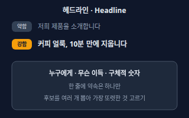</a> <b><a href="#headline--헤드라인">Headline</a></b> 헤드라인 글·광고·상세페이지 맨 위에서 가장 먼저 읽히는 큰 제목. 이 한 줄이 나머지를 읽게 만들지 정한다.</td>
<td width="33%" valign="top"><a href="#hook--훅">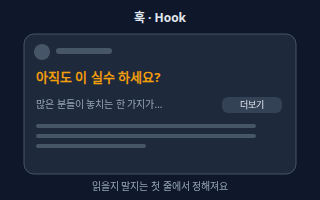</a> <b><a href="#hook--훅">Hook</a></b> 훅 사람이 스크롤을 멈추고 계속 읽거나 보게 만드는 맨 앞 한두 줄(영상이면 첫머리). SNS는 '더보기' 앞에서 승부가 난다.</td>
<td width="33%" valign="top"><a href="#lead--리드">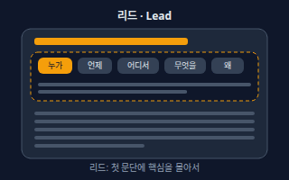</a> <b><a href="#lead--리드">Lead</a></b> 리드 글 맨 앞 첫 문단. 누가·언제·어디서·무엇을·왜·어떻게(5W1H) 중 핵심을 먼저 몰아서 알려 주는 요약 부분이다.</td>
</tr>
<tr>
<td width="33%" valign="top"><a href="#subhead--소제목">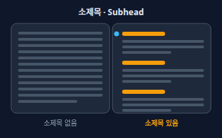</a> <b><a href="#subhead--소제목">Subhead</a></b> 소제목 긴 글을 몇 덩어리로 나누고 각 덩어리 맨 위에 붙이는 작은 제목. 독자가 훑어보다가 필요한 곳만 골라 읽게 해 준다.</td>
<td width="33%" valign="top"><a href="#body-copy--본문-카피">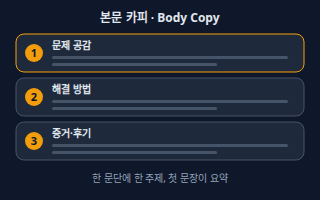</a> <b><a href="#body-copy--본문-카피">Body Copy</a></b> 본문 카피 헤드라인과 리드 뒤에 이어지는 설명 부분. 약속을 증명하고 믿게 하는 문단들로, 한 문단에 한 주제만 담는다.</td>
<td width="33%" valign="top"><a href="#cta-copy--cta-문구">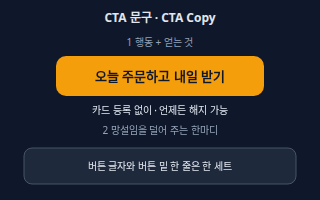</a> <b><a href="#cta-copy--cta-문구">CTA Copy</a></b> CTA 문구 버튼·링크·마지막 문장에서 '지금 무엇을 하라'고 말하는 글자. 동사로 시작해 얻는 것을 말하고, 망설임을 덜어 주는 한마디를 곁들이면 눌러 볼 이유가 생긴다.</td>
</tr>
<tr>
<td width="33%" valign="top"><b><a href="marketing.md#cta--행동-유도-버튼">CTA</a></b> 행동 유도 버튼 방문자가 다음 행동(구매·가입·문의)을 하도록 부르는 버튼이나 링크 요소. → marketing 시트</td>
</tr>
</table>

**설득 공식 · Frameworks** (5)

<table>
<tr>
<td width="33%" valign="top"><a href="#aida--아이다-공식">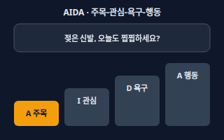</a> <b><a href="#aida--아이다-공식">AIDA</a></b> 아이다 공식 주목(Attention) → 관심(Interest) → 욕구(Desire) → 행동(Action) 네 단계로 글의 흐름을 짜는 오래된 공식. 처음 보는 사람에게 길게 설명하는 페이지에 잘 맞는다.</td>
<td width="33%" valign="top"><a href="#pas--문제-키우기-해결-공식">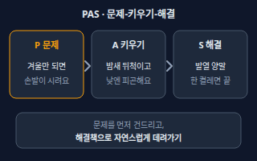</a> <b><a href="#pas--문제-키우기-해결-공식">PAS</a></b> 문제-키우기-해결 공식 문제(Problem)를 짚고, 그 문제가 계속되면 어떨지 키워서(Agitate) 보여 준 뒤, 해결책(Solution)을 내미는 공식. 독자가 이미 불편을 느끼는 상품에 맞는다.</td>
<td width="33%" valign="top"><a href="#bab--전후-다리-공식">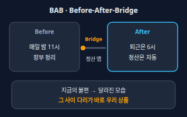</a> <b><a href="#bab--전후-다리-공식">BAB</a></b> 전후-다리 공식 지금의 불편(Before) → 달라진 모습(After) → 그 사이를 잇는 다리(Bridge, 우리 상품)의 순서로 쓰는 공식. 변화가 눈에 그려지는 서비스에 맞는다.</td>
</tr>
<tr>
<td width="33%" valign="top"><a href="#feature-vs-benefit--기능과-이점">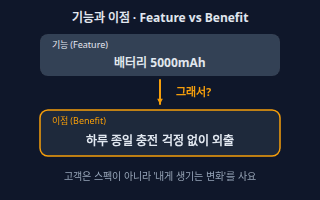</a> <b><a href="#feature-vs-benefit--기능과-이점">Feature vs Benefit</a></b> 기능과 이점 기능은 상품이 가진 사양이고, 이점은 그 사양 때문에 고객에게 생기는 변화다. '그래서 나한테 뭐가 좋은데?'에 답하는 것이 이점이다.</td>
<td width="33%" valign="top"><a href="#fab--특징-장점-이점">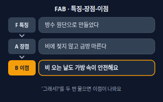</a> <b><a href="#fab--특징-장점-이점">FAB</a></b> 특징-장점-이점 특징(Feature) → 장점(Advantage) → 이점(Benefit)을 이어 쓰는 공식. '그래서?'를 두 번 물어 스펙에서 고객의 이득까지 끌고 간다.</td>
</tr>
</table>

**목소리와 읽기 쉬움 · Voice & Readability** (5)

<table>
<tr>
<td width="33%" valign="top"><a href="#voice-vs-tone--목소리와-어조">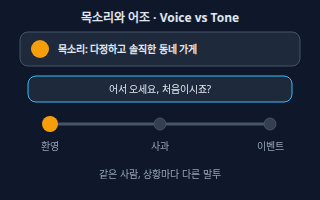</a> <b><a href="#voice-vs-tone--목소리와-어조">Voice vs Tone</a></b> 목소리와 어조 목소리(Voice)는 브랜드가 늘 지키는 말하는 성격(다정한, 솔직한)이고, 어조(Tone)는 상황에 따라 달라지는 말투의 강도다. 같은 사람이 사과할 땐 차분하게, 이벤트엔 들뜨게 말하는 것과 같다.</td>
<td width="33%" valign="top"><a href="#style-guide--스타일-가이드">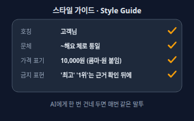</a> <b><a href="#style-guide--스타일-가이드">Style Guide</a></b> 스타일 가이드 호칭, 문체, 숫자·가격 표기, 금지 표현처럼 글쓰기 규칙을 한 장에 모은 것. AI에게 매번 같은 규칙을 건네면 글마다 말투가 흔들리지 않는다.</td>
<td width="33%" valign="top"><a href="#plain-language--쉬운-글쓰기">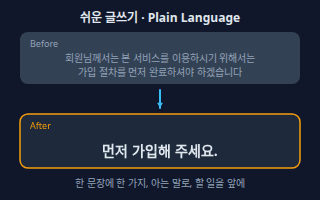</a> <b><a href="#plain-language--쉬운-글쓰기">Plain Language</a></b> 쉬운 글쓰기 독자가 한 번에 알아듣도록 짧은 문장, 아는 단어, 하고 싶은 일을 앞에 두는 글쓰기. 한 문장에는 한 가지 생각만 담는다.</td>
</tr>
<tr>
<td width="33%" valign="top"><a href="#readability--가독성">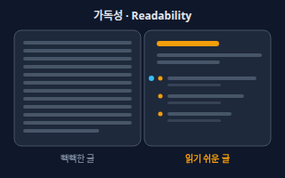</a> <b><a href="#readability--가독성">Readability</a></b> 가독성 글이 눈에 잘 들어오고 훑어 읽기 쉬운 정도. 문단 길이, 줄바꿈, 소제목, 불릿, 굵은 글씨가 좌우한다. 웹에서는 사람들이 꼼꼼히 읽기보다 훑는 경우가 많다.</td>
<td width="33%" valign="top"><b><a href="graphic-branding.md#tone-and-manner--톤앤매너">Tone and Manner</a></b> 톤앤매너 브랜드가 말하고 보여 주는 분위기와 태도를 일관되게 맞추는 약속. 말투·색·이미지의 느낌이 한 사람처럼 느껴지게 한다. → graphic-branding 시트</td>
</tr>
</table>

**짧은 글 · Short Copy** (6)

<table>
<tr>
<td width="33%" valign="top"><a href="#slogan-vs-tagline--슬로건과-태그라인">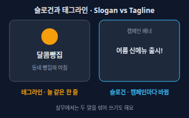</a> <b><a href="#slogan-vs-tagline--슬로건과-태그라인">Slogan vs Tagline</a></b> 슬로건과 태그라인 슬로건은 캠페인·시즌 광고에서 외치는 한 줄이고, 태그라인은 로고 곁에 오래 붙는 브랜드 정체성 한 줄이다. 실무에서는 두 말을 섞어 쓰기도 한다.</td>
<td width="33%" valign="top"><a href="#microcopy--마이크로카피">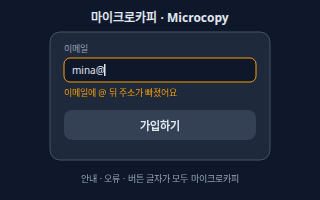</a> <b><a href="#microcopy--마이크로카피">Microcopy</a></b> 마이크로카피 버튼 글자, 입력칸 안내, 오류 메시지, 빈 화면 문구처럼 화면 속에서 사용자를 안내하는 짧은 글.</td>
<td width="33%" valign="top"><a href="#ad-copy-length-limit--광고-글자-수-한도">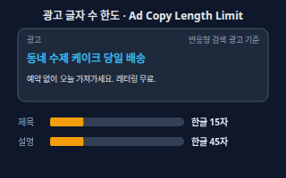</a> <b><a href="#ad-copy-length-limit--광고-글자-수-한도">Ad Copy Length Limit</a></b> 광고 글자 수 한도 광고 플랫폼이 제목·설명마다 정해 둔 글자 수 한도. 넘으면 입력이 안 되거나 잘려 보인다. 예를 들어 Google 반응형 검색 광고는 제목 30자·설명 90자(영문 기준)이고, 한국어 한 글자를 두 자로 세므로 한글로는 제목 15자·설명 45자까지다.</td>
</tr>
<tr>
<td width="33%" valign="top"><a href="#youtube-title--유튜브-제목">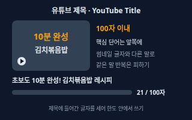</a> <b><a href="#youtube-title--유튜브-제목">YouTube Title</a></b> 유튜브 제목 영상 제목 칸에 쓰는 글. YouTube는 제목을 100자까지 허용하고, 검색·추천 화면에서 썸네일과 함께 보이므로 핵심 단어를 앞에 두고 썸네일 글자와 다른 정보를 준다.</td>
<td width="33%" valign="top"><a href="#subject-line--이메일-제목과-미리보기">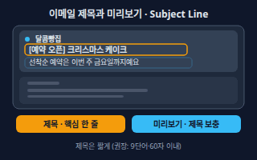</a> <b><a href="#subject-line--이메일-제목과-미리보기">Subject Line</a></b> 이메일 제목과 미리보기 받은편지함에서 보낸 사람 옆에 보이는 제목(Subject)과 그 뒤에 이어 보이는 미리보기 문구(Preview text). 메일을 열어 볼지는 이 둘로 정해진다. Mailchimp는 제목을 9단어·60자 이내로 짧게 쓰라고 권하며, 미리보기는 제목을 보충하는 자리로 안내한다.</td>
<td width="33%" valign="top"><a href="#product-description--상품-상세-설명">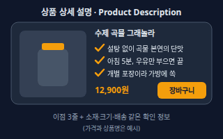</a> <b><a href="#product-description--상품-상세-설명">Product Description</a></b> 상품 상세 설명 쇼핑몰·스마트스토어 상품 페이지의 소개 글. 위쪽에는 고객에게 생기는 이점 몇 줄, 아래쪽에는 소재·크기·구성·배송처럼 확인용 정보를 나누어 쓴다.</td>
</tr>
</table>

**구조가 있는 글 · Structured Writing** (3)

<table>
<tr>
<td width="33%" valign="top"><a href="#press-release--보도자료">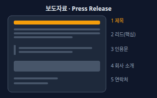</a> <b><a href="#press-release--보도자료">Press Release</a></b> 보도자료 언론에 소식을 알리려고 기자가 그대로 받아 쓸 수 있게 쓰는 공식 글. 제목, 핵심을 담은 리드, 세부 내용, 인용문, 회사 소개, 연락처 순으로 쓴다.</td>
<td width="33%" valign="top"><a href="#inverted-pyramid--역피라미드">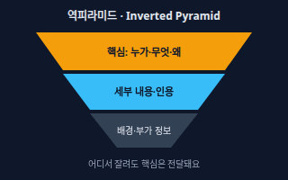</a> <b><a href="#inverted-pyramid--역피라미드">Inverted Pyramid</a></b> 역피라미드 가장 중요한 내용을 맨 위에 쓰고 아래로 갈수록 덜 중요한 내용을 두는 글 구조. 중간에 잘리거나 읽다 말아도 핵심은 전달된다.</td>
<td width="33%" valign="top"><a href="#storytelling--스토리텔링">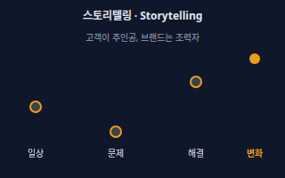</a> <b><a href="#storytelling--스토리텔링">Storytelling</a></b> 스토리텔링 정보를 나열하는 대신 인물·문제·변화의 이야기로 전하는 방식. 고객이 주인공이 되고 브랜드는 도와주는 사람 자리에 둔다.</td>
</tr>
</table>

**설득 심리 · Persuasion** (5)

<table>
<tr>
<td width="33%" valign="top"><a href="#social-proof--사회적-증거">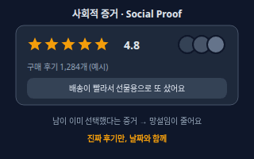</a> <b><a href="#social-proof--사회적-증거">Social Proof</a></b> 사회적 증거 다른 사람이 이미 샀고 만족했다는 흔적(후기·별점·판매 수·언론 보도). 사람은 남의 선택을 보면 마음이 놓인다.</td>
<td width="33%" valign="top"><a href="#scarcity-and-urgency--희소성과-긴박감">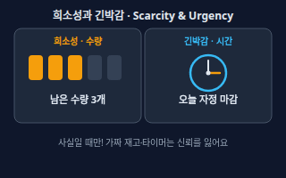</a> <b><a href="#scarcity-and-urgency--희소성과-긴박감">Scarcity and Urgency</a></b> 희소성과 긴박감 희소성은 수량·자리가 한정됐다는 것, 긴박감은 시간이 곧 끝난다는 것. 둘 다 '지금 결정해야 할 이유'를 준다. 사실일 때만 써야 한다.</td>
<td width="33%" valign="top"><a href="#specificity--구체성">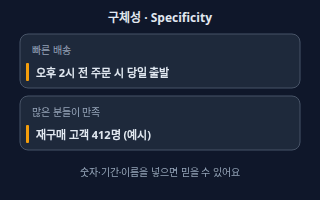</a> <b><a href="#specificity--구체성">Specificity</a></b> 구체성 막연한 형용사 대신 숫자·기간·이름·조건으로 말하는 것. 구체적일수록 더 믿을 만하게 읽힌다.</td>
</tr>
<tr>
<td width="33%" valign="top"><a href="#objection-handling--반론-처리">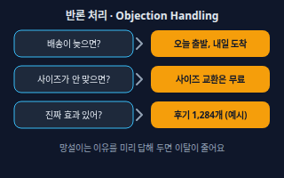</a> <b><a href="#objection-handling--반론-처리">Objection Handling</a></b> 반론 처리 고객이 살까 말까 망설이는 이유(가격·배송·품질·환불)를 미리 예상해서 글 안에서 답해 두는 것. FAQ나 보장 문구로 자주 쓴다.</td>
<td width="33%" valign="top"><a href="#risk-reversal--위험-줄이기">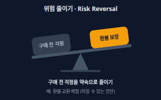</a> <b><a href="#risk-reversal--위험-줄이기">Risk Reversal</a></b> 위험 줄이기 구매의 위험을 파는 쪽이 대신 지겠다고 약속하는 것(환불·교환·무료 체험·만족 보장). 걱정을 덜어 주어 첫 구매의 문턱을 낮춘다.</td>
</tr>
</table>

**다듬기와 규칙 · Editing & Rules** (5)

<table>
<tr>
<td width="33%" valign="top"><a href="#proofreading-vs-editing--교정과-교열">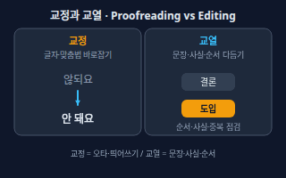</a> <b><a href="#proofreading-vs-editing--교정과-교열">Proofreading vs Editing</a></b> 교정과 교열 교정은 오탈자·맞춤법·띄어쓰기·문장부호를 바로잡는 일이고, 교열은 어색한 문장·중복·순서·사실 관계까지 검토해 고치는 일이다.</td>
<td width="33%" valign="top"><a href="#fact-check--팩트체크">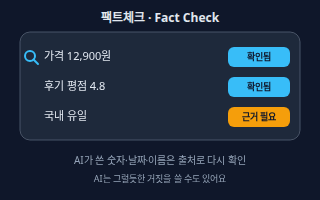</a> <b><a href="#fact-check--팩트체크">Fact Check</a></b> 팩트체크 글 속 숫자·날짜·이름·주장을 출처와 맞춰 보며 사실인지 확인하는 일. AI가 쓴 글에는 그럴듯한 거짓이 섞일 수 있어 꼭 거친다.</td>
<td width="33%" valign="top"><a href="#claim-substantiation--광고-문구-입증">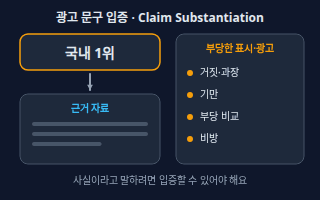</a> <b><a href="#claim-substantiation--광고-문구-입증">Claim Substantiation</a></b> 광고 문구 입증 광고에 쓴 사실 관련 문구('국내 1위' 등)는 근거 자료로 증명할 수 있어야 한다는 원칙. 표시ㆍ광고법은 거짓·과장, 기만, 부당 비교, 비방 표시·광고를 금지하고(제3조), 사실에 관한 광고 내용은 사업자가 실증할 수 있어야 한다고 정한다(제5조).</td>
</tr>
<tr>
<td width="33%" valign="top"><a href="#plagiarism-vs-copyright-infringement--표절과-저작권-침해">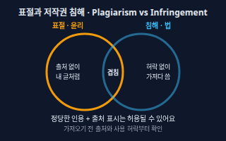</a> <b><a href="#plagiarism-vs-copyright-infringement--표절과-저작권-침해">Plagiarism vs Copyright Infringement</a></b> 표절과 저작권 침해 표절은 남의 글이나 생각을 출처 없이 내 것처럼 쓰는 일(윤리 문제)이고, 저작권 침해는 허락 없이 저작권 있는 표현을 가져다 쓰는 일(법 문제)이다. 둘은 겹치기도 하지만 같은 말은 아니다. 저작권법 제28조는 공표된 저작물을 보도·비평·교육·연구 등을 위해 정당한 범위에서 공정한 관행에 맞게 인용하는 것을 허용하고, 제37조는 출처를 밝히도록 한다.</td>
<td width="33%" valign="top"><b><a href="law.md#copyright--저작권">Copyright</a></b> 저작권 글·사진·그림·영상처럼 사람의 생각이나 감정을 표현한 창작물에 대해 만든 사람이 갖는 권리. → law 시트</td>
</tr>
</table>

<!-- overview:end -->

## 쓰기 전에 · Before Writing

### Copy Brief · 카피 브리프

- **정의**: 글을 쓰기 전에 누구에게, 무엇을, 왜 지금, 어떤 말투와 분량으로 쓸지 한 장에 적은 요청서. AI에게 건네는 첫 지시문이 되기도 한다.
- **AI에게 이렇게**: "아래 브리프대로 인스타그램 캡션 3개를 써줘. 누구에게: 30대 육아맘 / 무엇을: 무설탕 수제 쿠키 / 왜 지금: 어린이날 선물 시즌 / 말투: 다정하고 짧게 / 분량: 150자 이내"
- **언제**: 광고·상세페이지·뉴스레터처럼 새 글을 AI에게 처음 맡길 때
- **헷갈림**: Core Message — 브리프는 요청서 전체이고, 핵심 메시지는 그 안에 들어가는 '한 문장'이다.
- **관련**: Core Message, Writing for One Reader, Style Guide, USP
- **확인 질문**: 이 글을 읽은 사람이 무엇을 해야 하나요(구매·문의·저장)? 꼭 들어가야 할 정보(가격·기간·링크)와 쓰면 안 되는 표현이 있나요?

### Core Message · 핵심 메시지

- **정의**: 독자가 글을 거의 다 잊어도 하나만 기억한다면 남기고 싶은 한 문장. 장점이 여러 개여도 한 글에서는 하나만 크게 말한다.
- **AI에게 이렇게**: "장점이 많지만 이번 광고는 '오늘 주문하면 내일 아침 도착' 하나만 밀어줘. 다른 장점은 한 줄 이하로만 언급해줘."
- **언제**: 글이 이것저것 다 말하느라 흐릿할 때, 광고 소재를 여러 개 만들기 전
- **헷갈림**: USP — USP는 경쟁사와 다른 점을 정하는 전략이고, 핵심 메시지는 이번 글에서 밀 한 문장이다. USP에서 고를 수도, 이벤트·계절 소식으로 정할 수도 있다.
- **관련**: USP, Headline, Copy Brief
- **확인 질문**: 이번 글을 본 사람이 딱 하나만 기억한다면 무엇이면 좋겠나요?

### Writing for One Reader · 한 사람에게 쓰기

- **정의**: 불특정 다수 대신 구체적인 한 사람(나이·상황·걱정)을 떠올리며 쓰는 방법. 말투·예시·단어가 저절로 또렷해진다.
- **AI에게 이렇게**: "퇴근길 지하철에서 휴대폰으로 읽는 30대 직장인 민수 씨 한 명에게 말하듯 이 소개글을 다시 써줘."
- **언제**: 글이 교과서처럼 밋밋하거나 '모든 분께' 식으로 흐릴 때
- **헷갈림**: Persona(UX 리서치 시트) — 페르소나는 조사에 근거한 사용자 모델이고, 여기서는 글을 쓸 때 머릿속에 세우는 가상의 독자 한 명이다. 실제 고객이 한 말을 근거로 삼으면 더 정확하다.
- **관련**: Persona, Target Audience, Copy Brief
- **확인 질문**: 이 글을 읽을 사람의 나이·직업·상황과, 그 사람이 지금 가장 걱정하는 것은 무엇인가요?

### USP · 차별점

- **정의**: "다른 곳이 아니라 여기여야 하는 이유" 한 가지. 우리만 약속할 수 있고 고객이 신경 쓰는 것이어야 한다.
- **원본**: [마케팅 · USP](marketing.md#usp--차별점)

## 글의 뼈대 · Anatomy of a Page

### Headline · 헤드라인

- **정의**: 글·광고·상세페이지 맨 위에서 가장 먼저 읽히는 큰 제목. 이 한 줄이 나머지를 읽게 만들지 정한다.
- **AI에게 이렇게**: "이 가죽 지갑 상세페이지 헤드라인 후보를 10개 써줘. 누구에게 어떤 이득인지 보이게, 과장 표현은 빼고."
- **언제**: 랜딩 페이지, 상세페이지, 블로그 글, 보도자료의 제목
- **헷갈림**: Hook — 헤드라인은 제목 자리에 놓이는 글이고, 훅은 영상·게시글·문단 맨 앞에서 붙잡는 한 방이다(제목이 없는 곳에서도 쓴다).
- **관련**: Hook, Subhead, Subject Line, YouTube Title
- **확인 질문**: 누구에게 어떤 이득을 주는 글인가요? 제목에 넣을 수 있는 구체적 사실(숫자·기간)이 있나요?

### Hook · 훅

- **정의**: 사람이 스크롤을 멈추고 계속 읽거나 보게 만드는 맨 앞 한두 줄(영상이면 첫머리). SNS는 '더보기' 앞에서 승부가 난다.
- **AI에게 이렇게**: "인스타그램 캡션 첫 줄(훅) 5개를 써줘. 질문형, 숫자형, 의외의 사실형으로 나눠서, 내용은 아래 사실만 써줘."
- **언제**: 릴스·숏츠 첫머리, SNS 게시글 첫 줄, 이메일 도입부
- **헷갈림**: Lead — 훅은 시선을 잡는 한 줄이고, 리드는 핵심 정보를 요약해 주는 첫 문단이다.
- **관련**: Headline, Lead, AIDA
- **확인 질문**: 어느 채널(캡션·영상·메일)에서 어떤 화면에 보이나요? 훅이 약속한 내용을 본문이 실제로 지킬 수 있나요?

### Lead · 리드

- **정의**: 글 맨 앞 첫 문단. 누가·언제·어디서·무엇을·왜·어떻게(5W1H) 중 핵심을 먼저 몰아서 알려 주는 요약 부분이다.
- **AI에게 이렇게**: "이 신제품 소식을 핵심이 첫 문단에 다 들어가게 리드 3줄로 써줘. 세부 내용은 그 뒤에 두고."
- **언제**: 보도자료, 공지, 뉴스레터 도입부
- **헷갈림**: Body Copy — 리드는 핵심 요약 첫 문단이고, 본문은 그 근거와 세부 내용이다.
- **관련**: Inverted Pyramid, Press Release, Hook
- **확인 질문**: 가장 중요한 사실 한 가지는 무엇인가요? 빠지면 안 되는 정보(날짜·장소·가격)가 있나요?

### Subhead · 소제목

- **정의**: 긴 글을 몇 덩어리로 나누고 각 덩어리 맨 위에 붙이는 작은 제목. 독자가 훑어보다가 필요한 곳만 골라 읽게 해 준다.
- **AI에게 이렇게**: "이 상세페이지 본문에 소제목 4개를 달아줘. 소제목만 이어 읽어도 흐름이 보이게."
- **언제**: 스크롤이 긴 상세페이지, 블로그 글, 뉴스레터
- **헷갈림**: Headline — 헤드라인은 글 전체의 제목 한 개이고, 소제목은 중간중간 세운 안내 표지판이다.
- **관련**: Headline, Readability
- **확인 질문**: 독자가 가장 먼저 찾을 정보(가격·배송·후기)는 무엇인가요?

### Body Copy · 본문 카피

- **정의**: 헤드라인과 리드 뒤에 이어지는 설명 부분. 약속을 증명하고 믿게 하는 문단들로, 한 문단에 한 주제만 담는다.
- **AI에게 이렇게**: "헤드라인과 리드는 그대로 두고, 본문을 문제 공감 → 해결 방법 → 후기 순서로 문단 3개 써줘. 후기는 내가 준 것만 인용해줘."
- **언제**: 상세페이지, 블로그, 제안서, 뉴스레터
- **헷갈림**: Lead — 리드는 핵심 요약 첫 문단이고, 본문은 그 근거와 세부 내용이다.
- **관련**: Lead, Subhead, Feature vs Benefit
- **확인 질문**: 본문에서 꼭 증명해야 할 약속은 무엇이고, 쓸 수 있는 근거(후기·수치·사진)는 무엇인가요?

### CTA Copy · CTA 문구

- **정의**: 버튼·링크·마지막 문장에서 '지금 무엇을 하라'고 말하는 글자. 동사로 시작해 얻는 것을 말하고, 망설임을 덜어 주는 한마디를 곁들이면 눌러 볼 이유가 생긴다.
- **AI에게 이렇게**: "'구매하기' 말고 CTA 버튼 문구 5개와 버튼 아래에 붙일 한 줄 안내문을 써줘. 무료 교환이 가능하다는 점을 안내문에 넣어줘."
- **언제**: 랜딩 페이지 버튼, 이메일 마지막 줄, 광고 마지막 문장
- **헷갈림**: CTA(마케팅 시트) — 거기서는 행동 유도 요소 자체(버튼·위치·디자인)를 다루고, 여기서는 그 위에 쓰는 글자를 다룬다.
- **관련**: CTA, Microcopy, A/B Test
- **확인 질문**: 버튼을 누르면 바로 무슨 일이 일어나나요(결제·가입·문의)? 무료·환불·취소 조건이 있나요?

### CTA · 행동 유도 버튼

- **정의**: 방문자가 다음 행동(구매·가입·문의)을 하도록 부르는 버튼이나 링크 요소.
- **원본**: [마케팅 · CTA](marketing.md#cta--행동-유도-버튼)

## 설득 공식 · Frameworks

### AIDA · 아이다 공식

- **정의**: 주목(Attention) → 관심(Interest) → 욕구(Desire) → 행동(Action) 네 단계로 글의 흐름을 짜는 오래된 공식. 처음 보는 사람에게 길게 설명하는 페이지에 잘 맞는다.
- **AI에게 이렇게**: "방수 운동화 상세페이지를 AIDA 순서로 써줘. 각 단계 앞에 [주목] [관심] [욕구] [행동] 표시를 달아줘."
- **언제**: 랜딩 페이지, 세일즈 레터, 광고 영상 대본
- **헷갈림**: PAS — AIDA는 눈길을 끌어 끌고 가는 흐름이고, PAS는 독자가 이미 느끼는 문제에서 출발한다.
- **관련**: PAS, BAB, Landing Page
- **확인 질문**: 독자가 이 상품을 이미 아는 단계인가요, 처음 보는 단계인가요?

### PAS · 문제-키우기-해결 공식

- **정의**: 문제(Problem)를 짚고, 그 문제가 계속되면 어떨지 키워서(Agitate) 보여 준 뒤, 해결책(Solution)을 내미는 공식. 독자가 이미 불편을 느끼는 상품에 맞는다.
- **AI에게 이렇게**: "손발이 시려 고민인 사람에게 발열 양말을 PAS 순서로 소개해줘. 불안을 과하게 부추기지 말고 공감하는 말투로."
- **언제**: 불편이 분명한 상품·서비스의 광고, 이메일, 짧은 영상 대본
- **헷갈림**: AIDA — PAS는 독자의 문제에서 시작하고, AIDA는 눈길 끌기에서 시작한다. '키우기' 단계가 겁주기로 흐르면 안 된다.
- **관련**: AIDA, BAB, Objection Handling
- **확인 질문**: 독자가 지금 가장 불편해하는 것은 무엇이고, 우리 상품이 그것을 정말 해결하나요?

### BAB · 전후-다리 공식

- **정의**: 지금의 불편(Before) → 달라진 모습(After) → 그 사이를 잇는 다리(Bridge, 우리 상품)의 순서로 쓰는 공식. 변화가 눈에 그려지는 서비스에 맞는다.
- **AI에게 이렇게**: "장부 정리가 힘든 사장님에게 정산 앱을 BAB 순서로 소개해줘. After 장면은 구체적인 하루 모습으로."
- **언제**: 정리·자동화·절약처럼 달라진 모습을 보여 줄 수 있는 상품
- **헷갈림**: PAS — PAS는 불편을 파고들고, BAB는 달라진 모습을 먼저 그려 준다.
- **관련**: PAS, Storytelling, Feature vs Benefit
- **확인 질문**: 쓰기 전과 쓴 뒤의 모습 차이를 실제 사례나 수치로 말할 수 있나요?

### Feature vs Benefit · 기능과 이점

- **정의**: 기능은 상품이 가진 사양이고, 이점은 그 사양 때문에 고객에게 생기는 변화다. '그래서 나한테 뭐가 좋은데?'에 답하는 것이 이점이다.
- **AI에게 이렇게**: "아래 기능 목록을 '기능 → 그래서 고객에게 생기는 이점' 표로 바꿔줘. 이점은 하루 생활 장면으로 한 줄씩."
- **언제**: 상세페이지, 광고 문구, 제품 소개서
- **헷갈림**: FAB — 기능과 이점 사이에 '장점' 단계를 하나 더 넣은 공식이다.
- **관련**: FAB, Product Description, Core Message
- **확인 질문**: 이 기능을 쓰는 고객은 어떤 상황에서 무엇이 달라지나요?

### FAB · 특징-장점-이점

- **정의**: 특징(Feature) → 장점(Advantage) → 이점(Benefit)을 이어 쓰는 공식. '그래서?'를 두 번 물어 스펙에서 고객의 이득까지 끌고 간다.
- **AI에게 이렇게**: "방수 원단이라는 특징을 FAB로 풀어 써줘. 특징 → 장점 → 이점 순서로 각각 한 문장씩."
- **언제**: 기능 설명이 많은 제품, 영업용 자료, 상품 상세 설명
- **헷갈림**: Feature vs Benefit — 기능과 이점의 대비이고, FAB는 둘 사이의 장점 단계까지 포함한 3단 공식이다.
- **관련**: Feature vs Benefit, Product Description
- **확인 질문**: 이 특징이 다른 상품과 다른 점은 무엇이고, 그 덕분에 고객이 얻는 것은 무엇인가요?

## 목소리와 읽기 쉬움 · Voice & Readability

### Voice vs Tone · 목소리와 어조

- **정의**: 목소리(Voice)는 브랜드가 늘 지키는 말하는 성격(다정한, 솔직한)이고, 어조(Tone)는 상황에 따라 달라지는 말투의 강도다. 같은 사람이 사과할 땐 차분하게, 이벤트엔 들뜨게 말하는 것과 같다.
- **AI에게 이렇게**: "우리 가게 목소리는 '다정하고 솔직한 동네 사장님'이야. 이 목소리로 환불 사과 문자와 신메뉴 홍보 글을 써줘. 사과 글은 차분하게, 홍보 글은 들뜨게."
- **언제**: 브랜드 계정 운영, 고객 응대 문구, 여러 글의 말투를 맞출 때
- **헷갈림**: Tone and Manner(그래픽·브랜딩 시트) — 글뿐 아니라 시각까지 아우르는 브랜드 분위기 약속이고, 보이스·톤은 글의 말투에 집중한다.
- **관련**: Tone and Manner, Style Guide, Writing for One Reader
- **확인 질문**: 우리 브랜드를 한 사람으로 비유하면 어떤 성격인가요? 쓰고 싶은 말투와 절대 쓰기 싫은 말투가 있나요?

### Style Guide · 스타일 가이드

- **정의**: 호칭, 문체, 숫자·가격 표기, 금지 표현처럼 글쓰기 규칙을 한 장에 모은 것. AI에게 매번 같은 규칙을 건네면 글마다 말투가 흔들리지 않는다.
- **AI에게 이렇게**: "아래 스타일 가이드를 지켜서 글을 써줘. 호칭은 '고객님', 문체는 '~해요' 체, 가격은 10,000원 형식, '최고'·'1위'는 쓰지 마."
- **언제**: 여러 사람이나 AI가 같은 브랜드 글을 쓸 때
- **헷갈림**: Brand Guideline(그래픽·브랜딩 시트) — 로고·색·서체까지 포함한 전체 브랜드 규칙이고, 스타일 가이드는 그중 글 규칙만 담는다.
- **관련**: Voice vs Tone, Copy Brief, Proofreading vs Editing
- **확인 질문**: 이미 쓰고 있는 호칭·말투·표기 규칙이 있나요? 절대 쓰면 안 되는 단어가 있나요?

### Plain Language · 쉬운 글쓰기

- **정의**: 독자가 한 번에 알아듣도록 짧은 문장, 아는 단어, 하고 싶은 일을 앞에 두는 글쓰기. 한 문장에는 한 가지 생각만 담는다.
- **AI에게 이렇게**: "이 안내문을 중학생도 한 번에 이해하게 다시 써줘. 한 문장에 한 가지, 어려운 말은 쉬운 말로, 정보는 빼지 말고."
- **언제**: 안내문, 약관 요약, 고객 응대 글, 설명서
- **헷갈림**: Readability — 쉬운 글쓰기는 말(단어·문장)을 쉽게 하는 일이고, 가독성은 모양새(배치·간격)를 읽기 쉽게 하는 일이다. 둘은 함께 필요하다.
- **관련**: Readability, Style Guide
- **확인 질문**: 독자는 이 분야를 얼마나 아나요? 꼭 써야 하는 전문 용어가 있나요?

### Readability · 가독성

- **정의**: 글이 눈에 잘 들어오고 훑어 읽기 쉬운 정도. 문단 길이, 줄바꿈, 소제목, 불릿, 굵은 글씨가 좌우한다. 웹에서는 사람들이 꼼꼼히 읽기보다 훑는 경우가 많다.
- **AI에게 이렇게**: "이 글을 훑어 읽기 쉽게 바꿔줘. 문단은 3문장 이내, 소제목을 달고, 나열되는 내용은 불릿으로, 핵심 단어만 굵게."
- **언제**: 블로그 글, 상세페이지, 모바일에서 읽는 뉴스레터
- **헷갈림**: Plain Language — 가독성은 배치와 모양새, 쉬운 글쓰기는 단어와 문장의 쉬움이다.
- **관련**: Subhead, Plain Language, Visual Hierarchy
- **확인 질문**: 주로 휴대폰에서 읽나요, 컴퓨터에서 읽나요? 꼭 눈에 띄어야 할 문장은 무엇인가요?

### Tone and Manner · 톤앤매너

- **정의**: 브랜드가 말하고 보여 주는 분위기와 태도를 일관되게 맞추는 약속. 말투·색·이미지의 느낌이 한 사람처럼 느껴지게 한다.
- **원본**: [그래픽·브랜딩 · Tone and Manner](graphic-branding.md#tone-and-manner--톤앤매너)

## 짧은 글 · Short Copy

### Slogan vs Tagline · 슬로건과 태그라인

- **정의**: 슬로건은 캠페인·시즌 광고에서 외치는 한 줄이고, 태그라인은 로고 곁에 오래 붙는 브랜드 정체성 한 줄이다. 실무에서는 두 말을 섞어 쓰기도 한다.
- **AI에게 이렇게**: "동네 빵집 '달콤빵집'의 태그라인 후보 5개(오래 쓸 한 줄)와 여름 신메뉴 슬로건 후보 5개(이번 시즌용)를 따로 써줘. 각각 15자 이내로."
- **언제**: 브랜드 이름을 정한 뒤, 캠페인·이벤트 문구를 만들 때
- **헷갈림**: Headline — 헤드라인은 그 글의 제목이고, 슬로건·태그라인은 여러 곳에서 반복하는 구호다.
- **관련**: USP, Tone and Manner, Core Message
- **확인 질문**: 오래 남기고 싶은 약속은 무엇인가요? 비슷한 문구나 상표와 겹치지 않는지 확인했나요(상표는 법 시트의 Trademark 참고)?

### Microcopy · 마이크로카피

- **정의**: 버튼 글자, 입력칸 안내, 오류 메시지, 빈 화면 문구처럼 화면 속에서 사용자를 안내하는 짧은 글.
- **AI에게 이렇게**: "회원가입 화면의 입력칸 안내문, 오류 메시지 3종, 가입 버튼 글자를 써줘. 오류 메시지는 무엇이 잘못됐고 어떻게 고치는지 알려 주되 사용자를 탓하지 않게."
- **언제**: 앱·웹 화면, 가입·결제 흐름, 알림 문구
- **헷갈림**: CTA Copy — CTA 문구는 행동을 부르는 버튼 글자이고, 마이크로카피는 버튼·입력칸·오류·안내를 모두 포함한 화면 속 작은 글 전체다.
- **관련**: CTA Copy, Toast, Empty State, Tooltip
- **확인 질문**: 어느 화면의 어느 순간(입력 중·오류·완료)에 보이는 문구인가요? 글자 수 제한이 있나요?

### Ad Copy Length Limit · 광고 글자 수 한도

- **정의**: 광고 플랫폼이 제목·설명마다 정해 둔 글자 수 한도. 넘으면 입력이 안 되거나 잘려 보인다. 예를 들어 Google 반응형 검색 광고는 제목 30자·설명 90자(영문 기준)이고, 한국어 한 글자를 두 자로 세므로 한글로는 제목 15자·설명 45자까지다.
- **AI에게 이렇게**: "구글 반응형 검색 광고용 제목 8개(한글 15자 이내)와 설명 3개(한글 45자 이내)를 써줘. 줄마다 글자 수를 세어 표로 보여줘."
- **언제**: 광고 문구를 쓰거나 AI에게 분량을 지시할 때
- **헷갈림**: 광고 형식마다 한도가 다르다 — 같은 Google 안에서도 형식에 따라 제목 한도가 달라지고, 플랫폼은 한도를 바꾸기도 한다. 실제 한도는 광고 관리자 화면에서 확인한다.
- **관련**: Ad Creative, CTR, A/B Test
- **확인 질문**: 어느 플랫폼의 어떤 광고 형식인가요? 광고 관리자 화면에 표시된 최신 한도는 얼마인가요?
- **근거**: [Google Ads 고객센터 — 반응형 검색 광고에 대한 정보](https://support.google.com/google-ads/answer/7684791?hl=ko), [Google Ads 고객센터 — 검색 캠페인 사양](https://support.google.com/google-ads/answer/17092074?hl=en)
- **검증일**: 2026-11-02

### YouTube Title · 유튜브 제목

- **정의**: 영상 제목 칸에 쓰는 글. YouTube는 제목을 100자까지 허용하고, 검색·추천 화면에서 썸네일과 함께 보이므로 핵심 단어를 앞에 두고 썸네일 글자와 다른 정보를 준다.
- **AI에게 이렇게**: "김치볶음밥 레시피 영상 제목 후보 10개를 써줘. 100자 이내, 핵심 단어(김치볶음밥)는 앞쪽에, 썸네일에는 '10분 완성'이 들어가니 제목은 다른 정보를 담아서. 영상에 없는 내용은 약속하지 마."
- **언제**: 영상 업로드 직전, 제목·썸네일·설명을 함께 정할 때
- **헷갈림**: Thumbnail(영상 제작 시트) — 썸네일은 그림이고 제목은 글자다. 설명란(최대 5,000자)도 따로 있다.
- **관련**: Thumbnail, Hook, Headline
- **확인 질문**: 영상 안에서 실제로 지키는 약속인가요? 썸네일에는 어떤 글자가 들어가나요?
- **근거**: [YouTube 고객센터 — 동영상 설정 수정](https://support.google.com/youtube/answer/57404?hl=en)
- **검증일**: 2026-11-02

### Subject Line · 이메일 제목과 미리보기

- **정의**: 받은편지함에서 보낸 사람 옆에 보이는 제목(Subject)과 그 뒤에 이어 보이는 미리보기 문구(Preview text). 메일을 열어 볼지는 이 둘로 정해진다. Mailchimp는 제목을 9단어·60자 이내로 짧게 쓰라고 권하며, 미리보기는 제목을 보충하는 자리로 안내한다.
- **AI에게 이렇게**: "뉴스레터 제목 후보 6개와 각각에 어울리는 미리보기 문구를 써줘. 제목은 짧게, 미리보기는 제목을 보충하는 구체적 정보로. 한국어 기준 글자 수도 알려줘."
- **언제**: 뉴스레터, 프로모션 메일, 예약·알림 메일
- **헷갈림**: Headline — 메일 본문 맨 위 큰 제목과는 별개다. 광고성 메일의 표시·동의 규칙은 마케팅 시트의 Commercial Message Rules를 본다.
- **관련**: Newsletter and CRM, Commercial Message Rules, A/B Test
- **확인 질문**: 광고성 메일인가요? 보내는 사람 이름은 무엇인가요? 모바일에서 어디까지 보이는지 확인했나요?
- **근거**: [Mailchimp — Best Practices for Email Subject Lines](https://mailchimp.com/help/best-practices-for-email-subject-lines/), [Mailchimp — About Preview Text](https://mailchimp.com/help/about-preview-text/)
- **검증일**: 2026-11-02

### Product Description · 상품 상세 설명

- **정의**: 쇼핑몰·스마트스토어 상품 페이지의 소개 글. 위쪽에는 고객에게 생기는 이점 몇 줄, 아래쪽에는 소재·크기·구성·배송처럼 확인용 정보를 나누어 쓴다.
- **AI에게 이렇게**: "수제 곡물 그래놀라 상품 설명을 써줘. 위쪽은 이점 3줄, 아래는 원재료·용량·보관법·배송 안내를 표로. 효능을 단정하는 표현은 빼줘."
- **언제**: 상품 등록, 상세페이지 제작, 옵션·구성 안내
- **헷갈림**: Landing Page — 랜딩 페이지는 한 가지 행동을 위한 단독 페이지이고, 상세 설명은 상품 목록 속 한 상품의 소개 글이다.
- **관련**: Feature vs Benefit, Claim Substantiation, Fact Check
- **확인 질문**: 실제 사양(용량·원재료·크기)과 배송·환불 정책은 무엇인가요? 꼭 표시해야 하는 정보나 인증이 있나요?

## 구조가 있는 글 · Structured Writing

### Press Release · 보도자료

- **정의**: 언론에 소식을 알리려고 기자가 그대로 받아 쓸 수 있게 쓰는 공식 글. 제목, 핵심을 담은 리드, 세부 내용, 인용문, 회사 소개, 연락처 순으로 쓴다.
- **AI에게 이렇게**: "우리 가게 2호점 오픈 소식을 보도자료로 써줘. 제목 1개, 리드 3줄, 본문 3문단, 대표 인용문, 회사 소개, 문의 연락처 순서로. 과장 표현은 빼고 사실만."
- **언제**: 신제품 출시, 오픈, 수상, 협약처럼 알릴 만한 소식이 있을 때
- **헷갈림**: 광고글 — 보도자료는 홍보 문구가 아니라 '뉴스가 될 만한 사실'을 건조하게 전하는 글이다.
- **관련**: Inverted Pyramid, Lead, Fact Check
- **확인 질문**: 뉴스가 될 만한 새 소식(최초·변화·수치)은 무엇인가요? 날짜·장소·인명은 확정된 사실인가요? 인용문을 말할 사람은 누구인가요?

### Inverted Pyramid · 역피라미드

- **정의**: 가장 중요한 내용을 맨 위에 쓰고 아래로 갈수록 덜 중요한 내용을 두는 글 구조. 중간에 잘리거나 읽다 말아도 핵심은 전달된다.
- **AI에게 이렇게**: "이 공지문을 역피라미드 구조로 다시 써줘. 첫 문단에 누가·무엇·왜를 넣고, 세부 내용과 배경은 뒤로 보내줘."
- **언제**: 보도자료, 공지, 뉴스 기사처럼 빨리 전달해야 하는 글
- **헷갈림**: Storytelling — 이야기는 결말을 마지막에 두고, 역피라미드는 결론을 맨 앞에 둔다.
- **관련**: Lead, Press Release
- **확인 질문**: 독자가 첫 문단만 읽는다면 꼭 알아야 할 것은 무엇인가요?

### Storytelling · 스토리텔링

- **정의**: 정보를 나열하는 대신 인물·문제·변화의 이야기로 전하는 방식. 고객이 주인공이 되고 브랜드는 도와주는 사람 자리에 둔다.
- **AI에게 이렇게**: "우리 가게 창업 이야기를 '평범한 일상 → 문제 → 해결 → 달라진 모습' 4단계로 300자 안팎의 글로 써줘. 내가 준 사실만 쓰고 지어내지 마."
- **언제**: 브랜드 소개, 창업 이야기, 고객 사례, 영상 대본
- **헷갈림**: Inverted Pyramid — 이야기는 흐름을 따라가며 읽히고, 역피라미드는 결론부터 말한다. 이야기여도 사실이 아닌 내용을 지어내면 안 된다.
- **관련**: BAB, Social Proof, Inverted Pyramid
- **확인 질문**: 실제로 있었던 일(고객 사례·창업 계기)은 무엇인가요? 실명·사진을 써도 된다는 허락을 받았나요?

## 설득 심리 · Persuasion

### Social Proof · 사회적 증거

- **정의**: 다른 사람이 이미 샀고 만족했다는 흔적(후기·별점·판매 수·언론 보도). 사람은 남의 선택을 보면 마음이 놓인다.
- **AI에게 이렇게**: "상세페이지 맨 아래에 넣을 후기 요약 문구를 써줘. 내가 붙여 넣은 실제 후기 5개에서만 골라 인용하고, 없는 숫자는 만들지 마."
- **언제**: 상세페이지, 랜딩 페이지, 광고 소재, 뉴스레터
- **헷갈림**: Sponsored Disclosure(마케팅 시트) — 대가를 받고 쓴 후기는 그 사실을 밝혀야 한다. 지어낸 후기와도 다르다.
- **관련**: Influencer Marketing, Sponsored Disclosure, Fact Check
- **확인 질문**: 실제 후기·수치의 출처와 날짜는 무엇인가요? 후기를 인용해도 된다는 동의가 있나요?

### Scarcity and Urgency · 희소성과 긴박감

- **정의**: 희소성은 수량·자리가 한정됐다는 것, 긴박감은 시간이 곧 끝난다는 것. 둘 다 '지금 결정해야 할 이유'를 준다. 사실일 때만 써야 한다.
- **AI에게 이렇게**: "이번 주 한정 20세트 이벤트 공지를 써줘. 마감은 일요일 밤 12시야. 실제로 재고가 남은 동안에는 '마감 임박' 같은 표현은 쓰지 마."
- **언제**: 한정판 출시, 기간 한정 이벤트, 예약 마감 안내
- **헷갈림**: 가짜 재고·가짜 타이머 — 거짓으로 서두르게 하면 신뢰를 잃을 뿐 아니라 기만적인 광고가 될 수 있다(Claim Substantiation 참고).
- **관련**: Claim Substantiation, CTA Copy, Fact Check
- **확인 질문**: 남은 수량과 마감 시각은 실제인가요? 마감이 지난 뒤에는 정말 판매나 접수를 끝내나요?

### Specificity · 구체성

- **정의**: 막연한 형용사 대신 숫자·기간·이름·조건으로 말하는 것. 구체적일수록 더 믿을 만하게 읽힌다.
- **AI에게 이렇게**: "'빠른 배송, 많은 분들이 만족'을 숫자와 기한이 들어간 문장으로 고쳐줘. 숫자는 내가 아래에 준 것만 써줘."
- **언제**: 광고 문구가 뻔하거나 밋밋할 때, 상세페이지 이점 문장을 다듬을 때
- **헷갈림**: Plain Language — 구체성은 내용의 정확도이고, 쉬운 글쓰기는 표현의 쉬움이다.
- **관련**: Fact Check, Claim Substantiation, Feature vs Benefit
- **확인 질문**: 쓸 수 있는 실제 숫자·기간·고객 수·인증은 무엇인가요?

### Objection Handling · 반론 처리

- **정의**: 고객이 살까 말까 망설이는 이유(가격·배송·품질·환불)를 미리 예상해서 글 안에서 답해 두는 것. FAQ나 보장 문구로 자주 쓴다.
- **AI에게 이렇게**: "이 상품을 살까 말까 망설이는 이유 5가지를 먼저 뽑고, 각각에 한 줄 답변(FAQ)을 써줘. 정책은 내가 준 내용만 사용해줘."
- **언제**: 상세페이지 FAQ, 영업 메일, 가격·품질이 걱정되는 상품
- **헷갈림**: Risk Reversal — 반론 처리는 걱정에 '답을 설명'하는 것이고, 위험 줄이기는 '손해 보지 않게 약속'하는 것이다.
- **관련**: Risk Reversal, Social Proof, PAS
- **확인 질문**: 고객이 실제로 자주 묻는 질문이나 후기에 나온 불만은 무엇인가요?

### Risk Reversal · 위험 줄이기

- **정의**: 구매의 위험을 파는 쪽이 대신 지겠다고 약속하는 것(환불·교환·무료 체험·만족 보장). 걱정을 덜어 주어 첫 구매의 문턱을 낮춘다.
- **AI에게 이렇게**: "구매 버튼 근처에 넣을 환불·교환 안내를 한 줄로 써줘. 정책 원문은 아래야. 원문보다 더 해 주는 것처럼 보이는 표현은 쓰지 마."
- **언제**: 처음 사는 고객이 많은 상품, 가격대가 높은 상품, 체험판 안내
- **헷갈림**: Objection Handling — 반론 처리는 걱정에 답을 설명하고, 위험 줄이기는 약속으로 걱정을 덜어 준다. 법으로 정해진 권리와 가게가 따로 하는 보장은 다를 수 있으니 정책 원문을 확인한다.
- **관련**: Objection Handling, CTA Copy, Microcopy
- **확인 질문**: 실제로 지킬 수 있는 환불·교환 조건과 기간은 무엇인가요? 예외(옵션 상품·개봉 후)가 있나요?

## 다듬기와 규칙 · Editing & Rules

### Proofreading vs Editing · 교정과 교열

- **정의**: 교정은 오탈자·맞춤법·띄어쓰기·문장부호를 바로잡는 일이고, 교열은 어색한 문장·중복·순서·사실 관계까지 검토해 고치는 일이다.
- **AI에게 이렇게**: "이 글을 두 번 검토해줘. 1차 교정: 오탈자·맞춤법·띄어쓰기만 고치고 바뀐 곳을 표시. 2차 교열: 어색한 문장·중복·순서 문제는 제안만 하고 내용은 그대로 두기."
- **언제**: 글을 내보내기 직전, AI가 쓴 초안을 받은 뒤
- **헷갈림**: 윤문(문장을 매끄럽게 고쳐 쓰는 일) — 교정은 틀린 것을 바로잡고, 교열은 표현과 사실까지 살피며, 윤문은 더 매끄럽게 다시 쓰는 쪽에 가깝다.
- **관련**: Fact Check, Style Guide, Plain Language
- **확인 질문**: 어디까지 고쳐도 되나요(맞춤법만·문장 다듬기·구성 변경)? 고친 곳을 표시해 드릴까요?

### Fact Check · 팩트체크

- **정의**: 글 속 숫자·날짜·이름·주장을 출처와 맞춰 보며 사실인지 확인하는 일. AI가 쓴 글에는 그럴듯한 거짓이 섞일 수 있어 꼭 거친다.
- **AI에게 이렇게**: "이 글에서 확인이 필요한 사실(숫자, 날짜, 고유명사, '최고'·'유일' 같은 주장)을 목록으로 뽑고, 내가 준 자료에서 근거를 찾을 수 있는지 표시해줘. 자료에 없으면 '근거 없음'이라고 써줘."
- **언제**: AI 초안을 받은 뒤, 보도자료·광고·상세페이지를 올리기 전
- **헷갈림**: Hallucination(AI 에이전트 시트) — 환각은 AI가 만들어내는 그럴듯한 거짓이고, 팩트체크는 그것을 잡아내는 사람의 점검 단계다.
- **관련**: Hallucination, Claim Substantiation, Specificity
- **확인 질문**: 근거로 쓸 수 있는 자료(상품 사양, 인증서, 조사 결과, 공식 페이지)가 있나요?

### Claim Substantiation · 광고 문구 입증

- **정의**: 광고에 쓴 사실 관련 문구('국내 1위' 등)는 근거 자료로 증명할 수 있어야 한다는 원칙. 표시ㆍ광고법은 거짓·과장, 기만, 부당 비교, 비방 표시·광고를 금지하고(제3조), 사실에 관한 광고 내용은 사업자가 실증할 수 있어야 한다고 정한다(제5조).
- **AI에게 이렇게**: "이 광고 문구에서 '최고·1위·유일·100%'처럼 사실 주장으로 읽히는 표현을 찾아서, 각각 어떤 근거 자료가 있어야 하는지 목록으로 알려줘. 근거가 없으면 대체 문구도 제안해줘. 법률 판단이 아니라 점검용으로."
- **언제**: '최고·1위·유일·효과 보장' 같은 표현을 쓰기 전, 광고 시안을 올리기 전
- **헷갈림**: 의견·감상('맛있어요')과 사실 주장('국내 1위') — 사실처럼 읽히는 문구일수록 조사 기관·기간·기준 같은 근거가 필요하다. 어디까지가 허용되는지는 전문가에게 확인한다.
- **관련**: Fact Check, Scarcity and Urgency, Sponsored Disclosure
- **확인 질문**: 이 주장을 뒷받침하는 자료(조사 기관·기간·기준·표본)가 있나요? 자료의 날짜는 최신인가요?
- **근거**: [표시ㆍ광고의 공정화에 관한 법률 제3조](https://www.law.go.kr/법령/표시ㆍ광고의공정화에관한법률/제3조), [표시ㆍ광고의 공정화에 관한 법률 제5조](https://www.law.go.kr/법령/표시ㆍ광고의공정화에관한법률/제5조), [공정거래위원회 — 부당한 표시·광고 시정](https://www.ftc.go.kr/www/contents.do?key=700)
- **검증일**: 2026-11-02

### Plagiarism vs Copyright Infringement · 표절과 저작권 침해

- **정의**: 표절은 남의 글이나 생각을 출처 없이 내 것처럼 쓰는 일(윤리 문제)이고, 저작권 침해는 허락 없이 저작권 있는 표현을 가져다 쓰는 일(법 문제)이다. 둘은 겹치기도 하지만 같은 말은 아니다. 저작권법 제28조는 공표된 저작물을 보도·비평·교육·연구 등을 위해 정당한 범위에서 공정한 관행에 맞게 인용하는 것을 허용하고, 제37조는 출처를 밝히도록 한다.
- **AI에게 이렇게**: "이 문단이 기존 글을 거의 그대로 옮긴 곳이 없는지 점검하는 방법을 알려줘. 남의 글을 인용해야 한다면 어디까지 짧게 인용하고 출처를 어떻게 적어야 하는지도 정리해줘. 법률 판단이 아니라 점검용으로."
- **언제**: 블로그·상세페이지에 남의 글·사진·문장을 참고하거나 인용할 때, AI 초안이 기존 글과 비슷해 보일 때
- **헷갈림**: Copyright(법 시트) — 저작권은 권리 자체를 말하고, 표절은 출처를 숨기는 행위에 대한 윤리적 평가다. 출처를 적었다고 해서 허락 없는 이용이 항상 허용되는 것은 아니다.
- **관련**: Copyright, License, Fact Check
- **확인 질문**: 가져올 글·이미지의 원작자와 이용 조건은 무엇인가요? 광고·판매 같은 영리 목적에 쓰이나요? 얼마나 가져오고 출처는 어떻게 밝히나요?
- **근거**: [저작권법 제28조](https://www.law.go.kr/법령/저작권법/제28조), [저작권법 제37조](https://www.law.go.kr/법령/저작권법/제37조), [찾기쉬운 생활법령 — 공표된 저작물의 인용](https://easylaw.go.kr/CSP/CnpClsMain.laf?popMenu=ov&csmSeq=695&ccfNo=3&cciNo=2&cnpClsNo=2)
- **검증일**: 2026-11-02

### Copyright · 저작권

- **정의**: 글·사진·그림·영상처럼 사람의 생각이나 감정을 표현한 창작물에 대해 만든 사람이 갖는 권리.
- **원본**: [법 · Copyright](law.md#copyright--저작권)

## 참고 자료

- [Digital.gov — Clear and short (Plain language)](https://digital.gov/guides/plain-language/writing/clear-short)
- [Nielsen Norman Group — The Four Dimensions of Tone of Voice](https://www.nngroup.com/articles/tone-of-voice-dimensions/)
- [Nielsen Norman Group — How Little Do Users Read?](https://www.nngroup.com/articles/how-little-do-users-read/)
- [Digital NSW — Microcopy](https://www.digital.nsw.gov.au/delivery/digital-service-toolkit/resources/writing-content/content-style-guide/microcopy)
- [PRSA Jobs — How to Write a Press Release That Actually Gets Published](https://jobs.prsa.org/career-resources/finding-talent-10/how-to-write-a-press-release-that-actually-gets-published-377)
- [Pasvly — Copywriting Formulas (AIDA, PAS, BAB, FAB)](https://pasvly.com/guides/copywriting-formulas)
- [HubSpot — Features vs. Benefits](https://blog.hubspot.com/marketing/features-vs-benefits-messaging-ht)
- [Mailchimp — Best Practices for Email Subject Lines](https://mailchimp.com/help/best-practices-for-email-subject-lines/)
- [Mailchimp — About Preview Text](https://mailchimp.com/help/about-preview-text/)
- [Google Ads 고객센터 — 반응형 검색 광고에 대한 정보](https://support.google.com/google-ads/answer/7684791?hl=ko)
- [Google Ads 고객센터 — 검색 캠페인 사양](https://support.google.com/google-ads/answer/17092074?hl=en)
- [YouTube 고객센터 — 동영상 설정 수정](https://support.google.com/youtube/answer/57404?hl=en)
- [국가법령정보센터 — 표시ㆍ광고의 공정화에 관한 법률](https://www.law.go.kr/법령/표시ㆍ광고의공정화에관한법률)
- [공정거래위원회 — 부당한 표시·광고 시정](https://www.ftc.go.kr/www/contents.do?key=700)
- [국가법령정보센터 — 저작권법](https://www.law.go.kr/법령/저작권법)
- [찾기쉬운 생활법령정보 — 공표된 저작물의 인용](https://easylaw.go.kr/CSP/CnpClsMain.laf?popMenu=ov&csmSeq=695&ccfNo=3&cciNo=2&cnpClsNo=2)
- [찾기쉬운 생활법령정보 — 저작물](https://easylaw.go.kr/CSP/CnpClsMain.laf?popMenu=ov&csmSeq=695&ccfNo=1&cciNo=1&cnpClsNo=1)
