# 패션 치트시트

> 내 브랜드를 만들거나 이미지 프롬프트를 쓰는데 "그 옷 있잖아, 어깨가 내려오고 품이 넉넉한…"처럼 말로만 설명하다 막힐 때 펼치세요. 이 시트의 단어 몇 개만 알아도 AI·스타일리스트·공장이 같은 옷을 떠올립니다.

## 이렇게 쓰세요

- **나 → AI**: "오버핏에 드롭숄더, 크루넥인 230gsm 면 저지 티셔츠를 만들고 싶어. 이미지 먼저 뽑아주고, 공장에 보낼 테크팩 목록도 정리해줘."
- **AI → 나**: "오버핏은 어느 정도인가요? 지금 입는 티셔츠 가슴둘레(cm)를 알려주시면 그보다 몇 cm 크게 할지 정할게요. 크롭이 아니라 엉덩이를 덮는 길이가 맞나요?"
- **나 → AI**: "여름용 와이드 팬츠야. 소재는 린넨 160gsm, 하운즈투스는 말고 단색으로. 허리 주름은 투턱 플리츠."
- **AI → 나**: "샘플 단계에서 시접은 1cm로 두고, 첫 주문은 색상당 몇 장(MOQ)까지 가능한지 공장에 먼저 물어볼까요?"

## 한눈에 보기

<!-- overview:start -->
<!-- 이 구역은 자동 생성됩니다. 직접 고치지 말고 `cd mcp-server && npm run generate`를 실행하세요. -->

**실루엣·핏 · Silhouette & Fit** (7)

<table>
<tr>
<td width="33%" valign="top"><a href="#a-line--a라인">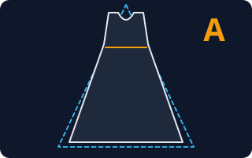</a> <b><a href="#a-line--a라인">A-line</a></b> A라인 어깨와 가슴은 몸에 맞고 허리 아래부터 밑단까지 완만하게 퍼지는 모양. 알파벳 A를 닮았다.</td>
<td width="33%" valign="top"><a href="#h-line--h라인">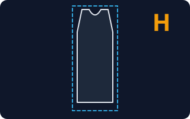</a> <b><a href="#h-line--h라인">H-line</a></b> H라인 어깨·허리·밑단 폭이 거의 같아 일자로 떨어지는 모양. 알파벳 H처럼 몸매 굴곡을 드러내지 않는다.</td>
<td width="33%" valign="top"><a href="#x-line--x라인">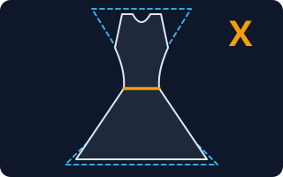</a> <b><a href="#x-line--x라인">X-line</a></b> X라인 어깨와 밑단은 넓고 허리만 잘록한 모래시계 모양. 알파벳 X를 닮았다.</td>
</tr>
<tr>
<td width="33%" valign="top"><a href="#oversized-fit--오버핏">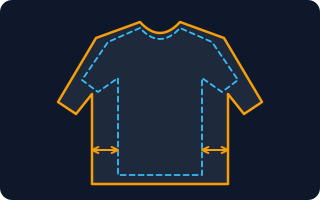</a> <b><a href="#oversized-fit--오버핏">Oversized Fit</a></b> 오버핏 몸 치수보다 일부러 한두 사이즈 크게 만든 헐렁한 핏. 어깨선이 내려오고 소매·기장이 넉넉한 경우가 많다.</td>
<td width="33%" valign="top"><a href="#slim-fit--슬림핏">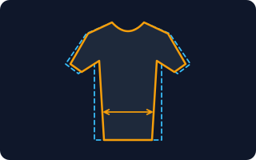</a> <b><a href="#slim-fit--슬림핏">Slim Fit</a></b> 슬림핏 몸의 선을 따라 폭을 좁혀 몸에 붙게 만든 핏. 기본 핏은 레귤러핏(Regular Fit)이고, 그보다 헐렁하면 릴랙스드·오버핏이다.</td>
<td width="33%" valign="top"><a href="#cropped--크롭">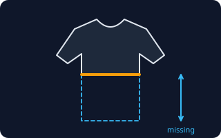</a> <b><a href="#cropped--크롭">Cropped</a></b> 크롭 보통 길이보다 짧게, 허리나 배꼽 위에서 끝나도록 자른 기장.</td>
</tr>
<tr>
<td width="33%" valign="top"><a href="#wide-leg--와이드-레그">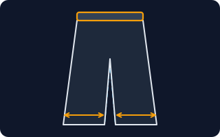</a> <b><a href="#wide-leg--와이드-레그">Wide Leg</a></b> 와이드 레그 허벅지부터 밑단까지 폭이 넓게 떨어지는 바지.</td>
</tr>
</table>

**디테일 · Details** (8)

<table>
<tr>
<td width="33%" valign="top"><a href="#crew-neck--크루넥">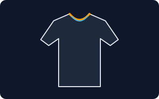</a> <b><a href="#crew-neck--크루넥">Crew Neck</a></b> 크루넥 목 둘레를 따라 둥글게 붙은 기본 티셔츠 목선. 한국에서는 라운드넥이라고도 부른다.</td>
<td width="33%" valign="top"><a href="#v-neck--브이넥">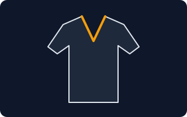</a> <b><a href="#v-neck--브이넥">V-neck</a></b> 브이넥 앞목 가운데로 갈수록 뾰족하게 파인 V자 목선.</td>
<td width="33%" valign="top"><a href="#turtleneck--터틀넥">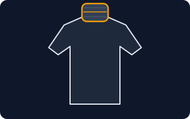</a> <b><a href="#turtleneck--터틀넥">Turtleneck</a></b> 터틀넥 목을 감싸는 원통 모양의 높은 깃이 달린 상의. 한국에서는 목폴라라고도 한다.</td>
</tr>
<tr>
<td width="33%" valign="top"><a href="#mandarin-collar--만다린-칼라">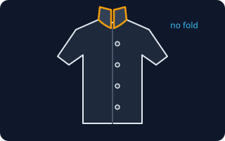</a> <b><a href="#mandarin-collar--만다린-칼라">Mandarin Collar</a></b> 만다린 칼라 접히지 않고 목에 세워져 붙은 낮은 띠 모양 깃. 차이나 칼라, 밴드 칼라라고도 부른다.</td>
<td width="33%" valign="top"><a href="#raglan-sleeve--래글런-슬리브">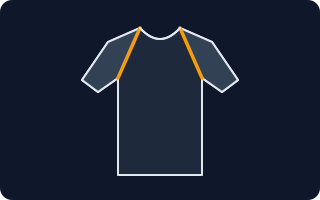</a> <b><a href="#raglan-sleeve--래글런-슬리브">Raglan Sleeve</a></b> 래글런 슬리브 어깨 부분을 따로 이어 붙이지 않고, 목에서 겨드랑이까지 비스듬한 선으로 소매와 어깨를 한 조각으로 만든 소매.</td>
<td width="33%" valign="top"><a href="#drop-shoulder--드롭숄더">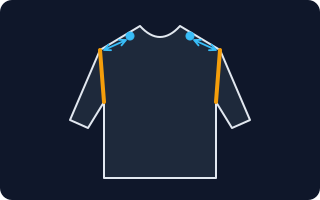</a> <b><a href="#drop-shoulder--드롭숄더">Drop Shoulder</a></b> 드롭숄더 어깨 봉제선이 진짜 어깨 끝보다 팔 쪽으로 내려와 있는 디자인. 어깨가 처져 보이고 소매가 넉넉해 편안한 느낌이다.</td>
</tr>
<tr>
<td width="33%" valign="top"><a href="#pleat--플리츠">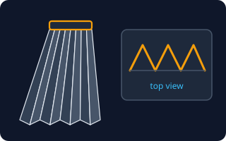</a> <b><a href="#pleat--플리츠">Pleat</a></b> 플리츠 천을 같은 간격으로 접어 만든 주름. 접힌 방향과 폭에 따라 모양이 달라진다.</td>
<td width="33%" valign="top"><a href="#dart--다트">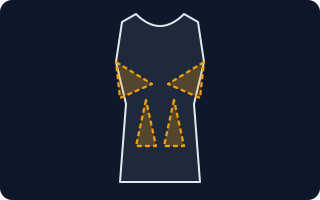</a> <b><a href="#dart--다트">Dart</a></b> 다트 평평한 천을 몸의 굴곡에 맞게 입체로 만들기 위해, 삼각형 모양으로 집어서 꿰맨 부분.</td>
</tr>
</table>

**소재 · Fabric** (6)

<table>
<tr>
<td width="33%" valign="top"><a href="#knit--니트편직">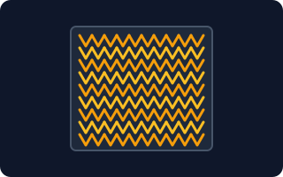</a> <b><a href="#knit--니트편직">Knit</a></b> 니트(편직) 실을 고리처럼 엮어 만든 천. 늘어나고 부드러우며 티셔츠(저지), 스웨터가 여기에 속한다.</td>
<td width="33%" valign="top"><a href="#woven--우븐직물">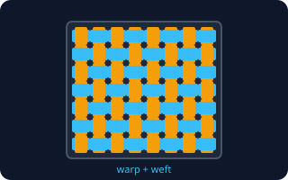</a> <b><a href="#woven--우븐직물">Woven</a></b> 우븐(직물) 세로실(날실)과 가로실(씨실)을 직각으로 엇갈려 짠 천. 단단하고 형태가 잘 잡히며 거의 늘어나지 않는다. 셔츠·청바지·슈트 소재.</td>
<td width="33%" valign="top"> <b><a href="#cotton--면">Cotton</a></b> 면 목화솜으로 만든 식물성 섬유. 부드럽고 땀을 잘 흡수하며 가장 흔한 옷감이다.</td>
</tr>
<tr>
<td width="33%" valign="top"><a href="#linen--린넨마">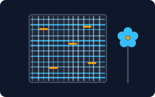</a> <b><a href="#linen--린넨마">Linen</a></b> 린넨(마) 아마라는 식물의 줄기로 만든 천. 시원하고 통기성이 좋지만 구김이 잘 가고 실 굵기가 고르지 않은 질감이 특징이다.</td>
<td width="33%" valign="top"><a href="#denim--데님">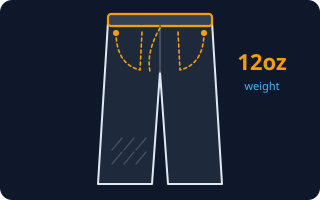</a> <b><a href="#denim--데님">Denim</a></b> 데님 사선으로 짜인 두꺼운 면 직물(트윌)로, 청바지의 원단. 무게는 1야드² 당 온스(oz)로 말하며 숫자가 클수록 두껍다.</td>
<td width="33%" valign="top"><a href="#gsm--원단-무게gsm">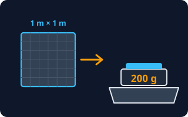</a> <b><a href="#gsm--원단-무게gsm">GSM</a></b> 원단 무게(GSM) 1㎡(가로세로 1m) 크기 천의 무게를 그램(g)으로 나타낸 값. g/㎡, GSM이라고 쓰며 숫자가 클수록 두껍고 무겁다.</td>
</tr>
</table>

**패턴·프린트 · Patterns** (5)

<table>
<tr>
<td width="33%" valign="top"><a href="#stripe--스트라이프">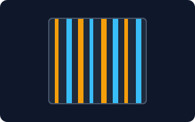</a> <b><a href="#stripe--스트라이프">Stripe</a></b> 스트라이프 같은 방향으로 길게 이어지는 줄무늬. 가로/세로/대각선이 있고 줄 두께와 간격으로 인상이 바뀐다.</td>
<td width="33%" valign="top"><a href="#check--체크">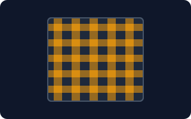</a> <b><a href="#check--체크">Check</a></b> 체크 가로줄과 세로줄이 겹쳐 사각형 칸이 만들어지는 무늬. 칸 크기와 색 조합에 따라 깅엄, 글렌, 타탄(플래드) 등 이름이 다르다.</td>
<td width="33%" valign="top"><a href="#herringbone--헤링본">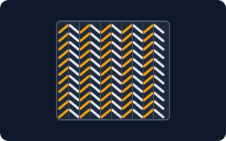</a> <b><a href="#herringbone--헤링본">Herringbone</a></b> 헤링본 V자가 세로로 이어지는 생선뼈 모양 무늬. 한 줄은 오른쪽 위, 다음 줄은 왼쪽 위로 사선 방향이 번갈아 바뀐다.</td>
</tr>
<tr>
<td width="33%" valign="top"><a href="#houndstooth--하운즈투스">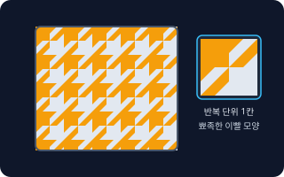</a> <b><a href="#houndstooth--하운즈투스">Houndstooth</a></b> 하운즈투스 끝이 뾰족한 이빨 모양이 두 색으로 반복되는 작은 격자 무늬. 사냥개 이빨을 닮아 붙은 이름이다.</td>
<td width="33%" valign="top"> <b><a href="#polka-dot--폴카-도트">Polka Dot</a></b> 폴카 도트 같은 크기의 동그란 점이 일정 간격으로 반복되는 물방울무늬. 땡땡이 무늬라고도 한다.</td>
</tr>
</table>

**생산 · Production** (6)

<table>
<tr>
<td width="33%" valign="top"><a href="#sewing-pattern--옷본패턴">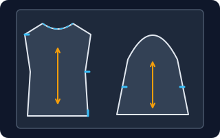</a> <b><a href="#sewing-pattern--옷본패턴">Sewing Pattern</a></b> 옷본(패턴) 옷을 이루는 조각(앞판·뒤판·소매 등)을 종이에 그린 설계도. 이 모양대로 천을 잘라 박아서 옷을 만든다.</td>
<td width="33%" valign="top"><a href="#grading--그레이딩">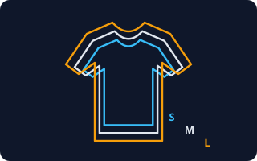</a> <b><a href="#grading--그레이딩">Grading</a></b> 그레이딩 기준 사이즈 옷본을 규칙에 따라 키우거나 줄여 S·M·L 같은 다른 사이즈 옷본을 만드는 일.</td>
<td width="33%" valign="top"><a href="#sample--샘플">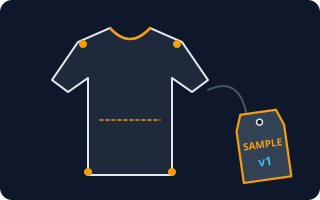</a> <b><a href="#sample--샘플">Sample</a></b> 샘플 대량 생산 전에 모양·핏·소재를 확인하려고 한두 벌만 먼저 만드는 시제품.</td>
</tr>
<tr>
<td width="33%" valign="top"><a href="#tech-pack--테크팩">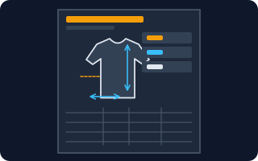</a> <b><a href="#tech-pack--테크팩">Tech Pack</a></b> 테크팩 공장에 옷 만드는 법을 정확히 전하는 서류 묶음. 도식화(옷 앞뒤 그림), 치수표, 소재·부자재 목록, 봉제 방법, 라벨 위치가 들어간다.</td>
<td width="33%" valign="top"><a href="#moq--최소-주문-수량">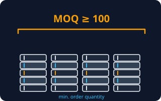</a> <b><a href="#moq--최소-주문-수량">MOQ</a></b> 최소 주문 수량 Minimum Order Quantity. 공장이나 원단 업체가 &quot;이 수량 이상이어야 주문 받는다&quot;고 정한 최소 수량. 보통 디자인·색상별로 정한다.</td>
<td width="33%" valign="top"><a href="#seam-allowance--시접">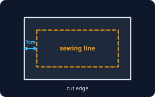</a> <b><a href="#seam-allowance--시접">Seam Allowance</a></b> 시접 박음질할 선(봉제선) 바깥으로 남겨 두는 여유 천. 두 천을 꿰매면 이 부분이 안쪽으로 접혀 들어간다.</td>
</tr>
</table>

<!-- overview:end -->

## 실루엣·핏 · Silhouette & Fit

### A-line · A라인

- **정의**: 어깨와 가슴은 몸에 맞고 허리 아래부터 밑단까지 완만하게 퍼지는 모양. 알파벳 A를 닮았다.
- **AI에게 이렇게**: "어깨는 슬림하고 허리부터 밑단까지 A라인으로 퍼지는 무릎 길이 원피스 디자인 이미지를 만들어줘"
- **언제**: 원피스·스커트·코트처럼 하체를 가리고 부드럽게 보이고 싶을 때
- **헷갈림**: H-line — H라인은 위아래 폭이 같은 직선형, A라인은 아래가 넓다. 플레어(flare)는 퍼지는 정도가 더 큰 표현
- **관련**: H-line, X-line, Pleat
- **확인 질문**: 밑단이 퍼지는 정도(살짝 / 풍성하게)와 기장(무릎 위·무릎·종아리)은 어떻게 할까요?

### H-line · H라인

- **정의**: 어깨·허리·밑단 폭이 거의 같아 일자로 떨어지는 모양. 알파벳 H처럼 몸매 굴곡을 드러내지 않는다.
- **AI에게 이렇게**: "허리 선이 없는 H라인 시프트 원피스, 단색 울 소재로 보여줘"
- **언제**: 단정하고 편안한 느낌, 체형을 크게 드러내고 싶지 않을 때
- **헷갈림**: Oversized Fit — H라인은 모양(직선)을, 오버핏은 크기(넉넉함)를 말한다. 오버핏이면서 H라인일 수도 있다
- **관련**: A-line, X-line, Regular Fit
- **확인 질문**: 허리에 벨트나 끈으로 조일 수 있게 할까요, 완전히 일자로 둘까요?

### X-line · X라인

- **정의**: 어깨와 밑단은 넓고 허리만 잘록한 모래시계 모양. 알파벳 X를 닮았다.
- **AI에게 이렇게**: "허리가 잘록하게 들어간 X라인 원피스, 밑단은 무릎 아래로 퍼지게 그려줘"
- **언제**: 여성스럽고 격식 있는 분위기, 웨딩·파티 룩
- **헷갈림**: A-line — A라인은 허리가 따로 들어가지 않고 쭉 퍼지는 실루엣이다. 다트(Dart)나 벨트로 허리를 잡으면 X라인이 된다
- **관련**: A-line, Dart, Slim Fit
- **확인 질문**: 허리를 다트로 잡을까요, 벨트·끈으로 묶을까요?

### Oversized Fit · 오버핏

- **정의**: 몸 치수보다 일부러 한두 사이즈 크게 만든 헐렁한 핏. 어깨선이 내려오고 소매·기장이 넉넉한 경우가 많다.
- **AI에게 이렇게**: "오버핏 박시한 후드 티셔츠, 어깨선이 처지고 소매가 손등을 덮는 스타일로 만들어줘"
- **언제**: 스트리트·캐주얼 룩, 레이어드할 때
- **헷갈림**: 큰 사이즈(Big size) — 사이즈 표만 키운 옷은 모양이 어색해진다. 오버핏은 어깨·가슴·소매를 처음부터 넉넉하게 설계한다
- **관련**: Drop Shoulder, Slim Fit, Regular Fit
- **확인 질문**: 평소 사이즈 기준으로 가슴둘레를 몇 cm 더 크게 할까요? 기장은 엉덩이 위인가요, 아래인가요?

### Slim Fit · 슬림핏

- **정의**: 몸의 선을 따라 폭을 좁혀 몸에 붙게 만든 핏. 기본 핏은 레귤러핏(Regular Fit)이고, 그보다 헐렁하면 릴랙스드·오버핏이다.
- **AI에게 이렇게**: "허리가 살짝 들어간 슬림핏 옥스포드 셔츠, 소매는 손목에 딱 맞게 그려줘"
- **언제**: 단정한 셔츠·슈트, 몸 라인을 살리고 싶을 때
- **헷갈림**: Skinny — 스키니는 슬림보다 더 달라붙는 핏. 신축성이 없는 소재로 슬림핏을 만들면 입고 움직이기 불편하다
- **관련**: Oversized Fit, Woven, Knit
- **확인 질문**: 신축성이 있는 소재(스판 섞임)로 할까요, 없는 소재로 할까요? 팔을 올리거나 앉았을 때 편해야 하나요?

### Cropped · 크롭

- **정의**: 보통 길이보다 짧게, 허리나 배꼽 위에서 끝나도록 자른 기장.
- **AI에게 이렇게**: "배꼽 위에서 끝나는 크롭 티셔츠, 소매는 짧게, 몸에는 적당히 붙게 만들어줘"
- **언제**: 하이웨이스트 바지·스커트와 함께 입어 다리가 길어 보이게 할 때
- **헷갈림**: Short Sleeve — 반팔은 소매가 짧은 것, 크롭은 몸판 기장이 짧은 것이다. "크롭 반팔"처럼 소매 길이와 기장을 따로 말한다
- **관련**: Slim Fit, Oversized Fit
- **확인 질문**: 기장은 가슴 아래·허리·배꼽 위 중 어디까지인가요? 밑단은 접어 박을까요, 그대로 둘까요?

### Wide Leg · 와이드 레그

- **정의**: 허벅지부터 밑단까지 폭이 넓게 떨어지는 바지.
- **AI에게 이렇게**: "허리는 하이웨이스트, 밑단까지 넓게 떨어지는 와이드 레그 면바지를 앞모습 플랫 스케치로 보여줘"
- **언제**: 편안하고 정돈된 느낌의 바지, 다리 선을 가리고 싶을 때
- **헷갈림**: Straight — 스트레이트는 허벅지부터 밑단까지 폭이 같은 일자 바지, 와이드는 그보다 확실히 넓다. 부츠컷·플레어는 무릎 아래만 퍼진다
- **관련**: A-line, Cotton, Linen
- **확인 질문**: 밑단 폭이 몇 cm쯤 되면 좋나요(예: 25cm)? 허리는 고무줄인가요, 지퍼·단추인가요?

## 디테일 · Details

### Crew Neck · 크루넥

- **정의**: 목 둘레를 따라 둥글게 붙은 기본 티셔츠 목선. 한국에서는 라운드넥이라고도 부른다.
- **AI에게 이렇게**: "목에 딱 붙는 두꺼운 리브 크루넥 맨투맨을 만들어줘"
- **언제**: 티셔츠·맨투맨·니트의 기본 목선
- **헷갈림**: U-neck — 크루넥은 목에 가깝게 얕은 원, U넥은 가슴 쪽으로 깊게 파인 원. V-neck — V자로 뾰족하게 파임
- **관련**: V-neck, Turtleneck, Knit
- **확인 질문**: 목 둘레 밴드(리브)의 폭은 얼마나 할까요? 목이 넓게 파인 느낌인가요, 꽉 조이는 느낌인가요?

### V-neck · 브이넥

- **정의**: 앞목 가운데로 갈수록 뾰족하게 파인 V자 목선.
- **AI에게 이렇게**: "가슴 중간까지 파이지 않는 얕은 브이넥 니트 티셔츠, 단색 면으로 보여줘"
- **언제**: 목을 길어 보이게 하고 싶을 때, 셔츠 위에 겹쳐 입는 니트
- **헷갈림**: Crew Neck — 크루넥은 둥글고 얕고, 브이넥은 뾰족하고 깊이를 정할 수 있다. 깊이를 안 말하면 AI가 너무 깊게 그릴 수 있다
- **관련**: Crew Neck, Turtleneck
- **확인 질문**: V의 깊이는 어디까지인가요(쇄골 아래 몇 cm)? 목둘레에 별도 밴드를 달까요?

### Turtleneck · 터틀넥

- **정의**: 목을 감싸는 원통 모양의 높은 깃이 달린 상의. 한국에서는 목폴라라고도 한다.
- **AI에게 이렇게**: "목을 한 번 접어 입는 터틀넥 울 니트, 몸에는 적당히 붙는 핏으로 만들어줘"
- **언제**: 가을·겨울 니트, 보온이 필요한 옷
- **헷갈림**: Mock Neck — 목이 낮은 반 터틀(모크넥)은 접지 않고 목 아래쪽만 감싼다. 터틀넥은 높게 올라오거나 접어 입는다
- **관련**: Crew Neck, Knit
- **확인 질문**: 깃 높이는 어느 정도인가요? 접어서 입을 길이로 할까요, 서 있는 상태 그대로 둘까요?

### Mandarin Collar · 만다린 칼라

- **정의**: 접히지 않고 목에 세워져 붙은 낮은 띠 모양 깃. 차이나 칼라, 밴드 칼라라고도 부른다.
- **AI에게 이렇게**: "깃이 접히지 않고 서 있는 만다린 칼라 린넨 셔츠, 단추는 앞 가운데 한 줄로 해줘"
- **언제**: 셔츠를 단정하지만 덜 딱딱하게 보이게 하고 싶을 때
- **헷갈림**: Shirt Collar — 일반 셔츠 깃은 목을 감싸며 접혀 뒤집힌다. 만다린은 접지 않고 세워진 상태다. 폴로의 깃과도 다르다
- **관련**: Linen, Crew Neck
- **확인 질문**: 깃 높이는 몇 cm인가요? 맨 위 단추를 채워서 입는 옷인가요?

### Raglan Sleeve · 래글런 슬리브

- **정의**: 어깨 부분을 따로 이어 붙이지 않고, 목에서 겨드랑이까지 비스듬한 선으로 소매와 어깨를 한 조각으로 만든 소매.
- **AI에게 이렇게**: "소매 색이 몸판과 다른 래글런 티셔츠, 목에서 겨드랑이로 대각선 봉제선이 보이게 그려줘"
- **언제**: 야구 티·운동복처럼 팔을 편하게 움직이는 옷, 소매만 색을 바꾸고 싶을 때
- **헷갈림**: Set-in Sleeve — 어깨 끝에 봉제선이 있어 몸판과 소매를 따로 만든 일반 소매. 래글런은 봉제선이 목까지 비스듬히 올라간다
- **관련**: Drop Shoulder, Sample
- **확인 질문**: 소매와 몸판 색을 다르게 할까요? 소매 길이는 반팔·7부·긴팔 중 어느 것인가요?

### Drop Shoulder · 드롭숄더

- **정의**: 어깨 봉제선이 진짜 어깨 끝보다 팔 쪽으로 내려와 있는 디자인. 어깨가 처져 보이고 소매가 넉넉해 편안한 느낌이다.
- **AI에게 이렇게**: "어깨선이 팔 위쪽으로 한 뼘쯤 내려온 드롭숄더 맨투맨을 정면 도식화로 그려줘"
- **언제**: 오버핏 맨투맨·후드·셔츠
- **헷갈림**: Oversized Fit — 자주 같이 쓰지만 오버핏은 옷 전체 크기, 드롭숄더는 어깨 봉제선 위치를 말한다. 체형이 처진 어깨라는 뜻이 아니라 디자인 용어다
- **관련**: Oversized Fit, Raglan Sleeve
- **확인 질문**: 어깨선을 몸에서 얼마나(예: 5cm) 내릴까요? 소매는 길게 내려오게 할까요?

### Pleat · 플리츠

- **정의**: 천을 같은 간격으로 접어 만든 주름. 접힌 방향과 폭에 따라 모양이 달라진다.
- **AI에게 이렇게**: "허리부터 밑단까지 잔주름이 규칙적으로 접힌 플리츠 스커트, 길이는 종아리까지로 만들어줘"
- **언제**: 스커트·바지·드레스에 움직임과 입체감을 줄 때
- **헷갈림**: Gather — 개더는 천을 모아 박아 불규칙하게 주름을 만든다. 플리츠는 정확한 폭으로 접어 모양이 고정된다. 턱(Tuck)은 한 곳만 접은 주름
- **관련**: A-line, Dart
- **확인 질문**: 주름 폭은 몇 mm(잔주름)인가요, 굵은 주름인가요? 주름을 세탁해도 유지되게(가공) 할까요?

### Dart · 다트

- **정의**: 평평한 천을 몸의 굴곡에 맞게 입체로 만들기 위해, 삼각형 모양으로 집어서 꿰맨 부분.
- **AI에게 이렇게**: "허리에 다트가 들어가 몸에 맞게 잡히는 셔츠 패턴을 만들어줘"
- **언제**: 가슴·허리·엉덩이 선에 맞는 몸에 붙는 옷을 만들 때
- **헷갈림**: Pleat — 다트는 끝이 점으로 사라지는 삼각형 봉제로 모양을 만들고, 플리츠는 같은 폭으로 접어 주름 모양을 남긴다
- **관련**: X-line, Sewing Pattern
- **확인 질문**: 가슴 다트와 허리 다트 중 어떤 것을 넣을까요? 몸에 딱 맞는 정도를 알려주세요

## 소재 · Fabric

### Knit · 니트(편직)

- **정의**: 실을 고리처럼 엮어 만든 천. 늘어나고 부드러우며 티셔츠(저지), 스웨터가 여기에 속한다.
- **AI에게 이렇게**: "늘어나는 니트 소재로 목이 넓은 박시 티셔츠를 만들고 싶어, 저지 면으로 해줘"
- **언제**: 신축성·편안함이 중요한 옷(티, 후드, 운동복, 스웨터)
- **헷갈림**: Woven — 우븐은 날실·씨실을 직각으로 짠 천이라 거의 안 늘어난다. 한국에서 "니트"는 스웨터만 가리킬 때가 많지만 원단 용어로는 편직 전체(저지 포함)를 뜻한다
- **관련**: Woven, Cotton, GSM
- **확인 질문**: 두께와 느낌은 어떻게 할까요(얇은 저지 / 두꺼운 후리스 / 굵은 스웨터)? 세탁 후 줄어드는 걸 감안해 여유를 둘까요?

### Woven · 우븐(직물)

- **정의**: 세로실(날실)과 가로실(씨실)을 직각으로 엇갈려 짠 천. 단단하고 형태가 잘 잡히며 거의 늘어나지 않는다. 셔츠·청바지·슈트 소재.
- **AI에게 이렇게**: "신축성 없는 우븐 면으로 만든 셔츠야, 구김이 덜 가는 소재로 추천해줘"
- **언제**: 형태가 반듯해야 하는 셔츠·바지·재킷
- **헷갈림**: Knit — 니트는 늘어나고 우븐은 늘어나지 않는다. 우븐 옷은 사이즈가 몸에 맞지 않으면 움직이기 불편하다
- **관련**: Knit, Denim, Linen
- **확인 질문**: 신축성(스판)을 조금 섞을까요? 빳빳한 느낌인가요, 부드러운 느낌인가요?

### Cotton · 면

- **정의**: 목화솜으로 만든 식물성 섬유. 부드럽고 땀을 잘 흡수하며 가장 흔한 옷감이다.
- **AI에게 이렇게**: "순면 100% 20수 단사 저지로 만든 티셔츠 원단을 추천해줘"
- **언제**: 티셔츠·셔츠·속옷·침구 등 피부에 닿는 거의 모든 옷
- **헷갈림**: 오가닉 코튼 — 농약 없이 재배한 면. 혼방(Blend) — 면 60% + 폴리 40%처럼 다른 실을 섞은 것으로 구김이 덜하지만 100% 면보다는 땀 흡수가 약하다
- **관련**: Knit, Woven, GSM
- **확인 질문**: 100% 면이 필요한가요, 혼방도 괜찮나요? 세탁 후 줄어들어도 괜찮은 용도인가요?

### Linen · 린넨(마)

- **정의**: 아마라는 식물의 줄기로 만든 천. 시원하고 통기성이 좋지만 구김이 잘 가고 실 굵기가 고르지 않은 질감이 특징이다.
- **AI에게 이렇게**: "여름용 린넨 100% 반팔 셔츠, 구김이 살짝 보이는 자연스러운 질감으로 그려줘"
- **언제**: 여름 셔츠·바지·원피스
- **헷갈림**: 마(麻) — 한국에서 "마"는 린넨(아마)과 라미(저마) 등을 함께 부른다. 린넨 혼방(면·레이온)이면 구김이 덜하다
- **관련**: Cotton, Woven, GSM
- **확인 질문**: 구김이 가는 것을 괜찮아하나요? 100% 린넨이 필요한가요, 구김을 줄인 혼방도 괜찮나요?

### Denim · 데님

- **정의**: 사선으로 짜인 두꺼운 면 직물(트윌)로, 청바지의 원단. 무게는 1야드² 당 온스(oz)로 말하며 숫자가 클수록 두껍다.
- **AI에게 이렇게**: "12oz 인디고 생지 데님으로 만든 스트레이트 청바지를 앞모습 스케치로 보여줘"
- **언제**: 청바지·재킷·가방 등 튼튼해야 하는 옷
- **헷갈림**: 생지(Raw/Dry) vs 워싱(Washed) — 생지는 가공하지 않아 빳빳하고 처음엔 줄어든다. 워싱은 가공해서 부드럽고 색이 바랜 느낌이다. oz 숫자: 8oz 이하 얇음, 10~12oz 보통, 14oz 이상 두꺼움
- **관련**: Woven, Cotton, GSM
- **확인 질문**: 몇 oz로 할까요(얇은 여름용 / 보통 / 두꺼운)? 생지로 할까요, 워싱을 넣을까요?

### GSM · 원단 무게(GSM)

- **정의**: 1㎡(가로세로 1m) 크기 천의 무게를 그램(g)으로 나타낸 값. g/㎡, GSM이라고 쓰며 숫자가 클수록 두껍고 무겁다.
- **AI에게 이렇게**: "여름용 티셔츠에 쓸 150gsm 정도 얇은 면 저지를 추천해줘"
- **언제**: 원단 가게·공장에 원단을 주문하거나 두께를 비교할 때
- **헷갈림**: oz — 데님은 oz(1야드² 당 온스)를 쓰고, 1oz ≈ 34gsm으로 계산한다(12oz ≈ 400gsm). 티셔츠는 대략 120~150gsm 얇음, 180~220 보통, 250 이상 두꺼움
- **관련**: Denim, Linen, Knit
- **확인 질문**: 계절은 언제인가요? 비치는 정도는 어느 정도까지 괜찮나요?

## 패턴·프린트 · Patterns

### Stripe · 스트라이프

- **정의**: 같은 방향으로 길게 이어지는 줄무늬. 가로/세로/대각선이 있고 줄 두께와 간격으로 인상이 바뀐다.
- **AI에게 이렇게**: "네이비와 흰색 가로 스트라이프 긴팔 티셔츠, 줄 간격은 1cm로 그려줘"
- **언제**: 마린 룩, 셔츠, 캐주얼
- **헷갈림**: Pinstripe — 핀스트라이프는 슈트에 쓰이는 아주 가는 줄. 보더(Border)는 가로 줄무늬를 한국에서 부르는 말
- **관련**: Check, Herringbone
- **확인 질문**: 줄 방향은 가로·세로 중 어느 것인가요? 줄 폭과 두 색은 무엇인가요?

### Check · 체크

- **정의**: 가로줄과 세로줄이 겹쳐 사각형 칸이 만들어지는 무늬. 칸 크기와 색 조합에 따라 깅엄, 글렌, 타탄(플래드) 등 이름이 다르다.
- **AI에게 이렇게**: "작은 빨간색 깅엄 체크 셔츠원피스, 칸은 5mm 정도로 보여줘"
- **언제**: 셔츠, 스커트, 겨울 플란넬 셔츠
- **헷갈림**: Plaid(타탄체크) — 굵고 얇은 줄이 여러 색으로 겹친 큰 체크. 깅엄은 두 색만 쓴 작은 체크
- **관련**: Stripe, Houndstooth
- **확인 질문**: 칸 크기는 어느 정도인가요? 두 색 깅엄인가요, 여러 색 플래드인가요?

### Herringbone · 헤링본

- **정의**: V자가 세로로 이어지는 생선뼈 모양 무늬. 한 줄은 오른쪽 위, 다음 줄은 왼쪽 위로 사선 방향이 번갈아 바뀐다.
- **AI에게 이렇게**: "차콜 회색 헤링본 울 재킷, 무늬는 작게 보이는 텍스처로 만들어줘"
- **언제**: 코트·재킷·바지 등 가을·겨울 클래식 소재
- **헷갈림**: Twill — 트윌은 한 방향 사선 결, 헤링본은 그 사선이 지그재그로 바뀐다. 마루 바닥 헤링본 패턴과 이름이 같다
- **관련**: Stripe, Houndstooth, Woven
- **확인 질문**: 무늬 크기(잔잔 / 큼직)와 색 대비는 어느 정도인가요?

### Houndstooth · 하운즈투스

- **정의**: 끝이 뾰족한 이빨 모양이 두 색으로 반복되는 작은 격자 무늬. 사냥개 이빨을 닮아 붙은 이름이다.
- **AI에게 이렇게**: "블랙과 화이트 하운즈투스 무늬 미니스커트, 무늬는 작게 반복되게 보여줘"
- **언제**: 클래식하고 빈티지한 분위기의 재킷·스커트
- **헷갈림**: Check — 체크는 줄이 만든 사각 칸이고, 하운즈투스는 뾰족한 이빨 모양이 이어진 무늬다. 크게 키운 것은 도그투스(Dogstooth)
- **관련**: Check, Herringbone
- **확인 질문**: 무늬 크기와 두 색은 무엇인가요? 옷 전체에 넣을까요, 일부(칼라·주머니)만 넣을까요?

### Polka Dot · 폴카 도트

- **정의**: 같은 크기의 동그란 점이 일정 간격으로 반복되는 물방울무늬. 땡땡이 무늬라고도 한다.
- **AI에게 이렇게**: "네이비 바탕에 지름 5mm 흰색 폴카 도트 블라우스를 그려줘"
- **언제**: 블라우스·스카프·원피스, 귀엽고 복고적인 분위기
- **헷갈림**: Pin Dot — 핀도트는 점이 아주 작은 것(1~2mm), 폴카 도트는 눈에 띄는 큰 점이다. "도트"라고만 하면 크기를 알 수 없으니 점 지름과 간격(mm)을 같이 말한다
- **관련**: Stripe, Check
- **확인 질문**: 점 지름과 간격은 얼마인가요? 바탕색과 점 색은 무엇인가요?

## 생산 · Production

### Sewing Pattern · 옷본(패턴)

- **정의**: 옷을 이루는 조각(앞판·뒤판·소매 등)을 종이에 그린 설계도. 이 모양대로 천을 잘라 박아서 옷을 만든다.
- **AI에게 이렇게**: "오버핏 티셔츠의 앞판·뒤판·소매 옷본에 필요한 치수 목록을 정리해줘"
- **언제**: 샘플 제작 전, 공장에 새 옷을 의뢰하기 전
- **헷갈림**: Tech Pack — 테크팩은 소재·치수·봉제 방식을 모은 의뢰 서류이고, 옷본은 조각 자체의 설계도다. 패턴(무늬)과 이름이 같으니 문맥을 확인한다
- **관련**: Seam Allowance, Grading, Tech Pack
- **확인 질문**: 직접 옷본을 만들 건가요, 공장·패턴사에게 맡길 건가요? 기준이 되는 사이즈는 무엇인가요?

### Grading · 그레이딩

- **정의**: 기준 사이즈 옷본을 규칙에 따라 키우거나 줄여 S·M·L 같은 다른 사이즈 옷본을 만드는 일.
- **AI에게 이렇게**: "M 기준 티셔츠 옷본으로 S부터 XL까지 그레이딩할 때 사이즈별 가슴둘레 증감표를 만들어줘"
- **언제**: 샘플을 확정하고 사이즈 여러 개로 대량 생산하기 직전
- **헷갈림**: 단순 확대 — 사이즈가 커질 때 모든 길이가 같은 비율로 커지지 않는다. 그레이딩 규칙(사이즈마다 가슴 4cm, 기장 1.5cm처럼)을 따로 정한다
- **관련**: Sewing Pattern, Sample, Tech Pack
- **확인 질문**: 어느 사이즈를 기준으로 할까요? 사이즈 범위(S~XL)와 사이즈 간 차이(cm)는 얼마인가요?

### Sample · 샘플

- **정의**: 대량 생산 전에 모양·핏·소재를 확인하려고 한두 벌만 먼저 만드는 시제품.
- **AI에게 이렇게**: "샘플 1차 제작 후 확인해야 할 체크리스트(핏, 봉제, 치수, 소재)를 정리해줘"
- **언제**: 대량 생산 결정 전, 디자인을 바꾸고 싶을 때
- **헷갈림**: Bulk(본생산) — 샘플은 시험용이라 소재나 봉제가 본생산과 조금 다를 수 있다. 1차 샘플은 보통 모양을 보는 용도이고, 2차 이후에 핏과 디테일을 맞춘다
- **관련**: Tech Pack, Grading, MOQ
- **확인 질문**: 샘플 비용과 기간은 얼마인가요? 몇 차례까지 수정할 수 있나요?

### Tech Pack · 테크팩

- **정의**: 공장에 옷 만드는 법을 정확히 전하는 서류 묶음. 도식화(옷 앞뒤 그림), 치수표, 소재·부자재 목록, 봉제 방법, 라벨 위치가 들어간다.
- **AI에게 이렇게**: "남성 오버핏 후드 티셔츠 테크팩 템플릿을 만들어줘. 도식화 설명, 치수표, 부자재 목록, 색상 칸을 넣어서"
- **언제**: 공장에 샘플이나 생산을 처음 요청할 때
- **헷갈림**: 룩북·무드보드 — 분위기 그림이고 공장은 못 만든다. 테크팩에는 숫자와 위치가 반드시 있어야 한다. 도식화(Flat)는 테크팩의 일부다
- **관련**: Sewing Pattern, Sample, Seam Allowance, GSM
- **확인 질문**: 치수 기준은 무엇인가요(가슴 단면 / 둘레)? 소재 이름·두께(GSM), 색상 번호, 라벨·포장 방법이 정해져 있나요?

### MOQ · 최소 주문 수량

- **정의**: Minimum Order Quantity. 공장이나 원단 업체가 "이 수량 이상이어야 주문 받는다"고 정한 최소 수량. 보통 디자인·색상별로 정한다.
- **AI에게 이렇게**: "공장에 보낼 이메일을 써줘. 티셔츠 3색을 색상당 50장씩 소량 주문하고 싶은데 MOQ를 낮춰줄 수 있는지 물어보는 내용으로"
- **언제**: 공장·원단업체를 고를 때, 소량으로 브랜드를 시작할 때
- **헷갈림**: 원단 MOQ vs 공장 MOQ — 원단은 롤(예: 50~100야드), 공장은 옷 개수 기준으로 따로 정해진다. 둘 다 확인해야 한다
- **관련**: Sample, Tech Pack
- **확인 질문**: 총 예산과 초기 주문 장수는 얼마인가요? 색상·사이즈를 몇 가지로 나눌 예정인가요?

### Seam Allowance · 시접

- **정의**: 박음질할 선(봉제선) 바깥으로 남겨 두는 여유 천. 두 천을 꿰매면 이 부분이 안쪽으로 접혀 들어간다.
- **AI에게 이렇게**: "옷본에 시접 1cm를 사방에 더하고, 밑단과 목 둘레는 시접을 따로 정해서 알려줘"
- **언제**: 옷본을 천에 옮겨 자르기 전
- **헷갈림**: 완성 치수 — 치수표의 길이는 시접을 뺀 완성 치수인지 시접을 더한 재단 치수인지 반드시 구분한다. 시접(Seam allowance)과 단 처리 여유(Hem allowance)도 다르다
- **관련**: Sewing Pattern, Tech Pack, Grading
- **확인 질문**: 시접은 몇 cm로 할까요(공장은 보통 1cm, 가정 재봉은 1.5cm가 많음)? 이 치수는 완성 치수인가요, 시접 포함 치수인가요?
