# 게임 디자인 치트시트

> "재미있는 게임 만들어줘"가 아니라 "핵심 반복을 먼저 정하고, 그레이박스로 만들고, 난이도 곡선을 톱니로 잡아줘"라고 말하고 싶을 때 펼치는 시트입니다. 구조 → 레벨·난이도 → 성장·경제 → 수익화 → 플레이어 경험 → 시스템·콘텐츠 → 제작·검증 순서로, 아이디어를 게임으로 바꾸는 말을 AI와 맞춥니다. 확률형 아이템 표시 의무 외의 법률·앱스토어 정책 판단은 대신하지 않으며, 서비스 전에는 전문가와 최신 규정을 확인하세요.

## 이렇게 쓰세요

- **나 → AI**: "점프만 하는 러닝 게임을 웹으로 만들 거야. 핵심 반복을 행동·보상·성장·도전 네 칸으로 정리하고, 회색 상자만 쓰는 그레이박스 프로토타입부터 만들어줘."
- **AI → 나**: "플레이어가 가장 자주 하는 동작 하나는 무엇인가요? 한 판은 몇 분을 생각하나요? 웹과 모바일 중 어디에서 먼저 낼까요?"
- **나 → AI**: "10개 스테이지의 난이도 곡선을 톱니 모양으로 설계하고, 1번 스테이지는 튜토리얼 역할을 하게 해줘. 3번과 6번 뒤에는 쉬는 구간을 넣어줘."
- **AI → 나**: "죽으면 어디서 다시 시작하나요(체크포인트)? 초보 플레이어를 기준으로 할까요, 숙련자를 기준으로 할까요?"
- **나 → AI**: "플레이테스트 5명 계획을 써줘. 어디서 죽는지, 어디서 멈추는지, 몇 분 만에 그만두는지를 체크리스트로 만들어줘."

그림·움직임 용어(프레임레이트, 스프라이트 시트)는 모션 디자인 시트에, 제품 지표(재방문율)는 기획 시트에, 화면 사용성(피드백, 어포던스)은 UX 시트에 원본이 있습니다.

## 한눈에 보기

<!-- overview:start -->
<!-- 이 구역은 자동 생성됩니다. 직접 고치지 말고 `cd mcp-server && npm run generate`를 실행하세요. -->

**게임의 뼈대 · Core Structure** (5)

<table>
<tr>
<td width="33%" valign="top"><a href="#core-loop--핵심-반복-코어-루프">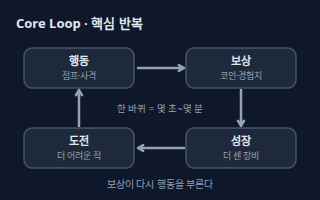</a> <b><a href="#core-loop--핵심-반복-코어-루프">Core Loop</a></b> 핵심 반복 (코어 루프) 플레이어가 게임 내내 가장 자주 되풀이하는 '행동 → 보상 → 성장 → 더 어려운 도전'의 한 바퀴. 이 한 바퀴가 재미있어야 나머지 기능이 의미를 가진다.</td>
<td width="33%" valign="top"><a href="#game-loop--게임-루프">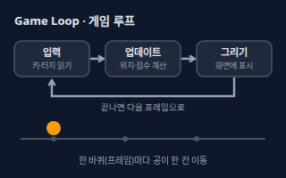</a> <b><a href="#game-loop--게임-루프">Game Loop</a></b> 게임 루프 게임 프로그램이 '입력 읽기 → 상태 갱신(업데이트) → 화면 그리기'를 1초에 수십 번 되풀이하는 코드의 반복. 이 반복 덕분에 화면이 계속 움직인다.</td>
<td width="33%" valign="top"><a href="#mda--메카닉다이내믹에스테틱">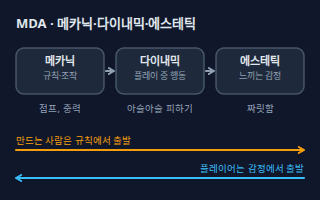</a> <b><a href="#mda--메카닉다이내믹에스테틱">MDA</a></b> 메카닉·다이내믹·에스테틱 게임을 세 층으로 보는 틀. 메카닉은 규칙과 조작, 다이내믹은 플레이 중에 벌어지는 행동, 에스테틱은 플레이어가 느끼는 감정이다. 만드는 사람은 규칙에서, 플레이어는 감정에서 출발한다.</td>
</tr>
<tr>
<td width="33%" valign="top"><a href="#game-engine--게임-엔진">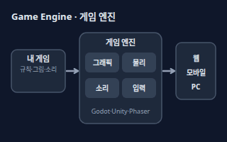</a> <b><a href="#game-engine--게임-엔진">Game Engine</a></b> 게임 엔진 그래픽·물리·소리·입력 같은 게임의 공통 부품을 미리 만들어 둔 제작 도구. 직접 만들 부분을 줄여 주고 웹·모바일·PC로 내보내 준다.</td>
<td width="33%" valign="top"><a href="#gdd--게임-디자인-문서">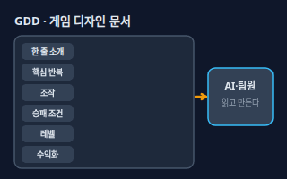</a> <b><a href="#gdd--게임-디자인-문서">GDD</a></b> 게임 디자인 문서 게임이 무엇이고 어떻게 돌아가는지 적은 설계 문서(Game Design Document). 한 줄 소개, 핵심 반복, 조작, 승패 조건, 레벨, 수익 방식을 담아 팀과 AI가 같은 그림을 보게 한다.</td>
</tr>
</table>

**레벨과 난이도 · Level & Difficulty** (7)

<table>
<tr>
<td width="33%" valign="top"><a href="#level-design--레벨-설계">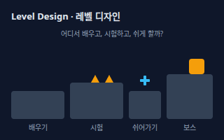</a> <b><a href="#level-design--레벨-설계">Level Design</a></b> 레벨 설계 코스(맵·스테이지)의 배치와 순서를 짜서 어디서 배우고, 시험받고, 쉬게 할지 정하는 일. 같은 규칙이라도 배치에 따라 재미가 달라진다.</td>
<td width="33%" valign="top"><a href="#difficulty-curve--난이도-곡선">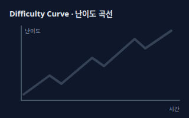</a> <b><a href="#difficulty-curve--난이도-곡선">Difficulty Curve</a></b> 난이도 곡선 게임을 진행하는 동안 어려움이 어떻게 변하는지 그린 그래프. 계속 오르기만 하지 않고 쉬는 구간을 끼워 톱니 모양으로 올라가는 편이 보통 좋다.</td>
<td width="33%" valign="top"><a href="#flow--몰입-플로우">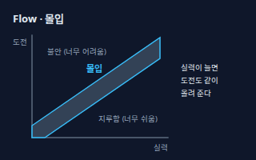</a> <b><a href="#flow--몰입-플로우">Flow</a></b> 몰입 (플로우) 도전이 내 실력과 알맞게 맞아서 시간 가는 줄 모르고 빠져드는 상태. 너무 어려우면 불안하고 너무 쉬우면 지루하다. 심리학자 칙센트미하이가 붙인 이름이다.</td>
</tr>
<tr>
<td width="33%" valign="top"><a href="#balance--밸런스">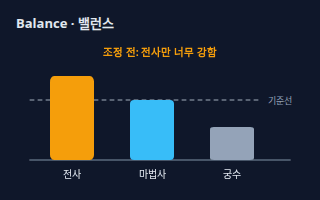</a> <b><a href="#balance--밸런스">Balance</a></b> 밸런스 캐릭터·무기·전략 같은 선택지 사이의 힘과 보상을 맞춰, 하나만 압도적으로 좋거나 쓸모없는 것이 없게 만드는 일. 정답 수치가 있는 게 아니라 플레이를 보며 계속 조정한다.</td>
<td width="33%" valign="top"><a href="#nerf-and-buff--너프와-버프">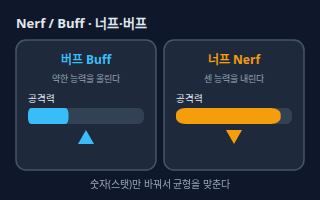</a> <b><a href="#nerf-and-buff--너프와-버프">Nerf and Buff</a></b> 너프와 버프 너프는 너무 센 능력을 약하게, 버프는 약한 능력을 강하게 바꾸는 조정. 보통 업데이트(패치)로 숫자를 바꿔 균형을 맞춘다.</td>
<td width="33%" valign="top"><a href="#meta--메타">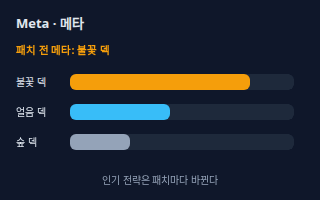</a> <b><a href="#meta--메타">Meta</a></b> 메타 지금 플레이어들 사이에서 가장 많이 쓰이고 이기기 쉬운 전략이나 조합. 패치가 나오면 유행이 바뀐다.</td>
</tr>
<tr>
<td width="33%" valign="top"><a href="#spawn--스폰-생성-위치">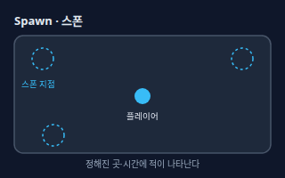</a> <b><a href="#spawn--스폰-생성-위치">Spawn</a></b> 스폰 (생성 위치) 적, 아이템, 플레이어 캐릭터가 정해진 위치와 시간에 게임 안에 나타나는 것. 어디서 언제 몇 개 나오느냐가 긴장감을 만든다.</td>
</tr>
</table>

**성장과 경제 · Progression & Economy** (5)

<table>
<tr>
<td width="33%" valign="top"><a href="#progression--성장-구조-진행">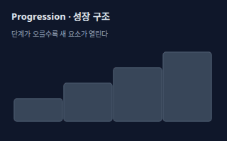</a> <b><a href="#progression--성장-구조-진행">Progression</a></b> 성장 구조 (진행) 플레이할수록 새 능력, 장비, 지역이 열리거나 강해져서 앞으로 나아가는 느낌을 주는 구조. 레벨업, 해금, 스토리 진행이 모두 여기에 든다.</td>
<td width="33%" valign="top"><a href="#xp-and-leveling--경험치와-레벨">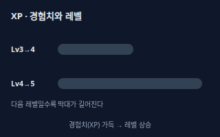</a> <b><a href="#xp-and-leveling--경험치와-레벨">XP and Leveling</a></b> 경험치와 레벨 적을 처치하거나 퀘스트를 하면 경험치(XP)가 쌓이고, 일정량이 차면 레벨이 오르는 방식. 보통 다음 레벨로 갈수록 필요한 경험치가 늘어난다.</td>
<td width="33%" valign="top"><a href="#sink-and-faucet--싱크와-파우셋-획득처소모처">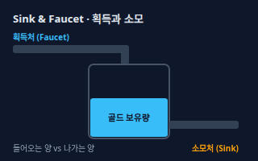</a> <b><a href="#sink-and-faucet--싱크와-파우셋-획득처소모처">Sink and Faucet</a></b> 싱크와 파우셋 (획득처·소모처) 게임 재화(골드, 보석)가 들어오는 곳이 파우셋(수도꼭지), 나가는 곳이 싱크(배수구). 둘의 균형이 깨지면 재화가 넘쳐 값어치가 떨어지거나 모자라서 답답해진다.</td>
</tr>
<tr>
<td width="33%" valign="top"><a href="#reward-schedule--보상-주기">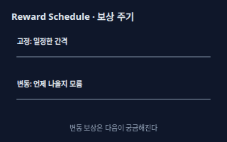</a> <b><a href="#reward-schedule--보상-주기">Reward Schedule</a></b> 보상 주기 보상을 언제 주는지 정하는 규칙. 일정한 간격으로 주는 고정형과 언제 나올지 모르게 하는 변동형이 있고, 변동형은 다음이 궁금해서 계속하게 만들 수 있다.</td>
<td width="33%" valign="top"><b><a href="product-planning.md#retention-rate--재방문율">Retention Rate</a></b> 재방문율 처음 플레이한 사람 중 일정 기간 뒤에도 다시 돌아와 쓰는 비율. 게임에서는 다음 날, 일주일 뒤 재접속 같은 단위로 본다. → product-planning 시트</td>
</tr>
</table>

**수익화 · Monetization** (3)

<table>
<tr>
<td width="33%" valign="top"><a href="#gacha-and-loot-box--가챠와-루트박스">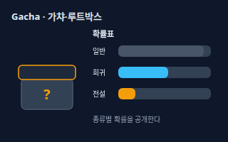</a> <b><a href="#gacha-and-loot-box--가챠와-루트박스">Gacha and Loot Box</a></b> 가챠와 루트박스 열어 보기 전에는 무엇이 나올지 모르고 확률로 결과가 정해지는 뽑기식 보상. 국내에서는 유상으로 구매하는 확률형 아이템의 종류와 종류별 공급 확률을 게임과 홈페이지·광고물에 표시해야 하고, 거짓·누락 표시로 손해를 입히면 배상 책임이 생길 수 있다.</td>
<td width="33%" valign="top"><a href="#free-to-play-and-iap--무료-게임과-인앱-결제">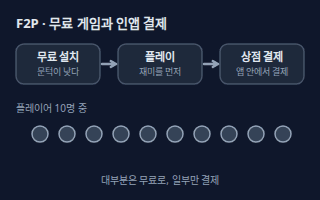</a> <b><a href="#free-to-play-and-iap--무료-게임과-인앱-결제">Free-to-Play and IAP</a></b> 무료 게임과 인앱 결제 무료로 내려받아 시작하고, 게임 안에서 아이템·재화를 사는 인앱 결제(IAP)나 광고로 수익을 내는 방식. 플레이어 대부분은 무료로 즐기고 일부만 결제하는 구조가 흔하다.</td>
<td width="33%" valign="top"><a href="#battle-pass--배틀-패스">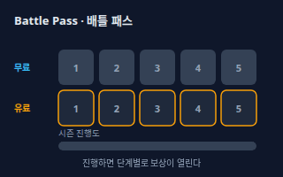</a> <b><a href="#battle-pass--배틀-패스">Battle Pass</a></b> 배틀 패스 한 시즌 동안 플레이로 진행도를 채우면 단계마다 보상을 받는 상품. 무료 보상 줄과 유료 보상 줄이 나란히 있는 경우가 많다.</td>
</tr>
</table>

**플레이어 경험 · Player Experience** (8)

<table>
<tr>
<td width="33%" valign="top"><a href="#onboarding-and-tutorial--온보딩과-튜토리얼">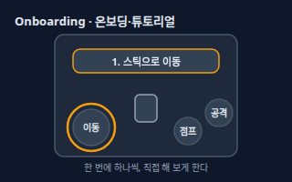</a> <b><a href="#onboarding-and-tutorial--온보딩과-튜토리얼">Onboarding and Tutorial</a></b> 온보딩과 튜토리얼 처음 하는 사람이 조작과 규칙을 익히게 안내하는 과정. 글로 길게 설명하기보다 한 번에 하나씩 직접 해 보게 하는 편이 좋다.</td>
<td width="33%" valign="top"><a href="#hud--hud-화면-표시-정보">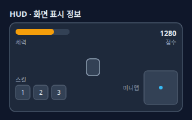</a> <b><a href="#hud--hud-화면-표시-정보">HUD</a></b> HUD (화면 표시 정보) 체력, 점수, 시간, 스킬, 미니맵처럼 플레이 화면 위에 계속 보이는 정보 표시(Head-Up Display). 게임 세계 속 물건이 아니라 화면 위에 겹쳐 놓은 정보다.</td>
<td width="33%" valign="top"><a href="#game-feel--게임-필-조작감-주스">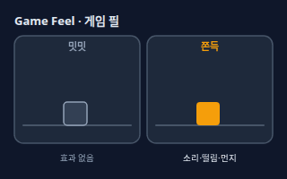</a> <b><a href="#game-feel--게임-필-조작감-주스">Game Feel</a></b> 게임 필 (조작감, 주스) 조작했을 때 느껴지는 손맛. 반응 속도, 움직임의 무게감, 소리·떨림·먼지 같은 연출(주스)이 합쳐져 만든다. 규칙이 같아도 연출에 따라 쫀득하게 느껴진다.</td>
</tr>
<tr>
<td width="33%" valign="top"><b><a href="ux-research.md#feedback--피드백">Feedback</a></b> 피드백 사용자가 한 행동에 시스템이 바로 반응을 돌려주는 것. 게임에서는 누른 즉시 소리·진동·모양 변화로 '됐다'를 알려 주는 일이다. → ux-research 시트</td>
<td width="33%" valign="top"><b><a href="ux-research.md#affordance--어포던스">Affordance</a></b> 어포던스 모양만 보고도 어떻게 쓰는지 알 수 있게 하는 단서. 게임에서는 오를 수 있는 벽, 누를 수 있는 버튼이 눈에 띄게 보이는 것이다. → ux-research 시트</td>
<td width="33%" valign="top"><a href="#hitbox--히트박스">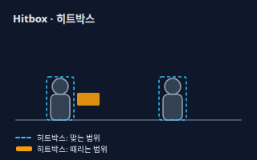</a> <b><a href="#hitbox--히트박스">Hitbox</a></b> 히트박스 게임이 명중과 충돌을 계산할 때 쓰는 눈에 안 보이는 상자(사각형·원). 때리는 쪽 범위를 히트박스, 맞는 쪽 범위를 허트박스라 부르며, 그림과 똑같지 않고 일부러 조금 작게도 잡는다.</td>
</tr>
<tr>
<td width="33%" valign="top"><a href="#collision--충돌-처리">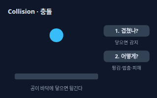</a> <b><a href="#collision--충돌-처리">Collision</a></b> 충돌 처리 두 물체가 겹쳤는지 확인하고(감지), 겹쳤을 때 튕기기·멈추기·피해 주기 같은 반응을 하는(처리) 과정.</td>
<td width="33%" valign="top"><a href="#save-and-checkpoint--저장과-체크포인트">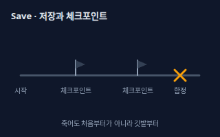</a> <b><a href="#save-and-checkpoint--저장과-체크포인트">Save and Checkpoint</a></b> 저장과 체크포인트 저장은 진행 상황을 기기나 서버에 남겨 두는 것이고, 체크포인트는 죽거나 실패했을 때 되돌아갈 자동 지점이다. 실패의 부담을 조절한다.</td>
</tr>
</table>

**시스템과 콘텐츠 · Systems & Content** (7)

<table>
<tr>
<td width="33%" valign="top"><a href="#npc-ai-behavior--npc-행동-ai">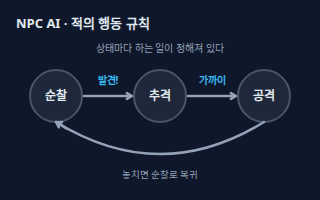</a> <b><a href="#npc-ai-behavior--npc-행동-ai">NPC AI Behavior</a></b> NPC 행동 AI 컴퓨터가 조종하는 인물이나 적이 상황에 따라 순찰, 추격, 공격 같은 행동을 고르는 규칙. 보통 '상태'와 '바뀌는 조건'을 정해 만들며, 간단한 규칙만으로도 충분히 똑똑해 보인다.</td>
<td width="33%" valign="top"><a href="#procedural-generation--절차적-생성">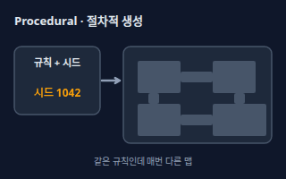</a> <b><a href="#procedural-generation--절차적-생성">Procedural Generation</a></b> 절차적 생성 사람이 하나하나 만드는 대신 규칙과 난수로 맵·아이템·던전을 자동으로 만드는 방법. 같은 시드(씨앗 숫자)를 넣으면 같은 결과가 나온다.</td>
<td width="33%" valign="top"><a href="#narrative-and-quest--서사와-퀘스트">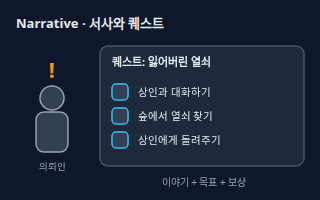</a> <b><a href="#narrative-and-quest--서사와-퀘스트">Narrative and Quest</a></b> 서사와 퀘스트 서사는 게임의 이야기와 세계관, 퀘스트는 그 이야기를 목표·과정·보상으로 쪼갠 임무. 플레이어에게 '왜 지금 이걸 하는지' 이유를 준다.</td>
</tr>
<tr>
<td width="33%" valign="top"><a href="#pvp-and-pve--대인전과-대환경전">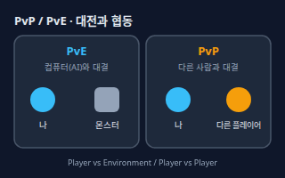</a> <b><a href="#pvp-and-pve--대인전과-대환경전">PvP and PvE</a></b> 대인전과 대환경전 PvP는 플레이어끼리 겨루는 방식(Player vs Player), PvE는 컴퓨터가 조종하는 적이나 환경과 겨루는 방식(Player vs Environment). 한 게임에 둘이 섞이기도 한다.</td>
<td width="33%" valign="top"><a href="#matchmaking--매치메이킹">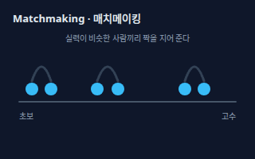</a> <b><a href="#matchmaking--매치메이킹">Matchmaking</a></b> 매치메이킹 대전·협동 게임에서 대기 중인 플레이어를 실력이나 조건이 비슷한 사람끼리 묶어 한 판을 만들어 주는 기능.</td>
<td width="33%" valign="top"><b><a href="motion-design.md#frame-rate--프레임레이트-fps">Frame Rate</a></b> 프레임레이트 (FPS) 1초에 화면(프레임)이 몇 장 바뀌는지를 나타낸 값. 게임 루프가 1초에 몇 번 돌아 그림을 그리는지와 이어진다. → motion-design 시트</td>
</tr>
<tr>
<td width="33%" valign="top"><b><a href="motion-design.md#sprite-sheet--스프라이트-시트">Sprite Sheet</a></b> 스프라이트 시트 캐릭터 동작 그림 여러 장을 한 장의 이미지에 격자로 모아 둔 것. 2D 게임에서 걷기·공격 애니메이션을 만드는 데 쓴다. → motion-design 시트</td>
</tr>
</table>

**제작과 검증 · Making & Testing** (3)

<table>
<tr>
<td width="33%" valign="top"><a href="#playtest--플레이테스트">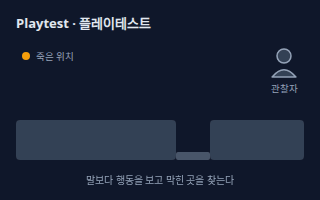</a> <b><a href="#playtest--플레이테스트">Playtest</a></b> 플레이테스트 다른 사람에게 게임을 직접 해 보게 하고 어디서 막히고, 죽고, 그만두는지 지켜보는 시험. 만든 사람은 이미 너무 잘 알아서 쉽게 느끼므로 꼭 필요하다.</td>
<td width="33%" valign="top"><a href="#greybox--그레이박스">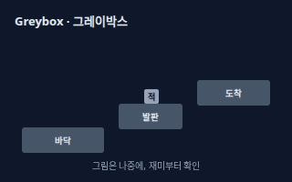</a> <b><a href="#greybox--그레이박스">Greybox</a></b> 그레이박스 그림과 효과 없이 회색 상자만으로 레벨과 조작을 먼저 만들어 보는 방법. 상자만으로도 재미가 느껴져야 그림을 입혀도 재미있다.</td>
<td width="33%" valign="top"><b><a href="ux-research.md#prototype--프로토타입">Prototype</a></b> 프로토타입 만들기 전에 눌러 보고 해 볼 수 있게 대충 만든 시제품. 게임에서는 핵심 반복만 먼저 만든 플레이 가능한 버전을 말한다. → ux-research 시트</td>
</tr>
</table>

<!-- overview:end -->

## 게임의 뼈대 · Core Structure

### Core Loop · 핵심 반복 (코어 루프)

- **정의**: 플레이어가 게임 내내 가장 자주 되풀이하는 '행동 → 보상 → 성장 → 더 어려운 도전'의 한 바퀴. 이 한 바퀴가 재미있어야 나머지 기능이 의미를 가진다.
- **AI에게 이렇게**: "내 러닝 게임의 핵심 반복을 행동·보상·성장·도전 네 칸으로 그려줘. 한 바퀴가 30초 안에 끝나게 하고, 보상이 다음 행동으로 어떻게 이어지는지도 적어줘."
- **언제**: 게임 아이디어를 처음 정리할 때, 기능을 더 넣기 전에 재미부터 점검할 때
- **헷갈림**: Game Loop(게임 루프) — 핵심 반복은 플레이어가 하는 일의 순환(기획 용어)이고, 게임 루프는 프로그램이 화면을 계속 갱신하는 코드의 순환이다.
- **관련**: Game Loop, Progression, Retention Rate, Prototype
- **확인 질문**: 플레이어가 가장 자주 하는 동작 하나는 무엇인가요? 한 바퀴는 몇 초에서 몇 분 정도로 생각하나요?

### Game Loop · 게임 루프

- **정의**: 게임 프로그램이 '입력 읽기 → 상태 갱신(업데이트) → 화면 그리기'를 1초에 수십 번 되풀이하는 코드의 반복. 이 반복 덕분에 화면이 계속 움직인다.
- **AI에게 이렇게**: "HTML5 canvas로 만드는 점프 게임에 requestAnimationFrame 기반 게임 루프를 만들어줘. 업데이트와 그리기를 따로 나누고, 기기 속도가 달라도 움직임이 같도록 지난 프레임과의 시간 차이(delta time)를 써줘."
- **언제**: 웹·모바일 게임을 코드로 만들 때, 기기마다 게임 속도가 다르게 느껴질 때
- **헷갈림**: Core Loop(핵심 반복) — 게임 루프는 컴퓨터가 도는 기술적 틀이고, 핵심 반복은 플레이어가 느끼는 재미의 순환이다.
- **관련**: Frame Rate, Delta Time(델타 타임), Game Engine, Core Loop
- **확인 질문**: 웹 브라우저·모바일 앱·PC 중 어디에서 실행되나요? 움직임 속도는 프레임 수가 아니라 시간 기준으로 맞춰야 하나요?

### MDA · 메카닉·다이내믹·에스테틱

- **정의**: 게임을 세 층으로 보는 틀. 메카닉은 규칙과 조작, 다이내믹은 플레이 중에 벌어지는 행동, 에스테틱은 플레이어가 느끼는 감정이다. 만드는 사람은 규칙에서, 플레이어는 감정에서 출발한다.
- **AI에게 이렇게**: "내 게임 아이디어를 MDA로 쪼개서 설명해줘. 짜릿함을 주고 싶다면 어떤 규칙(메카닉)이 어떤 플레이 행동(다이내믹)을 만들어야 하는지 표로 정리해줘."
- **언제**: '재미가 없다'는 막연한 평가를 원인으로 쪼갤 때, 새 규칙의 효과를 예상할 때
- **헷갈림**: Core Loop(핵심 반복) — MDA는 게임을 분석하는 세 층의 틀이고, 핵심 반복은 그중 플레이 중에 되풀이되는 구조 하나다.
- **관련**: Core Loop, Balance, Playtest
- **확인 질문**: 플레이어가 어떤 감정(짜릿함, 편안함, 긴장감 등)을 느끼길 원하나요?

### Game Engine · 게임 엔진

- **정의**: 그래픽·물리·소리·입력 같은 게임의 공통 부품을 미리 만들어 둔 제작 도구. 직접 만들 부분을 줄여 주고 웹·모바일·PC로 내보내 준다.
- **AI에게 이렇게**: "웹과 모바일 둘 다에 낼 2D 퍼즐 게임이야. Godot, Unity, Phaser 중 무엇이 맞을지 장단점을 표로 비교하고, 내 상황에는 어느 쪽이 좋은지 한 가지를 추천해줘."
- **언제**: 게임 제작을 시작하며 도구를 고를 때
- **헷갈림**: Library(라이브러리) — 라이브러리는 그리기처럼 일부 기능만 빌려 주는 부품이고, 엔진은 에디터·물리·내보내기까지 갖춘 큰 틀이다.
- **관련**: Game Loop, Sprite Sheet, Prototype
- **확인 질문**: 2D인가요, 3D인가요? 어떤 기기(웹, 안드로이드, iOS, PC)에 내보내야 하나요? 코딩 경험은 어느 정도인가요?

### GDD · 게임 디자인 문서

- **정의**: 게임이 무엇이고 어떻게 돌아가는지 적은 설계 문서(Game Design Document). 한 줄 소개, 핵심 반복, 조작, 승패 조건, 레벨, 수익 방식을 담아 팀과 AI가 같은 그림을 보게 한다.
- **AI에게 이렇게**: "내 게임의 GDD를 한 장짜리로 써줘. 한 줄 소개, 핵심 반복, 조작 방법, 이기고 지는 조건, 첫 레벨, 수익 방식 순서로 쓰고 내가 말하지 않은 것은 지어내지 말고 질문으로 남겨줘."
- **언제**: AI에게 게임 코드를 맡기기 전, 팀원이나 외주가 늘어날 때
- **헷갈림**: PRD(제품 요구사항 문서, 기획 시트) — PRD는 제품 전체의 요구사항 문서이고, GDD는 규칙과 재미의 설계까지 담은 게임 전용 문서다.
- **관련**: Core Loop, Prototype, Greybox
- **확인 질문**: 혼자 볼 문서인가요, 팀이나 외주에게 줄 문서인가요? 이미 정해진 규칙이 있나요?

## 레벨과 난이도 · Level & Difficulty

### Level Design · 레벨 설계

- **정의**: 코스(맵·스테이지)의 배치와 순서를 짜서 어디서 배우고, 시험받고, 쉬게 할지 정하는 일. 같은 규칙이라도 배치에 따라 재미가 달라진다.
- **AI에게 이렇게**: "횡스크롤 점프 게임의 1-1 스테이지를 설계해줘. 처음 20초는 점프를 배우게 하고, 중간에 함정 구간, 끝에 쉬어가는 구간과 미니 보스를 넣어줘. 구역별 역할을 표로 알려줘."
- **언제**: 스테이지·맵·퍼즐 방을 만들 때
- **헷갈림**: Difficulty Curve(난이도 곡선) — 레벨 설계는 한 코스의 배치이고, 난이도 곡선은 게임 전체에서 어려움이 변하는 흐름이다.
- **관련**: Difficulty Curve, Onboarding and Tutorial, Greybox, Spawn
- **확인 질문**: 한 판은 몇 분 정도인가요? 처음 배워야 하는 조작은 무엇인가요?

### Difficulty Curve · 난이도 곡선

- **정의**: 게임을 진행하는 동안 어려움이 어떻게 변하는지 그린 그래프. 계속 오르기만 하지 않고 쉬는 구간을 끼워 톱니 모양으로 올라가는 편이 보통 좋다.
- **AI에게 이렇게**: "10개 스테이지의 난이도 곡선을 톱니 모양으로 설계해줘. 3번과 6번 뒤에 쉬는 구간을 넣고 마지막은 보스로 끝내줘. 스테이지마다 새로 등장하는 요소도 적어줘."
- **언제**: 스테이지 순서를 정할 때, 플레이어가 중간에 많이 그만둘 때
- **헷갈림**: Balance(밸런스) — 난이도 곡선은 시간에 따른 어려움의 변화이고, 밸런스는 선택지(캐릭터·무기) 사이의 공정함이다.
- **관련**: Level Design, Flow, Playtest, Onboarding and Tutorial
- **확인 질문**: 대상 플레이어는 초보인가요, 숙련자인가요? 실패하면 얼마나 되돌아가나요?

### Flow · 몰입 (플로우)

- **정의**: 도전이 내 실력과 알맞게 맞아서 시간 가는 줄 모르고 빠져드는 상태. 너무 어려우면 불안하고 너무 쉬우면 지루하다. 심리학자 칙센트미하이가 붙인 이름이다.
- **AI에게 이렇게**: "이 퍼즐 게임이 플레이어를 몰입 구간에 두는지 점검해줘. 너무 쉬워 지루한 지점과 너무 어려워 좌절할 지점을 찾고 조정 방법을 제안해줘."
- **언제**: 난이도·피드백·튜토리얼을 다듬을 때
- **헷갈림**: Cognitive Load(인지 부하, UX 시트) — 몰입은 도전과 실력이 맞는 좋은 상태이고, 인지 부하는 한꺼번에 처리해야 하는 정보의 양이다.
- **관련**: Difficulty Curve, Feedback, Game Feel
- **확인 질문**: 이 게임에서 몰입이 깨질 만한 순간(긴 로딩, 건너뛸 수 없는 컷신, 메뉴)이 있나요?

### Balance · 밸런스

- **정의**: 캐릭터·무기·전략 같은 선택지 사이의 힘과 보상을 맞춰, 하나만 압도적으로 좋거나 쓸모없는 것이 없게 만드는 일. 정답 수치가 있는 게 아니라 플레이를 보며 계속 조정한다.
- **AI에게 이렇게**: "전사·마법사·궁수 3개 직업의 능력치를 표로 정리하고, 한 직업만 너무 강하거나 약해 보이는 부분을 찾아줘. 수치를 한 번에 크게 바꾸지 말고 작은 조정안 3가지를 제안해줘."
- **언제**: 선택지가 여러 개인 게임(대전, 카드, RPG)을 다듬을 때
- **헷갈림**: Difficulty Curve(난이도 곡선) — 밸런스는 선택지끼리의 공정함이고, 난이도 곡선은 시간에 따른 어려움의 변화다.
- **관련**: Nerf and Buff, Meta, Sink and Faucet, Playtest
- **확인 질문**: 어떤 선택지끼리 비교하나요? 모두 똑같이 강해야 하나요, 각자 장단점만 있으면 되나요?

### Nerf and Buff · 너프와 버프

- **정의**: 너프는 너무 센 능력을 약하게, 버프는 약한 능력을 강하게 바꾸는 조정. 보통 업데이트(패치)로 숫자를 바꿔 균형을 맞춘다.
- **AI에게 이렇게**: "마법사의 불꽃 스킬이 너무 강하다는 의견이 많아. 너프안 3가지(피해 감소, 재사용 대기 증가, 마나 소모 증가)를 만들고, 각각 플레이 느낌이 어떻게 달라지는지 설명해줘."
- **언제**: 패치 노트를 쓸 때, 밸런스 문제에 대응할 때
- **헷갈림**: Bug Fix(버그 수정) — 버그 수정은 의도와 다르게 동작하는 것을 고치는 일이고, 너프·버프는 의도한 수치를 일부러 바꾸는 일이다.
- **관련**: Balance, Meta, Playtest
- **확인 질문**: 얼마나 약하게 할까요(조금, 아니면 거의 못 쓰게)? 이미 이 능력에 시간이나 돈을 쓴 이용자가 있나요?

### Meta · 메타

- **정의**: 지금 플레이어들 사이에서 가장 많이 쓰이고 이기기 쉬운 전략이나 조합. 패치가 나오면 유행이 바뀐다.
- **AI에게 이렇게**: "우리 카드 게임의 현재 메타를 정리해줘. 승률 데이터를 보고 가장 많이 쓰이는 덱 3개, 그것을 이기는 덱, 패치로 다양성을 높일 방안을 제안해줘."
- **언제**: 대전·카드·MOBA 게임의 패치 방향을 정할 때
- **헷갈림**: Meta Progression(메타 진행) — 메타는 지금 유행하는 전략이고, 메타 진행은 한 판이 끝나도 남는 영구 성장 요소다. 이름이 같아 헷갈린다.
- **관련**: Balance, Nerf and Buff, Progression
- **확인 질문**: 승률·선택률 같은 데이터가 있나요? 대회나 랭킹이 있는 게임인가요?

### Spawn · 스폰 (생성 위치)

- **정의**: 적, 아이템, 플레이어 캐릭터가 정해진 위치와 시간에 게임 안에 나타나는 것. 어디서 언제 몇 개 나오느냐가 긴장감을 만든다.
- **AI에게 이렇게**: "서바이벌 게임에서 적이 화면 가장자리 세 곳에서 나타나게 스폰 규칙을 만들어줘. 시간이 갈수록 간격이 짧아지고, 플레이어 바로 앞에서는 나타나지 않게 해줘."
- **언제**: 적·아이템·웨이브를 설계할 때, 플레이어가 죽고 다시 나타날 위치를 정할 때
- **헷갈림**: Respawn(리스폰) — 스폰은 처음 나타나는 일 전체를 뜻하고, 리스폰은 죽은 뒤 다시 나타나는 일만 뜻한다.
- **관련**: Level Design, NPC AI Behavior, Save and Checkpoint
- **확인 질문**: 몇 마리씩 어떤 간격으로 나오게 할까요? 플레이어와 최소 거리를 둘까요?

## 성장과 경제 · Progression & Economy

### Progression · 성장 구조 (진행)

- **정의**: 플레이할수록 새 능력, 장비, 지역이 열리거나 강해져서 앞으로 나아가는 느낌을 주는 구조. 레벨업, 해금, 스토리 진행이 모두 여기에 든다.
- **AI에게 이렇게**: "퍼즐 모험 게임의 성장 구조를 5단계로 설계해줘. 단계마다 새로 열리는 능력이나 지역과, 그것을 열기 위한 조건을 적어줘."
- **언제**: 오래 플레이하게 만드는 구조를 짤 때
- **헷갈림**: XP and Leveling(경험치와 레벨) — 레벨업은 성장 구조를 구현하는 방법 중 하나이고, 성장 구조에는 해금과 스토리 진행도 포함된다.
- **관련**: XP and Leveling, Core Loop, Retention Rate
- **확인 질문**: 수치가 오르는 성장인가요, 새 기능이 열리는 성장인가요? 성장에 끝(최고 레벨)이 있나요?

### XP and Leveling · 경험치와 레벨

- **정의**: 적을 처치하거나 퀘스트를 하면 경험치(XP)가 쌓이고, 일정량이 차면 레벨이 오르는 방식. 보통 다음 레벨로 갈수록 필요한 경험치가 늘어난다.
- **AI에게 이렇게**: "레벨 1~30의 경험치 표를 만들어줘. 초반 레벨은 빨리 오르고 뒤로 갈수록 필요 경험치가 완만하게 늘어나게 하고, 표와 계산 공식을 같이 보여줘."
- **언제**: RPG·모바일 게임에서 성장 속도를 조절할 때
- **헷갈림**: Rank/Rating(랭크·레이팅) — 레벨은 시간을 들이면 계속 쌓이는 값이고, 랭크는 다른 사람과의 실력 비교로 오르내리는 값이다.
- **관련**: Progression, Reward Schedule, Balance
- **확인 질문**: 레벨 한도가 있나요? 한 레벨을 올리는 데 몇 분이 걸리게 할까요?

### Sink and Faucet · 싱크와 파우셋 (획득처·소모처)

- **정의**: 게임 재화(골드, 보석)가 들어오는 곳이 파우셋(수도꼭지), 나가는 곳이 싱크(배수구). 둘의 균형이 깨지면 재화가 넘쳐 값어치가 떨어지거나 모자라서 답답해진다.
- **AI에게 이렇게**: "이 게임의 골드 획득처와 소모처를 표로 정리해줘. 하루에 얻는 양과 쓰는 양을 비교해서 골드가 계속 쌓이기만 하는지 점검하고, 소모처 아이디어를 제안해줘."
- **언제**: 상점·강화·거래가 있는 게임의 경제를 설계할 때
- **헷갈림**: Monetization(수익화) — 싱크는 게임 속 재화가 나가는 곳이고, 수익화는 현실의 돈을 받는 구조다. 둘은 연결되지만 다른 문제다.
- **관련**: Balance, Progression, Free-to-Play and IAP
- **확인 질문**: 재화는 몇 종류인가요? 플레이어끼리 거래하거나 경매장이 있나요?

### Reward Schedule · 보상 주기

- **정의**: 보상을 언제 주는지 정하는 규칙. 일정한 간격으로 주는 고정형과 언제 나올지 모르게 하는 변동형이 있고, 변동형은 다음이 궁금해서 계속하게 만들 수 있다.
- **AI에게 이렇게**: "몬스터를 잡을 때 아이템이 나오는 걸 변동 보상으로 설계해줘. 일반은 자주, 희귀는 드물게 나오게 하고, 너무 오래 못 얻은 사람을 위한 안전장치(보정)도 제안해줘."
- **언제**: 아이템 드롭, 출석 보상, 상자를 설계할 때
- **헷갈림**: Gacha and Loot Box(가챠·루트박스) — 보상 주기는 보상 타이밍 규칙 전반이고, 가챠는 돈이나 재화를 내고 확률로 뽑는 구조다.
- **관련**: Gacha and Loot Box, Core Loop, Retention Rate
- **확인 질문**: 보상은 플레이 성과로 주나요, 시간(출석)으로 주나요? 오래 못 얻을 때 보정이 필요한가요?

### Retention Rate · 재방문율

- **정의**: 처음 플레이한 사람 중 일정 기간 뒤에도 다시 돌아와 쓰는 비율. 게임에서는 다음 날, 일주일 뒤 재접속 같은 단위로 본다.
- **원본**: [기획 (PM) · Retention Rate](product-planning.md#retention-rate--재방문율)

## 수익화 · Monetization

### Gacha and Loot Box · 가챠와 루트박스

- **정의**: 열어 보기 전에는 무엇이 나올지 모르고 확률로 결과가 정해지는 뽑기식 보상. 국내에서는 유상으로 구매하는 확률형 아이템의 종류와 종류별 공급 확률을 게임과 홈페이지·광고물에 표시해야 하고, 거짓·누락 표시로 손해를 입히면 배상 책임이 생길 수 있다.
- **AI에게 이렇게**: "이 가챠 상품 설명을 이용자가 이해하기 쉽게 정리해줘. 아이템 종류와 종류별 확률을 표로 보여주고, 확률 표시가 필요한 부분과 아닌 부분을 구분해줘. 최종 판단은 전문가와 게임물관리위원회에 확인하라고 적어줘."
- **언제**: 뽑기·상자 같은 확률형 상품을 넣을 때(국내 서비스 포함)
- **헷갈림**: Reward Schedule(보상 주기) — 보상 주기는 보상 타이밍 규칙 전반이고, 가챠·루트박스는 돈이 들어가는 확률형 구매다. 상자를 여는 형태가 루트박스, 뽑는 형태가 가챠이며 둘 다 확률형 아이템이다.
- **관련**: Reward Schedule, Free-to-Play and IAP, Battle Pass
- **확인 질문**: 유료 재화나 현금이 조금이라도 들어가는 뽑기인가요? 국내에도 서비스하나요? 확률표는 누가 확인하나요?
- **근거**: [게임산업진흥에 관한 법률 제33조](https://www.law.go.kr/법령/게임산업진흥에관한법률/제33조), [게임산업진흥에 관한 법률 제2조](https://www.law.go.kr/법령/게임산업진흥에관한법률/제2조), [문화체육관광부 확률형아이템 정보공개 해설서 안내](https://www.mcst.go.kr/site/s_notice/notice/noticeView.jsp?pSeq=17856)
- **검증일**: 2026-11-03

### Free-to-Play and IAP · 무료 게임과 인앱 결제

- **정의**: 무료로 내려받아 시작하고, 게임 안에서 아이템·재화를 사는 인앱 결제(IAP)나 광고로 수익을 내는 방식. 플레이어 대부분은 무료로 즐기고 일부만 결제하는 구조가 흔하다.
- **AI에게 이렇게**: "퍼즐 게임을 무료 설치 + 인앱 결제로 운영하려고 해. 재미를 해치지 않는 상품 후보 5개(광고 제거, 힌트 팩, 꾸미기 등)와 결제 안내를 띄울 알맞은 타이밍을 제안해줘."
- **언제**: 수익 모델을 정할 때
- **헷갈림**: Premium(유료 구매형) — 프리미엄은 처음에 한 번 돈을 내고 사는 게임이고, 무료 게임은 설치는 공짜이고 안에서 결제한다. Pay-to-Win은 결제가 승패를 좌우하는 설계다.
- **관련**: Battle Pass, Gacha and Loot Box, Retention Rate, Sink and Faucet
- **확인 질문**: 결제가 승패에 영향을 줘도 되나요? 광고를 넣을 건가요? 앱스토어의 결제 정책에 맞는 방식을 쓰나요?

### Battle Pass · 배틀 패스

- **정의**: 한 시즌 동안 플레이로 진행도를 채우면 단계마다 보상을 받는 상품. 무료 보상 줄과 유료 보상 줄이 나란히 있는 경우가 많다.
- **AI에게 이렇게**: "시즌제 배틀 패스를 설계해줘. 30단계, 무료 줄과 유료 줄의 보상 목록, 하루 20분 플레이로 시즌 안에 다 채울 수 있는 경험치 설정을 표로 만들어줘."
- **언제**: 시즌 콘텐츠로 접속을 이어가게 하고 싶을 때
- **헷갈림**: Subscription(구독) — 구독은 기간마다 계속 결제하는 것이고, 배틀 패스는 시즌마다 한 번 사서 플레이로 보상을 여는 것이다.
- **관련**: Free-to-Play and IAP, Progression, Retention Rate
- **확인 질문**: 시즌은 얼마 동안인가요? 유료 보상이 승패에 영향을 주나요? 못 받은 보상은 어떻게 하나요?

## 플레이어 경험 · Player Experience

### Onboarding and Tutorial · 온보딩과 튜토리얼

- **정의**: 처음 하는 사람이 조작과 규칙을 익히게 안내하는 과정. 글로 길게 설명하기보다 한 번에 하나씩 직접 해 보게 하는 편이 좋다.
- **AI에게 이렇게**: "모바일 러닝 게임의 첫 1분 튜토리얼을 설계해줘. 이동, 점프, 아이템 순서로 한 번에 하나씩 직접 해 보게 하고, 건너뛰기 버튼과 막혔을 때 힌트도 넣어줘."
- **언제**: 첫 플레이에서 그만두는 사람이 많을 때
- **헷갈림**: Help/Manual(도움말) — 도움말은 필요할 때 찾아보는 설명서이고, 튜토리얼은 플레이 흐름 안에서 가르친다.
- **관련**: Level Design, Affordance, Retention Rate
- **확인 질문**: 처음 하는 사람이 꼭 알아야 하는 조작은 몇 가지인가요? 건너뛰기를 허용할까요?

### HUD · HUD (화면 표시 정보)

- **정의**: 체력, 점수, 시간, 스킬, 미니맵처럼 플레이 화면 위에 계속 보이는 정보 표시(Head-Up Display). 게임 세계 속 물건이 아니라 화면 위에 겹쳐 놓은 정보다.
- **AI에게 이렇게**: "슈팅 게임의 HUD를 설계해줘. 왼쪽 위에 체력, 오른쪽 위에 점수, 아래에 스킬 3개를 두고, 모바일에서 엄지로 누르는 영역과 겹치지 않게 배치해줘."
- **언제**: 게임 화면 레이아웃을 짤 때, 화면에 정보가 너무 많다고 느낄 때
- **헷갈림**: Menu(메뉴) — 메뉴는 게임을 멈추고 여는 화면이고, HUD는 플레이 중 항상 보이는 정보다. 버튼·카드 같은 화면 부품은 UI 디자인 시트에 있다.
- **관련**: Feedback, Cognitive Load, Affordance
- **확인 질문**: 화면은 모바일 가로인가요, 세로인가요? 항상 보여야 하는 정보와 잠깐만 보이면 되는 정보는 무엇인가요?

### Game Feel · 게임 필 (조작감, 주스)

- **정의**: 조작했을 때 느껴지는 손맛. 반응 속도, 움직임의 무게감, 소리·떨림·먼지 같은 연출(주스)이 합쳐져 만든다. 규칙이 같아도 연출에 따라 쫀득하게 느껴진다.
- **AI에게 이렇게**: "점프 버튼에 게임 필을 더해줘. 올라갈 때 늘어나고 착지할 때 눌리는 스쿼시 앤 스트레치, 착지 먼지, 짧은 화면 떨림, 효과음을 넣고 각각 설정에서 끌 수 있게 해줘."
- **언제**: 조작이 밋밋하거나 둔하다는 말을 들을 때
- **헷갈림**: Feedback(피드백) — 피드백은 '눌렀더니 반응했다'는 알림 전반이고, 게임 필은 그 반응에 무게감과 쾌감을 더하는 연출까지 포함한다.
- **관련**: Feedback, Squash and Stretch, Hitbox, Prefers-reduced-motion
- **확인 질문**: 화면 떨림을 끄는 설정을 넣을까요? 어떤 조작에 가장 쾌감을 주고 싶나요?

### Feedback · 피드백

- **정의**: 사용자가 한 행동에 시스템이 바로 반응을 돌려주는 것. 게임에서는 누른 즉시 소리·진동·모양 변화로 '됐다'를 알려 주는 일이다.
- **원본**: [UX · Feedback](ux-research.md#feedback--피드백)

### Affordance · 어포던스

- **정의**: 모양만 보고도 어떻게 쓰는지 알 수 있게 하는 단서. 게임에서는 오를 수 있는 벽, 누를 수 있는 버튼이 눈에 띄게 보이는 것이다.
- **원본**: [UX · Affordance](ux-research.md#affordance--어포던스)

### Hitbox · 히트박스

- **정의**: 게임이 명중과 충돌을 계산할 때 쓰는 눈에 안 보이는 상자(사각형·원). 때리는 쪽 범위를 히트박스, 맞는 쪽 범위를 허트박스라 부르며, 그림과 똑같지 않고 일부러 조금 작게도 잡는다.
- **AI에게 이렇게**: "플레이어의 허트박스는 몸통보다 조금 작게, 칼 공격의 히트박스는 휘두르는 동안만 켜지게 만들어줘. 개발 모드에서 상자를 선으로 눈에 보이게 그려줘."
- **언제**: 공격이 안 맞거나 억울하게 맞는다는 말이 나올 때
- **헷갈림**: Collision(충돌 처리) — 히트박스는 판정 범위의 모양(데이터)이고, 충돌 처리는 그 범위가 겹쳤는지 검사하고 반응하는 과정이다. 캐릭터 그림(스프라이트)과도 다르다.
- **관련**: Collision, Sprite Sheet, Game Feel
- **확인 질문**: 2D인가요, 3D인가요? 공격 판정은 몇 프레임 동안 켜지나요?

### Collision · 충돌 처리

- **정의**: 두 물체가 겹쳤는지 확인하고(감지), 겹쳤을 때 튕기기·멈추기·피해 주기 같은 반응을 하는(처리) 과정.
- **AI에게 이렇게**: "공이 벽과 바닥에 닿으면 튕기도록 충돌 처리를 만들어줘. 사각형끼리 겹침 검사로 시작하고, 너무 빠를 때 벽을 뚫고 지나가지 않게 하는 방법도 알려줘."
- **언제**: 캐릭터가 벽을 뚫거나 바닥에 끼일 때
- **헷갈림**: Hitbox(히트박스) — 히트박스는 검사에 쓰는 범위(데이터)이고, 충돌 처리는 검사와 그 뒤의 반응(동작)이다.
- **관련**: Hitbox, Game Loop, Game Engine
- **확인 질문**: 물리처럼 부드럽게 튕겨야 하나요, 칸 단위로 막기만 하면 되나요? 물체가 얼마나 빠르게 움직이나요?

### Save and Checkpoint · 저장과 체크포인트

- **정의**: 저장은 진행 상황을 기기나 서버에 남겨 두는 것이고, 체크포인트는 죽거나 실패했을 때 되돌아갈 자동 지점이다. 실패의 부담을 조절한다.
- **AI에게 이렇게**: "스테이지 중간에 체크포인트 깃발을 두 개 놓고 죽으면 마지막 깃발에서 다시 시작하게 해줘. 앱을 껐다 켜도 마지막 체크포인트와 코인 수가 남도록 기기 저장도 넣어줘."
- **언제**: 실패 후 되돌아가는 거리가 너무 길다는 불만이 있을 때, 앱을 나갔다 돌아와도 이어 하게 할 때
- **헷갈림**: Autosave(자동 저장) — 자동 저장은 저장하는 방식이고, 체크포인트는 다시 시작할 위치다. 다른 기기에서 이어 하려면 계정·서버 저장(클라우드 저장)이 따로 필요하다.
- **관련**: Level Design, Difficulty Curve, Database
- **확인 질문**: 저장은 기기에만 하나요, 계정으로 서버에 하나요? 실패하면 얼마나 뒤로 돌아가게 할까요?

## 시스템과 콘텐츠 · Systems & Content

### NPC AI Behavior · NPC 행동 AI

- **정의**: 컴퓨터가 조종하는 인물이나 적이 상황에 따라 순찰, 추격, 공격 같은 행동을 고르는 규칙. 보통 '상태'와 '바뀌는 조건'을 정해 만들며, 간단한 규칙만으로도 충분히 똑똑해 보인다.
- **AI에게 이렇게**: "적 NPC의 행동을 순찰, 추격, 공격, 후퇴 상태로 설계해줘. 상태가 바뀌는 조건(시야, 거리, 체력)을 표로 쓰고 코드로도 만들어줘."
- **언제**: 적이 멍청하거나 너무 정확해서 재미없을 때
- **헷갈림**: LLM(대형 언어 모델, AI 에이전트 시트) — 게임 속 NPC AI는 정해진 규칙으로 행동을 고르는 것이고, LLM은 말을 만들어 내는 모델이다. 대화형 NPC에 LLM을 쓸 수는 있지만 같은 것이 아니다.
- **관련**: Spawn, Difficulty Curve, Balance
- **확인 질문**: 적은 얼마나 똑똑해야 하나요? 플레이어가 피할 수 있어야 하나요? 대화하는 NPC도 필요한가요?

### Procedural Generation · 절차적 생성

- **정의**: 사람이 하나하나 만드는 대신 규칙과 난수로 맵·아이템·던전을 자동으로 만드는 방법. 같은 시드(씨앗 숫자)를 넣으면 같은 결과가 나온다.
- **AI에게 이렇게**: "로그라이크 던전을 시드 값으로 생성하는 코드를 만들어줘. 방 5~8개를 복도로 이어 시작 방에서 출구까지 반드시 갈 수 있게 하고, 같은 시드면 같은 맵이 나오게 해줘."
- **언제**: 매번 다른 맵이 필요할 때, 사람 손으로 콘텐츠를 다 만들 수 없을 때
- **헷갈림**: Randomness(단순 무작위) — 절차적 생성은 규칙으로 제약한 무작위라 끝까지 갈 수 있는 맵이 나온다. 이미지를 만들어 주는 생성형 AI와도 다르다.
- **관련**: Level Design, Playtest, Spawn
- **확인 질문**: 매번 완전히 다르게 해야 하나요, 같은 시드로 다시 재현할 수 있어야 하나요? 반드시 클리어할 수 있어야 하나요?

### Narrative and Quest · 서사와 퀘스트

- **정의**: 서사는 게임의 이야기와 세계관, 퀘스트는 그 이야기를 목표·과정·보상으로 쪼갠 임무. 플레이어에게 '왜 지금 이걸 하는지' 이유를 준다.
- **AI에게 이렇게**: "작은 마을 모험 게임의 첫 퀘스트를 써줘. 의뢰인, 목표 3단계, 보상, 실패했을 때 대사를 정리하고 퀘스트 목록에 보일 짧은 문구도 만들어줘."
- **언제**: 세계관·대사·임무를 설계할 때
- **헷갈림**: Tutorial(튜토리얼) — 튜토리얼은 조작을 알려 주는 안내이고, 퀘스트는 이야기 속 임무다. 튜토리얼을 퀘스트로 포장하기도 한다.
- **관련**: Progression, Onboarding and Tutorial, Reward Schedule
- **확인 질문**: 이야기가 중심인가요, 보조인가요? 퀘스트는 필수인가요, 선택인가요?

### PvP and PvE · 대인전과 대환경전

- **정의**: PvP는 플레이어끼리 겨루는 방식(Player vs Player), PvE는 컴퓨터가 조종하는 적이나 환경과 겨루는 방식(Player vs Environment). 한 게임에 둘이 섞이기도 한다.
- **AI에게 이렇게**: "우리 게임에 PvE 협동 모드와 PvP 대전 모드를 둘 다 넣으려 해. 모드별 목표, 보상, 서버에서 처리해야 할 일의 차이를 표로 정리해줘."
- **언제**: 게임 모드를 정할 때
- **헷갈림**: Co-op(협동) — 협동은 플레이어들이 같은 편이라는 뜻이고 PvE의 한 형태다. PvP는 사람끼리 서로 반대편이다.
- **관련**: Matchmaking, Balance, NPC AI Behavior
- **확인 질문**: 접속한 사람끼리 실시간으로 겨루나요, 기록으로 겨루는 비동기 방식인가요? 서버가 필요한가요?

### Matchmaking · 매치메이킹

- **정의**: 대전·협동 게임에서 대기 중인 플레이어를 실력이나 조건이 비슷한 사람끼리 묶어 한 판을 만들어 주는 기능.
- **AI에게 이렇게**: "실력 점수(레이팅)가 비슷한 상대를 찾는 매치메이킹 규칙을 설계해줘. 처음에는 점수 차이를 작게 보다가 오래 기다리면 범위를 조금씩 넓히는 방식으로 해줘."
- **언제**: 초보가 고수에게 계속 지거나 대기 시간이 너무 길 때
- **헷갈림**: Lobby(로비) — 로비는 사람들이 모이는 공간이고, 매치메이킹은 그 사람들을 골라 짝짓는 규칙이다.
- **관련**: PvP and PvE, Balance, Queue
- **확인 질문**: 몇 대 몇 대결인가요? 기다리는 시간과 실력 차이 중 무엇이 더 중요한가요?

### Frame Rate · 프레임레이트 (FPS)

- **정의**: 1초에 화면(프레임)이 몇 장 바뀌는지를 나타낸 값. 게임 루프가 1초에 몇 번 돌아 그림을 그리는지와 이어진다.
- **원본**: [모션 디자인 · Frame Rate](motion-design.md#frame-rate--프레임레이트-fps)

### Sprite Sheet · 스프라이트 시트

- **정의**: 캐릭터 동작 그림 여러 장을 한 장의 이미지에 격자로 모아 둔 것. 2D 게임에서 걷기·공격 애니메이션을 만드는 데 쓴다.
- **원본**: [모션 디자인 · Sprite Sheet](motion-design.md#sprite-sheet--스프라이트-시트)

## 제작과 검증 · Making & Testing

### Playtest · 플레이테스트

- **정의**: 다른 사람에게 게임을 직접 해 보게 하고 어디서 막히고, 죽고, 그만두는지 지켜보는 시험. 만든 사람은 이미 너무 잘 알아서 쉽게 느끼므로 꼭 필요하다.
- **AI에게 이렇게**: "플레이테스트 5명 계획을 써줘. 설명은 최소로 하고 관찰할 것(어디서 죽는지, 어디서 멈추는지, 몇 분 만에 그만두는지)을 체크리스트로 만들고, 끝나고 물어볼 질문 5개를 정리해줘."
- **언제**: 프로토타입이 나왔을 때, 출시 전에 난이도와 이해도를 확인할 때
- **헷갈림**: QA(품질 검사, 기획 시트) — QA는 버그와 오류를 찾고, 플레이테스트는 재미와 이해도를 본다. Usability Test(사용성 테스트)는 화면 사용 과제를 보는 시험이고, 플레이테스트는 재미와 난이도까지 본다.
- **관련**: Prototype, Think-aloud, Difficulty Curve, Usability Test
- **확인 질문**: 몇 명에게, 게임 경험이 어느 정도인 사람에게 시킬까요? 옆에서 말을 해 줘도 되나요?

### Greybox · 그레이박스

- **정의**: 그림과 효과 없이 회색 상자만으로 레벨과 조작을 먼저 만들어 보는 방법. 상자만으로도 재미가 느껴져야 그림을 입혀도 재미있다.
- **AI에게 이렇게**: "회색 상자만으로 점프 스테이지 그레이박스를 만들어줘. 바닥, 발판, 적, 도착점은 단색 사각형으로 하고, 점프 높이와 거리 수치를 쉽게 바꿀 수 있게 위쪽에 변수로 빼줘."
- **언제**: 아트 작업 전에 재미를 확인할 때
- **헷갈림**: Prototype(프로토타입) — 프로토타입은 아이디어를 확인하려고 만든 모든 시제품이고, 그레이박스는 그중 그림을 상자로 대신한 레벨 버전이다.
- **관련**: Prototype, Level Design, Playtest, Core Loop
- **확인 질문**: 확인하려는 재미는 무엇인가요(점프 감각, 전투 등)? 그림은 언제 입힐까요?

### Prototype · 프로토타입

- **정의**: 만들기 전에 눌러 보고 해 볼 수 있게 대충 만든 시제품. 게임에서는 핵심 반복만 먼저 만든 플레이 가능한 버전을 말한다.
- **원본**: [UX · Prototype](ux-research.md#prototype--프로토타입)

## 참고 자료

- [MDA: A Formal Approach to Game Design and Game Research (AAAI)](https://aaai.org/papers/ws04-04-001-mda-a-formal-approach-to-game-design-and-game-research/)
- [Anatomy of a video game (MDN)](https://developer.mozilla.org/en-US/docs/Games/Anatomy)
- [Game Loop (Game Programming Patterns)](https://gameprogrammingpatterns.com/game-loop.html)
- [Core Loop (GameDesign.gg Glossary)](https://gamedesign.gg/glossary/core-loop/)
- [Game Feel (GameDesign.gg Glossary)](https://gamedesign.gg/glossary/game-feel/)
- [Flow State (GameDesign.gg Glossary)](https://gamedesign.gg/glossary/flow-state/)
- [Mastering the Art of Core Gameplay Loop Design (Game Developers)](https://game-developers.org/mastering-the-art-of-core-gameplay-loop-design-how-to-design-a-great-core-loop)
- [Game Loop Design: The Core of Every Great Game (Egmatic)](https://egmatic.com/blog/game-loop-design)
- [Hour 7: The Basics of Boxes (CAPCOM SF Seminar)](https://game.capcom.com/cfn/sfv/column/131422?lang=en)
- [Hitbox (The Fighting Game Glossary)](https://glossary.infil.net/?t=Hitbox)
- [Introduction (Godot Engine documentation)](https://docs.godotengine.org/en/stable/about/introduction.html)
- [게임산업진흥에 관한 법률 (국가법령정보센터)](https://www.law.go.kr/법령/게임산업진흥에관한법률)
- [확률형아이템 정보공개 관련 해설서 배포 (문화체육관광부)](https://www.mcst.go.kr/site/s_notice/notice/noticeView.jsp?pSeq=17856)
