# 그래픽 · 브랜딩 치트시트

> 창업자·가게 사장님이 AI나 디자이너에게 로고, 브랜드 아이덴티티, 포스터, 명함·전단지 같은 인쇄물을 맡길 때 펼치는 시트입니다. "예쁘게 해줘" 대신 "워드마크 로고, 도련 3mm 포함 CMYK PDF"처럼 정확한 말로 요청하게 도와줍니다.

> **참고용입니다.** 인쇄 규격(도련 크기, 안전 영역, 종이, 후가공)과 폰트·이미지 사용권은 인쇄소와 폰트·이미지 제공처마다 다릅니다. 실제 주문 전에는 인쇄소 안내와 라이선스를 꼭 확인하세요.

## 이렇게 쓰세요

- **나 → AI**: "우리 동네 베이커리 로고를 워드마크로 3안 만들어줘. 색은 따뜻한 주황 계열, 나중에 간판에도 쓸 수 있게 벡터 파일(SVG)로."
- **AI → 나**: "로고를 주로 어디에 쓰나요(간판, 포장지, 인스타 프로필)? 이미 정해진 색이나 글꼴이 있나요? 인쇄용(CMYK)과 화면용(RGB) 중 어느 쪽이 먼저인가요?"
- **나 → AI**: "명함 90x50mm 인쇄용 PDF를 만들어줘. 사방 3mm 도련, 중요한 글자는 안전 영역 안쪽, 글자는 아웃라인 처리해서."
- **AI → 나**: "인쇄소가 요구하는 색상 모드와 도련 크기를 알려 주시겠어요? 후가공(코팅, 박)이 들어가면 별도 파일이 필요해요."
- **나 → AI**: "이 포스터 시안을 시각적 위계 기준으로 점검해줘. 제목, 날짜·장소, 안내 순으로 눈이 가게 하고, 글자 대비도 확인해줘."

## 한눈에 보기

<!-- overview:start -->
<!-- 이 구역은 자동 생성됩니다. 직접 고치지 말고 `cd mcp-server && npm run generate`를 실행하세요. -->

**브랜드 · Brand** (5)

<table>
<tr>
<td width="33%" valign="top"><a href="#brand-identity--브랜드-아이덴티티">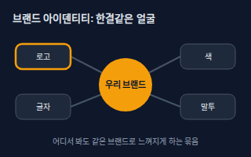</a> <b><a href="#brand-identity--브랜드-아이덴티티">Brand Identity</a></b> 브랜드 아이덴티티 브랜드가 어디서든 &quot;같은 사람(가게)&quot;처럼 느껴지게 하는 눈에 보이고 들리는 요소의 묶음. 로고·색·글자·사진 분위기·말투가 모두 들어간다.</td>
<td width="33%" valign="top"><a href="#logo-types--로고-유형-워드마크심볼엠블럼">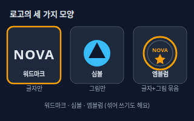</a> <b><a href="#logo-types--로고-유형-워드마크심볼엠블럼">Logo Types</a></b> 로고 유형 (워드마크·심볼·엠블럼) 로고는 크게 글자로만 만든 워드마크, 그림·도형만 쓴 심볼, 글자와 그림을 동그란 도장·방패처럼 한 덩어리로 묶은 엠블럼으로 나눈다. 글자와 심볼을 나란히 놓는 조합형도 많다.</td>
<td width="33%" valign="top"><a href="#brand-guideline--브랜드-가이드라인">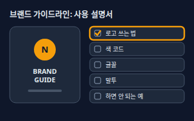</a> <b><a href="#brand-guideline--브랜드-가이드라인">Brand Guideline</a></b> 브랜드 가이드라인 로고·색·글꼴·말투를 &quot;이렇게 써 주세요&quot;라고 정리한 사용 설명서. 누가 만들어도 결과가 비슷해지게 해 준다.</td>
</tr>
<tr>
<td width="33%" valign="top"><a href="#tone-and-manner--톤앤매너">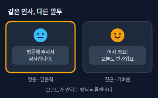</a> <b><a href="#tone-and-manner--톤앤매너">Tone and Manner</a></b> 톤앤매너 브랜드가 말하고 보여 주는 일관된 분위기와 말투. 같은 안내문도 &quot;방문해 주셔서 감사합니다&quot;와 &quot;어서 와요!&quot;는 전혀 다른 브랜드로 느껴진다.</td>
<td width="33%" valign="top"><a href="#mood-board--무드보드">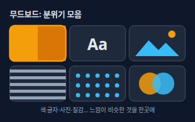</a> <b><a href="#mood-board--무드보드">Mood Board</a></b> 무드보드 원하는 분위기에 가까운 색·사진·글자·질감 이미지를 한 장에 모아 둔 참고판. 말로 설명하기 어려운 &quot;느낌&quot;을 눈으로 맞추는 도구다.</td>
</tr>
</table>

**색 · Color** (5)

<table>
<tr>
<td width="33%" valign="top"><a href="#rgb-vs-cmyk--rgb와-cmyk">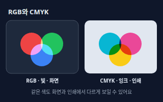</a> <b><a href="#rgb-vs-cmyk--rgb와-cmyk">RGB vs CMYK</a></b> RGB와 CMYK RGB는 빨강·초록·파랑 빛을 섞어 화면에 색을 내는 방식, CMYK는 청록·자홍·노랑·검정 잉크를 섞어 종이에 색을 내는 방식이다. 같은 색도 화면과 인쇄에서 다르게 보일 수 있다.</td>
<td width="33%" valign="top"><a href="#hex-code--헥스-코드">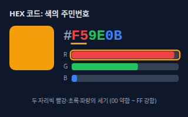</a> <b><a href="#hex-code--헥스-코드">HEX Code</a></b> 헥스 코드 웹·화면 색을 #과 6자리 숫자·알파벳(예: #F59E0B)으로 적는 표기. 두 자리씩 끊어 빨강·초록·파랑 빛의 세기를 뜻한다.</td>
<td width="33%" valign="top"><a href="#pantone--팬톤">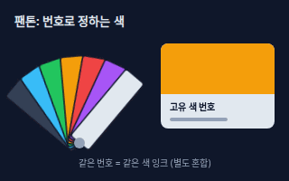</a> <b><a href="#pantone--팬톤">Pantone</a></b> 팬톤 색마다 번호를 붙여 &quot;이 번호 색으로 인쇄해 주세요&quot;라고 지정할 수 있게 한 색 표준. 별도로 섞은 단색 잉크를 쓰는 특별색 인쇄에 주로 쓴다.</td>
</tr>
<tr>
<td width="33%" valign="top"><a href="#color-palette--컬러-팔레트">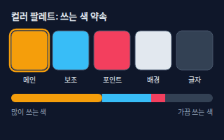</a> <b><a href="#color-palette--컬러-팔레트">Color Palette</a></b> 컬러 팔레트 브랜드나 디자인에서 쓰기로 정한 색 목록. 보통 메인 색, 보조 색, 포인트 색, 배경색, 글자색으로 나누고 쓰는 비율도 함께 정한다.</td>
<td width="33%" valign="top"><a href="#contrast--대비">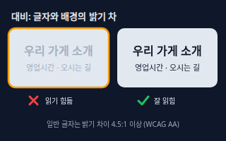</a> <b><a href="#contrast--대비">Contrast</a></b> 대비 글자와 배경, 또는 두 색의 밝기 차이. 대비가 낮으면 글자가 흐릿해 읽기 어렵다. 웹 접근성 기준(WCAG AA)은 일반 글자에 4.5:1 이상, 큰 글자에 3:1 이상을 요구한다.</td>
</tr>
</table>

**글자와 배치 · Typography & Layout** (7)

<table>
<tr>
<td width="33%" valign="top"><a href="#typeface-vs-font--서체와-폰트">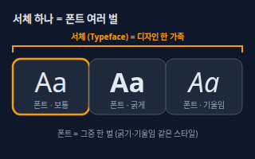</a> <b><a href="#typeface-vs-font--서체와-폰트">Typeface vs Font</a></b> 서체와 폰트 서체(Typeface)는 글자 모양의 디자인 한 가족(예: 명조, 고딕)이고, 폰트(Font)는 그 가족 안의 굵기·기울임 같은 실제 파일 한 벌이다. 일상에서는 두 말을 섞어 쓰는 경우가 많다.</td>
<td width="33%" valign="top"><a href="#serif-vs-sans-serif--세리프와-산세리프">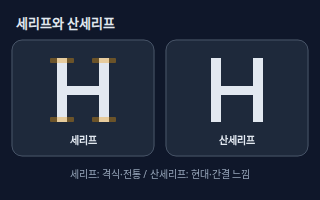</a> <b><a href="#serif-vs-sans-serif--세리프와-산세리프">Serif vs Sans-serif</a></b> 세리프와 산세리프 세리프는 글자 획 끝에 작은 돌기(장식)가 붙은 서체, 산세리프는 그 장식이 없는 서체다. 한글에서는 명조 계열이 세리프, 고딕 계열이 산세리프에 가깝다.</td>
<td width="33%" valign="top"><a href="#kerning--커닝-글자-짝-간격">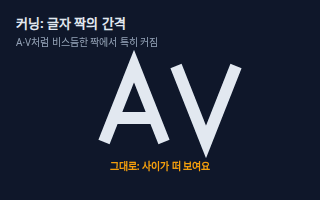</a> <b><a href="#kerning--커닝-글자-짝-간격">Kerning</a></b> 커닝 (글자 짝 간격) 글자 두 개 사이의 간격을 짝마다 따로 맞추는 것. A와 V처럼 비스듬한 짝은 사이가 떠 보여서 가까이 붙여 준다.</td>
</tr>
<tr>
<td width="33%" valign="top"><a href="#tracking--트래킹-자간">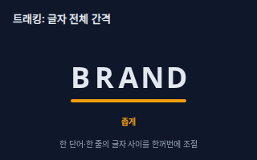</a> <b><a href="#tracking--트래킹-자간">Tracking</a></b> 트래킹 (자간) 한 단어나 한 줄 전체의 글자 사이 간격을 똑같이 넓히거나 좁히는 설정. 넓히면 시원하고 고급스러운 느낌, 좁히면 단단하고 빽빽한 느낌이 난다.</td>
<td width="33%" valign="top"><a href="#leading--리딩-줄-간격">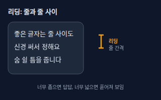</a> <b><a href="#leading--리딩-줄-간격">Leading</a></b> 리딩 (줄 간격) 글이 여러 줄일 때 한 줄과 다음 줄 사이의 간격. 너무 좁으면 답답하고, 너무 넓으면 한 문단이 흩어져 보인다.</td>
<td width="33%" valign="top"><a href="#visual-hierarchy--시각적-위계">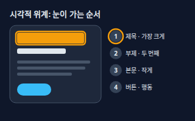</a> <b><a href="#visual-hierarchy--시각적-위계">Visual Hierarchy</a></b> 시각적 위계 무엇을 먼저 보고 무엇을 나중에 볼지 크기·굵기·색·위치로 순서를 만드는 것. 제목은 크게, 부제는 중간, 본문은 작게 두는 식이다.</td>
</tr>
<tr>
<td width="33%" valign="top"><a href="#grid-system--그리드-시스템">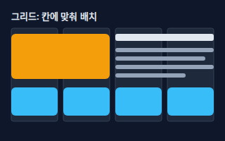</a> <b><a href="#grid-system--그리드-시스템">Grid System</a></b> 그리드 시스템 화면이나 종이를 보이지 않는 열·칸으로 나누고, 모든 요소를 그 칸에 맞춰 놓는 방식. 요소 간격과 줄이 맞아 정돈되어 보인다.</td>
</tr>
</table>

**파일 · Files** (5)

<table>
<tr>
<td width="33%" valign="top"><a href="#vector-vs-raster--벡터와-래스터">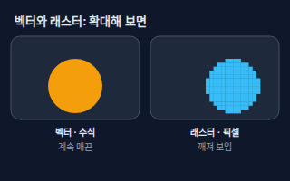</a> <b><a href="#vector-vs-raster--벡터와-래스터">Vector vs Raster</a></b> 벡터와 래스터 벡터는 선과 도형을 수식으로 기억해서 확대해도 매끈하고(예: SVG, AI), 래스터는 색 네모(픽셀)로 이뤄져서 크게 늘리면 깨진다(예: JPG, PNG). 로고는 벡터로 만들어 두는 것이 안전하다.</td>
<td width="33%" valign="top"><a href="#dpi-and-ppi--dpi와-ppi-해상도">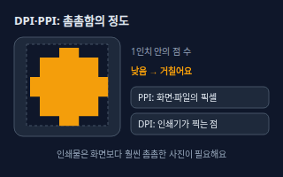</a> <b><a href="#dpi-and-ppi--dpi와-ppi-해상도">DPI and PPI</a></b> DPI와 PPI (해상도) 1인치 안에 점이 몇 개 들어가는지 나타내는 촘촘함. PPI는 화면·이미지 파일의 픽셀 밀도, DPI는 인쇄기가 찍는 점의 밀도를 가리킨다. 숫자가 클수록 곱지만 파일이 무거워진다.</td>
<td width="33%" valign="top"><a href="#transparent-png--투명-배경-png">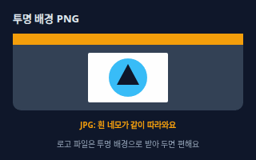</a> <b><a href="#transparent-png--투명-배경-png">Transparent PNG</a></b> 투명 배경 PNG 배경이 투명하게 비어 있는 PNG 이미지. 색이 있는 배경이나 사진 위에 로고를 얹어도 흰 네모가 생기지 않는다.</td>
</tr>
<tr>
<td width="33%" valign="top"><a href="#mockup--목업">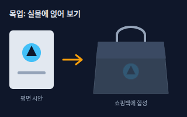</a> <b><a href="#mockup--목업">Mockup</a></b> 목업 디자인 시안을 쇼핑백·머그컵·간판 같은 실물 사진에 합성해 완성된 모습을 미리 보여 주는 이미지. 실제로 만들기 전에 확인하는 용도다.</td>
<td width="33%" valign="top"><a href="#outline--아웃라인-글자를-도형으로">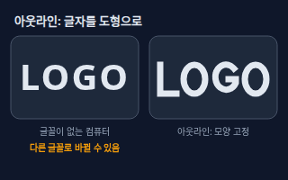</a> <b><a href="#outline--아웃라인-글자를-도형으로">Outline</a></b> 아웃라인 (글자를 도형으로) 글자를 글꼴 정보가 아니라 도형(선과 면)으로 바꾸는 작업. 글꼴이 설치되지 않은 컴퓨터에서 열어도 글자 모양이 그대로 보인다.</td>
</tr>
</table>

**인쇄 · Print** (6)

<table>
<tr>
<td width="33%" valign="top"><a href="#bleed--도련">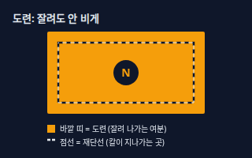</a> <b><a href="#bleed--도련">Bleed</a></b> 도련 종이를 자를 때 칼이 조금 어긋나도 가장자리에 흰 줄이 생기지 않도록, 배경이나 사진을 재단선 바깥까지 더 칠해 두는 여분 영역. 보통 3mm를 쓴다.</td>
<td width="33%" valign="top"><a href="#trim-line--재단선">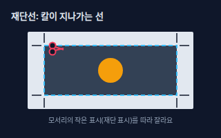</a> <b><a href="#trim-line--재단선">Trim Line</a></b> 재단선 인쇄가 끝난 큰 종이를 최종 크기로 자르는 선. 파일에서는 완성될 크기의 테두리이고, 모서리에 '재단 표시(크롭 마크)'를 달아 알려 준다.</td>
<td width="33%" valign="top"><a href="#safe-zone--인쇄-안전-영역">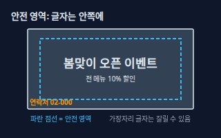</a> <b><a href="#safe-zone--인쇄-안전-영역">Safe Zone</a></b> 인쇄 안전 영역 재단할 때 조금 어긋나도 잘리지 않도록 중요한 글자와 로고를 안쪽에 두기로 한 여유 영역. 재단선보다 안쪽에 둔다.</td>
</tr>
<tr>
<td width="33%" valign="top"><a href="#paper-stock--종이-종류와-두께">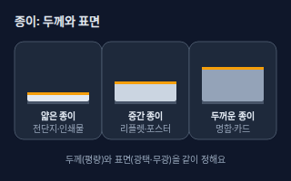</a> <b><a href="#paper-stock--종이-종류와-두께">Paper Stock</a></b> 종이 종류와 두께 인쇄에 쓰는 종이의 종류(표면: 광택·무광·거친 질감)와 두께(평량, 단위 g/㎡). 같은 디자인도 종이에 따라 색 느낌과 고급스러움이 달라진다.</td>
<td width="33%" valign="top"><a href="#finishing--후가공">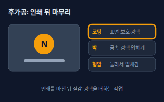</a> <b><a href="#finishing--후가공">Finishing</a></b> 후가공 인쇄가 끝난 뒤 종이에 더하는 마무리 작업. 표면을 보호하는 코팅, 금속 광택을 입히는 박, 눌러서 입체감을 주는 형압 등이 있다.</td>
<td width="33%" valign="top"><a href="#proof--시안과-교정">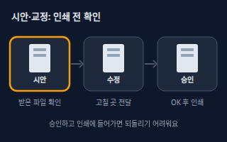</a> <b><a href="#proof--시안과-교정">Proof</a></b> 시안과 교정 실제로 대량 인쇄하기 전에 결과물을 미리 받아 확인하는 샘플. 오탈자·색·잘림을 점검하고 수정한 뒤 승인(OK)해야 인쇄에 들어간다.</td>
</tr>
</table>

<!-- overview:end -->

## 브랜드 · Brand

### Brand Identity · 브랜드 아이덴티티

- **정의**: 브랜드가 어디서든 "같은 사람(가게)"처럼 느껴지게 하는 눈에 보이고 들리는 요소의 묶음. 로고·색·글자·사진 분위기·말투가 모두 들어간다.
- **AI에게 이렇게**: "동네 베이커리 브랜드 아이덴티티를 잡고 싶어. 로고, 대표 색 2개, 글꼴, 말투 방향을 한 세트로 제안해줘."
- **언제**: 가게·서비스를 처음 만들 때, 간판·메뉴판·SNS가 따로 노는 느낌이 들 때
- **헷갈림**: Logo — 로고는 아이덴티티의 한 조각일 뿐, 아이덴티티는 색·글자·말투까지 포함한 전체
- **관련**: Logo Types, Brand Guideline, Tone and Manner, Color Palette
- **확인 질문**: 어떤 사람에게 어떤 느낌(고급·친근·미니멀 등)으로 기억되고 싶은가요? 이미 쓰는 이름과 색이 있나요?

### Logo Types · 로고 유형 (워드마크·심볼·엠블럼)

- **정의**: 로고는 크게 글자로만 만든 워드마크, 그림·도형만 쓴 심볼, 글자와 그림을 동그란 도장·방패처럼 한 덩어리로 묶은 엠블럼으로 나눈다. 글자와 심볼을 나란히 놓는 조합형도 많다.
- **AI에게 이렇게**: "우리 카페 이름 'NOVA'로 워드마크 로고 3안, 심볼 로고 3안을 따로 만들어줘. 엠블럼 스타일은 제외해줘."
- **언제**: 로고 방향을 정하기 전, AI나 디자이너에게 원하는 모양을 정확히 말해야 할 때
- **헷갈림**: Logo vs Brand — 로고는 그림 한 장, 브랜드는 고객이 떠올리는 인상 전체. 엠블럼은 작게 쓰면 안쪽 글자가 뭉개지기 쉬워 간판·도장용에 더 어울린다
- **관련**: Brand Identity, Vector vs Raster, Brand Guideline
- **확인 질문**: 로고는 주로 어디에 쓰이나요(간판, 앱 아이콘, 포장지)? 이름 글자를 꼭 넣어야 하나요?

### Brand Guideline · 브랜드 가이드라인

- **정의**: 로고·색·글꼴·말투를 "이렇게 써 주세요"라고 정리한 사용 설명서. 누가 만들어도 결과가 비슷해지게 해 준다.
- **AI에게 이렇게**: "위 로고와 색으로 A4 한 장짜리 브랜드 가이드라인을 만들어줘. 로고 사용법, 색 코드, 글꼴, 하면 안 되는 예를 넣어줘."
- **언제**: 디자이너·인쇄소·SNS 담당자가 여러 명이 되거나, 외주를 맡길 때
- **헷갈림**: Style Guide — 스타일 가이드는 글쓰기·UI 규칙을 말할 때가 많고, 브랜드 가이드라인은 로고와 색까지 포함한 더 넓은 범위
- **관련**: Brand Identity, Color Palette, Typeface vs Font, Tone and Manner
- **확인 질문**: 이미 확정된 로고·색·글꼴이 있나요? 가이드는 누가(인쇄소, 직원, 외주) 보게 되나요?

### Tone and Manner · 톤앤매너

- **정의**: 브랜드가 말하고 보여 주는 일관된 분위기와 말투. 같은 안내문도 "방문해 주셔서 감사합니다"와 "어서 와요!"는 전혀 다른 브랜드로 느껴진다.
- **AI에게 이렇게**: "우리 공방 인스타 문구 톤앤매너를 '따뜻하고 친근하지만 반말은 쓰지 않음'으로 정하고, 신제품 공지 3개를 써줘."
- **언제**: 홍보 문구, 안내문, 디자인 분위기가 글마다 달라 보일 때
- **헷갈림**: Mood Board — 무드보드는 분위기를 이미지로 모은 참고판, 톤앤매너는 말투와 태도를 규칙으로 정한 것
- **관련**: Brand Identity, Mood Board, Brand Guideline
- **확인 질문**: 고객은 누구이고, 존댓말·반말, 이모지 사용, 유머 허용 정도는 어떻게 할까요?

### Mood Board · 무드보드

- **정의**: 원하는 분위기에 가까운 색·사진·글자·질감 이미지를 한 장에 모아 둔 참고판. 말로 설명하기 어려운 "느낌"을 눈으로 맞추는 도구다.
- **AI에게 이렇게**: "'조용한 북카페' 느낌의 무드보드를 만들어줘. 색 5개, 글꼴 예시 2개, 질감 키워드와 참고 이미지 설명을 넣어줘."
- **언제**: 디자인을 맡기기 전 방향을 맞출 때, 취향을 설명하기 어려울 때
- **헷갈림**: Color Palette — 팔레트는 정해진 색 목록, 무드보드는 색·사진·질감이 섞인 아이디어 모음(아직 확정 아님)
- **관련**: Tone and Manner, Color Palette, Brand Identity
- **확인 질문**: 좋아하는 브랜드나 가게가 있나요? 반대로 절대 싫은 느낌은 무엇인가요?

## 색 · Color

### RGB vs CMYK · RGB와 CMYK

- **정의**: RGB는 빨강·초록·파랑 빛을 섞어 화면에 색을 내는 방식, CMYK는 청록·자홍·노랑·검정 잉크를 섞어 종이에 색을 내는 방식이다. 같은 색도 화면과 인쇄에서 다르게 보일 수 있다.
- **AI에게 이렇게**: "이 로고를 인쇄용 CMYK 모드 PDF와 웹용 RGB PNG 두 가지로 따로 준비해줘."
- **언제**: 화면용 디자인을 인쇄로 넘길 때, 인쇄 색이 모니터보다 탁하게 나올 때
- **헷갈림**: HEX — HEX는 RGB를 16진수로 적은 표기라 인쇄 색 지정에는 쓰지 않는다
- **관련**: HEX Code, Pantone, Color Palette, Proof
- **확인 질문**: 이 파일은 화면용인가요, 인쇄용인가요? 인쇄소가 요구하는 색상 모드가 있나요?
- **근거**: [Pantone · Understanding Different Color Spaces](https://www.pantone.com/na/en-us/articles/color-fundamentals/understanding-different-color-spaces) — 인쇄는 CMYK, 화면은 RGB 색 공간을 쓴다는 설명
- **검증일**: 2026-11-02

### HEX Code · 헥스 코드

- **정의**: 웹·화면 색을 #과 6자리 숫자·알파벳(예: #F59E0B)으로 적는 표기. 두 자리씩 끊어 빨강·초록·파랑 빛의 세기를 뜻한다.
- **AI에게 이렇게**: "브랜드 메인 색을 #F59E0B로 고정하고, 어울리는 보조 색 HEX 코드 2개와 글자색 HEX 코드를 알려줘."
- **언제**: 웹사이트·앱·피그마·PPT에서 색을 정확히 맞출 때
- **헷갈림**: Pantone — 팬톤은 인쇄 잉크 번호, HEX는 화면 색 코드. 화면 HEX가 인쇄에서 똑같이 나오는 것은 아니다
- **관련**: RGB vs CMYK, Color Palette, Pantone
- **확인 질문**: 이미 쓰고 있는 색 코드가 있나요? 화면 전용인가요, 인쇄물에도 같은 색을 쓰나요?

### Pantone · 팬톤

- **정의**: 색마다 번호를 붙여 "이 번호 색으로 인쇄해 주세요"라고 지정할 수 있게 한 색 표준. 별도로 섞은 단색 잉크를 쓰는 특별색 인쇄에 주로 쓴다.
- **AI에게 이렇게**: "로고 색을 팬톤 번호로 지정하고 싶어. 메인 주황색에 가까운 팬톤 후보를 알려주고, CMYK로 바꾸면 달라질 수 있는 점도 알려줘."
- **언제**: 로고·포장지 색이 인쇄소마다 달라지면 안 될 때, 명함·스티커 특별색 인쇄
- **헷갈림**: CMYK — CMYK는 4가지 잉크를 점으로 겹쳐 색을 만들고, 팬톤은 그 색 자체를 따로 섞은 잉크를 쓴다. 특별색은 인쇄소마다 지원 여부와 비용이 다르다
- **관련**: RGB vs CMYK, Color Palette, Proof
- **확인 질문**: 인쇄소가 특별색 인쇄를 지원하나요? 예산상 CMYK로 대체해도 되나요?
- **근거**: [Pantone · Understanding Different Color Spaces](https://www.pantone.com/na/en-us/articles/color-fundamentals/understanding-different-color-spaces), [Pantone · Spot color vs Process Color Printing](https://www.pantone.com/na/en-us/articles/technical/spot-vs-process-color) — 팬톤 같은 스폿(특별) 컬러는 별도 혼합 잉크로 인쇄한다
- **검증일**: 2026-11-02

### Color Palette · 컬러 팔레트

- **정의**: 브랜드나 디자인에서 쓰기로 정한 색 목록. 보통 메인 색, 보조 색, 포인트 색, 배경색, 글자색으로 나누고 쓰는 비율도 함께 정한다.
- **AI에게 이렇게**: "20대 여성 대상 비건 디저트 가게의 컬러 팔레트를 짜줘. 메인 1, 보조 1, 포인트 1, 배경과 글자색까지 HEX 코드로."
- **언제**: 로고·간판·메뉴판·웹사이트의 색을 통일할 때
- **헷갈림**: Mood Board — 무드보드는 분위기 참고판, 팔레트는 실제로 쓸 색을 확정한 목록
- **관련**: HEX Code, Contrast, Brand Guideline, Pantone
- **확인 질문**: 꼭 써야 하는 색이 있나요? 어두운 배경과 밝은 배경 중 어디에 많이 쓰나요?

### Contrast · 대비

- **정의**: 글자와 배경, 또는 두 색의 밝기 차이. 대비가 낮으면 글자가 흐릿해 읽기 어렵다. 웹 접근성 기준(WCAG AA)은 일반 글자에 4.5:1 이상, 큰 글자에 3:1 이상을 요구한다.
- **AI에게 이렇게**: "이 팔레트의 글자색·배경색 조합이 WCAG AA 대비(4.5:1)를 통과하는지 확인하고, 통과하지 못하는 조합은 가까운 색으로 고쳐줘."
- **언제**: 웹사이트·포스터에서 글자가 흐려 보일 때, 연한 색 위에 글자를 얹을 때
- **헷갈림**: Brightness — 밝기만 높인다고 대비가 좋아지지는 않는다. 글자와 배경 사이의 차이가 핵심
- **관련**: Color Palette, Visual Hierarchy, Mockup
- **확인 질문**: 글자 크기는 얼마나 되나요? 사진 위에 글자를 얹나요, 단색 배경 위인가요?
- **근거**: [W3C WCAG 2.2 · Understanding SC 1.4.3 Contrast (Minimum)](https://www.w3.org/WAI/WCAG22/Understanding/contrast-minimum) — 일반 글자 대비 4.5:1, 큰 글자 3:1 (WCAG 2.2 SC 1.4.3, Level AA)
- **검증일**: 2026-11-02

## 글자와 배치 · Typography & Layout

### Typeface vs Font · 서체와 폰트

- **정의**: 서체(Typeface)는 글자 모양의 디자인 한 가족(예: 명조, 고딕)이고, 폰트(Font)는 그 가족 안의 굵기·기울임 같은 실제 파일 한 벌이다. 일상에서는 두 말을 섞어 쓰는 경우가 많다.
- **AI에게 이렇게**: "브랜드 글꼴은 서체 하나를 정하고, 제목은 굵게, 본문은 보통 굵기로 쓰는 규칙을 정리해줘. 상업적으로 써도 되는 무료 서체로 골라줘."
- **언제**: 글꼴을 정하거나 인쇄소·디자이너에게 파일을 넘길 때
- **헷갈림**: Font Size — 크기는 글자의 크기 설정이지 서체 자체가 아니다
- **관련**: Serif vs Sans-serif, Outline, Brand Guideline
- **확인 질문**: 상업 이용이 가능한 글꼴이어야 하나요? 한글과 영문을 같은 서체로 쓸까요?

### Serif vs Sans-serif · 세리프와 산세리프

- **정의**: 세리프는 글자 획 끝에 작은 돌기(장식)가 붙은 서체, 산세리프는 그 장식이 없는 서체다. 한글에서는 명조 계열이 세리프, 고딕 계열이 산세리프에 가깝다.
- **AI에게 이렇게**: "브랜드 느낌이 '격식 있고 오래된 가게'야. 제목은 세리프, 본문은 산세리프로 조합한 글꼴 후보 3가지를 제안해줘."
- **언제**: 브랜드 분위기를 글꼴로 정할 때, 작은 화면 글자의 가독성을 고를 때
- **헷갈림**: Serif vs Gothic — 한글의 명조/고딕과 영문의 세리프/산세리프는 비슷하지만 완전히 같은 분류는 아니다
- **관련**: Typeface vs Font, Visual Hierarchy, Tone and Manner
- **확인 질문**: 전통적·고급스러운 느낌과 현대적·깔끔한 느낌 중 어느 쪽인가요? 주로 화면용인가요, 인쇄용인가요?

### Kerning · 커닝 (글자 짝 간격)

- **정의**: 글자 두 개 사이의 간격을 짝마다 따로 맞추는 것. A와 V처럼 비스듬한 짝은 사이가 떠 보여서 가까이 붙여 준다.
- **AI에게 이렇게**: "로고 글자 'AVENUE'에서 A와 V 사이가 떠 보여. 이 글자 짝의 커닝만 조정하고 나머지 간격은 그대로 둬줘."
- **언제**: 로고·제목처럼 큰 글자를 다듬을 때
- **헷갈림**: Tracking — 트래킹은 글자 전체 간격을 한꺼번에 넓히거나 좁히는 것, 커닝은 특정 글자 짝 하나의 간격
- **관련**: Tracking, Leading, Typeface vs Font
- **확인 질문**: 어느 글자 사이가 어색한가요? 로고처럼 크게 쓰는 글자인가요, 본문인가요?

### Tracking · 트래킹 (자간)

- **정의**: 한 단어나 한 줄 전체의 글자 사이 간격을 똑같이 넓히거나 좁히는 설정. 넓히면 시원하고 고급스러운 느낌, 좁히면 단단하고 빽빽한 느낌이 난다.
- **AI에게 이렇게**: "제목 글자 자간(트래킹)을 살짝 넓혀서 고급스러운 느낌으로 바꿔줘. 본문은 그대로 둬줘."
- **언제**: 영문 제목을 시원하게 보이게 할 때, 좁은 공간에 글자를 넣을 때
- **헷갈림**: Kerning — 커닝은 글자 짝 하나, 트래킹은 전체. 둘 다 "자간"이라고 부르기도 해서 AI에게는 구분해 말하는 편이 좋다
- **관련**: Kerning, Leading, Visual Hierarchy
- **확인 질문**: 특정 글자 사이만 조정할까요, 전체 간격을 바꿀까요?

### Leading · 리딩 (줄 간격)

- **정의**: 글이 여러 줄일 때 한 줄과 다음 줄 사이의 간격. 너무 좁으면 답답하고, 너무 넓으면 한 문단이 흩어져 보인다.
- **AI에게 이렇게**: "본문 글자 줄 간격(리딩)을 지금보다 넉넉하게 해서 읽기 편하게 바꿔줘."
- **언제**: 안내문·상세 페이지처럼 여러 줄 글을 넣을 때
- **헷갈림**: Letter Spacing — 자간(트래킹)은 가로로 글자 사이, 리딩은 세로로 줄 사이
- **관련**: Tracking, Kerning, Visual Hierarchy
- **확인 질문**: 글이 몇 줄 정도인가요? 작은 화면(모바일)에서도 보이나요?

### Visual Hierarchy · 시각적 위계

- **정의**: 무엇을 먼저 보고 무엇을 나중에 볼지 크기·굵기·색·위치로 순서를 만드는 것. 제목은 크게, 부제는 중간, 본문은 작게 두는 식이다.
- **AI에게 이렇게**: "이 포스터 시안에서 눈이 어디서 시작해 어디로 가는지 점검하고, 제목 > 날짜·장소 > 안내 문구 순서가 되도록 크기와 굵기를 정리해줘."
- **언제**: 포스터·전단지·상세 페이지가 정신없이 느껴질 때
- **헷갈림**: Emphasis — 강조(굵게·색)는 도구이고 위계는 전체 순서 설계. 다 강조하면 위계가 사라진다
- **관련**: Contrast, Grid System, Leading, Serif vs Sans-serif
- **확인 질문**: 독자가 가장 먼저 알아야 할 한 가지는 무엇인가요? 그다음 순서는요?

### Grid System · 그리드 시스템

- **정의**: 화면이나 종이를 보이지 않는 열·칸으로 나누고, 모든 요소를 그 칸에 맞춰 놓는 방식. 요소 간격과 줄이 맞아 정돈되어 보인다.
- **AI에게 이렇게**: "A4 세로 포스터를 4열 그리드로 나누고, 이미지는 2열, 글은 나머지 2열에 맞춰 배치해줘."
- **언제**: 여러 요소를 정돈되게 배치하고 싶을 때, 카드·메뉴판·상세 페이지 레이아웃
- **헷갈림**: Table — 표는 데이터를 담는 구조, 그리드는 배치를 위한 보이지 않는 가이드선
- **관련**: Visual Hierarchy, Safe Zone, Mockup
- **확인 질문**: 크기는 어떻게 되나요(A4, 인스타 정사각형 등)? 열은 몇 개로 나눌까요?

## 파일 · Files

### Vector vs Raster · 벡터와 래스터

- **정의**: 벡터는 선과 도형을 수식으로 기억해서 확대해도 매끈하고(예: SVG, AI), 래스터는 색 네모(픽셀)로 이뤄져서 크게 늘리면 깨진다(예: JPG, PNG). 로고는 벡터로 만들어 두는 것이 안전하다.
- **AI에게 이렇게**: "이 로고를 벡터 파일(SVG와 AI)로 다시 그려줘. 래스터 PNG는 투명 배경으로 크기별 3개만 같이 내보내줘."
- **언제**: 로고 원본을 받을 때, 현수막·간판처럼 크게 인쇄할 때
- **헷갈림**: High Resolution — 고해상도 PNG도 결국 래스터라, 아주 크게 늘리면 한계가 있다
- **관련**: DPI and PPI, Transparent PNG, Outline
- **확인 질문**: 최대로 크게 쓰는 곳은 어디인가요(명함, 간판, 현수막)? 원본 로고 파일이 있나요?
- **근거**: [MDN · Image file type and format guide](https://developer.mozilla.org/en-US/docs/Web/Media/Guides/Formats/Image_types) — SVG는 도형을 그리는 명령으로 이미지를 정의하는 벡터 포맷, JPEG/PNG는 픽셀 기반 이미지
- **검증일**: 2026-11-02

### DPI and PPI · DPI와 PPI (해상도)

- **정의**: 1인치 안에 점이 몇 개 들어가는지 나타내는 촘촘함. PPI는 화면·이미지 파일의 픽셀 밀도, DPI는 인쇄기가 찍는 점의 밀도를 가리킨다. 숫자가 클수록 곱지만 파일이 무거워진다.
- **AI에게 이렇게**: "이 사진을 A4 크기로 인쇄해도 괜찮은지 해상도(PPI)를 확인하고, 모자라면 어떻게 해야 하는지 알려줘."
- **언제**: 인쇄용 이미지를 고를 때, 화면에서 괜찮던 사진이 인쇄에서 흐릴 때
- **헷갈림**: Pixel Size — 가로세로 픽셀 수와 밀도(PPI)는 다르다. 인쇄물 크기가 커지면 같은 픽셀 수의 밀도는 낮아진다
- **관련**: Vector vs Raster, Bleed, Proof
- **확인 질문**: 인쇄할 최종 크기가 얼마인가요? 이미지 원본의 가로세로 픽셀 크기는요?
- **근거**: [Adobe Photoshop · 이미지 크기와 해상도](https://helpx.adobe.com/photoshop/using/image-size-resolution.html) — 해상도는 인치당 픽셀 수(ppi)로 지정
- **검증일**: 2026-11-02

### Transparent PNG · 투명 배경 PNG

- **정의**: 배경이 투명하게 비어 있는 PNG 이미지. 색이 있는 배경이나 사진 위에 로고를 얹어도 흰 네모가 생기지 않는다.
- **AI에게 이렇게**: "이 로고를 투명 배경 PNG로 내보내줘. 흰 글자 버전과 검정 글자 버전을 따로 만들어줘."
- **언제**: 로고를 웹사이트·PPT·영상·상세페이지 이미지 위에 얹을 때
- **헷갈림**: JPG — JPG는 투명을 지원하지 않아서 항상 배경색이 있다. SVG도 투명 배경이 가능하지만 벡터 형식이다
- **관련**: Vector vs Raster, Mockup, Color Palette
- **확인 질문**: 어두운 배경과 밝은 배경 중 어디에 얹나요? 필요한 크기는 얼마인가요?
- **근거**: [MDN · Image file type and format guide](https://developer.mozilla.org/en-US/docs/Web/Media/Guides/Formats/Image_types) — PNG는 투명도가 필요한 이미지의 선택지, JPEG에는 알파 채널이 없음
- **검증일**: 2026-11-02

### Mockup · 목업

- **정의**: 디자인 시안을 쇼핑백·머그컵·간판 같은 실물 사진에 합성해 완성된 모습을 미리 보여 주는 이미지. 실제로 만들기 전에 확인하는 용도다.
- **AI에게 이렇게**: "이 로고를 종이 쇼핑백, 머그컵, 가게 간판에 얹은 목업 이미지 3장을 만들어줘. 실제 제작용 파일은 따로 필요해."
- **언제**: 인쇄·제작 전에 느낌을 보거나 고객·투자자에게 보여 줄 때
- **헷갈림**: Prototype/Wireframe — 앱·웹의 동작을 보여 주는 것과 달리 목업은 겉모습을 보여 주는 합성 이미지. 인쇄용 최종 파일이 아니다
- **관련**: Transparent PNG, Proof, Brand Identity
- **확인 질문**: 어떤 제품(포장, 간판, 앱 화면)에 얹어 볼까요? 발표용인가요, 제작용인가요?

### Outline · 아웃라인 (글자를 도형으로)

- **정의**: 글자를 글꼴 정보가 아니라 도형(선과 면)으로 바꾸는 작업. 글꼴이 설치되지 않은 컴퓨터에서 열어도 글자 모양이 그대로 보인다.
- **AI에게 이렇게**: "인쇄소에 보낼 로고 파일의 글자를 모두 아웃라인 처리해서 AI와 PDF로 내보내줘."
- **언제**: 인쇄소·간판·외주 업체에 디자인 파일을 넘길 때
- **헷갈림**: Outline(윤곽선 효과) — 글자에 테두리를 두르는 효과와는 다르다. 여기서는 글자를 도형으로 바꾸는 '아웃라인 만들기'
- **관련**: Typeface vs Font, Vector vs Raster, Proof
- **확인 질문**: 이 파일을 나중에 수정할 필요가 있나요? 수정용 원본은 따로 보관할까요?

## 인쇄 · Print

### Bleed · 도련

- **정의**: 종이를 자를 때 칼이 조금 어긋나도 가장자리에 흰 줄이 생기지 않도록, 배경이나 사진을 재단선 바깥까지 더 칠해 두는 여분 영역. 보통 3mm를 쓴다.
- **AI에게 이렇게**: "명함 90x50mm 인쇄용 파일을 만들어줘. 사방 3mm 도련을 포함해서 배경색이 끝까지 차게 해줘."
- **언제**: 배경색이나 사진이 가장자리까지 가득 차는 명함·전단지·포스터
- **헷갈림**: Trim Line — 재단선은 칼이 지나가는 선, 도련은 그 선 바깥의 여분. 도련 부분은 자르면 사라진다
- **관련**: Trim Line, Safe Zone, Proof
- **확인 질문**: 인쇄소가 요구하는 도련 크기가 있나요? 배경이 가장자리까지 채워지나요?
- **근거**: [Adobe InDesign · Set a print bleed](https://helpx.adobe.com/indesign/how-to/set-print-bleed.html), [팩토리비 인쇄 파일 작업 가이드](https://factoryb.co.kr/theme/basic/file/print_guide.pdf) — 도련은 보통 3mm(0.125인치)가 표준이며 인쇄소가 더 크게 요구할 수 있음
- **검증일**: 2026-11-02

### Trim Line · 재단선

- **정의**: 인쇄가 끝난 큰 종이를 최종 크기로 자르는 선. 파일에서는 완성될 크기의 테두리이고, 모서리에 '재단 표시(크롭 마크)'를 달아 알려 준다.
- **AI에게 이렇게**: "최종 크기 A5 기준으로 재단선과 재단 표시가 보이도록 인쇄용 PDF를 만들어줘."
- **언제**: 인쇄 파일을 만들거나 인쇄소 확인용 PDF를 받을 때
- **헷갈림**: Bleed — 도련은 재단선 바깥 여분. 재단선 안쪽이 실제로 남는 부분
- **관련**: Bleed, Safe Zone, Proof
- **확인 질문**: 완성 크기(가로×세로)가 정확히 얼마인가요? 재단 표시를 넣을까요?
- **근거**: [Adobe InDesign · 인쇄용 표시 설정](https://helpx.adobe.com/mt/indesign/using/printers-marks-bleeds.html) — 재단 표시 등 프린터 마크는 페이지 가장자리 밖의 도련·슬러그 영역에 표시됨
- **검증일**: 2026-11-02

### Safe Zone · 인쇄 안전 영역

- **정의**: 재단할 때 조금 어긋나도 잘리지 않도록 중요한 글자와 로고를 안쪽에 두기로 한 여유 영역. 재단선보다 안쪽에 둔다.
- **AI에게 이렇게**: "전단지 가장자리에서 충분히 안쪽에만 연락처와 로고가 오도록 안전 영역을 표시하고 다시 배치해줘."
- **언제**: 전화번호·로고·핵심 문구가 가장자리에 붙어 있을 때
- **헷갈림**: Margin — 여백은 보기 좋은 간격이고, 안전 영역은 잘림을 막는 기준선. 인쇄소가 안전 영역 크기를 정해 준다
- **관련**: Bleed, Trim Line, Grid System
- **확인 질문**: 인쇄소가 안내한 안전 영역 크기가 있나요? 꼭 보여야 하는 정보가 무엇인가요?

### Paper Stock · 종이 종류와 두께

- **정의**: 인쇄에 쓰는 종이의 종류(표면: 광택·무광·거친 질감)와 두께(평량, 단위 g/㎡). 같은 디자인도 종이에 따라 색 느낌과 고급스러움이 달라진다.
- **AI에게 이렇게**: "명함에 어울리는 종이를 추천해줘. 도톰한 무광 종이와 광택 종이를 비교하고, 비용이 어떻게 달라지는지도 알려줘."
- **언제**: 명함·전단지·패키지 주문 전 종이를 고를 때
- **헷갈림**: Finishing — 종이는 바탕 재료, 후가공은 인쇄 후 덧붙이는 마무리 작업
- **관련**: Finishing, Proof, RGB vs CMYK
- **확인 질문**: 어디에 쓰는 인쇄물인가요(손에 들고 보는 것, 걸어 두는 것)? 예산은 어느 정도인가요?

### Finishing · 후가공

- **정의**: 인쇄가 끝난 뒤 종이에 더하는 마무리 작업. 표면을 보호하는 코팅, 금속 광택을 입히는 박, 눌러서 입체감을 주는 형압 등이 있다.
- **AI에게 이렇게**: "명함 로고에 금박 후가공을 넣고 싶어. 어떤 파일을 따로 준비해야 하고 비용이 어떻게 달라지는지 알려줘."
- **언제**: 명함·패키지·초대장을 고급스럽게 만들고 싶을 때
- **헷갈림**: Paper Stock — 종이는 바탕, 후가공은 그 위에 더하는 작업. 후가공은 비용·납기가 늘어날 수 있다
- **관련**: Paper Stock, Proof, Pantone
- **확인 질문**: 후가공 대상이 로고 일부인가요, 전체 면인가요? 인쇄소가 지원하는 후가공 종류는 무엇인가요?

### Proof · 시안과 교정

- **정의**: 실제로 대량 인쇄하기 전에 결과물을 미리 받아 확인하는 샘플. 오탈자·색·잘림을 점검하고 수정한 뒤 승인(OK)해야 인쇄에 들어간다.
- **AI에게 이렇게**: "인쇄 승인 전에 확인해야 할 체크리스트를 알려줘. 오탈자, 색, 잘림, 해상도, 연락처 확인 순서로."
- **언제**: 대량 인쇄 전, 새로운 인쇄소에 처음 맡길 때
- **헷갈림**: Mockup — 목업은 합성 이미지로 느낌만 보는 용도, 시안은 실제 인쇄용 내용을 점검하는 용도
- **관련**: Bleed, Trim Line, Safe Zone, RGB vs CMYK
- **확인 질문**: 디지털 시안만 볼까요, 실제 출력된 샘플도 받을까요? 승인할 사람은 누구인가요?

## 참고 자료

- [W3C · Understanding SC 1.4.3 Contrast (Minimum)](https://www.w3.org/WAI/WCAG22/Understanding/contrast-minimum)
- [Adobe InDesign · Set a print bleed](https://helpx.adobe.com/indesign/how-to/set-print-bleed.html)
- [Adobe InDesign · Set printer's marks](https://helpx.adobe.com/mt/indesign/using/printers-marks-bleeds.html)
- [Adobe Photoshop · Image size and resolution](https://helpx.adobe.com/photoshop/using/image-size-resolution.html)
- [MDN · Image file type and format guide](https://developer.mozilla.org/en-US/docs/Web/Media/Guides/Formats/Image_types)
- [MDN · SVG: Scalable Vector Graphics](https://developer.mozilla.org/en-US/docs/Web/SVG)
- [Pantone · Understanding Different Color Spaces](https://www.pantone.com/na/en-us/articles/color-fundamentals/understanding-different-color-spaces)
- [Pantone · Spot color vs Process Color Printing](https://www.pantone.com/na/en-us/articles/technical/spot-vs-process-color)
- [Adobe · Create a brand style guide](https://www.adobe.com/creativecloud/business/teams/resources/how-to/brand-guide.html)
- [Figma · Types of logos](https://www.figma.com/resource-library/types-of-logos/)
- [Affinity · Tracking, kerning & leading](https://affinity.studio/blog/tracking-kerning-leading-typography-essentials)
- [팩토리비인쇄그룹 · 파일 작업 가이드 (PDF)](https://factoryb.co.kr/theme/basic/file/print_guide.pdf)
