# 일러스트 · 드로잉 치트시트

> "예쁘게 그려줘", "애니 느낌으로"만으로는 작가도 AI도 어떤 그림인지 알 수 없습니다. 이 시트의 용어로 **어떤 순서로(밑그림 → 선화 → 밑색 → 명암) · 어떤 구조로(비례·투시) · 어떤 빛으로 · 어떤 도구 설정으로** 말하면 한 번에 통합니다.
> 일러스트를 외주로 맡길 때, AI 이미지 도구에 프롬프트를 쓸 때, Procreate·클립스튜디오·포토샵으로 처음 그려 볼 때 펼쳐 보세요. 그림은 GitHub에서 직접 움직이고, 순서는 밑그림 → 형태·구조 → 선화·채색 → 명암·빛 → 디지털 도구 → 의뢰라 영상 챕터 순서와 같습니다. 앱마다 메뉴 이름은 조금씩 다를 수 있습니다.

## 이렇게 쓰세요

- **나 → AI**: "먼저 구도가 다른 썸네일 스케치 4개를 보여줘. 마음에 드는 안을 고르면 그걸로 러프 → 선화 → 밑색 → 명암 순서로 진행해줘."
- **나 → AI**: "밑색 위에 클리핑 마스크 레이어를 만들어 곱하기(Multiply)로 그림자를 넣고, 광원은 왼쪽 위로 고정해줘. 셀 셰이딩처럼 경계는 딱 끊어서."
- **나 → AI**: "선 굵기에 강약이 있는 선화, 밑색은 단색 면, 그림자는 두 단계 셀 셰이딩, 오른쪽 윤곽에 림 라이트가 있는 캐릭터 일러스트 프롬프트를 써줘."
- **AI → 나**: "이 그림은 어디에 쓰나요(SNS 프로필·굿즈·인쇄)? 용도에 따라 캔버스 크기와 사용 범위 합의가 달라져요."
- **AI → 나**: "선화를 레이어로 분리해서 드릴까요, 아니면 채색까지 합쳐진 PNG 한 장이면 될까요?"

## 한눈에 보기

<!-- overview:start -->
<!-- 이 구역은 자동 생성됩니다. 직접 고치지 말고 `cd mcp-server && npm run generate`를 실행하세요. -->

**밑그림 · Sketching** (6)

<table>
<tr>
<td width="33%" valign="top"><a href="#thumbnail-sketch--썸네일-스케치">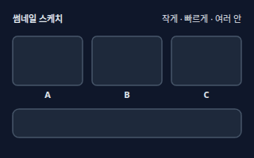</a> <b><a href="#thumbnail-sketch--썸네일-스케치">Thumbnail Sketch</a></b> 썸네일 스케치 우표만 한 작은 칸에 구도를 여러 개 빠르게 그려 보고 가장 좋은 안을 고르는 단계. 디테일은 그리지 않고 큰 덩어리와 배치만 봅니다.</td>
<td width="33%" valign="top"><a href="#rough-sketch--러프-스케치">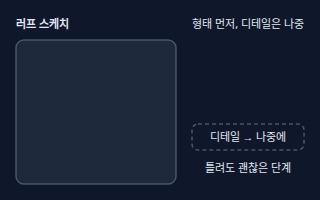</a> <b><a href="#rough-sketch--러프-스케치">Rough Sketch</a></b> 러프 스케치 비율·포즈·배치를 거칠게 잡은 밑그림. 선이 지저분해도 괜찮고, 이 단계에서 방향을 확인한 뒤 선화로 넘어갑니다.</td>
<td width="33%" valign="top"><a href="#gesture-drawing--제스처-드로잉">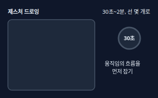</a> <b><a href="#gesture-drawing--제스처-드로잉">Gesture Drawing</a></b> 제스처 드로잉 짧은 시간 동안 선 몇 개로 포즈의 움직임과 흐름만 잡는 연습. 디테일보다 몸이 어디로 힘을 주고 있는지를 그립니다.</td>
</tr>
<tr>
<td width="33%" valign="top"><a href="#line-of-action--액션-라인">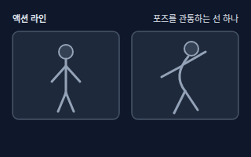</a> <b><a href="#line-of-action--액션-라인">Line of Action</a></b> 액션 라인 포즈 전체를 머리부터 발끝까지 관통하는 큰 곡선 하나. 이 선이 휘어 있으면 가만히 선 포즈에도 힘과 방향이 생깁니다.</td>
<td width="33%" valign="top"><a href="#silhouette--실루엣">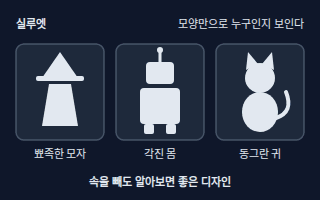</a> <b><a href="#silhouette--실루엣">Silhouette</a></b> 실루엣 안쪽 디테일을 빼고 바깥 모양만 한 가지 색으로 칠한 그림자 형태. 실루엣만 봐도 캐릭터나 물건을 알아볼 수 있으면 좋은 디자인으로 봅니다.</td>
<td width="33%" valign="top"><a href="#reference--레퍼런스">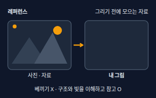</a> <b><a href="#reference--레퍼런스">Reference</a></b> 레퍼런스 그리기 전에 모아 두는 참고 자료(사진·실물·다른 그림). 베끼려는 게 아니라 구조·빛·분위기를 이해하려고 봅니다.</td>
</tr>
</table>

**형태와 구조 · Structure** (6)

<table>
<tr>
<td width="33%" valign="top"><a href="#proportion-head-unit--비례와-등신">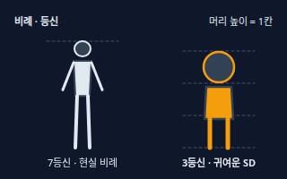</a> <b><a href="#proportion-head-unit--비례와-등신">Proportion (Head Unit)</a></b> 비례와 등신 머리 높이를 한 칸으로 삼아 몸 전체가 몇 칸인지 세는 방법. 7등신은 현실에 가까운 비례, 3등신 안팎은 귀여운 SD(작고 둥근) 캐릭터 비례입니다.</td>
<td width="33%" valign="top"><a href="#perspective--투시-원근법">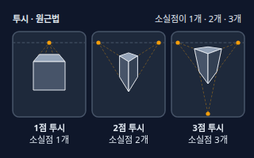</a> <b><a href="#perspective--투시-원근법">Perspective</a></b> 투시 (원근법) 평평한 종이 위에 깊이와 공간을 그리는 방법. 소실점이 1개인 1점 투시(정면), 2개인 2점 투시(모서리), 3개인 3점 투시(위·아래로 크게 보이는 장면)로 나뉩니다.</td>
<td width="33%" valign="top"><a href="#vanishing-point-and-horizon-line--소실점과-수평선">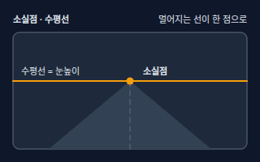</a> <b><a href="#vanishing-point-and-horizon-line--소실점과-수평선">Vanishing Point and Horizon Line</a></b> 소실점과 수평선 수평선은 그림 속 눈높이를 나타내는 선이고, 소실점은 그 수평선 위에서 멀어지는 평행선들이 모이는 점입니다.</td>
</tr>
<tr>
<td width="33%" valign="top"><a href="#foreshortening--단축법">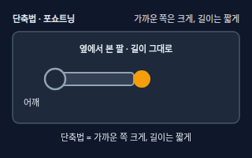</a> <b><a href="#foreshortening--단축법">Foreshortening</a></b> 단축법 앞으로 뻗은 팔처럼 보는 사람 쪽을 향한 부분을 길이는 짧게, 가까운 끝은 크게 그리는 방법.</td>
<td width="33%" valign="top"><a href="#composition-and-focal-point--구도와-초점">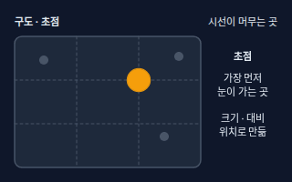</a> <b><a href="#composition-and-focal-point--구도와-초점">Composition and Focal Point</a></b> 구도와 초점 구도는 그림 안 요소를 배치하는 방식이고, 초점은 보는 사람의 시선이 가장 먼저 머무는 곳입니다. 크기·대비·위치·선의 방향으로 만듭니다.</td>
<td width="33%" valign="top"><a href="#character-sheet--캐릭터-시트">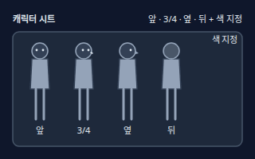</a> <b><a href="#character-sheet--캐릭터-시트">Character Sheet</a></b> 캐릭터 시트 한 캐릭터를 앞·옆·뒤(턴어라운드), 표정, 색 지정과 함께 모아 그린 설정 자료. 여러 작가나 AI가 같은 캐릭터를 같은 모습으로 그리게 해 줍니다.</td>
</tr>
</table>

**선화와 채색 · Line & Color** (8)

<table>
<tr>
<td width="33%" valign="top"><a href="#line-art--선화">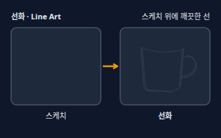</a> <b><a href="#line-art--선화">Line Art</a></b> 선화 러프 위에 깨끗한 선으로 다시 따서 만든 윤곽 단계. 채색은 이 선 아래 별도 레이어에서 합니다.</td>
<td width="33%" valign="top"><a href="#clean-up--클린업">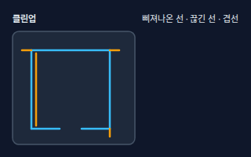</a> <b><a href="#clean-up--클린업">Clean-up</a></b> 클린업 선화에서 삐져나온 선, 끊긴 선, 겹친 선을 정리하는 마무리 작업. 선이 끊겨 있으면 페인트통으로 칠할 때 색이 밖으로 샙니다.</td>
<td width="33%" valign="top"><a href="#line-weight--선-굵기">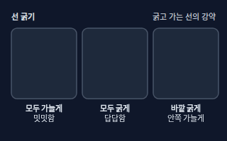</a> <b><a href="#line-weight--선-굵기">Line Weight</a></b> 선 굵기 선의 굵고 가는 정도. 바깥 윤곽은 굵게, 안쪽 디테일은 가늘게 그리면 입체감과 강약이 생깁니다.</td>
</tr>
<tr>
<td width="33%" valign="top"><a href="#flat-color--밑색">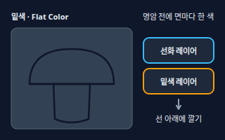</a> <b><a href="#flat-color--밑색">Flat Color</a></b> 밑색 명암 없이 면마다 한 가지 색만 평평하게 깔아 둔 채색의 첫 단계. 그림자와 하이라이트는 이 위에 따로 얹습니다.</td>
<td width="33%" valign="top"><a href="#value--밸류-명암-단계">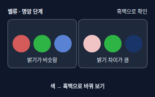</a> <b><a href="#value--밸류-명암-단계">Value</a></b> 밸류 (명암 단계) 색과 상관없이 얼마나 밝고 어두운지의 단계. 흑백으로 바꿨을 때 형태가 읽히면 밸류가 잘 잡힌 그림입니다.</td>
<td width="33%" valign="top"><a href="#hue-saturation-value--색조--채도--명도">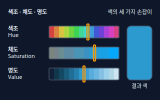</a> <b><a href="#hue-saturation-value--색조--채도--명도">Hue, Saturation, Value</a></b> 색조 · 채도 · 명도 색을 설명하는 세 가지 값. 색조는 어떤 색(빨강·파랑)인지, 채도는 얼마나 선명한지, 명도는 얼마나 밝은지입니다.</td>
</tr>
<tr>
<td width="33%" valign="top"><a href="#color-harmony--색-조화">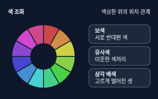</a> <b><a href="#color-harmony--색-조화">Color Harmony</a></b> 색 조화 색상환에서의 위치 관계로 어울리는 색 조합을 정하는 방법. 보색(반대편), 유사색(이웃), 삼각 배색(고르게 떨어진 세 색) 등이 있습니다.</td>
<td width="33%" valign="top"><b><a href="graphic-branding.md#color-palette--컬러-팔레트">Color Palette</a></b> 컬러 팔레트 그림이나 브랜드에서 쓰기로 정한 색의 묶음(주조색·보조색·강조색). → graphic-branding 시트</td>
</tr>
</table>

**명암과 빛 · Light & Shading** (7)

<table>
<tr>
<td width="33%" valign="top"><a href="#shading--명암-넣기">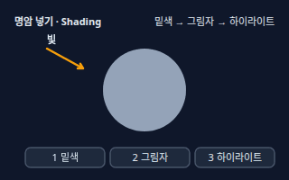</a> <b><a href="#shading--명암-넣기">Shading</a></b> 명암 넣기 밑색 위에 빛 방향에 따라 그림자 면과 밝은 점을 얹어 입체감을 만드는 작업.</td>
<td width="33%" valign="top"><a href="#cel-shading-vs-soft-shading--셀-셰이딩과-소프트-셰이딩">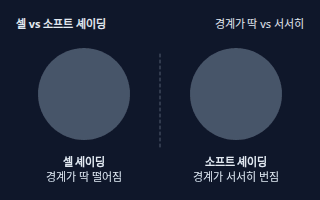</a> <b><a href="#cel-shading-vs-soft-shading--셀-셰이딩과-소프트-셰이딩">Cel Shading vs Soft Shading</a></b> 셀 셰이딩과 소프트 셰이딩 셀 셰이딩은 그림자 경계를 딱 끊어 칠해서 애니메이션 느낌을 내고, 소프트 셰이딩은 경계를 서서히 번지게 해서 부드럽고 입체적인 느낌을 냅니다.</td>
<td width="33%" valign="top"><a href="#light-source--광원">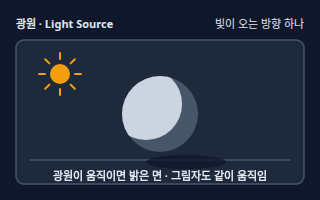</a> <b><a href="#light-source--광원">Light Source</a></b> 광원 그림 속 빛이 오는 방향과 종류. 광원을 하나 정하면 밝은 면, 그림자 면, 바닥 그림자의 방향이 한꺼번에 정해집니다.</td>
</tr>
<tr>
<td width="33%" valign="top"><b><a href="photography.md#hard--soft-light--하드-라이트--소프트-라이트">Hard / Soft Light</a></b> 하드 라이트 / 소프트 라이트 그림자 경계가 또렷한 빛과 부드럽게 퍼지는 빛의 차이. → photography 시트</td>
<td width="33%" valign="top"><a href="#cast-shadow-and-form-shadow--캐스트-섀도와-형태-그림자">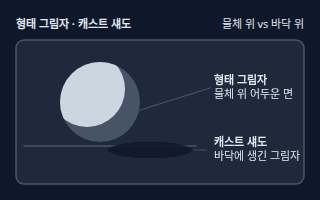</a> <b><a href="#cast-shadow-and-form-shadow--캐스트-섀도와-형태-그림자">Cast Shadow and Form Shadow</a></b> 캐스트 섀도와 형태 그림자 형태 그림자는 물체 자신이 빛을 받지 못하는 어두운 면이고, 캐스트 섀도는 그 물체가 바닥이나 벽에 드리운 그림자입니다.</td>
<td width="33%" valign="top"><a href="#ambient-occlusion--접촉-그림자-앰비언트-오클루전">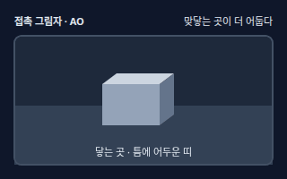</a> <b><a href="#ambient-occlusion--접촉-그림자-앰비언트-오클루전">Ambient Occlusion</a></b> 접촉 그림자 (앰비언트 오클루전) 물체가 바닥에 닿는 부분이나 옷 주름 속처럼 빛이 잘 닿지 않는 곳에 생기는 부드러운 어둠. 그림에서는 이 부분을 덧칠해 물체가 바닥에 붙어 보이게 합니다.</td>
</tr>
<tr>
<td width="33%" valign="top"><a href="#highlight-and-rim-light--하이라이트와-림-라이트">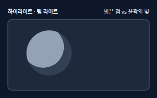</a> <b><a href="#highlight-and-rim-light--하이라이트와-림-라이트">Highlight and Rim Light</a></b> 하이라이트와 림 라이트 하이라이트는 빛이 가장 세게 맺힌 밝은 점이고, 림 라이트는 뒤쪽에서 오는 빛이 윤곽을 따라 만드는 가는 밝은 선입니다.</td>
</tr>
</table>

**디지털 도구 · Digital Tools** (8)

<table>
<tr>
<td width="33%" valign="top"><a href="#layer--레이어">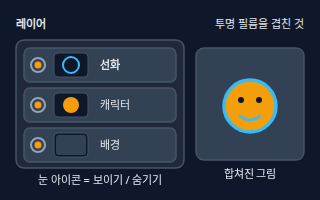</a> <b><a href="#layer--레이어">Layer</a></b> 레이어 투명한 필름처럼 겹쳐 쌓이는 그림 층. 선화·밑색·명암·배경을 따로 그려 두면 한 부분만 고쳐도 다른 부분이 망가지지 않습니다.</td>
<td width="33%" valign="top"><a href="#blend-modes--레이어-혼합-모드">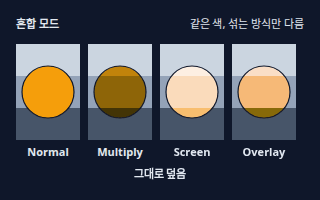</a> <b><a href="#blend-modes--레이어-혼합-모드">Blend Modes</a></b> 레이어 혼합 모드 위 레이어가 아래 레이어와 섞이는 방식. 곱하기(Multiply)는 어둡게 겹쳐 그림자에, 스크린(Screen)은 밝게 겹쳐 빛에, 오버레이(Overlay)는 밝은 곳은 더 밝게·어두운 곳은 더 어둡게 해 대비를 줍니다.</td>
<td width="33%" valign="top"><a href="#clipping-mask--클리핑-마스크">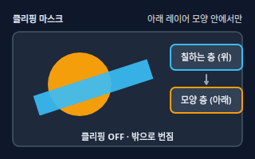</a> <b><a href="#clipping-mask--클리핑-마스크">Clipping Mask</a></b> 클리핑 마스크 위 레이어를 바로 아래 레이어의 모양 안에서만 보이게 하는 기능. 그림자를 마음껏 칠해도 캐릭터 밖으로 번지지 않습니다.</td>
</tr>
<tr>
<td width="33%" valign="top"><a href="#alpha-lock--알파-잠금">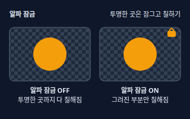</a> <b><a href="#alpha-lock--알파-잠금">Alpha Lock</a></b> 알파 잠금 레이어의 투명한 부분을 잠가서 이미 그려진 부분 안에만 칠해지게 하는 기능. 앱마다 이름이 달라 '투명 픽셀 잠금'이라고도 부릅니다.</td>
<td width="33%" valign="top"><a href="#brush-and-stabilizer--브러시와-손떨림-보정">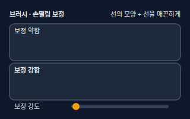</a> <b><a href="#brush-and-stabilizer--브러시와-손떨림-보정">Brush and Stabilizer</a></b> 브러시와 손떨림 보정 브러시는 선·칠의 모양, 크기, 진하기, 질감을 정하는 도구 설정이고, 손떨림 보정(스태빌라이저)은 손이 떨리거나 곡선이 흔들려도 선이 부드럽게 이어지게 해 줍니다.</td>
<td width="33%" valign="top"><a href="#canvas-size-and-resolution--캔버스-크기와-해상도">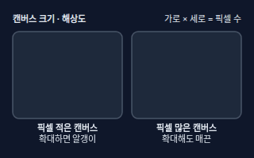</a> <b><a href="#canvas-size-and-resolution--캔버스-크기와-해상도">Canvas Size and Resolution</a></b> 캔버스 크기와 해상도 캔버스는 가로×세로 픽셀 수(해상도)로 정해지는 그림판입니다. 픽셀이 적게 시작하면 나중에 키울 때 흐려지므로, 쓰임에 맞는 크기로 처음부터 만드는 것이 안전합니다.</td>
</tr>
<tr>
<td width="33%" valign="top"><b><a href="graphic-branding.md#vector-vs-raster--벡터와-래스터">Vector vs Raster</a></b> 벡터와 래스터 점·선·곡선 수식으로 그린 벡터와 픽셀 격자로 그린 래스터의 차이. → graphic-branding 시트</td>
<td width="33%" valign="top"><b><a href="graphic-branding.md#dpi-and-ppi--dpi와-ppi-해상도">DPI and PPI</a></b> DPI와 PPI (해상도) 인쇄나 화면에서 1인치에 들어가는 점·픽셀의 밀도. → graphic-branding 시트</td>
</tr>
</table>

**의뢰와 사용 범위 · Commissions** (2)

<table>
<tr>
<td width="33%" valign="top"><a href="#commission--커미션-의뢰">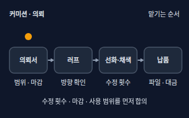</a> <b><a href="#commission--커미션-의뢰">Commission</a></b> 커미션 (의뢰) 작가에게 비용을 내고 원하는 그림을 맡기는 일. 보통 의뢰서 → 러프 확인 → 선화·채색 → 납품 순으로 진행되고, 수정 범위와 마감은 미리 정해 둡니다.</td>
<td width="33%" valign="top"><a href="#usage-rights--사용-범위-이용권">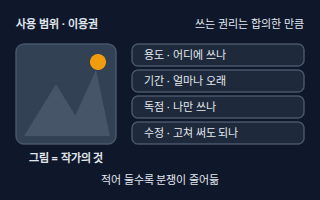</a> <b><a href="#usage-rights--사용-범위-이용권">Usage Rights</a></b> 사용 범위 (이용권) 의뢰한 그림을 어디에, 얼마나 오래, 누가 쓸 수 있는지에 대한 권리와 조건. 그림을 받아도 저작권이 자동으로 넘어오는 것은 아니어서 용도·기간·독점 여부를 글로 합의해 둡니다. 법률 자문이 아니므로 중요한 계약은 전문가에게 확인하세요.</td>
</tr>
</table>

<!-- overview:end -->

## 밑그림 · Sketching

### Thumbnail Sketch · 썸네일 스케치

- **정의**: 우표만 한 작은 칸에 구도를 여러 개 빠르게 그려 보고 가장 좋은 안을 고르는 단계. 디테일은 그리지 않고 큰 덩어리와 배치만 봅니다.
- **AI에게 이렇게**: "이 장면을 그리기 전에 구도가 서로 다른 썸네일 스케치 6개를 먼저 보여줘. 주인공 위치와 시선 방향을 다르게 해서"
- **언제**: 표지·포스터·웹툰 컷처럼 큰 그림을 그리기 전에 구도부터 정할 때
- **헷갈림**: Thumbnail(썸네일) — 영상·웹 목록에 뜨는 미리보기 이미지(video-production 시트)와 이름만 같고, 여기서는 구도를 고르려고 작게 그리는 밑그림
- **관련**: Rough Sketch, Composition and Focal Point, Silhouette
- **확인 질문**: 어디에 쓰는 그림이고(표지·SNS·포스터) 가로세로 비율은 어떻게 되나요? 꼭 들어가야 할 요소는 무엇인가요?

### Rough Sketch · 러프 스케치

- **정의**: 비율·포즈·배치를 거칠게 잡은 밑그림. 선이 지저분해도 괜찮고, 이 단계에서 방향을 확인한 뒤 선화로 넘어갑니다.
- **AI에게 이렇게**: "러프 스케치 단계에서 먼저 보내줘. 방향을 내가 OK 하기 전에는 선화와 채색으로 넘어가지 말아줘"
- **언제**: 의뢰한 그림의 방향을 확인할 때, 직접 그릴 때 첫 포즈와 배치를 잡을 때
- **헷갈림**: Line Art — 러프는 형태를 찾느라 지저분하게 그은 선, 선화는 그 위에 깨끗하게 다시 딴 최종 선
- **관련**: Thumbnail Sketch, Line Art, Clean-up
- **확인 질문**: 러프 단계에서 방향 수정은 몇 번까지 가능한가요? 러프에서 확인할 것은 구도·포즈·표정 중 무엇인가요?

### Gesture Drawing · 제스처 드로잉

- **정의**: 짧은 시간 동안 선 몇 개로 포즈의 움직임과 흐름만 잡는 연습. 디테일보다 몸이 어디로 힘을 주고 있는지를 그립니다.
- **AI에게 이렇게**: "달리는 사람 포즈를 제스처 드로잉처럼 선 몇 개로 잡는 순서를 알려줘. 디테일은 빼고 움직임의 흐름만"
- **언제**: 역동적인 포즈를 시작하기 전, 매일 하는 드로잉 워밍업
- **헷갈림**: Rough Sketch — 제스처는 아주 짧게 움직임만 잡는 연습, 러프는 비율과 배치까지 잡는 작업용 밑그림
- **관련**: Line of Action, Proportion (Head Unit), Foreshortening
- **확인 질문**: 어떤 동작(서기·달리기·앉기)인가요? 참고할 사진이나 모델 포즈가 있나요?

### Line of Action · 액션 라인

- **정의**: 포즈 전체를 머리부터 발끝까지 관통하는 큰 곡선 하나. 이 선이 휘어 있으면 가만히 선 포즈에도 힘과 방향이 생깁니다.
- **AI에게 이렇게**: "점프하는 캐릭터에 큰 C자 액션 라인을 먼저 긋고, 그 선을 따라 팔다리를 배치해서 포즈를 더 역동적으로 잡아줘"
- **언제**: 포즈를 역동적으로 만들고 싶을 때, 감정이나 움직임을 한눈에 보이게 하고 싶을 때
- **헷갈림**: Gesture Drawing — 액션 라인은 포즈에 긋는 큰 곡선 하나, 제스처 드로잉은 그런 흐름을 빠르게 잡는 연습 전체
- **관련**: Gesture Drawing, Silhouette, Composition and Focal Point
- **확인 질문**: 어떤 느낌(힘·피로·기쁨·긴장)을 보여주고 싶은가요? 몸이 향하는 방향은 어느 쪽인가요?

### Silhouette · 실루엣

- **정의**: 안쪽 디테일을 빼고 바깥 모양만 한 가지 색으로 칠한 그림자 형태. 실루엣만 봐도 캐릭터나 물건을 알아볼 수 있으면 좋은 디자인으로 봅니다.
- **AI에게 이렇게**: "이 캐릭터 시안 3개를 실루엣만 검은색으로 뽑아서 서로 구분이 되는지 비교해줘"
- **언제**: 캐릭터 디자인 비교, 포즈가 한눈에 읽히는지 확인할 때, 게임·애니 캐릭터를 구분 지을 때
- **헷갈림**: Value — 실루엣은 안쪽을 한 색으로 채운 바깥 모양, 밸류는 그림 안쪽의 밝고 어두운 단계
- **관련**: Character Sheet, Line of Action, Value
- **확인 질문**: 정면·옆모습 중 어느 포즈로 볼까요? 비교할 캐릭터는 몇 개인가요?

### Reference · 레퍼런스

- **정의**: 그리기 전에 모아 두는 참고 자료(사진·실물·다른 그림). 베끼려는 게 아니라 구조·빛·분위기를 이해하려고 봅니다.
- **AI에게 이렇게**: "한복 입은 인물을 그릴 건데 저고리 구조와 주름이 잘 보이는 레퍼런스를 찾으려면 어떤 키워드로 검색해야 하는지 알려줘"
- **언제**: 낯선 소품·포즈·건물을 그릴 때, 의뢰할 때 원하는 느낌을 작가에게 전달할 때
- **헷갈림**: Mood Board(무드보드, graphic-branding 시트) — 레퍼런스는 모양·포즈 같은 구체적인 참고 한 장, 무드보드는 전체 분위기를 모아 둔 판. 남의 그림을 그대로 따라 그리는 것은 참고가 아니라 모작입니다
- **관련**: Mood Board, Character Sheet, Commission
- **확인 질문**: 레퍼런스에서 무엇을 참고하고 싶나요(포즈·색·재질·분위기)? 그대로 따라 그리면 안 되는 자료는 아닌가요?

## 형태와 구조 · Structure

### Proportion (Head Unit) · 비례와 등신

- **정의**: 머리 높이를 한 칸으로 삼아 몸 전체가 몇 칸인지 세는 방법. 7등신은 현실에 가까운 비례, 3등신 안팎은 귀여운 SD(작고 둥근) 캐릭터 비례입니다.
- **AI에게 이렇게**: "같은 캐릭터를 성인용 7등신 버전과 마스코트용 3등신 버전으로 두 가지 비례로 설계해줘"
- **언제**: 캐릭터 체형을 정할 때, 이모티콘·마스코트를 만들 때
- **헷갈림**: Anatomy(해부학) — 등신은 전체 비례를 정하는 약속, 해부학은 뼈와 근육의 구조 지식
- **관련**: Character Sheet, Silhouette, Foreshortening
- **확인 질문**: 현실 비례·만화 비례·SD 중 어떤 느낌인가요? 작은 크기(이모티콘)로도 쓰이나요?

### Perspective · 투시 (원근법)

- **정의**: 평평한 종이 위에 깊이와 공간을 그리는 방법. 소실점이 1개인 1점 투시(정면), 2개인 2점 투시(모서리), 3개인 3점 투시(위·아래로 크게 보이는 장면)로 나뉩니다.
- **AI에게 이렇게**: "복도를 정면에서 보는 장면이니까 1점 투시로 그리고, 소실점은 화면 중앙에 두는 구도로 만들어줘"
- **언제**: 방·건물·거리 같은 배경을 그릴 때, 공간감을 주고 싶을 때
- **헷갈림**: Foreshortening — 투시는 공간 전체의 선이 한 점으로 모이는 규칙, 단축법은 팔·몸 같은 물체 하나에 같은 원리를 적용하는 것
- **관련**: Vanishing Point and Horizon Line, Foreshortening, Composition and Focal Point
- **확인 질문**: 정면으로 볼까요, 모서리가 보이게 볼까요? 눈높이는 서 있는 높이·내려다봄·올려다봄 중 무엇인가요?

### Vanishing Point and Horizon Line · 소실점과 수평선

- **정의**: 수평선은 그림 속 눈높이를 나타내는 선이고, 소실점은 그 수평선 위에서 멀어지는 평행선들이 모이는 점입니다.
- **AI에게 이렇게**: "수평선을 화면 아래쪽에 낮게 두고 소실점은 오른쪽에 둬서, 올려다보는 낮은 시점으로 도로가 오른쪽 멀리 사라지는 구도로 그려줘"
- **언제**: 배경·도로·건물을 그릴 때, 낮은 시점·높은 시점을 정할 때
- **헷갈림**: Rule of Thirds(삼분할 구도, photography 시트) — 수평선을 어디에 둘지 정할 때 삼분할을 참고하기도 하지만, 수평선은 눈높이이고 삼분할은 화면 배치 규칙
- **관련**: Perspective, Foreshortening, Rule of Thirds
- **확인 질문**: 보는 사람의 눈높이를 높게(내려다봄)·낮게(올려다봄) 중 어디에 둘까요? 소실점은 화면 안에 보이게 할까요?

### Foreshortening · 단축법

- **정의**: 앞으로 뻗은 팔처럼 보는 사람 쪽을 향한 부분을 길이는 짧게, 가까운 끝은 크게 그리는 방법.
- **AI에게 이렇게**: "관객 쪽으로 손을 뻗은 포즈를 단축법으로 그려줘. 팔은 짧게 겹쳐 보이고 손은 얼굴만큼 크게"
- **언제**: 앞으로 뻗은 손·발, 누운 포즈, 아래에서 올려다본 얼굴을 그릴 때
- **헷갈림**: Perspective — 투시는 공간 전체에 적용하는 소실점 규칙, 단축법은 하나의 몸·물체가 앞뒤로 짧아 보이는 현상
- **관련**: Perspective, Proportion (Head Unit), Gesture Drawing
- **확인 질문**: 시점(카메라) 위치는 어디인가요? 가장 가까이 오는 부분은 손·발·얼굴 중 어디인가요?

### Composition and Focal Point · 구도와 초점

- **정의**: 구도는 그림 안 요소를 배치하는 방식이고, 초점은 보는 사람의 시선이 가장 먼저 머무는 곳입니다. 크기·대비·위치·선의 방향으로 만듭니다.
- **AI에게 이렇게**: "주인공이 삼분할 선의 교차점에 오게 구도를 잡고, 배경의 선들이 주인공 쪽으로 모이게 해줘. 초점은 얼굴로"
- **언제**: 표지·포스터 일러스트, 웹툰 한 컷의 연출을 정할 때
- **헷갈림**: Rule of Thirds(photography 시트) — 삼분할은 구도 규칙 중 하나, 구도는 배치 방법 전체, 초점은 그 결과 시선이 머무는 곳
- **관련**: Thumbnail Sketch, Silhouette, Rule of Thirds, Leading Lines
- **확인 질문**: 가장 먼저 보여야 할 것은 무엇인가요(얼굴·제품·글자)? 제목이나 로고가 들어갈 빈 공간이 필요한가요?

### Character Sheet · 캐릭터 시트

- **정의**: 한 캐릭터를 앞·옆·뒤(턴어라운드), 표정, 색 지정과 함께 모아 그린 설정 자료. 여러 작가나 AI가 같은 캐릭터를 같은 모습으로 그리게 해 줍니다.
- **AI에게 이렇게**: "이 캐릭터 시트를 기준으로 정면·측면·후면 비율이 모두 똑같게, 머리카락과 옷 색은 시트에 적힌 색 지정대로 그려줘"
- **언제**: 캐릭터를 의뢰할 때, 웹툰·게임에서 캐릭터를 일관되게 유지할 때, AI 이미지에서 같은 캐릭터를 반복해 쓰고 싶을 때
- **헷갈림**: Reference — 레퍼런스는 바깥에서 가져온 참고 자료, 캐릭터 시트는 내가 만든 캐릭터의 공식 설정 자료
- **관련**: Proportion (Head Unit), Silhouette, Color Palette
- **확인 질문**: 필요한 방향(앞·옆·뒤)과 표정·소품 컷은 무엇인가요? 지정해 둔 색 코드(HEX)가 있나요?

## 선화와 채색 · Line & Color

### Line Art · 선화

- **정의**: 러프 위에 깨끗한 선으로 다시 따서 만든 윤곽 단계. 채색은 이 선 아래 별도 레이어에서 합니다.
- **AI에게 이렇게**: "러프 위에 선 굵기를 일정하게 맞춰 선화를 정리하고, 배경이 투명한 PNG로 따로 줘"
- **언제**: 만화·웹툰 작업, 일러스트의 최종 윤곽, 스티커·이모티콘의 선을 만들 때
- **헷갈림**: Outline(아웃라인, graphic-branding 시트) — 선화는 그림의 윤곽선을 그린 단계, 아웃라인은 글자를 도형으로 바꾸는 작업. 선 없이 색 면만으로 그리는 스타일은 '선 없는(lineless)' 방식입니다
- **관련**: Clean-up, Line Weight, Flat Color
- **확인 질문**: 선 색은 검정인가요, 색선인가요, 선 없는 스타일인가요? 투명 배경 PNG가 필요한가요?

### Clean-up · 클린업

- **정의**: 선화에서 삐져나온 선, 끊긴 선, 겹친 선을 정리하는 마무리 작업. 선이 끊겨 있으면 페인트통으로 칠할 때 색이 밖으로 샙니다.
- **AI에게 이렇게**: "선화에서 삐져나온 선과 끊긴 선을 정리하고, 밑색을 칠하기 전에 모든 영역이 닫혀 있는지 확인해줘"
- **언제**: 밑색을 칠하기 전, 최종 납품 전에
- **헷갈림**: Retouching(보정, photography 시트) — 클린업은 그림의 선을 정리하는 작업, 리터칭은 사진을 다듬는 작업
- **관련**: Line Art, Flat Color, Layer
- **확인 질문**: 어느 부분이 지저분한가요? 선 두께도 같이 균일하게 맞출까요?

### Line Weight · 선 굵기

- **정의**: 선의 굵고 가는 정도. 바깥 윤곽은 굵게, 안쪽 디테일은 가늘게 그리면 입체감과 강약이 생깁니다.
- **AI에게 이렇게**: "바깥 윤곽선은 굵게, 옷 주름과 얼굴 디테일은 가늘게 해서 선 굵기에 강약을 줘"
- **언제**: 선화 스타일을 정할 때, 작게 줄여 써도 형태가 읽히게 하고 싶을 때(이모티콘·아이콘)
- **헷갈림**: Brush Size(브러시 크기) — 선 굵기는 그려진 선의 결과, 브러시 크기는 그 선을 그리는 도구의 설정
- **관련**: Line Art, Brush and Stabilizer, Silhouette
- **확인 질문**: 작게 줄여서 쓰나요(스티커·아이콘)? 굵기가 일정한 느낌인가요, 펜처럼 강약이 있는 느낌인가요?

### Flat Color · 밑색

- **정의**: 명암 없이 면마다 한 가지 색만 평평하게 깔아 둔 채색의 첫 단계. 그림자와 하이라이트는 이 위에 따로 얹습니다.
- **AI에게 이렇게**: "선화 아래 레이어에 머리카락·피부·옷을 각각 한 색씩만 칠해줘. 명암은 아직 넣지 말고, 쓴 색으로 팔레트도 정리해줘"
- **언제**: 선화가 끝나고 채색을 시작할 때, 색 조합을 먼저 확인하고 싶을 때
- **헷갈림**: Flat Design(플랫 디자인) — 밑색은 채색 단계의 이름, 플랫 디자인은 그림자 없는 단순한 디자인 양식
- **관련**: Line Art, Layer, Color Palette, Shading
- **확인 질문**: 영역별(피부·머리·옷) 정해진 색이 있나요? 나중에 고치기 쉽게 영역별로 레이어를 나눌까요?

### Value · 밸류 (명암 단계)

- **정의**: 색과 상관없이 얼마나 밝고 어두운지의 단계. 흑백으로 바꿨을 때 형태가 읽히면 밸류가 잘 잡힌 그림입니다.
- **AI에게 이렇게**: "완성한 일러스트를 흑백으로 바꿔서 밝기 차이가 약해 서로 뭉쳐 보이는 부분을 알려줘"
- **언제**: 채색을 검토할 때, 그림이 평평하거나 뭉쳐 보일 때, 시선이 갈 초점을 만들 때
- **헷갈림**: Hue, Saturation, Value의 Value(명도) — 같은 말이지만, 여기서는 그림 전체의 밝고 어두운 배치를 보는 관점이고 색의 3요소에서는 색 하나의 밝기를 뜻함
- **관련**: Hue, Saturation, Value, Shading, Silhouette
- **확인 질문**: 밝은 분위기인가요, 어두운 분위기인가요? 초점이 되는 곳을 가장 밝게(또는 가장 대비 크게) 할까요?

### Hue, Saturation, Value · 색조 · 채도 · 명도

- **정의**: 색을 설명하는 세 가지 값. 색조는 어떤 색(빨강·파랑)인지, 채도는 얼마나 선명한지, 명도는 얼마나 밝은지입니다.
- **AI에게 이렇게**: "이 색은 색조는 그대로 두고 채도만 낮춰서 차분한 톤으로 바꿔줘. 그다음 명도를 조금 올려서 파스텔 느낌으로 만들어줘"
- **언제**: 색을 고를 때, 색 조정 레이어를 쓸 때, AI에게 색 느낌을 설명할 때
- **헷갈림**: RGB vs CMYK(graphic-branding 시트) — RGB·CMYK는 색을 만드는 방식(화면·인쇄), 색조·채도·명도는 사람이 색을 조절하기 쉽게 나눠 설명하는 방식
- **관련**: Value, Color Harmony, Color Palette
- **확인 질문**: 어떤 색을 어느 쪽(더 선명하게·더 탁하게·더 밝게·더 어둡게)으로 바꿀까요?

### Color Harmony · 색 조화

- **정의**: 색상환에서의 위치 관계로 어울리는 색 조합을 정하는 방법. 보색(반대편), 유사색(이웃), 삼각 배색(고르게 떨어진 세 색) 등이 있습니다.
- **AI에게 이렇게**: "주황 계열 주인공에 보색인 청록을 포인트로 쓰고 나머지는 유사색으로 정리한 컬러 팔레트를 추천해줘"
- **언제**: 캐릭터 색을 정할 때, 배경 분위기를 맞출 때, 팔레트를 만들 때
- **헷갈림**: Color Palette(graphic-branding 시트) — 색 조화는 어울리게 고르는 규칙, 팔레트는 고른 색의 목록 자체
- **관련**: Hue, Saturation, Value, Color Palette, Contrast
- **확인 질문**: 원하는 분위기(따뜻함·차가움·발랄함·차분함)는 무엇인가요? 꼭 써야 하는 브랜드 색이 있나요?

### Color Palette · 컬러 팔레트

- **정의**: 그림이나 브랜드에서 쓰기로 정한 색의 묶음(주조색·보조색·강조색).
- **원본**: [그래픽 · 브랜딩 · Color Palette](graphic-branding.md#color-palette--컬러-팔레트)

## 명암과 빛 · Light & Shading

### Shading · 명암 넣기

- **정의**: 밑색 위에 빛 방향에 따라 그림자 면과 밝은 점을 얹어 입체감을 만드는 작업.
- **AI에게 이렇게**: "밑색 레이어 위에 새 레이어를 만들어 왼쪽 위에서 빛이 오는 것으로 그림자를 넣어줘. 하이라이트는 마지막에 따로 줘"
- **언제**: 밑색을 다 칠한 뒤 그림에 부피감을 주고 싶을 때
- **헷갈림**: Flat / Smooth Shading(3d-modeling 시트) — 3D 모델에서 면을 매끈하게 보이게 하는 처리 방식이고, 여기서는 그림에 명암을 칠하는 작업
- **관련**: Light Source, Cel Shading vs Soft Shading, Flat Color, Blend Modes
- **확인 질문**: 빛은 어느 쪽에서 오나요? 단순하게 끊어 칠할까요, 부드럽게 번지게 칠할까요?

### Cel Shading vs Soft Shading · 셀 셰이딩과 소프트 셰이딩

- **정의**: 셀 셰이딩은 그림자 경계를 딱 끊어 칠해서 애니메이션 느낌을 내고, 소프트 셰이딩은 경계를 서서히 번지게 해서 부드럽고 입체적인 느낌을 냅니다.
- **AI에게 이렇게**: "그림자는 두 단계로 경계가 딱 떨어지는 셀 셰이딩으로 칠하고, 하이라이트는 한 번만 넣어서 애니메이션 느낌으로 만들어줘"
- **언제**: 그림 스타일을 정할 때(애니·웹툰은 셀, 회화풍은 소프트), AI 이미지 프롬프트에 화풍을 지정할 때
- **헷갈림**: Flat Color — 밑색은 명암이 없는 상태, 셀 셰이딩은 그 위에 그림자를 단계로 끊어 칠한 것
- **관련**: Shading, Light Source, Flat Color
- **확인 질문**: 애니메이션처럼 선명한 느낌인가요, 회화처럼 부드러운 느낌인가요? 그림자 단계는 몇 단계로 할까요?

### Light Source · 광원

- **정의**: 그림 속 빛이 오는 방향과 종류. 광원을 하나 정하면 밝은 면, 그림자 면, 바닥 그림자의 방향이 한꺼번에 정해집니다.
- **AI에게 이렇게**: "광원은 왼쪽 위에 고정하고 모든 그림자가 오른쪽 아래로 향하게 일관되게 그려줘"
- **언제**: 명암을 넣기 전에, 배경과 캐릭터의 빛을 서로 맞출 때
- **헷갈림**: Backlight(역광, photography 시트) — 역광은 광원이 피사체 뒤에 있는 한 가지 경우, 광원은 빛이 어디서 오는지 전체를 가리키는 말
- **관련**: Cast Shadow and Form Shadow, Hard / Soft Light, Three-Point Lighting, Highlight and Rim Light
- **확인 질문**: 빛은 어느 쪽에서 오나요(왼쪽·오른쪽·뒤·위)? 광원은 한 개인가요? 빛 색은 따뜻한가요, 차가운가요?

### Hard / Soft Light · 하드 라이트 / 소프트 라이트

- **정의**: 그림자 경계가 또렷한 빛과 부드럽게 퍼지는 빛의 차이.
- **원본**: [사진 촬영 · Hard / Soft Light](photography.md#hard--soft-light--하드-라이트--소프트-라이트)

### Cast Shadow and Form Shadow · 캐스트 섀도와 형태 그림자

- **정의**: 형태 그림자는 물체 자신이 빛을 받지 못하는 어두운 면이고, 캐스트 섀도는 그 물체가 바닥이나 벽에 드리운 그림자입니다.
- **AI에게 이렇게**: "공의 형태 그림자는 부드럽게, 바닥의 캐스트 섀도는 더 어둡고 가장자리가 또렷하게 구분해서 그려줘"
- **언제**: 물체에 입체감과 바닥에 선 느낌을 줄 때
- **헷갈림**: Ambient Occlusion — 둘 다 어두운 부분이지만, 접촉 그림자(AO)는 맞닿은 틈이 부드럽게 어두워지는 현상
- **관련**: Light Source, Ambient Occlusion, Shading
- **확인 질문**: 그림자가 떨어지는 바닥이나 벽이 있나요? 그림자 색을 검정 대신 푸른색·보라색 계열로 할까요?

### Ambient Occlusion · 접촉 그림자 (앰비언트 오클루전)

- **정의**: 물체가 바닥에 닿는 부분이나 옷 주름 속처럼 빛이 잘 닿지 않는 곳에 생기는 부드러운 어둠. 그림에서는 이 부분을 덧칠해 물체가 바닥에 붙어 보이게 합니다.
- **AI에게 이렇게**: "발바닥과 바닥 사이, 옷 주름 안쪽에 접촉 그림자(AO)를 부드럽게 넣어서 캐릭터가 붕 떠 보이지 않게 해줘"
- **언제**: 접지감을 주고 싶을 때, 물체가 겹치는 틈의 깊이를 표현할 때
- **헷갈림**: Cast Shadow — 캐스트 섀도는 광원 반대쪽으로 길게 드리운 그림자, AO는 광원 방향과 상관없이 맞닿은 곳이 어두운 현상
- **관련**: Cast Shadow and Form Shadow, Shading, Blend Modes
- **확인 질문**: 바닥이 있는 장면인가요, 투명 배경인가요? 어두운 정도는 은은하게 할까요, 뚜렷하게 할까요?

### Highlight and Rim Light · 하이라이트와 림 라이트

- **정의**: 하이라이트는 빛이 가장 세게 맺힌 밝은 점이고, 림 라이트는 뒤쪽에서 오는 빛이 윤곽을 따라 만드는 가는 밝은 선입니다.
- **AI에게 이렇게**: "머리카락에 하이라이트를 점 하나 넣고, 오른쪽 윤곽에는 푸른색 림 라이트를 가늘게 넣어서 인물이 배경에서 떠 보이게 해줘"
- **언제**: 눈·금속·머리카락처럼 반짝이는 부분을 표현할 때, 캐릭터를 배경에서 분리할 때
- **헷갈림**: Backlight(역광, photography 시트) — 역광은 사진에서 광원이 피사체 뒤에 있는 촬영 방식, 림 라이트는 그 결과 윤곽에 생기는 빛을 그림에서 표현한 것
- **관련**: Light Source, Backlight, Blend Modes, Shading
- **확인 질문**: 반짝임은 강하게 할까요, 은은하게 할까요? 림 라이트 색은 배경 빛 색과 같게 할까요?

## 디지털 도구 · Digital Tools

### Layer · 레이어

- **정의**: 투명한 필름처럼 겹쳐 쌓이는 그림 층. 선화·밑색·명암·배경을 따로 그려 두면 한 부분만 고쳐도 다른 부분이 망가지지 않습니다.
- **AI에게 이렇게**: "선화, 밑색, 그림자, 배경을 레이어로 나눈 PSD 파일로 줘. 레이어 이름도 한글로 붙여줘"
- **언제**: 디지털로 그리는 모든 작업, 납품 파일을 원본 레이어 상태로 받고 싶을 때
- **헷갈림**: Merge(병합) — 레이어를 하나로 합치는 것. 합치고 나면 다시 나누기 어렵고, 폴더(그룹)는 레이어를 묶어 정리만 하는 것
- **관련**: Clipping Mask, Alpha Lock, Blend Modes
- **확인 질문**: 레이어를 나눈 상태로 받아야 하나요? 파일 형식은 PSD, 앱 고유 형식, PNG 중 무엇인가요?

### Blend Modes · 레이어 혼합 모드

- **정의**: 위 레이어가 아래 레이어와 섞이는 방식. 곱하기(Multiply)는 어둡게 겹쳐 그림자에, 스크린(Screen)은 밝게 겹쳐 빛에, 오버레이(Overlay)는 밝은 곳은 더 밝게·어두운 곳은 더 어둡게 해 대비를 줍니다.
- **AI에게 이렇게**: "그림자 레이어는 곱하기(Multiply), 반짝이는 빛 레이어는 스크린(Screen)으로 설정하고 불투명도는 60%로 맞춰줘"
- **언제**: 그림자·빛 효과를 얹을 때, 색감을 한꺼번에 조정할 때, 질감을 얹을 때
- **헷갈림**: Opacity(불투명도) — 불투명도는 레이어가 얼마나 비쳐 보이는지, 혼합 모드는 아래 색과 어떤 방식으로 섞이는지
- **관련**: Layer, Clipping Mask, Shading, Highlight and Rim Light
- **확인 질문**: 쓰는 앱은 무엇인가요(Procreate·Clip Studio·Photoshop)? 어둡게 하려는 건가요, 밝게 하려는 건가요?

### Clipping Mask · 클리핑 마스크

- **정의**: 위 레이어를 바로 아래 레이어의 모양 안에서만 보이게 하는 기능. 그림자를 마음껏 칠해도 캐릭터 밖으로 번지지 않습니다.
- **AI에게 이렇게**: "밑색 레이어 위에 클리핑 마스크 레이어를 만들어서 그림자를 칠해줘. 윤곽 밖으로는 안 나가게"
- **언제**: 명암이나 질감을 얹을 때, 밑색을 건드리지 않고 덧칠하고 싶을 때
- **헷갈림**: Alpha Lock — 둘 다 모양 밖으로 칠이 번지지 않게 하지만, 클리핑 마스크는 별도 레이어에서, 알파 잠금은 같은 레이어에서 투명한 부분을 잠그는 방식. 레이어 마스크(일부를 가리거나 보이게 하는 기능)와도 다릅니다
- **관련**: Layer, Alpha Lock, Blend Modes
- **확인 질문**: 그림자를 칠할 새 레이어를 따로 둘까요? 원본 밑색 레이어는 그대로 보존할까요?

### Alpha Lock · 알파 잠금

- **정의**: 레이어의 투명한 부분을 잠가서 이미 그려진 부분 안에만 칠해지게 하는 기능. 앱마다 이름이 달라 '투명 픽셀 잠금'이라고도 부릅니다.
- **AI에게 이렇게**: "이 밑색 레이어에 알파 잠금을 켜고 머리카락 색만 갈색에서 은색으로 바꿔줘"
- **언제**: 한 레이어의 색을 통째로 바꿀 때, 모양 안에서만 그라데이션이나 질감을 칠할 때
- **헷갈림**: Clipping Mask — 알파 잠금은 같은 레이어를 직접 칠하므로 원래 색이 사라지고, 클리핑 마스크는 위에 새 레이어를 얹어 원본이 남음
- **관련**: Layer, Clipping Mask, Flat Color
- **확인 질문**: 원본 색을 남겨야 하나요? 그렇다면 레이어를 복제한 뒤 복사본에서 바꿀까요?

### Brush and Stabilizer · 브러시와 손떨림 보정

- **정의**: 브러시는 선·칠의 모양, 크기, 진하기, 질감을 정하는 도구 설정이고, 손떨림 보정(스태빌라이저)은 손이 떨리거나 곡선이 흔들려도 선이 부드럽게 이어지게 해 줍니다.
- **AI에게 이렇게**: "선화용으로는 보정 강도를 높이고 가는 펜 브러시, 질감 칠용으로는 보정을 낮추고 거친 질감의 브러시를 쓰는 설정을 추천해줘"
- **언제**: 선화를 깔끔하게 따고 싶을 때(보정 높게), 스케치를 빠르게 할 때(보정 낮게)
- **헷갈림**: Line Weight — 선 굵기는 그려진 결과의 두께, 브러시 크기는 그 선을 만드는 도구의 설정. 보정이 너무 높으면 선이 늦게 따라와 뭉툭해질 수 있음
- **관련**: Line Art, Line Weight, Layer
- **확인 질문**: 쓰는 앱과 입력 도구는 무엇인가요(아이패드·펜 태블릿·마우스)? 원하는 선 느낌은 또렷한 펜인가요, 거친 연필인가요?

### Canvas Size and Resolution · 캔버스 크기와 해상도

- **정의**: 캔버스는 가로×세로 픽셀 수(해상도)로 정해지는 그림판입니다. 픽셀이 적게 시작하면 나중에 키울 때 흐려지므로, 쓰임에 맞는 크기로 처음부터 만드는 것이 안전합니다.
- **AI에게 이렇게**: "SNS 프로필로 쓰고 나중에 A4 포스터로도 인쇄할 거야. 이 용도에 맞는 캔버스 가로세로 픽셀 크기와 설정을 알려줘"
- **언제**: 새 캔버스를 만들 때, 납품 크기를 협의할 때
- **헷갈림**: DPI and PPI — 해상도는 픽셀의 총 개수, DPI·PPI는 그 픽셀을 인쇄나 화면에서 1인치에 얼마나 촘촘히 놓는지의 밀도
- **관련**: DPI and PPI, Vector vs Raster, Layer
- **확인 질문**: 그림을 어디에 쓰나요(웹·SNS·인쇄)? 인쇄한다면 실제 인쇄 크기는 얼마인가요?

### Vector vs Raster · 벡터와 래스터

- **정의**: 점·선·곡선 수식으로 그린 벡터와 픽셀 격자로 그린 래스터의 차이.
- **원본**: [그래픽 · 브랜딩 · Vector vs Raster](graphic-branding.md#vector-vs-raster--벡터와-래스터)

### DPI and PPI · DPI와 PPI (해상도)

- **정의**: 인쇄나 화면에서 1인치에 들어가는 점·픽셀의 밀도.
- **원본**: [그래픽 · 브랜딩 · DPI and PPI](graphic-branding.md#dpi-and-ppi--dpi와-ppi-해상도)

## 의뢰와 사용 범위 · Commissions

### Commission · 커미션 (의뢰)

- **정의**: 작가에게 비용을 내고 원하는 그림을 맡기는 일. 보통 의뢰서 → 러프 확인 → 선화·채색 → 납품 순으로 진행되고, 수정 범위와 마감은 미리 정해 둡니다.
- **AI에게 이렇게**: "일러스트 커미션 의뢰서 초안을 써줘. 용도, 캐릭터 설명, 레퍼런스 링크, 마감일, 수정 가능 횟수, 납품 파일 형식을 빈칸으로 넣어서"
- **언제**: 캐릭터·표지·프로필·굿즈 일러스트를 외주로 맡길 때
- **헷갈림**: Usage Rights — 커미션은 그림을 그려 달라고 맡기는 거래, 사용 범위는 완성된 그림을 어디까지 쓸 수 있는지에 대한 약속
- **관련**: Rough Sketch, Character Sheet, Reference, Usage Rights
- **확인 질문**: 그림의 용도는 무엇인가요(개인 소장·SNS·상업)? 예산, 마감, 수정 횟수는 어떻게 되나요?

### Usage Rights · 사용 범위 (이용권)

- **정의**: 의뢰한 그림을 어디에, 얼마나 오래, 누가 쓸 수 있는지에 대한 권리와 조건. 그림을 받아도 저작권이 자동으로 넘어오는 것은 아니어서 용도·기간·독점 여부를 글로 합의해 둡니다. 법률 자문이 아니므로 중요한 계약은 전문가에게 확인하세요.
- **AI에게 이렇게**: "이 일러스트를 쇼핑몰 상세페이지와 SNS 광고에 쓸 건데, 작가에게 확인해야 할 사용 범위(용도·기간·독점 여부·수정 허용)를 질문 목록으로 정리해줘"
- **언제**: 굿즈·광고·책 표지처럼 상업적으로 쓸 때, 그림을 고쳐 쓰거나 다른 곳에 옮겨 쓸 때
- **헷갈림**: Copyright(저작권) — 저작권은 그림에 대한 권리 전체, 사용 범위는 그중 어디까지 쓰도록 허락했는지에 대한 약속
- **관련**: Commission, Reference, Character Sheet
- **확인 질문**: 어디에 쓰나요(개인·상업)? 얼마 동안, 어느 나라에서 쓰나요? 고쳐 쓰거나 굿즈로 만들 계획도 있나요?

## 참고 자료

- [Procreate Handbook · Blend Modes](https://help.procreate.com/procreate/handbook/layers/layers-blend)
- [Procreate Handbook · Layer Options (Alpha Lock)](https://procreate.com/handbook/procreate/layers/layers-options)
- [Procreate Handbook · Mask (Clipping Mask)](https://procreate.com/handbook/procreate/layers/layers-mask)
- [Procreate Handbook · Perspective Guide](https://help.procreate.com/procreate/handbook/guides/guides-perspective)
- [Adobe · Blending mode descriptions in Photoshop](https://helpx.adobe.com/photoshop/desktop/repair-retouch/adjust-light-tone/blending-mode-descriptions.html)
- [CLIP STUDIO TIPS · Tips for Cel Shading](https://tips.clip-studio.com/en-us/articles/10901)
- [CLIP STUDIO TIPS · Lineart Tips for Beginners](https://tips.clip-studio.com/en-us/articles/8809)
- [Simple Art Tips · Creating a Character Turnaround Sheet](https://www.simplearttips.com/tutorials-blog/turnaround-sheet)
- [The AOI · How to licence Illustration](https://www.theaoi.com/resources/professional-practice/licensing-illustration-2/)
