# 노무 · 채용 실무 치트시트

> 직원 한두 명, 알바 몇 명을 쓰는 작은 사업장의 사장님이 근로계약서, 주휴수당, 연장수당, 연차, 임금명세서를 AI에게 시키기 전에 펼치는 시트입니다. 노동법은 "사업장에 상시 몇 명이 있는가"에 따라 적용되는 조문이 달라지므로 첫 용어(Workplace Size)부터 맞춥니다.

> ⚠️ **참고용이며 법률·세무·투자 자문이 아닙니다.** 대한민국 기준, 2026-11 기준입니다. 법령·세율·한도는 바뀔 수 있으니 실제 판단은 노무사·변호사·세무사 등 전문가와 확인하세요.

## 이렇게 쓰세요

- **나 → AI**: "우리 가게는 사장 빼고 직원 3명, 알바 2명이야. 알바 한 명을 새로 뽑는데, 주 3일 하루 5시간으로 근로계약서 초안을 만들고 주휴수당이 생기는지 계산해줘."
- **AI → 나**: "상시 근로자 수가 5명 이상인지(알바 포함) 먼저 확인할게요. 그리고 4주 평균 주 소정근로시간이 15시간 이상인지, 시급이 최저임금 이상인지, 18세 미만은 아닌지 알려주세요."
- **나 → AI**: "퇴사하는 직원 최종 정산표를 만들어줘. 마지막 달 일할 급여, 미사용 연차, 퇴직금이 들어가야 해."
- **AI → 나**: "퇴직일부터 14일 안에 지급해야 하니 날짜를 먼저 정할게요. 입사일, 최근 3개월 임금 총액, 남은 연차 일수를 알려주세요."

## 한눈에 보기

<!-- overview:start -->
<!-- 이 구역은 자동 생성됩니다. 직접 고치지 말고 `cd mcp-server && npm run generate`를 실행하세요. -->

**기본 틀 · Basics** (3)

<table>
<tr>
<td width="33%" valign="top"><a href="#workplace-size--상시근로자-수와-5인-기준">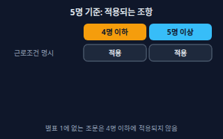</a> <b><a href="#workplace-size--상시근로자-수와-5인-기준">Workplace Size</a></b> 상시근로자 수와 5인 기준 근로기준법은 상시 5명 이상을 쓰는 사업장에는 전부 적용되고, 4명 이하 사업장에는 시행령 별표 1에 적힌 조문만 적용된다. 상시 근로자 수는 알바·단시간·기간제를 모두 포함해 최근 1개월의 연인원을 영업한 날 수로 나눠 센다.</td>
<td width="33%" valign="top"><b><a href="law.md#employee-status--근로자성">Employee Status</a></b> 근로자성 프리랜서·도급이라 써도 실제로는 사용자의 지휘를 받고 임금을 받는 근로자로 볼 수 있는지를 따지는 기준. → law 시트</td>
<td width="33%" valign="top"><a href="#work-rules--취업규칙">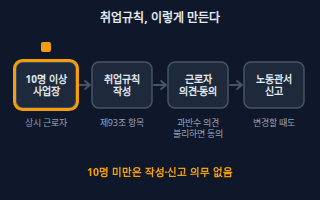</a> <b><a href="#work-rules--취업규칙">Work Rules</a></b> 취업규칙 상시 10명 이상을 쓰는 사업장이 근무시간·임금·휴가·퇴직·징계 같은 공통 규칙을 문서로 만들어 고용노동부에 신고해야 하는 사내 규정. 만들거나 바꿀 때 근로자 과반수의 의견을 듣고, 불리하게 바꾸면 동의를 받아야 한다.</td>
</tr>
</table>

**채용 · 계약 · Hiring & Contracts** (7)

<table>
<tr>
<td width="33%" valign="top"><a href="#fair-hiring-act--채용절차법">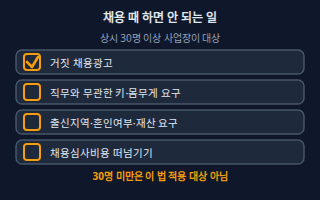</a> <b><a href="#fair-hiring-act--채용절차법">Fair Hiring Act</a></b> 채용절차법 구직자를 공정하게 대하도록 채용 과정의 규칙을 정한 법. 거짓 채용광고, 직무와 무관한 키·몸무게·출신지역·혼인여부·재산 요구, 채용심사비용 떠넘기기를 금지한다. 다만 상시 30명 이상 사업장의 채용에만 적용된다.</td>
<td width="33%" valign="top"><a href="#employment-contract--근로계약서">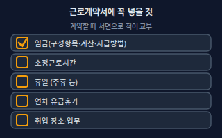</a> <b><a href="#employment-contract--근로계약서">Employment Contract</a></b> 근로계약서 임금·소정근로시간·휴일·연차 같은 근로조건을 글로 적어 근로자에게 주는 계약서. 사용자는 계약을 맺을 때 이 사항을 밝혀야 하고, 임금 구성항목·계산방법·지급방법과 소정근로시간·휴일·연차를 적은 서면(전자문서 포함)을 교부해야 한다.</td>
<td width="33%" valign="top"><a href="#probation--수습시용">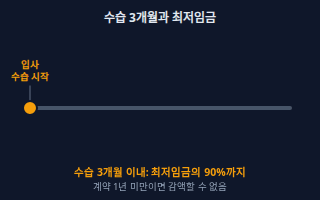</a> <b><a href="#probation--수습시용">Probation</a></b> 수습·시용 정식으로 쓰기 전에 일을 맡겨 보며 적격을 보는 기간. 이름이 수습이어도 임금을 받고 일하면 근로자라서 근로기준법이 적용된다. 1년 이상 계약을 하고 수습 시작 후 3개월 이내라면 최저임금의 90%까지 줄여 줄 수 있다(단순노무 직종 제외).</td>
</tr>
<tr>
<td width="33%" valign="top"><a href="#fixed-term-worker--기간제근로자">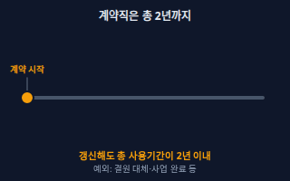</a> <b><a href="#fixed-term-worker--기간제근로자">Fixed-term Worker</a></b> 기간제근로자 계약기간을 정해 일하는 근로자(계약직). 반복 갱신을 합쳐 총 2년을 넘겨 쓸 수 없고, 넘기면 기간의 정함이 없는 근로자로 본다. 사업 완료, 휴직자 대체, 학업 이수, 고령자 계약 등은 예외다.</td>
<td width="33%" valign="top"><a href="#minor-worker--연소근로자">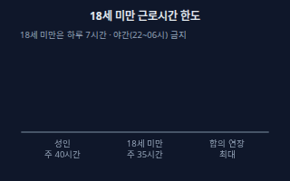</a> <b><a href="#minor-worker--연소근로자">Minor Worker</a></b> 연소근로자 18세 미만 근로자. 15세 미만(중학교 재학 중인 18세 미만 포함)은 취직인허증이 있어야만 쓸 수 있고, 18세 미만은 가족관계기록사항 증명서와 친권자 동의서를 사업장에 갖춰 둬야 한다. 15~17세는 하루 7시간·주 35시간이 한도이고 합의하면 하루 1시간·주 5시간까지 늘릴 수 있다.</td>
<td width="33%" valign="top"><a href="#part-time-worker--단시간근로자">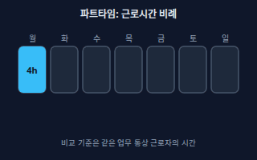</a> <b><a href="#part-time-worker--단시간근로자">Part-time Worker</a></b> 단시간근로자 1주 소정근로시간이 같은 업무의 통상 근로자보다 짧은 근로자(파트타임·알바). 근로조건은 통상 근로자의 근로시간에 비례해 정한다. 소정근로시간을 넘겨 일을 시키려면 근로자 동의가 있어야 하고, 1주 12시간을 넘길 수 없다(기간제법, 상시 5명 이상 사업장).</td>
</tr>
<tr>
<td width="33%" valign="top"><a href="#ultra-short-time-worker--초단시간근로자">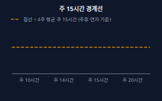</a> <b><a href="#ultra-short-time-worker--초단시간근로자">Ultra-short-time Worker</a></b> 초단시간근로자 4주 동안 평균해 1주 소정근로시간이 15시간 미만인 근로자. 이 경우 주휴(제55조)와 연차(제60조)가 적용되지 않고, 퇴직급여제도 설정 대상에서도 빠진다.</td>
</tr>
</table>

**근로시간 · 휴일 · Working Time** (7)

<table>
<tr>
<td width="33%" valign="top"><a href="#working-hours--법정근로시간과-소정근로시간">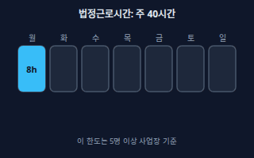</a> <b><a href="#working-hours--법정근로시간과-소정근로시간">Working Hours</a></b> 법정근로시간과 소정근로시간 법정근로시간은 휴게시간을 뺀 1일 8시간·1주 40시간의 한도이고, 소정근로시간은 근로자와 사용자가 그 한도 안에서 계약으로 정한 근로시간이다. 사용자의 지휘·감독 아래 있는 대기시간도 근로시간으로 본다.</td>
<td width="33%" valign="top"><a href="#overtime--연장근로">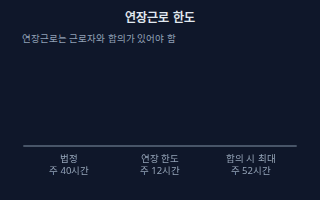</a> <b><a href="#overtime--연장근로">Overtime</a></b> 연장근로 1일 8시간 또는 1주 40시간의 법정근로시간을 넘는 근로. 당사자 간에 합의하면 1주 12시간을 한도로 시킬 수 있다. 가산임금은 Premium Pay를 본다.</td>
<td width="33%" valign="top"><a href="#break-time--휴게시간">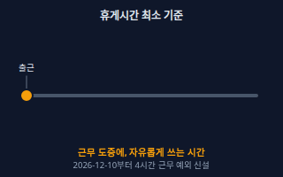</a> <b><a href="#break-time--휴게시간">Break Time</a></b> 휴게시간 근로시간 도중에 쉬게 해야 하는 시간으로, 근로자가 자유롭게 쓸 수 있어야 한다. 지금은 근로시간이 4시간이면 30분 이상, 8시간이면 1시간 이상을 줘야 한다. 2026-12-10부터는 4시간 근무에서 근로자가 휴게를 쓰지 않겠다고 명시적으로 요청하면 예외가 생긴다.</td>
</tr>
<tr>
<td width="33%" valign="top"><a href="#premium-pay--연장야간휴일근로-가산수당">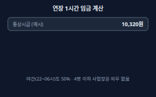</a> <b><a href="#premium-pay--연장야간휴일근로-가산수당">Premium Pay</a></b> 연장·야간·휴일근로 가산수당 연장근로, 야간근로(오후 10시~오전 6시), 휴일근로에는 통상임금의 50% 이상을 더해 줘야 한다. 휴일근로는 8시간 이내 50%, 8시간을 넘는 부분은 100%다.</td>
<td width="33%" valign="top"><a href="#weekly-holiday--주휴일">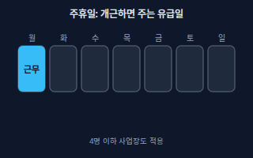</a> <b><a href="#weekly-holiday--주휴일">Weekly Holiday</a></b> 주휴일 1주에 평균 1회 이상 주는 유급휴일. 1주의 소정근로일을 개근한 근로자에게 줘야 한다. 어느 요일로 할지는 계약과 근무표로 정한다.</td>
<td width="33%" valign="top"><a href="#weekly-holiday-pay--주휴수당">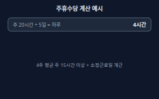</a> <b><a href="#weekly-holiday-pay--주휴수당">Weekly Holiday Pay</a></b> 주휴수당 주휴일에 일하지 않아도 주는 하루치 임금. 4주 평균 주 15시간 이상이고 1주의 소정근로일을 개근하면 생긴다. 하루치는 정상 근로일의 소정근로시간 × 시급이다(예: 주 5일 하루 4시간이면 4시간분).</td>
</tr>
<tr>
<td width="33%" valign="top"><a href="#paid-public-holiday--공휴일-유급휴일">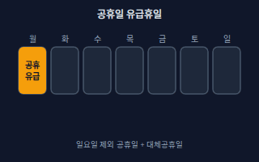</a> <b><a href="#paid-public-holiday--공휴일-유급휴일">Paid Public Holiday</a></b> 공휴일 유급휴일 일요일을 뺀 관공서 공휴일과 대체공휴일을 유급휴일로 보장해야 하는 제도. 근로자대표와 서면으로 합의하면 특정 근로일로 대체할 수 있다. 상시 5명 이상 사업장에 적용된다.</td>
</tr>
</table>

**휴가 · 모성보호 · Leave** (6)

<table>
<tr>
<td width="33%" valign="top"><a href="#annual-leave--연차유급휴가">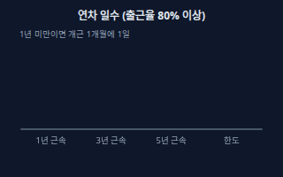</a> <b><a href="#annual-leave--연차유급휴가">Annual Leave</a></b> 연차유급휴가 1년간 80% 이상 출근한 근로자에게 주는 15일의 유급휴가. 1년 미만이거나 80% 미만 출근이면 1개월 개근마다 1일을 준다. 3년 이상 계속 근로하면 최초 1년을 넘는 매 2년마다 1일이 더해져 최대 25일이다.</td>
<td width="33%" valign="top"><a href="#annual-leave-promotion--연차-사용촉진">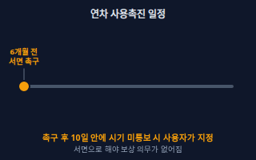</a> <b><a href="#annual-leave-promotion--연차-사용촉진">Annual Leave Promotion</a></b> 연차 사용촉진 사용자가 정해진 시기에 서면으로 남은 연차를 알리고 쓰라고 촉구한 뒤, 그래도 안 쓰면 사용 시기를 정해 서면으로 통보하는 절차. 이를 지키면 쓰지 않아 소멸한 연차에 대한 보상 의무가 없어진다. 연차가 소멸하기 6개월 전 기준 10일 이내에 촉구하고, 근로자가 10일 안에 시기를 알리지 않으면 소멸 2개월 전까지 사용 시기를 지정해 통보한다.</td>
<td width="33%" valign="top"><a href="#maternity-leave--출산전후휴가">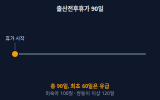</a> <b><a href="#maternity-leave--출산전후휴가">Maternity Leave</a></b> 출산전후휴가 임신 중인 여성에게 출산 전후로 주는 90일의 휴가(미숙아 100일, 한 번에 둘 이상 출산 120일). 출산 후에 45일 이상 남도록 배정해야 하고 최초 60일은 유급이다. 국가가 출산전후휴가급여를 지급하면 그 금액만큼 사업주의 지급 책임이 줄어든다.</td>
</tr>
<tr>
<td width="33%" valign="top"><a href="#spouse-birth-leave--배우자-출산휴가">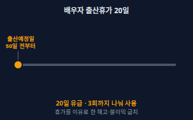</a> <b><a href="#spouse-birth-leave--배우자-출산휴가">Spouse Birth Leave</a></b> 배우자 출산휴가 근로자가 배우자의 임신·출산을 이유로 알리면 사업주가 20일의 유급휴가를 줘야 한다. 배우자 출산예정일 50일 전부터 쓸 수 있고, 출산한 날부터 120일이 지나면 쓸 수 없으며, 3회까지 나눠 쓸 수 있다.</td>
<td width="33%" valign="top"><a href="#parental-leave--육아휴직">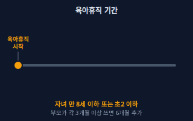</a> <b><a href="#parental-leave--육아휴직">Parental Leave</a></b> 육아휴직 만 8세 이하 또는 초등학교 2학년 이하 자녀를 키우는 근로자가 신청하면 사업주가 허용해야 하는 휴직. 기간은 1년 이내이고, 같은 자녀에 대해 부모가 각각 3개월 이상 쓴 경우 등에는 6개월을 더 쓸 수 있다. 끝난 뒤 같은 업무나 같은 수준의 임금을 주는 직무에 복귀시켜야 하고, 휴직 기간은 근속기간에 포함한다.</td>
<td width="33%" valign="top"><a href="#childcare-reduced-hours--육아기-근로시간-단축">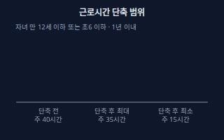</a> <b><a href="#childcare-reduced-hours--육아기-근로시간-단축">Childcare Reduced Hours</a></b> 육아기 근로시간 단축 만 12세 이하 또는 초등학교 6학년 이하 자녀를 키우는 근로자가 신청하면 근로시간을 줄여 주는 제도. 단축 후 근로시간은 주 15시간 이상 35시간 이하여야 하고, 기간은 1년 이내(쓰지 않은 육아휴직 기간이 있으면 그 두 배를 더한 기간 이내)다.</td>
</tr>
</table>

**임금 · Wages** (7)

<table>
<tr>
<td width="33%" valign="top"><a href="#minimum-wage--최저임금">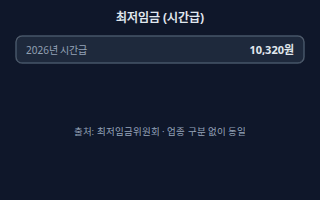</a> <b><a href="#minimum-wage--최저임금">Minimum Wage</a></b> 최저임금 사용자가 근로자에게 반드시 줘야 하는 임금의 최저 기준. 2026년 적용 시간급은 10,320원(월 209시간 기준 2,156,880원)이고, 2027년 1월 1일부터는 10,700원이다. 업종과 관계없이 같다.</td>
<td width="33%" valign="top"><a href="#ordinary-wage--통상임금">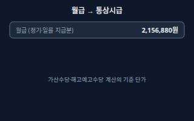</a> <b><a href="#ordinary-wage--통상임금">Ordinary Wage</a></b> 통상임금 소정근로의 대가로 정기적이고 일률적으로 지급하기로 정한 시간급·일급·주급·월급 금액. 월급은 월 통상임금 산정 기준시간 수로 나눠 시간급으로 바꾼다. 연장·야간·휴일 가산수당과 해고예고수당 계산의 기준 단가다.</td>
<td width="33%" valign="top"><a href="#average-wage--평균임금">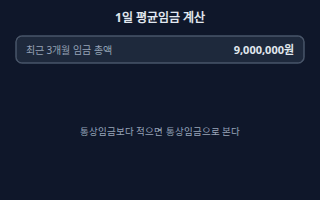</a> <b><a href="#average-wage--평균임금">Average Wage</a></b> 평균임금 평균임금을 산정해야 할 사유가 생긴 날 이전 3개월 동안 지급된 임금 총액을 그 기간의 총일수로 나눈 금액(1일 기준). 이 금액이 통상임금보다 적으면 통상임금을 평균임금으로 본다. 수습 3개월·출산전후휴가·육아휴직 같은 기간은 계산에서 뺀다.</td>
</tr>
<tr>
<td width="33%" valign="top"><a href="#wage-payment-principles--임금-지급-4원칙">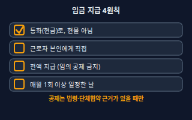</a> <b><a href="#wage-payment-principles--임금-지급-4원칙">Wage Payment Principles</a></b> 임금 지급 4원칙 임금은 통화로, 근로자에게 직접, 그 전액을, 매월 1회 이상 일정한 날짜에 지급해야 한다는 원칙. 법령이나 단체협약에 근거가 있을 때만 임금의 일부를 공제하거나 통화 외의 것으로 줄 수 있다.</td>
<td width="33%" valign="top"><a href="#payslip--임금명세서">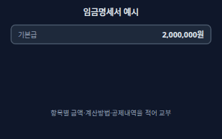</a> <b><a href="#payslip--임금명세서">Payslip</a></b> 임금명세서 임금을 줄 때 항목별 금액, 계산방법, 공제 내역을 적어 근로자에게 교부해야 하는 문서(서면 또는 전자문서). 근로자를 특정하는 정보, 임금지급일, 임금 총액, 구성항목별 금액, 출근일수·시간에 따라 달라지는 항목의 계산방법(연장·야간·휴일 시간 수 포함), 공제 내역을 적는다.</td>
<td width="33%" valign="top"><a href="#wage-arrears--임금체불">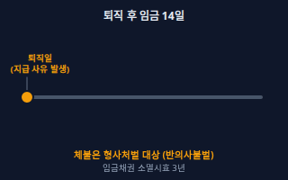</a> <b><a href="#wage-arrears--임금체불">Wage Arrears</a></b> 임금체불 약속한 임금·퇴직금 등을 정한 날까지 주지 않는 것. 정한 지급일(퇴직했다면 14일)이 지난 다음 날부터 연 20%의 지연이자를 줘야 한다. 임금체불은 5년 이하 징역 또는 5천만원 이하 벌금 대상이고, 피해자의 명시적 의사에 반해 공소를 제기할 수 없다.</td>
</tr>
<tr>
<td width="33%" valign="top"><b><a href="accounting.md#withholding-tax--원천징수">Withholding Tax</a></b> 원천징수 급여를 줄 때 회사가 소득세를 미리 떼어 대신 국가에 납부하는 제도. → accounting 시트</td>
</tr>
</table>

**보험 · 퇴직급여 · Insurance & Severance** (5)

<table>
<tr>
<td width="33%" valign="top"><b><a href="accounting.md#social-insurance--4대보험">Social Insurance</a></b> 4대보험 국민연금, 건강보험, 고용보험, 산재보험 네 가지 사회보험. → accounting 시트</td>
<td width="33%" valign="top"><a href="#insurance-acquisition-filing--4대보험-취득상실-신고">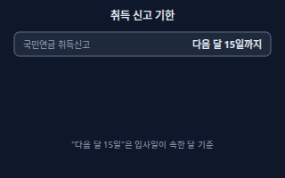</a> <b><a href="#insurance-acquisition-filing--4대보험-취득상실-신고">Insurance Acquisition Filing</a></b> 4대보험 취득·상실 신고 직원을 쓰면 사업주가 입사(취득)와 퇴사(상실)를 해당 기관에 신고하는 절차. 국민연금·고용보험은 사유가 생긴 날이 속하는 달의 다음 달 15일까지, 건강보험은 자격 취득일부터 14일 이내에 신고한다. 사업장 단위의 고용·산재보험 관계 성립은 성립일부터 14일 이내에 신고한다.</td>
<td width="33%" valign="top"><a href="#employment-insurance-exclusion--고용보험-적용-제외초단시간">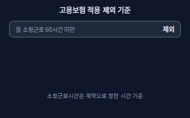</a> <b><a href="#employment-insurance-exclusion--고용보험-적용-제외초단시간">Employment Insurance Exclusion</a></b> 고용보험 적용 제외(초단시간) 해당 사업장에서 1개월 소정근로시간이 60시간 미만이거나 1주 소정근로시간이 15시간 미만인 근로자는 고용보험 적용에서 제외된다. 다만 한 사업장에서 3개월 이상 계속 근로하거나 일용근로자이면 적용 대상이다.</td>
</tr>
<tr>
<td width="33%" valign="top"><b><a href="accounting.md#severance-pay--퇴직금">Severance Pay</a></b> 퇴직금 1년 이상 일한 직원이 퇴직할 때 받는 돈. 계산과 기한은 회계 시트의 원본을 따른다. → accounting 시트</td>
<td width="33%" valign="top"><a href="#retirement-pension-db-and-dc--퇴직연금-dbdc">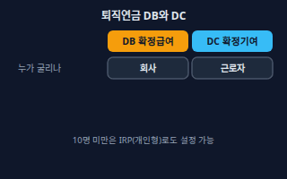</a> <b><a href="#retirement-pension-db-and-dc--퇴직연금-dbdc">Retirement Pension (DB and DC)</a></b> 퇴직연금 DB·DC 퇴직급여를 회사가 금융기관에 미리 쌓아 두는 제도. DB(확정급여형)는 퇴직할 때 받을 금액을 계속근로 1년에 30일분 이상의 평균임금으로 정해 두고 회사가 적립·운용 책임을 지며, DC(확정기여형)는 회사가 연간 임금총액의 12분의 1 이상을 해마다 근로자 계좌에 넣고 근로자가 운용한다. 상시 10명 미만 사업장은 근로자 동의나 요구가 있으면 개인형퇴직연금(IRP)으로 설정할 수 있다.</td>
</tr>
</table>

**퇴사 · 해고 · Separation** (4)

<table>
<tr>
<td width="33%" valign="top"><a href="#dismissal-notice--해고예고">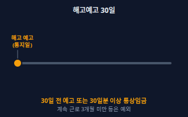</a> <b><a href="#dismissal-notice--해고예고">Dismissal Notice</a></b> 해고예고 근로자를 해고하려면 적어도 30일 전에 알려야 하고, 30일 전에 알리지 않으면 30일분 이상의 통상임금(해고예고수당)을 줘야 한다. 계속 근로 기간이 3개월 미만이거나, 천재지변 등으로 사업 계속이 불가능하거나, 근로자의 고의로 막대한 손해가 생긴 경우(노동부령 사유)는 예외다.</td>
<td width="33%" valign="top"><a href="#written-dismissal-notice--해고-서면통지">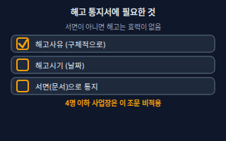</a> <b><a href="#written-dismissal-notice--해고-서면통지">Written Dismissal Notice</a></b> 해고 서면통지 해고하려면 해고사유와 해고시기를 서면으로 통지해야 하고, 서면으로 하지 않은 해고는 효력이 없다. 해고예고를 사유와 시기를 적은 서면으로 했다면 이 통지를 한 것으로 본다.</td>
<td width="33%" valign="top"><a href="#final-settlement--금품청산퇴직-정산">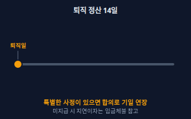</a> <b><a href="#final-settlement--금품청산퇴직-정산">Final Settlement</a></b> 금품청산(퇴직 정산) 근로자가 퇴직하거나 사망하면 지급 사유가 생긴 날부터 14일 이내에 임금, 보상금, 그 밖의 모든 금품을 지급해야 한다는 규칙. 특별한 사정이 있으면 당사자 합의로 기일을 늘릴 수 있다.</td>
</tr>
<tr>
<td width="33%" valign="top"><b><a href="law.md#unfair-dismissal--부당해고">Unfair Dismissal</a></b> 부당해고 정당한 이유 없이 한 해고. 구제 절차와 판단 기준은 법률 시트의 원본을 따른다. → law 시트</td>
</tr>
</table>

**직장 환경 · Workplace** (1)

<table>
<tr>
<td width="33%" valign="top"><a href="#workplace-harassment--직장-내-괴롭힘">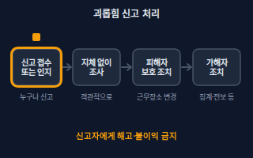</a> <b><a href="#workplace-harassment--직장-내-괴롭힘">Workplace Harassment</a></b> 직장 내 괴롭힘 직장에서의 지위나 관계의 우위를 이용해 업무상 적정범위를 넘어 다른 근로자에게 신체적·정신적 고통을 주거나 근무환경을 악화시키는 행위. 신고를 받거나 알게 되면 사용자는 지체 없이 객관적으로 조사하고, 피해자 보호와 행위자 조치를 해야 하며, 신고한 사람에게 불이익을 줄 수 없다.</td>
</tr>
</table>

<!-- overview:end -->

## 기본 틀 · Basics

### Workplace Size · 상시근로자 수와 5인 기준

- **정의**: 근로기준법은 상시 5명 이상을 쓰는 사업장에는 전부 적용되고, 4명 이하 사업장에는 시행령 별표 1에 적힌 조문만 적용된다. 상시 근로자 수는 알바·단시간·기간제를 모두 포함해 최근 1개월의 연인원을 영업한 날 수로 나눠 센다.
- **AI에게 이렇게**: "우리 가게는 사장 빼고 정직원 3명, 알바 2명이야. 근로기준법 5인 기준으로 상시 근로자 수를 계산하고, 우리에게 적용되는 조항과 안 되는 조항을 표로 나눠줘."
- **언제**: 연차·가산수당·부당해고 제한·직장 내 괴롭힘 같은 의무가 우리 가게에도 있는지 가를 때. 4명 이하여도 근로조건 명시, 해고예고, 금품청산, 임금 지급·명세서, 휴게, 주휴, 출산전후휴가는 적용된다.
- **헷갈림**: 취업규칙 의무 기준(10명) — 근로기준법 전체 적용 기준은 5명이고 취업규칙 신고 기준은 10명이다. 최저임금과 퇴직급여는 인원과 상관없이 근로자를 쓰는 모든 사업에 적용된다.
- **관련**: Work Rules, Annual Leave, Premium Pay, Workplace Harassment, Employee Status
- **확인 질문**: 최근 1개월 동안 일한 모든 근로자(알바·단시간·기간제 포함)의 날짜별 인원과 영업일 수는 어떻게 되나요? 가족(동거 친족)만 쓰는 사업장인가요?
- **근거**: [근로기준법 제11조](https://www.law.go.kr/법령/근로기준법/제11조), [근로기준법시행령 제7조](https://www.law.go.kr/법령/근로기준법시행령/제7조), [근로기준법시행령 제7조의2](https://www.law.go.kr/법령/근로기준법시행령/제7조의2), [근로기준법 시행령 별표 1](https://www.law.go.kr/법령/근로기준법시행령), [최저임금법 제3조](https://www.law.go.kr/법령/최저임금법/제3조), [근로자퇴직급여보장법 제3조](https://www.law.go.kr/법령/근로자퇴직급여보장법/제3조)
- **검증일**: 2026-11-02

### Employee Status · 근로자성

- **정의**: 프리랜서·도급이라 써도 실제로는 사용자의 지휘를 받고 임금을 받는 근로자로 볼 수 있는지를 따지는 기준.
- **원본**: [법률 기초 · Employee Status](law.md#employee-status--근로자성)

### Work Rules · 취업규칙

- **정의**: 상시 10명 이상을 쓰는 사업장이 근무시간·임금·휴가·퇴직·징계 같은 공통 규칙을 문서로 만들어 고용노동부에 신고해야 하는 사내 규정. 만들거나 바꿀 때 근로자 과반수의 의견을 듣고, 불리하게 바꾸면 동의를 받아야 한다.
- **AI에게 이렇게**: "직원 12명인 식당이야. 근로기준법 제93조에 나온 항목(근무시간, 임금, 휴가, 퇴직, 괴롭힘 예방 등)을 모두 넣은 취업규칙 초안을 만들어줘."
- **언제**: 직원이 10명이 되기 직전·직후, 징계나 휴가 규정을 바꿀 때. 신고 의무를 어기면 500만원 이하 과태료 대상이다.
- **헷갈림**: 근로계약서 — 계약서는 직원 한 명과의 개별 약속이고, 취업규칙은 사업장 전체에 적용되는 공통 규칙이다. 10명 미만 사업장은 취업규칙 작성·신고 의무가 없다.
- **관련**: Employment Contract, Workplace Size, Workplace Harassment
- **확인 질문**: 상시 근로자가 10명 이상인가요? 근로자 과반수로 조직된 노동조합이 있나요, 없으면 과반수 의견은 어떻게 듣나요? 근로자에게 불리한 변경인가요?
- **근거**: [근로기준법 제93조](https://www.law.go.kr/법령/근로기준법/제93조), [근로기준법 제94조](https://www.law.go.kr/법령/근로기준법/제94조), [근로기준법 제116조](https://www.law.go.kr/법령/근로기준법/제116조)
- **검증일**: 2026-11-02

## 채용 · 계약 · Hiring & Contracts

### Fair Hiring Act · 채용절차법

- **정의**: 구직자를 공정하게 대하도록 채용 과정의 규칙을 정한 법. 거짓 채용광고, 직무와 무관한 키·몸무게·출신지역·혼인여부·재산 요구, 채용심사비용 떠넘기기를 금지한다. 다만 상시 30명 이상 사업장의 채용에만 적용된다.
- **AI에게 이렇게**: "직원 40명 회사의 경리 채용공고와 지원서 양식을 만들어줘. 채용절차법 제4조의3에 걸리는 항목(키, 몸무게, 출신지역, 혼인여부, 재산)은 빼줘."
- **언제**: 채용공고, 지원서, 면접 안내, 불합격 통보를 쓸 때. 거짓 채용광고를 낸 구인자는 5년 이하 징역 또는 2천만원 이하 벌금 대상이다.
- **헷갈림**: 근로기준법 제17조 — 채용절차법은 모집·심사 단계, 제17조는 채용을 확정하고 근로계약을 맺는 단계의 규칙이다. 상시 30명 미만 사업장은 이 법의 적용 대상이 아니다.
- **관련**: Employment Contract, Probation, Workplace Size
- **확인 질문**: 상시 근로자가 30명 이상인가요? 지원서에서 받으려는 정보가 이 직무에 꼭 필요한가요? 탈락자의 채용서류 반환 요청에는 어떻게 응하나요?
- **근거**: [채용절차의공정화에관한법률 제3조](https://www.law.go.kr/법령/채용절차의공정화에관한법률/제3조), [채용절차의공정화에관한법률 제4조](https://www.law.go.kr/법령/채용절차의공정화에관한법률/제4조), [채용절차의공정화에관한법률 제4조의3](https://www.law.go.kr/법령/채용절차의공정화에관한법률/제4조의3), [채용절차의공정화에관한법률 제9조](https://www.law.go.kr/법령/채용절차의공정화에관한법률/제9조), [채용절차의공정화에관한법률 제11조](https://www.law.go.kr/법령/채용절차의공정화에관한법률/제11조), [채용절차의공정화에관한법률 제16조](https://www.law.go.kr/법령/채용절차의공정화에관한법률/제16조)
- **검증일**: 2026-11-02

### Employment Contract · 근로계약서

- **정의**: 임금·소정근로시간·휴일·연차 같은 근로조건을 글로 적어 근로자에게 주는 계약서. 사용자는 계약을 맺을 때 이 사항을 밝혀야 하고, 임금 구성항목·계산방법·지급방법과 소정근로시간·휴일·연차를 적은 서면(전자문서 포함)을 교부해야 한다.
- **AI에게 이렇게**: "카페 아르바이트 근로계약서 초안을 만들어줘. 시급 10,320원, 주 3일 하루 5시간, 근무 장소와 업무, 임금 지급일(매월 10일), 휴일, 연차를 근로기준법 제17조 항목대로 넣어줘."
- **언제**: 직원이나 알바를 새로 뽑을 때, 임금이나 근무시간을 바꿀 때(변경도 명시해야 한다). 이 의무는 4명 이하 사업장에도 적용되고 어기면 500만원 이하 벌금 대상이다.
- **헷갈림**: 구두 약속 — 말로만 정하면 제17조 위반이 된다. 취업 장소·업무와 취업규칙 항목도 시행령에 따라 함께 밝혀야 하며, 계약이 법 기준보다 불리하면 그 부분은 무효다.
- **관련**: Probation, Part-time Worker, Minimum Wage, Payslip, Work Rules
- **확인 질문**: 직원인가요, 프리랜서인가요? 계약기간이 있나요(기간제 여부)? 요일별 근무시간·휴게시간, 임금 지급일, 업무 장소는 무엇인가요? 만 18세 미만이 아닌가요?
- **근거**: [근로기준법 제17조](https://www.law.go.kr/법령/근로기준법/제17조), [근로기준법시행령 제8조](https://www.law.go.kr/법령/근로기준법시행령/제8조), [근로기준법 제15조](https://www.law.go.kr/법령/근로기준법/제15조), [근로기준법 제114조](https://www.law.go.kr/법령/근로기준법/제114조), [근로기준법 시행령 별표 1](https://www.law.go.kr/법령/근로기준법시행령)
- **검증일**: 2026-11-02

### Probation · 수습·시용

- **정의**: 정식으로 쓰기 전에 일을 맡겨 보며 적격을 보는 기간. 이름이 수습이어도 임금을 받고 일하면 근로자라서 근로기준법이 적용된다. 1년 이상 계약을 하고 수습 시작 후 3개월 이내라면 최저임금의 90%까지 줄여 줄 수 있다(단순노무 직종 제외).
- **AI에게 이렇게**: "수습 3개월을 둔 1년 계약직 근로계약서 문구를 만들어줘. 수습 기간 시급이 최저임금의 90%를 넘는지 확인하는 표도 같이 만들어줘."
- **언제**: 신입 채용 계약서를 쓸 때, 수습 평가 후 본채용을 정할 때.
- **헷갈림**: 인턴·체험 — 이름이 달라도 실제로 일하고 임금을 받으면 근로자다. 수습 중이라고 해고가 자유로운 것은 아니며, 5명 이상 사업장은 정당한 이유가 필요하다. 해고예고는 계속 근로 3개월 미만이면 적용되지 않는다.
- **관련**: Minimum Wage, Fixed-term Worker, Dismissal Notice, Unfair Dismissal
- **확인 질문**: 근로계약 기간이 1년 이상인가요? 단순노무 직종인가요? 수습 시작일과 수습 기간은 어떻게 되나요?
- **근거**: [최저임금법 제5조](https://www.law.go.kr/법령/최저임금법/제5조), [최저임금법시행령 제3조](https://www.law.go.kr/법령/최저임금법시행령/제3조), [근로기준법 제2조](https://www.law.go.kr/법령/근로기준법/제2조), [근로기준법 제23조](https://www.law.go.kr/법령/근로기준법/제23조), [근로기준법 제26조](https://www.law.go.kr/법령/근로기준법/제26조)
- **검증일**: 2026-11-02

### Fixed-term Worker · 기간제근로자

- **정의**: 계약기간을 정해 일하는 근로자(계약직). 반복 갱신을 합쳐 총 2년을 넘겨 쓸 수 없고, 넘기면 기간의 정함이 없는 근로자로 본다. 사업 완료, 휴직자 대체, 학업 이수, 고령자 계약 등은 예외다.
- **AI에게 이렇게**: "6개월 계약직 근로계약서 초안을 만들어줘. 갱신할 때 총 사용기간이 2년을 넘지 않는지 계산하는 표도 같이 만들어줘."
- **언제**: 계약직, 프로젝트 인력, 육아휴직 대체 인력을 채용할 때. 이 법은 상시 5명 이상 사업장에 적용되고, 4명 이하는 대통령령이 정한 일부만 적용된다.
- **헷갈림**: 파트타임(단시간근로자) — 기간제는 계약기간의 유무, 단시간은 근로시간의 길이로 나눈다. 한 사람이 둘 다일 수 있다.
- **관련**: Part-time Worker, Employment Contract, Probation, Parental Leave
- **확인 질문**: 최초 계약일과 갱신 횟수는 어떻게 되나요? 결원 대체 같은 예외 사유가 있나요? 사업장이 5명 이상인가요?
- **근거**: [기간제및단시간근로자보호등에관한법률 제2조](https://www.law.go.kr/법령/기간제및단시간근로자보호등에관한법률/제2조), [기간제및단시간근로자보호등에관한법률 제3조](https://www.law.go.kr/법령/기간제및단시간근로자보호등에관한법률/제3조), [기간제및단시간근로자보호등에관한법률 제4조](https://www.law.go.kr/법령/기간제및단시간근로자보호등에관한법률/제4조), [기간제및단시간근로자보호등에관한법률 제17조](https://www.law.go.kr/법령/기간제및단시간근로자보호등에관한법률/제17조)
- **검증일**: 2026-11-02

### Minor Worker · 연소근로자

- **정의**: 18세 미만 근로자. 15세 미만(중학교 재학 중인 18세 미만 포함)은 취직인허증이 있어야만 쓸 수 있고, 18세 미만은 가족관계기록사항 증명서와 친권자 동의서를 사업장에 갖춰 둬야 한다. 15~17세는 하루 7시간·주 35시간이 한도이고 합의하면 하루 1시간·주 5시간까지 늘릴 수 있다.
- **AI에게 이렇게**: "만 17세 고등학생 알바 근로계약서를 만들어줘. 근로시간은 하루 7시간·주 35시간 이내로, 야간·휴일 근무는 빼고, 친권자 동의서 양식도 같이 만들어줘."
- **언제**: 방학 알바나 청소년을 채용할 때. 18세 미만은 오후 10시~오전 6시와 휴일 근로가 원칙적으로 금지된다(본인 동의와 노동부 장관 인가가 있을 때만 예외).
- **헷갈림**: 성인 알바 — 한도(하루 8시간·주 40시간)가 다르고, 근로계약은 친권자가 대신 맺을 수 없으며 본인이 맺는다. 근로조건은 서면으로 적어 줘야 한다.
- **관련**: Employment Contract, Working Hours, Overtime
- **확인 질문**: 만 나이와 재학 여부(중학교)는 어떻게 되나요? 친권자 동의서와 가족관계기록사항 증명서를 받았나요? 야간·휴일 근무가 포함되나요?
- **근거**: [근로기준법 제64조](https://www.law.go.kr/법령/근로기준법/제64조), [근로기준법 제66조](https://www.law.go.kr/법령/근로기준법/제66조), [근로기준법 제67조](https://www.law.go.kr/법령/근로기준법/제67조), [근로기준법 제69조](https://www.law.go.kr/법령/근로기준법/제69조), [근로기준법 제70조](https://www.law.go.kr/법령/근로기준법/제70조), [근로기준법 시행령 별표 1](https://www.law.go.kr/법령/근로기준법시행령)
- **검증일**: 2026-11-02

### Part-time Worker · 단시간근로자

- **정의**: 1주 소정근로시간이 같은 업무의 통상 근로자보다 짧은 근로자(파트타임·알바). 근로조건은 통상 근로자의 근로시간에 비례해 정한다. 소정근로시간을 넘겨 일을 시키려면 근로자 동의가 있어야 하고, 1주 12시간을 넘길 수 없다(기간제법, 상시 5명 이상 사업장).
- **AI에게 이렇게**: "주 3일, 하루 5시간 일하는 알바의 주 소정근로시간을 계산하고, 같은 업무 통상 근로자(주 40시간) 대비 비례율을 구해서 연차와 주휴를 어떻게 따지는지 정리해줘."
- **언제**: 알바나 시간제 직원을 뽑을 때. 계약서에는 근로일과 근로일별 근로시간까지 서면으로 적어야 한다.
- **헷갈림**: 초단시간근로자 — 단시간 중에서도 4주 평균 주 15시간 미만인 경우로, 주휴·연차가 적용되지 않는다. 기간제와도 다르다(기간제는 계약기간 기준).
- **관련**: Ultra-short-time Worker, Weekly Holiday Pay, Overtime, Employment Contract
- **확인 질문**: 요일별 근무시간과 주 소정근로시간은 어떻게 되나요? 같은 업무 통상 근로자의 소정근로시간은 몇 시간인가요? 초과 근무 동의서가 있나요?
- **근거**: [근로기준법 제2조](https://www.law.go.kr/법령/근로기준법/제2조), [근로기준법 제18조](https://www.law.go.kr/법령/근로기준법/제18조), [기간제및단시간근로자보호등에관한법률 제3조](https://www.law.go.kr/법령/기간제및단시간근로자보호등에관한법률/제3조), [기간제및단시간근로자보호등에관한법률 제6조](https://www.law.go.kr/법령/기간제및단시간근로자보호등에관한법률/제6조), [기간제및단시간근로자보호등에관한법률 제17조](https://www.law.go.kr/법령/기간제및단시간근로자보호등에관한법률/제17조), [법제처 중앙부처 1차 해석: 단시간근로자의 유급 주휴 시간 산정](https://www.law.go.kr/LSW/cgmExpcInfoP.do?cgmExpcDatSeq=22542&mode=2&ofiClsCd=350101)
- **검증일**: 2026-11-02

### Ultra-short-time Worker · 초단시간근로자

- **정의**: 4주 동안 평균해 1주 소정근로시간이 15시간 미만인 근로자. 이 경우 주휴(제55조)와 연차(제60조)가 적용되지 않고, 퇴직급여제도 설정 대상에서도 빠진다.
- **AI에게 이렇게**: "주 12시간 일하는 알바야. 주 15시간 기준으로 주휴수당·연차·퇴직금 대상인지 정리하고, 4주 평균 소정근로시간을 계산하는 시트를 만들어줘."
- **언제**: 알바 시간표를 짤 때, 주 15시간 언저리에서 시간을 늘리거나 줄일 때.
- **헷갈림**: 단시간근로자 — 단시간은 넓은 말이고 초단시간은 주 15시간 미만이다. 고용보험은 따로 월 60시간 미만 또는 주 15시간 미만을 제외하되 3개월 이상 계속 근로하면 적용한다.
- **관련**: Part-time Worker, Weekly Holiday Pay, Annual Leave, Employment Insurance Exclusion
- **확인 질문**: 계약으로 정한 소정근로시간이 4주 평균 몇 시간인가요? 실제로 일한 시간이 아니라 약속한 시간 기준으로 보는 점 확인했나요?
- **근거**: [근로기준법 제18조](https://www.law.go.kr/법령/근로기준법/제18조), [근로자퇴직급여보장법 제4조](https://www.law.go.kr/법령/근로자퇴직급여보장법/제4조), [고용보험법 시행령 제3조](https://www.law.go.kr/법령/고용보험법시행령/제3조), [고용노동부 빠른인터넷상담: 주휴수당 발생 요건](https://www.moel.go.kr/minwon/fastcounsel/fastcounselView.do?inetDcssMngId=202409040342098360232)
- **검증일**: 2026-11-02

## 근로시간 · 휴일 · Working Time

### Working Hours · 법정근로시간과 소정근로시간

- **정의**: 법정근로시간은 휴게시간을 뺀 1일 8시간·1주 40시간의 한도이고, 소정근로시간은 근로자와 사용자가 그 한도 안에서 계약으로 정한 근로시간이다. 사용자의 지휘·감독 아래 있는 대기시간도 근로시간으로 본다.
- **AI에게 이렇게**: "하루 9시간 사업장에 머물고 점심 1시간을 쉬는 직원의 소정근로시간과 주간 근로시간을 계산해줘. 주 40시간 한도를 넘는지도 봐줘."
- **언제**: 근무표를 짜거나 근로계약서에 소정근로시간을 적을 때, 급여를 계산할 때.
- **헷갈림**: 체류 시간 — 사업장에 있던 시간이 아니라 휴게시간을 뺀 시간이 근로시간이다. 이 1일 8시간·주 40시간 한도(제50조)는 4명 이하 사업장에는 적용되지 않는다.
- **관련**: Overtime, Break Time, Weekly Holiday Pay, Part-time Worker
- **확인 질문**: 출퇴근 시각과 휴게시간은 어떻게 되나요? 손님이 없을 때의 대기시간이 있나요? 사업장이 5명 이상인가요?
- **근거**: [근로기준법 제50조](https://www.law.go.kr/법령/근로기준법/제50조), [근로기준법 제2조](https://www.law.go.kr/법령/근로기준법/제2조), [근로기준법 시행령 별표 1](https://www.law.go.kr/법령/근로기준법시행령)
- **검증일**: 2026-11-02

### Overtime · 연장근로

- **정의**: 1일 8시간 또는 1주 40시간의 법정근로시간을 넘는 근로. 당사자 간에 합의하면 1주 12시간을 한도로 시킬 수 있다. 가산임금은 Premium Pay를 본다.
- **AI에게 이렇게**: "이번 주 월~금 9시간씩 근무했고 토요일에 4시간 더 일했어. 주 40시간을 넘은 연장근로가 몇 시간인지, 12시간 한도에 걸리는지 계산해줘."
- **언제**: 주 40시간을 넘기는 주의 급여를 계산하거나 연장근무를 시킬 때. 연장근로 한도 규정은 4명 이하 사업장에는 적용되지 않는다.
- **헷갈림**: 소정근로시간 초과 — 파트타임이 계약한 시간보다 더 일하면 동의가 필요하고 통상임금의 50% 이상을 더 줘야 한다(기간제법, 상시 5명 이상 사업장). 법정근로시간(주 40시간) 초과와는 별개의 기준이다.
- **관련**: Working Hours, Premium Pay, Part-time Worker
- **확인 질문**: 이번 주 날짜별 실제 근무시간은 얼마인가요? 연장근로에 대한 근로자 합의서가 있나요? 사업장이 5명 이상인가요?
- **근거**: [근로기준법 제50조](https://www.law.go.kr/법령/근로기준법/제50조), [근로기준법 제53조](https://www.law.go.kr/법령/근로기준법/제53조), [기간제및단시간근로자보호등에관한법률 제3조](https://www.law.go.kr/법령/기간제및단시간근로자보호등에관한법률/제3조), [기간제및단시간근로자보호등에관한법률 제6조](https://www.law.go.kr/법령/기간제및단시간근로자보호등에관한법률/제6조), [근로기준법 시행령 별표 1](https://www.law.go.kr/법령/근로기준법시행령)
- **검증일**: 2026-11-02

### Break Time · 휴게시간

- **정의**: 근로시간 도중에 쉬게 해야 하는 시간으로, 근로자가 자유롭게 쓸 수 있어야 한다. 지금은 근로시간이 4시간이면 30분 이상, 8시간이면 1시간 이상을 줘야 한다. 2026-12-10부터는 4시간 근무에서 근로자가 휴게를 쓰지 않겠다고 명시적으로 요청하면 예외가 생긴다.
- **AI에게 이렇게**: "하루 8시간 근무 직원의 휴게시간(점심 1시간)을 반영해 근무표를 짜고, 휴게 중에 매장을 보게 하지 않도록 점검하는 체크리스트도 만들어줘."
- **언제**: 알바 근무표를 짤 때, 근로계약서에 근무 중 휴게를 적을 때. 이 규정은 4명 이하 사업장에도 적용된다.
- **헷갈림**: 대기시간 — 손님이 없어도 자리를 지키며 일에 대비해야 하는 시간은 근로시간이고, 자유롭게 쓸 수 있는 시간만 휴게시간이다.
- **관련**: Working Hours, Part-time Worker, Overtime
- **확인 질문**: 하루 근로시간은 몇 시간인가요? 휴게 중 자리를 비워도 되나요? 2026-12-10 이후 4시간 근무에서 근로자가 휴게 생략을 명시적으로 요청했나요?
- **근거**: [근로기준법 제54조](https://www.law.go.kr/법령/근로기준법/제54조), [근로기준법 제50조](https://www.law.go.kr/법령/근로기준법/제50조), [근로기준법 시행령 별표 1](https://www.law.go.kr/법령/근로기준법시행령)
- **검증일**: 2026-11-02

### Premium Pay · 연장·야간·휴일근로 가산수당

- **정의**: 연장근로, 야간근로(오후 10시~오전 6시), 휴일근로에는 통상임금의 50% 이상을 더해 줘야 한다. 휴일근로는 8시간 이내 50%, 8시간을 넘는 부분은 100%다.
- **AI에게 이렇게**: "시급 10,320원 직원이 이번 달 연장근로 5시간, 밤 11시~새벽 1시 야간근로 2시간을 했어. 가산수당을 항목별로 계산하고 임금명세서에 들어갈 줄로 정리해줘."
- **언제**: 연장·야간·휴일 근무가 있는 달의 급여를 계산할 때. 이 가산 의무는 4명 이하 사업장에는 적용되지 않는다.
- **헷갈림**: 통상임금·평균임금 — 가산의 기준은 통상임금이다. 연장과 야간이 겹치는 시간의 계산은 노무사나 노동청에 확인하는 것이 안전하다.
- **관련**: Ordinary Wage, Overtime, Payslip
- **확인 질문**: 통상시급은 얼마인가요? 연장·야간·휴일이 각각 몇 시간이고 겹치는 시간이 있나요? 사업장이 5명 이상인가요?
- **근거**: [근로기준법 제56조](https://www.law.go.kr/법령/근로기준법/제56조), [근로기준법 시행령 별표 1](https://www.law.go.kr/법령/근로기준법시행령)
- **검증일**: 2026-11-02

### Weekly Holiday · 주휴일

- **정의**: 1주에 평균 1회 이상 주는 유급휴일. 1주의 소정근로일을 개근한 근로자에게 줘야 한다. 어느 요일로 할지는 계약과 근무표로 정한다.
- **AI에게 이렇게**: "주 5일 근무 직원의 근무표에서 주휴일을 일요일로 정해 반영하고, 소정근로일 개근 조건 문구를 근로계약서에 넣어줘."
- **언제**: 근무표와 근로계약서를 만들 때. 4명 이하 사업장도 주휴일 규정(제55조 제1항)은 적용된다.
- **헷갈림**: 주휴수당 — 주휴일은 쉬는 날이고 주휴수당은 그날에 주는 임금이다. 4주 평균 주 15시간 미만인 초단시간근로자는 주휴 대상이 아니다.
- **관련**: Weekly Holiday Pay, Paid Public Holiday, Ultra-short-time Worker
- **확인 질문**: 소정근로일은 주 며칠인가요? 4주 평균 주 15시간 이상인가요?
- **근거**: [근로기준법 제55조](https://www.law.go.kr/법령/근로기준법/제55조), [근로기준법시행령 제30조](https://www.law.go.kr/법령/근로기준법시행령/제30조), [근로기준법 제18조](https://www.law.go.kr/법령/근로기준법/제18조), [근로기준법 시행령 별표 1](https://www.law.go.kr/법령/근로기준법시행령)
- **검증일**: 2026-11-02

### Weekly Holiday Pay · 주휴수당

- **정의**: 주휴일에 일하지 않아도 주는 하루치 임금. 4주 평균 주 15시간 이상이고 1주의 소정근로일을 개근하면 생긴다. 하루치는 정상 근로일의 소정근로시간 × 시급이다(예: 주 5일 하루 4시간이면 4시간분).
- **AI에게 이렇게**: "주 5일, 하루 4시간(주 20시간) 일하는 알바의 주휴수당을 시급 10,320원으로 계산해줘. 지각·조퇴나 결근이 있는 주는 어떻게 되는지도 알려줘."
- **언제**: 알바·파트타이머 월급을 계산할 때, 시급에 주휴수당이 포함인지 정할 때.
- **헷갈림**: 월급제 — 월급으로 정한 시간급은 주휴 유급시간까지 합친 기준시간으로 나누므로 월급에 주휴가 이미 들어 있는 경우가 많다. 지각·조퇴는 결근이 아니다.
- **관련**: Weekly Holiday, Minimum Wage, Ordinary Wage, Part-time Worker
- **확인 질문**: 주 소정근로시간과 소정근로일은 어떻게 되나요? 이번 주에 소정근로일을 모두 근무했나요? 시급에 주휴수당이 이미 포함돼 있나요?
- **근거**: [근로기준법 제55조](https://www.law.go.kr/법령/근로기준법/제55조), [근로기준법시행령 제30조](https://www.law.go.kr/법령/근로기준법시행령/제30조), [근로기준법시행령 제6조](https://www.law.go.kr/법령/근로기준법시행령/제6조), [고용노동부 빠른인터넷상담: 주휴수당 발생 요건](https://www.moel.go.kr/minwon/fastcounsel/fastcounselView.do?inetDcssMngId=202409040342098360232), [법제처 중앙부처 1차 해석: 단시간근로자의 유급 주휴 시간 산정](https://www.law.go.kr/LSW/cgmExpcInfoP.do?cgmExpcDatSeq=22542&mode=2&ofiClsCd=350101)
- **검증일**: 2026-11-02

### Paid Public Holiday · 공휴일 유급휴일

- **정의**: 일요일을 뺀 관공서 공휴일과 대체공휴일을 유급휴일로 보장해야 하는 제도. 근로자대표와 서면으로 합의하면 특정 근로일로 대체할 수 있다. 상시 5명 이상 사업장에 적용된다.
- **AI에게 이렇게**: "직원 6명인 식당이야. 이번 달 공휴일(대체공휴일 포함)을 유급휴일로 반영한 근무표와, 공휴일에 일한 직원의 임금 계산 방법을 정리해줘."
- **언제**: 달력에 공휴일·대체공휴일이 있을 때, 설·추석 연휴 근무표를 짤 때.
- **헷갈림**: 주휴일 — 주휴일은 매주 쉬는 날이고 공휴일 유급은 달력의 공휴일에 대한 보장이다. 4명 이하 사업장은 의무가 아니다.
- **관련**: Weekly Holiday, Premium Pay, Workplace Size
- **확인 질문**: 상시 5명 이상인가요? 근로자대표와 서면 합의로 다른 날로 대체했나요? 그 공휴일이 원래 근무하기로 한 소정근로일인가요?
- **근거**: [근로기준법 제55조](https://www.law.go.kr/법령/근로기준법/제55조), [근로기준법시행령 제30조](https://www.law.go.kr/법령/근로기준법시행령/제30조), [근로기준법 시행령 별표 1](https://www.law.go.kr/법령/근로기준법시행령)
- **검증일**: 2026-11-02

## 휴가 · 모성보호 · Leave

### Annual Leave · 연차유급휴가

- **정의**: 1년간 80% 이상 출근한 근로자에게 주는 15일의 유급휴가. 1년 미만이거나 80% 미만 출근이면 1개월 개근마다 1일을 준다. 3년 이상 계속 근로하면 최초 1년을 넘는 매 2년마다 1일이 더해져 최대 25일이다.
- **AI에게 이렇게**: "입사일이 2025-03-04인 직원의 연차 발생 내역을 시간순으로 표로 만들어줘. 1년 미만은 1개월 개근에 1일, 1년 근무 후 출근율 80% 이상이면 15일 기준으로."
- **언제**: 입사 1주년, 월별 휴가 신청, 퇴사 정산 때. 4명 이하 사업장과 4주 평균 주 15시간 미만 근로자에게는 적용되지 않는다. 연차는 1년간 쓰지 않으면 소멸하지만 사용자 잘못으로 못 쓴 경우는 예외다.
- **헷갈림**: 회사 약정휴가 — 연차는 법정 휴가이고, 회사가 더 주는 휴가는 약정이다. 2027-06-10부터 연차를 대통령령이 정한 시간 단위로 나눠 청구할 수 있는 개정 규정이 시행될 예정이다.
- **관련**: Annual Leave Promotion, Ultra-short-time Worker, Average Wage, Ordinary Wage
- **확인 질문**: 입사일은 언제인가요? 지난 1년 출근율은 몇 %인가요? 육아휴직·업무상 질병 기간은 출근으로 보는 점을 반영했나요? 사업장이 5명 이상인가요?
- **근거**: [근로기준법 제60조](https://www.law.go.kr/법령/근로기준법/제60조), [근로기준법 제18조](https://www.law.go.kr/법령/근로기준법/제18조), [근로기준법 시행령 별표 1](https://www.law.go.kr/법령/근로기준법시행령)
- **검증일**: 2026-11-02

### Annual Leave Promotion · 연차 사용촉진

- **정의**: 사용자가 정해진 시기에 서면으로 남은 연차를 알리고 쓰라고 촉구한 뒤, 그래도 안 쓰면 사용 시기를 정해 서면으로 통보하는 절차. 이를 지키면 쓰지 않아 소멸한 연차에 대한 보상 의무가 없어진다. 연차가 소멸하기 6개월 전 기준 10일 이내에 촉구하고, 근로자가 10일 안에 시기를 알리지 않으면 소멸 2개월 전까지 사용 시기를 지정해 통보한다.
- **AI에게 이렇게**: "연차 소멸 6개월 전에 보낼 연차 사용 촉구 서면 양식과, 근로자가 회신하지 않을 때 소멸 2개월 전까지 보낼 사용시기 지정 통보서 양식을 만들어줘."
- **언제**: 직원별 연차 소멸일 6개월 전과 2개월 전. 입사 1년 미만 근로자의 월 개근 연차는 3개월 전·1개월 전 기준으로 시기가 따로 있다.
- **헷갈림**: 단순 구두 안내 — 법이 정한 것은 서면 촉구와 서면 통보다. 말로 쓰라고 한 것만으로는 보상 의무가 면제되지 않을 수 있다.
- **관련**: Annual Leave, Average Wage
- **확인 질문**: 직원별 연차 소멸일은 언제인가요? 남은 연차 일수는 몇 일인가요? 촉구서와 통보서를 서면으로 남겼나요? 입사 1년 미만 근로자인가요?
- **근거**: [근로기준법 제61조](https://www.law.go.kr/법령/근로기준법/제61조)
- **검증일**: 2026-11-02

### Maternity Leave · 출산전후휴가

- **정의**: 임신 중인 여성에게 출산 전후로 주는 90일의 휴가(미숙아 100일, 한 번에 둘 이상 출산 120일). 출산 후에 45일 이상 남도록 배정해야 하고 최초 60일은 유급이다. 국가가 출산전후휴가급여를 지급하면 그 금액만큼 사업주의 지급 책임이 줄어든다.
- **AI에게 이렇게**: "출산예정일이 2027-02-10인 직원의 출산전후휴가 시작일과 종료일을 90일, 출산 후 45일 이상 보장 기준으로 짜고, 최초 60일 유급과 급여 신청 절차를 정리해줘."
- **언제**: 직원이 임신 사실을 알렸을 때. 4명 이하 사업장에도 적용되고, 휴가 기간과 그 후 30일은 해고할 수 없다.
- **헷갈림**: 배우자 출산휴가·육아휴직 — 출산전후휴가는 출산하는 본인의 휴가, 배우자 출산휴가는 배우자의 휴가, 육아휴직은 아이를 키우기 위한 휴직이다.
- **관련**: Spouse Birth Leave, Parental Leave, Annual Leave
- **확인 질문**: 출산예정일은 언제인가요? 한 명인가요, 쌍둥이 이상인가요, 미숙아인가요? 유산 경험 등으로 휴가를 나눠 써야 하나요? 급여 신청 서류는 준비됐나요?
- **근거**: [근로기준법 제74조](https://www.law.go.kr/법령/근로기준법/제74조), [근로기준법 제23조](https://www.law.go.kr/법령/근로기준법/제23조), [남녀고용평등과일ㆍ가정양립지원에관한법률 제18조](https://www.law.go.kr/법령/남녀고용평등과일ㆍ가정양립지원에관한법률/제18조), [근로기준법 시행령 별표 1](https://www.law.go.kr/법령/근로기준법시행령)
- **검증일**: 2026-11-02

### Spouse Birth Leave · 배우자 출산휴가

- **정의**: 근로자가 배우자의 임신·출산을 이유로 알리면 사업주가 20일의 유급휴가를 줘야 한다. 배우자 출산예정일 50일 전부터 쓸 수 있고, 출산한 날부터 120일이 지나면 쓸 수 없으며, 3회까지 나눠 쓸 수 있다.
- **AI에게 이렇게**: "직원이 배우자 출산휴가 20일을 신청했어. 출산예정일 2027-03-01 기준으로 사용 가능 기간과 3회 분할 사용 예시 일정표를 만들어줘."
- **언제**: 직원이 배우자의 임신·출산을 알려 왔을 때. 휴가를 이유로 해고하거나 불리하게 대할 수 없다.
- **헷갈림**: 출산전후휴가 — 출산전후휴가는 출산하는 본인에게, 배우자 출산휴가는 배우자인 근로자에게 주는 휴가다.
- **관련**: Maternity Leave, Parental Leave
- **확인 질문**: 출산예정일(또는 출산일)은 언제인가요? 몇 번에 나눠 쓸 건가요? 신청서는 받았나요?
- **근거**: [남녀고용평등과일ㆍ가정양립지원에관한법률 제18조의2](https://www.law.go.kr/법령/남녀고용평등과일ㆍ가정양립지원에관한법률/제18조의2)
- **검증일**: 2026-11-02

### Parental Leave · 육아휴직

- **정의**: 만 8세 이하 또는 초등학교 2학년 이하 자녀를 키우는 근로자가 신청하면 사업주가 허용해야 하는 휴직. 기간은 1년 이내이고, 같은 자녀에 대해 부모가 각각 3개월 이상 쓴 경우 등에는 6개월을 더 쓸 수 있다. 끝난 뒤 같은 업무나 같은 수준의 임금을 주는 직무에 복귀시켜야 하고, 휴직 기간은 근속기간에 포함한다.
- **AI에게 이렇게**: "직원이 6개월 육아휴직을 신청했어. 신청서 양식, 대체 인력을 기간제로 뽑을 때 계약서에 넣을 문구, 복직 후 업무 복귀 안내문을 만들어줘."
- **언제**: 직원이 아이 양육을 위해 휴직을 요청할 때. 육아휴직을 이유로 한 해고나 불리한 처우는 금지되고, 휴직 기간 중에는 해고할 수 없다(사업을 계속할 수 없는 경우 제외).
- **헷갈림**: 육아기 근로시간 단축 — 육아휴직은 일을 완전히 쉬는 것이고, 근로시간 단축은 일하면서 시간을 줄이는 것이다.
- **관련**: Childcare Reduced Hours, Maternity Leave, Fixed-term Worker
- **확인 질문**: 자녀의 나이(만 8세 이하·초2 이하)는 어떻게 되나요? 부모가 모두 쓰나요? 신청 시기와 기간은요? 대체 인력이 필요한가요?
- **근거**: [남녀고용평등과일ㆍ가정양립지원에관한법률 제19조](https://www.law.go.kr/법령/남녀고용평등과일ㆍ가정양립지원에관한법률/제19조), [찾기쉬운 생활법령정보: 육아휴직 신청](https://easylaw.go.kr/CSP/CnpClsMain.laf?ccfNo=2&cciNo=1&cnpClsNo=1&csmSeq=1380)
- **검증일**: 2026-11-02

### Childcare Reduced Hours · 육아기 근로시간 단축

- **정의**: 만 12세 이하 또는 초등학교 6학년 이하 자녀를 키우는 근로자가 신청하면 근로시간을 줄여 주는 제도. 단축 후 근로시간은 주 15시간 이상 35시간 이하여야 하고, 기간은 1년 이내(쓰지 않은 육아휴직 기간이 있으면 그 두 배를 더한 기간 이내)다.
- **AI에게 이렇게**: "직원이 육아기 근로시간 단축으로 주 40시간을 주 30시간으로 줄여 달래. 새 근무시간표, 임금 비례 조정 계산, 단축 후 근로조건을 서면으로 정하는 합의서 양식을 만들어줘."
- **언제**: 직원이 아이를 키우며 일을 이어 가고 싶어 시간을 줄여 달라고 할 때. 단축을 이유로 해고하거나 불리한 처우를 할 수 없다.
- **헷갈림**: 육아휴직·임신기 근로시간 단축 — 육아휴직은 완전히 쉬고, 임신기 근로시간 단축은 임신 중 1일 2시간을 줄이는 별개의 제도다.
- **관련**: Parental Leave, Part-time Worker, Average Wage
- **확인 질문**: 자녀의 나이·학년은 어떻게 되나요? 단축 후 주 몇 시간을 원하나요? 정상적인 사업 운영에 중대한 지장이 있어 허용하기 어렵다면 그 이유를 서면으로 알렸나요?
- **근거**: [남녀고용평등과일ㆍ가정양립지원에관한법률 제19조의2](https://www.law.go.kr/법령/남녀고용평등과일ㆍ가정양립지원에관한법률/제19조의2), [남녀고용평등과일ㆍ가정양립지원에관한법률 제19조의3](https://www.law.go.kr/법령/남녀고용평등과일ㆍ가정양립지원에관한법률/제19조의3), [근로기준법 제74조](https://www.law.go.kr/법령/근로기준법/제74조)
- **검증일**: 2026-11-02

## 임금 · Wages

### Minimum Wage · 최저임금

- **정의**: 사용자가 근로자에게 반드시 줘야 하는 임금의 최저 기준. 2026년 적용 시간급은 10,320원(월 209시간 기준 2,156,880원)이고, 2027년 1월 1일부터는 10,700원이다. 업종과 관계없이 같다.
- **AI에게 이렇게**: "월급 2,000,000원, 주 40시간(월 209시간) 직원의 시간급을 환산해서 2026년 최저임금 10,320원과 2027년 10,700원 기준으로 미달 여부를 표로 만들어줘."
- **언제**: 채용 때 임금을 정할 때, 해마다 1월 최저임금이 바뀔 때. 최저임금보다 적게 주면 3년 이하 징역 또는 2천만원 이하 벌금 대상이고, 낮게 정한 계약 부분은 무효가 된다.
- **헷갈림**: 통상임금 — 최저임금 비교는 소정근로에 대해 매월 1회 이상 정기적으로 주는 임금이 대상이고, 소정근로시간 밖에 주는 일부 임금은 빠진다. 수습 감액은 Probation을 본다.
- **관련**: Probation, Ordinary Wage, Weekly Holiday Pay
- **확인 질문**: 월급제인가요, 시급제인가요? 월 소정근로시간(주휴 포함)은 몇 시간인가요? 매월 정기적으로 주는 수당에는 어떤 것이 있나요? 수습 중인가요?
- **근거**: [최저임금법 제5조](https://www.law.go.kr/법령/최저임금법/제5조), [최저임금법 제6조](https://www.law.go.kr/법령/최저임금법/제6조), [최저임금법 제28조](https://www.law.go.kr/법령/최저임금법/제28조), [최저임금위원회 최저임금 결정현황](https://www.minimumwage.go.kr/minWage/policy/decisionMain.do), [최저임금위원회 2026년 적용 최저임금 고시](https://www.minimumwage.go.kr/customer/notice/view.do?bultnId=4657), [고용노동부 보도자료: 2026년 적용 최저임금 시간급 10,320원](https://www.moel.go.kr/news/enews/report/enewsView.do?news_seq=18144)
- **검증일**: 2026-11-02

### Ordinary Wage · 통상임금

- **정의**: 소정근로의 대가로 정기적이고 일률적으로 지급하기로 정한 시간급·일급·주급·월급 금액. 월급은 월 통상임금 산정 기준시간 수로 나눠 시간급으로 바꾼다. 연장·야간·휴일 가산수당과 해고예고수당 계산의 기준 단가다.
- **AI에게 이렇게**: "월급 2,156,880원, 월 209시간 직원의 통상시급을 계산해줘. 식대·직책수당이 있으면 정기적·일률적인 것만 통상임금에 넣는 기준으로 정리해줘."
- **언제**: 가산수당, 해고예고수당, 연차수당을 계산할 때.
- **헷갈림**: 평균임금 — 통상임금은 미리 정해진 단가이고, 평균임금은 사유 발생일 전 3개월 동안 실제 받은 금액의 평균이다.
- **관련**: Average Wage, Premium Pay, Dismissal Notice, Minimum Wage
- **확인 질문**: 임금 항목별로 매월 정해진 대로 지급하나요, 모든 근로자에게 같은 조건으로 주나요? 월 통상임금 산정 기준시간(주 소정근로시간 + 유급 처리 시간)은 몇 시간인가요?
- **근거**: [근로기준법시행령 제6조](https://www.law.go.kr/법령/근로기준법시행령/제6조), [근로기준법 제56조](https://www.law.go.kr/법령/근로기준법/제56조), [근로기준법 제26조](https://www.law.go.kr/법령/근로기준법/제26조)
- **검증일**: 2026-11-02

### Average Wage · 평균임금

- **정의**: 평균임금을 산정해야 할 사유가 생긴 날 이전 3개월 동안 지급된 임금 총액을 그 기간의 총일수로 나눈 금액(1일 기준). 이 금액이 통상임금보다 적으면 통상임금을 평균임금으로 본다. 수습 3개월·출산전후휴가·육아휴직 같은 기간은 계산에서 뺀다.
- **AI에게 이렇게**: "퇴직일이 2026-10-31인 직원의 최근 3개월(8·9·10월) 임금 총액이 9,000,000원이야. 총일수 92일 기준으로 1일 평균임금을 계산하고 통상임금과 비교해줘."
- **언제**: 퇴직금과 휴업수당을 계산할 때, 취업규칙이 평균임금으로 정한 연차수당을 계산할 때.
- **헷갈림**: 통상임금 — 통상임금은 정해진 단가, 평균임금은 최근 3개월에 실제로 받은 돈의 평균이다. 둘 중 평균임금이 더 적으면 통상임금을 쓴다.
- **관련**: Ordinary Wage, Severance Pay, Annual Leave
- **확인 질문**: 산정 사유가 생긴 날(퇴직일 등)은 언제인가요? 직전 3개월 임금 총액은 얼마인가요? 수습·출산휴가·육아휴직처럼 빼야 하는 기간이 있나요?
- **근거**: [근로기준법 제2조](https://www.law.go.kr/법령/근로기준법/제2조), [근로기준법시행령 제2조](https://www.law.go.kr/법령/근로기준법시행령/제2조)
- **검증일**: 2026-11-02

### Wage Payment Principles · 임금 지급 4원칙

- **정의**: 임금은 통화로, 근로자에게 직접, 그 전액을, 매월 1회 이상 일정한 날짜에 지급해야 한다는 원칙. 법령이나 단체협약에 근거가 있을 때만 임금의 일부를 공제하거나 통화 외의 것으로 줄 수 있다.
- **AI에게 이렇게**: "임금 지급일을 매월 10일로 정하는 계약서 문구와, 급여를 줄 때 법령에 근거 없는 공제를 하지 않도록 점검하는 체크리스트를 만들어줘."
- **언제**: 급여 지급일을 정할 때, 지각 벌금이나 파손 변상금을 월급에서 떼고 싶을 때. 이 원칙은 4명 이하 사업장에도 적용된다.
- **헷갈림**: 임금체불 — 4원칙은 주는 방식의 규칙이고, 임금체불은 정한 날에 주지 않은 결과다.
- **관련**: Payslip, Wage Arrears, Withholding Tax
- **확인 질문**: 임금 지급일은 며칠인가요? 공제하려는 항목에 법령·단체협약 근거가 있나요(4대보험·소득세 등)? 근로자 본인에게 직접 주나요?
- **근거**: [근로기준법 제43조](https://www.law.go.kr/법령/근로기준법/제43조), [근로기준법 시행령 별표 1](https://www.law.go.kr/법령/근로기준법시행령)
- **검증일**: 2026-11-02

### Payslip · 임금명세서

- **정의**: 임금을 줄 때 항목별 금액, 계산방법, 공제 내역을 적어 근로자에게 교부해야 하는 문서(서면 또는 전자문서). 근로자를 특정하는 정보, 임금지급일, 임금 총액, 구성항목별 금액, 출근일수·시간에 따라 달라지는 항목의 계산방법(연장·야간·휴일 시간 수 포함), 공제 내역을 적는다.
- **AI에게 이렇게**: "연장근로 10시간과 4대보험 공제가 있는 직원의 임금명세서를 근로기준법 시행령 제27조의2 항목대로 만들어줘. 기본급 2,000,000원, 시급 10,320원 기준 예시로."
- **언제**: 매 급여 지급일. 임금대장 작성도 함께 해야 한다. 이 의무는 4명 이하 사업장에도 적용되고, 어기면 500만원 이하 과태료 대상이다.
- **헷갈림**: 급여 이체 내역·원천징수영수증 — 이체만으로는 항목과 계산방법이 보이지 않으므로 임금명세서를 따로 교부해야 한다.
- **관련**: Wage Payment Principles, Premium Pay, Withholding Tax, Social Insurance
- **확인 질문**: 직원별 임금 구성항목은 무엇인가요? 공제 항목(소득세, 4대보험)과 금액은요? 이메일·앱 같은 전자문서로 줄 건가요?
- **근거**: [근로기준법 제48조](https://www.law.go.kr/법령/근로기준법/제48조), [근로기준법시행령 제27조의2](https://www.law.go.kr/법령/근로기준법시행령/제27조의2), [근로기준법 제116조](https://www.law.go.kr/법령/근로기준법/제116조), [찾기쉬운 생활법령정보: 임금대장 작성 및 임금명세서 교부](https://www.easylaw.go.kr/CSP/CnpClsMain.laf?ccfNo=2&cciNo=3&cnpClsNo=1&csmSeq=1694&popMenu=ov), [근로기준법 시행령 별표 1](https://www.law.go.kr/법령/근로기준법시행령)
- **검증일**: 2026-11-02

### Wage Arrears · 임금체불

- **정의**: 약속한 임금·퇴직금 등을 정한 날까지 주지 않는 것. 정한 지급일(퇴직했다면 14일)이 지난 다음 날부터 연 20%의 지연이자를 줘야 한다. 임금체불은 5년 이하 징역 또는 5천만원 이하 벌금 대상이고, 피해자의 명시적 의사에 반해 공소를 제기할 수 없다.
- **AI에게 이렇게**: "직원 3명의 급여 지급이 3주 밀렸어. 지연이자 연 20%를 날짜별로 계산하는 표와, 직원들에게 보낼 지급 일정 안내문을 만들어줘."
- **언제**: 자금이 막혀 급여가 밀릴 때, 퇴사자 정산이 늦어질 때. 임금채권은 3년이 지나면 시효로 소멸한다.
- **헷갈림**: 금품청산 — 금품청산은 퇴직 시 14일 안에 정산하라는 의무이고, 임금체불은 그 기한이나 지급일을 넘겨 못 준 상태다.
- **관련**: Final Settlement, Payslip, Severance Pay
- **확인 질문**: 밀린 임금의 항목·금액·원래 지급일은 어떻게 되나요? 퇴직한 사람이 있나요(퇴직일)? 분할 지급을 서면으로 합의했나요?
- **근거**: [근로기준법 제36조](https://www.law.go.kr/법령/근로기준법/제36조), [근로기준법 제37조](https://www.law.go.kr/법령/근로기준법/제37조), [근로기준법시행령 제17조](https://www.law.go.kr/법령/근로기준법시행령/제17조), [근로기준법 제43조](https://www.law.go.kr/법령/근로기준법/제43조), [근로기준법 제49조](https://www.law.go.kr/법령/근로기준법/제49조), [근로기준법 제107조](https://www.law.go.kr/법령/근로기준법/제107조)
- **검증일**: 2026-11-02

### Withholding Tax · 원천징수

- **정의**: 급여를 줄 때 회사가 소득세를 미리 떼어 대신 국가에 납부하는 제도.
- **원본**: [회계 · 세무 기초 · Withholding Tax](accounting.md#withholding-tax--원천징수)

## 보험 · 퇴직급여 · Insurance & Severance

### Social Insurance · 4대보험

- **정의**: 국민연금, 건강보험, 고용보험, 산재보험 네 가지 사회보험.
- **원본**: [회계 · 세무 기초 · Social Insurance](accounting.md#social-insurance--4대보험)

### Insurance Acquisition Filing · 4대보험 취득·상실 신고

- **정의**: 직원을 쓰면 사업주가 입사(취득)와 퇴사(상실)를 해당 기관에 신고하는 절차. 국민연금·고용보험은 사유가 생긴 날이 속하는 달의 다음 달 15일까지, 건강보험은 자격 취득일부터 14일 이내에 신고한다. 사업장 단위의 고용·산재보험 관계 성립은 성립일부터 14일 이내에 신고한다.
- **AI에게 이렇게**: "10월 20일 입사한 직원과 10월 31일 퇴사한 직원의 국민연금·고용보험 신고 기한(다음 달 15일)과 건강보험 취득신고 기한(14일)을 각각 날짜로 계산해 달력 일정으로 만들어줘."
- **언제**: 직원이 입사하거나 퇴사한 달. 일용근로자는 근로내용 확인신고서를 같은 기한까지 내면 신고한 것으로 본다.
- **헷갈림**: 4대보험 전체 설명(Social Insurance) — 보험료율과 부담 구조는 회계 시트에서 다루고, 여기서는 신고 기한과 자격 취득·상실만 다룬다.
- **관련**: Social Insurance, Employment Insurance Exclusion, Withholding Tax
- **확인 질문**: 입사일·퇴사일은 언제인가요? 월 소정근로시간이 60시간 이상인가요? 일용근로자인가요? 사업장 보험관계 성립 신고는 끝났나요?
- **근거**: [고용보험법 제15조](https://www.law.go.kr/법령/고용보험법/제15조), [고용보험법 시행령 제7조](https://www.law.go.kr/법령/고용보험법시행령/제7조), [국민연금법 시행규칙 제6조](https://www.law.go.kr/법령/국민연금법시행규칙/제6조), [국민건강보험법 제8조](https://www.law.go.kr/법령/국민건강보험법/제8조), [고용산재보험료징수법 제11조](https://www.law.go.kr/법령/고용보험및산업재해보상보험의보험료징수등에관한법률/제11조)
- **검증일**: 2026-11-02

### Employment Insurance Exclusion · 고용보험 적용 제외(초단시간)

- **정의**: 해당 사업장에서 1개월 소정근로시간이 60시간 미만이거나 1주 소정근로시간이 15시간 미만인 근로자는 고용보험 적용에서 제외된다. 다만 한 사업장에서 3개월 이상 계속 근로하거나 일용근로자이면 적용 대상이다.
- **AI에게 이렇게**: "알바 5명의 월·주 소정근로시간 표를 넣을게. 월 60시간·주 15시간 기준으로 고용보험 적용 제외 대상을 표시하고, 3개월 이상 계속 근로해서 가입 대상이 되는 시점도 표시해줘."
- **언제**: 알바 시간표를 정할 때, 알바 입사 후 3개월이 지났을 때 보험 가입 여부를 점검할 때.
- **헷갈림**: 주휴·연차의 15시간 기준 — 근로기준법은 4주 평균 주 15시간 미만이면 주휴·연차 제외이고, 고용보험은 월 60시간 미만도 따진다. 법과 기준이 서로 다르다.
- **관련**: Ultra-short-time Worker, Insurance Acquisition Filing
- **확인 질문**: 계약으로 정한 월 소정근로시간과 주 소정근로시간은 얼마인가요? 근무 시작일부터 3개월이 지났나요? 일용근로자인가요?
- **근거**: [고용보험법 제10조](https://www.law.go.kr/법령/고용보험법/제10조), [고용보험법 시행령 제3조](https://www.law.go.kr/법령/고용보험법시행령/제3조)
- **검증일**: 2026-11-02

### Severance Pay · 퇴직금

- **정의**: 1년 이상 일한 직원이 퇴직할 때 받는 돈. 계산과 기한은 회계 시트의 원본을 따른다.
- **원본**: [회계 · 세무 기초 · Severance Pay](accounting.md#severance-pay--퇴직금)

### Retirement Pension (DB and DC) · 퇴직연금 DB·DC

- **정의**: 퇴직급여를 회사가 금융기관에 미리 쌓아 두는 제도. DB(확정급여형)는 퇴직할 때 받을 금액을 계속근로 1년에 30일분 이상의 평균임금으로 정해 두고 회사가 적립·운용 책임을 지며, DC(확정기여형)는 회사가 연간 임금총액의 12분의 1 이상을 해마다 근로자 계좌에 넣고 근로자가 운용한다. 상시 10명 미만 사업장은 근로자 동의나 요구가 있으면 개인형퇴직연금(IRP)으로 설정할 수 있다.
- **AI에게 이렇게**: "직원 8명 가게야. 퇴직금 제도와 DC 퇴직연금을 비교해 주고, 직원 동의를 받아 IRP로 설정할 때 필요한 절차와 연 1회 이상 납입 일정을 정리해줘."
- **언제**: 퇴직급여제도를 정할 때, 퇴직금 부담을 해마다 나눠 쌓고 싶을 때.
- **헷갈림**: 퇴직금(일시금 제도) — 퇴직금은 퇴직할 때 사용자가 한꺼번에 주고, 퇴직연금은 회사가 미리 외부에 적립한다. 퇴직금 자체는 회계 시트의 Severance Pay를 본다.
- **관련**: Severance Pay, Average Wage
- **확인 질문**: 상시 근로자가 10명 미만인가요? 근로자대표의 동의가 필요한 사업장인가요, 개별 근로자 동의로 IRP를 설정하나요? 퇴직연금사업자는 어디로 정했나요?
- **근거**: [근로자퇴직급여보장법 제4조](https://www.law.go.kr/법령/근로자퇴직급여보장법/제4조), [근로자퇴직급여보장법 제8조](https://www.law.go.kr/법령/근로자퇴직급여보장법/제8조), [근로자퇴직급여보장법 제15조](https://www.law.go.kr/법령/근로자퇴직급여보장법/제15조), [근로자퇴직급여보장법 제20조](https://www.law.go.kr/법령/근로자퇴직급여보장법/제20조), [근로자퇴직급여보장법 제25조](https://www.law.go.kr/법령/근로자퇴직급여보장법/제25조)
- **검증일**: 2026-11-02

## 퇴사 · 해고 · Separation

### Dismissal Notice · 해고예고

- **정의**: 근로자를 해고하려면 적어도 30일 전에 알려야 하고, 30일 전에 알리지 않으면 30일분 이상의 통상임금(해고예고수당)을 줘야 한다. 계속 근로 기간이 3개월 미만이거나, 천재지변 등으로 사업 계속이 불가능하거나, 근로자의 고의로 막대한 손해가 생긴 경우(노동부령 사유)는 예외다.
- **AI에게 이렇게**: "5월 31일자로 해고하려는 직원에게 30일 전에 해고예고를 하려면 늦어도 언제 통지해야 하는지, 예고하지 않을 때 해고예고수당(통상임금 30일분)은 얼마인지 계산해줘."
- **언제**: 직원을 해고하기로 결정했을 때. 이 의무는 4명 이하 사업장에도 적용되고, 어기면 2년 이하 징역 또는 2천만원 이하 벌금 대상이다.
- **헷갈림**: 부당해고 — 해고예고는 알리는 절차이고, 해고 자체가 정당한지는 별개다(Unfair Dismissal). 해고 서면통지(Written Dismissal Notice)와도 다르다.
- **관련**: Written Dismissal Notice, Ordinary Wage, Unfair Dismissal, Probation
- **확인 질문**: 계속 근로 기간이 3개월 미만인가요? 해고 사유와 해고 예정일은 언제인가요? 통상임금(일급)은 얼마인가요?
- **근거**: [근로기준법 제26조](https://www.law.go.kr/법령/근로기준법/제26조), [근로기준법 제110조](https://www.law.go.kr/법령/근로기준법/제110조), [근로기준법 시행령 별표 1](https://www.law.go.kr/법령/근로기준법시행령), [찾기쉬운 생활법령정보: 해고근로자](https://www.easylaw.go.kr/CSP/CnpClsMain.laf?ccfNo=4&cciNo=2&cnpClsNo=1&csmSeq=514&popMenu=ov)
- **검증일**: 2026-11-02

### Written Dismissal Notice · 해고 서면통지

- **정의**: 해고하려면 해고사유와 해고시기를 서면으로 통지해야 하고, 서면으로 하지 않은 해고는 효력이 없다. 해고예고를 사유와 시기를 적은 서면으로 했다면 이 통지를 한 것으로 본다.
- **AI에게 이렇게**: "직원에게 줄 해고 통지서 초안을 만들어줘. 해고 사유와 해고 일자를 구체적으로 쓰고, 해고예고를 겸하는 문구도 넣어줘."
- **언제**: 해고를 통지하는 문서를 만들 때. 4명 이하 사업장에는 이 조문이 적용되지 않는다.
- **헷갈림**: 해고예고 — 해고예고는 30일 전에 알리는 시기의 규칙이고, 서면통지는 사유와 시기를 문서로 밝히는 방식의 규칙이다.
- **관련**: Dismissal Notice, Unfair Dismissal
- **확인 질문**: 해고 사유를 구체적으로 적을 수 있나요? 해고 일자는 언제인가요? 사업장이 5명 이상인가요?
- **근거**: [근로기준법 제27조](https://www.law.go.kr/법령/근로기준법/제27조), [근로기준법 시행령 별표 1](https://www.law.go.kr/법령/근로기준법시행령)
- **검증일**: 2026-11-02

### Final Settlement · 금품청산(퇴직 정산)

- **정의**: 근로자가 퇴직하거나 사망하면 지급 사유가 생긴 날부터 14일 이내에 임금, 보상금, 그 밖의 모든 금품을 지급해야 한다는 규칙. 특별한 사정이 있으면 당사자 합의로 기일을 늘릴 수 있다.
- **AI에게 이렇게**: "10월 31일에 퇴사한 직원의 최종 정산표를 만들어줘. 마지막 달 일할 급여, 미사용 연차 정산, 퇴직금(해당 시)을 넣고 11월 14일까지 지급하도록 일정도 표시해줘."
- **언제**: 직원이 퇴사했을 때. 이 의무는 4명 이하 사업장에도 적용된다. 퇴직금도 지급 사유가 생긴 날부터 14일 이내에 줘야 한다.
- **헷갈림**: 임금체불 — 금품청산은 퇴직 때 14일 안에 정산하라는 기한 규칙이고, 이를 넘겨 못 준 상태가 임금체불이다.
- **관련**: Wage Arrears, Severance Pay, Annual Leave
- **확인 질문**: 퇴직일은 언제인가요? 미지급 임금·연차 정산·퇴직금(1년 이상, 주 15시간 이상)이 있나요? 기일 연장 합의를 서면으로 했나요?
- **근거**: [근로기준법 제36조](https://www.law.go.kr/법령/근로기준법/제36조), [근로자퇴직급여보장법 제9조](https://www.law.go.kr/법령/근로자퇴직급여보장법/제9조), [근로자퇴직급여보장법 제4조](https://www.law.go.kr/법령/근로자퇴직급여보장법/제4조), [근로기준법 시행령 별표 1](https://www.law.go.kr/법령/근로기준법시행령)
- **검증일**: 2026-11-02

### Unfair Dismissal · 부당해고

- **정의**: 정당한 이유 없이 한 해고. 구제 절차와 판단 기준은 법률 시트의 원본을 따른다.
- **원본**: [법률 기초 · Unfair Dismissal](law.md#unfair-dismissal--부당해고)

## 직장 환경 · Workplace

### Workplace Harassment · 직장 내 괴롭힘

- **정의**: 직장에서의 지위나 관계의 우위를 이용해 업무상 적정범위를 넘어 다른 근로자에게 신체적·정신적 고통을 주거나 근무환경을 악화시키는 행위. 신고를 받거나 알게 되면 사용자는 지체 없이 객관적으로 조사하고, 피해자 보호와 행위자 조치를 해야 하며, 신고한 사람에게 불이익을 줄 수 없다.
- **AI에게 이렇게**: "직원 15명 사업장의 직장 내 괴롭힘 신고 처리 절차(접수 → 조사 → 피해자 보호 → 행위자 조치)와 조사 보고서 양식, 취업규칙에 넣을 예방 조항을 만들어줘."
- **언제**: 직원 간 갈등이나 신고가 접수됐을 때, 취업규칙을 만들 때. 사용자 본인이 한 괴롭힘은 1천만원 이하 과태료 대상이고, 신고자에게 해고 등 불이익을 주면 3년 이하 징역 또는 3천만원 이하 벌금 대상이다. 4명 이하 사업장에는 적용되지 않는다.
- **헷갈림**: 정당한 업무 지시 — 업무상 적정범위 안의 지시·징계는 괴롭힘이 아니다. 직장 내 성희롱은 남녀고용평등법 제12조가 따로 금지한다.
- **관련**: Work Rules, Workplace Size, Unfair Dismissal
- **확인 질문**: 신고 내용과 당사자의 지위 관계는 어떻게 되나요? 사업장이 5명 이상인가요? 피해자의 의견을 듣고 비밀을 지킬 방법이 있나요? 사용자 본인이 행위자인가요?
- **근거**: [근로기준법 제76조의2](https://www.law.go.kr/법령/근로기준법/제76조의2), [근로기준법 제76조의3](https://www.law.go.kr/법령/근로기준법/제76조의3), [근로기준법 제109조](https://www.law.go.kr/법령/근로기준법/제109조), [근로기준법 제116조](https://www.law.go.kr/법령/근로기준법/제116조), [남녀고용평등과일ㆍ가정양립지원에관한법률 제12조](https://www.law.go.kr/법령/남녀고용평등과일ㆍ가정양립지원에관한법률/제12조), [근로기준법 시행령 별표 1](https://www.law.go.kr/법령/근로기준법시행령), [찾기쉬운 생활법령정보: 직장 내 괴롭힘](https://www.easylaw.go.kr/CSP/CnpClsMain.laf?ccfNo=2&cciNo=1&cnpClsNo=1&csmSeq=2862&popMenu=ov)
- **검증일**: 2026-11-02

## 참고 자료

- [국가법령정보센터 근로기준법](https://www.law.go.kr/법령/근로기준법)
- [국가법령정보센터 근로기준법 시행령(별표 1 포함)](https://www.law.go.kr/법령/근로기준법시행령)
- [국가법령정보센터 최저임금법](https://www.law.go.kr/법령/최저임금법)
- [국가법령정보센터 근로자퇴직급여 보장법](https://www.law.go.kr/법령/근로자퇴직급여보장법)
- [국가법령정보센터 남녀고용평등과 일·가정 양립 지원에 관한 법률](https://www.law.go.kr/법령/남녀고용평등과일ㆍ가정양립지원에관한법률)
- [국가법령정보센터 채용절차의 공정화에 관한 법률](https://www.law.go.kr/법령/채용절차의공정화에관한법률)
- [국가법령정보센터 기간제 및 단시간근로자 보호 등에 관한 법률](https://www.law.go.kr/법령/기간제및단시간근로자보호등에관한법률)
- [국가법령정보센터 고용보험법](https://www.law.go.kr/법령/고용보험법)
- [국가법령정보센터 고용보험 및 산업재해보상보험의 보험료징수 등에 관한 법률](https://www.law.go.kr/법령/고용보험및산업재해보상보험의보험료징수등에관한법률)
- [국가법령정보센터 국민연금법 시행규칙](https://www.law.go.kr/법령/국민연금법시행규칙)
- [국가법령정보센터 국민건강보험법](https://www.law.go.kr/법령/국민건강보험법)
- [최저임금위원회 최저임금 결정현황](https://www.minimumwage.go.kr/minWage/policy/decisionMain.do)
- [최저임금위원회 2026년 적용 최저임금 고시](https://www.minimumwage.go.kr/customer/notice/view.do?bultnId=4657)
- [고용노동부 보도자료: 2026년 적용 최저임금](https://www.moel.go.kr/news/enews/report/enewsView.do?news_seq=18144)
- [고용노동부 빠른인터넷상담: 주휴수당](https://www.moel.go.kr/minwon/fastcounsel/fastcounselView.do?inetDcssMngId=202409040342098360232)
- [법제처 중앙부처 1차 해석: 단시간근로자의 유급 주휴 시간 산정](https://www.law.go.kr/LSW/cgmExpcInfoP.do?cgmExpcDatSeq=22542&mode=2&ofiClsCd=350101)
- [찾기쉬운 생활법령정보: 임금대장 작성 및 임금명세서 교부](https://www.easylaw.go.kr/CSP/CnpClsMain.laf?ccfNo=2&cciNo=3&cnpClsNo=1&csmSeq=1694&popMenu=ov)
- [찾기쉬운 생활법령정보: 해고근로자](https://www.easylaw.go.kr/CSP/CnpClsMain.laf?ccfNo=4&cciNo=2&cnpClsNo=1&csmSeq=514&popMenu=ov)
- [찾기쉬운 생활법령정보: 육아휴직 신청](https://easylaw.go.kr/CSP/CnpClsMain.laf?ccfNo=2&cciNo=1&cnpClsNo=1&csmSeq=1380)
- [찾기쉬운 생활법령정보: 직장 내 괴롭힘](https://www.easylaw.go.kr/CSP/CnpClsMain.laf?ccfNo=2&cciNo=1&cnpClsNo=1&csmSeq=2862&popMenu=ov)
