# 법률 기초 치트시트

> 계약서를 받았거나, 돈을 못 받았거나, 저작권·개인정보 문제가 생겼을 때 "무슨 말인지 모르겠다"를 없애기 위한 시트입니다. 용어를 알면 AI와 변호사에게 훨씬 정확하게 물어볼 수 있습니다.

> ⚠️ **참고용이며 법률 자문이 아닙니다.** 대한민국 법 기준, 2026-11 기준입니다. 법과 기준 금액·기한은 바뀔 수 있으니 실제 판단은 변호사 등 전문가와 확인하세요.

## 이렇게 쓰세요

- **나 → AI**: "프리랜서로 로고를 만들어 줬는데 대금을 안 줘. 내용증명 보내는 게 먼저야, 지급명령이 먼저야? 내가 확인해야 할 것부터 물어봐줘."
- **AI → 나**: "계약서나 카톡 대화가 있나요? 금액은 얼마이고 상대방 주소는 정확히 아시나요? 그에 따라 내용증명 → 지급명령 또는 소액사건심판 순서로 정리해 드릴게요."
- **나 → AI**: "이 계약서에서 해제와 해지가 뭐가 다른지 내 상황에 맞춰 설명하고, 위약금 조항이 과한지 같이 봐줘."
- **AI → 나**: "이 계약은 한 번에 끝나는 계약인가요, 매달 이어지는 계약인가요? 그게 해제인지 해지인지를 가릅니다. 이건 일반적인 설명이고 최종 판단은 변호사와 확인하셔야 해요."

## 한눈에 보기

<!-- overview:start -->
<!-- 이 구역은 자동 생성됩니다. 직접 고치지 말고 `cd mcp-server && npm run generate`를 실행하세요. -->

**계약 · Contracts** (7)

<table>
<tr>
<td width="33%" valign="top"><a href="#parties-to-a-contract--계약-당사자갑을">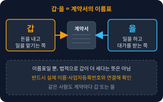</a> <b><a href="#parties-to-a-contract--계약-당사자갑을">Parties to a Contract</a></b> 계약 당사자(갑·을) 계약서에서 계약을 맺는 각 사람이나 회사를 부르는 이름. 보통 돈을 내고 일을 시키는 쪽을 '갑', 일을 받아 하는 쪽을 '을'이라 쓰지만, 법적으로 갑이 더 세다는 뜻은 아니다.</td>
<td width="33%" valign="top"><a href="#rescission--해제">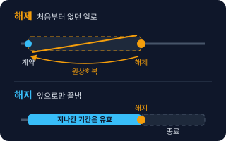</a> <b><a href="#rescission--해제">Rescission</a></b> 해제 한쪽이 약속을 어겼을 때 등 계약을 처음부터 없던 것처럼 되돌리는 것. 이미 주고받은 돈이나 물건은 서로 돌려줘야 한다(원상회복).</td>
<td width="33%" valign="top"><a href="#termination--해지">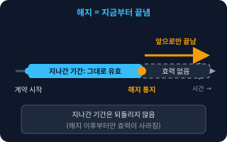</a> <b><a href="#termination--해지">Termination</a></b> 해지 이어지는 계약(월세, 구독, 월 단위 용역 등)을 지금부터 앞으로만 끝내는 것. 이미 지나간 기간의 계약 내용은 그대로 유효하다.</td>
</tr>
<tr>
<td width="33%" valign="top"><a href="#liquidated-damages--위약금손해배상액의-예정">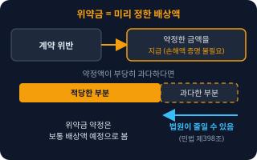</a> <b><a href="#liquidated-damages--위약금손해배상액의-예정">Liquidated Damages</a></b> 위약금(손해배상액의 예정) 계약을 어기면 &quot;이만큼 물어준다&quot;고 계약서에 미리 정해 둔 금액. 실제 손해가 얼마인지 따지지 않고 그 금액을 기준으로 한다.</td>
<td width="33%" valign="top"><a href="#damages--손해배상">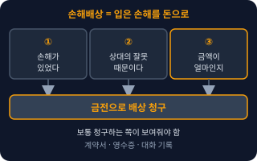</a> <b><a href="#damages--손해배상">Damages</a></b> 손해배상 상대의 잘못으로 내가 입은 손해를 돈으로 물어 달라고 하는 것. 손해가 있었다는 것, 상대 잘못 때문이라는 것, 금액이 얼마인지를 보통 청구하는 쪽이 보여줘야 한다.</td>
<td width="33%" valign="top"><a href="#standard-terms--약관">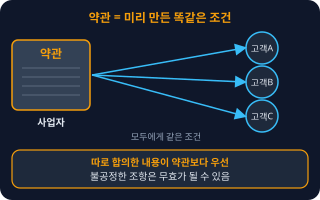</a> <b><a href="#standard-terms--약관">Standard Terms</a></b> 약관 사업자가 여러 고객과 똑같이 계약하려고 미리 만들어 둔 계약 조건. 쇼핑몰 이용약관, 앱 서비스 약관이 대표적이다. 약관의 공정성은 약관규제법이 따로 규율한다.</td>
</tr>
<tr>
<td width="33%" valign="top"><a href="#nda--비밀유지계약">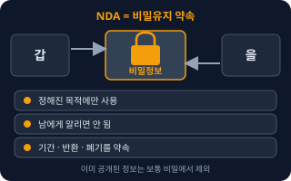</a> <b><a href="#nda--비밀유지계약">NDA</a></b> 비밀유지계약 서로 주고받은 비밀 정보를 남에게 알리거나 정해진 목적 밖에서 쓰지 않겠다고 약속하는 계약. 'Non-Disclosure Agreement'를 줄인 말이다.</td>
</tr>
</table>

**분쟁 · Disputes** (7)

<table>
<tr>
<td width="33%" valign="top"><a href="#certified-mail--내용증명">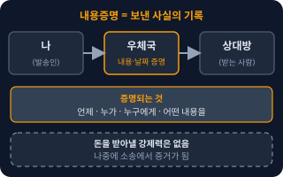</a> <b><a href="#certified-mail--내용증명">Certified Mail</a></b> 내용증명 &quot;언제, 누가, 누구에게, 어떤 내용의 문서를 보냈는지&quot;를 우체국이 증명해 주는 우편. 상대가 받았는데 몰랐다고 하기 어렵게 기록을 남긴다.</td>
<td width="33%" valign="top"><a href="#payment-order--지급명령">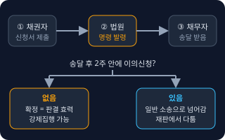</a> <b><a href="#payment-order--지급명령">Payment Order</a></b> 지급명령 돈을 받을 게 있을 때 재판 없이 서류 심사만으로 &quot;돈을 갚아라&quot;는 명령을 법원에서 받는 절차. 상대가 가만히 있으면 확정판결과 같은 효력이 생긴다.</td>
<td width="33%" valign="top"><a href="#small-claims--소액사건심판">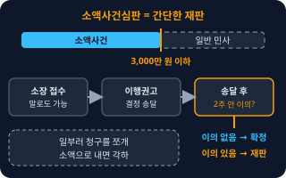</a> <b><a href="#small-claims--소액사건심판">Small Claims</a></b> 소액사건심판 금액이 작은 돈 다툼을 일반 재판보다 간단하고 빠르게 처리하는 재판 절차. 신청 때 말로 접수하는 것도 가능하고, 법원이 먼저 &quot;갚으라&quot;는 이행권고결정을 보내기도 한다.</td>
</tr>
<tr>
<td width="33%" valign="top"><a href="#civil-lawsuit-vs-criminal-complaint--민사소송과-형사고소">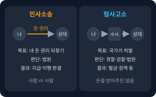</a> <b><a href="#civil-lawsuit-vs-criminal-complaint--민사소송과-형사고소">Civil Lawsuit vs Criminal Complaint</a></b> 민사소송과 형사고소 민사소송은 사람끼리 돈·권리 다툼을 법원에서 가리는 것이고, 형사고소는 상대를 처벌해 달라고 수사기관에 알리는 것이다.</td>
<td width="33%" valign="top"><a href="#provisional-attachment--가압류">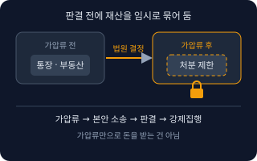</a> <b><a href="#provisional-attachment--가압류">Provisional Attachment</a></b> 가압류 판결을 받기 전에 상대가 재산을 숨기거나 팔아 버리지 못하도록, 법원 결정으로 그 재산(통장, 부동산 등)을 임시로 묶어 두는 절차.</td>
<td width="33%" valign="top"><a href="#statute-of-limitations--소멸시효">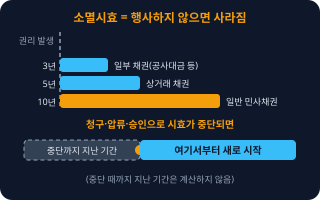</a> <b><a href="#statute-of-limitations--소멸시효">Statute of Limitations</a></b> 소멸시효 받을 권리가 있어도 오랫동안 행사하지 않으면 그 권리가 사라지는 제도. 청구할 수 있는 기간이 권리 종류마다 다르다.</td>
</tr>
<tr>
<td width="33%" valign="top"><a href="#mediation-and-arbitration--조정중재">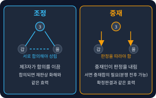</a> <b><a href="#mediation-and-arbitration--조정중재">Mediation and Arbitration</a></b> 조정·중재 재판 대신 제3자의 도움으로 분쟁을 푸는 방법. 조정은 중간에서 합의를 이끌고, 중재는 중재인이 판정을 내려 따르게 한다.</td>
</tr>
</table>

**지식재산 · IP** (7)

<table>
<tr>
<td width="33%" valign="top"><a href="#ip-rights-overview--지식재산권-3종-비교">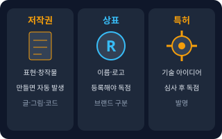</a> <b><a href="#ip-rights-overview--지식재산권-3종-비교">IP Rights Overview</a></b> 지식재산권 3종 비교 사람이 만든 결과물을 보호하는 권리 가운데 가장 많이 쓰는 세 가지. 저작권은 글·그림·코드 같은 표현, 상표권은 이름·로고, 특허권은 기술 아이디어를 지킨다.</td>
<td width="33%" valign="top"><a href="#copyright--저작권">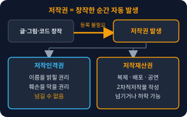</a> <b><a href="#copyright--저작권">Copyright</a></b> 저작권 창작한 글·그림·사진·음악·프로그램 같은 '표현'을 만든 사람이 갖는 권리. 따로 등록하지 않아도 만든 순간 생긴다.</td>
<td width="33%" valign="top"><a href="#work-made-for-hire--업무상저작물">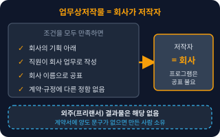</a> <b><a href="#work-made-for-hire--업무상저작물">Work Made for Hire</a></b> 업무상저작물 회사 직원이 회사 일로 만든 저작물은 일정한 조건이면 회사가 저작자가 되는 제도. 조건은 회사의 기획 아래, 업무로, 회사 이름으로 공표되는 것 등이다(프로그램은 공표 요건이 없다).</td>
</tr>
<tr>
<td width="33%" valign="top"><a href="#trademark--상표권">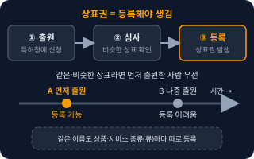</a> <b><a href="#trademark--상표권">Trademark</a></b> 상표권 내 상품·서비스를 다른 것과 구별하게 해 주는 이름, 로고 같은 표시를 독점해서 쓰는 권리. 특허청에 등록해야 생긴다.</td>
<td width="33%" valign="top"><a href="#patent--특허권">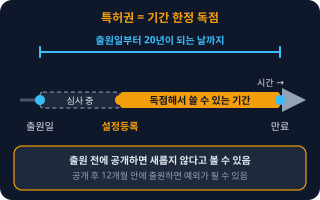</a> <b><a href="#patent--특허권">Patent</a></b> 특허권 새롭고 쉽게 생각해 내기 어려운 기술적 발명을 정해진 기간 동안 독점해서 쓸 수 있게 하는 권리. 특허청에 출원해 심사를 통과해야 한다.</td>
<td width="33%" valign="top"><a href="#license--라이선스이용허락">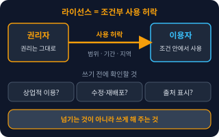</a> <b><a href="#license--라이선스이용허락">License</a></b> 라이선스(이용허락) 저작권·상표 같은 권리를 가진 사람이 다른 사람에게 &quot;이 조건으로 쓰는 것은 허락한다&quot;고 하는 약속. 권리 자체는 그대로 가진다.</td>
</tr>
<tr>
<td width="33%" valign="top"><a href="#copyright-assignment--저작권-양도">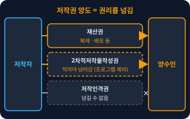</a> <b><a href="#copyright-assignment--저작권-양도">Copyright Assignment</a></b> 저작권 양도 저작권 중 재산권(복제, 배포 등)을 다른 사람에게 넘기는 계약. 넘기면 원래 저작자는 그 권리를 더 이상 마음대로 쓸 수 없다.</td>
</tr>
</table>

**개인정보 · Privacy** (5)

<table>
<tr>
<td width="33%" valign="top"><a href="#personal-information--개인정보">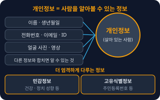</a> <b><a href="#personal-information--개인정보">Personal Information</a></b> 개인정보 살아 있는 사람을 알아볼 수 있는 정보. 이름, 연락처, 얼굴 사진 같은 것은 물론, 다른 정보와 쉽게 합쳐서 누구인지 알 수 있으면 포함된다.</td>
<td width="33%" valign="top"><a href="#consent--동의">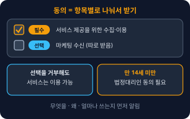</a> <b><a href="#consent--동의">Consent</a></b> 동의 고객이 &quot;내 정보를 이 목적으로 쓰는 것에 찬성한다&quot;고 알리는 것. 어떤 정보를, 왜, 얼마나 쓰는지 먼저 알려야 한다.</td>
<td width="33%" valign="top"><a href="#entrustment--처리위탁">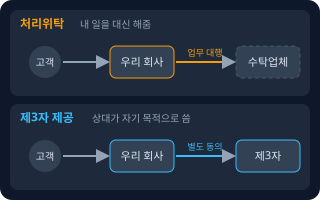</a> <b><a href="#entrustment--처리위탁">Entrustment</a></b> 처리위탁 내가 해야 할 개인정보 처리 업무(문자 발송, 배송, 클라우드 보관 등)를 다른 업체에 맡기는 것. 업체는 내 일을 대신할 뿐 자기 목적으로 쓰지 않는다.</td>
</tr>
<tr>
<td width="33%" valign="top"><a href="#third-party-provision--제3자-제공">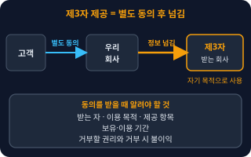</a> <b><a href="#third-party-provision--제3자-제공">Third-Party Provision</a></b> 제3자 제공 고객 정보를 다른 회사나 사람에게 넘겨서 그쪽이 자기 목적으로 쓰게 하는 것. 원칙적으로 고객에게 따로 동의를 받아야 한다.</td>
<td width="33%" valign="top"><a href="#privacy-policy--개인정보처리방침">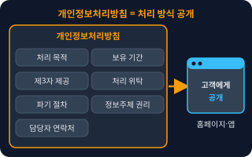</a> <b><a href="#privacy-policy--개인정보처리방침">Privacy Policy</a></b> 개인정보처리방침 회사가 개인정보를 어떻게 다루는지(수집 항목, 목적, 보관 기간, 위탁·제공, 파기, 고객 권리, 담당자 연락처) 고객에게 공개하는 문서.</td>
</tr>
</table>

**회사·노동 · Business & Labor** (4)

<table>
<tr>
<td width="33%" valign="top"><a href="#sole-proprietor-vs-corporation--개인사업자와-법인">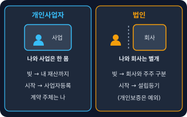</a> <b><a href="#sole-proprietor-vs-corporation--개인사업자와-법인">Sole Proprietor vs Corporation</a></b> 개인사업자와 법인 개인사업자는 사업을 하는 사람이 곧 사업 주체이고, 법인은 사람과 별개로 법이 인정한 '회사' 자체가 계약·재산의 주체가 되는 형태.</td>
<td width="33%" valign="top"><a href="#employee-status--근로자성">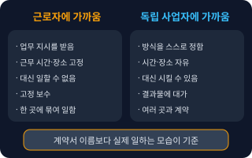</a> <b><a href="#employee-status--근로자성">Employee Status</a></b> 근로자성 계약서 이름과 상관없이 실제 일하는 모습을 보고 그 사람이 법적으로 '근로자'인지 가리는 것. 근로자로 인정되면 근로기준법의 보호(연차, 퇴직금, 해고 제한 등)를 받는다.</td>
<td width="33%" valign="top"><a href="#service-contract--용역계약">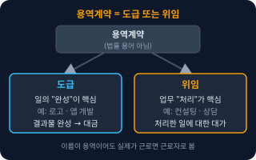</a> <b><a href="#service-contract--용역계약">Service Contract</a></b> 용역계약 일(개발, 디자인, 컨설팅, 청소 등)을 해주고 대가를 받는 계약을 통틀어 부르는 말. 법률 용어가 아니고, 내용에 따라 '도급'(결과물 완성) 또는 '위임'(일 처리) 중 하나로 본다.</td>
</tr>
<tr>
<td width="33%" valign="top"><a href="#unfair-dismissal--부당해고">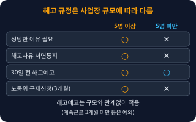</a> <b><a href="#unfair-dismissal--부당해고">Unfair Dismissal</a></b> 부당해고 정당한 이유 없이 직원을 내보내거나, 정해진 절차(서면 통지 등)를 지키지 않고 해고하는 것. 근로기준법은 해고에 정당한 이유를 요구한다.</td>
</tr>
</table>

<!-- overview:end -->

## 계약 · Contracts

### Parties to a Contract · 계약 당사자(갑·을)

- **정의**: 계약서에서 계약을 맺는 각 사람이나 회사를 부르는 이름. 보통 돈을 내고 일을 시키는 쪽을 '갑', 일을 받아 하는 쪽을 '을'이라 쓰지만, 법적으로 갑이 더 세다는 뜻은 아니다.
- **AI에게 이렇게**: "이 계약서에서 갑과 을이 각각 누구인지 정리하고, 나(을)가 져야 할 의무와 받을 권리를 표로 만들어줘."
- **언제**: 계약서를 읽거나 쓸 때, 계약서에 이름 대신 갑·을만 적혀 있을 때
- **헷갈림**: 갑·을은 그냥 편의상 이름표다. 법적 지위가 아니라 계약서의 이름표라서, 같은 사람이 계약마다 갑이 되기도 을이 되기도 한다. 반드시 실제 이름·사업자등록번호와 연결해서 확인한다.
- **관련**: Standard Terms, Service Contract
- **확인 질문**: 계약서에 적힌 갑·을이 실제 누구(개인인지 법인인지, 대표 이름까지)인가요? 서명하는 사람에게 계약할 권한이 있나요?

### Rescission · 해제

- **정의**: 한쪽이 약속을 어겼을 때 등 계약을 **처음부터 없던 것처럼** 되돌리는 것. 이미 주고받은 돈이나 물건은 서로 돌려줘야 한다(원상회복).
- **AI에게 이렇게**: "상대가 납품 기한을 두 번 어겼어. 이 계약을 해제할 수 있는 요건과 해제 통지서에 꼭 들어갈 내용을 알려줘."
- **언제**: 물건을 한 번 주고받는 계약(매매 등)에서 상대의 약속 위반이 있거나, 계약서에 해제 사유가 적혀 있을 때
- **헷갈림**: Termination(해지) — 해제는 처음으로 돌아가고 해지는 지금부터 끝낸다. 한 번에 끝나는 계약은 해제, 임대차·구독·월 단위 용역처럼 이어지는 계약은 해지가 일반적이다. 해제해도 손해가 있으면 손해배상은 따로 청구할 수 있다. 소비자가 쇼핑몰에서 하는 '청약철회'도 다른 제도다.
- **관련**: Termination, Damages, Liquidated Damages
- **확인 질문**: 계약서에 해제 조건이 적혀 있나요? 이미 돈이나 물건이 오갔나요? 상대에게 "기한 안에 이행하라"고 한 기록(문자, 내용증명)이 있나요?
- **근거**: [민법 제543조](https://www.law.go.kr/법령/민법/제543조), [민법 제548조](https://www.law.go.kr/법령/민법/제548조), [민법 제551조](https://www.law.go.kr/법령/민법/제551조)
- **검증일**: 2026-11-01

### Termination · 해지

- **정의**: 이어지는 계약(월세, 구독, 월 단위 용역 등)을 **지금부터 앞으로만** 끝내는 것. 이미 지나간 기간의 계약 내용은 그대로 유효하다.
- **AI에게 이렇게**: "매달 이어지는 유지보수 계약을 끝내려고 해. 계약서의 해지 조항(예고 기간, 위약금)을 찾아서 내가 언제까지 어떻게 통지해야 하는지 알려줘."
- **언제**: 임대차, 유지보수, 구독, 광고 대행처럼 기간을 두고 계속되는 계약을 중간에 끝낼 때
- **헷갈림**: Rescission(해제) — 해지는 과거는 그대로 두고 미래만 끝낸다. 계약 기간이 끝나서 자연스럽게 종료되는 '만료'나, 서로 합의해서 끝내는 '합의해제'와도 구분한다. 일상에서 '해지'와 '해제'를 섞어 쓰기 때문에 계약서 문구를 확인해야 한다.
- **관련**: Rescission, Liquidated Damages
- **확인 질문**: 계약서에 중도 해지 방법과 예고 기간(몇 달 전 통지)이 있나요? 해지 사유가 상대의 잘못인가요, 내 사정인가요?
- **근거**: [민법 제543조](https://www.law.go.kr/법령/민법/제543조), [민법 제550조](https://www.law.go.kr/법령/민법/제550조), [민법 제551조](https://www.law.go.kr/법령/민법/제551조)
- **검증일**: 2026-11-01

### Liquidated Damages · 위약금(손해배상액의 예정)

- **정의**: 계약을 어기면 "이만큼 물어준다"고 계약서에 미리 정해 둔 금액. 실제 손해가 얼마인지 따지지 않고 그 금액을 기준으로 한다.
- **AI에게 이렇게**: "계약서에 위약금이 계약금액의 두 배로 적혀 있어. 이 정도면 너무 과한지, 줄일 수 있는 방법이 있는지 법적 쟁점을 정리해줘."
- **언제**: 계약서에 위약금 조항이 있을 때, 중도 해지를 고민할 때
- **헷갈림**: 위약금은 보통 '손해배상액의 예정'으로 보지만, 계약에 "손해배상과 별도로 벌로 물린다"는 '위약벌'이면 성격이 다르다. 손해배상액의 예정이 부당하게 과다하면 법원이 줄일 수 있다(민법 제398조). 위약금이 곧 상한이라는 뜻도 아니다. 조항 문구로 판단해야 한다.
- **관련**: Damages, Termination, Rescission
- **확인 질문**: 위약금이 어떤 경우에 어떤 기준(금액, 비율)으로 발생한다고 적혀 있나요? "위약금과 별도로 손해배상" 문구가 있나요?
- **근거**: [민법 제398조](https://www.law.go.kr/법령/민법/제398조)
- **검증일**: 2026-11-01

### Damages · 손해배상

- **정의**: 상대의 잘못으로 내가 입은 손해를 돈으로 물어 달라고 하는 것. 손해가 있었다는 것, 상대 잘못 때문이라는 것, 금액이 얼마인지를 보통 청구하는 쪽이 보여줘야 한다.
- **AI에게 이렇게**: "납품 지연으로 광고 일정이 밀려 손해가 났어. 어떤 손해를 청구할 수 있고, 어떤 증거를 모아야 하는지 체크리스트로 만들어줘."
- **언제**: 계약 위반, 불법행위(남에게 피해를 준 행위)로 손해가 났을 때
- **헷갈림**: Liquidated Damages(위약금) — 손해배상은 실제 손해를 따져 계산하고, 위약금은 미리 정한 금액이다. 계약 위반으로 인한 손해배상(채무불이행)과 계약 없는 사람에게 입힌 손해(불법행위)는 요건이 다르다.
- **관련**: Liquidated Damages, Statute of Limitations, Civil Lawsuit vs Criminal Complaint
- **확인 질문**: 손해가 구체적으로 어떤 항목(돈, 시간, 매출)인가요? 영수증, 계약서, 대화 기록 같은 증거가 있나요?
- **근거**: [민법 제390조](https://www.law.go.kr/법령/민법/제390조), [민법 제750조](https://www.law.go.kr/법령/민법/제750조)
- **검증일**: 2026-11-01

### Standard Terms · 약관

- **정의**: 사업자가 여러 고객과 똑같이 계약하려고 미리 만들어 둔 계약 조건. 쇼핑몰 이용약관, 앱 서비스 약관이 대표적이다. 약관의 공정성은 약관규제법이 따로 규율한다.
- **AI에게 이렇게**: "우리 서비스 이용약관 초안을 읽고 고객에게 일방적으로 불리해서 무효가 될 수 있는 조항이 있는지 찾아줘."
- **언제**: 서비스를 만들어 고객과 계약할 때, 남이 만든 약관에 '동의'를 눌러야 할 때
- **헷갈림**: 개별 계약서 — 약관은 모두에게 똑같이 쓰는 조건이고, 개별 계약서는 한 상대와 협의한 내용이다. 상대와 따로 합의한 내용이 약관보다 우선한다. 약관이어도 불공정하면 무효가 될 수 있고, 중요한 내용은 사업자가 고객에게 설명해야 한다.
- **관련**: Parties to a Contract, Consent, Privacy Policy
- **확인 질문**: 고객과 따로 협의하는 부분이 있나요, 모두에게 동일한 조건인가요? 약관을 고객이 가입 전에 볼 수 있나요?
- **근거**: [약관의 규제에 관한 법률 제2조](https://www.law.go.kr/법령/약관의규제에관한법률/제2조), [약관의 규제에 관한 법률 제3조](https://www.law.go.kr/법령/약관의규제에관한법률/제3조), [약관의 규제에 관한 법률 제4조](https://www.law.go.kr/법령/약관의규제에관한법률/제4조), [약관의 규제에 관한 법률 제6조](https://www.law.go.kr/법령/약관의규제에관한법률/제6조)
- **검증일**: 2026-11-01

### NDA · 비밀유지계약

- **정의**: 서로 주고받은 비밀 정보를 남에게 알리거나 정해진 목적 밖에서 쓰지 않겠다고 약속하는 계약. 'Non-Disclosure Agreement'를 줄인 말이다.
- **AI에게 이렇게**: "외주 개발사와 아이디어를 공유하기 전에 쓸 NDA 초안을 만들어줘. 비밀정보 범위, 사용 목적, 기간, 반환·폐기 조항을 포함해줘."
- **언제**: 투자자·파트너·외주업체에게 제품 계획이나 고객 정보를 보여주기 전
- **헷갈림**: 영업비밀 — NDA는 당사자끼리의 약속이고, 영업비밀 보호는 법(부정경쟁방지법)이 정한 별개의 보호다. 영업비밀로 인정받으려면 비밀로 관리해 왔다는 점이 중요하다. NDA에 서명했다고 모든 정보가 자동으로 보호되는 건 아니며, 이미 공개된 정보는 보통 제외된다.
- **관련**: Parties to a Contract, Liquidated Damages, Personal Information
- **확인 질문**: 어떤 정보를 비밀로 할 건가요? 쌍방 비밀유지인가요, 한쪽만인가요? 비밀유지 기간은 얼마로 할까요?
- **근거**: [부정경쟁방지 및 영업비밀보호에 관한 법률 제2조](https://www.law.go.kr/법령/부정경쟁방지및영업비밀보호에관한법률/제2조)
- **검증일**: 2026-11-01

## 분쟁 · Disputes

### Certified Mail · 내용증명

- **정의**: "언제, 누가, 누구에게, 어떤 내용의 문서를 보냈는지"를 우체국이 증명해 주는 우편. 상대가 받았는데 몰랐다고 하기 어렵게 기록을 남긴다.
- **AI에게 이렇게**: "빌려준 500만 원을 14일 안에 갚으라는 내용증명 초안을 써줘. 날짜, 금액, 계좌, 기한이 들어가게."
- **언제**: 소송 전에 정식으로 요구하거나 해지·해제를 통지한 기록을 남길 때
- **헷갈림**: 내용증명 자체에는 돈을 받아내는 힘(강제력)이 없다. 상대가 무시해도 벌이나 의무가 생기지 않는다. 나중에 소송에서 "이런 요구를 했다"는 증거가 될 뿐이다. 지급명령·소송과는 다른 단계다.
- **관련**: Payment Order, Rescission, Statute of Limitations
- **확인 질문**: 요구 내용(금액, 기한, 방법)을 정했나요? 상대의 정확한 주소를 알고 있나요? 이미 대화로 요구한 기록이 있나요?
- **근거**: [우편법 시행규칙 제25조](https://www.law.go.kr/법령/우편법시행규칙/제25조)
- **검증일**: 2026-11-01

### Payment Order · 지급명령

- **정의**: 돈을 받을 게 있을 때 재판 없이 서류 심사만으로 "돈을 갚아라"는 명령을 법원에서 받는 절차. 상대가 가만히 있으면 확정판결과 같은 효력이 생긴다.
- **AI에게 이렇게**: "상대가 용역 대금 300만 원을 안 줘. 계약서와 세금계산서가 있어. 지급명령 신청서에 들어갈 청구 취지와 청구 원인을 써줘."
- **언제**: 상대가 돈을 줘야 한다는 사실 자체는 다투지 않을 것 같고, 금액이 명확할 때
- **헷갈림**: 소액사건심판 — 지급명령은 서류만으로 진행하는 절차이고 소액사건은 재판 절차다. 상대가 정해진 기간(받은 날부터 2주) 안에 이의신청을 하면 지급명령은 힘을 잃고 소송으로 넘어간다. 또 금전 등 일정한 수량 지급이 목적일 때 쓰며, 상대의 주소를 알아야 한다.
- **관련**: Certified Mail, Small Claims, Statute of Limitations
- **확인 질문**: 돈의 금액과 근거(계약서, 계산서, 메시지)는? 상대방 주소는 정확한가요? 상대가 금액이나 이유를 다툴 가능성이 있나요?
- **근거**: [민사소송법 제462조](https://www.law.go.kr/법령/민사소송법/제462조), [민사소송법 제467조](https://www.law.go.kr/법령/민사소송법/제467조), [민사소송법 제470조](https://www.law.go.kr/법령/민사소송법/제470조), [민사소송법 제474조](https://www.law.go.kr/법령/민사소송법/제474조), [대법원 독촉절차 안내](https://www.scourt.go.kr/nm/min_1/min_1_7/min_1_7_1/index.html)
- **검증일**: 2026-11-01

### Small Claims · 소액사건심판

- **정의**: 금액이 작은 돈 다툼을 일반 재판보다 간단하고 빠르게 처리하는 재판 절차. 신청 때 말로 접수하는 것도 가능하고, 법원이 먼저 "갚으라"는 이행권고결정을 보내기도 한다.
- **AI에게 이렇게**: "받을 돈이 800만 원이야. 소액사건심판으로 갈 수 있는지, 소장에 뭘 써야 하는지 순서대로 알려줘."
- **언제**: 소송목적의 값이 소액사건 기준 이하(소액사건심판규칙 기준 3,000만 원 이하, 2017.1.1. 시행 이후)인 금전 청구
- **헷갈림**: 기준 금액은 법령(대법원규칙)이 바뀌면 달라질 수 있으니 제기 전에 확인한다. 이행권고결정을 받은 쪽(피고)이 등본을 송달받은 날부터 2주 안에 서면으로 이의신청을 하면 재판으로 이어진다. 소액사건심판법을 적용받으려고 청구를 쪼개 일부만 청구하면 소가 각하된다(소액사건심판법 제5조의2).
- **관련**: Payment Order, Civil Lawsuit vs Criminal Complaint, Mediation and Arbitration
- **확인 질문**: 청구 금액은 얼마(이자 제외)인가요? 상대의 주소와 증거가 있나요? 이미 지급명령을 시도했나요?
- **근거**: [소액사건심판규칙 제1조의2](https://www.law.go.kr/법령/소액사건심판규칙/제1조의2), [소액사건심판법 제4조](https://www.law.go.kr/법령/소액사건심판법/제4조), [소액사건심판법 제5조의2](https://www.law.go.kr/법령/소액사건심판법/제5조의2), [소액사건심판법 제5조의3](https://www.law.go.kr/법령/소액사건심판법/제5조의3), [소액사건심판법 제5조의4](https://www.law.go.kr/법령/소액사건심판법/제5조의4), [찾기쉬운 생활법령정보 소액사건재판](https://www.easylaw.go.kr/CSP/CnpClsMainBtr.laf?ccfNo=1&cciNo=1&cnpClsNo=1&csmSeq=239&popMenu=ov)
- **검증일**: 2026-11-01

### Civil Lawsuit vs Criminal Complaint · 민사소송과 형사고소

- **정의**: 민사소송은 사람끼리 돈·권리 다툼을 법원에서 가리는 것이고, 형사고소는 상대를 처벌해 달라고 수사기관에 알리는 것이다.
- **AI에게 이렇게**: "거래 대금을 안 주고 연락을 끊은 상대가 있어. 민사로 갈지 형사고소를 할지, 각각 어떤 결과를 기대할 수 있는지 비교해줘."
- **언제**: 피해를 입었는데 돈을 받고 싶은지, 처벌을 원하는지부터 나눠야 할 때
- **헷갈림**: 형사고소를 한다고 돈을 받아 주지는 않는다(합의는 별개). 돈을 안 갚는 것만으로는 범죄(사기 등)가 아닐 수 있고, 처음부터 속일 의도가 있었는지가 핵심이다. "고소 취하할 테니 돈 내라"는 식의 압박은 오히려 문제가 될 수 있다. 같은 사건에 민사와 형사를 따로 진행할 수도 있다.
- **관련**: Damages, Small Claims, Provisional Attachment
- **확인 질문**: 원하는 결과가 돈을 돌려받는 것인가요, 처벌인가요? 상대가 처음부터 속이려고 했다고 볼 만한 사실(거짓 정보, 반복 피해)이 있나요?

### Provisional Attachment · 가압류

- **정의**: 판결을 받기 전에 상대가 재산을 숨기거나 팔아 버리지 못하도록, 법원 결정으로 그 재산(통장, 부동산 등)을 임시로 묶어 두는 절차.
- **AI에게 이렇게**: "상대가 곧 재산을 처분할 것 같아. 가압류를 하려면 뭘 소명해야 하고 담보금이 필요한지 알려줘."
- **언제**: 받을 돈이 있는데 소송 중 재산이 사라질 위험이 있을 때
- **헷갈림**: 가압류는 돈을 받는 것이 아니라 재산을 '못 팔게 묶는' 임시 조치다. 이후 본안 소송에서 이기고 강제집행을 해야 실제로 돈을 받는다. 보통 법원이 담보 제공을 요구하고(민사집행법 제280조), 본안에서 지면 신청인의 고의·과실이 추정되어 상대가 입은 손해를 물어줄 수 있다(대법원 2023. 6. 1. 선고 2020다242935 판결). 돈이 아닌 권리(물건 인도, 사용 금지)를 지키는 것은 '가처분'이다.
- **관련**: Civil Lawsuit vs Criminal Complaint, Payment Order
- **확인 질문**: 상대의 재산(은행, 부동산, 받을 돈)이 어디 있는지 알고 있나요? 받을 돈의 증거가 있나요? 담보금을 마련할 수 있나요?
- **근거**: [민사집행법 제276조](https://www.law.go.kr/법령/민사집행법/제276조), [민사집행법 제280조](https://www.law.go.kr/법령/민사집행법/제280조), [민사집행법 제300조](https://www.law.go.kr/법령/민사집행법/제300조), [대법원 2023. 6. 1. 선고 2020다242935 판결](https://www.law.go.kr/LSW/precInfoP.do?precSeq=237195)
- **검증일**: 2026-11-01

### Statute of Limitations · 소멸시효

- **정의**: 받을 권리가 있어도 오랫동안 행사하지 않으면 그 권리가 사라지는 제도. 청구할 수 있는 기간이 권리 종류마다 다르다.
- **AI에게 이렇게**: "3년 전에 받지 못한 외주 대금이 있어. 소멸시효가 지났는지 따져보게, 어떤 사실을 확인해야 하는지 물어봐줘."
- **언제**: 오래된 돈·권리를 청구하거나, 오래된 청구를 받았을 때
- **헷갈림**: 대표적으로 일반 민사채권 10년(민법 제162조), 상거래로 생긴 채권 5년(상법 제64조), 일부 채권(이자·급료, 도급받은 자의 공사 채권, 상품 대금 등)은 3년(민법 제163조) 등으로 나뉜다(2026-11 기준 민법·상법, 종류별로 확인 필요). 재판상 청구로 중단된 시효는 판결이 확정된 때부터 새로 진행하고, 판결로 확정된 채권의 시효는 10년이다(제165조, 제178조). 청구·압류·가압류·상대의 인정 등으로 시효가 '중단'될 수 있어서, 달력만 보고 판단하면 안 된다.
- **관련**: Certified Mail, Payment Order, Provisional Attachment
- **확인 질문**: 돈이 생긴 날은 언제이고, 그 뒤에 청구나 상대의 일부 변제·인정 같은 일이 있었나요? 어떤 종류의 채권(대금, 임금, 대여금)인가요?
- **근거**: [민법 제162조](https://www.law.go.kr/법령/민법/제162조), [민법 제163조](https://www.law.go.kr/법령/민법/제163조), [민법 제165조](https://www.law.go.kr/법령/민법/제165조), [민법 제168조](https://www.law.go.kr/법령/민법/제168조), [민법 제178조](https://www.law.go.kr/법령/민법/제178조), [상법 제64조](https://www.law.go.kr/법령/상법/제64조)
- **검증일**: 2026-11-01

### Mediation and Arbitration · 조정·중재

- **정의**: 재판 대신 제3자의 도움으로 분쟁을 푸는 방법. 조정은 중간에서 합의를 이끌고, 중재는 중재인이 판정을 내려 따르게 한다.
- **AI에게 이렇게**: "저작권 분쟁이 생겼는데 재판 말고 조정으로 풀 수 있는 기관과 절차를 알려줘. 비용과 걸리는 기간도 같이."
- **언제**: 재판까지 가기엔 부담이 크고, 서로 합의 가능성이 있을 때
- **헷갈림**: 조정은 서로 합의해야 성립한다. 합의가 되면 재판상 화해 등과 같은 효력을 갖는 경우가 있다. 중재는 당사자 사이에 서면 중재합의가 있어야 하고(분쟁 전에 계약서 조항으로 두거나 분쟁 후에 따로 합의할 수 있다), 중재판정은 보통 한 번으로 끝난다(재판처럼 항소하지 않음). 계약서에 '분쟁은 중재로 해결한다'는 조항이 있으면 법원 소송이 막힐 수 있으니 서명 전에 읽는다.
- **관련**: Small Claims, Parties to a Contract
- **확인 질문**: 계약서에 중재나 관할 법원 조항이 있나요? 상대도 합의할 의사가 있어 보이나요?
- **근거**: [민사조정법 제29조](https://www.law.go.kr/법령/민사조정법/제29조), [중재법 제8조](https://www.law.go.kr/법령/중재법/제8조), [중재법 제9조](https://www.law.go.kr/법령/중재법/제9조), [중재법 제35조](https://www.law.go.kr/법령/중재법/제35조), [중재법 제36조](https://www.law.go.kr/법령/중재법/제36조)
- **검증일**: 2026-11-01

## 지식재산 · IP

### IP Rights Overview · 지식재산권 3종 비교

- **정의**: 사람이 만든 결과물을 보호하는 권리 가운데 가장 많이 쓰는 세 가지. 저작권은 글·그림·코드 같은 표현, 상표권은 이름·로고, 특허권은 기술 아이디어를 지킨다.
- **AI에게 이렇게**: "내 앱 이름, 로고, 핵심 알고리즘을 각각 저작권·상표·특허 중 무엇으로 보호할 수 있는지 표로 정리해줘."
- **언제**: 내 결과물을 지키거나 남의 것을 쓰기 전에 어떤 권리가 걸려 있는지 확인할 때
- **헷갈림**: 저작권은 만든 순간 생기지만 상표·특허는 등록(심사)해야 독점 권리가 생긴다. 아이디어 자체는 저작권으로 보호되지 않는다. 이름과 로고는 저작권 문제일 수도, 상표 문제일 수도 있으니 목적을 나눠 본다.
- **관련**: Copyright, Trademark, Patent
- **확인 질문**: 지키고 싶은 것이 이름·로고인가요, 글·그림·코드인가요, 기술 방식인가요? 이미 공개했나요?
- **근거**: [저작권법 제10조](https://www.law.go.kr/법령/저작권법/제10조), [상표법 제82조](https://www.law.go.kr/법령/상표법/제82조), [특허법 제87조](https://www.law.go.kr/법령/특허법/제87조), [한국저작권위원회 AI-저작권 안내서](https://www.copyright.or.kr/notify/notice/view.do?brdctsno=55402)
- **검증일**: 2026-11-01

### Copyright · 저작권

- **정의**: 창작한 글·그림·사진·음악·프로그램 같은 '표현'을 만든 사람이 갖는 권리. 따로 등록하지 않아도 만든 순간 생긴다.
- **AI에게 이렇게**: "블로그에 남이 만든 이미지를 쓰려고 해. 저작권 때문에 확인해야 할 것과 안전하게 쓰는 방법을 알려줘."
- **언제**: 이미지·글·음악·소스코드를 쓰거나 남이 내 것을 쓸 때
- **헷갈림**: 아이디어·사실·제목 같은 것은 보호 대상이 아닌 경우가 많고, 구체적인 표현만 보호된다. 저작권은 복제·배포 같은 재산권과, 이름을 밝히고 훼손을 막는 인격권으로 나뉘며 인격권은 양도하기 어렵다. AI가 만든 결과물은 사람의 창작적 기여가 있어야 보호될 수 있다는 것이 현재 일반적 안내인데, 사안마다 다르다.
- **관련**: Work Made for Hire, License, Copyright Assignment
- **확인 질문**: 누가 언제 만들었나요? 외주나 직원이 만든 것인가요? 계약서에 저작권을 누구에게 둔다고 적혀 있나요?
- **근거**: [저작권법 제2조](https://www.law.go.kr/법령/저작권법/제2조), [저작권법 제10조](https://www.law.go.kr/법령/저작권법/제10조), [저작권법 제14조](https://www.law.go.kr/법령/저작권법/제14조), [한국저작권위원회 AI-저작권 안내서](https://www.copyright.or.kr/notify/notice/view.do?brdctsno=55402)
- **검증일**: 2026-11-01

### Work Made for Hire · 업무상저작물

- **정의**: 회사 직원이 회사 일로 만든 저작물은 일정한 조건이면 회사가 저작자가 되는 제도. 조건은 회사의 기획 아래, 업무로, 회사 이름으로 공표되는 것 등이다(프로그램은 공표 요건이 없다).
- **AI에게 이렇게**: "직원이 만든 디자인의 저작권이 회사에 있는지 따져보게, 확인해야 할 항목을 알려줘. 근로계약서에 넣을 문구 예시도."
- **언제**: 직원이나 인턴이 만든 코드·디자인·콘텐츠의 저작권 주인을 정할 때
- **헷갈림**: 외주(프리랜서)가 만든 결과물에는 이 규정이 그대로 적용되지 않는다. 외주 결과물은 계약서에 저작권을 넘긴다는 문구(Copyright Assignment)가 없으면 만든 사람에게 남는다. 계약이나 회사 규정으로 다르게 정할 수도 있다.
- **관련**: Copyright, Copyright Assignment, Employee Status
- **확인 질문**: 만든 사람은 직원인가요, 프리랜서인가요? 업무 시간·장비로 만들었나요? 회사 이름으로 공개되나요?
- **근거**: [저작권법 제2조](https://www.law.go.kr/법령/저작권법/제2조), [저작권법 제9조](https://www.law.go.kr/법령/저작권법/제9조)
- **검증일**: 2026-11-01

### Trademark · 상표권

- **정의**: 내 상품·서비스를 다른 것과 구별하게 해 주는 이름, 로고 같은 표시를 독점해서 쓰는 권리. 특허청에 등록해야 생긴다.
- **AI에게 이렇게**: "카페 이름 '달빛로스터'를 상표로 등록하고 싶어. 비슷한 상표가 이미 있는지 조사하는 방법과 어떤 류(분류)로 출원해야 하는지 알려줘."
- **언제**: 브랜드 이름·로고를 정하고 사업을 시작하기 전, 남이 비슷한 이름을 쓸 때
- **헷갈림**: 사업자등록증이나 법인 이름과 상표는 별개다. 회사 이름을 등록했다고 상표권이 생기지 않는다. 같은 이름이라도 상품·서비스의 종류(류)마다 따로 등록한다. 한국은 먼저 출원한 사람이 우선하는 제도라서 쓰기 전 선점 확인이 중요하다.
- **관련**: IP Rights Overview, License
- **확인 질문**: 이름·로고는 어떤 상품·서비스에 쓰나요? 해외에서도 쓸 계획인가요? 이미 같은 이름을 쓰는 곳이 있는지 검색해 봤나요?
- **근거**: [상표법 제35조](https://www.law.go.kr/법령/상표법/제35조), [상표법 제38조](https://www.law.go.kr/법령/상표법/제38조), [상표법 제82조](https://www.law.go.kr/법령/상표법/제82조)
- **검증일**: 2026-11-01

### Patent · 특허권

- **정의**: 새롭고 쉽게 생각해 내기 어려운 기술적 발명을 정해진 기간 동안 독점해서 쓸 수 있게 하는 권리. 특허청에 출원해 심사를 통과해야 한다.
- **AI에게 이렇게**: "내가 만든 알고리즘이 특허가 될 수 있는지 판단할 때 확인할 기준을 설명하고, 출원 전에 해야 할 일을 알려줘."
- **언제**: 새로운 기술·제조 방법을 개발했고 남이 못 베끼게 하고 싶을 때
- **헷갈림**: 출원 전에 공개하면 새롭지 않다고 판단될 수 있다(예외 제도가 있지만 조건이 까다롭다). 존속기간은 특허권을 설정등록한 날부터 특허출원일 후 20년이 되는 날까지다(특허법 제88조). 특허권은 설정등록으로 생기고(제87조), 공개 후 12개월 안에 출원하면 새롭지 않다는 판단을 피하는 예외가 있다(제30조). 아이디어만으론 안 되고 구체적인 기술 방법이어야 하며, 소프트웨어는 별도 검토가 필요하다.
- **관련**: IP Rights Overview, Trademark
- **확인 질문**: 이미 공개(발표, 판매, 논문)한 적이 있나요? 기존 기술과 무엇이 다른가요? 비슷한 특허를 검색해 봤나요?
- **근거**: [특허법 제29조](https://www.law.go.kr/법령/특허법/제29조), [특허법 제30조](https://www.law.go.kr/법령/특허법/제30조), [특허법 제87조](https://www.law.go.kr/법령/특허법/제87조), [특허법 제88조](https://www.law.go.kr/법령/특허법/제88조)
- **검증일**: 2026-11-01

### License · 라이선스(이용허락)

- **정의**: 저작권·상표 같은 권리를 가진 사람이 다른 사람에게 "이 조건으로 쓰는 것은 허락한다"고 하는 약속. 권리 자체는 그대로 가진다.
- **AI에게 이렇게**: "이 폰트/이미지/오픈소스 라이선스로 상업 서비스에 써도 되는지 허용 범위(상업적 이용, 수정, 재배포, 출처 표시)를 표로 정리해줘."
- **언제**: 남의 이미지·폰트·코드·음악을 쓰거나 내 결과물을 남에게 쓰게 할 때
- **헷갈림**: Copyright Assignment(양도) — 라이선스는 사용 허락이고, 양도는 권리 자체를 넘기는 것이다. 독점/비독점, 기간, 지역, 용도, 수정 가능 여부에 따라 범위가 크게 달라진다. 무료 라이선스도 조건(출처 표시, 같은 조건으로 공개)이 붙는 경우가 많다.
- **관련**: Copyright, Copyright Assignment, Trademark
- **확인 질문**: 어디서 무엇에 쓸 건가요(상업적 여부, 기간, 지역)? 독점이어야 하나요? 수정하거나 재배포할 건가요?
- **근거**: [저작권법 제46조](https://www.law.go.kr/법령/저작권법/제46조)
- **검증일**: 2026-11-01

### Copyright Assignment · 저작권 양도

- **정의**: 저작권 중 재산권(복제, 배포 등)을 다른 사람에게 넘기는 계약. 넘기면 원래 저작자는 그 권리를 더 이상 마음대로 쓸 수 없다.
- **AI에게 이렇게**: "외주 개발 계약서에 결과물 저작권을 우리 회사로 양도하는 조항을 넣고 싶어. 2차적저작물 작성권과 저작인격권 불행사까지 빠뜨리지 않게 문구를 제안해줘."
- **언제**: 외주 결과물의 권리를 확실히 가져올 때, 내 작품을 팔 때
- **헷갈림**: 계약서에 "저작권 일체 양도"라고만 쓰면 2차적저작물작성권(번역·각색·변형)은 넘기지 않았다고 추정된다(저작권법 제45조 제2항). 다만 컴퓨터프로그램은 특약이 없으면 2차적저작물작성권도 함께 양도된 것으로 추정되니, 프로그램이 아닌 결과물이라면 이 권리까지 넘긴다고 따로 적어야 한다. 저작인격권은 넘길 수 없어서 '행사하지 않기로 한다'는 특약을 쓰는 것이 일반적이다. 양도와 이용허락의 차이를 구분한다.
- **관련**: License, Copyright, Work Made for Hire
- **확인 질문**: 모든 권리를 넘기나요, 일부만 넘기나요? 넘긴 후 만든 사람이 포트폴리오로 쓸 수 있게 허락할까요? 대가는 얼마인가요?
- **근거**: [저작권법 제14조](https://www.law.go.kr/법령/저작권법/제14조), [저작권법 제22조](https://www.law.go.kr/법령/저작권법/제22조), [저작권법 제45조](https://www.law.go.kr/법령/저작권법/제45조)
- **검증일**: 2026-11-01

## 개인정보 · Privacy

### Personal Information · 개인정보

- **정의**: 살아 있는 사람을 알아볼 수 있는 정보. 이름, 연락처, 얼굴 사진 같은 것은 물론, 다른 정보와 쉽게 합쳐서 누구인지 알 수 있으면 포함된다.
- **AI에게 이렇게**: "우리 서비스가 수집하는 항목(이름, 이메일, 접속 IP, 주문 기록)이 개인정보 보호법상 개인정보인지 구분하고, 최소한만 받는 방법을 알려줘."
- **언제**: 회원가입·문의·주문 폼에서 고객 정보를 받기 전
- **헷갈림**: 이름이 없어도 이메일·전화번호·아이디가 사람을 가리키면 개인정보다. 법인 정보 자체는 개인정보가 아니지만 그 안의 담당자 이름·연락처는 개인정보다. 건강·정치 성향처럼 민감한 정보와 주민등록번호 같은 고유식별번호는 더 엄격하게 다룬다.
- **관련**: Consent, Entrustment, Privacy Policy
- **확인 질문**: 어떤 항목을 왜 받나요? 꼭 필요한 항목만인가요? 얼마나 오래 보관하고 언제 지우나요?
- **근거**: [개인정보 보호법 제2조](https://www.law.go.kr/법령/개인정보보호법/제2조), [개인정보 보호법 제23조](https://www.law.go.kr/법령/개인정보보호법/제23조), [개인정보 보호법 제24조](https://www.law.go.kr/법령/개인정보보호법/제24조)
- **검증일**: 2026-11-01

### Consent · 동의

- **정의**: 고객이 "내 정보를 이 목적으로 쓰는 것에 찬성한다"고 알리는 것. 어떤 정보를, 왜, 얼마나 쓰는지 먼저 알려야 한다.
- **AI에게 이렇게**: "회원가입 화면의 개인정보 수집·이용 동의문을 필수 항목과 선택 항목으로 나누어 써줘. 마케팅 수신은 따로 받게."
- **언제**: 개인정보를 받을 때, 목적 외로 쓰거나 남에게 줄 때
- **헷갈림**: 모든 처리에 동의가 필요한 것은 아니고(계약 이행에 필요한 정보 등), 동의 없이 처리하는 근거가 따로 있다. 동의를 받는다면 필수·선택을 나누어야 하며, 선택 동의를 거부했다고 서비스를 못 쓰게 하면 안 된다. 만 14세 미만 아동은 법정대리인 동의가 필요하다(2026-11 기준 확인).
- **관련**: Personal Information, Third-Party Provision, Privacy Policy
- **확인 질문**: 이 정보가 서비스 제공에 꼭 필요한가요, 마케팅용인가요? 14세 미만 사용자가 있을 수 있나요?
- **근거**: [개인정보 보호법 제15조](https://www.law.go.kr/법령/개인정보보호법/제15조), [개인정보 보호법 제16조](https://www.law.go.kr/법령/개인정보보호법/제16조), [개인정보 보호법 제22조](https://www.law.go.kr/법령/개인정보보호법/제22조), [개인정보 보호법 제22조의2](https://www.law.go.kr/법령/개인정보보호법/제22조의2)
- **검증일**: 2026-11-01

### Entrustment · 처리위탁

- **정의**: 내가 해야 할 개인정보 처리 업무(문자 발송, 배송, 클라우드 보관 등)를 다른 업체에 맡기는 것. 업체는 내 일을 대신할 뿐 자기 목적으로 쓰지 않는다.
- **AI에게 이렇게**: "문자 발송 업체와 클라우드 서버에 고객 정보를 맡기려고 해. 위탁계약서에 꼭 넣어야 할 항목과 개인정보처리방침에 공개할 내용을 정리해줘."
- **언제**: 배송, 문자·알림 발송, 결제, 클라우드 보관, 고객센터 외주를 쓸 때
- **헷갈림**: Third-Party Provision(제3자 제공) — 처리위탁은 맡기는 쪽의 업무를 대신하는 것이고, 제3자 제공은 받는 쪽이 자기 목적으로 쓴다. 위탁이면 보통 별도 동의 없이 가능하지만 위탁계약서를 쓰고, 맡긴 사실을 공개하며, 업체를 관리·감독해야 한다. 맡겼다고 책임이 없어지지 않는다.
- **관련**: Third-Party Provision, Privacy Policy, Personal Information
- **확인 질문**: 업체가 고객 정보를 자기 서비스에 쓸 수 있나요, 우리 일만 대신하나요? 업체가 해외에 있거나 정보가 해외로 나가나요?
- **근거**: [개인정보 보호법 제26조](https://www.law.go.kr/법령/개인정보보호법/제26조), [개인정보 보호법 제17조](https://www.law.go.kr/법령/개인정보보호법/제17조)
- **검증일**: 2026-11-01

### Third-Party Provision · 제3자 제공

- **정의**: 고객 정보를 다른 회사나 사람에게 넘겨서 그쪽이 자기 목적으로 쓰게 하는 것. 원칙적으로 고객에게 따로 동의를 받아야 한다.
- **AI에게 이렇게**: "제휴 쇼핑몰에 고객 이름과 전화번호를 넘기려고 해. 제3자 제공 동의문에 들어갈 항목(받는 자, 목적, 항목, 보유기간)을 써줘."
- **언제**: 제휴사, 광고 파트너, 다른 회사에 고객 정보를 넘기는 경우
- **헷갈림**: Entrustment(처리위탁) — 위탁은 내 업무 대행, 제공은 상대의 목적. 겉보기에 비슷해도 법적 의무가 다르다. 동의는 '받는 자, 목적, 항목, 보유기간'을 알려야 하고, 거부할 권리와 거부 시 불이익도 안내한다. 법에서 허용하는 예외도 있다.
- **관련**: Entrustment, Consent, Privacy Policy
- **확인 질문**: 정보를 받는 쪽이 누구이고 무엇에 쓰나요? 고객 서비스에 꼭 필요한 제공인가요, 사업상 필요인가요?
- **근거**: [개인정보 보호법 제17조](https://www.law.go.kr/법령/개인정보보호법/제17조)
- **검증일**: 2026-11-01

### Privacy Policy · 개인정보처리방침

- **정의**: 회사가 개인정보를 어떻게 다루는지(수집 항목, 목적, 보관 기간, 위탁·제공, 파기, 고객 권리, 담당자 연락처) 고객에게 공개하는 문서.
- **AI에게 이렇게**: "우리 서비스는 이메일·주문 정보를 받고 배송업체에 위탁해. 이 사실을 반영한 개인정보처리방침 초안을 법에서 요구하는 항목 순서대로 써줘."
- **언제**: 개인정보를 처리하는 서비스를 열기 전, 수집 항목·위탁 업체가 바뀔 때
- **헷갈림**: Standard Terms(약관) — 이용약관은 서비스 계약 조건이고 처리방침은 개인정보 정책 공개 문서로 둘은 별개다. 개인정보를 처리하는 사업자는 소규모여도 원칙적으로 만들어 공개해야 한다. 실제로 하지 않는 일을 적거나, 쓴 내용과 다르게 처리하면 문제가 된다.
- **관련**: Consent, Entrustment, Third-Party Provision, Standard Terms
- **확인 질문**: 수집 항목·목적·보관 기간이 정리되어 있나요? 위탁·제공하는 업체 목록이 있나요? 개인정보 담당자는 누구인가요?
- **근거**: [개인정보 보호법 제30조](https://www.law.go.kr/법령/개인정보보호법/제30조)
- **검증일**: 2026-11-01

## 회사·노동 · Business & Labor

### Sole Proprietor vs Corporation · 개인사업자와 법인

- **정의**: 개인사업자는 사업을 하는 사람이 곧 사업 주체이고, 법인은 사람과 별개로 법이 인정한 '회사' 자체가 계약·재산의 주체가 되는 형태.
- **AI에게 이렇게**: "1인 개발 서비스를 시작하는데 개인사업자와 법인 중 어느 쪽이 맞을지, 책임·계약·설립 절차 관점에서 비교해줘. 세금 부분은 세무사에게 물어볼 항목으로만 정리해줘."
- **언제**: 사업을 시작할 때, 투자받을 계획이 있거나 매출·인원이 커질 때
- **헷갈림**: 개인사업자는 사업 빚에 대해 개인 재산으로 책임지는 반면, 법인은 법인과 주주가 구분된다. 다만 대표가 개인 보증을 서거나 법적 책임이 있는 행위를 하면 개인에게도 책임이 생길 수 있다. 개인사업자는 사업자등록, 법인은 법인 설립 등기를 한다. 세금 차이는 이 시트가 다루지 않으니 세무사에게 확인한다.
- **관련**: Parties to a Contract, Employee Status
- **확인 질문**: 투자 유치나 공동 창업 계획이 있나요? 공동 대표나 직원이 생기나요? 사업 위험(소송, 큰 계약) 수준은 어떤가요?
- **근거**: [상법 제169조](https://www.law.go.kr/법령/상법/제169조), [상법 제172조](https://www.law.go.kr/법령/상법/제172조), [상법 제331조](https://www.law.go.kr/법령/상법/제331조), [부가가치세법 제8조](https://www.law.go.kr/법령/부가가치세법/제8조)
- **검증일**: 2026-11-01

### Employee Status · 근로자성

- **정의**: 계약서 이름과 상관없이 실제 일하는 모습을 보고 그 사람이 법적으로 '근로자'인지 가리는 것. 근로자로 인정되면 근로기준법의 보호(연차, 퇴직금, 해고 제한 등)를 받는다.
- **AI에게 이렇게**: "프리랜서 계약으로 일하는 사람에게 출퇴근 시간을 정해주고 업무 지시도 하고 있어. 근로자로 볼 위험이 있는지 판단 기준과 점검 항목을 알려줘."
- **언제**: 프리랜서·용역으로 사람을 쓸 때, 내가 프리랜서인데 직원처럼 일할 때
- **헷갈림**: Service Contract(용역계약) — 계약서에 '용역'이라 쓰고 3.3% 공제(사업소득 원천징수: 소득세 3% + 지방소득세 0.3%)를 해도, 실제로 지휘·감독과 시간 구속이 강하면 근로자로 볼 수 있다. 3.3% 공제는 세금 처리 방식일 뿐 근로자성을 정하지 않는다. 원천징수율은 2026-11 기준이며 세법 개정으로 바뀔 수 있다. 반대로 근로계약서를 썼어도 실질이 독립 사업자면 달라질 수 있다. 하나의 사실만으로 정해지지 않고 여러 요소를 종합해 판단한다.
- **관련**: Service Contract, Unfair Dismissal, Work Made for Hire
- **확인 질문**: 업무 시간과 장소를 누가 정하나요? 업무 지시를 받나요? 다른 사람이 대신 일할 수 있나요? 보수는 고정급인가요, 결과물 대가인가요?
- **근거**: [근로기준법 제2조](https://www.law.go.kr/법령/근로기준법/제2조), [소득세법 제129조](https://www.law.go.kr/법령/소득세법/제129조), [국세청 원천징수 3.3% 안내](https://www.nts.go.kr/nts/cm/cntnts/cntntsView.do?cntntsId=239072), [국세청 원천징수 대상 사업소득](https://www.nts.go.kr/nts/cm/cntnts/cntntsView.do?mi=6620&cntntsId=7900)
- **검증일**: 2026-11-01

### Service Contract · 용역계약

- **정의**: 일(개발, 디자인, 컨설팅, 청소 등)을 해주고 대가를 받는 계약을 통틀어 부르는 말. 법률 용어가 아니고, 내용에 따라 '도급'(결과물 완성) 또는 '위임'(일 처리) 중 하나로 본다.
- **AI에게 이렇게**: "디자이너에게 로고를 맡기는 용역계약서를 만들어줘. 결과물 범위, 수정 횟수, 대금 지급 시기, 저작권 귀속, 해지 조건을 포함해줘."
- **언제**: 외주, 프리랜서, 컨설팅을 맡기거나 맡을 때
- **헷갈림**: 근로계약 — 근로계약은 회사 지시 아래 일하고 임금을 받는 관계이고, 용역계약은 독립적으로 결과나 업무를 처리하는 관계다. 이름이 용역이어도 실제가 근로면 근로자로 볼 수 있다. 도급은 '완성'이, 위임은 '처리'가 핵심이라 수정·검수·대금 조건이 다르다. 대기업이나 일정 규모 이상 거래는 하도급법에 따라 서면 발급 의무 등이 따로 있다.
- **관련**: Employee Status, Copyright Assignment, Termination
- **확인 질문**: 결과물이 완성되어야 대금이 나가나요, 일한 시간에 따라 나가나요? 수정은 몇 번까지인가요? 결과물의 저작권은 누구에게 가나요?
- **근거**: [민법 제664조](https://www.law.go.kr/법령/민법/제664조), [민법 제680조](https://www.law.go.kr/법령/민법/제680조), [하도급거래 공정화에 관한 법률 제3조](https://www.law.go.kr/법령/하도급거래공정화에관한법률/제3조)
- **검증일**: 2026-11-01

### Unfair Dismissal · 부당해고

- **정의**: 정당한 이유 없이 직원을 내보내거나, 정해진 절차(서면 통지 등)를 지키지 않고 해고하는 것. 근로기준법은 해고에 정당한 이유를 요구한다.
- **AI에게 이렇게**: "직원을 해고하려는데 정당한 이유가 되는지, 해고 예고와 서면 통지는 어떻게 해야 하는지 절차 체크리스트를 만들어줘."
- **언제**: 직원을 해고하려고 하거나, 부당하게 해고당했다고 느낄 때
- **헷갈림**: 상시 5명 미만 사업장은 근로기준법 일부 규정(정당한 이유 요구, 해고사유 서면통지, 노동위원회 구제신청 등)이 적용되지 않는다. 다만 30일 전 해고 예고(또는 30일분 이상 통상임금인 해고예고수당) 규정은 규모와 관계없이 적용된다(근로기준법 시행령 제7조·별표 1, 2026-11 기준). 해고예고는 계속 근로한 기간이 3개월 미만인 경우 등 예외가 있다(제26조). 5명 이상 사업장의 해고 구제는 부당해고가 있었던 날부터 3개월 안에 노동위원회에 신청해야 한다(제28조, 2026-11 기준). '권고사직'이나 '자진 퇴사 처리'도 실제로는 해고로 다퉈질 수 있다.
- **관련**: Employee Status, Service Contract
- **확인 질문**: 상시 근로자 수는 몇 명인가요? 해고 이유는 무엇이며 서면으로 알렸나요? 해고 예고를 했나요? 해고된 날은 언제인가요?
- **근거**: [근로기준법 제11조](https://www.law.go.kr/법령/근로기준법/제11조), [근로기준법 제23조](https://www.law.go.kr/법령/근로기준법/제23조), [근로기준법 제26조](https://www.law.go.kr/법령/근로기준법/제26조), [근로기준법 제27조](https://www.law.go.kr/법령/근로기준법/제27조), [근로기준법 제28조](https://www.law.go.kr/법령/근로기준법/제28조), [근로기준법 시행령 제7조](https://www.law.go.kr/법령/근로기준법시행령/제7조), [찾기쉬운 생활법령정보 부당해고와 구제절차](https://easylaw.go.kr/CSP/CnpClsMainBtr.laf?popMenu=ov&csmSeq=514&ccfNo=5&cciNo=1&cnpClsNo=1)
- **검증일**: 2026-11-01
