# 마케팅 · 광고 치트시트

> 작은 가게 사장님과 크리에이터가 광고, SNS, 뉴스레터, 랜딩 페이지를 AI와 함께 만들고 숫자로 점검할 때 펼치는 시트입니다. "누구에게, 무슨 말을, 어디서, 얼마에 보여 주고, 무엇을 세는가"를 AI와 같은 말로 맞추는 것이 목표입니다.

> **참고용입니다.** 광고성 정보 전송·대가성 광고 표시는 대한민국 법령 기준(2026-11-02 확인)이며 법률 판단을 대신하지 않습니다. 광고 플랫폼의 화면·용어·정책은 자주 바뀌니 실제 집행 전에 해당 플랫폼 도움말과 전문가를 확인하세요.

## 이렇게 쓰세요

- **나 → AI**: "우리 동네 수제 케이크 가게야. 인스타그램 광고를 월 30만 원으로 처음 돌려 보려고 해. 타깃 고객, 광고 소재 3종, 성과 볼 지표(CTR, 전환율, ROAS)를 표로 정리해줘."
- **AI → 나**: "목표가 방문·문의·구매 중 무엇인가요? 한 건 팔 때 남는 이익은 얼마인가요? 결제 완료를 광고 쪽에서 셀 수 있게 추적 코드(픽셀)가 설치돼 있나요?"
- **나 → AI**: "랜딩 페이지 제목과 CTA 버튼 문구를 A/B 테스트용으로 두 가지씩 만들어줘. 한 번에 하나만 다르게."
- **AI → 나**: "이 링크는 인스타 광고용인가요, 뉴스레터용인가요? UTM 이름표(source·medium·campaign)를 어떻게 부를지 정해 두면 분석 화면에서 구분됩니다."
- **나 → AI**: "신규 가입자에게 보낼 쿠폰 문자 초안을 써줘. 광고성 문자 규칙에 맞게 (광고) 표시, 보내는 곳, 무료 수신거부 방법까지 넣어서."

## 한눈에 보기

<!-- overview:start -->
<!-- 이 구역은 자동 생성됩니다. 직접 고치지 말고 `cd mcp-server && npm run generate`를 실행하세요. -->

**전략 · Strategy** (6)

<table>
<tr>
<td width="33%" valign="top"><a href="#target-audience--타깃-고객">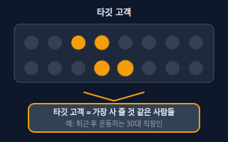</a> <b><a href="#target-audience--타깃-고객">Target Audience</a></b> 타깃 고객 전체 사람 중 우리 상품을 가장 살 것 같은 사람들을 구체적으로 고른 집단. 나이·지역뿐 아니라 상황과 관심사까지 적을수록 광고 문구와 설정이 선명해진다.</td>
<td width="33%" valign="top"><a href="#positioning--포지셔닝">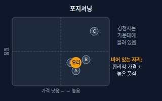</a> <b><a href="#positioning--포지셔닝">Positioning</a></b> 포지셔닝 고객 머릿속에서 우리를 경쟁사와 어떻게 다른 자리에 놓을지 정하는 일. &quot;가장 싼 곳&quot;, &quot;가장 전문적인 곳&quot;처럼 한 칸을 차지하는 것이다.</td>
<td width="33%" valign="top"><a href="#usp--차별점">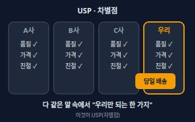</a> <b><a href="#usp--차별점">USP</a></b> 차별점 &quot;다른 곳이 아니라 여기여야 하는 이유&quot; 한 가지. Unique Selling Proposition의 줄임말로, 우리만 약속할 수 있고 고객이 신경 쓰는 것이어야 한다.</td>
</tr>
<tr>
<td width="33%" valign="top"><a href="#funnel--퍼널">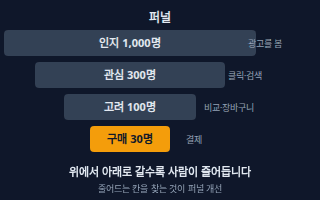</a> <b><a href="#funnel--퍼널">Funnel</a></b> 퍼널 사람이 우리를 알게 된 뒤 관심을 갖고, 비교하고, 구매하는 단계를 깔때기 모양으로 그린 것. 단계마다 사람이 줄어들기 때문에 어느 단계에서 많이 빠지는지 찾는 데 쓴다.</td>
<td width="33%" valign="top"><a href="#performance-vs-brand-marketing--퍼포먼스브랜드-마케팅">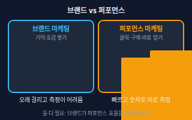</a> <b><a href="#performance-vs-brand-marketing--퍼포먼스브랜드-마케팅">Performance vs Brand Marketing</a></b> 퍼포먼스·브랜드 마케팅 퍼포먼스 마케팅은 클릭·가입·구매 같은 행동을 숫자로 재며 바로 성과를 얻으려는 방식이고, 브랜드 마케팅은 이름과 이미지를 오래 기억시켜 나중에 선택받게 하는 방식이다.</td>
<td width="33%" valign="top"><b><a href="accounting.md#unit-economics--유닛-이코노믹스">Unit Economics</a></b> 유닛 이코노믹스 고객 1명(또는 주문 1건) 기준으로 얼마를 벌고 얼마가 드는지 따지는 방식. 고객 한 명을 데려오는 데 쓴 돈(CAC)과 그 고객이 평생 가져다주는 이익(LTV)을 비교한다. → accounting 시트</td>
</tr>
</table>

**광고 지표 · Ad Metrics** (7)

<table>
<tr>
<td width="33%" valign="top"><a href="#impression--노출">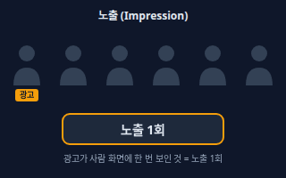</a> <b><a href="#impression--노출">Impression</a></b> 노출 내 광고가 사람 화면에 보인 횟수. 같은 사람에게 세 번 보였으면 노출은 3이다. 사람이 읽었는지·눌렀는지와는 관계없다.</td>
<td width="33%" valign="top"><a href="#ctr--클릭률">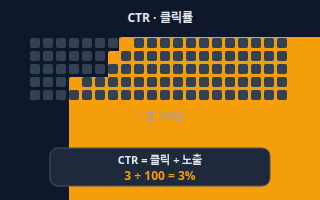</a> <b><a href="#ctr--클릭률">CTR</a></b> 클릭률 광고가 보인 횟수 중 클릭된 비율. 클릭 수 ÷ 노출 수로 구한다. 제목·이미지가 사람의 눈길을 끌었는지 보여 준다.</td>
<td width="33%" valign="top"><a href="#cpc--클릭당-비용">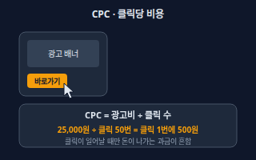</a> <b><a href="#cpc--클릭당-비용">CPC</a></b> 클릭당 비용 클릭 한 번을 얻는 데 든 평균 광고비. 광고비 ÷ 클릭 수로 구한다. 광고가 클릭될 때마다 돈이 나가는 방식(클릭 과금)에서 핵심 숫자다.</td>
</tr>
<tr>
<td width="33%" valign="top"><a href="#cpm--천-회-노출당-비용">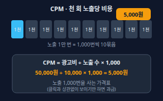</a> <b><a href="#cpm--천-회-노출당-비용">CPM</a></b> 천 회 노출당 비용 광고가 천 번 노출되는 데 드는 비용. 광고비 ÷ 노출 수 × 1,000으로 구한다. 클릭과 관계없이 보이기만 하면 과금되는 방식의 기준이다. M은 로마 숫자로 천을 뜻한다.</td>
<td width="33%" valign="top"><a href="#conversion-rate--전환율">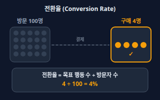</a> <b><a href="#conversion-rate--전환율">Conversion Rate</a></b> 전환율 방문한 사람 중 우리가 원한 행동(구매·가입·문의 등)을 한 사람의 비율. 목표 행동 수 ÷ 방문자 수로 구한다. 그 행동을 &quot;전환&quot;이라 부른다.</td>
<td width="33%" valign="top"><a href="#roas--광고-수익률">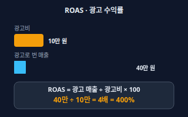</a> <b><a href="#roas--광고-수익률">ROAS</a></b> 광고 수익률 광고비 1원당 광고로 생긴 매출이 얼마인지 보는 비율. 광고 매출 ÷ 광고비 × 100(%)로 구한다. 예: 10만 원을 써서 40만 원 매출이면 400%.</td>
</tr>
<tr>
<td width="33%" valign="top"><a href="#frequency--빈도">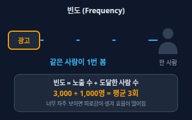</a> <b><a href="#frequency--빈도">Frequency</a></b> 빈도 한 사람에게 같은 광고가 평균 몇 번 보였는지. 노출 수 ÷ 도달한 사람 수로 구한다. 너무 낮으면 기억에 안 남고, 너무 높으면 질려서 효율이 떨어진다.</td>
</tr>
</table>

**운영 · Operations** (7)

<table>
<tr>
<td width="33%" valign="top"><a href="#ab-test--ab-테스트">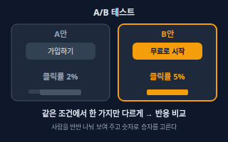</a> <b><a href="#ab-test--ab-테스트">A/B Test</a></b> A/B 테스트 한 가지만 다르게 만든 두 안(A, B)을 같은 시기에 사람들에게 나눠 보여 주고 어느 쪽 반응이 좋은지 숫자로 비교하는 실험.</td>
<td width="33%" valign="top"><a href="#retargeting--리타기팅">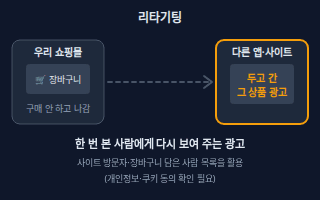</a> <b><a href="#retargeting--리타기팅">Retargeting</a></b> 리타기팅 우리 사이트나 앱에 이미 방문했거나 장바구니에 담은 사람에게 광고를 다시 보여 주는 방식. 리마케팅이라고도 부른다.</td>
<td width="33%" valign="top"><a href="#utm--utm-태그">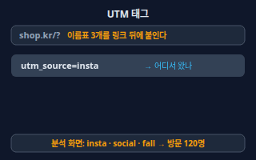</a> <b><a href="#utm--utm-태그">UTM</a></b> UTM 태그 링크 뒤에 붙이는 이름표(utm_source, utm_medium, utm_campaign 등). 방문자가 어디서(출처), 어떤 통로(매체)로, 어느 캠페인에서 왔는지 분석 도구가 구분하게 해 준다.</td>
</tr>
<tr>
<td width="33%" valign="top"><a href="#conversion-tracking--전환-추적픽셀">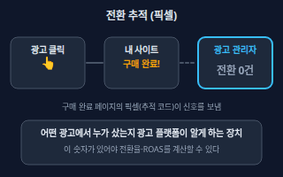</a> <b><a href="#conversion-tracking--전환-추적픽셀">Conversion Tracking</a></b> 전환 추적(픽셀) 광고를 보거나 누른 사람이 사이트에서 구매·가입을 했는지를 광고 플랫폼이 알도록 하는 장치. 사이트에 심는 작은 추적 코드를 픽셀이라 부르고, 서버가 직접 보내는 방식도 있다.</td>
<td width="33%" valign="top"><a href="#landing-page--랜딩-페이지">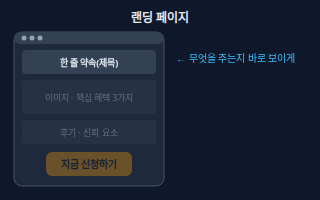</a> <b><a href="#landing-page--랜딩-페이지">Landing Page</a></b> 랜딩 페이지 광고나 링크를 누른 사람이 처음 도착하는, 하나의 행동(구매·신청·문의)을 하도록 만든 한 장짜리 페이지.</td>
<td width="33%" valign="top"><a href="#cta--행동-유도-버튼">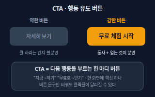</a> <b><a href="#cta--행동-유도-버튼">CTA</a></b> 행동 유도 버튼 Call To Action. 화면을 본 사람에게 &quot;다음에 이걸 하세요&quot;라고 알려 주는 버튼이나 문구. 예: &quot;무료로 시작하기&quot;, &quot;지금 예약하기&quot;.</td>
</tr>
<tr>
<td width="33%" valign="top"><a href="#ad-creative--광고-소재">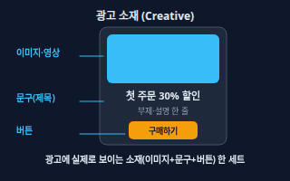</a> <b><a href="#ad-creative--광고-소재">Ad Creative</a></b> 광고 소재 광고에 실제로 보이는 이미지·영상·문구·버튼의 한 세트. 같은 타깃에게도 소재에 따라 반응이 크게 달라진다.</td>
</tr>
</table>

**채널 · Channels** (5)

<table>
<tr>
<td width="33%" valign="top"><a href="#seo--검색엔진-최적화">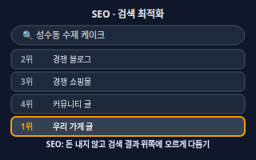</a> <b><a href="#seo--검색엔진-최적화">SEO</a></b> 검색엔진 최적화 Search Engine Optimization. 검색엔진이 우리 사이트의 내용을 잘 이해하고, 검색한 사람에게 도움이 되는 결과로 보여 주도록 글과 사이트를 다듬는 일. 광고비를 내지 않고 자연 검색 결과에 오르는 것이 목표다.</td>
<td width="33%" valign="top"><a href="#sem--검색엔진-마케팅">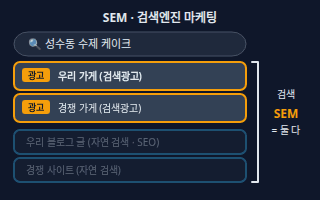</a> <b><a href="#sem--검색엔진-마케팅">SEM</a></b> 검색엔진 마케팅 Search Engine Marketing. 검색엔진에서 사람을 데려오는 모든 마케팅. 돈을 내는 검색광고와 돈을 안 내는 자연 검색(SEO)을 합쳐서 말하기도 하고, 좁게는 검색광고만 가리키기도 한다.</td>
<td width="33%" valign="top"><a href="#organic-vs-paid--오가닉유료-광고">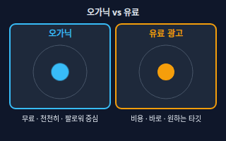</a> <b><a href="#organic-vs-paid--오가닉유료-광고">Organic vs Paid</a></b> 오가닉·유료 광고 오가닉은 돈을 내지 않고 게시물·검색·입소문으로 자연스럽게 퍼지는 것이고, 유료는 광고비를 내서 원하는 사람에게 보이게 하는 것이다.</td>
</tr>
<tr>
<td width="33%" valign="top"><a href="#influencer-marketing--인플루언서-마케팅">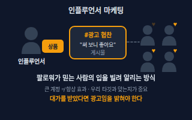</a> <b><a href="#influencer-marketing--인플루언서-마케팅">Influencer Marketing</a></b> 인플루언서 마케팅 팔로워에게 영향력이 있는 사람(크리에이터)에게 제품을 소개하게 해 그 신뢰를 빌려 알리는 마케팅.</td>
<td width="33%" valign="top"><a href="#newsletter-and-crm--뉴스레터crm">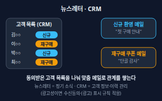</a> <b><a href="#newsletter-and-crm--뉴스레터crm">Newsletter and CRM</a></b> 뉴스레터·CRM 뉴스레터는 정기적으로 소식을 보내는 메일이고, CRM은 고객 정보와 구매·연락 이력을 모아 두고 고객별로 다르게 말 걸기 위한 관리 방식이다. 둘을 합치면 한 번 온 고객을 다시 오게 하는 길이 된다.</td>
</tr>
</table>

**규칙 · Rules** (3)

<table>
<tr>
<td width="33%" valign="top"><a href="#commercial-message-rules--광고성-정보-전송-규칙">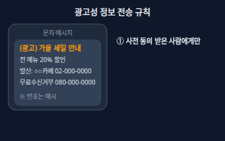</a> <b><a href="#commercial-message-rules--광고성-정보-전송-규칙">Commercial Message Rules</a></b> 광고성 정보 전송 규칙 문자·카카오톡·이메일 같은 전자적 수단으로 영리 목적의 광고성 정보를 보내려면 받는 사람의 명시적 사전 동의를 받아야 하고, 보내는 곳과 수신거부 방법을 광고에 밝혀야 한다. 오후 9시부터 다음 날 오전 8시까지는 별도 동의가 필요하다(이메일 등 일부 매체는 예외).</td>
<td width="33%" valign="top"><a href="#consent-reconfirmation--수신동의-재확인">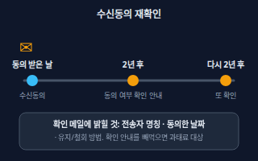</a> <b><a href="#consent-reconfirmation--수신동의-재확인">Consent Reconfirmation</a></b> 수신동의 재확인 광고성 정보 수신동의를 받은 사업자가 동의를 받은 날부터 2년마다 수신자에게 동의 여부를 다시 확인하는 안내를 보내야 하는 의무. 안내에는 전송자 명칭, 수신동의한 사실과 날짜, 유지·철회 방법을 담는다.</td>
<td width="33%" valign="top"><a href="#sponsored-disclosure--대가성-광고-표시">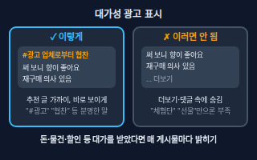</a> <b><a href="#sponsored-disclosure--대가성-광고-표시">Sponsored Disclosure</a></b> 대가성 광고 표시 광고주에게 돈·제품·상품권·할인 등 대가를 받고 쓴 추천·후기에는 그 사실(경제적 이해관계)을 소비자가 쉽게 알도록 밝히는 것. 흔히 말하는 뒷광고(숨긴 광고)를 막는 규칙이다.</td>
</tr>
</table>

<!-- overview:end -->

## 전략 · Strategy

### Target Audience · 타깃 고객

- **정의**: 전체 사람 중 우리 상품을 가장 살 것 같은 사람들을 구체적으로 고른 집단. 나이·지역뿐 아니라 상황과 관심사까지 적을수록 광고 문구와 설정이 선명해진다.
- **AI에게 이렇게**: "우리 상품의 타깃 고객을 한 문장으로 정의하고, 그 사람이 광고를 보는 순간의 고민과 평소 쓰는 말투도 3가지씩 적어줘."
- **언제**: 광고를 처음 설정할 때, 문구·이미지 방향이 흔들릴 때
- **헷갈림**: 고객 전체 — 모든 사람에게 말하면 아무에게도 말하지 못한다. 타깃은 "누구를 일부러 제외할지"까지 정한다. 사용자 조사용 페르소나는 UX 리서치 쪽 도구다.
- **관련**: Positioning, Funnel, Retargeting
- **확인 질문**: 지금 가장 많이 사는 고객은 어떤 사람인가요? 지역(오프라인 매장이면 동네)이나 연령처럼 반드시 제외할 조건이 있나요?

### Positioning · 포지셔닝

- **정의**: 고객 머릿속에서 우리를 경쟁사와 어떻게 다른 자리에 놓을지 정하는 일. "가장 싼 곳", "가장 전문적인 곳"처럼 한 칸을 차지하는 것이다.
- **AI에게 이렇게**: "경쟁 가게 3곳의 가격과 강점을 표로 비교해서, 우리가 차지할 수 있는 비어 있는 자리를 두 가지 제안해줘."
- **언제**: 신규 브랜드 시작, 경쟁이 심해 광고 효율이 떨어질 때
- **헷갈림**: 슬로건 — 슬로건은 포지셔닝을 표현한 문장이고, 포지셔닝은 그 뒤에 있는 전략적 선택이다.
- **관련**: USP, Target Audience, Performance vs Brand Marketing
- **확인 질문**: 고객이 우리 대신 고를 만한 대체재(경쟁 가게·대안)는 무엇인가요? 가격과 품질 중 포기할 수 있는 쪽은 어느 쪽인가요?

### USP · 차별점

- **정의**: "다른 곳이 아니라 여기여야 하는 이유" 한 가지. Unique Selling Proposition의 줄임말로, 우리만 약속할 수 있고 고객이 신경 쓰는 것이어야 한다.
- **AI에게 이렇게**: "우리 가게의 장점 10가지를 적을 테니 경쟁사도 흔히 하는 말은 지우고, 우리만 말할 수 있는 USP 후보 3개를 한 문장씩으로 만들어줘."
- **언제**: 광고 제목, 랜딩 페이지 첫 줄, 상품 소개를 쓸 때
- **헷갈림**: 장점 목록 — "품질 좋고 친절함"은 모두가 하는 말이다. USP는 장점 중에서 경쟁사가 못 하거나 안 하는 한 가지만 골라낸 것이다.
- **관련**: Positioning, Landing Page, Ad Creative
- **확인 질문**: 이 차별점을 실제로 증명할 수 있나요(후기·수치·사진)? 경쟁사가 내일 똑같이 할 수 있는 말은 아닌가요?

### Funnel · 퍼널

- **정의**: 사람이 우리를 알게 된 뒤 관심을 갖고, 비교하고, 구매하는 단계를 깔때기 모양으로 그린 것. 단계마다 사람이 줄어들기 때문에 어느 단계에서 많이 빠지는지 찾는 데 쓴다.
- **AI에게 이렇게**: "광고 노출, 클릭, 상품 페이지 조회, 장바구니, 결제 단계의 숫자를 넣으면 단계별 이탈률을 계산하고 가장 크게 빠지는 구간과 개선 아이디어를 알려줘."
- **언제**: 방문은 많은데 구매가 적을 때, 개선할 곳의 우선순위를 정할 때
- **헷갈림**: 전환율 — 퍼널은 사람이 지나가는 전체 경로 그림이고, 전환율은 그 경로의 한 구간(또는 맨 끝)을 비율로 잰 숫자다. 단계 이름(인지·관심·구매 등)은 회사마다 다르니 AI와 단계 수를 먼저 맞춘다.
- **관련**: Conversion Rate, Landing Page, Retargeting
- **확인 질문**: 우리 퍼널 단계는 무엇으로 나누나요? 단계별 숫자를 어디에서 볼 수 있나요(광고 관리자, 분석 도구)?

### Performance vs Brand Marketing · 퍼포먼스·브랜드 마케팅

- **정의**: 퍼포먼스 마케팅은 클릭·가입·구매 같은 행동을 숫자로 재며 바로 성과를 얻으려는 방식이고, 브랜드 마케팅은 이름과 이미지를 오래 기억시켜 나중에 선택받게 하는 방식이다.
- **AI에게 이렇게**: "월 광고 예산 100만 원을 퍼포먼스와 브랜드에 나눈다면 지금 단계(신규 오픈 3개월)에서 어떻게 나누는 게 좋을지 근거와 함께 두 가지 안으로 보여줘."
- **언제**: 예산을 나눌 때, "광고비는 쓰는데 이름이 안 알려진다"거나 "알려졌는데 안 사 준다"는 고민이 있을 때
- **헷갈림**: 온라인 광고 = 퍼포먼스가 아니다. 인스타 영상 광고도 이름을 알리는 목적이면 브랜드 마케팅이고, 같은 매체여도 목표 지표(노출·조회 vs 구매)가 다르다.
- **관련**: Funnel, CPM, ROAS
- **확인 질문**: 지금 가장 급한 것이 이름을 알리는 일인가요, 당장 매출인가요? 3개월 후와 1년 후 중 어느 쪽 성과를 보시나요?

### Unit Economics · 유닛 이코노믹스

- **정의**: 고객 1명(또는 주문 1건) 기준으로 얼마를 벌고 얼마가 드는지 따지는 방식. 고객 한 명을 데려오는 데 쓴 돈(CAC)과 그 고객이 평생 가져다주는 이익(LTV)을 비교한다.
- **원본**: [회계 · 유닛 이코노믹스](accounting.md#unit-economics--유닛-이코노믹스)

## 광고 지표 · Ad Metrics

### Impression · 노출

- **정의**: 내 광고가 사람 화면에 보인 횟수. 같은 사람에게 세 번 보였으면 노출은 3이다. 사람이 읽었는지·눌렀는지와는 관계없다.
- **AI에게 이렇게**: "지난주 광고 리포트의 노출, 도달, 클릭을 표로 정리하고 노출이 많은데 클릭이 적은 광고 세트를 찾아줘."
- **언제**: 광고가 얼마나 퍼졌는지 볼 때, 클릭률·노출당 비용 계산의 바탕
- **헷갈림**: 도달(Reach) — 노출은 보인 횟수, 도달은 보인 서로 다른 사람 수. 한 사람이 3번 봤다면 노출 3, 도달 1이다.
- **관련**: Frequency, CTR, CPM
- **확인 질문**: 플랫폼이 말하는 "노출"의 기준(화면에 얼마나 보여야 하는지)을 확인했나요? 노출이 아니라 도달 기준으로 보고 싶은가요?

### CTR · 클릭률

- **정의**: 광고가 보인 횟수 중 클릭된 비율. 클릭 수 ÷ 노출 수로 구한다. 제목·이미지가 사람의 눈길을 끌었는지 보여 준다.
- **AI에게 이렇게**: "광고 소재별 노출과 클릭 수를 넣을 테니 CTR을 계산해서 높은 순으로 정렬하고, 노출이 너무 적어 믿기 어려운 소재는 표시해줘."
- **언제**: 소재(이미지·문구)를 비교할 때
- **헷갈림**: 전환율 — CTR은 광고를 누른 비율, 전환율은 눌러서 들어온 사람 중 구매·가입까지 한 비율이다. CTR이 높아도 구매가 없을 수 있다.
- **관련**: Impression, CPC, Ad Creative
- **확인 질문**: 비교할 광고들의 노출 수가 충분한가요? 같은 지면(피드·스토리)끼리 비교하는 건가요?

### CPC · 클릭당 비용

- **정의**: 클릭 한 번을 얻는 데 든 평균 광고비. 광고비 ÷ 클릭 수로 구한다. 광고가 클릭될 때마다 돈이 나가는 방식(클릭 과금)에서 핵심 숫자다.
- **AI에게 이렇게**: "광고비와 클릭 수가 있는 시트에서 광고 세트별 CPC를 계산하고, 평균보다 비싼 세트를 표시해줘."
- **언제**: 방문자 한 명을 얻는 값이 얼마인지 볼 때, 입찰·예산을 조절할 때
- **헷갈림**: CPA(전환당 비용) — CPC는 방문 한 번의 값, CPA는 구매·가입 한 건의 값이다. 클릭이 싸도 구매로 이어지지 않으면 CPA는 비쌀 수 있다.
- **관련**: CTR, CPM, Conversion Rate
- **확인 질문**: 지금 광고는 클릭 과금인가요, 노출 과금인가요? 링크 클릭과 모든 클릭(좋아요·프로필 이동 포함) 중 어느 쪽 기준인가요?

### CPM · 천 회 노출당 비용

- **정의**: 광고가 천 번 노출되는 데 드는 비용. 광고비 ÷ 노출 수 × 1,000으로 구한다. 클릭과 관계없이 보이기만 하면 과금되는 방식의 기준이다. M은 로마 숫자로 천을 뜻한다.
- **AI에게 이렇게**: "광고비 5만 원에 노출 1만 번이면 CPM이 얼마인지 계산하고, 비슷한 타깃의 다른 광고 세트와 비교해서 어느 쪽이 싼지 정리해줘."
- **언제**: 이름 알리기(브랜드) 광고, 지면·타깃별 단가 비교
- **헷갈림**: CPC — CPM은 "보여 주는 값", CPC는 "누르게 하는 값"이다. CTR이 낮으면 CPM이 싸 보여도 CPC는 비싸진다.
- **관련**: CPC, Impression, Performance vs Brand Marketing
- **확인 질문**: 광고비를 노출 기준으로 내는 구매 방식인가요? 타깃을 좁히면 CPM이 올라갈 수 있다는 점을 알고 계신가요?

### Conversion Rate · 전환율

- **정의**: 방문한 사람 중 우리가 원한 행동(구매·가입·문의 등)을 한 사람의 비율. 목표 행동 수 ÷ 방문자 수로 구한다. 그 행동을 "전환"이라 부른다.
- **AI에게 이렇게**: "월별 방문자 수와 구매 건수를 넣을 테니 전환율을 계산하고, 유입 경로(광고·검색·SNS)별로 나눠서 어느 경로가 사는 사람을 데려오는지 보여줘."
- **언제**: 랜딩 페이지·상품 페이지를 고칠 때, 광고 경로별 질을 비교할 때
- **헷갈림**: CTR — CTR은 광고에서 눌린 비율(입구), 전환율은 들어온 뒤 행동한 비율(출구)이다. 분모가 다르다(노출 vs 방문자).
- **관련**: Funnel, Landing Page, A/B Test
- **확인 질문**: 무엇을 전환으로 셀까요(구매·장바구니·문의)? 분모는 방문 수인가요, 클릭 수인가요? 같은 기간끼리 비교하나요?

### ROAS · 광고 수익률

- **정의**: 광고비 1원당 광고로 생긴 매출이 얼마인지 보는 비율. 광고 매출 ÷ 광고비 × 100(%)로 구한다. 예: 10만 원을 써서 40만 원 매출이면 400%.
- **AI에게 이렇게**: "광고비와 광고로 발생한 매출, 원가율 60%를 넣어서 ROAS를 구하고, 손익분기 ROAS가 얼마인지도 같이 알려줘."
- **언제**: 광고를 늘릴지 줄일지 결정할 때
- **헷갈림**: 이익률 — ROAS는 매출 기준이라 400%여도 원가·수수료를 빼면 적자일 수 있다. 손익분기 ROAS를 따로 계산한다. 고객 평생 이익은 LTV와 CAC를 보는 유닛 이코노믹스 쪽이다.
- **관련**: Unit Economics, Conversion Tracking, CPC
- **확인 질문**: 매출은 부가세 포함인가요, 환불을 뺀 금액인가요? 마진율이 얼마라서 몇 % 이상이어야 남나요?

### Frequency · 빈도

- **정의**: 한 사람에게 같은 광고가 평균 몇 번 보였는지. 노출 수 ÷ 도달한 사람 수로 구한다. 너무 낮으면 기억에 안 남고, 너무 높으면 질려서 효율이 떨어진다.
- **AI에게 이렇게**: "광고 세트별 노출, 도달, 빈도를 비교하고 빈도가 높은데 CTR이 떨어지는 세트를 찾아서 소재 교체나 타깃 확대를 제안해줘."
- **언제**: 같은 광고를 오래 돌려 반응이 떨어질 때(광고 피로)
- **헷갈림**: 노출 — 노출은 전체 횟수, 빈도는 사람 한 명당 평균이다. 몇 명에게 퍼졌는지는 도달로 본다.
- **관련**: Impression, Ad Creative, Retargeting
- **확인 질문**: 광고를 며칠째 돌리고 있나요? 같은 소재를 바꾸지 않았나요?

## 운영 · Operations

### A/B Test · A/B 테스트

- **정의**: 한 가지만 다르게 만든 두 안(A, B)을 같은 시기에 사람들에게 나눠 보여 주고 어느 쪽 반응이 좋은지 숫자로 비교하는 실험.
- **AI에게 이렇게**: "랜딩 페이지 버튼 문구를 A '가입하기'와 B '무료로 시작' 두 안으로 테스트하려고 해. 어떤 숫자를 얼마나 모아야 승자를 고를 수 있는지, 실험 설계표를 만들어줘."
- **언제**: 제목·이미지·버튼·가격 문구 중 무엇이 더 나은지 감으로 말다툼이 날 때
- **헷갈림**: 순서대로 바꿔 보기 — 이번 주 A, 다음 주 B로 하면 요일·이벤트 영향이 섞인다. A/B는 같은 기간에 나눠서 본다. 여러 가지를 한꺼번에 바꾸면 원인을 알 수 없다.
- **관련**: Conversion Rate, CTR, Landing Page, CTA
- **확인 질문**: 이번에 바꾸는 한 가지는 무엇인가요? 성공 기준 지표는 무엇이고, 며칠·몇 명 정도 모일 때까지 기다릴까요?

### Retargeting · 리타기팅

- **정의**: 우리 사이트나 앱에 이미 방문했거나 장바구니에 담은 사람에게 광고를 다시 보여 주는 방식. 리마케팅이라고도 부른다.
- **AI에게 이렇게**: "최근 14일 안에 상품 페이지를 보고 구매하지 않은 방문자를 대상으로 하는 리타기팅 광고 문구 3가지를 만들어줘. 너무 집요해 보이지 않게."
- **언제**: 방문은 했는데 사지 않은 사람이 많을 때
- **헷갈림**: 신규 고객 광고 — 리타기팅은 이미 우리를 아는 사람이 대상이라 효율이 높은 대신 규모가 작다. 구매한 사람을 목록에서 빼지 않으면 이미 산 상품 광고를 계속 보게 된다.
- **관련**: Conversion Tracking, Frequency, Funnel
- **확인 질문**: 사이트에 추적 코드(픽셀)가 설치돼 있나요? 구매 완료한 사람은 제외할까요? 방문 후 며칠까지 보여 줄까요?

### UTM · UTM 태그

- **정의**: 링크 뒤에 붙이는 이름표(utm_source, utm_medium, utm_campaign 등). 방문자가 어디서(출처), 어떤 통로(매체)로, 어느 캠페인에서 왔는지 분석 도구가 구분하게 해 준다.
- **AI에게 이렇게**: "인스타 광고, 카카오 채널 메시지, 뉴스레터 세 곳에 쓸 UTM 링크를 규칙 있게(소문자, 띄어쓰기 없이) 만들어서 표로 정리해줘."
- **언제**: 같은 사이트로 여러 곳에서 사람을 보낼 때
- **헷갈림**: 광고 플랫폼 자체 리포트 — 플랫폼 리포트는 그 플랫폼 기준이고, UTM은 내 사이트 분석 도구에서 모든 경로를 같은 기준으로 비교하게 해 준다. 철자·대소문자가 다르면 다른 것으로 집계된다.
- **관련**: Conversion Tracking, Newsletter and CRM, Organic vs Paid
- **확인 질문**: 이름표 규칙(예: source는 채널명, campaign은 행사명)을 정했나요? 어떤 분석 도구로 볼 건가요?

### Conversion Tracking · 전환 추적(픽셀)

- **정의**: 광고를 보거나 누른 사람이 사이트에서 구매·가입을 했는지를 광고 플랫폼이 알도록 하는 장치. 사이트에 심는 작은 추적 코드를 픽셀이라 부르고, 서버가 직접 보내는 방식도 있다.
- **AI에게 이렇게**: "쇼핑몰의 결제 완료 페이지에서만 '구매' 이벤트가 한 번 기록되도록 광고 픽셀 설치 순서와 테스트 방법을 단계별로 알려줘."
- **언제**: 첫 광고를 돌리기 전, ROAS·전환율을 광고 화면에서 보고 싶을 때
- **헷갈림**: 방문자 수 집계 — 방문자 수는 사이트에 몇 명 왔는지, 전환 추적은 그중 목표 행동을 한 건수를 광고와 연결하는 일이다. 개인정보·쿠키 동의 고지를 갖추었는지도 함께 확인해야 한다.
- **관련**: ROAS, Retargeting, UTM
- **확인 질문**: 사이트는 어떤 서비스(스마트스토어, 카페24, 자체 개발 등)로 만들었나요? 전환으로 셀 행동은 무엇이고, 중복 집계가 생기지 않나요?

### Landing Page · 랜딩 페이지

- **정의**: 광고나 링크를 누른 사람이 처음 도착하는, 하나의 행동(구매·신청·문의)을 하도록 만든 한 장짜리 페이지.
- **AI에게 이렇게**: "수제 케이크 예약 문의를 받는 랜딩 페이지 구성안을 만들어줘. 맨 위에 한 줄 약속, 혜택 3가지, 후기, 예약 버튼 순서로, 모바일 화면 기준으로."
- **언제**: 광고 클릭은 나오는데 전환이 적을 때, 새 상품이나 이벤트를 알릴 때
- **헷갈림**: 홈페이지 — 홈페이지는 여러 메뉴로 둘러보는 곳이고, 랜딩 페이지는 광고 약속과 이어진 한 가지 행동만 남긴 곳이다. 맨 위 큰 영역 디자인은 UI 디자인의 히어로 섹션에서 다룬다.
- **관련**: CTA, Conversion Rate, A/B Test, USP
- **확인 질문**: 광고에서 약속한 문구와 페이지 첫 화면이 일치하나요? 사람들이 하길 바라는 행동은 정확히 하나인가요?

### CTA · 행동 유도 버튼

- **정의**: Call To Action. 화면을 본 사람에게 "다음에 이걸 하세요"라고 알려 주는 버튼이나 문구. 예: "무료로 시작하기", "지금 예약하기".
- **AI에게 이렇게**: "예약 페이지의 CTA 버튼 문구를 '동사+얻는 것' 형태로 5개 제안해줘. 너무 압박하는 표현은 빼고."
- **언제**: 랜딩 페이지, 광고 소재, 뉴스레터 마지막 줄
- **헷갈림**: 일반 버튼 — 모든 버튼이 CTA는 아니다. CTA는 성과 지표로 세는 핵심 행동 하나를 부르는 버튼이다. 한 화면에 CTA가 너무 많으면 눌릴 곳이 흩어진다.
- **관련**: Landing Page, A/B Test, Conversion Rate
- **확인 질문**: 이 화면에서 사람이 꼭 해야 할 단 하나의 행동은 무엇인가요? 버튼이 누르면 어디로 이동하나요?

### Ad Creative · 광고 소재

- **정의**: 광고에 실제로 보이는 이미지·영상·문구·버튼의 한 세트. 같은 타깃에게도 소재에 따라 반응이 크게 달라진다.
- **AI에게 이렇게**: "20대 직장인 타깃, 제품은 도시락 구독이야. 인스타 피드 광고 소재로 이미지 아이디어 3개와 제목 문구 3개, 버튼 문구를 짝지어 줘. 각각 어떤 약속(혜택)을 내세우는지도 적어줘."
- **언제**: 광고를 새로 만들거나 반응이 식어 소재를 바꿀 때
- **헷갈림**: 타깃 설정 — 타깃은 "누구에게 보일지", 소재는 "무엇을 보일지"다. 성과가 낮을 때 둘 중 어느 쪽 문제인지 나눠서 본다. 한 번에 여러 개를 바꾸면 원인을 모른다.
- **관련**: CTR, A/B Test, Frequency, USP
- **확인 질문**: 광고가 노출될 지면(피드·스토리·릴스·검색)은 어디인가요? 사용해도 되는 이미지·음원인가요(저작권)?

## 채널 · Channels

### SEO · 검색엔진 최적화

- **정의**: Search Engine Optimization. 검색엔진이 우리 사이트의 내용을 잘 이해하고, 검색한 사람에게 도움이 되는 결과로 보여 주도록 글과 사이트를 다듬는 일. 광고비를 내지 않고 자연 검색 결과에 오르는 것이 목표다.
- **AI에게 이렇게**: "'성수동 수제 케이크' 검색으로 들어오는 사람을 위한 블로그 글 제목 5개와 목차를 만들어줘. 제목과 소제목에 검색어가 자연스럽게 들어가게."
- **언제**: 광고비 없이 꾸준히 사람을 모으고 싶을 때(성과는 시간이 걸린다)
- **헷갈림**: 검색광고 — SEO는 자연 검색 순위를 노력으로 올리는 일이고, 검색광고는 돈을 내고 검색 결과 위쪽 광고 칸에 나오는 것이다. 순위를 돈으로 사거나 보장할 수 있다고 말하는 곳은 주의한다.
- **관련**: SEM, Landing Page, UTM
- **확인 질문**: 사람들이 실제로 검색할 말은 무엇이라 생각하나요? 네이버와 구글 중 어느 검색에서 노출되길 원하나요?

### SEM · 검색엔진 마케팅

- **정의**: Search Engine Marketing. 검색엔진에서 사람을 데려오는 모든 마케팅. 돈을 내는 검색광고와 돈을 안 내는 자연 검색(SEO)을 합쳐서 말하기도 하고, 좁게는 검색광고만 가리키기도 한다.
- **AI에게 이렇게**: "'동네 케이크 주문' 검색어로 검색광고를 시작하려고 해. 키워드 20개와 제외할 검색어, 광고 문구 3개를 정리해줘."
- **언제**: 지금 막 사려고 검색하는 사람(구매 의도가 높은 사람)을 잡고 싶을 때
- **헷갈림**: SNS 광고 — 검색광고는 사람이 먼저 찾을 때 보이고(수요를 잡음), SNS 광고는 사람이 다른 걸 보고 있을 때 끼어든다(수요를 만듦). SEM이 검색광고만 뜻하는지 SEO까지 포함하는지는 대화에서 먼저 맞춘다.
- **관련**: SEO, CPC, Organic vs Paid
- **확인 질문**: SEM을 검색광고만 뜻하나요, SEO까지 포함하나요? 사람들이 어떤 검색어로 우리를 찾을까요?

### Organic vs Paid · 오가닉·유료 광고

- **정의**: 오가닉은 돈을 내지 않고 게시물·검색·입소문으로 자연스럽게 퍼지는 것이고, 유료는 광고비를 내서 원하는 사람에게 보이게 하는 것이다.
- **AI에게 이렇게**: "이번 달 신메뉴 홍보를 오가닉 게시물 4개와 유료 광고 1개로 나눠서 짜 줘. 어떤 게시물을 광고로 키울지 기준도 같이."
- **언제**: SNS 운영 계획을 짤 때, 반응 좋은 게시물을 광고로 키울지 정할 때
- **헷갈림**: 무료 = 공짜 아님 — 오가닉은 광고비는 안 들지만 콘텐츠 제작 시간이 든다. 또 오가닉이라도 업체에서 대가를 받은 후기는 광고 표시 대상이다.
- **관련**: SEO, Influencer Marketing, Sponsored Disclosure
- **확인 질문**: 지금 팔로워가 몇 명이고 평소 게시물 반응은 어떤가요? 광고 예산이 있나요, 없다면 어느 정도 시간을 쓸 수 있나요?

### Influencer Marketing · 인플루언서 마케팅

- **정의**: 팔로워에게 영향력이 있는 사람(크리에이터)에게 제품을 소개하게 해 그 신뢰를 빌려 알리는 마케팅.
- **AI에게 이렇게**: "수제 비누 브랜드야. 우리 타깃이 많이 보는 크리에이터를 고를 기준 5가지와 제안 메일 초안을 써줘. 광고 표시를 계약서에 명시하는 문구도 넣어줘."
- **언제**: 우리 타깃이 이미 믿고 보는 사람이 있을 때, 광고 소재로 쓸 사용 후기 콘텐츠가 필요할 때
- **헷갈림**: 큰 계정 = 효과가 큰 계정이 아니다. 팔로워가 많아도 우리 타깃과 안 맞으면 반응이 없다. 대가를 받은 추천은 광고임을 밝혀야 한다(대가성 광고 표시 참고).
- **관련**: Sponsored Disclosure, Target Audience, Organic vs Paid
- **확인 질문**: 협찬은 현금·제품·할인 중 무엇인가요? 게시물에 광고 표시를 누가, 어디에 넣을까요? 성과는 어떤 링크·코드로 추적할까요?

### Newsletter and CRM · 뉴스레터·CRM

- **정의**: 뉴스레터는 정기적으로 소식을 보내는 메일이고, CRM은 고객 정보와 구매·연락 이력을 모아 두고 고객별로 다르게 말 걸기 위한 관리 방식이다. 둘을 합치면 한 번 온 고객을 다시 오게 하는 길이 된다.
- **AI에게 이렇게**: "신규 가입 고객과 두 번 이상 산 고객으로 나눠, 각각 첫 주에 보낼 메일 제목과 본문 초안을 써줘. 마지막에 수신거부 안내 문구도 넣어줘."
- **언제**: 신규 고객 확보보다 재구매가 싸고 효과적일 때, 고객 명단이 쌓이기 시작했을 때
- **헷갈림**: 대량 문자 — 구매나 가입으로 모은 연락처라도 광고성 내용이면 수신동의와 (광고) 표시 등 규칙을 따라야 한다. 뉴스레터에 쿠폰·상품 안내가 들어가면 광고성 정보일 수 있다.
- **관련**: Commercial Message Rules, Consent Reconfirmation, Unit Economics
- **확인 질문**: 연락처는 어떻게 모았고 광고 수신에 동의받았나요? 고객 목록에 구매 이력(신규·재구매) 열이 있나요?

## 규칙 · Rules

### Commercial Message Rules · 광고성 정보 전송 규칙

- **정의**: 문자·카카오톡·이메일 같은 전자적 수단으로 영리 목적의 광고성 정보를 보내려면 받는 사람의 명시적 사전 동의를 받아야 하고, 보내는 곳과 수신거부 방법을 광고에 밝혀야 한다. 오후 9시부터 다음 날 오전 8시까지는 별도 동의가 필요하다(이메일 등 일부 매체는 예외).
- **AI에게 이렇게**: "수신동의한 고객에게 보낼 쿠폰 문자 초안을 써줘. 정보통신망법에 맞게 맨 앞 (광고) 표시, 보내는 곳, 무료 수신거부 방법을 넣고, 발송 가능 시간대도 알려줘. 최종 법률 확인은 내가 따로 할게."
- **언제**: 쿠폰·이벤트 문자나 메일, 푸시를 보내기 전
- **헷갈림**: 거래 안내(주문 확인·배송 안내) — 광고 내용이 없는 단순 안내는 광고성 정보가 아니지만, 거기에 쿠폰·상품 홍보를 섞으면 광고성 정보가 될 수 있다. 사전 동의의 예외(거래 후 일정 기간 같은 종류 상품 광고)는 요건이 까다로우니 전문가와 확인한다.
- **관련**: Consent Reconfirmation, Newsletter and CRM, Sponsored Disclosure
- **확인 질문**: 받는 사람에게 광고 수신 동의를 받은 기록이 있나요? 발송 매체(문자·카카오 알림·이메일)와 발송 시간은 언제인가요? 무료 수신거부 번호가 준비돼 있나요?
- **근거**: [정보통신망 이용촉진 및 정보보호 등에 관한 법률 제50조](https://www.law.go.kr/법령/정보통신망이용촉진및정보보호등에관한법률/제50조), [정보통신망법 시행령 별표 6(광고 표시 방법)](https://www.law.go.kr/lsBylInfoPLinkR.do?bylBrNo=00&bylCls=BE&bylNo=0006&lsNm=%EC%A0%95%EB%B3%B4%ED%86%B5%EC%8B%A0%EB%A7%9D%20%EC%9D%B4%EC%9A%A9%EC%B4%89%EC%A7%84%20%EB%B0%8F%20%EC%A0%95%EB%B3%B4%EB%B3%B4%ED%98%B8%20%EB%93%B1%EC%97%90%20%EA%B4%80%ED%95%9C%20%EB%B2%95%EB%A5%A0%20%EC%8B%9C%ED%96%89%EB%A0%B9), [KISA 불법스팸대응센터](https://spam.kisa.or.kr/)
- **검증일**: 2026-11-02

### Consent Reconfirmation · 수신동의 재확인

- **정의**: 광고성 정보 수신동의를 받은 사업자가 동의를 받은 날부터 2년마다 수신자에게 동의 여부를 다시 확인하는 안내를 보내야 하는 의무. 안내에는 전송자 명칭, 수신동의한 사실과 날짜, 유지·철회 방법을 담는다.
- **AI에게 이렇게**: "수신동의 날짜가 적힌 고객 시트에서 오늘 기준으로 2년이 지났거나 한 달 안에 지나는 고객을 뽑고, 확인 안내 문자 초안을 써줘."
- **언제**: 고객 DB를 오래 쓰며 광고 문자·메일을 계속 보낼 때
- **헷갈림**: 수신거부 처리 — 수신거부는 고객이 거부했을 때 즉시 멈추는 것이고, 재확인은 거부 의사가 없어도 사업자가 주기적으로 먼저 묻는 것이다.
- **관련**: Commercial Message Rules, Newsletter and CRM
- **확인 질문**: 고객별 동의 받은 날짜를 기록하고 있나요? 확인 안내는 문자와 이메일 중 어느 쪽으로 보낼까요?
- **근거**: [정보통신망 이용촉진 및 정보보호 등에 관한 법률 제50조제8항](https://www.law.go.kr/법령/정보통신망이용촉진및정보보호등에관한법률/제50조), [KISA 불법스팸대응센터 — 2년마다 수신동의 여부 확인 안내](https://spam.kisa.or.kr/spam/na/ntt/selectNttInfo.do?bbsId=1001&mi=1019&nttSn=1217)
- **검증일**: 2026-11-02

### Sponsored Disclosure · 대가성 광고 표시

- **정의**: 광고주에게 돈·제품·상품권·할인 등 대가를 받고 쓴 추천·후기에는 그 사실(경제적 이해관계)을 소비자가 쉽게 알도록 밝히는 것. 흔히 말하는 뒷광고(숨긴 광고)를 막는 규칙이다.
- **AI에게 이렇게**: "협찬 받은 제품의 인스타그램 후기 게시물 문안을 써줘. 공정거래위원회 지침에 맞게 맨 앞에 알아보기 쉬운 광고 표시를 넣고, 더보기나 댓글에 숨기지 않게."
- **언제**: 인플루언서에게 협찬하거나 체험단 후기를 받을 때, 내가 협찬받아 후기를 쓸 때
- **헷갈림**: 아무 해시태그 — 지침은 '#광고', '#협찬', '금전적 지원' 등 명확한 표현을 예로 들고, '체험 후기', '선물', 브랜드 이름만 해시태그로 단 것은 명확하지 않다고 본다. 표시 문구는 추천 내용과 가까이 두고 더보기·댓글 속에 숨기지 않는다.
- **관련**: Influencer Marketing, Organic vs Paid, Commercial Message Rules
- **확인 질문**: 대가를 받았나요(현금·제품·할인 포함)? 게시 플랫폼(블로그·인스타·유튜브)과 표시 위치는 어디인가요? AI로 만든 가상 인물이 후기를 하나요?
- **근거**: [공정거래위원회 추천·보증 등에 관한 표시·광고 심사지침 Ⅴ.6](https://www.law.go.kr/LSW/admRulInfoP.do?admRulSeq=2100000280130)
- **검증일**: 2026-11-02

## 참고 자료

- [정보통신망 이용촉진 및 정보보호 등에 관한 법률 제50조 — 국가법령정보센터](https://www.law.go.kr/LSW/lsLawLinkInfo.do?chrClsCd=010202&lsJoLnkSeq=1000688185&lsId=000030&print=print)
- [추천ㆍ보증 등에 관한 표시ㆍ광고 심사지침 — 국가법령정보센터](https://www.law.go.kr/LSW/admRulInfoP.do?admRulSeq=2100000280130)
- [KISA 불법스팸대응센터 — 2년마다 수신동의 여부 확인 안내](https://spam.kisa.or.kr/spam/na/ntt/selectNttInfo.do?bbsId=1001&mi=1019&nttSn=1217)
- [KISA 정보통신망법 안내서(광고성 정보 전송, 사본)](https://static.toastoven.net/prod_sms/kisa_spam_guide.pdf)
- [Google Ads 고객센터 — 클릭률(CTR) 정의](https://support.google.com/google-ads/answer/2615875?hl=en-GB)
- [Google Ads 고객센터 — 목표 ROAS 입찰 소개](https://support.google.com/google-ads/answer/6268637)
- [Google 애널리틱스 고객센터 — 맞춤 URL로 캠페인 데이터 수집(UTM)](https://support.google.com/analytics/answer/1033863?hl=en-GB&ref_topic=1032998)
- [Google 검색 센터 — SEO 시작 가이드](https://developers.google.com/search/docs/fundamentals/seo-starter-guide)
- [Meta for Developers — 전환 추적(Meta Pixel)](https://developers.facebook.com/docs/meta-pixel/implementation/conversion-tracking)
