# 모션 디자인 치트시트

> "부드럽게 움직이게 해줘"만으로는 AI도 디자이너도 어떤 움직임인지 알 수 없습니다. 이 시트의 용어로 **언제(타이밍) · 어떻게 가속하는지(이징) · 어떤 방식으로(기법) · 어떤 파일로(형식)** 를 말하면 한 번에 통합니다.
> 그림은 GitHub에서 직접 움직입니다. 순서는 시간 → 이징 → 기법 → 결과물 순이라 영상 챕터 순서와 같습니다.

## 이렇게 쓰세요

- **나 → AI**: "버튼을 누르면 0.3초 동안 Ease-out으로 살짝 커졌다가 돌아오는 Micro-interaction을 CSS로 만들어줘."
- **나 → AI**: "로고가 Mask Reveal로 왼쪽에서 오른쪽으로 드러나게 해줘. Duration은 1.2초, Loop 없이 한 번만."
- **AI → 나**: "‘부드럽게’가 천천히 시작해서 천천히 끝나는 Ease-in-out인가요, 끝에서 살짝 튕기는 Spring인가요?"
- **AI → 나**: "움직임이 들어갈 곳이 웹 화면인가요, 영상(MP4)인가요? 결과물 형식에 따라 코드(CSS·Lottie)와 렌더링 방식이 달라집니다."
- **나 → AI**: "‘움직임 줄이기’ 설정을 켠 사용자에게는 Prefers-reduced-motion으로 이동 애니메이션을 끄고 페이드만 보여줘."

## 한눈에 보기

<!-- overview:start -->
<!-- 이 구역은 자동 생성됩니다. 직접 고치지 말고 `cd mcp-server && npm run generate`를 실행하세요. -->

**타이밍 · Timing** (5)

<table>
<tr>
<td width="33%" valign="top"><a href="#keyframe--키프레임">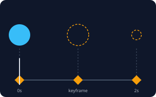</a> <b><a href="#keyframe--키프레임">Keyframe</a></b> 키프레임 움직임에서 &quot;여기서는 이 모양·이 위치&quot;라고 직접 찍어 두는 중요한 순간. 키프레임 사이의 장면은 프로그램이 알아서 채웁니다.</td>
<td width="33%" valign="top"><a href="#duration--지속-시간">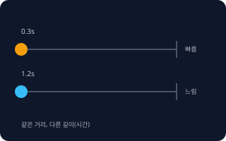</a> <b><a href="#duration--지속-시간">Duration</a></b> 지속 시간 움직임이 시작해서 끝날 때까지 걸리는 시간. 같은 움직임도 짧으면 빠르고 날카롭게, 길면 느긋하게 느껴집니다.</td>
<td width="33%" valign="top"><a href="#delay--지연">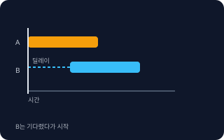</a> <b><a href="#delay--지연">Delay</a></b> 지연 움직임을 시작하기 전에 일부러 기다리는 시간. 여러 요소의 순서와 박자를 만들 때 씁니다.</td>
</tr>
<tr>
<td width="33%" valign="top"><a href="#frame-rate--프레임레이트-fps">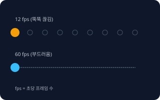</a> <b><a href="#frame-rate--프레임레이트-fps">Frame Rate</a></b> 프레임레이트 (FPS) 1초에 보여주는 장면(프레임)의 수. 숫자가 클수록 부드럽고, 작을수록 뚝뚝 끊깁니다. 단위는 fps(frames per second)입니다.</td>
<td width="33%" valign="top"><a href="#loop--반복">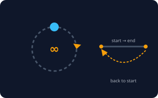</a> <b><a href="#loop--반복">Loop</a></b> 반복 애니메이션이 끝나면 처음으로 돌아가 계속 반복되는 것. 끝과 시작이 자연스럽게 이어지면 &quot;Seamless Loop&quot;라고 부릅니다.</td>
</tr>
</table>

**이징 · Easing** (7)

<table>
<tr>
<td width="33%" valign="top"><a href="#linear--선형">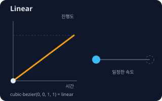</a> <b><a href="#linear--선형">Linear</a></b> 선형 처음부터 끝까지 속도가 변하지 않는 움직임. 그래프가 곧은 대각선입니다.</td>
<td width="33%" valign="top"><a href="#ease-in--이즈-인">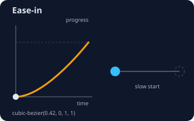</a> <b><a href="#ease-in--이즈-인">Ease-in</a></b> 이즈 인 천천히 시작해서 점점 빨라지는 움직임. 화면 밖으로 나가는 요소에 어울립니다.</td>
<td width="33%" valign="top"><a href="#ease-out--이즈-아웃">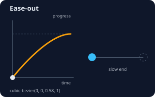</a> <b><a href="#ease-out--이즈-아웃">Ease-out</a></b> 이즈 아웃 빠르게 시작해서 끝에서 천천히 멈추는 움직임. 사용자가 누른 직후 바로 반응하는 느낌을 줍니다.</td>
</tr>
<tr>
<td width="33%" valign="top"><a href="#ease-in-out--이즈-인-아웃">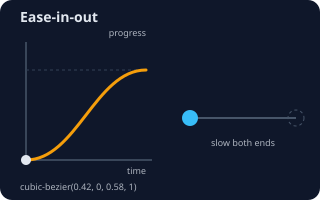</a> <b><a href="#ease-in-out--이즈-인-아웃">Ease-in-out</a></b> 이즈 인 아웃 천천히 시작해서 중간에 빨라지고 끝에서 다시 천천히 멈추는 움직임. 그래프가 S자 모양입니다.</td>
<td width="33%" valign="top"><a href="#cubic-bezier--큐빅-베지어">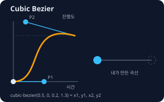</a> <b><a href="#cubic-bezier--큐빅-베지어">Cubic Bezier</a></b> 큐빅 베지어 숫자 4개(x1, y1, x2, y2)로 가속 곡선을 직접 그리는 방법. 이징을 내 마음대로 만들 때 씁니다. CSS에서는 cubic-bezier(0.5, 0, 0.2, 1.3)처럼 씁니다.</td>
<td width="33%" valign="top"><a href="#spring--스프링">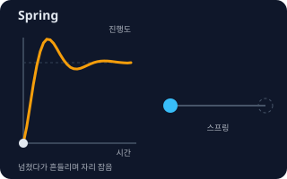</a> <b><a href="#spring--스프링">Spring</a></b> 스프링 용수철처럼 목표를 지나쳤다가 되돌아오고 몇 번 출렁이다 멈추는 움직임. 시간 대신 &quot;탄성&quot;과 &quot;감쇠&quot; 값으로 정합니다.</td>
</tr>
<tr>
<td width="33%" valign="top"><a href="#bounce--바운스">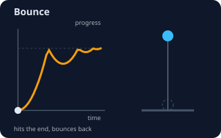</a> <b><a href="#bounce--바운스">Bounce</a></b> 바운스 공이 바닥에 떨어져 튕기듯 점점 작게 되튀다 멈추는 움직임.</td>
</tr>
</table>

**기법 · Techniques** (11)

<table>
<tr>
<td width="33%" valign="top"><a href="#tween--트윈">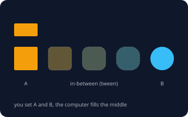</a> <b><a href="#tween--트윈">Tween</a></b> 트윈 시작 모양과 끝 모양만 정하면 그 사이 장면을 컴퓨터가 자동으로 채워주는 방식. &quot;in-between&quot;의 줄임말입니다.</td>
<td width="33%" valign="top"><a href="#stagger--스태거">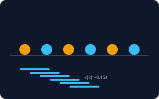</a> <b><a href="#stagger--스태거">Stagger</a></b> 스태거 여러 요소가 동시에 움직이지 않고, 같은 간격으로 하나씩 차례로 움직이게 하는 것. 물결치는 듯한 리듬이 생깁니다.</td>
<td width="33%" valign="top"><a href="#morphing--모핑">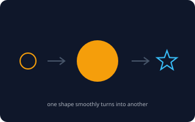</a> <b><a href="#morphing--모핑">Morphing</a></b> 모핑 한 모양이 끊김 없이 다른 모양으로 서서히 변하는 효과. 아이콘 전환(☰ → ✕)에 자주 씁니다.</td>
</tr>
<tr>
<td width="33%" valign="top"><a href="#path-animation--패스-애니메이션">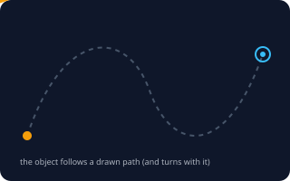</a> <b><a href="#path-animation--패스-애니메이션">Path Animation</a></b> 패스 애니메이션 미리 그려 둔 선(경로)을 따라 물체가 이동하게 하는 방식. 직선이 아닌 곡선이나 지그재그로 움직일 수 있습니다.</td>
<td width="33%" valign="top"><a href="#mask-reveal--마스크-리빌">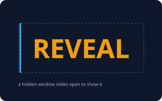</a> <b><a href="#mask-reveal--마스크-리빌">Mask Reveal</a></b> 마스크 리빌 요소 위에 가려진 창(마스크)을 씌우고, 그 창이 열리거나 이동하면서 요소가 드러나게 하는 효과.</td>
<td width="33%" valign="top"><a href="#kinetic-typography--키네틱-타이포그래피">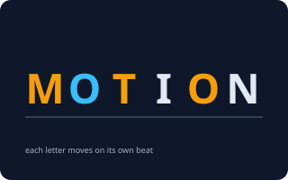</a> <b><a href="#kinetic-typography--키네틱-타이포그래피">Kinetic Typography</a></b> 키네틱 타이포그래피 글자 자체가 움직여 말의 느낌과 박자를 전하는 기법. 노래 가사 영상, 인트로 문구, 강조 문장에 씁니다.</td>
</tr>
<tr>
<td width="33%" valign="top"><a href="#squash-and-stretch--스쿼시-앤-스트레치">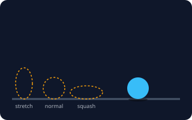</a> <b><a href="#squash-and-stretch--스쿼시-앤-스트레치">Squash and Stretch</a></b> 스쿼시 앤 스트레치 움직이는 물체가 빠르면 길게 늘어나고(Stretch), 부딪힐 때는 납작하게 눌리게(Squash) 만들어 무게와 탄력을 느끼게 하는 기법. 면적은 같게 유지하는 것이 포인트입니다.</td>
<td width="33%" valign="top"><a href="#anticipation--예비-동작"></a> <b><a href="#anticipation--예비-동작">Anticipation</a></b> 예비 동작 큰 움직임 전에 반대 방향으로 살짝 움직여 &quot;이제 간다&quot;를 미리 알려주는 준비 동작. 점프 전에 무릎을 굽히는 것과 같습니다.</td>
<td width="33%" valign="top"><a href="#follow-through--팔로스루"></a> <b><a href="#follow-through--팔로스루">Follow-through</a></b> 팔로스루 몸체가 멈춘 뒤에도 달려 있는 부분(머리카락, 안테나, 옷자락)이 관성으로 조금 더 움직이다가 천천히 멈추게 하는 기법.</td>
</tr>
<tr>
<td width="33%" valign="top"><b><a href="ui-design.md#parallax-scrolling--패럴랙스-스크롤">Parallax</a></b> 패럴랙스 먼 층은 천천히, 가까운 층은 빠르게 움직여 평면 화면에 깊이감을 만드는 효과. 스크롤 외에 영상·게임 배경에도 쓴다. → ui-design 시트</td>
<td width="33%" valign="top"><b><a href="ui-design.md#micro-interaction--마이크로-인터랙션">Micro-interaction</a></b> 마이크로 인터랙션 버튼 누르기·좋아요·토글처럼 작은 행동 하나에 즉시 돌아오는 짧은 반응 움직임. → ui-design 시트</td>
</tr>
</table>

**결과물과 도구 · Formats & Tools** (5)

<table>
<tr>
<td width="33%" valign="top"><a href="#lottie--로티">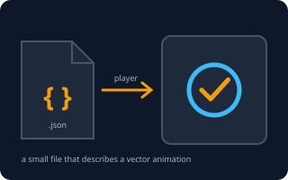</a> <b><a href="#lottie--로티">Lottie</a></b> 로티 디자이너가 만든 벡터 애니메이션을 가벼운 JSON 파일로 저장해 앱·웹에서 재생하는 형식. 확대해도 깨지지 않고 용량이 작습니다.</td>
<td width="33%" valign="top"><a href="#gif-vs-mp4--gif와-mp4webm">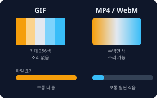</a> <b><a href="#gif-vs-mp4--gif와-mp4webm">GIF vs MP4</a></b> GIF와 MP4/WebM 움직이는 이미지를 담는 파일 형식 비교. GIF는 어디서나 자동 재생되지만 색이 256색까지이고 소리가 없고 용량이 큽니다. MP4·WebM은 영상이라 화질이 좋고 용량이 작으며 소리도 넣을 수 있습니다.</td>
<td width="33%" valign="top"><a href="#sprite-sheet--스프라이트-시트">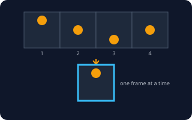</a> <b><a href="#sprite-sheet--스프라이트-시트">Sprite Sheet</a></b> 스프라이트 시트 애니메이션의 여러 장면을 이미지 한 장에 격자나 한 줄로 붙여 놓고, 창을 옮기며 한 칸씩 보여주는 방식. 게임과 웹의 가벼운 애니메이션에 씁니다.</td>
</tr>
<tr>
<td width="33%" valign="top"><a href="#motion-graphics--모션-그래픽스"></a> <b><a href="#motion-graphics--모션-그래픽스">Motion Graphics</a></b> 모션 그래픽스 도형·글자·아이콘·그래프 같은 그래픽 요소를 움직여 정보를 전달하는 영상. 캐릭터가 연기하는 캐릭터 애니메이션과 구분합니다.</td>
<td width="33%" valign="top"><a href="#prefers-reduced-motion--움직임-줄이기-설정">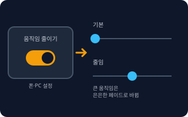</a> <b><a href="#prefers-reduced-motion--움직임-줄이기-설정">Prefers-reduced-motion</a></b> 움직임 줄이기 설정 사용자가 기기 설정에서 &quot;움직임 줄이기&quot;를 켰다는 신호. 웹은 CSS @media (prefers-reduced-motion: reduce)로 이를 읽어 큰 움직임을 끄거나 줄입니다.</td>
</tr>
</table>

<!-- overview:end -->

## 타이밍 · Timing

### Keyframe · 키프레임

- **정의**: 움직임에서 "여기서는 이 모양·이 위치"라고 직접 찍어 두는 중요한 순간. 키프레임 사이의 장면은 프로그램이 알아서 채웁니다.
- **AI에게 이렇게**: "0초에는 작고 투명하게, 0.5초에는 원래 크기로, 1초에는 오른쪽으로 이동하는 3개의 키프레임으로 애니메이션을 만들어줘."
- **언제**: 시작·중간·끝처럼 모양이 바뀌는 지점을 정확히 지정하고 싶을 때. 웹 애니메이션, 영상, 3D 애니메이션(공 튀기기·로고 회전)에서 모두 같은 개념이다
- **헷갈림**: Frame(프레임) — 프레임은 영상의 낱장 한 컷이고, 키프레임은 사람이 직접 정한 중요한 컷입니다. 둘 사이의 컷은 Tween이 채웁니다.
- **관련**: Tween, Duration, Easing
- **확인 질문**: 어떤 순간에 어떤 모양(위치·크기·색·투명도)이어야 하나요? 키프레임은 몇 개로 할까요?

### Duration · 지속 시간

- **정의**: 움직임이 시작해서 끝날 때까지 걸리는 시간. 같은 움직임도 짧으면 빠르고 날카롭게, 길면 느긋하게 느껴집니다.
- **AI에게 이렇게**: "메뉴가 열리는 애니메이션 Duration을 0.25초로 맞춰줘. 닫힐 때는 0.2초로 조금 더 짧게."
- **언제**: 화면 속 버튼·메뉴 같은 작은 반응은 보통 0.15~0.4초, 큰 화면 전환이나 인트로는 0.5~1.5초 안팎이 무난합니다.
- **헷갈림**: Delay — Duration은 움직이는 데 걸리는 시간, Delay는 움직이기 전에 기다리는 시간입니다. "1초 뒤에 시작"은 Delay입니다.
- **관련**: Delay, Easing, Timeline
- **확인 질문**: 전체 길이는 몇 초가 좋을까요? 사용자가 반복해서 보는 UI인가요, 한 번 보는 인트로인가요?

### Delay · 지연

- **정의**: 움직임을 시작하기 전에 일부러 기다리는 시간. 여러 요소의 순서와 박자를 만들 때 씁니다.
- **AI에게 이렇게**: "제목이 나오고 0.4초 Delay 뒤에 부제가 나타나게 해줘."
- **언제**: 요소를 차례로 등장시킬 때, 페이지가 로딩된 뒤 잠시 있다가 움직이게 할 때
- **헷갈림**: Duration — 기다림(Delay)과 움직임(Duration)을 합친 것이 눈에 보이는 전체 시간입니다. Delay가 너무 길면 "먹통"처럼 느껴집니다.
- **관련**: Duration, Stagger, Timeline
- **확인 질문**: 어떤 요소 뒤에 시작할까요? 몇 초 기다릴까요? 여러 요소면 모두 같은 Delay인가요, 차례로 늘어나나요?

### Frame Rate · 프레임레이트 (FPS)

- **정의**: 1초에 보여주는 장면(프레임)의 수. 숫자가 클수록 부드럽고, 작을수록 뚝뚝 끊깁니다. 단위는 fps(frames per second)입니다.
- **AI에게 이렇게**: "인트로 영상을 30fps 1080p MP4로 뽑아줘. 웹 애니메이션은 60fps로 부드럽게 돌아가게 해줘."
- **언제**: 영상을 내보낼 때(영화 느낌은 보통 24fps, 일반 영상은 30fps), 웹·앱 화면 애니메이션 성능을 따질 때(보통 60fps가 목표)
- **헷갈림**: Frame Rate와 Duration — 프레임레이트는 "초당 몇 장"이고, 길이(Duration)는 "몇 초"입니다. 일부러 낮춘 프레임으로 손그림 느낌을 내는 연출도 있습니다.
- **관련**: Keyframe, GIF vs MP4, Sprite Sheet
- **확인 질문**: 결과물이 영상 파일인가요, 웹·앱 화면인가요? 영화 같은 느낌인가요, 끊김 없이 부드러운 느낌인가요?

### Loop · 반복

- **정의**: 애니메이션이 끝나면 처음으로 돌아가 계속 반복되는 것. 끝과 시작이 자연스럽게 이어지면 "Seamless Loop"라고 부릅니다.
- **AI에게 이렇게**: "로딩 스피너를 무한 반복(infinite)으로 돌려줘. 끝과 시작이 끊기지 않게 이어지는 Seamless Loop로."
- **언제**: 로딩 표시, 배경 움직임, 이모티콘·GIF처럼 계속 재생되는 짧은 영상
- **헷갈림**: Alternate(왕복) — 처음→끝→처음으로 되감으며 반복하는 방식이고, 일반 Loop는 끝나면 바로 처음으로 점프합니다. 사용자가 계속 보는 화면이면 반복 횟수도 정해야 합니다.
- **관련**: Keyframe, GIF vs MP4, Prefers-reduced-motion
- **확인 질문**: 무한 반복인가요, 정해진 횟수인가요? 한 바퀴가 끝날 때 처음과 이어 보여야 하나요, 왕복인가요?

## 이징 · Easing

### Linear · 선형

- **정의**: 처음부터 끝까지 속도가 변하지 않는 움직임. 그래프가 곧은 대각선입니다.
- **AI에게 이렇게**: "로딩 바가 일정한 속도로 채워지도록 Linear로 해줘."
- **언제**: 계속 도는 스피너, 진행 막대, 기계적인 움직임, 스크롤에 맞춰 따라 움직이는 효과
- **헷갈림**: Ease(이징) — 사물은 현실에서 서서히 빨라지고 느려지기 때문에, UI 버튼 같은 곳에 Linear를 쓰면 로봇처럼 딱딱해 보입니다.
- **관련**: Ease-in, Ease-out, Cubic Bezier
- **확인 질문**: 일정한 속도로 계속 돌아야 하나요, 사람이 느끼기에 자연스러워야 하나요?

### Ease-in · 이즈 인

- **정의**: 천천히 시작해서 점점 빨라지는 움직임. 화면 밖으로 나가는 요소에 어울립니다.
- **AI에게 이렇게**: "팝업이 사라질 때 Ease-in으로 점점 빨라지며 아래로 빠져나가게 해줘."
- **언제**: 요소가 화면에서 퇴장할 때, 무언가가 출발해서 가속하는 느낌을 낼 때
- **헷갈림**: Ease-out과 반대 — 이름의 in/out이 "들어온다/나간다"가 아니라 "움직임의 시작/끝을 부드럽게"입니다. 등장하는 요소에 Ease-in을 쓰면 반응이 굼뜨게 느껴집니다.
- **관련**: Ease-out, Ease-in-out, Cubic Bezier
- **확인 질문**: 이 요소가 들어오는 건가요, 나가는 건가요?

### Ease-out · 이즈 아웃

- **정의**: 빠르게 시작해서 끝에서 천천히 멈추는 움직임. 사용자가 누른 직후 바로 반응하는 느낌을 줍니다.
- **AI에게 이렇게**: "모달이 나타날 때 0.3초 Ease-out으로 위에서 부드럽게 내려와 멈추게 해줘."
- **언제**: 화면에 등장하는 요소, 버튼·메뉴 같은 사용자 반응. UI에서 가장 자주 쓰는 기본값입니다.
- **헷갈림**: CSS 기본값 `ease`는 Ease-out과 비슷하지만 같지 않습니다. 정확히 하려면 곡선 값(Cubic Bezier)을 말하는 게 좋습니다.
- **관련**: Ease-in, Ease-in-out, Cubic Bezier
- **확인 질문**: 등장하는 움직임인가요? 끝에서 얼마나 천천히 멈추게 할까요?

### Ease-in-out · 이즈 인 아웃

- **정의**: 천천히 시작해서 중간에 빨라지고 끝에서 다시 천천히 멈추는 움직임. 그래프가 S자 모양입니다.
- **AI에게 이렇게**: "슬라이드가 한쪽에서 다른 쪽 위치로 옮겨 갈 때 Ease-in-out으로 부드럽게 움직이게 해줘."
- **언제**: 화면 안에서 위치·크기가 바뀌는 이동, 화면 전환, 카메라 이동처럼 시작과 끝이 모두 보이는 움직임
- **헷갈림**: Ease-out — Ease-in-out은 시작이 느려서 누른 직후 반응이 약간 굼뜹니다. 짧은 버튼 반응에는 Ease-out이 더 낫습니다.
- **관련**: Ease-in, Ease-out, Spring
- **확인 질문**: 움직임 시작이 굼떠 보여도 괜찮은가요? 요소가 화면 안에서 이동하는 건가요, 화면에 들어오는 건가요?

### Cubic Bezier · 큐빅 베지어

- **정의**: 숫자 4개(x1, y1, x2, y2)로 가속 곡선을 직접 그리는 방법. 이징을 내 마음대로 만들 때 씁니다. CSS에서는 `cubic-bezier(0.5, 0, 0.2, 1.3)`처럼 씁니다.
- **AI에게 이렇게**: "transition-timing-function을 cubic-bezier(0.5, 0, 0.2, 1.3)로 해서 끝에서 살짝 넘쳤다가 돌아오는 느낌으로 만들어줘."
- **언제**: 기본 이징(ease, ease-out 등)으로는 원하는 느낌이 안 나올 때, 디자이너가 정해준 곡선 값을 그대로 쓸 때
- **헷갈림**: y 값이 0~1 밖(예: 1.3)이면 곡선이 목표를 지나쳤다가 돌아옵니다(Overshoot). Spring과 비슷해 보이지만, Spring은 물리 법칙으로 출렁이고 Cubic Bezier는 한 번 지나치는 정도까지만 표현합니다.
- **관련**: Linear, Ease-in-out, Spring
- **확인 질문**: 원하는 느낌을 말로 설명해 줄 수 있나요(천천히 시작해서 빠르게 끝 등)? 디자인 도구에서 받은 곡선 값이 있나요?

### Spring · 스프링

- **정의**: 용수철처럼 목표를 지나쳤다가 되돌아오고 몇 번 출렁이다 멈추는 움직임. 시간 대신 "탄성"과 "감쇠" 값으로 정합니다.
- **AI에게 이렇게**: "카드를 드래그해서 놓으면 Spring으로 제자리에 탄성 있게 돌아가게 해줘. 너무 출렁이지 않게 감쇠는 높게."
- **언제**: 손가락으로 끌었다 놓는 제스처, 살아 있는 느낌이 필요한 앱 UI, 알림 팝업
- **헷갈림**: Bounce — Bounce는 바닥에 튕기는 움직임이고, Spring은 목표 지점 주변에서 출렁이는 움직임입니다. Spring은 Duration을 직접 정하지 않고 값에 따라 길이가 정해집니다.
- **관련**: Bounce, Cubic Bezier, Follow-through
- **확인 질문**: 얼마나 통통 튀는 느낌인가요(살짝/많이)? 앱(iOS·Android·React Native)처럼 Spring 기능이 있는 환경인가요?

### Bounce · 바운스

- **정의**: 공이 바닥에 떨어져 튕기듯 점점 작게 되튀다 멈추는 움직임.
- **AI에게 이렇게**: "알림 아이콘이 위에서 떨어져 바닥에서 두세 번 Bounce하고 멈추게 해줘."
- **언제**: 장난스럽거나 가벼운 분위기, 주목시키는 아이콘, 게임·어린이용 서비스
- **헷갈림**: Spring — Bounce는 도착 지점(바닥)에 부딪혀 되튀기 때문에 목표를 넘어가지 않고, Spring은 목표를 넘어갔다가 되돌아옵니다. 업무용·금융 서비스에서는 과해 보일 수 있습니다.
- **관련**: Spring, Squash and Stretch, Ease-out
- **확인 질문**: 서비스 분위기가 장난스러워도 되나요? 몇 번 튕길까요?

## 기법 · Techniques

### Tween · 트윈

- **정의**: 시작 모양과 끝 모양만 정하면 그 사이 장면을 컴퓨터가 자동으로 채워주는 방식. "in-between"의 줄임말입니다.
- **AI에게 이렇게**: "작은 사각형 모양에서 큰 원 모양으로, 색도 주황에서 파랑으로 Tween해줘."
- **언제**: 거의 모든 UI 애니메이션 — CSS transition, 애니메이션 라이브러리가 모두 Tween입니다.
- **헷갈림**: Keyframe — Keyframe은 사람이 정한 지점, Tween은 그 사이를 채운 장면입니다. 둘이 짝을 이룹니다.
- **관련**: Keyframe, Morphing, Easing
- **확인 질문**: 바뀌는 것이 위치·크기·색·투명도 중 무엇인가요? 시작 모양과 끝 모양이 정해져 있나요?

### Stagger · 스태거

- **정의**: 여러 요소가 동시에 움직이지 않고, 같은 간격으로 하나씩 차례로 움직이게 하는 것. 물결치는 듯한 리듬이 생깁니다.
- **AI에게 이렇게**: "카드 6개가 0.1초 간격으로 Stagger되어 아래에서 위로 차례대로 나타나게 해줘."
- **언제**: 리스트·카드·메뉴 항목의 등장, 글자·로고 조각이 차례로 나오는 인트로
- **헷갈림**: Delay — Delay는 하나의 요소가 기다리는 시간이고, Stagger는 여러 요소의 Delay를 일정한 간격으로 늘려 주는 것입니다. 간격이 너무 크거나 항목이 많으면 마지막 요소가 한참 뒤에 나옵니다.
- **관련**: Delay, Kinetic Typography, Duration
- **확인 질문**: 항목이 몇 개인가요? 간격은 몇 초(보통 0.05~0.15초)로 할까요? 왼쪽부터인가요, 위에서부터인가요?

### Morphing · 모핑

- **정의**: 한 모양이 끊김 없이 다른 모양으로 서서히 변하는 효과. 아이콘 전환(☰ → ✕)에 자주 씁니다.
- **AI에게 이렇게**: "햄버거 메뉴 아이콘이 클릭하면 X 모양으로 Morphing되게 해줘."
- **언제**: 아이콘 상태 전환(재생 ↔ 일시정지), 로고 변신, 도형 사이 이어지는 전환
- **헷갈림**: Tween — Tween은 "사이를 채우는 방식" 전체이고, Morphing은 그중 모양(윤곽선) 자체가 변하는 경우입니다. 두 모양의 점 개수가 다르면 어색하게 일그러질 수 있습니다.
- **관련**: Tween, Lottie, Path Animation
- **확인 질문**: 변하기 전·후 모양을 가지고 있나요(SVG·벡터)? 아이콘 정도의 단순한 모양인가요?

### Path Animation · 패스 애니메이션

- **정의**: 미리 그려 둔 선(경로)을 따라 물체가 이동하게 하는 방식. 직선이 아닌 곡선이나 지그재그로 움직일 수 있습니다.
- **AI에게 이렇게**: "비행기 아이콘이 곡선 경로를 따라 날아가고, 방향도 경로에 맞춰 회전하게 만들어줘."
- **언제**: 배송 경로 표시, 별똥별·비행기 같은 연출, 지도 위 이동
- **헷갈림**: Line Draw(선 그리기) — 경로를 따라 물체가 움직이는 것과, 경로 선 자체가 그려지는 것은 다릅니다. 둘을 함께 쓰기도 합니다.
- **관련**: Morphing, Tween, Lottie
- **확인 질문**: 경로 모양이 이미 있나요(SVG)? 물체가 경로 방향으로 회전해야 하나요?

### Mask Reveal · 마스크 리빌

- **정의**: 요소 위에 가려진 창(마스크)을 씌우고, 그 창이 열리거나 이동하면서 요소가 드러나게 하는 효과.
- **AI에게 이렇게**: "회사 로고 글자가 왼쪽에서 오른쪽으로 Mask Reveal로 1초 동안 드러나게 해줘."
- **언제**: 로고·제목 등장, 고급스럽고 깔끔한 인트로, 이미지가 슬라이드되며 나타나는 갤러리
- **헷갈림**: Fade In — 페이드는 전체가 투명도로 서서히 나타나는 것이고, Mask Reveal은 일부만 보여주는 영역이 움직이는 것입니다. Wipe(와이프)와 비슷하지만 Wipe는 장면 전환에 주로 씁니다.
- **관련**: Kinetic Typography, Stagger, Ease-in-out
- **확인 질문**: 어느 방향(왼→오, 위→아래)에서 드러나게 할까요? 한 번에 전체인가요, 글자·줄마다 차례로인가요?

### Kinetic Typography · 키네틱 타이포그래피

- **정의**: 글자 자체가 움직여 말의 느낌과 박자를 전하는 기법. 노래 가사 영상, 인트로 문구, 강조 문장에 씁니다.
- **AI에게 이렇게**: "'Hello World' 문장이 글자 하나씩 튀어 오르며 나타나는 Kinetic Typography를 만들어줘. 음악 박자에 맞춰 0.5초마다 한 단어씩."
- **언제**: 홍보 영상 문구, 가사 영상, SNS 숏폼 자막, 웹 히어로의 큰 제목
- **헷갈림**: 일반 자막 애니메이션 — 자막이 단순히 나타나고 사라지는 것은 Kinetic Typography가 아닙니다. 글자의 크기·위치·회전이 말의 뜻과 박자에 맞게 쓰일 때 이렇게 부릅니다.
- **관련**: Stagger, Mask Reveal, Motion Graphics
- **확인 질문**: 문구가 무엇이고 몇 초 안에 읽혀야 하나요? 음악이나 음성의 박자에 맞춰야 하나요?

### Squash and Stretch · 스쿼시 앤 스트레치

- **정의**: 움직이는 물체가 빠르면 길게 늘어나고(Stretch), 부딪힐 때는 납작하게 눌리게(Squash) 만들어 무게와 탄력을 느끼게 하는 기법. 면적은 같게 유지하는 것이 포인트입니다.
- **AI에게 이렇게**: "공이 떨어질 때는 세로로 길어지고, 바닥에 닿을 때는 가로로 납작해졌다가 튕겨 오르게 Squash and Stretch를 적용해줘."
- **언제**: 캐릭터·마스코트, 통통 튀는 아이콘, 로고가 탄력 있게 등장하는 연출
- **헷갈림**: Bounce — Bounce는 위치가 튕기는 이징이고, Squash and Stretch는 모양이 변하는 것입니다. 보통 함께 씁니다. 너무 과하면 고무처럼 어색해 보입니다.
- **관련**: Bounce, Anticipation, Follow-through
- **확인 질문**: 물체가 딱딱한 물건인가요, 말랑한 물건인가요? 변형을 얼마나 과장할까요?

### Anticipation · 예비 동작

- **정의**: 큰 움직임 전에 반대 방향으로 살짝 움직여 "이제 간다"를 미리 알려주는 준비 동작. 점프 전에 무릎을 굽히는 것과 같습니다.
- **AI에게 이렇게**: "버튼이 튀어 오르기 전에 먼저 아래로 살짝 눌렸다가(Anticipation) 위로 점프하게 해줘."
- **언제**: 점프·발사·큰 이동 직전, 눈을 사로잡는 로고 등장
- **헷갈림**: Delay — Delay는 그냥 가만히 기다리는 것이고, Anticipation은 기다리는 동안 반대 방향으로 움직이는 것입니다. 짧게(0.1~0.2초) 넣지 않으면 반응이 늦은 것처럼 느껴집니다.
- **관련**: Follow-through, Squash and Stretch, Ease-in-out
- **확인 질문**: 어느 방향으로 움직일 건가요? 준비 동작을 눈에 띄게 할까요, 살짝만 할까요?

### Follow-through · 팔로스루

- **정의**: 몸체가 멈춘 뒤에도 달려 있는 부분(머리카락, 안테나, 옷자락)이 관성으로 조금 더 움직이다가 천천히 멈추게 하는 기법.
- **AI에게 이렇게**: "상자가 오른쪽으로 이동해서 멈추면 위에 달린 안테나가 앞으로 한 번 쏠렸다가 두세 번 흔들리며 멈추게 Follow-through를 넣어줘."
- **언제**: 캐릭터·마스코트 애니메이션, 깃발·리본·꼬리 같은 부속물, 자연스러운 정지 연출
- **헷갈림**: Spring — 스프링은 하나의 값을 출렁이게 하는 계산 방식이고, Follow-through는 연결된 "부속"이 늦게 따라와서 멈추는 연출 원칙입니다. 구현에 Spring을 쓰기도 합니다.
- **관련**: Anticipation, Spring, Squash and Stretch
- **확인 질문**: 몸체에 매달린 부분이 있나요? 얼마나 오래 흔들리다 멈출까요?

### Parallax · 패럴랙스

- **정의**: 먼 층은 천천히, 가까운 층은 빠르게 움직여 평면 화면에 깊이감을 만드는 효과. 스크롤 외에 영상·게임 배경에도 쓴다.
- **원본**: [UI 디자인 · Parallax Scrolling](ui-design.md#parallax-scrolling--패럴랙스-스크롤)

### Micro-interaction · 마이크로 인터랙션

- **정의**: 버튼 누르기·좋아요·토글처럼 작은 행동 하나에 즉시 돌아오는 짧은 반응 움직임.
- **원본**: [UI 디자인 · Micro-interaction](ui-design.md#micro-interaction--마이크로-인터랙션)

## 결과물과 도구 · Formats & Tools

### Lottie · 로티

- **정의**: 디자이너가 만든 벡터 애니메이션을 가벼운 JSON 파일로 저장해 앱·웹에서 재생하는 형식. 확대해도 깨지지 않고 용량이 작습니다.
- **AI에게 이렇게**: "로딩 완료 체크 표시 Lottie 파일을 웹페이지에 넣고, 한 번만 재생되게 해줘. lottie-web 라이브러리로."
- **언제**: 앱·웹의 온보딩, 성공·로딩 표시, 일러스트가 움직이는 장면. After Effects에서 만든 애니메이션을 개발자에게 넘길 때
- **헷갈림**: GIF — 같은 장면을 GIF로 만들면 크고 화질이 떨어지지만, Lottie는 작고 선명합니다. 반대로 사진처럼 복잡한 장면은 Lottie에 맞지 않으니 영상(MP4)을 씁니다.
- **관련**: GIF vs MP4, Morphing, Motion Graphics
- **확인 질문**: 이미 만들어진 .json(또는 .lottie) 파일이 있나요? 사용 환경이 웹인가요, iOS·Android 앱인가요?

### GIF vs MP4 · GIF와 MP4/WebM

- **정의**: 움직이는 이미지를 담는 파일 형식 비교. GIF는 어디서나 자동 재생되지만 색이 256색까지이고 소리가 없고 용량이 큽니다. MP4·WebM은 영상이라 화질이 좋고 용량이 작으며 소리도 넣을 수 있습니다.
- **AI에게 이렇게**: "이 애니메이션을 웹에 올릴 건데, GIF 대신 자동 재생·무음·반복되는 MP4와 WebM 두 가지로 만들어줘."
- **언제**: GIF — 메신저·이모티콘·문서처럼 영상 재생이 막힌 곳. MP4/WebM — 웹사이트·앱 화면의 배경이나 설명 영상
- **헷갈림**: WebM — MP4와 같은 "영상 파일"이고, 웹에 최적화된 오픈 형식입니다. 브라우저·기기 호환을 위해 둘을 함께 제공하기도 합니다. 투명 배경이 필요하면 GIF나 투명 WebM·APNG를 고려합니다.
- **관련**: Lottie, Frame Rate, Loop
- **확인 질문**: 어디에 올리나요(웹페이지·메신저·문서)? 소리나 투명 배경이 필요한가요? 파일 크기 제한이 있나요?

### Sprite Sheet · 스프라이트 시트

- **정의**: 애니메이션의 여러 장면을 이미지 한 장에 격자나 한 줄로 붙여 놓고, 창을 옮기며 한 칸씩 보여주는 방식. 게임과 웹의 가벼운 애니메이션에 씁니다.
- **AI에게 이렇게**: "스프라이트 시트 이미지(8칸, 칸당 64×64)를 CSS steps()로 한 칸씩 넘기며 12fps로 재생해줘."
- **언제**: 2D 게임 캐릭터의 걷기·공격 동작, 영상 재생이 번거로운 짧은 효과, 이미지 하나로 여러 아이콘 상태를 관리할 때
- **헷갈림**: GIF — GIF는 파일 하나가 알아서 재생되고, 스프라이트 시트는 코드가 한 칸씩 보여주기 때문에 속도·멈춤·반응을 자유롭게 조절할 수 있습니다.
- **관련**: Frame Rate, Loop, GIF vs MP4
- **확인 질문**: 칸이 몇 개이고 한 칸의 크기는 얼마인가요? 초당 몇 장으로 재생할까요? 반복하나요?

### Motion Graphics · 모션 그래픽스

- **정의**: 도형·글자·아이콘·그래프 같은 그래픽 요소를 움직여 정보를 전달하는 영상. 캐릭터가 연기하는 캐릭터 애니메이션과 구분합니다.
- **AI에게 이렇게**: "30초 제품 소개 영상용 모션 그래픽스를 만들어줘. 로고, 핵심 숫자 3개, 아이콘이 차례로 나오는 구성으로 해줘."
- **언제**: 홍보·설명 영상, 유튜브 인트로·아웃트로, 뉴스 그래프, 앱 소개 영상
- **헷갈림**: Animation(애니메이션) — 애니메이션은 큰 이름이고(캐릭터·스토리가 중심), 모션 그래픽스는 그래픽·정보 중심입니다. 둘을 섞어 쓰는 경우도 많으니 "캐릭터가 나오나요?"를 꼭 확인합니다.
- **관련**: Kinetic Typography, Lottie, Frame Rate
- **확인 질문**: 목적이 정보 전달인가요, 이야기 전달인가요? 캐릭터가 필요한가요? 길이와 해상도는요?

### Prefers-reduced-motion · 움직임 줄이기 설정

- **정의**: 사용자가 기기 설정에서 "움직임 줄이기"를 켰다는 신호. 웹은 CSS `@media (prefers-reduced-motion: reduce)`로 이를 읽어 큰 움직임을 끄거나 줄입니다.
- **AI에게 이렇게**: "모든 애니메이션에 prefers-reduced-motion: reduce일 때는 이동·확대·패럴랙스를 끄고 페이드만 남기도록 CSS를 추가해줘."
- **언제**: 웹·앱 애니메이션을 만들 때 항상. 특히 화면 전체가 움직이는 효과(Parallax, 큰 슬라이드)에 필요합니다.
- **헷갈림**: 모든 애니메이션 끄기 — 아닙니다. 어지럽게 하는 큰 이동·회전·확대만 줄이고, 상태를 알리는 짧은 페이드는 남기는 것이 좋습니다. 영상(MP4)은 이 설정을 자동으로 따르지 않습니다.
- **관련**: Parallax, Loop, Micro-interaction
- **확인 질문**: 이 설정이 켜졌을 때 모든 움직임을 끌까요, 큰 움직임만 줄일까요? 대신 보여줄 효과(페이드·정지)는 무엇인가요?
