# 재테크 치트시트

> 월급을 모으고 불리고 빌리는 개인 돈 관리 이야기를 AI와 나누기 전에 펼치는 시트입니다. 상품 이름을 외우기보다 "예금과 적금이 뭐가 달라?" 같은 기본 말을 먼저 맞춥니다.

> ⚠️ **참고용이며 투자 권유가 아닙니다.** 대한민국 기준, 2026-11 기준입니다. 제도·세율·한도는 바뀔 수 있으니 실제 판단은 금융사·세무사 등 전문가와 확인하세요.

## 이렇게 쓰세요

- **나 → AI**: "월 100만원을 3년 동안 모으려는데 적금과 ISA 중 어떤 쪽이 나한테 맞을지, 장단점을 표로 비교해줘."
- **AI → 나**: "3년 안에 쓸 돈인가요, 그 이상 묻어 둬도 되는 돈인가요? 원금 손실이 생겨도 괜찮은 정도는 어느 정도인가요?"
- **나 → AI**: "연금저축과 IRP 중 어디에 먼저 넣어야 연말정산 세액공제를 받는지, 납입 한도를 알려줘."
- **AI → 나**: "올해 총급여가 대략 얼마인가요? 이미 연금저축이나 IRP에 넣은 금액이 있나요? 한도와 공제율은 소득에 따라 달라서 먼저 확인이 필요해요."
- **나 → AI**: "주택담보대출을 고정금리로 받을지 변동금리로 받을지 고민이야. 중도상환수수료까지 포함해서 쉽게 비교해줘."

## 한눈에 보기

<!-- overview:start -->
<!-- 이 구역은 자동 생성됩니다. 직접 고치지 말고 `cd mcp-server && npm run generate`를 실행하세요. -->

**저축 · Saving** (6)

<table>
<tr>
<td width="33%" valign="top"><a href="#deposit-vs-installment-savings--예금적금">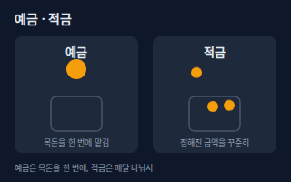</a> <b><a href="#deposit-vs-installment-savings--예금적금">Deposit vs Installment Savings</a></b> 예금·적금 예금은 목돈을 한 번에 맡기고 만기에 이자를 받는 상품이고, 적금은 매달 정해진 금액을 넣어 모으는 상품이다. 이자에는 소득세 14%가 원천징수된다.</td>
<td width="33%" valign="top"><a href="#simple-vs-compound-interest--단리복리">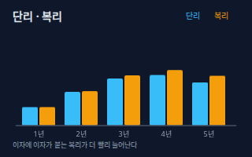</a> <b><a href="#simple-vs-compound-interest--단리복리">Simple vs Compound Interest</a></b> 단리·복리 단리는 처음 맡긴 원금에만 이자가 붙는 방식이고, 복리는 이자에도 다시 이자가 붙는 방식이다. 기간이 길수록 복리가 더 빨리 불어난다.</td>
<td width="33%" valign="top"><a href="#base-rate--기준금리">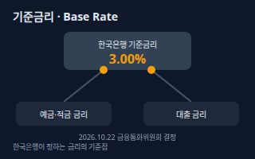</a> <b><a href="#base-rate--기준금리">Base Rate</a></b> 기준금리 한국은행 금융통화위원회가 정하는 정책금리다. 예금·대출 금리의 기준점이 되어 이 금리가 오르내리면 시중 금리도 대체로 따라 움직인다. 2026년 10월 22일 결정에서 3.00%로 유지되었다.</td>
</tr>
<tr>
<td width="33%" valign="top"><a href="#deposit-insurance--예금자보호">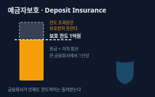</a> <b><a href="#deposit-insurance--예금자보호">Deposit Insurance</a></b> 예금자보호 예금을 맡긴 은행 등이 파산해 돈을 줄 수 없을 때 예금보험공사가 대신 지급해 주는 제도다. 한 금융회사당 1인 기준으로 원금과 이자를 합쳐 1억원까지 보호되고(2025년 9월 1일부터 5천만원에서 상향), 펀드처럼 운용 실적에 따라 원금이 달라지는 상품은 보호 대상이 아니다.</td>
<td width="33%" valign="top"><a href="#emergency-fund--비상금">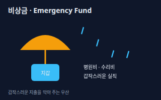</a> <b><a href="#emergency-fund--비상금">Emergency Fund</a></b> 비상금 갑작스러운 병원비·수리비·실직처럼 예상 못 한 지출에 대비해 따로 떼어 둔 돈이다. 투자하지 않고 필요할 때 바로 꺼낼 수 있게 둔다.</td>
<td width="33%" valign="top"><a href="#inflation--인플레이션-물가상승">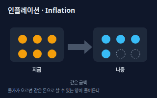</a> <b><a href="#inflation--인플레이션-물가상승">Inflation</a></b> 인플레이션 (물가상승) 물가가 지속해서 오르는 현상이다. 같은 돈으로 살 수 있는 물건이 줄어들어, 이자가 물가 상승보다 낮으면 돈의 실제 가치는 줄어든다.</td>
</tr>
</table>

**투자 · Investing** (7)

<table>
<tr>
<td width="33%" valign="top"><a href="#etf--상장지수펀드">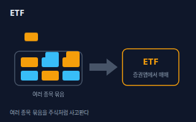</a> <b><a href="#etf--상장지수펀드">ETF</a></b> 상장지수펀드 여러 종목을 한 묶음으로 담아 지수 등을 따라가게 만들고, 거래소에서 주식처럼 실시간으로 사고파는 펀드다.</td>
<td width="33%" valign="top"><a href="#index-fund--인덱스펀드">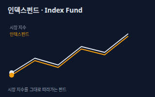</a> <b><a href="#index-fund--인덱스펀드">Index Fund</a></b> 인덱스펀드 코스피200 같은 시장 지수와 같은 모양으로 움직이도록 지수에 들어 있는 종목들을 그대로 담은 펀드다. 종목을 골라 맞히려 하지 않고 시장 평균을 노린다.</td>
<td width="33%" valign="top"><a href="#diversification--분산투자">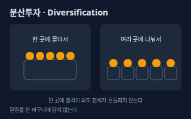</a> <b><a href="#diversification--분산투자">Diversification</a></b> 분산투자 한 종목이나 자산에 몰아 넣지 않고 여러 종목·자산·지역·시기로 나눠 투자해서, 어느 한 곳이 나빠져도 전체가 크게 흔들리지 않게 하는 방법이다.</td>
</tr>
<tr>
<td width="33%" valign="top"><a href="#dollar-cost-averaging--적립식-투자">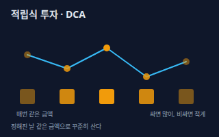</a> <b><a href="#dollar-cost-averaging--적립식-투자">Dollar-cost Averaging</a></b> 적립식 투자 가격이 오르내려도 정해진 날에 같은 금액으로 꾸준히 사는 방식이다. 가격이 쌀 때 더 많이, 비쌀 때 더 적게 사게 되어 평균 매입 단가가 평준화된다.</td>
<td width="33%" valign="top"><a href="#exchange-rate--환율">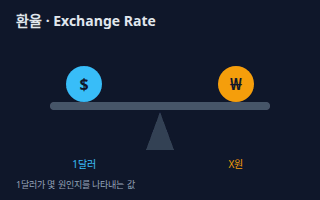</a> <b><a href="#exchange-rate--환율">Exchange Rate</a></b> 환율 한 나라 돈을 다른 나라 돈으로 바꿀 때의 비율이다. 예를 들어 1달러가 몇 원인지를 나타내며, 해외 자산의 원화 가치에 영향을 준다.</td>
<td width="33%" valign="top"><a href="#currency-hedge--환헤지">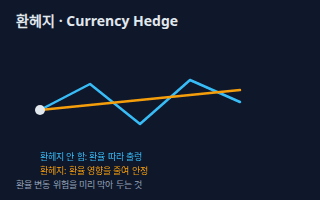</a> <b><a href="#currency-hedge--환헤지">Currency Hedge</a></b> 환헤지 해외 자산에 투자할 때 환율 변동으로 생기는 손익을 줄이려고 미리 대비하는 것이다. 환율 위험은 줄지만 헤지 비용이 들 수 있다.</td>
</tr>
<tr>
<td width="33%" valign="top"><a href="#risk-and-return--위험과-수익">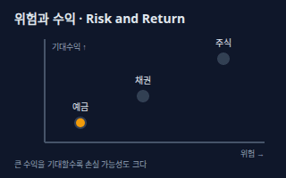</a> <b><a href="#risk-and-return--위험과-수익">Risk and Return</a></b> 위험과 수익 기대수익이 큰 투자일수록 손실 가능성(위험)도 커지는 관계다. 예금처럼 안전한 상품은 수익이 작고, 주식처럼 오르내림이 큰 상품은 수익도 손실도 클 수 있다.</td>
</tr>
</table>

**절세 계좌 · Tax-advantaged Accounts** (6)

<table>
<tr>
<td width="33%" valign="top"><a href="#isa--개인종합자산관리계좌">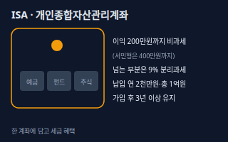</a> <b><a href="#isa--개인종합자산관리계좌">ISA</a></b> 개인종합자산관리계좌 예금·펀드·ETF·주식 등을 한 계좌에 담아 굴리고, 번 이익 중 일정 금액(일반형 200만원, 서민형 400만원)까지는 세금을 매기지 않고 넘는 부분은 9%로 분리과세하는 절세 계좌다. 총 납입 한도는 1억원이고 3년 이상 유지해야 혜택이 있다.</td>
<td width="33%" valign="top"><a href="#pension-savings--연금저축">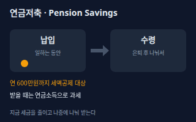</a> <b><a href="#pension-savings--연금저축">Pension Savings</a></b> 연금저축 노후 대비를 위해 매년 넣은 돈의 일부를 세금에서 공제해 주는 연금 계좌다. 납입액의 12%(소득이 낮으면 15%)를 세금에서 빼 주고(지방소득세 포함 13.2%·16.5%), 연금저축은 연 600만원까지, 퇴직연금(IRP 등)과 합하면 연 900만원까지 공제 대상이다.</td>
<td width="33%" valign="top"><a href="#irp--개인형-퇴직연금">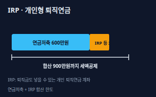</a> <b><a href="#irp--개인형-퇴직연금">IRP</a></b> 개인형 퇴직연금 회사를 옮기며 받은 퇴직금을 넣어 두거나 개인이 따로 돈을 넣어 은퇴 후까지 굴리는 퇴직연금 계좌다. 연금저축과 합쳐 연 900만원까지 세액공제를 받을 수 있다.</td>
</tr>
<tr>
<td width="33%" valign="top"><a href="#tax-free-vs-separate-taxation--비과세분리과세">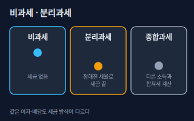</a> <b><a href="#tax-free-vs-separate-taxation--비과세분리과세">Tax-free vs Separate Taxation</a></b> 비과세·분리과세 비과세는 세금을 아예 매기지 않는 것이고, 분리과세는 다른 소득과 합치지 않고 따로 정해진 세율로 세금을 끝내는 것이다. 합쳐서 계산하는 종합과세와 구분한다. 이자·배당소득 합계가 연 2천만원 이하면 원천징수로 끝나고, 넘으면 종합과세 대상이 된다.</td>
<td width="33%" valign="top"><a href="#tax-credit-vs-deduction--세액공제소득공제">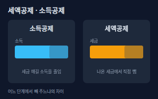</a> <b><a href="#tax-credit-vs-deduction--세액공제소득공제">Tax Credit vs Deduction</a></b> 세액공제·소득공제 소득공제는 세금을 매기는 기준이 되는 소득(과세표준) 자체를 줄이는 것이고, 세액공제는 계산이 끝난 세금에서 일정 금액을 직접 빼는 것이다.</td>
<td width="33%" valign="top"><b><a href="accounting.md#comprehensive-income-tax--종합소득세">Comprehensive Income Tax</a></b> 종합소득세 개인이 1년간 번 사업·근로·이자 등 소득을 합쳐서 내는 세금. 금융소득이 일정 금액을 넘으면 이 세금에 합산된다. → accounting 시트</td>
</tr>
</table>

**대출 · 신용 · Loans & Credit** (5)

<table>
<tr>
<td width="33%" valign="top"><a href="#credit-score--신용점수">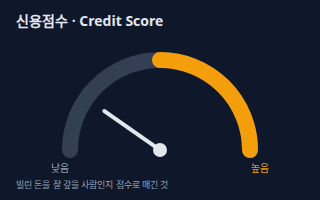</a> <b><a href="#credit-score--신용점수">Credit Score</a></b> 신용점수 금융회사가 빌린 돈을 잘 갚을 사람인지 판단하려고 매기는 개인의 점수다. 점수가 높을수록 대출 한도와 금리, 카드 발급에서 유리하다.</td>
<td width="33%" valign="top"><a href="#dsr--총부채원리금상환비율">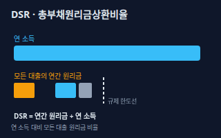</a> <b><a href="#dsr--총부채원리금상환비율">DSR</a></b> 총부채원리금상환비율 한 해 동안 갚아야 하는 모든 대출의 원금과 이자 합계를 연 소득으로 나눈 비율이다. 금융당국은 이 비율을 일정 범위 안으로 관리해 빚이 소득에 비해 너무 커지지 않게 한다.</td>
<td width="33%" valign="top"><a href="#fixed-vs-variable-rate--고정변동금리">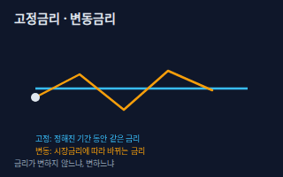</a> <b><a href="#fixed-vs-variable-rate--고정변동금리">Fixed vs Variable Rate</a></b> 고정·변동금리 고정금리는 정해진 기간 동안 금리가 변하지 않는 대출이고, 변동금리는 시장 금리를 따라 일정 주기마다 금리가 바뀌는 대출이다.</td>
</tr>
<tr>
<td width="33%" valign="top"><a href="#prepayment-fee--중도상환수수료">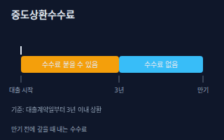</a> <b><a href="#prepayment-fee--중도상환수수료">Prepayment Fee</a></b> 중도상환수수료 대출을 만기 전에 미리 갚을 때 내는 수수료다. 금융소비자보호법상 원칙적으로 부과할 수 없지만, 대출계약일부터 3년 이내에 갚는 경우에는 예외적으로 부과할 수 있다.</td>
<td width="33%" valign="top"> <b><a href="#overdraft-account--마이너스통장">Overdraft Account</a></b> 마이너스통장 통장 잔액이 모자라도 정해진 한도까지 자동으로 빌려 쓸 수 있는 대출 통장이다. 빌려 쓴 금액에 대해서만, 쓴 기간만큼 이자가 붙는다.</td>
</tr>
</table>

<!-- overview:end -->

## 저축 · Saving

### Deposit vs Installment Savings · 예금·적금

- **정의**: 예금은 목돈을 한 번에 맡기고 만기에 이자를 받는 상품이고, 적금은 매달 정해진 금액을 넣어 모으는 상품이다. 이자에는 소득세 14%가 원천징수된다.
- **AI에게 이렇게**: "목돈이 천만 원 있는 경우와 매달 50만 원씩 모으는 경우, 예금과 적금 중 무엇이 맞는지 이자 계산과 함께 알려줘."
- **언제**: 원금을 지키면서 정해진 이자를 받고 싶을 때, 단기 목표 자금을 모을 때
- **헷갈림**: 적금의 금리와 실제 수익 — 적금은 매달 넣는 돈이 맡긴 기간이 달라서, 표시된 금리가 같아도 실제 받는 이자는 예금보다 적다.
- **관련**: 단리·복리, 예금자보호, 기준금리, 비상금
- **확인 질문**: 목돈인가요, 매달 모으는 돈인가요? 만기는 언제까지 필요한가요? 이자에 대한 세금을 뗀 뒤 금액으로 계산할까요?
- **근거**: [소득세법 제129조](https://www.law.go.kr/법령/소득세법/제129조)
- **검증일**: 2026-11-02

### Simple vs Compound Interest · 단리·복리

- **정의**: 단리는 처음 맡긴 원금에만 이자가 붙는 방식이고, 복리는 이자에도 다시 이자가 붙는 방식이다. 기간이 길수록 복리가 더 빨리 불어난다.
- **AI에게 이렇게**: "원금 천만 원을 연 3% 단리와 복리로 10년 굴렸을 때 금액이 얼마나 차이 나는지 표와 그래프로 보여줘."
- **언제**: 예·적금 상품의 이자 방식을 비교하거나, 오래 투자할 때 수익이 불어나는 원리를 설명할 때
- **헷갈림**: 이율과 수익률 — 이율은 약속된 연 이자 비율이고, 수익률은 실제로 번 돈을 원금으로 나눈 값이라 투자 상품에서는 달라진다.
- **관련**: 예금·적금, 적립식 투자, 인플레이션
- **확인 질문**: 원금과 이율, 기간은 얼마인가요? 이자를 매달 합칠지(월복리) 매년 합칠지 아시나요?

### Base Rate · 기준금리

- **정의**: 한국은행 금융통화위원회가 정하는 정책금리다. 예금·대출 금리의 기준점이 되어 이 금리가 오르내리면 시중 금리도 대체로 따라 움직인다. 2026년 10월 22일 결정에서 3.00%로 유지되었다.
- **AI에게 이렇게**: "기준금리가 지금 얼마인지, 오르면 내 예금과 대출 이자에 보통 어떤 일이 생기는지 쉽게 설명해줘."
- **언제**: 뉴스에서 금리 인상·인하 이야기를 들었을 때, 예금이나 대출 시기를 고민할 때
- **헷갈림**: 대출금리 — 기준금리는 한국은행이 정하는 기준이고, 실제 내 대출금리는 은행이 기준금리에 가산금리 등을 더해 정한다.
- **관련**: 고정·변동금리, 예금·적금, 인플레이션
- **확인 질문**: 어느 시점의 기준금리를 알고 싶으신가요? 금통위 결정은 계속 바뀌니 가장 최근 결정 날짜를 확인할까요?
- **근거**: [한국은행 통화정책방향(2026.10.22)](https://www.bok.or.kr/portal/bbs/P0000559/view.do?menuNo=200690&nttId=11065823)
- **검증일**: 2026-11-02

### Deposit Insurance · 예금자보호

- **정의**: 예금을 맡긴 은행 등이 파산해 돈을 줄 수 없을 때 예금보험공사가 대신 지급해 주는 제도다. 한 금융회사당 1인 기준으로 원금과 이자를 합쳐 1억원까지 보호되고(2025년 9월 1일부터 5천만원에서 상향), 펀드처럼 운용 실적에 따라 원금이 달라지는 상품은 보호 대상이 아니다.
- **AI에게 이렇게**: "내가 한 은행에 1억 3천만 원 맡겨 두었는데 예금자보호 한도를 넘는 부분은 어떻게 나눠 두는 게 좋을지 설명해줘."
- **언제**: 큰 목돈을 한 금융회사에 맡기기 전, 저축은행·새마을금고 등의 안전성이 궁금할 때
- **헷갈림**: 원금보장 — 예금자보호는 한도(1억원)까지만 지켜 주는 제도이고, 펀드·ETF처럼 실적에 따라 손익이 달라지는 상품은 해당이 없다.
- **관련**: 예금·적금, ISA, 연금저축
- **확인 질문**: 맡기려는 금융회사가 예금자보호 대상인가요? 같은 금융회사에 다른 예금도 있나요?
- **근거**: [예금자보호법 제32조](https://www.law.go.kr/법령/예금자보호법/제32조), [예금자보호법 시행령 제18조](https://www.law.go.kr/법령/예금자보호법시행령/제18조), [찾기쉬운 생활법령 예금자 보호 한도 1억 원으로 상향](https://m.easylaw.go.kr/MOB/NtcInfoRetrieve.laf?ntcSeq=1707&targetRow=31&sch=&type=TTL)
- **검증일**: 2026-11-02

### Emergency Fund · 비상금

- **정의**: 갑작스러운 병원비·수리비·실직처럼 예상 못 한 지출에 대비해 따로 떼어 둔 돈이다. 투자하지 않고 필요할 때 바로 꺼낼 수 있게 둔다.
- **AI에게 이렇게**: "내 월 고정 지출이 이 정도인데, 비상금을 어느 정도 모으면 좋을지 기준과 보관할 곳을 알려줘."
- **언제**: 투자나 저축을 시작하기 전에 가장 먼저 준비하는 돈
- **헷갈림**: 저축 — 저축은 목표를 위해 모으는 돈이고, 비상금은 목표 없이 만일을 위해 두는 돈이라 쉽게 빼 쓸 수 있어야 한다.
- **관련**: 예금·적금, 마이너스통장, 위험과 수익
- **확인 질문**: 한 달 생활비와 고정 지출은 얼마인가요? 소득이 일정한가요, 들쭉날쭉한가요?

### Inflation · 인플레이션 (물가상승)

- **정의**: 물가가 지속해서 오르는 현상이다. 같은 돈으로 살 수 있는 물건이 줄어들어, 이자가 물가 상승보다 낮으면 돈의 실제 가치는 줄어든다.
- **AI에게 이렇게**: "내 예금 금리가 물가 상승률보다 낮을 때 실질 가치가 어떻게 되는지 예시로 계산해줘."
- **언제**: 돈을 예금에만 둘지, 투자도 같이 할지 고민할 때
- **헷갈림**: 금리 — 금리는 돈을 빌리거나 맡기는 값이고, 인플레이션은 물건 값이 오르는 현상이다. 이자에서 물가상승률을 뺀 것이 실질 수익이다.
- **관련**: 기준금리, 예금·적금, 분산투자
- **확인 질문**: 어느 기간의 물가상승률을 기준으로 할까요? 세금을 떼기 전 이자인가요, 후인가요?

## 투자 · Investing

### ETF · 상장지수펀드

- **정의**: 여러 종목을 한 묶음으로 담아 지수 등을 따라가게 만들고, 거래소에서 주식처럼 실시간으로 사고파는 펀드다.
- **AI에게 이렇게**: "코스피200 같은 지수를 따라가는 ETF를 고를 때 비교할 항목(보수, 거래량, 추종 지수)을 정리해줘."
- **언제**: 종목 하나하나 고르기 어렵거나 분산투자를 간단히 하고 싶을 때
- **헷갈림**: 인덱스펀드 — 둘 다 지수를 따라가지만 ETF는 주식처럼 거래소에서 실시간으로 사고팔고, 일반 펀드는 하루 한 번 기준가로 거래한다.
- **관련**: 인덱스펀드, 분산투자, 적립식 투자, 배당(주식 시트)
- **확인 질문**: 어떤 지수나 테마를 따라가는 ETF를 찾으시나요? 국내 상장인가요, 해외 상장인가요? 보수와 거래량도 함께 비교할까요?

### Index Fund · 인덱스펀드

- **정의**: 코스피200 같은 시장 지수와 같은 모양으로 움직이도록 지수에 들어 있는 종목들을 그대로 담은 펀드다. 종목을 골라 맞히려 하지 않고 시장 평균을 노린다.
- **AI에게 이렇게**: "인덱스펀드와 종목을 직접 고르는 액티브펀드의 차이를 보수와 성과 관점에서 비교해줘."
- **언제**: 특정 종목 선택 부담 없이 시장 전체에 투자하고 싶을 때, 적립식으로 장기 투자할 때
- **헷갈림**: 액티브펀드 — 액티브펀드는 운용자가 종목을 골라 지수를 이기려 하고, 인덱스펀드는 지수를 따라가는 것이 목표다.
- **관련**: ETF, 분산투자, 적립식 투자
- **확인 질문**: 어떤 지수(국내·해외·전 세계)를 따라가고 싶으신가요? 투자 기간은 얼마나 되나요?

### Diversification · 분산투자

- **정의**: 한 종목이나 자산에 몰아 넣지 않고 여러 종목·자산·지역·시기로 나눠 투자해서, 어느 한 곳이 나빠져도 전체가 크게 흔들리지 않게 하는 방법이다.
- **AI에게 이렇게**: "내 투자 비중이 한 종목에 쏠려 있는지 점검하고, 자산별로 나누는 예시 포트폴리오를 보여줘."
- **언제**: 투자 규모가 커졌거나 한 종목 비중이 너무 높아졌을 때
- **헷갈림**: 종목 수 — 종목만 늘리고 모두 같은 업종이면 분산이 아니다. 서로 다르게 움직이는 자산에 나눠야 한다.
- **관련**: ETF, 인덱스펀드, 위험과 수익, 환헤지
- **확인 질문**: 지금 가진 자산과 비중이 어떻게 되나요? 투자 기간과 감당 가능한 손실은 어느 정도인가요?

### Dollar-cost Averaging · 적립식 투자

- **정의**: 가격이 오르내려도 정해진 날에 같은 금액으로 꾸준히 사는 방식이다. 가격이 쌀 때 더 많이, 비쌀 때 더 적게 사게 되어 평균 매입 단가가 평준화된다.
- **AI에게 이렇게**: "매달 같은 날 30만 원씩 ETF를 사면 가격이 오르내릴 때 평균 매입 단가가 어떻게 되는지 예시 표로 보여줘."
- **언제**: 한 번에 사는 시점이 부담될 때, 월급에서 꾸준히 투자할 때
- **헷갈림**: 거치식 투자 — 거치식은 목돈을 한 번에 투자하는 방식이고, 적립식은 나눠서 사는 방식이다. 가격이 계속 오르면 거치식이 유리하고 오르내리면 적립식이 안정적일 수 있다.
- **관련**: ETF, 인덱스펀드, 위험과 수익
- **확인 질문**: 매달 넣을 수 있는 금액은 얼마인가요? 어떤 상품에 몇 년 동안 넣을 계획인가요?

### Exchange Rate · 환율

- **정의**: 한 나라 돈을 다른 나라 돈으로 바꿀 때의 비율이다. 예를 들어 1달러가 몇 원인지를 나타내며, 해외 자산의 원화 가치에 영향을 준다.
- **AI에게 이렇게**: "미국 주식에 투자할 때 환율이 오르면 내 수익이 원화로 어떻게 달라지는지 예시로 설명해줘."
- **언제**: 해외 주식·ETF를 사거나 해외 여행·유학 자금을 준비할 때
- **헷갈림**: 환율 상승과 원화 가치 — 환율 숫자가 오르면 달러가 비싸지고 원화는 약해진 것이다.
- **관련**: 환헤지, 분산투자, 인플레이션
- **확인 질문**: 어느 나라 돈과의 환율인가요? 사고파는 환전 수수료도 같이 반영할까요?

### Currency Hedge · 환헤지

- **정의**: 해외 자산에 투자할 때 환율 변동으로 생기는 손익을 줄이려고 미리 대비하는 것이다. 환율 위험은 줄지만 헤지 비용이 들 수 있다.
- **AI에게 이렇게**: "환헤지가 된 해외 ETF와 안 된 ETF의 차이를 환율이 오를 때와 내릴 때로 나눠 설명해줘."
- **언제**: 해외 ETF의 (H) 표시가 붙은 상품을 만났을 때
- **헷갈림**: 분산투자 — 분산은 여러 자산으로 위험을 나누는 것이고, 환헤지는 환율이라는 한 가지 위험만 줄이는 것이다.
- **관련**: 환율, ETF, 분산투자
- **확인 질문**: 어떤 해외 자산에 투자하려고 하나요? 투자 기간이 긴가요, 짧은가요? 헤지 비용이 얼마인지 확인했나요?

### Risk and Return · 위험과 수익

- **정의**: 기대수익이 큰 투자일수록 손실 가능성(위험)도 커지는 관계다. 예금처럼 안전한 상품은 수익이 작고, 주식처럼 오르내림이 큰 상품은 수익도 손실도 클 수 있다.
- **AI에게 이렇게**: "내 나이와 투자 기간을 고려해서 예금·채권·주식 비중을 어떻게 나눌지 위험 수준별 예시를 알려줘."
- **언제**: 투자 상품을 고를 때 내가 감당할 수 있는 손실 수준을 정하는 기준
- **헷갈림**: 수익률과 안정성 — 수익이 높고 위험이 낮은 상품은 흔하지 않다. 그런 약속을 하는 곳은 의심해야 한다.
- **관련**: 분산투자, 비상금, 예금·적금
- **확인 질문**: 투자 목적과 기간은 무엇인가요? 원금이 얼마나 줄어들면 마음이 불편해지시나요?

## 절세 계좌 · Tax-advantaged Accounts

### ISA · 개인종합자산관리계좌

- **정의**: 예금·펀드·ETF·주식 등을 한 계좌에 담아 굴리고, 번 이익 중 일정 금액(일반형 200만원, 서민형 400만원)까지는 세금을 매기지 않고 넘는 부분은 9%로 분리과세하는 절세 계좌다. 총 납입 한도는 1억원이고 3년 이상 유지해야 혜택이 있다.
- **AI에게 이렇게**: "나는 직장인이야. ISA를 만들면 예금 이자와 ETF 수익에 세금이 어떻게 달라지는지, 일반형과 서민형 차이까지 알려줘."
- **언제**: 이자·배당·펀드 수익에 붙는 세금을 줄이고 싶을 때, 3년 이상 묻어 둘 돈이 있을 때
- **헷갈림**: 연금저축 — ISA는 3년 이상 유지하면 비과세·분리과세 혜택이 있는 중기 계좌이고, 연금저축은 노후 대비 세액공제 계좌다.
- **관련**: 비과세·분리과세, 연금저축, 예금자보호, ETF
- **확인 질문**: 나이와 직전 연도 소득(서민형 요건)은 어떻게 되나요? 이미 ISA가 있나요? 3년 안에 쓸 돈은 아닌가요? 법 개정 논의가 있으니 시행일도 함께 확인할까요?
- **근거**: [조세특례제한법 제91조의18](https://www.law.go.kr/법령/조세특례제한법/제91조의18), [금융감독원 금융상품한눈에 절세금융상품](https://finlife.fss.or.kr/finlife/main/contents.do?menuNo=700060)
- **검증일**: 2026-11-02

### Pension Savings · 연금저축

- **정의**: 노후 대비를 위해 매년 넣은 돈의 일부를 세금에서 공제해 주는 연금 계좌다. 납입액의 12%(소득이 낮으면 15%)를 세금에서 빼 주고(지방소득세 포함 13.2%·16.5%), 연금저축은 연 600만원까지, 퇴직연금(IRP 등)과 합하면 연 900만원까지 공제 대상이다.
- **AI에게 이렇게**: "총급여가 이 정도인 직장인이 연금저축에 연 600만 원을 넣으면 연말정산에서 얼마를 돌려받는지 계산해줘."
- **언제**: 연말정산에서 세금을 줄이고 싶을 때, 노후 자금을 따로 마련하고 싶을 때
- **헷갈림**: IRP — 연금저축은 누구나 가입하는 노후용 계좌이고, IRP는 퇴직금을 받을 수도 있는 개인형 퇴직연금 계좌다. 공제 한도는 합산해서 적용한다.
- **관련**: IRP, 세액공제, 비과세·분리과세, ISA
- **확인 질문**: 올해 총급여(또는 종합소득금액)는 얼마인가요? 이미 연금저축이나 IRP에 넣은 돈이 있나요? 일찍 빼면 세금이 달라지는 점도 알고 계신가요?
- **근거**: [소득세법 제59조의3](https://www.law.go.kr/법령/소득세법/제59조의3), [금융감독원 금융상품한눈에 절세금융상품](https://finlife.fss.or.kr/finlife/main/contents.do?menuNo=700060)
- **검증일**: 2026-11-02

### IRP · 개인형 퇴직연금

- **정의**: 회사를 옮기며 받은 퇴직금을 넣어 두거나 개인이 따로 돈을 넣어 은퇴 후까지 굴리는 퇴직연금 계좌다. 연금저축과 합쳐 연 900만원까지 세액공제를 받을 수 있다.
- **AI에게 이렇게**: "퇴직금을 받았는데 IRP로 옮기라고 한다. 옮기면 세금이 어떻게 달라지는지 쉬운 말로 설명해줘."
- **언제**: 퇴직금을 받았을 때, 연금저축 한도를 채우고도 공제를 더 받고 싶을 때
- **헷갈림**: 연금저축 — IRP는 퇴직금도 넣을 수 있는 계좌이고, 둘의 세액공제 한도는 합산해서 연 900만원까지다.
- **관련**: 연금저축, 세액공제, 비과세·분리과세
- **확인 질문**: 퇴직금을 받았나요, 아니면 월급에서 따로 넣을 계획인가요? 연금저축에 이미 얼마를 넣었나요?
- **근거**: [소득세법 제59조의3](https://www.law.go.kr/법령/소득세법/제59조의3), [금융감독원 금융상품한눈에 절세금융상품](https://finlife.fss.or.kr/finlife/main/contents.do?menuNo=700060)
- **검증일**: 2026-11-02

### Tax-free vs Separate Taxation · 비과세·분리과세

- **정의**: 비과세는 세금을 아예 매기지 않는 것이고, 분리과세는 다른 소득과 합치지 않고 따로 정해진 세율로 세금을 끝내는 것이다. 합쳐서 계산하는 종합과세와 구분한다. 이자·배당소득 합계가 연 2천만원 이하면 원천징수로 끝나고, 넘으면 종합과세 대상이 된다.
- **AI에게 이렇게**: "내 이자·배당소득이 이만큼인데 비과세 계좌를 쓰면 종합과세를 피할 수 있는지 설명해줘."
- **언제**: 금융 상품의 세금 혜택 문구를 읽을 때, 연말에 이자·배당이 많이 쌓였을 때
- **헷갈림**: 세액공제 — 비과세·분리과세는 이익에 매기는 세금 방식이고, 세액공제는 이미 계산된 세금에서 직접 빼는 것이다.
- **관련**: ISA, 종합소득세, 세액공제, 연금저축
- **확인 질문**: 이자·배당소득이 연간 얼마나 되나요? ISA 같은 절세 계좌 안에서 받는 소득인가요?
- **근거**: [소득세법 제14조](https://www.law.go.kr/법령/소득세법/제14조), [조세특례제한법 제91조의18](https://www.law.go.kr/법령/조세특례제한법/제91조의18)
- **검증일**: 2026-11-02

### Tax Credit vs Deduction · 세액공제·소득공제

- **정의**: 소득공제는 세금을 매기는 기준이 되는 소득(과세표준) 자체를 줄이는 것이고, 세액공제는 계산이 끝난 세금에서 일정 금액을 직접 빼는 것이다.
- **AI에게 이렇게**: "연말정산에서 소득공제와 세액공제가 각각 어떤 항목에 적용되는지 표로 정리하고 내 상황에서 유리한 순서를 알려줘."
- **언제**: 연말정산 공제 항목을 읽을 때, 연금저축·IRP 혜택을 계산할 때
- **헷갈림**: 비과세 — 비과세는 과세 대상에서 빼는 것이고, 소득공제·세액공제는 과세 대상이 되는 소득이나 세금에서 일정 금액을 빼 주는 것이다.
- **관련**: 연금저축, IRP, 종합소득세, 비과세·분리과세
- **확인 질문**: 근로소득자인가요, 사업소득자인가요? 연말정산 항목 중 어떤 공제를 알고 싶으신가요?

### Comprehensive Income Tax · 종합소득세

- **정의**: 개인이 1년간 번 사업·근로·이자 등 소득을 합쳐서 내는 세금. 금융소득이 일정 금액을 넘으면 이 세금에 합산된다.
- **원본**: [회계 · 세무 기초 · Comprehensive Income Tax](accounting.md#comprehensive-income-tax--종합소득세)

## 대출 · 신용 · Loans & Credit

### Credit Score · 신용점수

- **정의**: 금융회사가 빌린 돈을 잘 갚을 사람인지 판단하려고 매기는 개인의 점수다. 점수가 높을수록 대출 한도와 금리, 카드 발급에서 유리하다.
- **AI에게 이렇게**: "내 신용점수를 올리려면 평소에 어떤 습관을 바꿔야 하는지, 점수가 깎이는 흔한 이유와 함께 알려줘."
- **언제**: 대출·카드를 신청하기 전, 금리 조건이 왜 다른지 알고 싶을 때
- **헷갈림**: 신용등급 — 예전에는 등급으로 나눴지만 지금은 점수로 보는 쪽이 일반적이다. 신용평가사(KCB·NICE)마다 점수가 조금씩 다를 수 있다.
- **관련**: DSR, 마이너스통장, 중도상환수수료
- **확인 질문**: 어느 신용평가사 점수인가요? 연체나 대출 이력이 있나요? 최근에 대출을 많이 조회하지는 않았나요?

### DSR · 총부채원리금상환비율

- **정의**: 한 해 동안 갚아야 하는 모든 대출의 원금과 이자 합계를 연 소득으로 나눈 비율이다. 금융당국은 이 비율을 일정 범위 안으로 관리해 빚이 소득에 비해 너무 커지지 않게 한다.
- **AI에게 이렇게**: "내 연 소득과 기존 대출 상환액으로 DSR을 계산하고, 새 대출을 받으면 한도가 어떻게 달라질지 알려줘."
- **언제**: 주택담보대출·신용대출 한도가 예상보다 적게 나왔을 때
- **헷갈림**: LTV — LTV는 집값 대비 대출 비율이고, DSR은 소득 대비 원리금 상환 비율이다. 둘 다 한도를 정하는 데 쓰인다.
- **관련**: 신용점수, 고정·변동금리, 마이너스통장, 기준금리
- **확인 질문**: 연 소득은 얼마이고, 갚고 있는 대출이 어떤 종류인가요? 변동금리 대출이면 금리 상승을 가정한 스트레스 DSR도 계산할까요? 한도 비율은 금융당국 규정에 따라 바뀌니 최신 기준을 금융사에 확인할까요?

### Fixed vs Variable Rate · 고정·변동금리

- **정의**: 고정금리는 정해진 기간 동안 금리가 변하지 않는 대출이고, 변동금리는 시장 금리를 따라 일정 주기마다 금리가 바뀌는 대출이다.
- **AI에게 이렇게**: "앞으로 금리가 오를지 내릴지 모르는 상황에서 고정금리와 변동금리의 장단점을 내 상환 계획에 맞춰 비교해줘."
- **언제**: 대출을 받을 때 금리 방식을 고르거나, 금리가 바뀌어 이자가 달라졌을 때
- **헷갈림**: 혼합형 — 일정 기간(예: 처음 몇 년)은 고정이고 이후엔 변동으로 바뀌는 방식도 있다. 약정서에서 방식과 기간을 꼭 확인한다.
- **관련**: 기준금리, DSR, 중도상환수수료
- **확인 질문**: 대출 기간은 얼마나 되나요? 금리가 올라도 감당할 수 있는 월 상환액은 얼마인가요?

### Prepayment Fee · 중도상환수수료

- **정의**: 대출을 만기 전에 미리 갚을 때 내는 수수료다. 금융소비자보호법상 원칙적으로 부과할 수 없지만, 대출계약일부터 3년 이내에 갚는 경우에는 예외적으로 부과할 수 있다.
- **AI에게 이렇게**: "이 대출은 중도상환수수료가 얼마인지, 3년이 지나면 없어지는지 약관 기준으로 확인할 항목을 알려줘."
- **언제**: 대출 갈아타기를 고민하거나, 여윳돈으로 대출 일부를 갚으려 할 때
- **헷갈림**: 이자 — 이자는 빌린 기간 동안 내는 값이고, 중도상환수수료는 약속보다 빨리 갚을 때 내는 별도 비용이다.
- **관련**: 고정·변동금리, DSR, 마이너스통장
- **확인 질문**: 대출 실행일은 언제인가요? 어느 금융회사의 어떤 대출인가요? 갈아타기를 생각 중인가요?
- **근거**: [금융소비자보호법 제20조](https://www.law.go.kr/법령/금융소비자보호법/제20조), [금융위원회 중도상환수수료율 인하 보도자료](https://www.fsc.go.kr/no010101/83833)
- **검증일**: 2026-11-02

### Overdraft Account · 마이너스통장

- **정의**: 통장 잔액이 모자라도 정해진 한도까지 자동으로 빌려 쓸 수 있는 대출 통장이다. 빌려 쓴 금액에 대해서만, 쓴 기간만큼 이자가 붙는다.
- **AI에게 이렇게**: "마이너스통장 한도가 있으면 쓰지 않아도 불이익이 있는지, 대출 한도(DSR)에 어떻게 반영되는지 알려줘."
- **언제**: 월급이 들어오기 전 잠깐 모자란 돈을 메우고 싶을 때
- **헷갈림**: 비상금 — 마이너스통장은 쓰는 만큼 이자를 내는 빚이고, 비상금은 내 돈이다. 비상금 대신 쓰면 이자 부담이 생긴다.
- **관련**: DSR, 신용점수, 비상금
- **확인 질문**: 한도는 얼마이고, 얼마를 쓰고 있나요? 금리는 몇 퍼센트인가요? 만기 때 갱신 조건도 확인했나요?

## 참고 자료

- [한국은행 통화정책방향(2026.10.22)](https://www.bok.or.kr/portal/bbs/P0000559/view.do?menuNo=200690&nttId=11065823)
- [국가법령정보센터 예금자보호법 제32조](https://www.law.go.kr/법령/예금자보호법/제32조)
- [국가법령정보센터 예금자보호법 시행령 제18조](https://www.law.go.kr/법령/예금자보호법시행령/제18조)
- [찾기쉬운 생활법령 — 예금자 보호 한도 1억 원으로 상향](https://m.easylaw.go.kr/MOB/NtcInfoRetrieve.laf?ntcSeq=1707&targetRow=31&sch=&type=TTL)
- [국가법령정보센터 조세특례제한법 제91조의18](https://www.law.go.kr/법령/조세특례제한법/제91조의18)
- [국가법령정보센터 소득세법 제59조의3](https://www.law.go.kr/법령/소득세법/제59조의3)
- [국가법령정보센터 소득세법 제14조](https://www.law.go.kr/법령/소득세법/제14조)
- [국가법령정보센터 소득세법 제129조](https://www.law.go.kr/법령/소득세법/제129조)
- [금융감독원 금융상품한눈에 — 절세금융상품](https://finlife.fss.or.kr/finlife/main/contents.do?menuNo=700060)
- [국가법령정보센터 금융소비자보호법 제20조](https://www.law.go.kr/법령/금융소비자보호법/제20조)
- [금융위원회 — 중도상환수수료율 인하 보도자료](https://www.fsc.go.kr/no010101/83833)
- [금융위원회 — 3단계 스트레스 DSR 시행방안](https://www.fsc.go.kr/no010101/84617)
