# 사진 촬영 치트시트

> "예쁘게 찍어줘", "사진처럼 만들어줘"만으로는 AI도 사진가도 어떤 사진인지 알 수 없습니다. 이 시트의 용어로 **얼마나 밝게(노출) · 어디까지 선명하게(렌즈·초점) · 어떤 빛으로 · 어떻게 배치해서 · 어떻게 다듬을지**를 말하면 한 번에 통합니다.
> 가게 상품 사진, 크리에이터 썸네일, AI 이미지 프롬프트(예: "85mm, f/1.8, 골든아워 역광")를 쓸 때 펼쳐 보세요. 그림은 GitHub에서 직접 움직이고, 순서는 노출 → 렌즈·초점 → 빛 → 구도 → 파일·보정이라 영상 챕터 순서와 같습니다.

## 이렇게 쓰세요

- **나 → AI**: "움직이는 아이 사진인데 흔들리지 않게 찍고 싶어. 셔터 속도를 1/500초 이상으로 하고 ISO는 필요한 만큼만 올려줘."
- **나 → AI**: "85mm 렌즈, f/1.8, 골든아워 역광, 얕은 심도로 배경이 보케로 번지는 인물 사진 느낌의 이미지를 만들어줘."
- **나 → AI**: "쇼핑몰 대표 사진용으로 흰 배경에 제품만 보이게, 그림자는 약하게 남기고 가로세로 1:1로 크롭해줘."
- **AI → 나**: "사진을 찍는 건가요, 이미 찍은 사진을 보정하는 건가요, 아니면 AI로 새로 만드는 건가요? 방법이 달라요."
- **AI → 나**: "‘배경을 흐리게’는 조리개를 열어서 얕은 심도로 찍는 걸 말하나요, 아니면 찍은 뒤 보정으로 흐리게 하는 건가요?"

## 한눈에 보기

<!-- overview:start -->
<!-- 이 구역은 자동 생성됩니다. 직접 고치지 말고 `cd mcp-server && npm run generate`를 실행하세요. -->

**노출 · Exposure** (6)

<table>
<tr>
<td width="33%" valign="top"><a href="#exposure-triangle--노출-삼각형">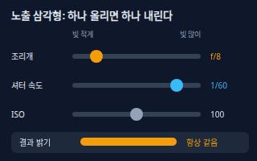</a> <b><a href="#exposure-triangle--노출-삼각형">Exposure Triangle</a></b> 노출 삼각형 사진의 밝기(노출)는 조리개 · 셔터 속도 · ISO 세 가지가 함께 정합니다. 하나를 밝게 바꾸면 다른 하나를 어둡게 바꿔서 같은 밝기를 유지할 수 있습니다.</td>
<td width="33%" valign="top"><a href="#aperture--조리개-f값">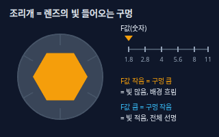</a> <b><a href="#aperture--조리개-f값">Aperture</a></b> 조리개 (F값) 렌즈 안에서 빛이 지나가는 구멍의 크기. 크기는 F값(f/2.8처럼)으로 말하며, 숫자가 작을수록 구멍이 커서 빛이 많이 들어오고 배경이 더 흐려집니다.</td>
<td width="33%" valign="top"><a href="#shutter-speed--셔터-속도">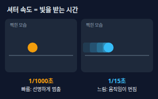</a> <b><a href="#shutter-speed--셔터-속도">Shutter Speed</a></b> 셔터 속도 센서가 빛을 받는 시간. 1/1000초처럼 짧으면 움직임이 멈춰 보이고, 1/15초처럼 길면 움직이는 대상이 번지고 손떨림도 잘 생깁니다.</td>
</tr>
<tr>
<td width="33%" valign="top"><a href="#iso--iso-감도">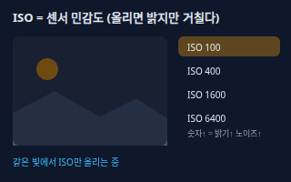</a> <b><a href="#iso--iso-감도">ISO</a></b> ISO 감도 센서가 빛에 반응하는 민감도. 숫자를 두 배로 올리면 한 단계 더 밝게 찍히지만 화면에 거친 알갱이(노이즈)도 늘어납니다.</td>
<td width="33%" valign="top"><a href="#exposure-compensation--노출-보정">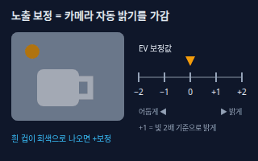</a> <b><a href="#exposure-compensation--노출-보정">Exposure Compensation</a></b> 노출 보정 카메라가 자동으로 정한 밝기를 +/− 눈금(EV)으로 더 밝게 또는 더 어둡게 바꾸는 조절. +1은 빛을 한 단계(2배) 더 받아들이는 것입니다.</td>
<td width="33%" valign="top"><a href="#histogram--히스토그램">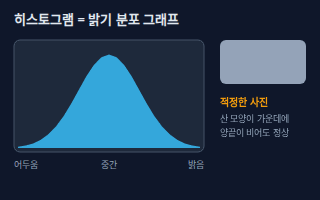</a> <b><a href="#histogram--히스토그램">Histogram</a></b> 히스토그램 사진 속 픽셀이 얼마나 어둡고 밝은지 분포를 보여주는 산 모양 그래프. 왼쪽 끝은 어두운 부분, 오른쪽 끝은 밝은 부분이며, 한쪽 끝에 몰리면 노출이 맞지 않은 것입니다.</td>
</tr>
</table>

**렌즈 · 초점 · Lens & Focus** (7)

<table>
<tr>
<td width="33%" valign="top"><a href="#focal-length--초점거리">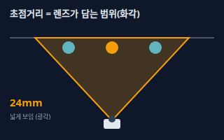</a> <b><a href="#focal-length--초점거리">Focal Length</a></b> 초점거리 렌즈의 mm 숫자. 숫자가 작으면(24mm) 넓게, 크면(200mm) 좁고 멀리까지 담습니다. 풀프레임(35mm) 카메라 기준으로 말하는 경우가 많습니다.</td>
<td width="33%" valign="top"><b><a href="3d-modeling.md#field-of-view--시야각-fov">Field of View</a></b> 시야각 (FOV) 카메라가 한 번에 담는 각도(시야). 사진에서는 초점거리가 짧을수록 넓어집니다. → 3d-modeling 시트</td>
<td width="33%" valign="top"><a href="#wide--telephoto--광각--망원">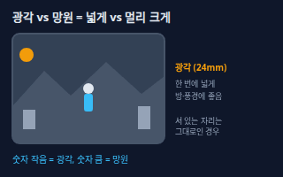</a> <b><a href="#wide--telephoto--광각--망원">Wide / Telephoto</a></b> 광각 / 망원 넓게 담는 렌즈를 광각, 멀리 있는 것을 크게 당겨 담는 렌즈를 망원이라고 합니다. 광각은 가까이 찍으면 모양이 늘어나 보이고, 망원은 배경이 가까이 붙어 보입니다.</td>
</tr>
<tr>
<td width="33%" valign="top"><a href="#prime--zoom-lens--단렌즈--줌렌즈">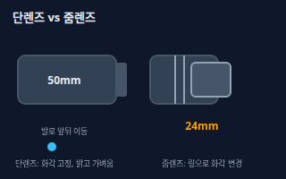</a> <b><a href="#prime--zoom-lens--단렌즈--줌렌즈">Prime / Zoom Lens</a></b> 단렌즈 / 줌렌즈 단렌즈는 초점거리가 하나로 고정된 렌즈(예: 50mm), 줌렌즈는 링을 돌려 범위를 바꾸는 렌즈(예: 24–70mm)입니다. 단렌즈는 보통 더 밝고 가볍고, 줌렌즈는 자리를 안 옮기고 구도를 바꾸기 편합니다.</td>
<td width="33%" valign="top"><a href="#depth-of-field--피사계-심도">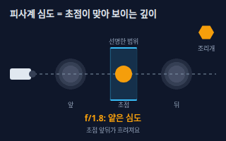</a> <b><a href="#depth-of-field--피사계-심도">Depth of Field</a></b> 피사계 심도 사진에서 초점이 맞아 보이는 앞뒤 거리의 범위. 범위가 좁으면 얕은 심도(배경이 흐림), 넓으면 깊은 심도(앞뒤 모두 선명)입니다. 조리개를 열수록, 피사체에 가까울수록, 초점거리가 길수록 얕아집니다.</td>
<td width="33%" valign="top"><a href="#bokeh--보케">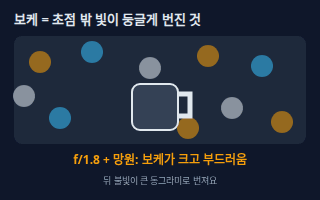</a> <b><a href="#bokeh--보케">Bokeh</a></b> 보케 초점이 맞지 않은 배경의 빛이 둥글고 부드럽게 번져 보이는 효과, 또는 그 번짐의 질감.</td>
</tr>
<tr>
<td width="33%" valign="top"><a href="#focus-modes--초점-모드">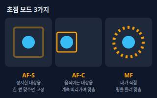</a> <b><a href="#focus-modes--초점-모드">Focus Modes</a></b> 초점 모드 초점을 맞추는 방식. 정지한 대상은 한 번 맞추고 고정하는 AF-S(캐논은 원샷), 움직이는 대상은 계속 따라가는 AF-C(캐논은 서보), 직접 링을 돌리는 수동 MF가 있습니다.</td>
</tr>
</table>

**빛 · Light** (7)

<table>
<tr>
<td width="33%" valign="top"><a href="#white-balance--화이트-밸런스">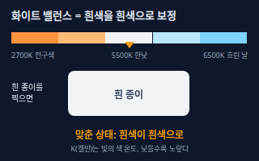</a> <b><a href="#white-balance--화이트-밸런스">White Balance</a></b> 화이트 밸런스 빛의 색 때문에 생기는 색 번짐을 보정해서 흰색을 흰색으로 보이게 하는 설정. 빛의 색은 켈빈(K)으로 말하며 숫자가 낮을수록 노랗고 높을수록 푸릅니다. 한낮 햇빛은 5000~5500K 안팎, 백열 전구는 3000K 안팎입니다.</td>
<td width="33%" valign="top"><a href="#hard--soft-light--하드-라이트--소프트-라이트">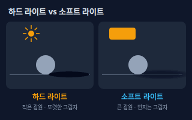</a> <b><a href="#hard--soft-light--하드-라이트--소프트-라이트">Hard / Soft Light</a></b> 하드 라이트 / 소프트 라이트 광원이 작고 직접 비추면 그림자 경계가 또렷한 하드 라이트, 광원이 크거나 퍼지면(구름·창가·소프트박스) 그림자가 부드러운 소프트 라이트가 됩니다.</td>
<td width="33%" valign="top"><a href="#backlight--역광">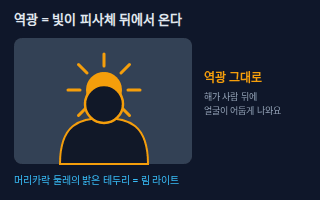</a> <b><a href="#backlight--역광">Backlight</a></b> 역광 빛이 피사체 뒤에서 카메라 쪽으로 들어오는 상황. 머리카락 둘레에 밝은 테두리(림 라이트)가 생기지만, 그냥 찍으면 얼굴이 어둡게 나옵니다.</td>
</tr>
<tr>
<td width="33%" valign="top"><a href="#golden-hour--골든아워">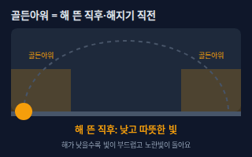</a> <b><a href="#golden-hour--골든아워">Golden Hour</a></b> 골든아워 해가 뜬 직후와 해지기 직전, 해가 낮게 떠서 빛이 따뜻한 노란빛이고 부드러운 시간대. 사진 찍기 가장 좋은 빛으로 꼽힙니다.</td>
<td width="33%" valign="top"><a href="#reflector--반사판">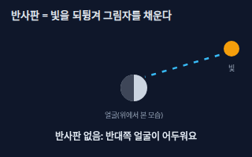</a> <b><a href="#reflector--반사판">Reflector</a></b> 반사판 빛을 되튕겨 피사체의 그림자 쪽을 채워 주는 판. 흰색은 부드럽게, 은색은 강하게, 금색은 따뜻하게 되튕깁니다. 흰 스티로폼이나 종이로도 대신할 수 있습니다.</td>
<td width="33%" valign="top"><a href="#flash--플래시">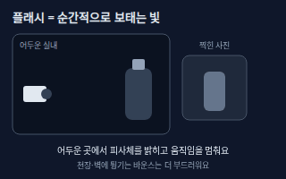</a> <b><a href="#flash--플래시">Flash</a></b> 플래시 아주 짧은 순간 밝은 빛을 내는 조명. 어두운 곳을 밝히고 움직임을 멈추게 하지만 정면으로 쏘면 그림자가 딱딱하고 반사가 생기기 쉬워서, 천장이나 벽에 튕기는 바운스로 부드럽게 쓰기도 합니다.</td>
</tr>
<tr>
<td width="33%" valign="top"><b><a href="3d-modeling.md#three-point-lighting--3점-조명">Three-Point Lighting</a></b> 3점 조명 주 조명·보조 조명·뒷 조명 세 개로 입체감을 만드는 기본 조명 배치. → 3d-modeling 시트</td>
</tr>
</table>

**구도 · Composition** (5)

<table>
<tr>
<td width="33%" valign="top"><a href="#rule-of-thirds--삼분할-구도">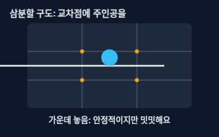</a> <b><a href="#rule-of-thirds--삼분할-구도">Rule of Thirds</a></b> 삼분할 구도 화면을 가로세로 3등분하는 선을 긋고, 주인공이나 수평선을 선 위나 교차점에 놓는 기본 구도. 가운데에 두는 것보다 안정되면서 자연스럽게 보입니다.</td>
<td width="33%" valign="top"><a href="#leading-lines--유도선">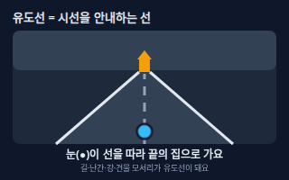</a> <b><a href="#leading-lines--유도선">Leading Lines</a></b> 유도선 길·난간·강·건물 모서리처럼 시선을 따라가게 만드는 선. 선들이 주인공 쪽으로 모이게 배치하면 눈이 저절로 주인공에게 갑니다.</td>
<td width="33%" valign="top"><a href="#negative-space--여백">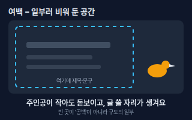</a> <b><a href="#negative-space--여백">Negative Space</a></b> 여백 일부러 비워 둔 공간. 주인공이 작아도 돋보이게 하고, 그 빈 곳에 제목이나 문구를 넣을 자리를 만들어 줍니다.</td>
</tr>
<tr>
<td width="33%" valign="top"><a href="#camera-angle--촬영-각도">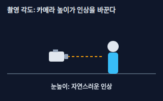</a> <b><a href="#camera-angle--촬영-각도">Camera Angle</a></b> 촬영 각도 카메라가 피사체에 대해 어느 높이에서 보는지. 눈높이는 자연스럽고, 아래에서 올려다보는 로우앵글은 크고 당당하게, 위에서 내려다보는 하이앵글은 작고 귀엽게 보입니다.</td>
<td width="33%" valign="top"><a href="#framing--프레이밍">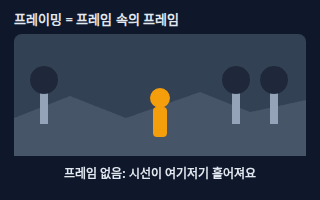</a> <b><a href="#framing--프레이밍">Framing</a></b> 프레이밍 문틀·창문·나뭇가지·아치 같은 앞쪽 물체로 주인공을 둘러싸서 시선을 모으는 구도. &quot;프레임 속의 프레임&quot;이라고도 합니다.</td>
</tr>
</table>

**파일 · 보정 · Files & Editing** (4)

<table>
<tr>
<td width="33%" valign="top"><a href="#raw-vs-jpeg--raw와-jpeg">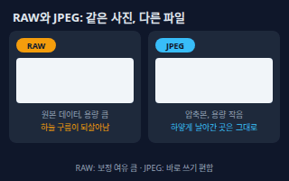</a> <b><a href="#raw-vs-jpeg--raw와-jpeg">RAW vs JPEG</a></b> RAW와 JPEG RAW는 센서가 받은 정보를 거의 그대로 담은 원본 파일이고 용량이 큽니다. JPEG은 카메라가 보정하고 압축해서 만든 완성본이라 작고 바로 쓸 수 있지만, 나중에 밝기·색을 크게 고치면 화질이 쉽게 깨집니다.</td>
<td width="33%" valign="top"><a href="#photo-crop--사진-자르기-크롭">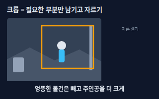</a> <b><a href="#photo-crop--사진-자르기-크롭">Photo Crop</a></b> 사진 자르기 (크롭) 사진의 가장자리를 잘라 내서 구도와 가로세로 비율을 바꾸는 작업. 잘라 낸 만큼 픽셀 수(해상도)도 줄어듭니다.</td>
<td width="33%" valign="top"><a href="#retouching--보정-리터칭">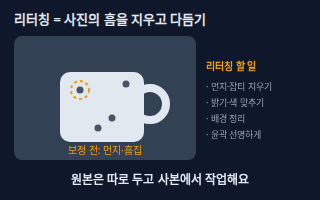</a> <b><a href="#retouching--보정-리터칭">Retouching</a></b> 보정 (리터칭) 찍은 사진을 다듬는 작업. 먼지·잡티 지우기, 밝기·색 맞추기, 배경 정리, 윤곽 선명하게 하기 등을 포함합니다. 원본은 따로 두고 사본에서 작업하는 게 안전합니다.</td>
</tr>
<tr>
<td width="33%" valign="top"><a href="#product-photo-on-white-background--흰-배경-제품-사진">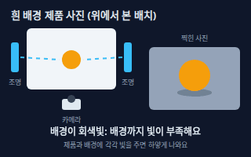</a> <b><a href="#product-photo-on-white-background--흰-배경-제품-사진">Product Photo on White Background</a></b> 흰 배경 제품 사진 쇼핑몰·오픈마켓 대표 이미지로 쓰는, 하얀 배경 위에 제품만 보이는 사진. 제품과 배경에 따로 조명을 주고 배경이 회색빛으로 가라앉지 않게 밝게 맞추는 게 핵심입니다.</td>
</tr>
</table>

<!-- overview:end -->

## 노출 · Exposure

### Exposure Triangle · 노출 삼각형

- **정의**: 사진의 밝기(노출)는 조리개 · 셔터 속도 · ISO 세 가지가 함께 정합니다. 하나를 밝게 바꾸면 다른 하나를 어둡게 바꿔서 같은 밝기를 유지할 수 있습니다.
- **AI에게 이렇게**: "조리개를 f/2.8로 열었으니 셔터 속도와 ISO를 조정해서 밝기는 지금과 같게 유지해줘"
- **언제**: 어두운 곳에서 찍을 때, 배경 흐림·움직임 멈춤·깨끗한 화질 중 무엇을 우선할지 정할 때
- **헷갈림**: Exposure Compensation — 노출 삼각형은 밝기를 만드는 세 재료, 노출 보정은 카메라가 정한 밝기를 일부러 더 밝게·어둡게 바꾸는 조절
- **관련**: Aperture, Shutter Speed, ISO, Histogram
- **확인 질문**: 가장 중요한 게 배경 흐림, 움직임 멈춤, 깨끗한 화질 중 무엇인가요?

### Aperture · 조리개 (F값)

- **정의**: 렌즈 안에서 빛이 지나가는 구멍의 크기. 크기는 F값(f/2.8처럼)으로 말하며, 숫자가 작을수록 구멍이 커서 빛이 많이 들어오고 배경이 더 흐려집니다.
- **AI에게 이렇게**: "f/1.8로 열어서 배경을 흐리게 찍은 느낌으로 만들어줘 / 단체 사진이니까 f/8 정도로 조여서 전체가 선명하게 찍어줘"
- **언제**: 배경을 흐리게(인물·제품 강조) 하거나 풍경·단체 사진을 전체 선명하게 찍을 때
- **헷갈림**: Focal Length — F값은 구멍의 크기, 초점거리(mm)는 렌즈가 담는 범위. 둘 다 렌즈에 적혀 있지만 의미가 다름
- **관련**: Depth of Field, Exposure Triangle, Bokeh
- **확인 질문**: 배경을 흐리게 하고 싶나요, 아니면 앞뒤를 모두 선명하게 하고 싶나요?

### Shutter Speed · 셔터 속도

- **정의**: 센서가 빛을 받는 시간. 1/1000초처럼 짧으면 움직임이 멈춰 보이고, 1/15초처럼 길면 움직이는 대상이 번지고 손떨림도 잘 생깁니다.
- **AI에게 이렇게**: "달리는 강아지를 찍을 거니까 셔터 속도 1/1000초로 얼어붙은 듯 선명하게 / 폭포는 1/4초로 물이 실처럼 흐르게 찍은 느낌으로 만들어줘"
- **언제**: 스포츠·아이·동물 사진(빠르게), 야경·폭포·빛줄기(느리게, 삼각대와 함께)
- **헷갈림**: Frame Rate(영상의 초당 장면 수) — 셔터 속도는 한 장을 찍는 노출 시간, 프레임레이트는 1초에 몇 장을 보여주는지
- **관련**: Exposure Triangle, ISO, Aperture
- **확인 질문**: 움직임을 멈추고 싶나요, 일부러 흐르는 느낌을 내고 싶나요? 삼각대가 있나요?

### ISO · ISO 감도

- **정의**: 센서가 빛에 반응하는 민감도. 숫자를 두 배로 올리면 한 단계 더 밝게 찍히지만 화면에 거친 알갱이(노이즈)도 늘어납니다.
- **AI에게 이렇게**: "실내라 어두운데 셔터는 1/125초는 유지하고, 노이즈가 너무 심하지 않은 선에서 ISO를 올려줘"
- **언제**: 조리개와 셔터 속도를 더 못 바꾸는데 아직 어두울 때, 일부러 필름 같은 거친 질감을 낼 때
- **헷갈림**: Exposure Compensation — ISO는 센서의 민감도, 노출 보정은 목표 밝기를 바꾸는 조절. ISO를 올리면 노이즈가 늘지만 보정은 그렇지 않음
- **관련**: Exposure Triangle, Shutter Speed, Retouching
- **확인 질문**: 쓰는 카메라(스마트폰·미러리스)의 ISO를 직접 바꿀 수 있나요? 인쇄할 크기는 어느 정도인가요?

### Exposure Compensation · 노출 보정

- **정의**: 카메라가 자동으로 정한 밝기를 +/− 눈금(EV)으로 더 밝게 또는 더 어둡게 바꾸는 조절. +1은 빛을 한 단계(2배) 더 받아들이는 것입니다.
- **AI에게 이렇게**: "눈 덮인 풍경이 회색으로 나왔어. 노출 보정 +1로 올려서 흰 눈이 흰색으로 보이게 해줘"
- **언제**: 흰 배경·눈 사진이 회색으로 어둡게 나올 때, 검은 배경·밤 사진이 너무 밝게 나올 때, 역광에서 얼굴을 살릴 때
- **헷갈림**: Exposure Triangle — 노출 삼각형은 밝기를 만드는 세 재료, 노출 보정은 카메라가 정한 목표 밝기를 직접 올리고 내리는 조절
- **관련**: Histogram, Backlight, Exposure Triangle
- **확인 질문**: 지금 사진이 어두운가요, 밝은가요? 흰 부분이 하얗게 날아간 곳은 없나요?

### Histogram · 히스토그램

- **정의**: 사진 속 픽셀이 얼마나 어둡고 밝은지 분포를 보여주는 산 모양 그래프. 왼쪽 끝은 어두운 부분, 오른쪽 끝은 밝은 부분이며, 한쪽 끝에 몰리면 노출이 맞지 않은 것입니다.
- **AI에게 이렇게**: "이 사진의 히스토그램을 보고 노출이 적정한지 알려줘. 오른쪽 끝에 잘린 하이라이트가 있는지도 확인해줘"
- **언제**: 화면이 밝아서 눈으로 노출을 믿기 어려울 때, 찍은 뒤 하얗게 날아간 곳·검게 뭉개진 곳을 찾을 때
- **헷갈림**: Bar Chart(막대그래프) — 히스토그램은 값(밝기)의 분포를 구간별로 세어 붙여서 보여주는 그래프, 항목을 비교하는 막대그래프와 다름
- **관련**: Exposure Compensation, RAW vs JPEG, Exposure Triangle
- **확인 질문**: 사진 파일이나 카메라 화면의 히스토그램을 볼 수 있나요? 밝은 사진이 목표인가요, 어두운 분위기가 목표인가요?

## 렌즈 · 초점 · Lens & Focus

### Focal Length · 초점거리

- **정의**: 렌즈의 mm 숫자. 숫자가 작으면(24mm) 넓게, 크면(200mm) 좁고 멀리까지 담습니다. 풀프레임(35mm) 카메라 기준으로 말하는 경우가 많습니다.
- **AI에게 이렇게**: "35mm 렌즈로 가게 안을 넓게 보여주는 구도로 / 85mm 렌즈로 인물 상반신이 자연스럽게 보이는 사진 느낌으로 만들어줘"
- **언제**: 어떤 렌즈를 쓸지 고를 때, AI 프롬프트에 "35mm", "85mm" 같은 사진 느낌을 지정할 때
- **헷갈림**: Aperture — 초점거리(mm)는 담는 범위, 조리개(F값)는 빛이 들어오는 구멍. 둘이 같이 쓰이지만 다른 숫자
- **관련**: Wide / Telephoto, Field of View, Depth of Field
- **확인 질문**: 카메라 센서 크기(풀프레임·크롭·스마트폰)가 어떻게 되나요? 같은 mm여도 센서가 작으면 더 좁게 보여요

### Field of View · 시야각 (FOV)

- **정의**: 카메라가 한 번에 담는 각도(시야). 사진에서는 초점거리가 짧을수록 넓어집니다.
- **원본**: [3D 모델링 · Field of View](3d-modeling.md#field-of-view--시야각-fov)

### Wide / Telephoto · 광각 / 망원

- **정의**: 넓게 담는 렌즈를 광각, 멀리 있는 것을 크게 당겨 담는 렌즈를 망원이라고 합니다. 광각은 가까이 찍으면 모양이 늘어나 보이고, 망원은 배경이 가까이 붙어 보입니다.
- **AI에게 이렇게**: "좁은 방 전체가 보이도록 광각(24mm)으로 / 먼 산이 크게 보이도록 망원(135mm)으로 압축감 있게 만들어줘"
- **언제**: 좁은 공간·풍경(광각), 인물·스포츠·먼 대상(망원)
- **헷갈림**: Digital Zoom(디지털 줌) — 망원은 렌즈로 당겨 찍는 것, 디지털 줌은 사진 일부를 확대해서 해상도가 떨어짐
- **관련**: Focal Length, Prime / Zoom Lens, Depth of Field
- **확인 질문**: 찍을 공간이 얼마나 넓고, 피사체와 얼마나 떨어질 수 있나요?

### Prime / Zoom Lens · 단렌즈 / 줌렌즈

- **정의**: 단렌즈는 초점거리가 하나로 고정된 렌즈(예: 50mm), 줌렌즈는 링을 돌려 범위를 바꾸는 렌즈(예: 24–70mm)입니다. 단렌즈는 보통 더 밝고 가볍고, 줌렌즈는 자리를 안 옮기고 구도를 바꾸기 편합니다.
- **AI에게 이렇게**: "인물용으로 밝은 50mm 단렌즈를 쓴 것처럼 배경이 부드럽게 흐려진 느낌으로 만들어줘"
- **언제**: 렌즈를 살 때, 여행·행사처럼 이동이 어려운 촬영(줌), 배경 흐림·야간 촬영(밝은 단렌즈)
- **헷갈림**: Wide / Telephoto — 단렌즈·줌렌즈는 렌즈의 종류(고정/가변), 광각·망원은 담는 범위
- **관련**: Focal Length, Aperture, Wide / Telephoto
- **확인 질문**: 어떤 상황에서 가장 자주 찍나요? 짐의 무게와 예산은 어느 정도인가요?

### Depth of Field · 피사계 심도

- **정의**: 사진에서 초점이 맞아 보이는 앞뒤 거리의 범위. 범위가 좁으면 얕은 심도(배경이 흐림), 넓으면 깊은 심도(앞뒤 모두 선명)입니다. 조리개를 열수록, 피사체에 가까울수록, 초점거리가 길수록 얕아집니다.
- **AI에게 이렇게**: "얕은 심도로 제품만 선명하고 뒤는 흐리게 / 건축 사진이라 깊은 심도로 앞뒤 모두 선명하게 만들어줘"
- **언제**: 인물·음식·제품 강조(얕게), 풍경·단체·건물(깊게)
- **헷갈림**: Bokeh — 피사계 심도는 선명한 범위의 깊이, 보케는 그 밖의 흐린 부분이 어떤 모양·느낌으로 번지는가
- **관련**: Aperture, Bokeh, Focal Length
- **확인 질문**: 주인공 하나만 돋보이게 하고 싶나요, 장소 전체를 보여주고 싶나요?

### Bokeh · 보케

- **정의**: 초점이 맞지 않은 배경의 빛이 둥글고 부드럽게 번져 보이는 효과, 또는 그 번짐의 질감.
- **AI에게 이렇게**: "밤거리 불빛이 크고 부드러운 보케로 번진 배경에, 인물만 선명하게 나온 사진 느낌으로 만들어줘"
- **언제**: 야경 인물, 크리스마스 조명 배경, 제품 사진에서 분위기 있는 배경이 필요할 때
- **헷갈림**: Blur(단순 흐림 필터) — 보케는 렌즈가 만드는 번짐이라 밝은 점이 동그란 빛망울로 보이고, 포토샵의 블러는 전체를 뭉개는 효과
- **관련**: Depth of Field, Aperture, Wide / Telephoto
- **확인 질문**: 배경에 빛(조명·가로등)이 있나요? 보케가 크고 둥근 느낌을 원하나요, 은은한 정도를 원하나요?

### Focus Modes · 초점 모드

- **정의**: 초점을 맞추는 방식. 정지한 대상은 한 번 맞추고 고정하는 AF-S(캐논은 원샷), 움직이는 대상은 계속 따라가는 AF-C(캐논은 서보), 직접 링을 돌리는 수동 MF가 있습니다.
- **AI에게 이렇게**: "뛰어다니는 아이 사진이니까 AF-C(연속 초점)에 얼굴 인식 켜는 설정을 알려줘 / 제품 사진이라 MF로 라벨 글씨에 정확히 맞추는 방법을 알려줘"
- **언제**: 정지 제품(AF-S 또는 MF), 아이·반려동물·스포츠(AF-C), 어두운 곳·접사(MF)
- **헷갈림**: Autofocus Point(초점 위치) — 모드는 어떻게 맞출지, 초점 위치는 화면의 어디에 맞출지
- **관련**: Depth of Field, Shutter Speed, Aperture
- **확인 질문**: 찍는 대상이 움직이나요? 카메라나 스마트폰 모델이 무엇인가요?

## 빛 · Light

### White Balance · 화이트 밸런스

- **정의**: 빛의 색 때문에 생기는 색 번짐을 보정해서 흰색을 흰색으로 보이게 하는 설정. 빛의 색은 켈빈(K)으로 말하며 숫자가 낮을수록 노랗고 높을수록 푸릅니다. 한낮 햇빛은 5000~5500K 안팎, 백열 전구는 3000K 안팎입니다.
- **AI에게 이렇게**: "실내 전구 조명 때문에 노랗게 나온 사진의 화이트 밸런스를 맞춰서 흰 벽이 흰색으로 보이게 해줘 / 따뜻한 분위기를 위해 5000K로 약간 따뜻하게 해줘"
- **언제**: 실내 조명 아래 촬영, 제품 색이 실제와 같아야 할 때(쇼핑몰), 여러 장의 색이 서로 다를 때
- **헷갈림**: Color Grading(색보정으로 분위기 만들기) — 화이트 밸런스는 색 번짐을 바로잡는 첫 단계, 컬러 그레이딩은 그 위에 분위기를 입히는 단계
- **관련**: Reflector, Flash, RAW vs JPEG
- **확인 질문**: 조명이 햇빛·형광등·전구 중 무엇인가요? 흰색 기준이 되는 물건(흰 종이·회색 카드)이 사진에 있나요?

### Hard / Soft Light · 하드 라이트 / 소프트 라이트

- **정의**: 광원이 작고 직접 비추면 그림자 경계가 또렷한 하드 라이트, 광원이 크거나 퍼지면(구름·창가·소프트박스) 그림자가 부드러운 소프트 라이트가 됩니다.
- **AI에게 이렇게**: "창가의 부드러운 빛이 들어오는 소프트 라이트로 그림자가 거의 없는 느낌으로 / 강한 직사광으로 그림자가 선명한 하드 라이트 느낌으로 만들어줘"
- **언제**: 인물·음식·화장품(소프트), 강한 질감·극적인 느낌(하드)
- **헷갈림**: Brightness(밝기) — 하드/소프트는 빛의 질, 밝기는 빛의 양. 밝아도 하드, 어두워도 소프트일 수 있음
- **관련**: Reflector, Golden Hour, Three-Point Lighting
- **확인 질문**: 분위기가 부드럽고 깨끗한가요, 극적이고 대비가 강한가요? 창문이나 조명 장비가 있나요?

### Backlight · 역광

- **정의**: 빛이 피사체 뒤에서 카메라 쪽으로 들어오는 상황. 머리카락 둘레에 밝은 테두리(림 라이트)가 생기지만, 그냥 찍으면 얼굴이 어둡게 나옵니다.
- **AI에게 이렇게**: "해가 사람 뒤에서 비추는 역광 사진인데 얼굴이 어두워. 노출 보정을 올리거나 반사판·플래시로 얼굴을 살리는 방법을 알려줘"
- **언제**: 해 질 녘 인물, 분위기 있는 실루엣, 투명한 음료·유리 제품을 빛나게 할 때
- **헷갈림**: Side Light(측광) — 역광은 빛이 뒤에서, 측광은 옆에서 옴. 역광은 윤곽이 빛나고 얼굴은 어두워지기 쉬움
- **관련**: Exposure Compensation, Reflector, Flash
- **확인 질문**: 얼굴을 밝게 살리고 싶나요, 실루엣처럼 검게 남기고 싶나요?

### Golden Hour · 골든아워

- **정의**: 해가 뜬 직후와 해지기 직전, 해가 낮게 떠서 빛이 따뜻한 노란빛이고 부드러운 시간대. 사진 찍기 가장 좋은 빛으로 꼽힙니다.
- **AI에게 이렇게**: "골든아워의 낮고 따뜻한 햇빛이 옆에서 비추는 느낌으로 인물과 거리 풍경 사진을 만들어줘"
- **언제**: 야외 인물·풍경·건물 외관 촬영, 따뜻하고 감성적인 분위기를 낼 때
- **헷갈림**: Blue Hour(블루아워) — 골든아워는 해가 지평선 근처일 때의 따뜻한 빛, 블루아워는 해가 진 뒤 하늘이 푸르게 남는 시간
- **관련**: Hard / Soft Light, White Balance, Backlight
- **확인 질문**: 촬영 장소와 날짜가 어떻게 되나요? 그 날 일출·일몰 시각을 알아야 시간을 맞출 수 있어요

### Reflector · 반사판

- **정의**: 빛을 되튕겨 피사체의 그림자 쪽을 채워 주는 판. 흰색은 부드럽게, 은색은 강하게, 금색은 따뜻하게 되튕깁니다. 흰 스티로폼이나 종이로도 대신할 수 있습니다.
- **AI에게 이렇게**: "제품 한쪽이 어두운데 흰 반사판으로 그림자 쪽을 채우려면 어디에 두는 게 좋은지 알려줘"
- **언제**: 창가 제품·음식 사진, 야외 인물 촬영에서 얼굴 그림자를 줄일 때
- **헷갈림**: Flash — 반사판은 있는 빛을 되튕기고, 플래시는 새 빛을 만들어 줌
- **관련**: Hard / Soft Light, Backlight, Product Photo on White Background
- **확인 질문**: 주 광원이 어느 쪽에 있나요? 반사판으로 쓸 흰 판이나 천이 있나요?

### Flash · 플래시

- **정의**: 아주 짧은 순간 밝은 빛을 내는 조명. 어두운 곳을 밝히고 움직임을 멈추게 하지만 정면으로 쏘면 그림자가 딱딱하고 반사가 생기기 쉬워서, 천장이나 벽에 튕기는 바운스로 부드럽게 쓰기도 합니다.
- **AI에게 이렇게**: "어두운 실내 행사 사진인데 정면 플래시 대신 천장에 바운스한 부드러운 플래시 느낌으로 만들어줘"
- **언제**: 실내·야간 인물 촬영, 역광에서 얼굴 살리기, 움직이는 대상을 멈추고 싶을 때
- **헷갈림**: Continuous Light(상시 조명) — 플래시는 찍는 순간만 번쩍이고, 상시 조명은 계속 켜 있어서 결과를 미리 보면서 찍을 수 있음
- **관련**: Backlight, Reflector, Shutter Speed
- **확인 질문**: 카메라 내장 플래시인가요, 외장 플래시인가요? 사람 눈에 직접 쏴도 괜찮은 환경인가요?

### Three-Point Lighting · 3점 조명

- **정의**: 주 조명·보조 조명·뒷 조명 세 개로 입체감을 만드는 기본 조명 배치.
- **원본**: [3D 모델링 · Three-Point Lighting](3d-modeling.md#three-point-lighting--3점-조명)

## 구도 · Composition

### Rule of Thirds · 삼분할 구도

- **정의**: 화면을 가로세로 3등분하는 선을 긋고, 주인공이나 수평선을 선 위나 교차점에 놓는 기본 구도. 가운데에 두는 것보다 안정되면서 자연스럽게 보입니다.
- **AI에게 이렇게**: "삼분할 구도로 인물을 오른쪽 세로선에 두고, 수평선은 아래쪽 가로선에 맞춰서 만들어줘"
- **언제**: 인물·풍경·제품을 처음 배치할 때, 썸네일·광고 이미지에 글자 자리를 남길 때
- **헷갈림**: Centered Composition(중앙 구도) — 중앙은 정면·대칭을 강조하는 의도된 선택, 삼분할은 시선이 편한 기본 배치
- **관련**: Negative Space, Framing, Leading Lines
- **확인 질문**: 주인공은 어디에 있나요? 사진의 가로세로 비율(1:1, 4:5, 16:9)은 무엇인가요?

### Leading Lines · 유도선

- **정의**: 길·난간·강·건물 모서리처럼 시선을 따라가게 만드는 선. 선들이 주인공 쪽으로 모이게 배치하면 눈이 저절로 주인공에게 갑니다.
- **AI에게 이렇게**: "길이 멀리 있는 작은 집을 향해 모이는 유도선 구도로 만들어줘. 낮은 위치에서 길 중앙을 따라 찍은 느낌으로"
- **언제**: 풍경·건축·가게 내부처럼 공간의 깊이감이 필요한 사진
- **헷갈림**: Frame(프레임) — 유도선은 선으로 시선을 끄는 것, 프레이밍은 문틀·창문으로 주인공을 둘러싸는 것
- **관련**: Rule of Thirds, Camera Angle, Framing
- **확인 질문**: 사진의 주인공이 무엇인가요? 주변에 쓸 만한 선(길·테이블 모서리·난간)이 있나요?

### Negative Space · 여백

- **정의**: 일부러 비워 둔 공간. 주인공이 작아도 돋보이게 하고, 그 빈 곳에 제목이나 문구를 넣을 자리를 만들어 줍니다.
- **AI에게 이렇게**: "왼쪽에 여백을 넓게 두고 제품은 오른쪽 아래에 작게 놓아서 제목 문구를 넣을 수 있게 만들어줘"
- **언제**: 광고 배너·썸네일·SNS 카드처럼 글자를 얹을 사진, 미니멀한 분위기의 제품 사진
- **헷갈림**: Crop — 여백은 처음 구도에서 남기는 빈 공간, 크롭은 찍은 뒤 가장자리를 잘라 비율과 구도를 바꾸는 작업
- **관련**: Rule of Thirds, Photo Crop, Framing
- **확인 질문**: 글자가 들어갈 위치는 어디인가요(왼쪽·위·아래)? 최종 이미지 비율은 무엇인가요?

### Camera Angle · 촬영 각도

- **정의**: 카메라가 피사체에 대해 어느 높이에서 보는지. 눈높이는 자연스럽고, 아래에서 올려다보는 로우앵글은 크고 당당하게, 위에서 내려다보는 하이앵글은 작고 귀엽게 보입니다.
- **AI에게 이렇게**: "제품을 낮은 위치에서 올려다보는 로우앵글로 웅장해 보이게 / 음식은 바로 위에서 내려다보는 탑뷰(플랫레이)로 만들어줘"
- **언제**: 인상을 바꾸고 싶을 때, 음식(위에서)·신발(낮게)·건물(올려다)처럼 대상에 맞는 각도를 고를 때
- **헷갈림**: Shot Size(샷 크기 — 클로즈업·풀샷 등) — 각도는 카메라의 높이와 방향, 샷 크기는 피사체가 화면에서 차지하는 크기. 샷 크기는 영상 촬영 시트에서 다룸
- **관련**: Leading Lines, Wide / Telephoto, Rule of Thirds
- **확인 질문**: 어떤 느낌을 주고 싶나요(당당함·귀여움·자연스러움)? 쇼핑몰 사진이라면 정면·측면·윗면 중 어떤 컷이 필요한가요?

### Framing · 프레이밍

- **정의**: 문틀·창문·나뭇가지·아치 같은 앞쪽 물체로 주인공을 둘러싸서 시선을 모으는 구도. "프레임 속의 프레임"이라고도 합니다.
- **AI에게 이렇게**: "문틀을 어둡게 앞에 두고 그 안으로 보이는 카페 내부가 주인공이 되는 프레이밍 구도로 만들어줘"
- **언제**: 풍경·건축·여행 사진에서 깊이감을 주거나 주변이 산만할 때
- **헷갈림**: Photo Crop — 프레이밍은 찍을 때 장면 속 물체로 둘러싸는 것, 크롭은 찍은 뒤 사진 가장자리를 잘라내는 것
- **관련**: Leading Lines, Rule of Thirds, Negative Space
- **확인 질문**: 주변에 프레임으로 쓸 수 있는 물체(문·창·나무)가 있나요?

## 파일 · 보정 · Files & Editing

### RAW vs JPEG · RAW와 JPEG

- **정의**: RAW는 센서가 받은 정보를 거의 그대로 담은 원본 파일이고 용량이 큽니다. JPEG은 카메라가 보정하고 압축해서 만든 완성본이라 작고 바로 쓸 수 있지만, 나중에 밝기·색을 크게 고치면 화질이 쉽게 깨집니다.
- **AI에게 이렇게**: "행사 사진은 RAW+JPEG로 같이 저장하고, 제품 사진은 RAW로 찍어서 색과 밝기를 나중에 보정할 수 있게 설정 방법을 알려줘"
- **언제**: 나중에 보정할 사진(RAW), 빠르게 공유·업로드할 사진(JPEG), 저장 공간이 부족할 때
- **헷갈림**: PNG, WebP(웹용 이미지 형식) — RAW와 JPEG은 카메라가 저장하는 파일, PNG·WebP는 편집이 끝난 뒤 웹에 올리는 형식
- **관련**: Histogram, White Balance, Retouching
- **확인 질문**: 보정을 직접 할 건가요, 찍은 그대로 쓸 건가요? 쓰는 편집 프로그램이 RAW를 열 수 있나요? 저장 공간은 충분한가요?

### Photo Crop · 사진 자르기 (크롭)

- **정의**: 사진의 가장자리를 잘라 내서 구도와 가로세로 비율을 바꾸는 작업. 잘라 낸 만큼 픽셀 수(해상도)도 줄어듭니다.
- **AI에게 이렇게**: "이 사진을 인스타그램 4:5 비율로 크롭하는데 주인공 얼굴이 위쪽 삼분할선에 오도록 하고 왼쪽 쓰레기통은 잘라줘"
- **언제**: SNS·썸네일 비율에 맞출 때, 가장자리의 방해되는 물건을 없앨 때, 주인공을 더 크게 보이게 할 때
- **헷갈림**: Resize(크기 조절) — 크롭은 일부를 잘라 내고, 리사이즈는 전체를 그대로 줄이거나 늘림
- **관련**: Rule of Thirds, Negative Space, Retouching
- **확인 질문**: 최종 사용처와 비율은 무엇인가요(1:1·4:5·16:9)? 원본 해상도는 얼마나 되나요?

### Retouching · 보정 (리터칭)

- **정의**: 찍은 사진을 다듬는 작업. 먼지·잡티 지우기, 밝기·색 맞추기, 배경 정리, 윤곽 선명하게 하기 등을 포함합니다. 원본은 따로 두고 사본에서 작업하는 게 안전합니다.
- **AI에게 이렇게**: "제품 표면의 먼지와 잡티만 지우고 색과 모양은 그대로 두는 가벼운 보정을 해줘. 원본 느낌은 바꾸지 말고"
- **언제**: 쇼핑몰 제품 사진, 프로필·인물 사진, 광고 이미지를 마무리할 때
- **헷갈림**: Generative Edit(AI로 새로 그림) — 리터칭은 있는 사진을 다듬는 것, 생성형 편집은 AI가 없던 부분을 새로 만들어 넣어서 실제와 달라질 수 있음
- **관련**: RAW vs JPEG, White Balance, Product Photo on White Background
- **확인 질문**: 어디까지 고쳐도 되나요(잡티만 vs 모양·색까지)? 실제 제품과 달라 보이면 안 되는 사진인가요?

### Product Photo on White Background · 흰 배경 제품 사진

- **정의**: 쇼핑몰·오픈마켓 대표 이미지로 쓰는, 하얀 배경 위에 제품만 보이는 사진. 제품과 배경에 따로 조명을 주고 배경이 회색빛으로 가라앉지 않게 밝게 맞추는 게 핵심입니다.
- **AI에게 이렇게**: "쇼핑몰 대표 이미지용으로 흰 배경에 제품 하나만, 은은한 그림자와 정확한 제품 색으로 정면에서 찍은 사진 느낌으로 만들어줘"
- **언제**: 스마트스토어·쿠팡·아마존 같은 마켓 대표 이미지, 카탈로그, 제품 비교 이미지
- **헷갈림**: Lifestyle Shot(연출 컷) — 흰 배경 사진은 제품 자체를 정확히 보여주는 용도, 연출 컷은 사용 장면과 분위기를 보여주는 용도
- **관련**: Hard / Soft Light, White Balance, Reflector
- **확인 질문**: 올릴 마켓의 사진 규정(배경색·크기·비율)이 있나요? 제품이 유리·금속처럼 반짝이거나 흰색이라 배경과 섞이는 제품인가요?

## 참고 자료

- [Adobe · What is an exposure in photography?](https://www.adobe.com/creativecloud/photography/discover/exposure-in-photography.html)
- [Cambridge in Colour · Camera Exposure](https://www.cambridgeincolour.com/tutorials/camera-exposure.htm)
- [Cambridge in Colour · Depth of Field](https://www.cambridgeincolour.com/tutorials/depth-of-field.htm)
- [Nikon · Setting White Balance](https://www.nikonusa.com/learn-and-explore/c/tips-and-techniques/setting-white-balance)
- [Adobe · Histogram in photography](https://www.adobe.com/creativecloud/photography/discover/how-to-read-a-histogram.html)
- [Adobe · JPEG vs RAW](https://www.adobe.com/creativecloud/file-types/image/comparison/jpeg-vs-raw.html)
- [Canon Europe · Improve the composition of your photos](https://www.canon-europe.com/get-inspired/tips-and-techniques/better-composition/)
- [Shopify Help Center · Taking product photographs](https://help.shopify.com/en/manual/products/product-media/product-photography)
