# 기획 (PM) 치트시트

> 창업자·기획자가 아이디어를 AI와 개발자에게 맡길 때 펼치는 시트입니다. "만들어줘"가 아니라 "PRD를 쓰고, MoSCoW로 나눠서, 인수 조건까지 적어줘"처럼 정확한 단어로 요청할 수 있게 맞춥니다.

## 이렇게 쓰세요

- **나 → AI**: "우리 앱의 PRD를 써줘. 배경, 대상 사용자, 핵심 기능, 이번에 제외할 것, 성공 기준 순서로. 모르는 건 질문으로 남겨줘."
- **AI → 나**: "이 문서를 읽을 사람은 개발자인가요, 투자자인가요? 이번 버전에서 일부러 빼려는 기능이 있나요?"
- **나 → AI**: "기능 후보 10개를 MoSCoW로 나누고, Must만 RICE 점수로 순서를 매겨서 2주 스프린트 계획에 넣어줘."
- **AI → 나**: "출시 날짜와 인원은 고정인가요? 도달(Reach)은 한 달 사용자 수로 셀까요?"
- **나 → AI**: "지금 요청이 처음 합의한 범위 안인지 밖인지 판단해줘. 밖이면 일정 영향과 다음 버전으로 미루는 안을 같이 알려줘."

화면 설계 용어(와이어프레임, 프로토타입, 페르소나, 사용성 테스트)는 UX 시트에, A/B 테스트·전환율은 마케팅 시트에 있습니다.

## 한눈에 보기

<!-- overview:start -->
<!-- 이 구역은 자동 생성됩니다. 직접 고치지 말고 `cd mcp-server && npm run generate`를 실행하세요. -->

**문서 · Documents** (5)

<table>
<tr>
<td width="33%" valign="top"><a href="#prd--제품-요구사항-문서">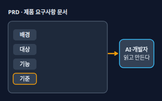</a> <b><a href="#prd--제품-요구사항-문서">PRD</a></b> 제품 요구사항 문서 무엇을, 왜, 누구를 위해, 어떤 기준으로 만들지 한곳에 적은 문서. 개발자와 AI가 같은 그림을 보고 일하게 해 준다. (Product Requirements Document)</td>
<td width="33%" valign="top"><a href="#user-story--사용자-이야기">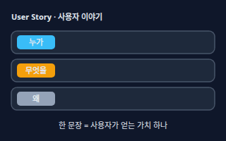</a> <b><a href="#user-story--사용자-이야기">User Story</a></b> 사용자 이야기 &quot;누가, 무엇을 하고 싶고, 왜 그런지&quot;를 한 문장으로 쓴 요구. 기능 이름이 아니라 사용자가 얻는 가치를 적는다.</td>
<td width="33%" valign="top"><a href="#acceptance-criteria--인수-조건">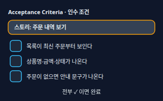</a> <b><a href="#acceptance-criteria--인수-조건">Acceptance Criteria</a></b> 인수 조건 기능이 제대로 완성됐는지 '예/아니오'로 확인할 수 있게 적은 조건 목록. 이 조건을 모두 만족하면 그 기능은 끝난 것으로 본다.</td>
</tr>
<tr>
<td width="33%" valign="top"><a href="#requirements--요구사항">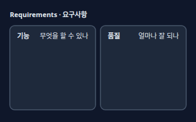</a> <b><a href="#requirements--요구사항">Requirements</a></b> 요구사항 제품이 해야 하는 일(기능 요구사항)과 얼마나 잘 해야 하는지(속도·보안·호환성 같은 품질, 비기능 요구사항)를 나눠 적은 항목.</td>
<td width="33%" valign="top"><a href="#definition-of-done--완료의-정의">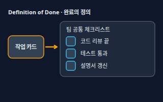</a> <b><a href="#definition-of-done--완료의-정의">Definition of Done</a></b> 완료의 정의 팀이 모든 작업에 똑같이 적용하는 &quot;여기까지 해야 끝났다&quot;는 공통 체크리스트. 스크럼에서 쓰는 말이다.</td>
</tr>
</table>

**우선순위 · Prioritization** (6)

<table>
<tr>
<td width="33%" valign="top"><a href="#mvp--최소-기능-제품">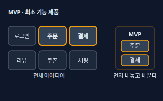</a> <b><a href="#mvp--최소-기능-제품">MVP</a></b> 최소 기능 제품 가장 핵심적인 가치만 담아 빨리 내놓고, 실제 반응으로 배우기 위한 최소한의 제품. 덜 만든 제품이 아니라 &quot;먼저 확인할 한 가지&quot;만 담은 제품이다. (Minimum Viable Product)</td>
<td width="33%" valign="top"><a href="#rice--우선순위-점수">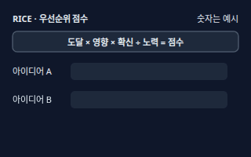</a> <b><a href="#rice--우선순위-점수">RICE</a></b> 우선순위 점수 도달(Reach)·영향(Impact)·확신(Confidence)·노력(Effort) 네 가지로 아이디어에 점수를 매기는 방법. 도달 × 영향 × 확신 ÷ 노력이 클수록 먼저 한다.</td>
<td width="33%" valign="top"><a href="#moscow--필수중요선택제외">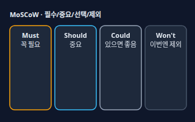</a> <b><a href="#moscow--필수중요선택제외">MoSCoW</a></b> 필수·중요·선택·제외 기능을 Must(꼭 필요), Should(중요), Could(있으면 좋음), Won't(이번엔 안 함) 네 칸으로 나누는 우선순위 방법.</td>
</tr>
<tr>
<td width="33%" valign="top"><a href="#roadmap--로드맵">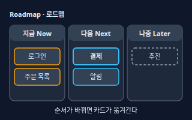</a> <b><a href="#roadmap--로드맵">Roadmap</a></b> 로드맵 제품이 앞으로 어떤 방향으로 어떤 순서로 나아갈지 큰 줄기를 보여주는 계획표. 날짜 약속보다 &quot;지금·다음·나중&quot;의 방향에 가깝다.</td>
<td width="33%" valign="top"><a href="#backlog--백로그">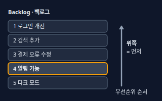</a> <b><a href="#backlog--백로그">Backlog</a></b> 백로그 앞으로 할 일(기능, 개선, 버그)을 우선순위 순서로 쌓아 둔 목록. 위쪽일수록 먼저 하고, 새 아이디어가 생기면 여기에 넣는다.</td>
<td width="33%" valign="top"><a href="#scope-creep--범위-확대">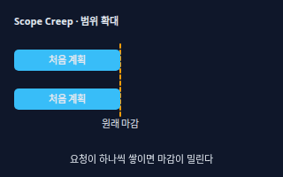</a> <b><a href="#scope-creep--범위-확대">Scope Creep</a></b> 범위 확대 처음 정한 범위 밖의 요청이 조금씩 계속 더해져 일정과 비용이 늘어나는 현상.</td>
</tr>
</table>

**실행 · Execution** (7)

<table>
<tr>
<td width="33%" valign="top"><a href="#sprint--스프린트">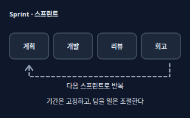</a> <b><a href="#sprint--스프린트">Sprint</a></b> 스프린트 정한 일을 짧고 고정된 기간 안에 끝내고 다음 주기로 넘어가는 반복 작업 단위. 스크럼에서는 한 달 이하로 잡는다. 기간은 고정하고 담는 일의 양을 조절한다.</td>
<td width="33%" valign="top"><a href="#kanban--칸반-보드">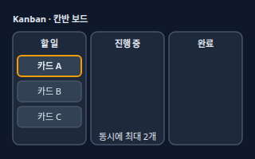</a> <b><a href="#kanban--칸반-보드">Kanban</a></b> 칸반 보드 할 일·진행 중·완료 칸 사이로 카드를 옮기며 일의 흐름을 눈으로 보는 방식. 진행 중 카드 수를 제한(WIP 제한)해서 한꺼번에 벌이지 않게 한다.</td>
<td width="33%" valign="top"><a href="#milestone--마일스톤">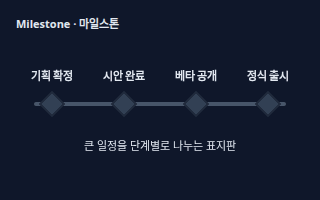</a> <b><a href="#milestone--마일스톤">Milestone</a></b> 마일스톤 프로젝트 중간의 중요한 도착 지점. &quot;시안 완료&quot;, &quot;베타 공개&quot;처럼 지났는지 아닌지가 분명한 표지판이다.</td>
</tr>
<tr>
<td width="33%" valign="top"><a href="#release--릴리스출시">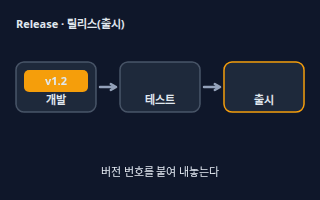</a> <b><a href="#release--릴리스출시">Release</a></b> 릴리스(출시) 만든 결과에 버전 번호를 붙이고 점검을 거쳐 실제 사용자에게 내놓는 일, 또는 그렇게 내놓은 버전.</td>
<td width="33%" valign="top"><a href="#qa--품질-검사">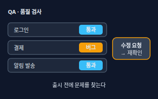</a> <b><a href="#qa--품질-검사">QA</a></b> 품질 검사 Quality Assurance. 출시 전에 제품이 요구한 대로 동작하는지 확인하고 버그를 찾는 품질 검사.</td>
<td width="33%" valign="top"><a href="#retrospective--회고">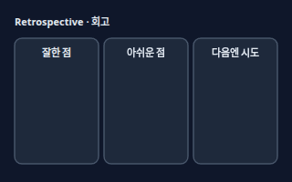</a> <b><a href="#retrospective--회고">Retrospective</a></b> 회고 한 주기(스프린트, 프로젝트)가 끝난 뒤 팀이 잘한 점, 아쉬운 점, 다음에 바꿀 점을 이야기하고 개선 한두 가지를 정하는 모임.</td>
</tr>
<tr>
<td width="33%" valign="top"><a href="#stakeholder--이해관계자">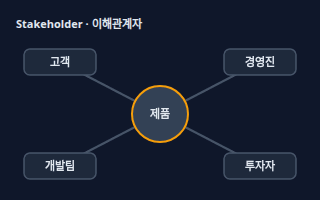</a> <b><a href="#stakeholder--이해관계자">Stakeholder</a></b> 이해관계자 제품이나 프로젝트에 영향을 주거나 영향을 받는 사람과 조직. 고객, 팀원, 경영진, 투자자, 규제 기관 등이 있다.</td>
</tr>
</table>

**지표 · Metrics** (5)

<table>
<tr>
<td width="33%" valign="top"><a href="#kpi--핵심-성과-지표">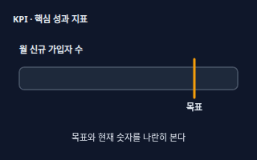</a> <b><a href="#kpi--핵심-성과-지표">KPI</a></b> 핵심 성과 지표 목표를 얼마나 이뤘는지 확인하려고 정해 둔 핵심 숫자. &quot;월 신규 가입자 100명&quot;처럼 무엇을, 얼마나, 언제까지가 들어간다. (Key Performance Indicator)</td>
<td width="33%" valign="top"><a href="#okr--목표와-핵심-결과">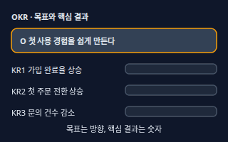</a> <b><a href="#okr--목표와-핵심-결과">OKR</a></b> 목표와 핵심 결과 Objective(이루고 싶은 방향)와 그 달성을 재는 Key Results(숫자로 측정되는 결과 몇 개)를 짝지어 세우는 목표 설정법. 보통 분기마다 새로 정한다.</td>
<td width="33%" valign="top"><a href="#north-star-metric--북극성-지표">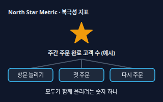</a> <b><a href="#north-star-metric--북극성-지표">North Star Metric</a></b> 북극성 지표 제품이 사용자에게 주는 핵심 가치를 가장 잘 보여주고, 팀 전체가 함께 올리려는 대표 지표 하나.</td>
</tr>
<tr>
<td width="33%" valign="top"><a href="#retention-rate--재방문율">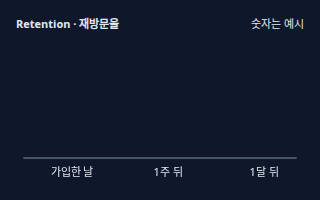</a> <b><a href="#retention-rate--재방문율">Retention Rate</a></b> 재방문율 가입하거나 처음 쓴 사람 중 일정 시간이 지난 뒤에도 다시 쓰는 사람의 비율. 가입자 100명 중 1주 뒤 40명이 다시 오면 40%.</td>
<td width="33%" valign="top"><b><a href="accounting.md#unit-economics--유닛-이코노믹스">Unit Economics</a></b> 유닛 이코노믹스 고객 한 명을 데려오는 비용(CAC)과 그 고객이 주는 이익(LTV)을 비교해 사업이 남는지 따지는 방식. → accounting 시트</td>
</tr>
</table>

<!-- overview:end -->

## 문서 · Documents

### PRD · 제품 요구사항 문서

- **정의**: 무엇을, 왜, 누구를 위해, 어떤 기준으로 만들지 한곳에 적은 문서. 개발자와 AI가 같은 그림을 보고 일하게 해 준다. (Product Requirements Document)
- **AI에게 이렇게**: "우리 앱의 PRD를 써줘. 배경, 대상 사용자, 핵심 기능, 이번에 제외할 것, 성공 기준 순서로 쓰고, 내가 말하지 않은 건 지어내지 말고 질문으로 남겨줘."
- **언제**: 개발을 시작하기 전, 외주나 AI에게 기능을 맡기기 전
- **헷갈림**: Requirements(요구사항) — 요구사항은 문서 안의 개별 항목이고, PRD는 그것을 배경·목표와 함께 묶은 문서 전체
- **관련**: User Story, Acceptance Criteria, Requirements, MVP, 와이어프레임
- **확인 질문**: 이 문서를 읽을 사람은 누구인가요(개발자, 디자이너, 투자자)? 이번 버전에서 일부러 제외할 것이 있나요?

### User Story · 사용자 이야기

- **정의**: "누가, 무엇을 하고 싶고, 왜 그런지"를 한 문장으로 쓴 요구. 기능 이름이 아니라 사용자가 얻는 가치를 적는다.
- **AI에게 이렇게**: "'쇼핑몰 손님으로서 주문 내역을 보고 싶다, 배송이 어디쯤인지 알고 싶기 때문에' 형식으로 주문 관련 유저 스토리를 5개 써줘."
- **언제**: 큰 기능을 잘게 쪼개 개발 순서를 정할 때
- **헷갈림**: Use Case(사용 사례) — 유저 스토리는 가치를 담은 짧은 한 문장이고, 상세한 동작과 예외는 인수 조건에 따로 적는다
- **관련**: Acceptance Criteria, Backlog, Persona(UX 시트), PRD
- **확인 질문**: 이 기능을 쓰는 사람은 누구인가요? 그 사람이 이 기능으로 얻고 싶은 것은 무엇인가요?

### Acceptance Criteria · 인수 조건

- **정의**: 기능이 제대로 완성됐는지 '예/아니오'로 확인할 수 있게 적은 조건 목록. 이 조건을 모두 만족하면 그 기능은 끝난 것으로 본다.
- **AI에게 이렇게**: "이 유저 스토리의 인수 조건을 '~하면 ~된다' 형식 체크리스트로 써줘. 주문이 없을 때와 오류가 날 때도 포함해줘."
- **언제**: 개발을 맡기기 전에 합의할 때, 결과물을 검수할 때
- **헷갈림**: Definition of Done — 인수 조건은 스토리마다 다른 기능별 조건이고, 완료의 정의는 모든 작업에 똑같이 쓰는 팀 공통 규칙
- **관련**: User Story, Definition of Done, QA
- **확인 질문**: '완료'를 눈으로 확인하는 방법은 무엇인가요? 오류가 나거나 데이터가 없을 때 화면은 어떻게 보여야 하나요?

### Requirements · 요구사항

- **정의**: 제품이 해야 하는 일(기능 요구사항)과 얼마나 잘 해야 하는지(속도·보안·호환성 같은 품질, 비기능 요구사항)를 나눠 적은 항목.
- **AI에게 이렇게**: "이 서비스의 기능 요구사항과 비기능 요구사항을 나눠서 표로 정리해줘. 속도, 보안, 모바일 지원 같은 품질 항목도 빠뜨리지 말고."
- **언제**: 견적을 받기 전, 개발 범위를 정하기 전
- **헷갈림**: 기능 vs 비기능 — "주문할 수 있다"는 기능이고 "2초 안에 열린다"는 품질이다. 비기능은 빼먹기 쉬워서 따로 묻는다
- **관련**: PRD, Acceptance Criteria, Scope Creep
- **확인 질문**: 동시에 몇 명쯤 쓰나요? 어떤 기기와 브라우저를 지원해야 하나요? 다루는 개인정보가 있나요?

### Definition of Done · 완료의 정의

- **정의**: 팀이 모든 작업에 똑같이 적용하는 "여기까지 해야 끝났다"는 공통 체크리스트. 스크럼에서 쓰는 말이다.
- **AI에게 이렇게**: "우리 팀의 완료의 정의를 만들어줘. 코드 리뷰, 테스트 통과, 설명서 갱신, 배포 확인을 포함해서 체크리스트로."
- **언제**: 팀이 일하는 방식을 처음 정할 때, "다 됐다"의 기준이 사람마다 다를 때
- **헷갈림**: Acceptance Criteria — 완료의 정의는 모든 작업에 공통, 인수 조건은 그 기능에만 해당
- **관련**: Acceptance Criteria, Sprint, QA
- **확인 질문**: 배포까지 해야 끝인가요, 리뷰 통과까지인가요? 테스트는 누가 하나요?

## 우선순위 · Prioritization

### MVP · 최소 기능 제품

- **정의**: 가장 핵심적인 가치만 담아 빨리 내놓고, 실제 반응으로 배우기 위한 최소한의 제품. 덜 만든 제품이 아니라 "먼저 확인할 한 가지"만 담은 제품이다. (Minimum Viable Product)
- **AI에게 이렇게**: "이 아이디어의 MVP 범위를 정해줘. 꼭 있어야 하는 기능 3개 이하만 남기고 나머지는 '다음 버전'으로 미루되, 이유를 한 줄씩 붙여줘."
- **언제**: 처음 출시할 때, 아이디어가 먹히는지 검증할 때
- **헷갈림**: Prototype(프로토타입, UX 시트) — 프로토타입은 눌러 보는 체험용 시제품이고, MVP는 실제 사용자가 실제로 쓰는 제품
- **관련**: Scope Creep, MoSCoW, Roadmap
- **확인 질문**: 이 제품이 풀려는 가장 큰 문제 하나는 무엇인가요? 첫 사용자는 누구이고, 무엇을 보면 "반응이 있다"고 판단할까요?

### RICE · 우선순위 점수

- **정의**: 도달(Reach)·영향(Impact)·확신(Confidence)·노력(Effort) 네 가지로 아이디어에 점수를 매기는 방법. 도달 × 영향 × 확신 ÷ 노력이 클수록 먼저 한다.
- **AI에게 이렇게**: "아래 기능 후보를 RICE로 점수 매겨서 표로 보여줘. 도달은 한 달 사용자 수, 영향은 3·2·1·0.5·0.25 중에서, 확신은 %, 노력은 사람-월로 추정하고 근거도 한 줄씩 적어줘."
- **언제**: 기능 후보가 많아서 무엇부터 할지 정해야 할 때
- **헷갈림**: MoSCoW — RICE는 점수로 줄을 세우고, MoSCoW는 필수·선택 상자로 나눈다
- **관련**: MoSCoW, Backlog, Roadmap
- **확인 질문**: 도달을 어떤 기간과 단위(월 사용자 수 등)로 셀까요? 노력은 사람-월로 잴까요, 일 수로 잴까요?
- **근거**: [Intercom — RICE: Simple prioritization for product managers](https://www.intercom.com/blog/rice-simple-prioritization-for-product-managers/)
- **검증일**: 2026-11-02

### MoSCoW · 필수·중요·선택·제외

- **정의**: 기능을 Must(꼭 필요), Should(중요), Could(있으면 좋음), Won't(이번엔 안 함) 네 칸으로 나누는 우선순위 방법.
- **AI에게 이렇게**: "이 기능 목록을 MoSCoW로 분류해줘. 출시일은 고정이니 Must는 정말 없으면 출시할 수 없는 것만 넣고, 각 분류의 이유를 한 줄씩 붙여줘."
- **언제**: 일정이 정해져 있어서 무엇을 뺄지 정해야 할 때, 이해관계자와 범위를 합의할 때
- **헷갈림**: RICE — MoSCoW는 상자에 나누는 방법이고, Won't는 "영원히 안 한다"가 아니라 "이번에는 안 한다"는 뜻
- **관련**: RICE, MVP, Scope Creep
- **확인 질문**: 출시 날짜와 인원은 고정인가요? 없으면 출시 자체가 불가능한 기능은 무엇인가요?

### Roadmap · 로드맵

- **정의**: 제품이 앞으로 어떤 방향으로 어떤 순서로 나아갈지 큰 줄기를 보여주는 계획표. 날짜 약속보다 "지금·다음·나중"의 방향에 가깝다.
- **AI에게 이렇게**: "앞으로 6개월 로드맵을 지금·다음·나중 세 칸으로 만들어줘. 각 항목에 해결하는 문제를 한 줄씩 적고, 날짜는 확정하지 말고 분기 단위로만 써줘."
- **언제**: 팀·투자자·고객에게 제품 방향을 보여줄 때
- **헷갈림**: Backlog — 로드맵은 위에서 내려다본 큰 방향 지도이고, 백로그는 해야 할 일을 모두 쌓아 둔 상세 목록
- **관련**: Backlog, Milestone, MVP
- **확인 질문**: 이 로드맵을 볼 사람은 누구인가요(내부 팀, 투자자, 고객)? 날짜를 약속해도 되나요?

### Backlog · 백로그

- **정의**: 앞으로 할 일(기능, 개선, 버그)을 우선순위 순서로 쌓아 둔 목록. 위쪽일수록 먼저 하고, 새 아이디어가 생기면 여기에 넣는다.
- **AI에게 이렇게**: "이 요청 목록을 백로그 형식으로 정리해줘. 제목, 설명, 우선순위(높음/중간/낮음), 예상 크기 열을 두고 우선순위 순서로 정렬해줘."
- **언제**: 스프린트에서 다음에 할 일을 고를 때, 쏟아지는 요청을 한곳에 모을 때
- **헷갈림**: Roadmap(방향 지도), To-do(단순 할 일 목록) — 백로그는 순서와 크기를 매겨 계속 다듬는 목록
- **관련**: Sprint, User Story, RICE
- **확인 질문**: 우선순위는 누가 최종으로 정하나요? 이미 진행 중인 일과 새 요청은 어떻게 구분할까요?

### Scope Creep · 범위 확대

- **정의**: 처음 정한 범위 밖의 요청이 조금씩 계속 더해져 일정과 비용이 늘어나는 현상.
- **AI에게 이렇게**: "지금 요청이 처음 합의한 범위 안인지 밖인지 판단해줘. 밖이라면 추가될 작업량과 일정 영향, 다음 버전으로 미루는 안도 같이 알려줘."
- **언제**: 개발 중에 "이것도 넣어주세요"가 나올 때
- **헷갈림**: 변경 요청 — 변경 요청은 범위 변경을 공식으로 합의하는 절차이고, 스코프 크립은 합의 없이 슬그머니 늘어나는 것
- **관련**: MVP, MoSCoW, Backlog, Requirements
- **확인 질문**: 처음 합의한 범위 문서는 어디 있나요? 추가하면 무엇을 빼거나 마감을 미룰 수 있나요?

## 실행 · Execution

### Sprint · 스프린트

- **정의**: 정한 일을 짧고 고정된 기간 안에 끝내고 다음 주기로 넘어가는 반복 작업 단위. 스크럼에서는 한 달 이하로 잡는다. 기간은 고정하고 담는 일의 양을 조절한다.
- **AI에게 이렇게**: "2주 스프린트 계획을 세워줘. 백로그 위쪽 항목 중 팀 3명이 할 수 있는 양만 골라서 스프린트 목표 한 줄과 함께 알려줘."
- **언제**: 정기적으로 결과를 내고 점검하며 일할 때
- **헷갈림**: Milestone — 스프린트는 반복되는 기간이고, 마일스톤은 한 번 도착하는 지점
- **관련**: Backlog, Retrospective, Kanban, Definition of Done
- **확인 질문**: 한 스프린트를 며칠로 할까요? 팀 인원과 휴가 일정은 어떻게 되나요?
- **근거**: [The Scrum Guide — The Sprint](https://www.scrumguides.org/scrum-guide.html)
- **검증일**: 2026-11-02

### Kanban · 칸반 보드

- **정의**: 할 일·진행 중·완료 칸 사이로 카드를 옮기며 일의 흐름을 눈으로 보는 방식. 진행 중 카드 수를 제한(WIP 제한)해서 한꺼번에 벌이지 않게 한다.
- **AI에게 이렇게**: "칸반 보드를 표로 만들어줘. 칸은 할 일, 진행 중(최대 3개), 리뷰, 완료로 하고 지금 작업 목록을 알맞은 칸에 넣어줘."
- **언제**: 요청이 수시로 들어오는 운영·유지보수 일, 어디서 일이 막히는지 볼 때
- **헷갈림**: Sprint — 칸반은 기간을 끊지 않고 계속 흐르는 방식이고, 스프린트는 기간을 정해 반복하는 방식
- **관련**: Sprint, Backlog
- **확인 질문**: 진행 중에 둘 수 있는 카드는 몇 개까지인가요? 리뷰나 테스트 같은 칸이 더 필요한가요?

### Milestone · 마일스톤

- **정의**: 프로젝트 중간의 중요한 도착 지점. "시안 완료", "베타 공개"처럼 지났는지 아닌지가 분명한 표지판이다.
- **AI에게 이렇게**: "앱 출시까지 마일스톤을 4~5개로 나눠줘. 각 마일스톤마다 "끝났다"고 말할 수 있는 기준과 예상 시기를 적어줘."
- **언제**: 긴 프로젝트의 진행도를 보고할 때, 검수와 대금 지급 단계를 나눌 때
- **헷갈림**: Release — 마일스톤은 일정표 위의 표시이고, 릴리스는 사용자에게 실제로 내놓는 행동
- **관련**: Roadmap, Release, Sprint
- **확인 질문**: 마일스톤마다 검수나 대금 지급이 걸려 있나요? 날짜가 고정된 마일스톤이 있나요?

### Release · 릴리스(출시)

- **정의**: 만든 결과에 버전 번호를 붙이고 점검을 거쳐 실제 사용자에게 내놓는 일, 또는 그렇게 내놓은 버전.
- **AI에게 이렇게**: "v1.2 릴리스 노트를 써줘. 새 기능, 개선, 고친 버그로 나누고 사용자가 이해할 말로 적어줘. 출시 전 확인 체크리스트도 같이 줘."
- **언제**: 앱스토어 심사 제출, 웹 서비스 새 버전 공개
- **헷갈림**: Deployment(배포, 백엔드 시트) — 릴리스는 사용자에게 공개하는 결정과 버전이고, 배포는 서버에 코드를 올리는 기술 작업
- **관련**: QA, Milestone, Definition of Done
- **확인 질문**: 모든 사용자에게 한꺼번에 공개할까요, 일부에게 먼저 보여줄까요? 문제가 생기면 되돌릴 방법이 있나요?

### QA · 품질 검사

- **정의**: Quality Assurance. 출시 전에 제품이 요구한 대로 동작하는지 확인하고 버그를 찾는 품질 검사.
- **AI에게 이렇게**: "이 인수 조건으로 QA 테스트 케이스를 써줘. 각 케이스에 순서, 기대 결과, 통과/실패 칸을 넣고 오류 상황도 포함해줘."
- **언제**: 기능이 완성된 뒤, 릴리스 직전
- **헷갈림**: Usability Test(사용성 테스트, UX 시트) — QA는 "정해진 대로 동작하나"를 보고, 사용성 테스트는 "사람이 쉽게 쓰나"를 본다
- **관련**: Acceptance Criteria, Release, Definition of Done
- **확인 질문**: 어떤 기기와 브라우저에서 확인할까요? 결제처럼 반드시 통과해야 하는 흐름은 무엇인가요?

### Retrospective · 회고

- **정의**: 한 주기(스프린트, 프로젝트)가 끝난 뒤 팀이 잘한 점, 아쉬운 점, 다음에 바꿀 점을 이야기하고 개선 한두 가지를 정하는 모임.
- **AI에게 이렇게**: "이번 스프린트 회고 진행표를 만들어줘. 잘한 점·아쉬운 점·시도할 점 세 칸의 질문과, 마지막에 다음 스프린트에 실천할 개선 2가지를 고르는 순서로."
- **언제**: 스프린트나 프로젝트가 끝난 직후
- **헷갈림**: Sprint Review(스프린트 리뷰) — 리뷰는 만든 결과를 보여주고 의견을 듣는 자리이고, 회고는 일하는 방식을 돌아보는 자리
- **관련**: Sprint, Stakeholder
- **확인 질문**: 참석자는 누구인가요? 지난 회고에서 정한 개선은 실천했나요?

### Stakeholder · 이해관계자

- **정의**: 제품이나 프로젝트에 영향을 주거나 영향을 받는 사람과 조직. 고객, 팀원, 경영진, 투자자, 규제 기관 등이 있다.
- **AI에게 이렇게**: "이 프로젝트의 이해관계자를 표로 정리해줘. 각자 원하는 것, 영향력(높음/낮음), 얼마나 자주 보고할지를 같이 적어줘."
- **언제**: 프로젝트를 시작할 때, 요구가 서로 부딪힐 때
- **헷갈림**: User(사용자) — 사용자는 제품을 쓰는 사람이고, 이해관계자는 쓰지 않아도 결과에 영향을 받거나 결정권이 있는 사람까지 포함
- **관련**: PRD, Scope Creep, Roadmap
- **확인 질문**: 최종 결정을 내리는 사람은 누구인가요? 의견이 부딪히면 누구 의견을 따르나요?

## 지표 · Metrics

### KPI · 핵심 성과 지표

- **정의**: 목표를 얼마나 이뤘는지 확인하려고 정해 둔 핵심 숫자. "월 신규 가입자 100명"처럼 무엇을, 얼마나, 언제까지가 들어간다. (Key Performance Indicator)
- **AI에게 이렇게**: "이 서비스의 KPI를 3개만 제안해줘. 각 KPI마다 측정 방법, 목표값, 확인 주기를 적고 왜 이 숫자가 중요한지도 설명해줘."
- **언제**: 성과를 정기적으로 점검하고 보고할 때
- **헷갈림**: OKR — KPI는 계속 지켜보는 건강 지표이고, OKR은 이번 분기에 도전할 목표와 결과
- **관련**: OKR, North Star Metric, Retention Rate
- **확인 질문**: 이 숫자는 어디서 자동으로 뽑을 수 있나요? 얼마 동안 어느 값이면 성공인가요?

### OKR · 목표와 핵심 결과

- **정의**: Objective(이루고 싶은 방향)와 그 달성을 재는 Key Results(숫자로 측정되는 결과 몇 개)를 짝지어 세우는 목표 설정법. 보통 분기마다 새로 정한다.
- **AI에게 이렇게**: "'첫 사용 경험을 쉽게 만든다'를 목표(O)로 OKR을 써줘. 핵심 결과(KR)는 숫자로 측정할 수 있게 3개, 현재 값과 목표 값을 함께 적어줘."
- **언제**: 분기나 반기 목표를 팀 전체가 맞출 때
- **헷갈림**: KPI — OKR은 도전할 방향과 결과를 정하는 틀이고, KPI는 평소에 계속 보는 숫자
- **관련**: KPI, North Star Metric, Roadmap
- **확인 질문**: 이번 분기에 가장 중요한 방향은 무엇인가요? 현재 값을 이미 알고 있는 숫자는 무엇인가요?

### North Star Metric · 북극성 지표

- **정의**: 제품이 사용자에게 주는 핵심 가치를 가장 잘 보여주고, 팀 전체가 함께 올리려는 대표 지표 하나.
- **AI에게 이렇게**: "우리 서비스의 북극성 지표 후보를 3개 제안해줘. 각각 사용자가 얻는 가치와 매출에 얼마나 이어지는지 비교해줘."
- **언제**: 여러 팀의 방향을 하나로 모을 때
- **헷갈림**: 매출 — 매출은 결과이고, 북극성 지표는 사용자가 가치를 얻은 횟수처럼 그 원인에 가까운 숫자
- **관련**: KPI, OKR, Retention Rate
- **확인 질문**: 사용자가 "이 제품을 쓰길 잘했다"고 느끼는 순간은 언제인가요? 그 순간을 셀 수 있나요?

### Retention Rate · 재방문율

- **정의**: 가입하거나 처음 쓴 사람 중 일정 시간이 지난 뒤에도 다시 쓰는 사람의 비율. 가입자 100명 중 1주 뒤 40명이 다시 오면 40%.
- **AI에게 이렇게**: "가입 주별로 1주 뒤, 4주 뒤 재방문율을 계산하는 표 양식을 만들어줘. '다시 썼다'는 로그인 기준으로 잡아줘."
- **언제**: 서비스를 쓰다가 떠나는지 확인할 때
- **헷갈림**: Conversion Rate(전환율, 마케팅 시트) — 전환율은 원하는 행동을 한 비율이고, 재방문율은 다시 돌아온 비율
- **관련**: KPI, North Star Metric
- **확인 질문**: '다시 썼다'는 무엇을 기준으로 할까요(로그인, 주문 등)? 가입 날짜별로 묶어서 볼까요?

### Unit Economics · 유닛 이코노믹스

- **정의**: 고객 한 명을 데려오는 비용(CAC)과 그 고객이 주는 이익(LTV)을 비교해 사업이 남는지 따지는 방식.
- **원본**: [회계 · Unit Economics](accounting.md#unit-economics--유닛-이코노믹스)

## 참고 자료

- [The Scrum Guide (scrumguides.org)](https://www.scrumguides.org/scrum-guide.html)
- [Intercom — RICE: Simple prioritization for product managers](https://www.intercom.com/blog/rice-simple-prioritization-for-product-managers/)
- [Atlassian — Kanban](https://www.atlassian.com/agile/kanban)
- [Atlassian — Product requirements document (PRD)](https://www.atlassian.com/agile/product-management/requirements)
- [Scrum.org — The Scrum Guide](https://www.scrum.org/resources/scrum-guide)
- [Google re:Work — Set goals with OKRs](https://rework.withgoogle.com/intl/en/guides/set-goals-with-okrs)
- [Amplitude — North Star Playbook](https://amplitude.com/books/north-star/about-the-north-star-framework)
