# 부동산 치트시트

> 처음 집을 구하는 세입자와 처음 집을 사는 사람이 계약서·등기부·세금 이야기에서 길을 잃지 않도록, 꼭 알아야 할 말부터 정리한 시트입니다. 계산하는 법보다 "이 말이 무슨 뜻이고 어디서 확인하는지"를 먼저 맞춥니다.

> ⚠️ **참고용이며 투자 권유가 아닙니다.** 대한민국 기준, 2026-11 기준입니다. 제도·세율·한도는 바뀔 수 있으니 실제 판단은 공인중개사·세무사·변호사 등 전문가와 확인하세요.

## 이렇게 쓰세요

- **나 → AI**: "전세 2억 원짜리 빌라를 계약하려고 해. 등기부등본과 건축물대장 내용을 붙여넣을 테니 근저당, 압류, 위반건축물 같은 위험 신호를 찾아서 계약해도 되는지 체크리스트로 정리해줘."
- **AI → 나**: "집 시세(최근 실거래가)와 등기부 을구의 근저당 채권최고액, 다른 세입자 보증금이 얼마인지부터 알려주세요. 보증금과 앞선 대출 합계가 시세에 얼마나 가까운지로 깡통전세 위험을 가늠할 수 있어요."
- **나 → AI**: "계약 만료가 5개월 남았는데 집주인이 월세를 올리겠대. 계약갱신요구권을 언제까지 어떤 방식으로 쓸 수 있고, 올릴 수 있는 한도가 얼마인지 날짜 기준으로 알려줘."
- **AI → 나**: "계약서상 만료일, 지금까지 갱신요구권을 쓴 적이 있는지, 집주인이 실거주를 이유로 거절했는지 알려주세요. 이건 일반 설명이고 분쟁이 되면 변호사나 주택임대차분쟁조정위원회와 확인하세요."
- **나 → AI**: "처음 집을 사려는데 계약금·잔금 일정, LTV, 취득세를 한 장의 타임라인으로 정리하고, 내가 더 알려줘야 할 정보를 질문해줘."

## 한눈에 보기

<!-- overview:start -->
<!-- 이 구역은 자동 생성됩니다. 직접 고치지 말고 `cd mcp-server && npm run generate`를 실행하세요. -->

**임대차 · Lease** (7)

<table>
<tr>
<td width="33%" valign="top"><a href="#jeonse--전세">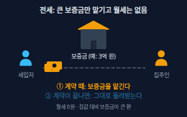</a> <b><a href="#jeonse--전세">Jeonse</a></b> 전세 월세 없이 큰 보증금만 집주인에게 맡기고 살다가, 계약이 끝나면 보증금을 돌려받는 한국식 임대 방식. 등기하지 않은 전세계약에도 주택임대차보호법이 적용되고, 기간을 정하지 않았거나 2년 미만이면 2년으로 본다.</td>
<td width="33%" valign="top"><a href="#monthly-rent--월세">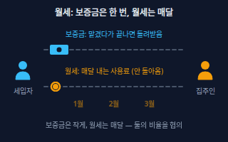</a> <b><a href="#monthly-rent--월세">Monthly Rent</a></b> 월세 보증금을 맡기고 매달 집 사용료(차임)를 내는 방식. 보증금이 작을수록 월세가 커지는 식으로 둘을 맞바꾼다.</td>
<td width="33%" valign="top"><a href="#deposit--보증금">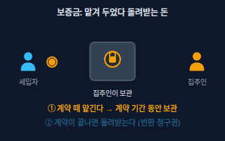</a> <b><a href="#deposit--보증금">Deposit</a></b> 보증금 집을 빌리는 동안 집주인에게 맡겨 두는 돈. 임대차가 끝나면 돌려받는 돈이고, 계약 기간이 끝나도 보증금을 돌려받을 때까지는 임대차 관계가 이어지는 것으로 본다.</td>
</tr>
<tr>
<td width="33%" valign="top"><a href="#renewal-right--계약갱신요구권">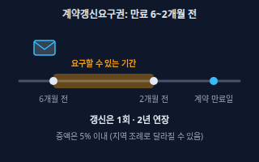</a> <b><a href="#renewal-right--계약갱신요구권">Renewal Right</a></b> 계약갱신요구권 계약이 끝나기 6개월 전부터 2개월 전까지 세입자가 갱신을 요구하면 집주인이 정당한 사유 없이 거절하지 못하는 권리. 1회만 쓸 수 있고 갱신되면 2년으로 보며, 올릴 수 있는 보증금·월세는 5%(20분의 1) 이내다.</td>
<td width="33%" valign="top"><a href="#rent-conversion--전월세-전환">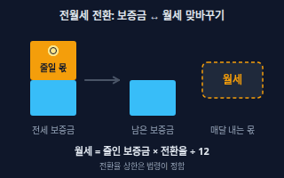</a> <b><a href="#rent-conversion--전월세-전환">Rent Conversion</a></b> 전월세 전환 보증금의 일부를 월세로 바꾸는 것. 이때 월세는 바꾸는 금액에 '연 10%'와 '한국은행 기준금리 + 연 2%' 중 낮은 비율을 곱한 값을 넘을 수 없고, 월세 = 줄인 보증금 × 전환율 ÷ 12 로 계산한다.</td>
<td width="33%" valign="top"><a href="#rental-report--임대차-신고">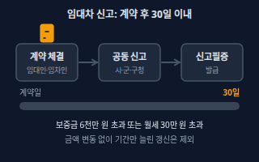</a> <b><a href="#rental-report--임대차-신고">Rental Report</a></b> 임대차 신고 주택 임대차 계약을 맺은 날부터 30일 이내에 임대인·임차인이 보증금·월세 같은 계약 내용을 시·군·구에 함께 신고하는 제도. 보증금이 6천만 원을 넘거나 월세가 30만 원을 넘는 계약이 대상이다.</td>
</tr>
<tr>
<td width="33%" valign="top"><b><a href="law.md#certified-mail--내용증명">Certified Mail</a></b> 내용증명 누가 누구에게 어떤 내용을 언제 보냈는지 우체국이 증명해 주는 우편. 계약 갱신 통지나 보증금 반환 요구처럼 나중에 증거가 필요한 연락에 쓴다. → law 시트</td>
</tr>
</table>

**보증금 지키기 · Deposit Protection** (7)

<table>
<tr>
<td width="33%" valign="top"><a href="#move-in-report--전입신고와-대항력">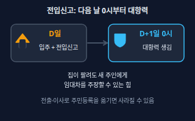</a> <b><a href="#move-in-report--전입신고와-대항력">Move-in Report</a></b> 전입신고와 대항력 이사한 집으로 주민등록 주소를 옮기는 신고. 집에 입주(인도)하고 전입신고까지 마치면 그 다음 날부터 대항력, 곧 집이 팔려도 새 주인에게 임대차를 주장하고 보증금을 받을 때까지 버틸 수 있는 힘이 생긴다.</td>
<td width="33%" valign="top"><a href="#fixed-date--확정일자">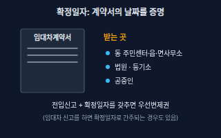</a> <b><a href="#fixed-date--확정일자">Fixed Date</a></b> 확정일자 임대차계약서에 받는 공식 날짜 도장. 그 날짜에 계약서가 있었다는 것을 증명하고, 입주·전입신고(대항요건)와 함께 갖추면 우선변제권이 생긴다. 읍·면사무소·동 주민센터, 법원·등기소, 공증인이 부여한다.</td>
<td width="33%" valign="top"><a href="#priority-repayment--우선변제권">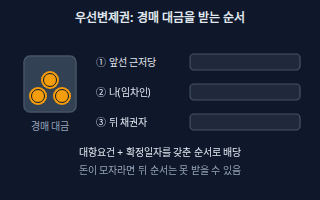</a> <b><a href="#priority-repayment--우선변제권">Priority Repayment</a></b> 우선변제권 집이 경매나 공매로 팔릴 때, 매각 대금에서 후순위 권리자나 다른 채권자보다 먼저 보증금을 받을 수 있는 권리. 대항요건(입주 + 전입신고)과 확정일자를 갖춰야 생기고, 순서는 근저당 같은 다른 권리와 갖춘 선후로 정해진다.</td>
</tr>
<tr>
<td width="33%" valign="top"><a href="#small-deposit-priority--최우선변제">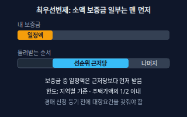</a> <b><a href="#small-deposit-priority--최우선변제">Small Deposit Priority</a></b> 최우선변제 보증금이 소액인 세입자가 경매 신청 등기 전에 입주·전입신고를 마쳤다면, 보증금 중 일정액을 근저당 같은 담보권자보다도 먼저 돌려받는 제도. 소액 기준과 보호 금액은 지역별로 시행령에 표로 정해져 있고, 보호 금액은 주택가액의 1/2을 넘지 못한다.</td>
<td width="33%" valign="top"><a href="#deposit-return-guarantee--전세보증금반환보증">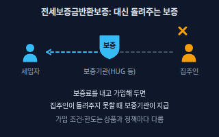</a> <b><a href="#deposit-return-guarantee--전세보증금반환보증">Deposit Return Guarantee</a></b> 전세보증금반환보증 계약이 끝났는데 집주인이 보증금을 돌려주지 못할 때 주택도시보증공사(HUG) 같은 보증기관이 세입자에게 대신 지급하는 보증상품. 세입자가 보증료를 내고 가입하며, 가입 가능한 주택·보증 한도·신청 기한은 상품과 정책에 따라 바뀐다.</td>
<td width="33%" valign="top"><a href="#lease-registration-order--임차권등기명령">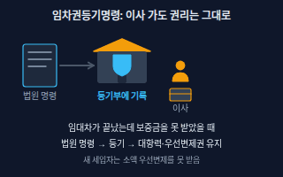</a> <b><a href="#lease-registration-order--임차권등기명령">Lease Registration Order</a></b> 임차권등기명령 임대차가 끝났는데 보증금을 못 돌려받았을 때 세입자가 법원에 신청해서 임차권을 등기부에 올리는 제도. 등기를 마치면 이사를 가도 이미 갖춘 대항력과 우선변제권이 유지되고, 비용은 임대인에게 청구할 수 있다.</td>
</tr>
<tr>
<td width="33%" valign="top"><a href="#underwater-jeonse--깡통전세">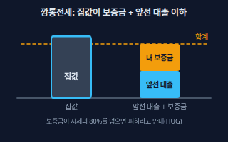</a> <b><a href="#underwater-jeonse--깡통전세">Underwater Jeonse</a></b> 깡통전세 전세 보증금(과 집에 이미 있는 대출)의 합이 집 시세에 가깝거나 넘어서, 집이 팔려도 보증금을 다 못 돌려받을 수 있는 전세. 집값이 조금만 내려가도 위험하다. HUG는 보증금이 시세의 80%를 넘으면 피하는 게 좋다고 안내한다.</td>
</tr>
</table>

**서류·권리 · Documents** (8)

<table>
<tr>
<td width="33%" valign="top"><a href="#property-register--등기부등본">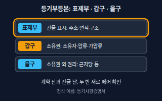</a> <b><a href="#property-register--등기부등본">Property Register</a></b> 등기부등본 부동산의 표시(표제부), 소유권 정보(갑구: 소유자·압류·가압류), 소유권 외 권리(을구: 근저당 등)가 기록된 공적 장부. 정식 이름은 '등기사항증명서'이고, 인터넷등기소에서 365일 24시간 열람할 수 있다.</td>
<td width="33%" valign="top"><a href="#collateral-mortgage--근저당">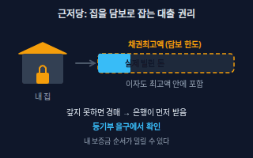</a> <b><a href="#collateral-mortgage--근저당">Collateral Mortgage</a></b> 근저당 대출을 받을 때 은행 등이 집을 담보로 잡으면서, 빌린 돈이 늘고 줄어도 '채권최고액'이라는 한도까지 담보하는 권리. 갚지 못하면 경매에서 다른 채권자보다 먼저 돈을 받고, 이자도 채권최고액 안에 들어간다.</td>
<td width="33%" valign="top"><b><a href="law.md#provisional-attachment--가압류">Provisional Attachment</a></b> 가압류 돈을 받을 사람이 재판 결과가 나오기 전에 상대방 재산을 마음대로 처분하지 못하게 법원을 통해 묶어 두는 절차. 등기부 갑구에서 확인한다. → law 시트</td>
</tr>
<tr>
<td width="33%" valign="top"><a href="#building-register--건축물대장">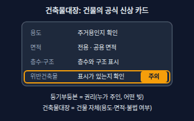</a> <b><a href="#building-register--건축물대장">Building Register</a></b> 건축물대장 건물의 용도·면적·층수·구조 같은 현황과 소유 정보를 시·군·구가 적어 두는 공적 장부. 위반건축물 표시가 있으면 불법으로 늘리거나 용도를 바꾼 건물일 수 있고, 정부24에서 인터넷으로 발급받는다.</td>
<td width="33%" valign="top"><b><a href="construction.md#exclusive-area--전용면적">Exclusive Area</a></b> 전용면적 내 집 문 안쪽에서 실제로 쓰는 바닥 면적. 임대차·매매·청약에서 면적을 비교할 때 기준으로 삼는다. → construction 시트</td>
<td width="33%" valign="top"><b><a href="construction.md#supply-area--공급면적">Supply Area</a></b> 공급면적 전용면적에 복도·계단 같은 공용 면적 일부를 더한 면적. 분양 광고의 '몇 평형'은 보통 이 면적이다. → construction 시트</td>
</tr>
<tr>
<td width="33%" valign="top"><a href="#official-price--공시가격">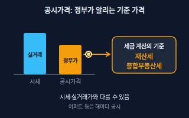</a> <b><a href="#official-price--공시가격">Official Price</a></b> 공시가격 국토교통부(단독주택 개별가격은 시·군·구)가 해마다 조사·공시하는 부동산 가격. 아파트 같은 공동주택은 공동주택가격이라고 하며, 시세와 같지 않을 수 있고 재산세·종합부동산세의 계산 기준으로 쓰인다.</td>
<td width="33%" valign="top"><a href="#brokerage-fee--중개보수">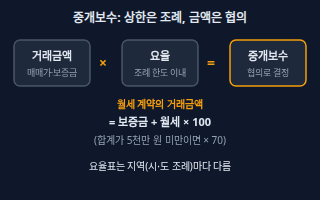</a> <b><a href="#brokerage-fee--중개보수">Brokerage Fee</a></b> 중개보수 공인중개사에게 계약을 중개해 준 대가로 내는 돈(흔히 '복비'). 주택은 시·도 조례가 정한 요율 한도 안에서 중개의뢰인과 개업공인중개사가 협의해 정하고, 월세가 있으면 거래금액을 보증금 + 월세 × 100 으로 계산한다(합계가 5천만 원 미만이면 월세 × 70).</td>
</tr>
</table>

**매매·대출 · Buying** (4)

<table>
<tr>
<td width="33%" valign="top"><a href="#subscription--청약">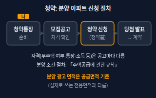</a> <b><a href="#subscription--청약">Subscription</a></b> 청약 새로 짓는 분양 아파트 등에 '입주할 사람으로 뽑아 달라'고 신청하는 것. 청약통장을 준비하고 입주자모집공고를 읽은 뒤 청약홈에서 신청하고, 당첨되면 계약한다. 공급 조건·방법·절차는 「주택공급에 관한 규칙」이 정한다.</td>
<td width="33%" valign="top"><a href="#ltv--담보인정비율">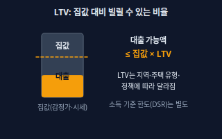</a> <b><a href="#ltv--담보인정비율">LTV</a></b> 담보인정비율 Loan To Value. 집의 가치 대비 빌릴 수 있는 대출의 비율로, 대출 가능액은 '집값 × LTV'를 넘지 못한다. 비율은 지역(규제지역 여부)·주택 유형·정책에 따라 달라지고 자주 바뀐다.</td>
<td width="33%" valign="top"><a href="#down-payment--balance--계약금잔금">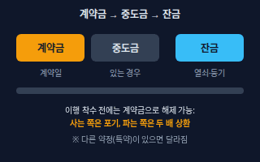</a> <b><a href="#down-payment--balance--계약금잔금">Down Payment &amp; Balance</a></b> 계약금·잔금 매매 대금을 나눠 내는 순서. 계약금은 계약 때, 중도금은 필요하면 중간에, 잔금은 마지막에 내며 잔금날 열쇠를 받고 소유권이전등기를 한다. 계약금을 주고받았다면 다른 약정이 없는 한 한쪽이 이행에 착수하기 전까지 사는 쪽은 포기하고, 파는 쪽은 두 배를 돌려주고 계약을 해제할 수 있다.</td>
</tr>
<tr>
<td width="33%" valign="top"><a href="#asking-vs-transaction-price--호가와-실거래가">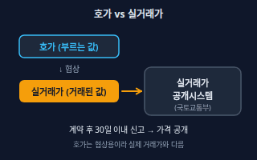</a> <b><a href="#asking-vs-transaction-price--호가와-실거래가">Asking vs Transaction Price</a></b> 호가와 실거래가 호가는 파는 사람이 '이 값에 팔겠다'고 부르는 값이고, 실거래가는 실제로 거래가 이뤄져 신고된 가격. 부동산 매매계약은 계약일부터 30일 이내에 신고해야 하고, 신고된 가격은 국토교통부 실거래가 공개시스템에서 볼 수 있다.</td>
</tr>
</table>

**세금 · Taxes** (5)

<table>
<tr>
<td width="33%" valign="top"><a href="#acquisition-tax--취득세">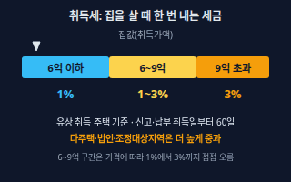</a> <b><a href="#acquisition-tax--취득세">Acquisition Tax</a></b> 취득세 부동산을 사거나 상속·증여받는 등 취득할 때 한 번 내는 지방세. 유상으로 주택을 살 때의 기본 세율은 취득가액 6억 원 이하 1%, 9억 원 초과 3%, 그 사이는 가격에 따라 1~3% 사이의 계산식이며, 취득일부터 60일 이내 신고·납부한다.</td>
<td width="33%" valign="top"><a href="#property-tax--재산세">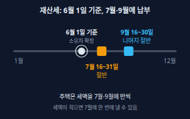</a> <b><a href="#property-tax--재산세">Property Tax</a></b> 재산세 6월 1일 현재 부동산(주택·토지·건축물)을 실제로 가진 사람에게 해마다 매기는 지방세. 주택은 세액의 절반을 7월 16~31일, 나머지 절반을 9월 16~30일에 내고, 세액이 20만 원 이하면 7월에 한 번에 내도록 할 수 있다.</td>
<td width="33%" valign="top"><a href="#comprehensive-real-estate-tax--종합부동산세">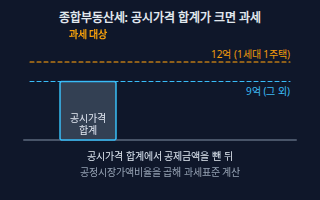</a> <b><a href="#comprehensive-real-estate-tax--종합부동산세">Comprehensive Real Estate Tax</a></b> 종합부동산세 6월 1일 현재 가진 주택의 공시가격을 사람별로 합쳐 공제금액(일반 9억 원, 1세대 1주택자 12억 원)을 넘으면 그 초과분에 공정시장가액비율을 곱해 과세표준을 구하는 국세. 재산세와 별도로 12월 1~15일에 낸다.</td>
</tr>
<tr>
<td width="33%" valign="top"><a href="#capital-gains-tax--양도소득세">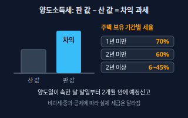</a> <b><a href="#capital-gains-tax--양도소득세">Capital Gains Tax</a></b> 양도소득세 집·땅을 팔아서 생긴 이익(양도차익)에 매기는 소득세. 주택은 1년 미만 보유 70%, 1년 이상 2년 미만 60%, 2년 이상은 기본세율(6~45%)이며, 양도일이 속한 달의 말일부터 2개월 이내 예정신고, 다음 해 5월에 확정신고를 한다.</td>
<td width="33%" valign="top"> <b><a href="#one-household-one-home-exemption--1세대-1주택-비과세">One-Household One-Home Exemption</a></b> 1세대 1주택 비과세 1세대가 국내에 주택 1채만 갖고 있다가 팔 때, 보유 기간 2년 이상(취득 당시 조정대상지역이면 보유 중 거주 2년 이상도 필요) 등 요건을 채우면 양도소득세를 내지 않는 제도. 양도가액이 12억 원을 넘는 고가주택은 비과세 대상에서 빠진다.</td>
</tr>
</table>

<!-- overview:end -->

## 임대차 · Lease

### Jeonse · 전세

- **정의**: 월세 없이 큰 보증금만 집주인에게 맡기고 살다가, 계약이 끝나면 보증금을 돌려받는 한국식 임대 방식. 등기하지 않은 전세계약에도 주택임대차보호법이 적용되고, 기간을 정하지 않았거나 2년 미만이면 2년으로 본다.
- **AI에게 이렇게**: "전세 보증금 2억 원 빌라를 보고 있어. 계약 전에 내가 확인할 서류와 위험 신호를 순서대로 체크리스트로 만들어줘."
- **언제**: 보증금이 큰 집을 구할 때, 전세와 월세를 비교할 때
- **헷갈림**: 월세 — 월세는 매달 쓰고 사라지는 돈이 나가고, 전세는 큰 돈을 맡겨 두었다가 돌려받는다. 대신 돌려받지 못할 위험(깡통전세, 보증금 미반환)이 커진다
- **관련**: Monthly Rent, Deposit, Underwater Jeonse, Deposit Return Guarantee
- **확인 질문**: 보증금과 집의 최근 매매 시세는 얼마인가요? 등기부에 이미 대출(근저당)이 있나요? 계약 기간과 입주일은 언제인가요?
- **근거**: [주택임대차보호법 제4조](https://www.law.go.kr/법령/주택임대차보호법/제4조), [주택임대차보호법 제12조](https://www.law.go.kr/법령/주택임대차보호법/제12조)
- **검증일**: 2026-11-02

### Monthly Rent · 월세

- **정의**: 보증금을 맡기고 매달 집 사용료(차임)를 내는 방식. 보증금이 작을수록 월세가 커지는 식으로 둘을 맞바꾼다.
- **AI에게 이렇게**: "보증금 1,000만 원에 월세 50만 원인 방이야. 같은 집이 보증금 5,000만 원이면 월세를 얼마까지 낮춰 달라고 할 수 있는지 법으로 정한 상한 기준으로 계산해줘."
- **언제**: 목돈이 적을 때, 계약 기간이 짧거나 이사 가능성이 클 때
- **헷갈림**: 관리비 — 월세는 집 사용료이고 관리비(전기·수도·공용 시설)는 따로 내는 경우가 많다. 월세 두 번 치 이상 밀리면 계약갱신 요구가 거절될 수 있다
- **관련**: Deposit, Rent Conversion, Renewal Right, Jeonse
- **확인 질문**: 월세 납부일과 계좌는 어떻게 되나요? 관리비는 월세에 포함인가요, 별도인가요?
- **근거**: [주택임대차보호법 제6조의3](https://www.law.go.kr/법령/주택임대차보호법/제6조의3) (임차인이 2기의 차임액에 이르도록 연체하면 갱신 요구 거절 사유)
- **검증일**: 2026-11-02

### Deposit · 보증금

- **정의**: 집을 빌리는 동안 집주인에게 맡겨 두는 돈. 임대차가 끝나면 돌려받는 돈이고, 계약 기간이 끝나도 보증금을 돌려받을 때까지는 임대차 관계가 이어지는 것으로 본다.
- **AI에게 이렇게**: "보증금 3,000만 원에 월세 40만 원으로 계약하려 해. 계약서에 보증금 반환 시기와 방법을 어떻게 쓰면 안전한지 특약 문구 예시를 알려줘."
- **언제**: 계약서 쓰기 전, 계약금을 보내기 전, 이사 나갈 때 돌려받는 절차를 정할 때
- **헷갈림**: 계약금 — 계약금은 계약을 맺을 때 먼저 내는 돈(보통 보증금의 일부)이고, 보증금은 입주 전 모두 내는 전체 맡긴 돈이다
- **관련**: Jeonse, Monthly Rent, Fixed Date, Move-in Report
- **확인 질문**: 보증금을 보낼 계좌가 등기부등본상 집주인 명의인가요? 대리인이 나오면 위임장과 인감증명서를 확인했나요?
- **근거**: [주택임대차보호법 제4조](https://www.law.go.kr/법령/주택임대차보호법/제4조) (제2항: 임대차기간이 끝난 경우에도 보증금을 반환받을 때까지 임대차관계 존속)
- **검증일**: 2026-11-02

### Renewal Right · 계약갱신요구권

- **정의**: 계약이 끝나기 6개월 전부터 2개월 전까지 세입자가 갱신을 요구하면 집주인이 정당한 사유 없이 거절하지 못하는 권리. 1회만 쓸 수 있고 갱신되면 2년으로 보며, 올릴 수 있는 보증금·월세는 5%(20분의 1) 이내다.
- **AI에게 이렇게**: "계약 만료일이 2027년 3월 31일이야. 계약갱신요구권을 언제부터 언제까지 어떤 방식으로 통보해야 하는지 날짜로 계산해주고, 증액 한도와 내용증명 문구 초안도 써줘."
- **언제**: 계약 만료 6개월 전~2개월 전, 집주인이 월세를 올리거나 나가 달라고 할 때
- **헷갈림**: 묵시적 갱신 — 묵시적 갱신은 양쪽이 아무 말 안 해서 같은 조건으로 이어지는 것이고, 갱신요구권은 세입자가 적극적으로 요구하는 권리다. 집주인 본인·직계존비속 실거주 등 법에 적힌 거절 사유가 있으며, 증액 상한은 지역 조례로 달라질 수 있다
- **관련**: Rent Conversion, Rental Report, Certified Mail, Monthly Rent
- **확인 질문**: 계약서상 만료일은 언제인가요? 갱신요구권을 이미 한 번 썼나요? 집주인이 실거주를 이유로 거절했나요?
- **근거**: [주택임대차보호법 제6조](https://www.law.go.kr/법령/주택임대차보호법/제6조), [주택임대차보호법 제6조의3](https://www.law.go.kr/법령/주택임대차보호법/제6조의3), [주택임대차보호법 제7조](https://www.law.go.kr/법령/주택임대차보호법/제7조), [찾기쉬운 생활법령정보 – 임대차계약의 갱신](https://www.easylaw.go.kr/CSP/CnpClsMain.laf?popMenu=ov&csmSeq=629&ccfNo=4&cciNo=4&cnpClsNo=1)
- **검증일**: 2026-11-02

### Rent Conversion · 전월세 전환

- **정의**: 보증금의 일부를 월세로 바꾸는 것. 이때 월세는 바꾸는 금액에 '연 10%'와 '한국은행 기준금리 + 연 2%' 중 낮은 비율을 곱한 값을 넘을 수 없고, 월세 = 줄인 보증금 × 전환율 ÷ 12 로 계산한다.
- **AI에게 이렇게**: "전세 3억 원을 보증금 1억 원 + 월세로 바꾸려는데, 법으로 허용되는 월세 상한을 계산해줘. 한국은행 기준금리는 네가 오늘 기준으로 찾아서 날짜와 출처를 같이 알려줘."
- **언제**: 전세를 월세로 돌릴 때, 반전세를 협상할 때, 집주인이 월세를 높게 부를 때
- **헷갈림**: 대출 금리 — 전환율 상한은 법이 정한 계산 방식이고, 은행 대출금리와 다르다. 상한을 넘겨 낸 월세는 돌려 달라고 청구할 수 있다
- **관련**: Jeonse, Monthly Rent, Deposit, 기준금리(personal-finance)
- **확인 질문**: 줄이려는 보증금은 얼마인가요? 기준금리는 어느 날짜 기준 값을 쓸까요?
- **근거**: [주택임대차보호법 제7조의2](https://www.law.go.kr/법령/주택임대차보호법/제7조의2), [주택임대차보호법 제10조의2](https://www.law.go.kr/법령/주택임대차보호법/제10조의2), [주택임대차보호법 시행령 제9조](https://www.law.go.kr/법령/주택임대차보호법시행령/제9조) (연 1할, 기준금리에 연 2% 가산)
- **검증일**: 2026-11-02

### Rental Report · 임대차 신고

- **정의**: 주택 임대차 계약을 맺은 날부터 30일 이내에 임대인·임차인이 보증금·월세 같은 계약 내용을 시·군·구에 함께 신고하는 제도. 보증금이 6천만 원을 넘거나 월세가 30만 원을 넘는 계약이 대상이다.
- **AI에게 이렇게**: "어제 월세 계약서를 썼어. 임대차 신고 대상인지, 마감일이 언제인지 계산하고 온라인 신고에 필요한 서류를 알려줘."
- **언제**: 계약 체결 직후, 보증금이나 월세가 바뀌는 재계약·변경이 있을 때(변경·해제도 확정일부터 30일 이내)
- **헷갈림**: 확정일자 — 신고를 하면 계약서를 낸 경우 확정일자를 받은 것으로 보지만, 집이 팔려도 버티는 힘(대항력)은 입주 + 전입신고로 따로 갖춰야 한다. 금액 변동 없이 기간만 늘린 갱신은 신고 대상이 아니고, 대상 지역은 시행령이 정한다
- **관련**: Fixed Date, Move-in Report, Deposit, Monthly Rent
- **확인 질문**: 보증금과 월세는 얼마인가요? 계약일은 언제인가요? 직접 신고할 건가요, 중개사에게 확인할 건가요?
- **근거**: [부동산 거래신고 등에 관한 법률 제6조의2](https://www.law.go.kr/법령/부동산거래신고등에관한법률/제6조의2), [같은 법 제6조의3](https://www.law.go.kr/법령/부동산거래신고등에관한법률/제6조의3), [같은 법 제6조의5](https://www.law.go.kr/법령/부동산거래신고등에관한법률/제6조의5), [같은 법 시행령 제4조의3](https://www.law.go.kr/법령/부동산거래신고등에관한법률시행령/제4조의3), [찾기쉬운 생활법령정보 – 주택 임대차 계약 신고제](https://www.easylaw.go.kr/CSP/CnpClsMain.laf?popMenu=ov&csmSeq=629&ccfNo=2&cciNo=2&cnpClsNo=5)
- **검증일**: 2026-11-02

### Certified Mail · 내용증명

- **정의**: 누가 누구에게 어떤 내용을 언제 보냈는지 우체국이 증명해 주는 우편. 계약 갱신 통지나 보증금 반환 요구처럼 나중에 증거가 필요한 연락에 쓴다.
- **원본**: [법률 기초 · Certified Mail](law.md#certified-mail--내용증명)

## 보증금 지키기 · Deposit Protection

### Move-in Report · 전입신고와 대항력

- **정의**: 이사한 집으로 주민등록 주소를 옮기는 신고. 집에 입주(인도)하고 전입신고까지 마치면 그 다음 날부터 대항력, 곧 집이 팔려도 새 주인에게 임대차를 주장하고 보증금을 받을 때까지 버틸 수 있는 힘이 생긴다.
- **AI에게 이렇게**: "내일 입주하는데 오늘 전입신고를 하면 대항력은 언제부터 생겨? 잔금일, 입주일, 전입신고일 순서를 어떻게 잡아야 안전한지 설명해줘."
- **언제**: 잔금을 치르고 이사한 당일(가능하면 같은 날)
- **헷갈림**: 확정일자·우선변제권 — 대항력은 '새 주인에게 계약을 주장하는 힘', 우선변제권은 '경매에서 먼저 돈을 받는 힘'이다. 전출(주소 이전)하면 대항력이 사라질 수 있고, 근저당보다 늦게 갖추면 경매에서 밀릴 수 있다
- **관련**: Fixed Date, Priority Repayment, Lease Registration Order, Property Register
- **확인 질문**: 입주일과 전입신고일이 같은 날인가요? 그 집 등기부에 내 대항력보다 앞선 근저당이 있나요?
- **근거**: [주택임대차보호법 제3조](https://www.law.go.kr/법령/주택임대차보호법/제3조) (제1항: 인도 + 주민등록을 마친 다음 날부터 제3자에게 효력, 전입신고 시 주민등록으로 봄), [찾기쉬운 생활법령정보 – 대항력 및 우선변제권 취득](https://www.easylaw.go.kr/CSP/CnpClsMain.laf?ccfNo=2&cciNo=3&cnpClsNo=1&csmSeq=629)
- **검증일**: 2026-11-02

### Fixed Date · 확정일자

- **정의**: 임대차계약서에 받는 공식 날짜 도장. 그 날짜에 계약서가 있었다는 것을 증명하고, 입주·전입신고(대항요건)와 함께 갖추면 우선변제권이 생긴다. 읍·면사무소·동 주민센터, 법원·등기소, 공증인이 부여한다.
- **AI에게 이렇게**: "새 임대차계약서와 보증금 증액분 계약서에 확정일자를 받는 절차를 순서대로 알려줘. 전입신고와 같은 날 하는 이유도 설명해줘."
- **언제**: 계약서를 쓰고 입주하는 날, 보증금을 올려 다시 계약서를 쓸 때(증액 부분에 따로 받음)
- **헷갈림**: 전입신고 — 전입신고는 새 주인에게 맞서는 힘(대항력)이고, 확정일자는 순위를 정하는 날짜 증거다. 둘 다 있어야 경매에서 먼저 받는 우선변제권이 된다
- **관련**: Move-in Report, Priority Repayment, Rental Report, Deposit
- **확인 질문**: 계약서 원본이 있나요? 계약서의 주소·보증금·집주인 이름이 등기부와 같나요? 보증금을 올린 계약이면 증액분 계약서도 있나요?
- **근거**: [주택임대차보호법 제3조의2](https://www.law.go.kr/법령/주택임대차보호법/제3조의2), [주택임대차보호법 제3조의6](https://www.law.go.kr/법령/주택임대차보호법/제3조의6), [찾기쉬운 생활법령정보 – 차임 또는 보증금의 증감청구](https://www.easylaw.go.kr/CSP/CnpClsMain.laf?popMenu=ov&csmSeq=629&ccfNo=4&cciNo=1&cnpClsNo=2)
- **검증일**: 2026-11-02

### Priority Repayment · 우선변제권

- **정의**: 집이 경매나 공매로 팔릴 때, 매각 대금에서 후순위 권리자나 다른 채권자보다 먼저 보증금을 받을 수 있는 권리. 대항요건(입주 + 전입신고)과 확정일자를 갖춰야 생기고, 순서는 근저당 같은 다른 권리와 갖춘 선후로 정해진다.
- **AI에게 이렇게**: "내 집이 경매에 넘어가면 배당 순서가 어떻게 되는지, 선순위 근저당이 이미 있으면 내 보증금이 얼마나 안전한지 그림으로 설명해줘. 등기부 을구 내용을 붙여넣을게."
- **언제**: 계약 전 등기부 위험을 따질 때, 집이 경매에 넘어갔다는 통지를 받았을 때
- **헷갈림**: 대항력 — 대항력은 집을 비워 주지 않고 버티는 힘이고, 우선변제권은 돈을 먼저 받는 힘이다. 경매에서 보증금을 받으려면 집을 낙찰자(양수인)에게 넘겨주어야 한다
- **관련**: Fixed Date, Move-in Report, Collateral Mortgage, Small Deposit Priority
- **확인 질문**: 등기부 을구의 선순위 근저당 채권최고액은 얼마인가요? 내 전입신고일·확정일자는 언제인가요? 집의 경매 예상 가격은 어느 정도인가요?
- **근거**: [주택임대차보호법 제3조의2](https://www.law.go.kr/법령/주택임대차보호법/제3조의2) (제2항: 대항요건 + 확정일자 → 후순위 권리자보다 우선 변제, 제3항: 양수인에게 인도해야 보증금을 받음), [찾기쉬운 생활법령정보 – 대항력 및 우선변제권 취득](https://www.easylaw.go.kr/CSP/CnpClsMain.laf?ccfNo=2&cciNo=3&cnpClsNo=1&csmSeq=629)
- **검증일**: 2026-11-02

### Small Deposit Priority · 최우선변제

- **정의**: 보증금이 소액인 세입자가 경매 신청 등기 전에 입주·전입신고를 마쳤다면, 보증금 중 일정액을 근저당 같은 담보권자보다도 먼저 돌려받는 제도. 소액 기준과 보호 금액은 지역별로 시행령에 표로 정해져 있고, 보호 금액은 주택가액의 1/2을 넘지 못한다.
- **AI에게 이렇게**: "내 보증금과 집 주소를 알려줄 테니 최우선변제 대상인지, 지역 기준표에서 내 집이 어느 구간인지 확인하는 방법을 알려줘. 최신 기준표는 시행령 원문으로 확인하고 날짜도 적어줘."
- **언제**: 보증금이 작은 월세 집을 구할 때, 집이 경매에 넘어갈 위험이 있을 때
- **헷갈림**: 우선변제권 — 우선변제권은 보증금 전부를 확정일자 순서로, 최우선변제는 일정액만 순서와 상관없이 맨 앞에서 받는다. 기준 금액은 정책에 따라 바뀌므로 숫자를 외우지 말고 시행령 표를 확인한다
- **관련**: Priority Repayment, Collateral Mortgage, Deposit, Lease Registration Order
- **확인 질문**: 보증금은 얼마인가요(월세 환산이 아닌 보증금)? 집 주소는 시행령 표의 어느 지역 구간인가요? 대항요건을 경매 신청 등기보다 먼저 갖췄나요?
- **근거**: [주택임대차보호법 제8조](https://www.law.go.kr/법령/주택임대차보호법/제8조), [주택임대차보호법 시행령 제10조](https://www.law.go.kr/법령/주택임대차보호법시행령/제10조), [같은 시행령 제11조](https://www.law.go.kr/법령/주택임대차보호법시행령/제11조), [찾기쉬운 생활법령정보 – 소액보증금 우선변제](https://www.easylaw.go.kr/CSP/CnpClsMain.laf?popMenu=ov&csmSeq=629&ccfNo=5&cciNo=2&cnpClsNo=2)
- **검증일**: 2026-11-02

### Deposit Return Guarantee · 전세보증금반환보증

- **정의**: 계약이 끝났는데 집주인이 보증금을 돌려주지 못할 때 주택도시보증공사(HUG) 같은 보증기관이 세입자에게 대신 지급하는 보증상품. 세입자가 보증료를 내고 가입하며, 가입 가능한 주택·보증 한도·신청 기한은 상품과 정책에 따라 바뀐다.
- **AI에게 이렇게**: "전세 계약 전에 HUG 전세보증금반환보증에 가입할 수 있는 집인지 점검하려고 해. 등기부등본·건축물대장·보증금을 알려줄 테니 가입이 막힐 수 있는 요소를 찾아줘. 최신 조건은 HUG 안내 기준으로 확인해줘."
- **언제**: 전세 계약 전 가입 가능 여부를 가릴 때, 계약 후 가입 신청 기한이 지나기 전
- **헷갈림**: 임차권등기명령 — 반환보증은 미리 가입해 두는 안전장치이고, 임차권등기명령은 이미 끝난 계약에서 보증금을 못 받았을 때 법원에 신청하는 사후 조치다
- **관련**: Underwater Jeonse, Lease Registration Order, Fixed Date, Property Register
- **확인 질문**: 집이 아파트·빌라·오피스텔 중 무엇인가요? 보증금과 선순위 근저당 합계는 얼마인가요? 가입 신청 기한이 아직 남았나요?
- **근거**: [HUG 전세보증금반환보증 상품안내](https://onestop.khug.or.kr/view/biz/apply/goods001) (보증한도는 주택가격 × 담보인정비율 − 선순위채권 등), [서울주거포털 – 전세보증금 반환보증(HUG 보증 조건 안내)](https://housing.seoul.go.kr/site/main/content/sh01_060400) (보증 조건: 전입신고·확정일자, 등기부 갑구·을구, 건축물대장 위반건축물 여부 확인)
- **검증일**: 2026-11-02

### Lease Registration Order · 임차권등기명령

- **정의**: 임대차가 끝났는데 보증금을 못 돌려받았을 때 세입자가 법원에 신청해서 임차권을 등기부에 올리는 제도. 등기를 마치면 이사를 가도 이미 갖춘 대항력과 우선변제권이 유지되고, 비용은 임대인에게 청구할 수 있다.
- **AI에게 이렇게**: "계약이 끝났는데 집주인이 보증금을 안 돌려줘. 임차권등기명령 신청서에 쓸 항목과 필요한 서류, 이사 날짜를 정할 때 주의할 점을 순서대로 알려줘."
- **언제**: 계약이 끝났는데 보증금을 못 받은 채 이사해야 할 때(등기부에 기록된 것을 확인한 뒤 이사)
- **헷갈림**: 임대차등기(민법) — 민법상 임대차등기는 집주인에게 협력을 청구해야 하지만, 임차권등기명령은 집주인 동의 없이 법원 명령으로 한다. 등기 이후에 들어온 새 세입자는 소액 최우선변제를 받지 못한다
- **관련**: Move-in Report, Priority Repayment, Deposit Return Guarantee, Certified Mail
- **확인 질문**: 임대차가 이미 끝났나요(만료·해지)? 보증금 반환 요구를 서면으로 했나요? 이사 날짜 전에 등기부에 올랐는지 확인할 수 있나요?
- **근거**: [주택임대차보호법 제3조의3](https://www.law.go.kr/법령/주택임대차보호법/제3조의3), [민법 제621조](https://www.law.go.kr/법령/민법/제621조), [찾기쉬운 생활법령정보 – 임차권등기명령 신청](https://www.easylaw.go.kr/CSP/CnpClsMain.laf?ccfNo=5&cciNo=2&cnpClsNo=1&csmSeq=629)
- **검증일**: 2026-11-02

### Underwater Jeonse · 깡통전세

- **정의**: 전세 보증금(과 집에 이미 있는 대출)의 합이 집 시세에 가깝거나 넘어서, 집이 팔려도 보증금을 다 못 돌려받을 수 있는 전세. 집값이 조금만 내려가도 위험하다. HUG는 보증금이 시세의 80%를 넘으면 피하는 게 좋다고 안내한다.
- **AI에게 이렇게**: "시세 3억 원 빌라의 전세 보증금이 2억 5천만 원이고 등기부 을구에 근저당 채권최고액 1억 원이 있어. 보증금과 앞선 대출 합계가 시세의 몇 %인지 계산하고 위험 신호를 알려줘."
- **언제**: 전세 계약 전 가격과 등기부를 비교할 때, 집값이 내려가는 시기에 재계약할 때
- **헷갈림**: 전세가율 — 전세가율(전세 ÷ 매매가)은 단순 비율이고, 깡통전세는 여기에 선순위 대출·다른 세입자 보증금까지 합쳐서 봐야 한다
- **관련**: Collateral Mortgage, Property Register, Asking vs Transaction Price, Deposit Return Guarantee
- **확인 질문**: 최근 실거래가는 얼마인가요? 등기부 을구 근저당 채권최고액은요? 다가구라면 다른 세입자의 보증금도 알 수 있나요?
- **근거**: [HUG 전세사기예방센터 – 전세계약 체결 전 유의사항](https://www.khug.or.kr/jeonse/web/s03/s030104.jsp) (깡통주택, 보증금이 시세의 80%를 넘으면 피하는 게 좋다는 안내)
- **검증일**: 2026-11-02

## 서류·권리 · Documents

### Property Register · 등기부등본

- **정의**: 부동산의 표시(표제부), 소유권 정보(갑구: 소유자·압류·가압류), 소유권 외 권리(을구: 근저당 등)가 기록된 공적 장부. 정식 이름은 '등기사항증명서'이고, 인터넷등기소에서 365일 24시간 열람할 수 있다.
- **AI에게 이렇게**: "이 등기부등본 텍스트를 붙여넣을 테니 표제부·갑구·을구로 나눠서 소유자가 누구인지, 근저당·압류·가압류가 있는지, 계약해도 되는 집인지 위험 신호를 정리해줘."
- **언제**: 계약 전, 잔금을 치르는 날(그 사이 권리가 바뀌지 않았는지 다시 확인)
- **헷갈림**: 건축물대장 — 등기부는 '누가 주인이고 어떤 빚이 걸렸는지'(권리), 건축물대장은 '건물이 실제로 어떤지'(현황)다. 둘을 같이 봐야 한다
- **관련**: Collateral Mortgage, Provisional Attachment, Building Register, Priority Repayment
- **확인 질문**: 건물 전체인가요, 아파트·빌라 같은 한 호(집합건물)인가요? 열람한 날짜가 오늘에 가깝나요? 소유자 이름이 계약서의 집주인과 같나요?
- **근거**: [찾기쉬운 생활법령정보 – 부동산등기부 확인](https://www.easylaw.go.kr/CSP/OnhunqueansInfoRetrieve.laf?onhunqnaAstSeq=84&onhunqueSeq=2746), [공인중개사법 제25조](https://www.law.go.kr/법령/공인중개사법/제25조) (개업공인중개사는 등기사항증명서·건축물대장 등 근거자료를 제시하며 확인·설명), [서울주거포털](https://housing.seoul.go.kr/site/main/content/sh01_060400) (갑구: 압류·가압류·경매신청, 을구: 근저당 확인)
- **검증일**: 2026-11-02

### Collateral Mortgage · 근저당

- **정의**: 대출을 받을 때 은행 등이 집을 담보로 잡으면서, 빌린 돈이 늘고 줄어도 '채권최고액'이라는 한도까지 담보하는 권리. 갚지 못하면 경매에서 다른 채권자보다 먼저 돈을 받고, 이자도 채권최고액 안에 들어간다.
- **AI에게 이렇게**: "등기부 을구에 근저당 채권최고액 1억 2천만 원이 있어. 실제 대출이 얼마일지 추정하는 방법과, 이런 집에 전세로 들어가도 되는지 판단 기준을 알려줘."
- **언제**: 전세·매매 계약 전 등기부를 볼 때, 잔금일에 대출 상환·말소를 약속할 때
- **헷갈림**: 가압류 — 근저당은 대출을 위해 집을 담보로 잡는 권리, 가압류는 돈 받을 사람이 재산을 못 팔게 법원에서 묶어 두는 것이다. 채권최고액은 한도라서 실제 빌린 돈과 같지 않을 수 있다
- **관련**: Property Register, Provisional Attachment, Priority Repayment, Underwater Jeonse
- **확인 질문**: 채권최고액과 설정일은 어떻게 되나요? 내 전입신고·확정일자보다 앞선 날짜인가요? 잔금일에 말소하기로 계약서에 적었나요?
- **근거**: [민법 제356조](https://www.law.go.kr/법령/민법/제356조), [민법 제357조](https://www.law.go.kr/법령/민법/제357조) (근저당: 채무의 최고액만 정하고, 이자는 최고액 중에 산입)
- **검증일**: 2026-11-02

### Provisional Attachment · 가압류

- **정의**: 돈을 받을 사람이 재판 결과가 나오기 전에 상대방 재산을 마음대로 처분하지 못하게 법원을 통해 묶어 두는 절차. 등기부 갑구에서 확인한다.
- **원본**: [법률 기초 · Provisional Attachment](law.md#provisional-attachment--가압류)

### Building Register · 건축물대장

- **정의**: 건물의 용도·면적·층수·구조 같은 현황과 소유 정보를 시·군·구가 적어 두는 공적 장부. 위반건축물 표시가 있으면 불법으로 늘리거나 용도를 바꾼 건물일 수 있고, 정부24에서 인터넷으로 발급받는다.
- **AI에게 이렇게**: "건축물대장 내용을 붙여넣을게. 이 집이 주거용이 맞는지, 위반건축물 표시가 있는지, 전용면적이 계약서와 같은지 확인해줘."
- **언제**: 빌라·다가구·오피스텔 전세·매매 전, 중개사의 확인설명서와 비교할 때
- **헷갈림**: 등기부등본 — 등기부는 권리관계(주인·빚), 건축물대장은 건물 자체의 정보(용도·면적·불법 여부)다. 대장의 면적이 전용면적인지 공급면적인지도 구분한다
- **관련**: Property Register, Exclusive Area, Supply Area, Deposit Return Guarantee
- **확인 질문**: 아파트인가요, 빌라·다가구인가요? 대장의 '위반건축물' 표시가 비어 있나요? 용도가 주거용으로 되어 있나요?
- **근거**: [건축법 제38조](https://www.law.go.kr/법령/건축법/제38조), [정부24 – 건축물대장 인터넷 발급](https://www.gov.kr/portal/service/serviceInfo/161300000067), [서울주거포털](https://housing.seoul.go.kr/site/main/content/sh01_060400) (HUG 반환보증 조건: 위반건축물로 기재되지 않을 것, 아파트 제외)
- **검증일**: 2026-11-02

### Exclusive Area · 전용면적

- **정의**: 내 집 문 안쪽에서 실제로 쓰는 바닥 면적. 임대차·매매·청약에서 면적을 비교할 때 기준으로 삼는다.
- **원본**: [건설 · 인테리어 · Exclusive Area](construction.md#exclusive-area--전용면적)

### Supply Area · 공급면적

- **정의**: 전용면적에 복도·계단 같은 공용 면적 일부를 더한 면적. 분양 광고의 '몇 평형'은 보통 이 면적이다.
- **원본**: [건설 · 인테리어 · Supply Area](construction.md#supply-area--공급면적)

### Official Price · 공시가격

- **정의**: 국토교통부(단독주택 개별가격은 시·군·구)가 해마다 조사·공시하는 부동산 가격. 아파트 같은 공동주택은 공동주택가격이라고 하며, 시세와 같지 않을 수 있고 재산세·종합부동산세의 계산 기준으로 쓰인다.
- **AI에게 이렇게**: "이 아파트의 공시가격과 최근 실거래가를 비교해서 공시가격이 시세의 몇 %쯤인지 보여주고, 재산세·종부세에 어떻게 쓰이는지 쉬운 말로 설명해줘."
- **언제**: 보유세를 가늠할 때, 전세 보증 가입 가능 여부나 대출 한도를 알아볼 때
- **헷갈림**: 실거래가·시세 — 공시가격은 정부가 세금 등을 위해 정해 알리는 값이고, 실거래가는 실제 거래가 신고된 가격, 호가는 팔려는 사람이 부르는 값이다
- **관련**: Property Tax, Comprehensive Real Estate Tax, Asking vs Transaction Price
- **확인 질문**: 아파트(공동주택)인가요, 단독·다가구주택인가요? 어느 해의 공시가격인가요?
- **근거**: [부동산 가격공시에 관한 법률 제18조](https://www.law.go.kr/법령/부동산가격공시에관한법률/제18조) (공동주택가격), [같은 법 제16조](https://www.law.go.kr/법령/부동산가격공시에관한법률/제16조), [지방세법 제4조](https://www.law.go.kr/법령/지방세법/제4조) (시가표준액은 공시된 가액), [종합부동산세법 제8조](https://www.law.go.kr/법령/종합부동산세법/제8조)
- **검증일**: 2026-11-02

### Brokerage Fee · 중개보수

- **정의**: 공인중개사에게 계약을 중개해 준 대가로 내는 돈(흔히 '복비'). 주택은 시·도 조례가 정한 요율 한도 안에서 중개의뢰인과 개업공인중개사가 협의해 정하고, 월세가 있으면 거래금액을 보증금 + 월세 × 100 으로 계산한다(합계가 5천만 원 미만이면 월세 × 70).
- **AI에게 이렇게**: "보증금 5,000만 원에 월세 50만 원 임대차의 거래금액을 중개보수 계산 방식으로 환산해줘. 우리 지역 시·도 조례의 요율 한도표는 네가 찾아서 출처 링크와 함께 알려줘."
- **언제**: 계약서를 쓰기 전 중개보수를 협의할 때
- **헷갈림**: 계약금·잔금 — 계약금과 잔금은 거래 대금이고, 중개보수는 중개인에게 주는 사례다. 중개사 잘못으로 거래가 무효·취소·해제되면 보수를 받지 못하고, 오피스텔은 별도 상한요율을 쓴다
- **관련**: Deposit, Monthly Rent, Down Payment & Balance
- **확인 질문**: 매매·전세·월세 중 무엇인가요? 거래금액은 얼마인가요? 주택인가요, 오피스텔인가요? 중개사무소는 어느 시·도에 있나요?
- **근거**: [공인중개사법 제32조](https://www.law.go.kr/법령/공인중개사법/제32조), [공인중개사법 시행규칙 제20조](https://www.law.go.kr/법령/공인중개사법시행규칙/제20조) (제1항: 쌍방에서 각각, 조례 한도 이내 협의, 제5항: 월세 × 100, 5천만 원 미만은 × 70)
- **검증일**: 2026-11-02

## 매매·대출 · Buying

### Subscription · 청약

- **정의**: 새로 짓는 분양 아파트 등에 '입주할 사람으로 뽑아 달라'고 신청하는 것. 청약통장을 준비하고 입주자모집공고를 읽은 뒤 청약홈에서 신청하고, 당첨되면 계약한다. 공급 조건·방법·절차는 「주택공급에 관한 규칙」이 정한다.
- **AI에게 이렇게**: "나는 무주택 세대주야. 이번 입주자모집공고(붙여넣기)에서 내가 지원할 수 있는 공급 유형과 필요한 서류, 청약통장 조건을 확인하는 체크리스트를 만들어줘."
- **언제**: 분양 아파트 공고가 나왔을 때, 내 집 마련 계획을 세울 때
- **헷갈림**: 일반 매매 — 청약은 분양가가 정해져 있고 추첨이나 가점으로 뽑으며 당첨 뒤 계약금을 내야 확정된다. 광고의 면적은 공급면적이라 전용면적과 다르고, 자격(무주택세대구성원 등)과 순위는 공고마다 다르다
- **관련**: Exclusive Area, Supply Area, Down Payment & Balance, LTV
- **확인 질문**: 세대원 전원이 무주택인가요? 청약통장 종류·가입 기간·납입 횟수는요? 거주 지역 요건이 있나요?
- **근거**: [주택공급에 관한 규칙 제1조](https://www.law.go.kr/법령/주택공급에관한규칙/제1조), [같은 규칙 제2조](https://www.law.go.kr/법령/주택공급에관한규칙/제2조) (무주택세대구성원: 세대원 전원이 주택을 소유하고 있지 않은 세대의 구성원), [청약홈](https://www.applyhome.co.kr)
- **검증일**: 2026-11-02

### LTV · 담보인정비율

- **정의**: Loan To Value. 집의 가치 대비 빌릴 수 있는 대출의 비율로, 대출 가능액은 '집값 × LTV'를 넘지 못한다. 비율은 지역(규제지역 여부)·주택 유형·정책에 따라 달라지고 자주 바뀐다.
- **AI에게 이렇게**: "내가 사려는 지역과 주택 유형에서 LTV 한도가 얼마인지 금융위원회·금융감독원 최신 공지로 확인해서 날짜와 함께 알려주고, 집값 5억 원일 때 필요한 현금을 계산해줘. DSR도 같이 확인해야 하는지 알려줘."
- **언제**: 주택담보대출로 집을 사거나 전세자금 계획을 세울 때
- **헷갈림**: DSR — LTV는 '집값 대비' 빌릴 수 있는 한도이고, DSR은 '내 소득 대비' 갚을 수 있는 한도다. 둘 다 통과해야 대출이 나온다. 같은 LTV라도 감정가인지 시세인지 기준이 다르면 금액이 달라진다
- **관련**: DSR(personal-finance), Down Payment & Balance, Acquisition Tax, Asking vs Transaction Price
- **확인 질문**: 집값은 시세·감정가 중 무엇 기준인가요? 무주택·1주택 중 어디에 해당하나요? 대상 주택이 규제지역에 있나요?
- **근거**: [금융위원회 – 10.15 주택시장 안정화 대책 관련 FAQ](https://www.fsc.go.kr/po020201/85466) (지역·대상별로 다른 LTV 적용 사례)
- **검증일**: 2026-11-02

### Down Payment & Balance · 계약금·잔금

- **정의**: 매매 대금을 나눠 내는 순서. 계약금은 계약 때, 중도금은 필요하면 중간에, 잔금은 마지막에 내며 잔금날 열쇠를 받고 소유권이전등기를 한다. 계약금을 주고받았다면 다른 약정이 없는 한 한쪽이 이행에 착수하기 전까지 사는 쪽은 포기하고, 파는 쪽은 두 배를 돌려주고 계약을 해제할 수 있다.
- **AI에게 이렇게**: "매매가 4억 원 아파트의 계약금·중도금·잔금을 일반적으로 어떻게 나누는지, 계약금 포기로 해제할 수 있는 시점, 특약으로 넣을 문구 예시를 알려줘."
- **언제**: 매매 계약서를 쓰기 전, 가계약금을 보내기 전, 잔금 일정과 대출 실행일을 맞출 때
- **헷갈림**: 보증금 — 매매의 계약금은 해약금 성격이라 포기하거나 두 배로 돌려주면 계약을 풀 수 있고, 임대차의 보증금은 계약이 끝나면 돌려받는 돈이다. 가계약금도 반환 조건을 문서로 남긴다
- **관련**: Deposit, Brokerage Fee, Acquisition Tax, LTV
- **확인 질문**: 총 거래금액과 잔금일은 언제인가요? 중도금이 있나요? 대출 실행일이 잔금일과 맞나요? 특약으로 정한 해제 조건이 있나요?
- **근거**: [민법 제565조](https://www.law.go.kr/법령/민법/제565조) (해약금: 이행에 착수할 때까지 교부자는 포기, 수령자는 배액 상환으로 해제)
- **검증일**: 2026-11-02

### Asking vs Transaction Price · 호가와 실거래가

- **정의**: 호가는 파는 사람이 '이 값에 팔겠다'고 부르는 값이고, 실거래가는 실제로 거래가 이뤄져 신고된 가격. 부동산 매매계약은 계약일부터 30일 이내에 신고해야 하고, 신고된 가격은 국토교통부 실거래가 공개시스템에서 볼 수 있다.
- **AI에게 이렇게**: "이 단지에서 같은 전용면적, 비슷한 층의 최근 6개월 실거래가를 표로 정리해서 현재 호가와 비교해줘. 거래일과 신고일이 다른 점도 표시하고 출처 링크를 달아줘."
- **언제**: 집값이 적정한지 판단할 때, 협상 근거가 필요할 때, 전세 보증금이 시세에 비해 높은지 따질 때
- **헷갈림**: 감정가·공시가격 — 호가는 협상용 희망가, 실거래가는 이미 끝난 거래의 가격이라 지금 시세와 시차가 있을 수 있다. 감정가는 평가사·은행의 평가, 공시가격은 정부 공시다
- **관련**: Official Price, Underwater Jeonse, LTV, Exclusive Area
- **확인 질문**: 비교하는 거래가 같은 단지·같은 전용면적·비슷한 층인가요? 가장 최근 거래일은 언제인가요?
- **근거**: [부동산 거래신고 등에 관한 법률 제3조](https://www.law.go.kr/법령/부동산거래신고등에관한법률/제3조) (매매계약 체결일부터 30일 이내 신고), [국토교통부 실거래가 공개시스템](https://rt.molit.go.kr)
- **검증일**: 2026-11-02

## 세금 · Taxes

### Acquisition Tax · 취득세

- **정의**: 부동산을 사거나 상속·증여받는 등 취득할 때 한 번 내는 지방세. 유상으로 주택을 살 때의 기본 세율은 취득가액 6억 원 이하 1%, 9억 원 초과 3%, 그 사이는 가격에 따라 1~3% 사이의 계산식이며, 취득일부터 60일 이내 신고·납부한다.
- **AI에게 이렇게**: "무주택자가 7억 원 주택을 처음 살 때 취득세 기본세율을 계산해줘. 감면이나 중과가 붙을 수 있는 조건을 질문 목록으로 만들고, 정확한 세액을 확인할 공식 방법도 알려줘."
- **언제**: 집을 사기 전 자금 계획을 세울 때, 잔금일과 등기 일정을 잡을 때
- **헷갈림**: 재산세 — 취득세는 살 때 한 번 내는 세금이고, 재산세는 가지고 있는 동안 매년 내는 세금이다. 법인·다주택(조정대상지역 여부 등)은 중과세율이 따로 있고 기본 세율과 다르다
- **관련**: Property Tax, Capital Gains Tax, Down Payment & Balance, One-Household One-Home Exemption
- **확인 질문**: 취득 원인이 매매·상속·증여 중 무엇인가요? 취득가액은 얼마인가요? 지금 보유한 주택 수와 대상 주택의 조정대상지역 여부는요?
- **근거**: [지방세법 제11조](https://www.law.go.kr/법령/지방세법/제11조) (제1항 제8호: 유상 취득 주택 6억 원 이하 1천분의 10, 9억 원 초과 1천분의 30), [지방세법 제13조의2](https://www.law.go.kr/법령/지방세법/제13조의2) (법인·다주택 중과), [지방세법 제20조](https://www.law.go.kr/법령/지방세법/제20조) (취득한 날부터 60일), [주택법 제63조의2](https://www.law.go.kr/법령/주택법/제63조의2) (조정대상지역)
- **검증일**: 2026-11-02

### Property Tax · 재산세

- **정의**: 6월 1일 현재 부동산(주택·토지·건축물)을 실제로 가진 사람에게 해마다 매기는 지방세. 주택은 세액의 절반을 7월 16~31일, 나머지 절반을 9월 16~30일에 내고, 세액이 20만 원 이하면 7월에 한 번에 내도록 할 수 있다.
- **AI에게 이렇게**: "5월 말에 잔금을 치르면 올해 재산세는 누가 내는지, 6월 1일 기준일을 고려해서 잔금일을 정할 때 알아야 할 것을 설명해줘."
- **언제**: 집을 사고팔 때 잔금일을 정할 때, 매년 7월·9월 고지서를 받을 때
- **헷갈림**: 종합부동산세 — 재산세는 집을 가진 모든 사람이 지방자치단체에 내는 세금이고, 종합부동산세는 공시가격 합계가 일정 금액을 넘는 사람에게 더 매기는 국세다. 6월 1일 현재 소유자가 납세의무자다
- **관련**: Official Price, Comprehensive Real Estate Tax, Acquisition Tax
- **확인 질문**: 잔금일(소유권 이전일)이 6월 1일보다 앞인가요, 뒤인가요? 주택의 공시가격은 얼마인가요?
- **근거**: [지방세법 제107조](https://www.law.go.kr/법령/지방세법/제107조) (과세기준일 현재 사실상 소유자), [지방세법 제114조](https://www.law.go.kr/법령/지방세법/제114조) (과세기준일 6월 1일), [지방세법 제115조](https://www.law.go.kr/법령/지방세법/제115조) (주택 납기 7월 16~31일·9월 16~30일), [지방세법 제110조](https://www.law.go.kr/법령/지방세법/제110조)
- **검증일**: 2026-11-02

### Comprehensive Real Estate Tax · 종합부동산세

- **정의**: 6월 1일 현재 가진 주택의 공시가격을 사람별로 합쳐 공제금액(일반 9억 원, 1세대 1주택자 12억 원)을 넘으면 그 초과분에 공정시장가액비율을 곱해 과세표준을 구하는 국세. 재산세와 별도로 12월 1~15일에 낸다.
- **AI에게 이렇게**: "나는 공시가격 8억 원 아파트 1채를 가지고 있어. 종부세 대상이 되려면 공시가격이 얼마를 넘어야 하는지, 1세대 1주택자로 보는 경우를 알려줘."
- **언제**: 보유 주택이 여러 채이거나 공시가격이 높을 때, 매년 12월 납부 전
- **헷갈림**: 재산세 — 재산세는 모든 소유자가 지방세로 내고, 종부세는 공제금액을 넘는 부분에만 따로 매기는 국세다. 공정시장가액비율은 법이 정한 범위 안에서 시행령이 정하므로 해마다 확인한다
- **관련**: Official Price, Property Tax, One-Household One-Home Exemption
- **확인 질문**: 6월 1일 현재 보유한 주택 수와 각 공시가격 합계는 얼마인가요? 1세대 1주택 특례(대체취득·상속 등)에 해당하나요?
- **근거**: [종합부동산세법 제8조](https://www.law.go.kr/법령/종합부동산세법/제8조) (공시가격 합산 − 공제 9억 원, 1세대 1주택자 12억 원 × 공정시장가액비율 60~100%), [종합부동산세법 제3조](https://www.law.go.kr/법령/종합부동산세법/제3조), [종합부동산세법 제16조](https://www.law.go.kr/법령/종합부동산세법/제16조) (납부기간 12월 1~15일)
- **검증일**: 2026-11-02

### Capital Gains Tax · 양도소득세

- **정의**: 집·땅을 팔아서 생긴 이익(양도차익)에 매기는 소득세. 주택은 1년 미만 보유 70%, 1년 이상 2년 미만 60%, 2년 이상은 기본세율(6~45%)이며, 양도일이 속한 달의 말일부터 2개월 이내 예정신고, 다음 해 5월에 확정신고를 한다.
- **AI에게 이렇게**: "내가 3억 원에 산 아파트를 5억 원에 팔려고 해. 양도소득세 계산 순서를 단계별로 알려주고, 더 알려줘야 할 정보(보유·거주 기간, 필요경비, 주택 수)를 질문해줘."
- **언제**: 집을 팔기 전 세금을 가늠할 때, 보유 기간 때문에 매도 시기를 정할 때
- **헷갈림**: 취득세 — 취득세는 살 때 한 번 내는 지방세이고, 양도소득세는 팔 때 이익에 내는 국세다. 판 값 전체가 아니라 차익에 매기며, 보유 3년 이상이면 장기보유특별공제가 있고 비과세·중과 여부에 따라 실제 세금은 크게 달라진다
- **관련**: One-Household One-Home Exemption, Acquisition Tax, Asking vs Transaction Price
- **확인 질문**: 취득일·양도일과 취득가액·양도가액은 얼마인가요? 필요경비(중개보수·취득세 등)는요? 보유 주택 수와 조정대상지역 여부는요?
- **근거**: [소득세법 제104조](https://www.law.go.kr/법령/소득세법/제104조) (제1항 제2·3호: 주택 1년 미만 100분의 70, 2년 미만 100분의 60), [소득세법 제105조](https://www.law.go.kr/법령/소득세법/제105조) (양도일이 속하는 달의 말일부터 2개월), [소득세법 제110조](https://www.law.go.kr/법령/소득세법/제110조) (다음 연도 5월 1~31일), [소득세법 제95조](https://www.law.go.kr/법령/소득세법/제95조) (보유 3년 이상 장기보유특별공제), [국세청 – 양도소득세 세율](https://nts.go.kr/nts/cm/cntnts/cntntsView.do?mi=2312&cntntsId=7711) (기본세율 6~45%)
- **검증일**: 2026-11-02

### One-Household One-Home Exemption · 1세대 1주택 비과세

- **정의**: 1세대가 국내에 주택 1채만 갖고 있다가 팔 때, 보유 기간 2년 이상(취득 당시 조정대상지역이면 보유 중 거주 2년 이상도 필요) 등 요건을 채우면 양도소득세를 내지 않는 제도. 양도가액이 12억 원을 넘는 고가주택은 비과세 대상에서 빠진다.
- **AI에게 이렇게**: "우리 부부가 아파트 1채를 4년 보유(실거주 1년)했어. 취득할 때 조정대상지역이었는지에 따라 1세대 1주택 비과세 요건이 어떻게 달라지는지 질문하고 설명해줘."
- **언제**: 이사하며 집을 갈아탈 때, 결혼·합가로 세대 구성이 바뀔 때
- **헷갈림**: 종부세의 1세대 1주택자 — 이름이 같아도 양도세 비과세와 종합부동산세는 요건·기준금액이 따로이고, 일시적 2주택·상속 같은 예외도 세목마다 다르다
- **관련**: Capital Gains Tax, Comprehensive Real Estate Tax, Acquisition Tax
- **확인 질문**: 취득일·양도일과 거주 기간은요? 취득 당시 조정대상지역이었나요? 세대원이 가진 다른 주택·분양권·입주권이 있나요?
- **근거**: [소득세법 제89조](https://www.law.go.kr/법령/소득세법/제89조) (제1항 제3호, 12억 원 초과 고가주택 제외), [소득세법 시행령 제154조](https://www.law.go.kr/법령/소득세법시행령/제154조) (보유 2년, 조정대상지역 취득 시 거주 2년), [소득세법 시행령 제156조](https://www.law.go.kr/법령/소득세법시행령/제156조) (고가주택의 범위), [소득세법 제88조](https://www.law.go.kr/법령/소득세법/제88조) (1세대의 정의)
- **검증일**: 2026-11-02

## 참고 자료

- [국가법령정보센터 – 주택임대차보호법](https://www.law.go.kr/법령/주택임대차보호법)
- [국가법령정보센터 – 주택임대차보호법 시행령](https://www.law.go.kr/법령/주택임대차보호법시행령)
- [국가법령정보센터 – 부동산 거래신고 등에 관한 법률](https://www.law.go.kr/법령/부동산거래신고등에관한법률)
- [국가법령정보센터 – 공인중개사법](https://www.law.go.kr/법령/공인중개사법)
- [국가법령정보센터 – 지방세법](https://www.law.go.kr/법령/지방세법)
- [국가법령정보센터 – 종합부동산세법](https://www.law.go.kr/법령/종합부동산세법)
- [국가법령정보센터 – 소득세법](https://www.law.go.kr/법령/소득세법)
- [국가법령정보센터 – 민법](https://www.law.go.kr/법령/민법)
- [국가법령정보센터 – 주택공급에 관한 규칙](https://www.law.go.kr/법령/주택공급에관한규칙)
- [찾기쉬운 생활법령정보 – 주택임대차](https://www.easylaw.go.kr/CSP/CnpClsMain.laf?popMenu=ov&csmSeq=629&ccfNo=2&cciNo=3&cnpClsNo=1)
- [주택도시보증공사(HUG) 전세사기예방센터](https://www.khug.or.kr/jeonse/web/s03/s030104.jsp)
- [서울주거포털 – 전세보증금 반환보증](https://housing.seoul.go.kr/site/main/content/sh01_060400)
- [국토교통부 실거래가 공개시스템](https://rt.molit.go.kr)
- [청약홈](https://www.applyhome.co.kr)
- [국세청 – 양도소득세 세율](https://nts.go.kr/nts/cm/cntnts/cntntsView.do?mi=2312&cntntsId=7711)
- [금융위원회 – 주요정책문답](https://www.fsc.go.kr/po020201/85466)
