# 보안 치트시트

> 작은 팀과 창업자가 계정, 앱, 데이터를 지키려고 AI에게 점검과 체크리스트를 부탁할 때 펼치는 시트입니다. 공격 방법이 아니라 "무엇이 위협이고 어떻게 막고 알아채는가"만 다룹니다.

> **방어 목적의 참고용입니다.** 이 시트는 위협을 이해하고 예방·탐지·대응을 AI와 상의하기 위한 용어집이며, 보안 진단이나 법률 자문을 대신하지 않습니다. 중요한 서비스는 전문가의 점검을 받고, 개인정보 관련 법령은 바뀔 수 있으니 확인하세요. 개인정보 보호법 조문은 2026-11-03에 국가법령정보센터에서 확인했습니다.

## 이렇게 쓰세요

- **나 → AI**: "우리 회사(직원 10명, 구글 워크스페이스와 AWS 사용)에서 지금 당장 막아야 할 보안 구멍을 우선순위 순서로 10개 이내 체크리스트로 만들어줘. 각 항목마다 왜 중요한지 한 줄씩 붙여줘."
- **AI → 나**: "가장 지키고 싶은 것은 무엇인가요(고객 정보, 결제, 소스 코드)? 직원들은 어떤 계정을 쓰고 2단계 인증은 켜져 있나요? 백업은 어디에 있고 복구해 본 적이 있나요?"
- **나 → AI**: "우리 서비스 로그인과 회원 DB 설계를 방어 관점에서 검토해줘. 비밀번호 저장, 세션, 권한, 로그를 항목별로 점검하고 고칠 순서를 알려줘."
- **AI → 나**: "서비스는 웹 앱인가요 API인가요? 사용자 입력이 저장되거나 다른 사용자에게 보이는 곳이 있나요? 외주나 외부 라이브러리를 많이 쓰나요?"
- **나 → AI**: "직원이 수상한 문자를 눌러 버렸대. 피해를 줄이기 위해 지금 순서대로 해야 할 일과 나중에 점검할 일을 나눠서 알려줘."

## 한눈에 보기

<!-- overview:start -->
<!-- 이 구역은 자동 생성됩니다. 직접 고치지 말고 `cd mcp-server && npm run generate`를 실행하세요. -->

**기본 개념 · Fundamentals** (5)

<table>
<tr>
<td width="33%" valign="top"><a href="#cia-triad--cia-3요소">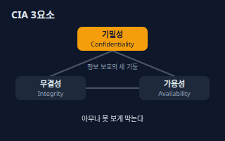</a> <b><a href="#cia-triad--cia-3요소">CIA Triad</a></b> CIA 3요소 정보를 지킨다는 말을 세 가지로 나눈 기준. 기밀성(허락된 사람만 본다), 무결성(몰래 바뀌지 않는다), 가용성(필요할 때 쓸 수 있다)이다.</td>
<td width="33%" valign="top"><a href="#threat-vulnerability-and-risk--위협취약점위험">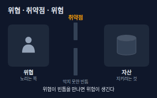</a> <b><a href="#threat-vulnerability-and-risk--위협취약점위험">Threat, Vulnerability and Risk</a></b> 위협·취약점·위험 위협은 해를 끼치려는 대상이나 사건, 취약점은 막지 못한 빈틈, 위험은 위협이 취약점을 만나 실제 피해가 날 가능성이다. 위험은 빈틈을 막거나 피해를 줄이면 낮아진다.</td>
<td width="33%" valign="top"><a href="#attack-surface--공격-표면">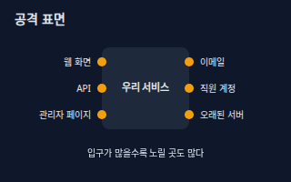</a> <b><a href="#attack-surface--공격-표면">Attack Surface</a></b> 공격 표면 외부에서 닿을 수 있는 입구의 총합. 공개된 화면, API, 관리자 페이지, 이메일, 직원 계정, 잊힌 서버가 모두 포함된다. 입구가 적을수록 지킬 곳도 줄어든다.</td>
</tr>
<tr>
<td width="33%" valign="top"><a href="#zero-trust--제로-트러스트">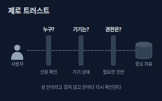</a> <b><a href="#zero-trust--제로-트러스트">Zero Trust</a></b> 제로 트러스트 '회사 안이니까 믿는다'를 버리고, 접속할 때마다 사용자·기기·권한을 다시 확인하는 보안 방식. 아무것도 자동으로 믿지 않는다는 뜻이다.</td>
<td width="33%" valign="top"> <b><a href="#security-awareness--보안-인식">Security Awareness</a></b> 보안 인식 사람이 가장 흔한 입구라는 점을 알고, 수상한 메시지를 받으면 멈추고 확인하고 신고하는 습관. 도구보다 먼저 쓸 수 있는 방어다.</td>
</tr>
</table>

**계정과 인증 · Accounts** (9)

<table>
<tr>
<td width="33%" valign="top"><a href="#2fa-and-mfa--2단계-인증다중-인증">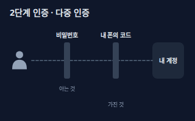</a> <b><a href="#2fa-and-mfa--2단계-인증다중-인증">2FA and MFA</a></b> 2단계 인증·다중 인증 로그인할 때 비밀번호 외에 내가 가진 것(폰의 앱, 보안키)이나 나 자신(지문)을 한 번 더 확인하는 방식. 비밀번호가 새도 계정이 바로 뚫리지 않게 한다.</td>
<td width="33%" valign="top"><a href="#passkey--패스키">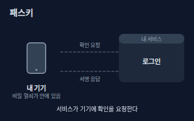</a> <b><a href="#passkey--패스키">Passkey</a></b> 패스키 비밀번호 대신 내 기기에 든 비밀 열쇠로 로그인하는 방식. 지문·얼굴·PIN으로 기기를 열면 열쇠가 서비스의 확인 요청에 서명해 답한다. 가짜 사이트에는 쓸 수 없어 피싱에 강하다.</td>
<td width="33%" valign="top"><a href="#password-manager--비밀번호-관리자">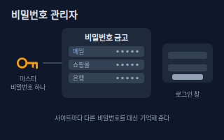</a> <b><a href="#password-manager--비밀번호-관리자">Password Manager</a></b> 비밀번호 관리자 마스터 비밀번호 하나로 여는 금고에 사이트마다 서로 다른 긴 비밀번호를 저장하고 자동으로 채워 주는 도구.</td>
</tr>
<tr>
<td width="33%" valign="top"><a href="#password-hashing--비밀번호-해시-저장">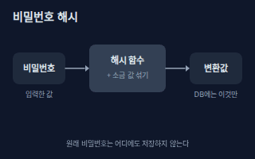</a> <b><a href="#password-hashing--비밀번호-해시-저장">Password Hashing</a></b> 비밀번호 해시 저장 서버가 비밀번호 원문을 저장하지 않고, 되돌릴 수 없는 방식으로 변환한 값(해시)에 사용자마다 다른 소금(무작위 값)을 섞어 저장하는 방법. DB가 새어도 원문이 바로 드러나지 않는다.</td>
<td width="33%" valign="top"><a href="#brute-force-and-account-lockout--무차별-대입과-계정-잠금">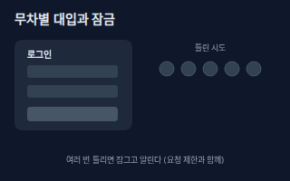</a> <b><a href="#brute-force-and-account-lockout--무차별-대입과-계정-잠금">Brute Force and Account Lockout</a></b> 무차별 대입과 계정 잠금 로그인 시도를 끝없이 반복해 비밀번호를 맞히려는 시도를 무차별 대입이라 한다. 방어는 틀린 횟수가 쌓이면 잠시 잠그고, 알림을 보내고, 요청 수를 제한하는 것이다.</td>
<td width="33%" valign="top"><a href="#session-hijacking--세션-하이재킹">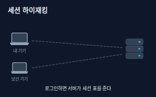</a> <b><a href="#session-hijacking--세션-하이재킹">Session Hijacking</a></b> 세션 하이재킹 로그인 뒤 서버가 주는 '로그인된 상태 표'(세션)를 다른 사람이 가져다 써서 내 계정인 척하는 사고. 방어는 HTTPS 사용, 짧은 만료, 로그아웃 시 폐기, 이상 접속 시 재인증이다.</td>
</tr>
<tr>
<td width="33%" valign="top"><b><a href="backend.md#authentication-vs-authorization--인증과-인가">Authentication vs Authorization</a></b> 인증과 인가 인증은 '누구인지' 확인하고, 인가는 '무엇을 해도 되는지' 정한다. 보안 점검은 이 둘을 따로 살펴야 한다. → backend 시트</td>
<td width="33%" valign="top"><b><a href="backend.md#session-vs-jwt--세션과-jwt">Session vs JWT</a></b> 세션과 JWT 로그인 상태를 서버가 기억하는 세션 방식과, 정보를 담은 토큰을 손님이 들고 다니는 JWT 방식의 차이. → backend 시트</td>
<td width="33%" valign="top"><b><a href="backend.md#rate-limit--요청-제한">Rate Limit</a></b> 요청 제한 한 사용자가 정해진 시간에 보낼 수 있는 요청 수를 제한해 과부하와 무차별 시도를 막는 장치. → backend 시트</td>
</tr>
</table>

**접근 권한 · Access Control** (3)

<table>
<tr>
<td width="33%" valign="top"><a href="#least-privilege--최소-권한">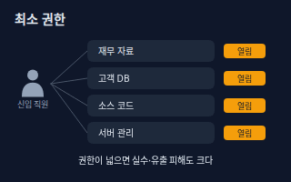</a> <b><a href="#least-privilege--최소-권한">Least Privilege</a></b> 최소 권한 일을 하는 데 꼭 필요한 권한만, 필요한 기간 동안만 주는 원칙. 계정이 뚫리거나 실수가 나도 피해가 작게 끝난다.</td>
<td width="33%" valign="top"><a href="#rbac--역할-기반-접근-제어">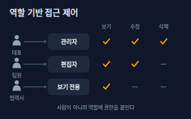</a> <b><a href="#rbac--역할-기반-접근-제어">RBAC</a></b> 역할 기반 접근 제어 사람마다 권한을 따로 주는 대신 '관리자·편집자·보기 전용' 같은 역할을 만들고, 사람을 역할에 배정하는 방식. 입사·이동·퇴사 때 관리가 쉽다.</td>
<td width="33%" valign="top"><a href="#access-review--접근-권한-점검">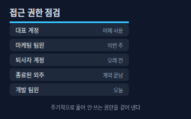</a> <b><a href="#access-review--접근-권한-점검">Access Review</a></b> 접근 권한 점검 계정과 권한 목록을 정기적으로 훑어 퇴사자·종료된 외주·안 쓰는 계정의 권한을 걷어 내는 일. 쌓인 권한이 가장 흔한 구멍이다.</td>
</tr>
</table>

**암호화 · Encryption** (4)

<table>
<tr>
<td width="33%" valign="top"><a href="#encryption-in-transit-vs-at-rest--전송-중저장-중-암호화">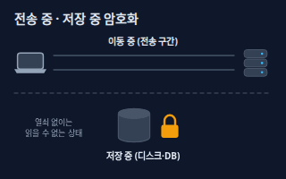</a> <b><a href="#encryption-in-transit-vs-at-rest--전송-중저장-중-암호화">Encryption in Transit vs at Rest</a></b> 전송 중·저장 중 암호화 전송 중 암호화는 데이터가 네트워크를 지나는 동안(HTTPS 등), 저장 중 암호화는 디스크·DB·백업에 놓여 있는 동안 읽지 못하게 잠그는 것. 두 구간은 따로 지켜야 한다.</td>
<td width="33%" valign="top"><a href="#public-key-encryption--공개키-암호">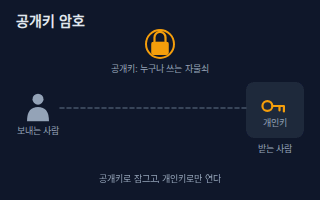</a> <b><a href="#public-key-encryption--공개키-암호">Public-key Encryption</a></b> 공개키 암호 잠그는 열쇠(공개키)는 누구에게나 나눠 주고, 여는 열쇠(개인키)는 나만 가지는 방식. 만난 적 없는 상대와도 안전하게 비밀을 주고받을 수 있다.</td>
<td width="33%" valign="top"><a href="#certificate-and-tls--인증서와-tls">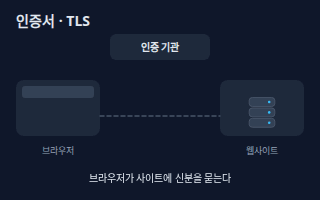</a> <b><a href="#certificate-and-tls--인증서와-tls">Certificate and TLS</a></b> 인증서와 TLS 인증서는 '이 사이트가 진짜 그 주인'임을 믿을 수 있는 발급 기관이 서명해 준 신분증이고, TLS는 그것을 확인한 뒤 암호화된 연결을 여는 규칙이다. 주소창의 자물쇠가 그 결과다.</td>
</tr>
<tr>
<td width="33%" valign="top"><b><a href="backend.md#https--https">HTTPS</a></b> HTTPS 웹 주소가 https로 시작하면 브라우저와 서버 사이의 통신이 TLS로 암호화된 상태다. → backend 시트</td>
</tr>
</table>

**사기와 악성코드 · Scams & Malware** (3)

<table>
<tr>
<td width="33%" valign="top"><a href="#phishing-and-smishing--피싱스미싱">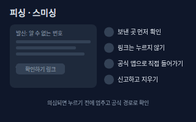</a> <b><a href="#phishing-and-smishing--피싱스미싱">Phishing and Smishing</a></b> 피싱·스미싱 진짜인 척하는 메일(피싱)이나 문자(스미싱)로 링크를 누르게 하거나 정보를 입력하게 만드는 사기. 보낸 곳을 확인하고, 링크를 누르지 않고 공식 앱·주소로 직접 들어가는 것이 기본 방어다.</td>
<td width="33%" valign="top"><a href="#social-engineering--사회공학">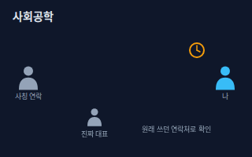</a> <b><a href="#social-engineering--사회공학">Social Engineering</a></b> 사회공학 기계가 아니라 사람을 속여 정보를 얻거나 행동을 하게 만드는 방법. 대표를 사칭해 급하다고 재촉하는 식이다. 방어는 급할수록 원래 알던 연락처로 따로 확인하는 것이다.</td>
<td width="33%" valign="top"><a href="#malware-and-ransomware--악성코드와-랜섬웨어">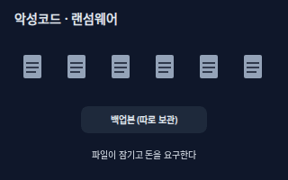</a> <b><a href="#malware-and-ransomware--악성코드와-랜섬웨어">Malware and Ransomware</a></b> 악성코드와 랜섬웨어 악성코드는 몰래 설치돼 해를 끼치는 프로그램 전체를 부르는 말이고, 랜섬웨어는 파일을 잠가 놓고 풀어 주는 대가로 돈을 요구하는 종류다. 방어는 업데이트, 의심 첨부파일 열지 않기, 따로 보관한 백업이다.</td>
</tr>
</table>

**웹 앱 취약점 · Web App** (5)

<table>
<tr>
<td width="33%" valign="top"><a href="#owasp-top-10--owasp-톱-10">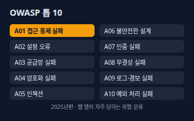</a> <b><a href="#owasp-top-10--owasp-톱-10">OWASP Top 10</a></b> OWASP 톱 10 보안 커뮤니티 OWASP가 웹 앱에서 가장 중요한 위험 10가지를 정리한 목록. 접근 통제 실패, 설정 오류, 인젝션 같은 범주가 들어 있다. 이름을 알면 점검 범위를 정하기 쉽다.</td>
<td width="33%" valign="top"><a href="#xss--xss-교차-사이트-스크립팅">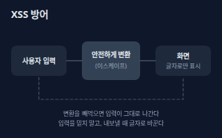</a> <b><a href="#xss--xss-교차-사이트-스크립팅">XSS</a></b> XSS (교차 사이트 스크립팅) 사용자가 입력한 글이 화면에 나올 때 그대로 코드처럼 처리되어 다른 사용자의 화면에서 의도치 않은 동작을 하게 되는 약점. 방어는 화면에 내보낼 때 글자로 바꿔(이스케이프) 보여 주는 것이다.</td>
<td width="33%" valign="top"><a href="#sql-injection--sql-인젝션">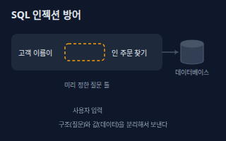</a> <b><a href="#sql-injection--sql-인젝션">SQL Injection</a></b> SQL 인젝션 사용자 입력이 데이터가 아니라 질문(SQL 명령)의 일부로 해석되어 데이터베이스가 엉뚱한 동작을 하는 약점. 방어는 질문 틀과 값을 분리하는 매개변수화 질의(prepared statement)다.</td>
</tr>
<tr>
<td width="33%" valign="top"><a href="#csrf--csrf-사이트-간-요청-위조">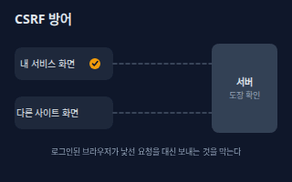</a> <b><a href="#csrf--csrf-사이트-간-요청-위조">CSRF</a></b> CSRF (사이트 간 요청 위조) 로그인한 브라우저가 낯선 사이트의 꼬임으로 내 서비스에 원치 않는 요청을 대신 보내게 되는 약점. 방어는 내 화면에서만 만들어지는 확인용 토큰과 쿠키 보호 설정을 쓰는 것이다.</td>
<td width="33%" valign="top"><b><a href="ai-agents.md#prompt-injection--프롬프트-인젝션">Prompt Injection</a></b> 프롬프트 인젝션 AI가 읽는 문서나 웹페이지 안에 숨은 지시문이 AI를 속여 원래 지시를 어기게 만드는 공격. AI 에이전트의 대표적인 보안 위험이다. → ai-agents 시트</td>
</tr>
</table>

**비밀과 키 · Secrets** (3)

<table>
<tr>
<td width="33%" valign="top"><a href="#api-key-and-secret-management--api-키비밀-관리">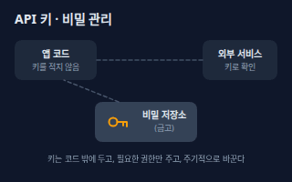</a> <b><a href="#api-key-and-secret-management--api-키비밀-관리">API Key and Secret Management</a></b> API 키·비밀 관리 API 키·토큰·DB 비밀번호 같은 '비밀'을 코드 밖의 비밀 저장소에 두고, 필요한 권한만 주고, 정기적으로 바꾸고, 새면 즉시 폐기하는 관리 방식.</td>
<td width="33%" valign="top"><a href="#secret-leak-in-git--깃-비밀-유출">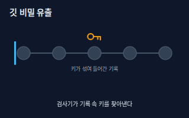</a> <b><a href="#secret-leak-in-git--깃-비밀-유출">Secret Leak in Git</a></b> 깃 비밀 유출 API 키·비밀번호가 코드 저장소(Git)에 실수로 올라가 공개되거나 기록에 남는 사고. 파일을 지워도 과거 기록에 남으므로 키를 먼저 폐기하고 새로 발급해야 한다.</td>
<td width="33%" valign="top"><b><a href="backend.md#environment-variable--환경-변수">Environment Variable</a></b> 환경 변수 코드 밖에서 프로그램에 설정값을 넘겨 주는 방법. API 키 같은 비밀을 코드에 적지 않고 넘길 때 자주 쓴다. → backend 시트</td>
</tr>
</table>

**운영과 대응 · Operations** (7)

<table>
<tr>
<td width="33%" valign="top"><a href="#backup-3-2-1--백업-3-2-1">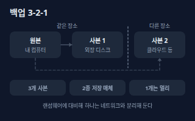</a> <b><a href="#backup-3-2-1--백업-3-2-1">Backup 3-2-1</a></b> 백업 3-2-1 중요한 데이터를 3개 사본으로, 2종류의 서로 다른 저장장치에, 그중 1개는 다른 장소(오프사이트)에 두는 백업 규칙. 화재, 고장, 랜섬웨어에 함께 당하지 않게 한다.</td>
<td width="33%" valign="top"><a href="#patch-and-update--패치와-업데이트">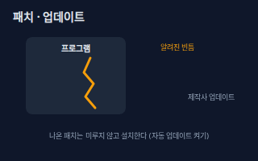</a> <b><a href="#patch-and-update--패치와-업데이트">Patch and Update</a></b> 패치와 업데이트 제작사가 이미 알려진 보안 빈틈을 고쳐서 내놓은 수정판을 설치하는 일. 공개된 빈틈은 누구나 알고 있으므로 미룰수록 위험하다.</td>
<td width="33%" valign="top"><a href="#cve--cve-공통-취약점-식별번호">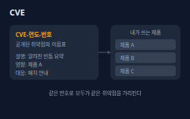</a> <b><a href="#cve--cve-공통-취약점-식별번호">CVE</a></b> CVE (공통 취약점 식별번호) 공개된 보안 취약점에 붙는 공용 이름표(CVE-연도-번호 형식). 같은 번호를 쓰면 보안 공지, 도구, 제작사가 같은 약점을 가리키는 것을 알 수 있다.</td>
</tr>
<tr>
<td width="33%" valign="top"><a href="#dependency-vulnerability--의존성-취약점-sca">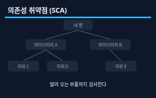</a> <b><a href="#dependency-vulnerability--의존성-취약점-sca">Dependency Vulnerability</a></b> 의존성 취약점 (SCA) 내 앱이 가져다 쓰는 오픈소스 라이브러리와 그 라이브러리가 다시 쓰는 부품에 있는 알려진 약점. SCA 도구가 목록을 만들어 알려진 약점과 대조해 준다.</td>
<td width="33%" valign="top"><a href="#audit-log--감사-로그">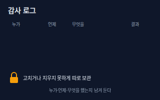</a> <b><a href="#audit-log--감사-로그">Audit Log</a></b> 감사 로그 누가, 언제, 무엇을 했는지 고칠 수 없게 남긴 기록. 사고가 났을 때 원인을 찾고, 수상한 행동을 일찍 알아채는 데 쓴다. 개인정보를 다루는 곳은 접속기록 보관도 안전 조치에 속한다.</td>
<td width="33%" valign="top"><a href="#incident-response--사고-대응">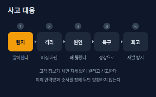</a> <b><a href="#incident-response--사고-대응">Incident Response</a></b> 사고 대응 보안 사고를 알아챈 뒤 탐지, 격리(번지는 것 차단), 원인 파악, 복구, 회고의 순서로 움직이는 계획. 미리 연락망과 순서를 정해 두면 당황하지 않는다. 고객 개인정보가 새면 법에 따라 지체 없이 알려야 한다.</td>
</tr>
<tr>
<td width="33%" valign="top"><a href="#vpn--vpn-가상-사설망">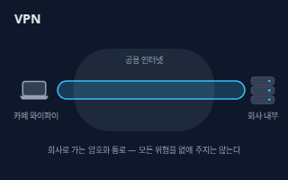</a> <b><a href="#vpn--vpn-가상-사설망">VPN</a></b> VPN (가상 사설망) 인터넷 위에 암호화된 통로를 만들어, 카페 같은 공용 와이파이에서도 회사 내부 서비스에 안전하게 접속하게 해 주는 기술.</td>
</tr>
</table>

**개인정보 · Privacy** (1)

<table>
<tr>
<td width="33%" valign="top"><a href="#personal-data-minimisation--개인정보-최소-수집">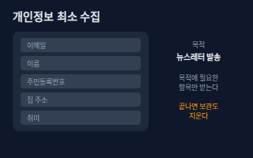</a> <b><a href="#personal-data-minimisation--개인정보-최소-수집">Personal Data Minimisation</a></b> 개인정보 최소 수집 서비스 목적에 꼭 필요한 개인정보만 받는 원칙. 안 받은 정보는 새지도 않는다. 법도 개인정보처리자가 처리 목적에 필요한 범위에서 최소한의 개인정보만 수집하라고 정한다.</td>
</tr>
</table>

<!-- overview:end -->

## 기본 개념 · Fundamentals

### CIA Triad · CIA 3요소

- **정의**: 정보를 지킨다는 말을 세 가지로 나눈 기준. 기밀성(허락된 사람만 본다), 무결성(몰래 바뀌지 않는다), 가용성(필요할 때 쓸 수 있다)이다.
- **AI에게 이렇게**: "우리 고객 주문 시스템을 기밀성, 무결성, 가용성 세 가지 관점으로 점검해서 각각 지금 부족한 점과 개선 순서를 표로 정리해줘."
- **언제**: 보안 점검의 틀을 잡을 때, '무엇이 가장 중요한가'를 팀과 합의할 때
- **헷갈림**: 기밀성만 보안이라고 생각하기 쉽다 — 서비스가 멈추는 것(가용성)이나 데이터가 몰래 바뀌는 것(무결성)도 똑같이 보안 사고다.
- **관련**: Threat, Vulnerability and Risk, Least Privilege, Backup 3-2-1
- **확인 질문**: 지키려는 정보나 서비스는 무엇인가요? 유출, 변조, 중단 중 팀이 가장 두려워하는 것은 무엇인가요?

### Threat, Vulnerability and Risk · 위협·취약점·위험

- **정의**: 위협은 해를 끼치려는 대상이나 사건, 취약점은 막지 못한 빈틈, 위험은 위협이 취약점을 만나 실제 피해가 날 가능성이다. 위험은 빈틈을 막거나 피해를 줄이면 낮아진다.
- **AI에게 이렇게**: "우리 서비스의 주요 자산, 예상되는 위협, 알려진 취약점을 표로 나누고 위험이 큰 순서대로 우선순위를 매겨줘. 막는 방법도 같이 알려줘."
- **언제**: 보안 점검 우선순위를 정할 때, 투자할 대책을 고를 때
- **헷갈림**: CVE — CVE는 공개된 취약점의 번호표일 뿐이고, 그 취약점이 우리에게 얼마나 위험한지는 우리가 쓰는지·노출됐는지에 따라 달라진다.
- **관련**: Attack Surface, CVE, Incident Response
- **확인 질문**: 지켜야 할 가장 중요한 자산은 무엇인가요? 그것이 깨지면 얼마나 곤란한가요?

### Attack Surface · 공격 표면

- **정의**: 외부에서 닿을 수 있는 입구의 총합. 공개된 화면, API, 관리자 페이지, 이메일, 직원 계정, 잊힌 서버가 모두 포함된다. 입구가 적을수록 지킬 곳도 줄어든다.
- **AI에게 이렇게**: "우리 서비스에서 인터넷에 열려 있는 입구를 모두 목록으로 만들고, 닫거나 줄여도 되는 것을 골라서 우선순위와 함께 알려줘."
- **언제**: 새 서비스를 열기 전, 오래된 서버·계정을 정리할 때
- **헷갈림**: Vulnerability — 취약점은 입구의 '빈틈'이고, 공격 표면은 입구가 몇 개나 열려 있는지의 규모다.
- **관련**: Least Privilege, Access Review, Zero Trust
- **확인 질문**: 외부에 공개된 주소, 관리자 페이지, 테스트 서버, 퇴사자 계정이 남아 있나요?

### Zero Trust · 제로 트러스트

- **정의**: '회사 안이니까 믿는다'를 버리고, 접속할 때마다 사용자·기기·권한을 다시 확인하는 보안 방식. 아무것도 자동으로 믿지 않는다는 뜻이다.
- **AI에게 이렇게**: "재택근무와 클라우드를 쓰는 10명 규모 팀이 제로 트러스트 원칙을 단계적으로 도입하는 계획을 현실적인 순서로 짜줘."
- **언제**: 재택·외부 협력이 많아 '사내 네트워크 안'의 경계가 흐릴 때
- **헷갈림**: VPN — VPN은 안전한 통로를 만드는 도구이고, 제로 트러스트는 통로 안에서도 계속 확인하는 원칙이다.
- **관련**: Least Privilege, 2FA and MFA, VPN
- **확인 질문**: 직원 기기를 회사가 관리하나요? 어떤 서비스가 사내망에서만 열리나요?
- **근거**: [NIST SP 800-207 Zero Trust Architecture](https://nvlpubs.nist.gov/nistpubs/specialpublications/NIST.SP.800-207.pdf)
- **검증일**: 2026-11-03

### Security Awareness · 보안 인식

- **정의**: 사람이 가장 흔한 입구라는 점을 알고, 수상한 메시지를 받으면 멈추고 확인하고 신고하는 습관. 도구보다 먼저 쓸 수 있는 방어다.
- **AI에게 이렇게**: "직원 10명이 15분에 읽을 수 있는 보안 수칙 한 장을 만들어줘. 피싱 대응, 비밀번호 관리, 의심될 때 신고하는 순서를 쉬운 말로 넣어줘."
- **언제**: 신입 교육, 보안 사고 뒤 재발 방지 교육, 주기적 점검
- **헷갈림**: 보안 교육 = 시험 — 목적은 점수가 아니라 '의심될 때 누구에게 말하는지' 아는 것이다. 신고한 사람을 탓하지 않는 분위기가 중요하다.
- **관련**: Phishing and Smishing, Social Engineering, Incident Response
- **확인 질문**: 직원들이 수상한 메일을 받으면 누구에게 알리게 되어 있나요? 마지막 교육은 언제였나요?

## 계정과 인증 · Accounts

### 2FA and MFA · 2단계 인증·다중 인증

- **정의**: 로그인할 때 비밀번호 외에 내가 가진 것(폰의 앱, 보안키)이나 나 자신(지문)을 한 번 더 확인하는 방식. 비밀번호가 새도 계정이 바로 뚫리지 않게 한다.
- **AI에게 이렇게**: "우리 팀 계정(메일, 클라우드, 코드 저장소, 결제)에 2단계 인증을 켜야 할 우선순위를 정하고, 문자보다 강한 방식으로 바꾸는 순서를 알려줘."
- **언제**: 메일, 클라우드 콘솔, 코드 저장소, 결제 계정처럼 뚫리면 크게 번지는 계정
- **헷갈림**: 2FA vs MFA — 2FA는 두 가지 확인, MFA는 두 가지 이상 확인의 넓은 말이다. 문자 인증번호는 하나도 안 켠 것보다는 낫지만 가로채일 수 있어 약한 편이고, 보안키·패스키(FIDO 방식)가 가장 강하다.
- **관련**: Passkey, Password Manager, Brute Force and Account Lockout
- **확인 질문**: 어떤 계정부터 켜야 하나요? 폰을 잃어버렸을 때 복구 방법(백업 코드)은 준비되어 있나요?
- **근거**: [CISA Implementing Phishing-Resistant MFA](https://www.cisa.gov/sites/default/files/publications/fact-sheet-implementing-phishing-resistant-mfa-508c.pdf)
- **검증일**: 2026-11-03

### Passkey · 패스키

- **정의**: 비밀번호 대신 내 기기에 든 비밀 열쇠로 로그인하는 방식. 지문·얼굴·PIN으로 기기를 열면 열쇠가 서비스의 확인 요청에 서명해 답한다. 가짜 사이트에는 쓸 수 없어 피싱에 강하다.
- **AI에게 이렇게**: "우리 서비스 로그인에 패스키를 추가하려고 해. 기존 회원의 비밀번호 로그인과 병행하는 방법, 기기를 바꿨을 때의 복구 방법, 사용자 안내 문구를 정리해줘."
- **언제**: 비밀번호 유출·피싱 걱정을 줄이고 싶을 때, 로그인 과정을 간단하게 만들고 싶을 때
- **헷갈림**: 2FA — 2FA는 비밀번호에 한 단계를 더하는 것이고, 패스키는 비밀번호 자체를 없앤다. 서버에는 공개 정보만 저장된다.
- **관련**: 2FA and MFA, Public-key Encryption, Authentication vs Authorization
- **확인 질문**: 사용자가 쓰는 기기와 브라우저는 무엇인가요? 기기를 잃어버렸을 때의 복구 수단은 무엇인가요?
- **근거**: [FIDO Alliance Passkeys](https://fidoalliance.org/passkeys/)
- **검증일**: 2026-11-03

### Password Manager · 비밀번호 관리자

- **정의**: 마스터 비밀번호 하나로 여는 금고에 사이트마다 서로 다른 긴 비밀번호를 저장하고 자동으로 채워 주는 도구.
- **AI에게 이렇게**: "팀원 전체가 쓸 비밀번호 관리자를 고르는 기준(공유 금고, 퇴사 시 회수, 2단계 인증 지원)을 표로 정리하고 도입 순서도 알려줘."
- **언제**: 서비스 계정이 많아졌을 때, 같은 비밀번호를 돌려 쓰는 습관을 끊을 때
- **헷갈림**: 브라우저 저장 — 브라우저 기본 저장도 도움이 되지만, 팀 공유·권한 관리·감사가 필요하면 전용 도구가 낫다. 비밀번호는 복잡한 기호 규칙보다 길고 겹치지 않는 편이 좋고, 정기 변경은 유출이 의심될 때만 권장된다.
- **관련**: 2FA and MFA, Password Hashing, API Key and Secret Management
- **확인 질문**: 몇 명이 쓰나요? 공유해야 하는 계정이 있나요? 마스터 비밀번호를 잃어버렸을 때 복구는 어떻게 하나요?
- **근거**: [NIST SP 800-63B-4 Digital Identity Guidelines](https://pages.nist.gov/800-63-4/sp800-63b.html)
- **검증일**: 2026-11-03

### Password Hashing · 비밀번호 해시 저장

- **정의**: 서버가 비밀번호 원문을 저장하지 않고, 되돌릴 수 없는 방식으로 변환한 값(해시)에 사용자마다 다른 소금(무작위 값)을 섞어 저장하는 방법. DB가 새어도 원문이 바로 드러나지 않는다.
- **AI에게 이렇게**: "우리 회원 DB가 비밀번호를 어떻게 저장하는지 점검하는 체크리스트를 만들어줘. 느린 해시와 소금을 쓰는지, 기존 방식에서 안전하게 옮겨가는 계획도 포함해줘."
- **언제**: 회원가입·로그인 기능을 만들거나 검토할 때, 비밀번호 저장 방식이 걱정될 때
- **헷갈림**: 암호화 — 암호화는 키로 다시 풀 수 있지만, 해시는 풀 수 없는 일방향이다. 비밀번호는 풀 필요가 없으니 해시가 맞다.
- **관련**: Encryption in Transit vs at Rest, Brute Force and Account Lockout, Authentication vs Authorization
- **확인 질문**: 지금 비밀번호를 어떤 방식으로 저장하나요? 직접 만든 방식인가요, 검증된 라이브러리인가요?
- **근거**: [OWASP Password Storage Cheat Sheet](https://cheatsheetseries.owasp.org/cheatsheets/Password_Storage_Cheat_Sheet.html)
- **검증일**: 2026-11-03

### Brute Force and Account Lockout · 무차별 대입과 계정 잠금

- **정의**: 로그인 시도를 끝없이 반복해 비밀번호를 맞히려는 시도를 무차별 대입이라 한다. 방어는 틀린 횟수가 쌓이면 잠시 잠그고, 알림을 보내고, 요청 수를 제한하는 것이다.
- **AI에게 이렇게**: "우리 로그인 화면에서 무차별 대입을 막는 방어 설계를 제안해줘. 잠금 기준, 정상 사용자가 불편하지 않게 푸는 방법, 관리자 알림을 포함해줘."
- **언제**: 로그인·인증번호 입력·비밀번호 재설정 기능을 만들 때
- **헷갈림**: 계정 잠금과 요청 제한(Rate Limit) — 잠금은 한 계정을 지키고, 요청 제한은 주소·기기 단위로 속도를 제한한다. 둘을 함께 써야 한쪽 약점을 서로 메운다.
- **관련**: 2FA and MFA, Rate Limit, Audit Log
- **확인 질문**: 비정상 로그인 시도를 지금 알 수 있나요? 잠긴 사용자는 어떻게 풀게 되어 있나요?

### Session Hijacking · 세션 하이재킹

- **정의**: 로그인 뒤 서버가 주는 '로그인된 상태 표'(세션)를 다른 사람이 가져다 써서 내 계정인 척하는 사고. 방어는 HTTPS 사용, 짧은 만료, 로그아웃 시 폐기, 이상 접속 시 재인증이다.
- **AI에게 이렇게**: "우리 웹 서비스의 세션 관리를 점검해서 세션 표 보호(만료, 로그아웃 폐기, 쿠키 보호 설정, 이상 징후 재로그인) 체크리스트를 만들어줘."
- **언제**: 로그인 유지 기능을 설계할 때, 계정이 도용된 것 같을 때
- **헷갈림**: 비밀번호 유출 — 비밀번호가 안 새도 세션 표가 새면 도용된다. 그래서 로그인 뒤에도 보호가 필요하다.
- **관련**: HTTPS, CSRF, Audit Log
- **확인 질문**: 로그인 유지 기간은 얼마나 되나요? 로그아웃하면 서버에서도 세션이 지워지나요?

### Authentication vs Authorization · 인증과 인가

- **정의**: 인증은 '누구인지' 확인하고, 인가는 '무엇을 해도 되는지' 정한다. 보안 점검은 이 둘을 따로 살펴야 한다.
- **원본**: [백엔드 · Authentication vs Authorization](backend.md#authentication-vs-authorization--인증과-인가)

### Session vs JWT · 세션과 JWT

- **정의**: 로그인 상태를 서버가 기억하는 세션 방식과, 정보를 담은 토큰을 손님이 들고 다니는 JWT 방식의 차이.
- **원본**: [백엔드 · Session vs JWT](backend.md#session-vs-jwt--세션과-jwt)

### Rate Limit · 요청 제한

- **정의**: 한 사용자가 정해진 시간에 보낼 수 있는 요청 수를 제한해 과부하와 무차별 시도를 막는 장치.
- **원본**: [백엔드 · Rate Limit](backend.md#rate-limit--요청-제한)

## 접근 권한 · Access Control

### Least Privilege · 최소 권한

- **정의**: 일을 하는 데 꼭 필요한 권한만, 필요한 기간 동안만 주는 원칙. 계정이 뚫리거나 실수가 나도 피해가 작게 끝난다.
- **AI에게 이렇게**: "신입 마케터에게 줄 권한을 최소 권한 원칙에 맞게 정해줘. 필요한 도구와 읽기·쓰기 범위를 표로 만들고, 기간이 지나면 회수하는 방법도 알려줘."
- **언제**: 새 직원·외주·AI 에이전트에게 권한을 줄 때, 관리자 계정을 나눠 쓰고 있을 때
- **헷갈림**: 편의상 전체 권한 — 처음에 넓게 주고 나중에 줄이겠다는 계획은 거의 실행되지 않는다. 좁게 주고 필요할 때 늘리는 편이 안전하다.
- **관련**: RBAC, Access Review, Attack Surface
- **확인 질문**: 이 사람이 하는 일은 무엇인가요? 어떤 자료를 꼭 읽어야 하고, 어떤 것을 수정해야 하나요? 언제까지 필요한가요?

### RBAC · 역할 기반 접근 제어

- **정의**: 사람마다 권한을 따로 주는 대신 '관리자·편집자·보기 전용' 같은 역할을 만들고, 사람을 역할에 배정하는 방식. 입사·이동·퇴사 때 관리가 쉽다.
- **AI에게 이렇게**: "우리 서비스에 관리자, 편집자, 보기 전용 세 역할을 만들고 각 역할이 할 수 있는 일을 표로 정리해줘. 역할 변경과 퇴사 처리 절차도 알려줘."
- **언제**: 팀이 커지고 권한 관리가 복잡해질 때, 외부 협력사에게 제한된 접근을 줄 때
- **헷갈림**: Least Privilege — 최소 권한은 '얼마나 주는가'의 원칙이고, RBAC는 그 권한을 '어떻게 묶어 관리하는가'의 방법이다.
- **관련**: Least Privilege, Access Review, Authentication vs Authorization
- **확인 질문**: 서비스에 어떤 역할들이 필요한가요? 한 사람이 여러 역할을 가져도 되나요?

### Access Review · 접근 권한 점검

- **정의**: 계정과 권한 목록을 정기적으로 훑어 퇴사자·종료된 외주·안 쓰는 계정의 권한을 걷어 내는 일. 쌓인 권한이 가장 흔한 구멍이다.
- **AI에게 이렇게**: "분기마다 할 접근 권한 점검 절차를 만들어줘. 점검할 시스템 목록, 확인 항목, 회수 기록 남기는 방법을 체크리스트로 정리해줘."
- **언제**: 퇴사자·계약 종료 뒤, 정기 점검 일정을 만들 때
- **헷갈림**: 계정 삭제 — 퇴사 처리는 한 번이지만, 점검은 주기적으로 반복한다. 퇴사 처리가 새거나 이동으로 권한이 쌓이는 것을 점검이 잡는다.
- **관련**: Least Privilege, RBAC, Audit Log
- **확인 질문**: 점검할 서비스가 몇 개인가요? 퇴사·계약 종료 때의 권한 회수 담당자는 누구인가요?

## 암호화 · Encryption

### Encryption in Transit vs at Rest · 전송 중·저장 중 암호화

- **정의**: 전송 중 암호화는 데이터가 네트워크를 지나는 동안(HTTPS 등), 저장 중 암호화는 디스크·DB·백업에 놓여 있는 동안 읽지 못하게 잠그는 것. 두 구간은 따로 지켜야 한다.
- **AI에게 이렇게**: "우리 서비스에서 개인 정보가 지나가는 구간과 저장되는 곳을 나열하고, 각각 전송 중·저장 중 암호화가 되어 있는지 점검표로 만들어줘."
- **언제**: 고객 정보를 다루는 서비스를 설계·점검할 때, 클라우드 저장소·백업을 설정할 때
- **헷갈림**: 둘 중 하나만 — 전송만 잠그면 서버가 털릴 때 읽히고, 저장만 잠그면 이동 중에 읽힌다. 열쇠 관리까지 같이 봐야 한다.
- **관련**: HTTPS, Certificate and TLS, API Key and Secret Management
- **확인 질문**: 저장되는 곳(DB, 파일, 백업)은 어디인가요? 암호화 키는 누가 어디에 보관하나요?

### Public-key Encryption · 공개키 암호

- **정의**: 잠그는 열쇠(공개키)는 누구에게나 나눠 주고, 여는 열쇠(개인키)는 나만 가지는 방식. 만난 적 없는 상대와도 안전하게 비밀을 주고받을 수 있다.
- **AI에게 이렇게**: "공개키와 개인키가 무엇이고 개인키를 어떻게 안전하게 보관해야 하는지, 우리 팀이 지켜야 할 규칙을 비개발자도 이해할 수 있게 정리해줘."
- **언제**: HTTPS 연결, 전자서명, 패스키, SSH 접속의 바탕 원리를 이해할 때
- **헷갈림**: 공유 비밀번호 — 비밀번호 방식은 양쪽이 같은 비밀을 알아야 하지만, 공개키 방식은 개인키가 밖으로 나가지 않는다.
- **관련**: Certificate and TLS, Passkey, HTTPS
- **확인 질문**: 개인키가 저장된 곳은 어디인가요? 분실·유출 시 폐기하고 새로 만드는 절차가 있나요?

### Certificate and TLS · 인증서와 TLS

- **정의**: 인증서는 '이 사이트가 진짜 그 주인'임을 믿을 수 있는 발급 기관이 서명해 준 신분증이고, TLS는 그것을 확인한 뒤 암호화된 연결을 여는 규칙이다. 주소창의 자물쇠가 그 결과다.
- **AI에게 이렇게**: "우리 사이트의 인증서 만료일을 놓치지 않도록 점검과 알림 절차를 만들어줘. 자동 갱신 설정과 갱신 실패 시 대응도 포함해줘."
- **언제**: 웹사이트·API를 공개할 때, 인증서 만료 경고가 뜰 때
- **헷갈림**: 자물쇠 = 안전한 사이트 — 자물쇠는 연결이 암호화됐다는 뜻이지, 사이트가 믿을 만하다는 보증은 아니다. 피싱 사이트도 자물쇠가 있을 수 있다.
- **관련**: HTTPS, Public-key Encryption, Phishing and Smishing
- **확인 질문**: 인증서는 누가 발급·갱신하나요? 만료일은 언제이고 알림이 오나요?

### HTTPS · HTTPS

- **정의**: 웹 주소가 https로 시작하면 브라우저와 서버 사이의 통신이 TLS로 암호화된 상태다.
- **원본**: [백엔드 · HTTPS](backend.md#https--https)

## 사기와 악성코드 · Scams & Malware

### Phishing and Smishing · 피싱·스미싱

- **정의**: 진짜인 척하는 메일(피싱)이나 문자(스미싱)로 링크를 누르게 하거나 정보를 입력하게 만드는 사기. 보낸 곳을 확인하고, 링크를 누르지 않고 공식 앱·주소로 직접 들어가는 것이 기본 방어다.
- **AI에게 이렇게**: "직원들에게 보낼 피싱·스미싱 대응 안내문을 만들어줘. 의심 신호, 눌러 버렸을 때 즉시 할 일, 신고 방법을 순서대로 쉬운 말로 써줘."
- **언제**: 택배·결제·계정 확인 같은 알림을 받았을 때, 직원 교육 자료를 만들 때
- **헷갈림**: Social Engineering — 피싱은 메시지를 이용한 속임이고, 사회공학은 전화·대면까지 포함한 사람을 속이는 방법 전체를 부르는 넓은 말이다.
- **관련**: Social Engineering, 2FA and MFA, Security Awareness
- **확인 질문**: 어떤 채널(메일, 문자, 메신저)로 오나요? 누른 사람이 있나요? 계정 정보를 입력했나요?

### Social Engineering · 사회공학

- **정의**: 기계가 아니라 사람을 속여 정보를 얻거나 행동을 하게 만드는 방법. 대표를 사칭해 급하다고 재촉하는 식이다. 방어는 급할수록 원래 알던 연락처로 따로 확인하는 것이다.
- **AI에게 이렇게**: "대표나 거래처를 사칭한 급한 송금·정보 요청에 대응하는 확인 절차를 만들어줘. 어떤 요청은 반드시 다른 연락 수단으로 재확인할지 기준도 정해줘."
- **언제**: 송금·계정 변경·정보 요청이 갑자기 급하게 올 때
- **헷갈림**: 해킹 — 해킹은 시스템의 빈틈을 겨냥하고, 사회공학은 사람의 신뢰와 조급함을 겨냥한다. 기술 방어만으로는 막기 어렵다.
- **관련**: Phishing and Smishing, Security Awareness, Least Privilege
- **확인 질문**: 어떤 요청(송금, 비밀번호 재설정, 정보 제공)이 이런 식으로 올 수 있나요? 승인 절차는 누구와 하나요?

### Malware and Ransomware · 악성코드와 랜섬웨어

- **정의**: 악성코드는 몰래 설치돼 해를 끼치는 프로그램 전체를 부르는 말이고, 랜섬웨어는 파일을 잠가 놓고 풀어 주는 대가로 돈을 요구하는 종류다. 방어는 업데이트, 의심 첨부파일 열지 않기, 따로 보관한 백업이다.
- **AI에게 이렇게**: "랜섬웨어에 대비한 우리 팀의 예방·복구 점검표를 만들어줘. 업데이트, 권한 제한, 백업 분리, 감염 의심 시 첫 행동을 순서대로 넣어줘."
- **언제**: 직원 PC·서버 보호 계획을 세울 때, 백업 정책을 점검할 때
- **헷갈림**: 바이러스 — 바이러스는 악성코드의 한 종류일 뿐이다. 요즘은 돈을 요구하거나 정보를 빼내는 것이 많아 백신만으로는 부족하다.
- **관련**: Backup 3-2-1, Patch and Update, Phishing and Smishing
- **확인 질문**: 중요한 파일은 어디에 있나요? 백업은 네트워크와 분리되어 있고 복구 연습을 해 봤나요?

## 웹 앱 취약점 · Web App

### OWASP Top 10 · OWASP 톱 10

- **정의**: 보안 커뮤니티 OWASP가 웹 앱에서 가장 중요한 위험 10가지를 정리한 목록. 접근 통제 실패, 설정 오류, 인젝션 같은 범주가 들어 있다. 이름을 알면 점검 범위를 정하기 쉽다.
- **AI에게 이렇게**: "OWASP Top 10 최신판 범주를 기준으로 우리 웹 앱의 점검표를 만들어줘. 각 범주마다 코드·설정에서 확인할 방어 항목을 질문 형태로 적어줘."
- **언제**: 서비스 출시 전 보안 점검 범위를 잡을 때, 개발팀·외주와 점검 기준을 맞출 때
- **헷갈림**: 법적 기준 — OWASP Top 10은 법이 아니라 업계가 합의한 참고 목록이다. 이것을 통과해도 '완전히 안전'하다는 뜻은 아니다.
- **관련**: XSS, SQL Injection, CSRF, Dependency Vulnerability
- **확인 질문**: 웹 앱인가요, API인가요, 모바일 앱인가요? 어떤 프레임워크와 데이터베이스를 쓰나요?
- **근거**: [OWASP Top 10:2025](https://owasp.org/Top10/2025)
- **검증일**: 2026-11-03

### XSS · XSS (교차 사이트 스크립팅)

- **정의**: 사용자가 입력한 글이 화면에 나올 때 그대로 코드처럼 처리되어 다른 사용자의 화면에서 의도치 않은 동작을 하게 되는 약점. 방어는 화면에 내보낼 때 글자로 바꿔(이스케이프) 보여 주는 것이다.
- **AI에게 이렇게**: "게시판과 댓글 기능이 있는 우리 서비스에서 XSS를 막기 위한 방어 점검표를 만들어줘. 출력 시 변환, 프레임워크 기본 보호 확인, 보안 헤더 설정을 포함해줘."
- **언제**: 사용자가 글·이름·프로필을 입력하고 다른 사람에게 보여 주는 모든 기능
- **헷갈림**: 입력 검증 — 입력 검사도 필요하지만 핵심은 출력할 때의 변환이다. 입력만 걸러서는 모든 경우를 막기 어렵다.
- **관련**: OWASP Top 10, CSRF, SQL Injection
- **확인 질문**: 사용자 입력이 화면에 표시되는 곳은 어디인가요? 쓰는 프론트엔드 프레임워크는 무엇인가요?

### SQL Injection · SQL 인젝션

- **정의**: 사용자 입력이 데이터가 아니라 질문(SQL 명령)의 일부로 해석되어 데이터베이스가 엉뚱한 동작을 하는 약점. 방어는 질문 틀과 값을 분리하는 매개변수화 질의(prepared statement)다.
- **AI에게 이렇게**: "우리 백엔드 코드에서 DB 질의를 하는 부분을 검토해서 입력값이 질문에 직접 이어 붙는 곳이 있는지 찾고, 매개변수화 질의로 바꾸는 방법을 설명해줘."
- **언제**: DB를 조회·수정하는 코드를 쓰거나 리뷰할 때, 검색·필터 기능을 만들 때
- **헷갈림**: XSS — SQL 인젝션은 서버의 DB를 겨냥하고, XSS는 사용자의 브라우저 화면을 겨냥한다. 방어 방법도 다르다.
- **관련**: OWASP Top 10, Least Privilege, Logging
- **확인 질문**: 어떤 DB와 라이브러리를 쓰나요? 직접 쓴 SQL 문이 있나요? DB 계정은 필요한 권한만 가지고 있나요?

### CSRF · CSRF (사이트 간 요청 위조)

- **정의**: 로그인한 브라우저가 낯선 사이트의 꼬임으로 내 서비스에 원치 않는 요청을 대신 보내게 되는 약점. 방어는 내 화면에서만 만들어지는 확인용 토큰과 쿠키 보호 설정을 쓰는 것이다.
- **AI에게 이렇게**: "쿠키로 로그인을 유지하는 우리 서비스의 상태 변경 요청(결제, 설정 변경, 삭제)에 CSRF 방어가 되어 있는지 점검하고 필요한 보호 방식을 제안해줘."
- **언제**: 쿠키 기반 로그인을 쓰는 웹 서비스의 쓰기·삭제·결제 기능
- **헷갈림**: CORS — CORS는 브라우저가 다른 출처의 응답을 읽을 수 있는지 정하는 규칙이고, CSRF 방어는 요청 자체가 내 화면에서 왔는지 확인한다. 서로 대신하지 못한다.
- **관련**: Session Hijacking, XSS, CORS, Authentication vs Authorization
- **확인 질문**: 로그인은 쿠키 방식인가요, 헤더 토큰 방식인가요? 상태를 바꾸는 요청에 확인 토큰이 붙나요?

### Prompt Injection · 프롬프트 인젝션

- **정의**: AI가 읽는 문서나 웹페이지 안에 숨은 지시문이 AI를 속여 원래 지시를 어기게 만드는 공격. AI 에이전트의 대표적인 보안 위험이다.
- **원본**: [AI 에이전트 · Prompt Injection](ai-agents.md#prompt-injection--프롬프트-인젝션)

## 비밀과 키 · Secrets

### API Key and Secret Management · API 키·비밀 관리

- **정의**: API 키·토큰·DB 비밀번호 같은 '비밀'을 코드 밖의 비밀 저장소에 두고, 필요한 권한만 주고, 정기적으로 바꾸고, 새면 즉시 폐기하는 관리 방식.
- **AI에게 이렇게**: "우리 서비스가 쓰는 API 키와 비밀번호 목록을 만들고, 각각 어디에 저장되는지, 권한 범위가 필요 이상인지, 교체 주기와 폐기 절차는 있는지 점검해줘."
- **언제**: 외부 서비스를 연동할 때, AI 에이전트나 외주에게 접근을 줄 때, 팀원이 바뀔 때
- **헷갈림**: 비밀번호와 API 키 — 사람의 비밀번호는 사람이 입력하고, API 키는 프로그램이 들고 다닌다. 눈에 띄지 않아 오래 방치되기 쉬워 교체 주기가 더 중요하다.
- **관련**: Environment Variable, Secret Leak in Git, Least Privilege
- **확인 질문**: 키는 누가 발급하고 어디에 저장되나요? 새어서 폐기해야 할 때 몇 곳을 바꿔야 하나요?

### Secret Leak in Git · 깃 비밀 유출

- **정의**: API 키·비밀번호가 코드 저장소(Git)에 실수로 올라가 공개되거나 기록에 남는 사고. 파일을 지워도 과거 기록에 남으므로 키를 먼저 폐기하고 새로 발급해야 한다.
- **AI에게 이렇게**: "우리 코드 저장소에 비밀이 들어갔는지 검사하는 방법과, 올리기 전에 막는 설정(비밀 검사, 무시 목록)을 알려줘. 이미 올라갔을 때의 대응 순서도 정리해줘."
- **언제**: 코드를 공개 저장소에 올리기 전, 비밀이 올라간 것 같다는 경고를 받았을 때
- **헷갈림**: 파일 삭제 — 파일만 지우는 것은 해결이 아니다. 이미 복제되었거나 기록에 남았을 수 있으니 '키를 폐기'가 첫 번째 대응이다.
- **관련**: API Key and Secret Management, Environment Variable, Incident Response
- **확인 질문**: 저장소가 공개인가요, 비공개인가요? 어떤 종류의 비밀이 올라갔나요? 올라간 뒤 얼마나 지났나요?

### Environment Variable · 환경 변수

- **정의**: 코드 밖에서 프로그램에 설정값을 넘겨 주는 방법. API 키 같은 비밀을 코드에 적지 않고 넘길 때 자주 쓴다.
- **원본**: [백엔드 · Environment Variable](backend.md#environment-variable--환경-변수)

## 운영과 대응 · Operations

### Backup 3-2-1 · 백업 3-2-1

- **정의**: 중요한 데이터를 3개 사본으로, 2종류의 서로 다른 저장장치에, 그중 1개는 다른 장소(오프사이트)에 두는 백업 규칙. 화재, 고장, 랜섬웨어에 함께 당하지 않게 한다.
- **AI에게 이렇게**: "우리 팀 자료(고객 DB, 문서, 코드)의 백업을 3-2-1 규칙에 맞게 설계해줘. 백업 대상, 주기, 보관 장소, 복구 시험 방법을 표로 정리해줘."
- **언제**: 백업 정책을 처음 만들 때, 랜섬웨어 대비를 점검할 때
- **헷갈림**: 동기화 — 클라우드 동기화는 지운 파일도 같이 지워지고 감염도 같이 퍼진다. 시점별로 되돌릴 수 있는 별도 백업이 필요하다.
- **관련**: Malware and Ransomware, Incident Response, Least Privilege
- **확인 질문**: 복구해야 할 가장 중요한 자료는 무엇인가요? 마지막으로 복구를 시험해 본 것은 언제인가요?
- **근거**: [KISA 보호나라 랜섬웨어 대응을 위한 데이터백업 8대 보안 수칙](https://www.boho.or.kr/kr/bbs/view.do?bbsId=B0000133&menuNo=205020&nttId=71809)
- **검증일**: 2026-11-03

### Patch and Update · 패치와 업데이트

- **정의**: 제작사가 이미 알려진 보안 빈틈을 고쳐서 내놓은 수정판을 설치하는 일. 공개된 빈틈은 누구나 알고 있으므로 미룰수록 위험하다.
- **AI에게 이렇게**: "우리 서버, 개발 도구, 직원 PC에서 업데이트가 밀린 것을 점검하는 절차와 주기를 만들어줘. 영향이 큰 서비스는 먼저 시험하고 적용하는 순서도 알려줘."
- **언제**: 서버·앱·운영체제·라이브러리를 운영할 때, 보안 공지를 받았을 때
- **헷갈림**: 기능 업데이트 — 새 기능을 위한 업데이트와 달리 보안 패치는 미루지 않는 것이 원칙이다. 자동 업데이트를 켜 두면 놓치지 않는다.
- **관련**: CVE, Dependency Vulnerability, Attack Surface
- **확인 질문**: 어떤 제품과 버전을 쓰나요? 자동 업데이트가 켜져 있나요? 적용 전에 시험할 환경이 있나요?

### CVE · CVE (공통 취약점 식별번호)

- **정의**: 공개된 보안 취약점에 붙는 공용 이름표(CVE-연도-번호 형식). 같은 번호를 쓰면 보안 공지, 도구, 제작사가 같은 약점을 가리키는 것을 알 수 있다.
- **AI에게 이렇게**: "이 보안 공지의 CVE 번호가 우리가 쓰는 제품에 해당하는지 확인하고, 해당하면 영향 범위와 패치 방법을 정리해줘."
- **언제**: 보안 공지·취약점 스캐너 결과를 읽을 때
- **헷갈림**: 위험도 — CVE는 번호표일 뿐 얼마나 위험한지를 말하지 않는다. 심각도 점수와 우리 환경에서의 노출 여부를 함께 봐야 한다.
- **관련**: Patch and Update, Dependency Vulnerability, Threat, Vulnerability and Risk
- **확인 질문**: 해당 제품과 버전은 우리가 쓰는 것과 같은가요? 인터넷에 노출되어 있나요?
- **근거**: [CVE Program Overview](https://www.cve.org/About/Overview)
- **검증일**: 2026-11-03

### Dependency Vulnerability · 의존성 취약점 (SCA)

- **정의**: 내 앱이 가져다 쓰는 오픈소스 라이브러리와 그 라이브러리가 다시 쓰는 부품에 있는 알려진 약점. SCA 도구가 목록을 만들어 알려진 약점과 대조해 준다.
- **AI에게 이렇게**: "우리 프로젝트가 쓰는 라이브러리 목록을 만들고 알려진 취약점이 있는 것을 찾아줘. 고쳐진 버전으로 올릴 때 깨질 수 있는 부분도 알려줘."
- **언제**: 새 라이브러리를 넣을 때, 정기 점검과 배포 전 검사에서
- **헷갈림**: 내가 쓴 코드의 버그 — 이것은 내가 안 쓴 부품에 들어 있는 남의 약점이라 내가 읽지 않으면 알기 어렵다.
- **관련**: CVE, Patch and Update, OWASP Top 10
- **확인 질문**: 어떤 언어와 패키지 관리 도구를 쓰나요? 배포 전에 자동 검사를 돌릴 수 있나요?

### Audit Log · 감사 로그

- **정의**: 누가, 언제, 무엇을 했는지 고칠 수 없게 남긴 기록. 사고가 났을 때 원인을 찾고, 수상한 행동을 일찍 알아채는 데 쓴다. 개인정보를 다루는 곳은 접속기록 보관도 안전 조치에 속한다.
- **AI에게 이렇게**: "우리 서비스에서 감사 로그로 남겨야 할 행동(로그인, 권한 변경, 데이터 내려받기)을 정하고, 로그에 비밀번호 같은 민감 정보가 들어가지 않게 하는 규칙도 알려줘."
- **언제**: 관리자 기능, 권한 변경, 고객 정보 조회가 있는 서비스, 사고 대응 준비
- **헷갈림**: 일반 로깅 — 서버 오류를 보려는 로그와 달리 감사 로그는 '사람의 행동'을 기록하고, 변조·삭제를 막아 별도로 보관한다.
- **관련**: Incident Response, Access Review, Logging
- **확인 질문**: 누가 어떤 화면과 데이터에 접근하나요? 로그를 얼마나 보관하고, 누가 지울 수 있나요?
- **근거**: [개인정보 보호법 제29조](https://www.law.go.kr/법령/개인정보보호법/제29조)
- **검증일**: 2026-11-03

### Incident Response · 사고 대응

- **정의**: 보안 사고를 알아챈 뒤 탐지, 격리(번지는 것 차단), 원인 파악, 복구, 회고의 순서로 움직이는 계획. 미리 연락망과 순서를 정해 두면 당황하지 않는다. 고객 개인정보가 새면 법에 따라 지체 없이 알려야 한다.
- **AI에게 이렇게**: "우리 팀의 보안 사고 대응 계획서 초안을 써줘. 담당자와 연락망, 첫 한 시간의 행동, 고객 알림 기준, 사후 회고 항목을 한 장으로 정리해줘."
- **언제**: 사고가 나기 전 준비할 때, 계정 도용·유출 의심 신호를 받았을 때
- **헷갈림**: 사후 처리 — 사고 대응은 일이 터진 뒤의 수습이 아니라, 평소에 정한 순서와 연습으로 피해 시간을 줄이는 일이다.
- **관련**: Audit Log, Backup 3-2-1, Secret Leak in Git
- **확인 질문**: 누가 사고를 판단하고 지시하나요? 고객 정보가 관련됐나요? 어디까지 퍼졌는지 알 수 있나요?
- **근거**: [개인정보 보호법 제34조](https://www.law.go.kr/법령/개인정보보호법/제34조)
- **검증일**: 2026-11-03

### VPN · VPN (가상 사설망)

- **정의**: 인터넷 위에 암호화된 통로를 만들어, 카페 같은 공용 와이파이에서도 회사 내부 서비스에 안전하게 접속하게 해 주는 기술.
- **AI에게 이렇게**: "원격 근무하는 직원이 회사 내부 서비스에 접속할 때 VPN을 쓸지 다른 방식을 쓸지 비교하고, 우리 규모에서 현실적인 접속 정책을 추천해줘."
- **언제**: 재택·출장 직원이 사내 시스템에 접속할 때, 공용 와이파이 위험을 줄일 때
- **헷갈림**: 만능 보안 — VPN은 접속 통로를 암호화할 뿐 기기가 감염됐거나 계정이 도용된 것까지 막지 못한다. 접속 뒤에도 권한과 인증은 따로 지켜야 한다.
- **관련**: Zero Trust, Encryption in Transit vs at Rest, 2FA and MFA
- **확인 질문**: 내부 서비스가 어디에 있나요? 직원 기기를 회사가 관리하나요? 접속 시 2단계 인증이 있나요?

## 개인정보 · Privacy

### Personal Data Minimisation · 개인정보 최소 수집

- **정의**: 서비스 목적에 꼭 필요한 개인정보만 받는 원칙. 안 받은 정보는 새지도 않는다. 법도 개인정보처리자가 처리 목적에 필요한 범위에서 최소한의 개인정보만 수집하라고 정한다.
- **AI에게 이렇게**: "회원가입 폼의 입력 항목을 하나씩 보고, 서비스 목적에 꼭 필요한 항목과 빼도 되는 항목으로 나눠줘. 보관 기간과 삭제 절차도 제안해줘."
- **언제**: 가입·주문·문의 폼을 만들거나 고칠 때, 오래된 고객 데이터를 정리할 때
- **헷갈림**: 동의 받으면 다 받아도 됨 — 동의를 받는다고 해서 필요 없는 정보까지 받을 수 있는 것은 아니다. 개인정보의 뜻, 동의, 처리위탁은 법 시트(law.md)에서 다룬다.
- **관련**: Encryption in Transit vs at Rest, Audit Log, Least Privilege
- **확인 질문**: 이 정보는 어떤 목적에 쓰나요? 없으면 서비스가 정말 안 되나요? 언제까지 보관하고 언제 지우나요?
- **근거**: [개인정보 보호법 제3조](https://www.law.go.kr/법령/개인정보보호법/제3조)
- **검증일**: 2026-11-03

## 참고 자료

- [OWASP Top 10:2025](https://owasp.org/Top10/2025)
- [OWASP Cheat Sheet Series: Password Storage](https://cheatsheetseries.owasp.org/cheatsheets/Password_Storage_Cheat_Sheet.html)
- [OWASP Cheat Sheet Series: Cross Site Scripting Prevention](https://cheatsheetseries.owasp.org/cheatsheets/Cross_Site_Scripting_Prevention_Cheat_Sheet.html)
- [OWASP Cheat Sheet Series: SQL Injection Prevention](https://cheatsheetseries.owasp.org/cheatsheets/SQL_Injection_Prevention_Cheat_Sheet.html)
- [OWASP Cheat Sheet Series: Cross-Site Request Forgery Prevention](https://cheatsheetseries.owasp.org/cheatsheets/Cross-Site_Request_Forgery_Prevention_Cheat_Sheet.html)
- [NIST SP 800-63B-4 Digital Identity Guidelines](https://pages.nist.gov/800-63-4/sp800-63b.html)
- [NIST SP 800-207 Zero Trust Architecture](https://nvlpubs.nist.gov/nistpubs/specialpublications/NIST.SP.800-207.pdf)
- [FIDO Alliance Passkeys](https://fidoalliance.org/passkeys/)
- [CISA Implementing Phishing-Resistant MFA](https://www.cisa.gov/sites/default/files/publications/fact-sheet-implementing-phishing-resistant-mfa-508c.pdf)
- [CISA Back Up Business Data](https://www.cisa.gov/audiences/small-and-medium-businesses/secure-your-business/back-up-business-data)
- [CISA #StopRansomware Guide](https://cisa.gov/stopransomware/ransomware-guide)
- [KISA 보호나라 랜섬웨어 대응을 위한 데이터백업 8대 보안 수칙](https://www.boho.or.kr/kr/bbs/view.do?bbsId=B0000133&menuNo=205020&nttId=71809)
- [KISA 보호나라 스미싱 대응 요령](https://www.boho.or.kr/kr/bbs/view.do?bbsId=B0000127&menuNo=205021&nttId=71544)
- [CVE Program Overview](https://www.cve.org/About/Overview)
- [개인정보 보호법 (국가법령정보센터)](https://www.law.go.kr/법령/개인정보보호법)
