# SEO · 검색 노출 치트시트

> 소상공인·블로거·AI로 사이트를 만드는 사람이 "구글이랑 네이버에 나오게 해줘"라고 막연히 말하는 대신, 어느 단계(찾기·읽기·보관·순위)의 무엇을 고칠지 정확한 말로 AI와 맞추는 시트입니다. 검색 순위는 누구도 보장할 수 없고, 아래 내용은 구글 검색 센터와 네이버 서치어드바이저의 공식 안내를 바탕으로 합니다.

## 이렇게 쓰세요

- **나 → AI**: "우리 가게 홈페이지가 네이버에서 안 나와. 먼저 robots.txt가 네이버 봇(Yeti)을 막고 있는지, noindex가 켜져 있는지, 서치어드바이저에 등록돼 있는지 순서대로 점검해줘."
- **AI → 나**: "어느 단계에서 막혔는지 먼저 나누어 볼게요. 구글에서 site:주소로 검색하면 나오나요(색인), 새로 올린 글은 며칠 전인가요(크롤링), 노리는 검색어는 무엇인가요(검색 의도)?"
- **나 → AI**: "블로그 글마다 제목 태그와 메타 디스크립션을 다르게 써주고, 이미지에 alt 텍스트도 넣어줘. 키워드를 억지로 반복하지는 마."
- **AI → 나**: "이 글이 답하려는 질문은 무엇인가요? 롱테일 키워드(예: '성수동 비건 케이크 당일배송') 한두 개를 정하면 제목·소제목·본문에 자연스럽게 녹일게요."
- **나 → AI**: "동네 카페라서 지도 검색에도 나오고 싶어. 구글 비즈니스 프로필과 네이버 플레이스에 올릴 정보를 체크리스트로 만들어줘."

## 한눈에 보기

<!-- overview:start -->
<!-- 이 구역은 자동 생성됩니다. 직접 고치지 말고 `cd mcp-server && npm run generate`를 실행하세요. -->

**검색의 원리 · How Search Works** (9)

<table>
<tr>
<td width="33%" valign="top"><b><a href="marketing.md#seo--검색엔진-최적화">SEO</a></b> 검색엔진 최적화 검색엔진이 우리 사이트를 잘 이해하고, 검색한 사람에게 도움이 되는 결과로 보여 주도록 글과 사이트를 다듬는 일. 이 시트의 용어는 모두 이 일의 세부 부품이다. → marketing 시트</td>
<td width="33%" valign="top"><a href="#search-intent--검색-의도">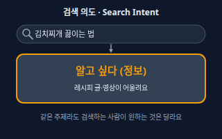</a> <b><a href="#search-intent--검색-의도">Search Intent</a></b> 검색 의도 검색창에 단어를 넣은 사람이 진짜 원하는 것. 같은 단어라도 '알고 싶다 / 비교하고 싶다 / 사고 싶다 / 어딘가로 가고 싶다'처럼 목적이 다르다.</td>
<td width="33%" valign="top"><a href="#keyword-research--키워드-조사">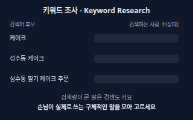</a> <b><a href="#keyword-research--키워드-조사">Keyword Research</a></b> 키워드 조사 손님이 실제로 검색할 말을 찾아 모으고, 그중 우리가 다룰 수 있는 말을 고르는 작업.</td>
</tr>
<tr>
<td width="33%" valign="top"><a href="#long-tail-keyword--롱테일-키워드">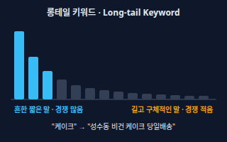</a> <b><a href="#long-tail-keyword--롱테일-키워드">Long-tail Keyword</a></b> 롱테일 키워드 &quot;케이크&quot;처럼 짧고 흔한 말이 아니라 &quot;성수동 비건 케이크 당일배송&quot;처럼 길고 구체적인 검색어. 검색하는 사람은 적어도 경쟁이 덜하고 원하는 것이 분명하다.</td>
<td width="33%" valign="top"><a href="#serp--검색-결과-페이지">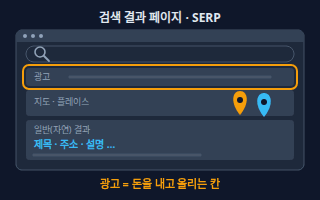</a> <b><a href="#serp--검색-결과-페이지">SERP</a></b> 검색 결과 페이지 Search Engine Results Page. 검색어를 넣으면 나오는 결과 화면. 광고, 지도, 일반 결과, 이미지 같은 칸이 섞여 있고 검색어마다 구성이 달라진다.</td>
<td width="33%" valign="top"><a href="#smart-block--스마트블록-네이버">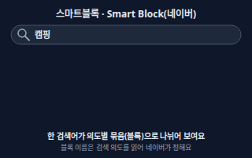</a> <b><a href="#smart-block--스마트블록-네이버">Smart Block</a></b> 스마트블록 (네이버) 네이버가 검색 의도를 분석해, 한 검색어의 결과를 '캠핑요리·캠핑용품·캠핑장·캠핑카'처럼 세부 의도별 묶음(블록)으로 나눠 보여 주는 방식.</td>
</tr>
<tr>
<td width="33%" valign="top"><a href="#crawling--크롤링">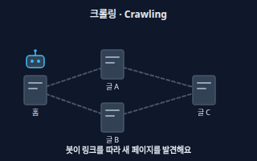</a> <b><a href="#crawling--크롤링">Crawling</a></b> 크롤링 검색엔진의 봇(구글 Googlebot, 네이버 Yeti)이 링크를 따라다니며 페이지를 찾아 내용을 가져가는 일. 먼저 읽혀야 검색에 오를 수 있다.</td>
<td width="33%" valign="top"><a href="#indexing--색인">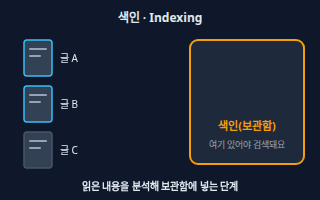</a> <b><a href="#indexing--색인">Indexing</a></b> 색인 봇이 읽어 간 페이지를 분석해 검색엔진의 거대한 데이터베이스(색인)에 저장하는 단계. 색인에 들어가야 검색 결과에 나올 수 있고, 읽혔다고 해서 반드시 색인되지는 않는다.</td>
<td width="33%" valign="top"><a href="#ranking--검색-순위">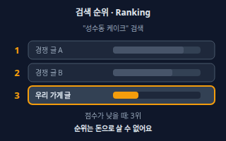</a> <b><a href="#ranking--검색-순위">Ranking</a></b> 검색 순위 검색어에 맞춰 색인된 페이지 중 무엇을 먼저 보여 줄지 정하는 과정과 그 결과의 순서. 사용자의 위치·언어·기기에 따라서도 달라진다.</td>
</tr>
</table>

**페이지 안 손보기 · On-page** (6)

<table>
<tr>
<td width="33%" valign="top"><a href="#meta-title--메타-타이틀">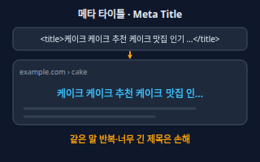</a> <b><a href="#meta-title--메타-타이틀">Meta Title</a></b> 메타 타이틀 HTML의 &lt;title&gt;에 적는 페이지 제목. 검색 결과의 파란 제목줄과 브라우저 탭에 쓰인다. 페이지마다 다르고 내용을 짧게 설명해야 한다.</td>
<td width="33%" valign="top"><a href="#meta-description--메타-디스크립션">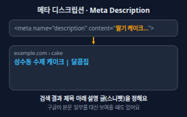</a> <b><a href="#meta-description--메타-디스크립션">Meta Description</a></b> 메타 디스크립션 페이지를 요약하는 &lt;meta name=&quot;description&quot;&gt; 태그. 검색 결과 제목 아래 설명 글(스니펫)에 쓰일 수 있지만, 구글은 검색어에 맞게 본문에서 다른 문장을 골라 보여 주기도 한다.</td>
<td width="33%" valign="top"><a href="#heading-structure--제목-구조">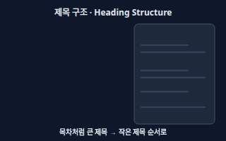</a> <b><a href="#heading-structure--제목-구조">Heading Structure</a></b> 제목 구조 글을 큰 제목(H1)과 소제목(H2, H3)으로 목차처럼 나누는 HTML 구조. 사람은 훑어 읽기 쉽고, 봇은 글의 뼈대를 알아본다.</td>
</tr>
<tr>
<td width="33%" valign="top"><a href="#alt-text--대체-텍스트">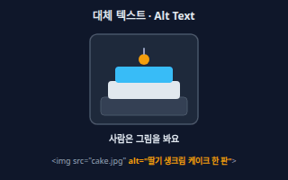</a> <b><a href="#alt-text--대체-텍스트">Alt Text</a></b> 대체 텍스트 이미지를 볼 수 없는 사람·프로그램(화면낭독기, 검색 봇)을 위해 이미지 내용을 글로 적는 alt 속성. 구글은 alt와 주변 글로 이미지가 무엇인지 이해한다.</td>
<td width="33%" valign="top"><a href="#url-structure--url-구조">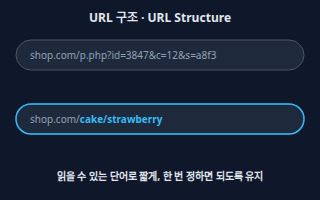</a> <b><a href="#url-structure--url-구조">URL Structure</a></b> URL 구조 페이지 주소를 shop.com/cake/strawberry처럼 읽을 수 있는 단어와 폴더 단계로 짓는 것. 사람과 봇이 주소만 보고도 내용을 짐작할 수 있다.</td>
<td width="33%" valign="top"><a href="#open-graph--오픈-그래프">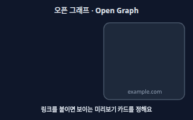</a> <b><a href="#open-graph--오픈-그래프">Open Graph</a></b> 오픈 그래프 링크를 메신저·SNS에 붙였을 때 나오는 미리보기 카드(제목·설명·대표 이미지)를 정하는 og: 태그.</td>
</tr>
</table>

**봇 길 안내와 색인 제어 · Crawl & Index Control** (11)

<table>
<tr>
<td width="33%" valign="top"><a href="#robotstxt--로봇-배제-파일">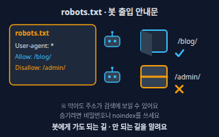</a> <b><a href="#robotstxt--로봇-배제-파일">robots.txt</a></b> 로봇 배제 파일 사이트 맨 위(example.com/robots.txt)에 두는 텍스트 파일로, 봇이 들어와도 되는 길과 안 되는 길을 안내한다. 봇의 접근 양을 조절하는 용도이지 비밀을 지키는 방법은 아니다.</td>
<td width="33%" valign="top"><a href="#sitemapxml--사이트맵">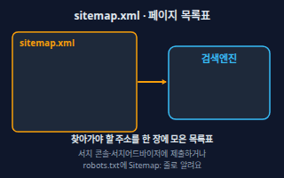</a> <b><a href="#sitemapxml--사이트맵">sitemap.xml</a></b> 사이트맵 사이트의 중요한 주소를 한 파일에 모은 목록. 봇이 새 글을 더 잘 찾도록 돕지만, 제출했다고 색인이 보장되지는 않는다. 한 파일에는 최대 5만 개 주소(압축 전 50MB)까지 담을 수 있다.</td>
<td width="33%" valign="top"><a href="#noindex--검색-제외-표시">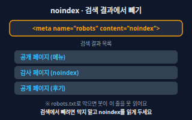</a> <b><a href="#noindex--검색-제외-표시">noindex</a></b> 검색 제외 표시 페이지에 '이 페이지는 검색 결과에 넣지 마세요'라고 붙이는 표시(meta robots 태그 또는 응답 헤더). 봇이 읽으면 그 페이지는 검색 결과에서 빠진다.</td>
</tr>
<tr>
<td width="33%" valign="top"><a href="#canonical-url--대표-url">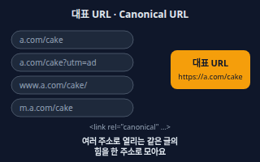</a> <b><a href="#canonical-url--대표-url">Canonical URL</a></b> 대표 URL 같은 내용이 여러 주소로 열릴 때(http/https, www 유무, 광고 추적 파라미터 등) '이 주소가 대표'라고 알려 주는 것. &lt;link rel=&quot;canonical&quot;&gt; 태그가 대표적인 방법이다.</td>
<td width="33%" valign="top"><a href="#duplicate-content--중복-콘텐츠">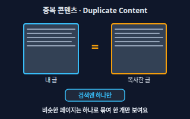</a> <b><a href="#duplicate-content--중복-콘텐츠">Duplicate Content</a></b> 중복 콘텐츠 같거나 매우 비슷한 내용이 여러 주소 또는 여러 사이트에 있는 상태. 검색엔진은 그중 하나를 골라 보여 주고 나머지는 묶는다. 남의 글을 복사해 올리면 가치가 낮은 글로 본다.</td>
<td width="33%" valign="top"><a href="#301-redirect--301-리다이렉트">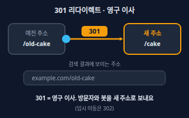</a> <b><a href="#301-redirect--301-리다이렉트">301 Redirect</a></b> 301 리다이렉트 옛 주소로 들어온 방문자와 봇을 새 주소로 자동으로 보내며 '영구히 이사했다'고 알리는 이동. 주소를 바꿀 때 검색 노출을 이어 가는 기본 방법이다. 구글 봇은 이동이 이어지면 보통 10단계까지 따라간다.</td>
</tr>
<tr>
<td width="33%" valign="top"><a href="#404-and-soft-404--404와-소프트-404">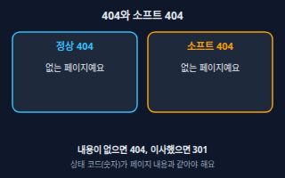</a> <b><a href="#404-and-soft-404--404와-소프트-404">404 and Soft 404</a></b> 404와 소프트 404 404는 '그 주소에 페이지가 없다'는 서버의 정식 대답이다. 소프트 404는 화면에는 '없는 페이지예요'라고 써 놓고 상태 코드는 200(성공)으로 답하는 잘못된 경우로, 검색엔진이 헷갈린다.</td>
<td width="33%" valign="top"><a href="#ssr-vs-csr--서버-렌더링과-클라이언트-렌더링">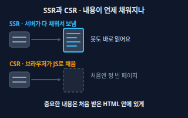</a> <b><a href="#ssr-vs-csr--서버-렌더링과-클라이언트-렌더링">SSR vs CSR</a></b> 서버 렌더링과 클라이언트 렌더링 SSR은 서버가 내용을 채운 HTML을 보내는 방식, CSR은 빈 HTML을 보내고 브라우저가 자바스크립트로 나중에 채우는 방식. 구글은 자바스크립트를 실행해 보지만 모든 봇이 그런 것은 아니라서, 처음 받는 HTML에 내용이 있는 쪽이 안전하다.</td>
<td width="33%" valign="top"><b><a href="backend.md#status-code--상태-코드">Status Code</a></b> 상태 코드 서버가 요청에 대해 '성공(200)·이동(301)·없음(404)·서버 오류(500)'처럼 결과를 숫자로 알려 주는 코드. 검색엔진 봇도 이 숫자를 보고 판단한다. → backend 시트</td>
</tr>
<tr>
<td width="33%" valign="top"><b><a href="backend.md#https--https">HTTPS</a></b> HTTPS 웹 사이트와 방문자 사이의 통신을 암호화해 주는 보안 연결. 주소가 https://로 시작한다. → backend 시트</td>
<td width="33%" valign="top"><b><a href="backend.md#domain-and-dns--도메인과-dns">Domain and DNS</a></b> 도메인과 DNS 사람이 읽는 사이트 주소(도메인)를 실제 서버 위치로 이어 주는 주소록 체계. → backend 시트</td>
</tr>
</table>

**검색 화면과 성능 · Appearance & Performance** (5)

<table>
<tr>
<td width="33%" valign="top"><a href="#structured-data--구조화된-데이터">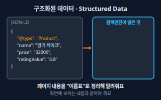</a> <b><a href="#structured-data--구조화된-데이터">Structured Data</a></b> 구조화된 데이터 페이지 내용을 '상품이고, 이름은 이것, 가격은 이것'처럼 표준 형식(주로 JSON-LD, schema.org 어휘)으로 정리해 봇에게 알려 주는 코드. 화면에 보이는 내용과 같아야 한다.</td>
<td width="33%" valign="top"><a href="#rich-result--리치-결과">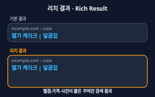</a> <b><a href="#rich-result--리치-결과">Rich Result</a></b> 리치 결과 별점, 가격, 사진, 행사 일정처럼 일반 결과보다 풍부하게 꾸며져 나오는 검색 결과. 구조화된 데이터를 올바르게 달면 자격이 생기지만 반드시 나오는 것은 아니다.</td>
<td width="33%" valign="top"><a href="#mobile-first-indexing--모바일-우선-색인">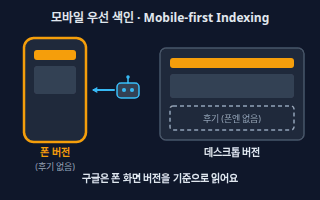</a> <b><a href="#mobile-first-indexing--모바일-우선-색인">Mobile-first Indexing</a></b> 모바일 우선 색인 구글이 휴대폰용 버전의 페이지를 기준으로 읽어 색인·순위에 쓰는 방식. 폰 화면에서 빠진 내용은 반영되지 않을 수 있다.</td>
</tr>
<tr>
<td width="33%" valign="top"><b><a href="ui-design.md#responsive-layout--반응형-레이아웃">Responsive Layout</a></b> 반응형 레이아웃 화면 너비에 따라 배치가 자동으로 바뀌어 PC·태블릿·폰에서 모두 알맞게 보이는 레이아웃. → ui-design 시트</td>
<td width="33%" valign="top"><a href="#core-web-vitals--핵심-웹-지표">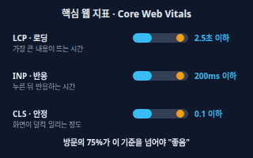</a> <b><a href="#core-web-vitals--핵심-웹-지표">Core Web Vitals</a></b> 핵심 웹 지표 방문자가 느끼는 속도 품질을 재는 3가지 지표. LCP(가장 큰 내용이 뜨는 시간) 2.5초 이하, INP(누른 뒤 반응하는 시간) 200밀리초 이하, CLS(화면이 덜컥 밀리는 정도) 0.1 이하가 '좋음'이며, 실제 방문의 75%가 이 기준을 넘으면 통과로 본다.</td>
</tr>
</table>

**링크 · Links** (4)

<table>
<tr>
<td width="33%" valign="top"><a href="#internal-link--내부-링크">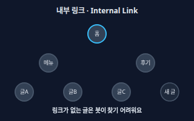</a> <b><a href="#internal-link--내부-링크">Internal Link</a></b> 내부 링크 같은 사이트 안의 한 페이지에서 다른 페이지로 거는 링크. 사람이 다음 글을 찾는 길이자, 봇이 새 페이지를 발견하는 길이다.</td>
<td width="33%" valign="top"><a href="#backlink--백링크">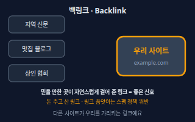</a> <b><a href="#backlink--백링크">Backlink</a></b> 백링크 다른 사이트에서 우리 사이트로 걸어 준 링크. 믿을 만한 곳이 자연스럽게 걸어 줄수록 좋은 신호가 된다. 링크를 사고팔거나 품앗이로 주고받는 것은 스팸 정책 위반이다.</td>
<td width="33%" valign="top"><a href="#anchor-text--앵커-텍스트">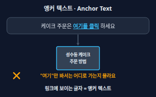</a> <b><a href="#anchor-text--앵커-텍스트">Anchor Text</a></b> 앵커 텍스트 링크에 걸린, 눈에 보이는 글자. 사람과 봇 모두 이 글자를 보고 링크가 어디로 가는지 짐작한다.</td>
</tr>
<tr>
<td width="33%" valign="top"><a href="#link-attributes--링크-속성-rel">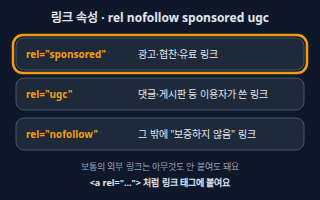</a> <b><a href="#link-attributes--링크-속성-rel">Link Attributes</a></b> 링크 속성 (rel) 링크 태그에 붙여 그 링크와의 관계를 알리는 값. 광고·협찬 링크는 sponsored, 댓글·게시판 등 이용자가 쓴 링크는 ugc, 그 밖에 따라가기를 원하지 않으면 nofollow.</td>
</tr>
</table>

**신뢰와 품질 · Quality & Trust** (2)

<table>
<tr>
<td width="33%" valign="top"><a href="#e-e-a-t--e-e-a-t">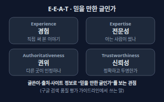</a> <b><a href="#e-e-a-t--e-e-a-t">E-E-A-T</a></b> E-E-A-T Experience(경험), Expertise(전문성), Authoritativeness(권위), Trustworthiness(신뢰성)의 머리글자. 글과 사이트가 믿을 만한지 가늠하는 관점으로, 누가 어떤 경험으로 썼는지가 드러나는 글이 유리하다.</td>
<td width="33%" valign="top"><a href="#spam-policies--스팸-정책">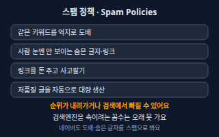</a> <b><a href="#spam-policies--스팸-정책">Spam Policies</a></b> 스팸 정책 검색엔진을 속여 순위를 올리려는 꼼수(키워드 도배, 숨은 글자·링크, 링크 매매, 가치 없는 글 대량 생산 등)를 금지하는 규칙. 어기면 순위가 내려가거나 검색에서 빠질 수 있다.</td>
</tr>
</table>

**측정 도구 · Tools** (2)

<table>
<tr>
<td width="33%" valign="top"><a href="#google-search-console--구글-서치-콘솔">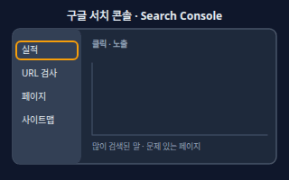</a> <b><a href="#google-search-console--구글-서치-콘솔">Google Search Console</a></b> 구글 서치 콘솔 구글이 무료로 제공하는 도구. 우리 사이트가 구글 검색에 얼마나 나오고 클릭됐는지, 색인에 문제가 없는지 알려 주고, 사이트맵 제출·URL 검사·재색인 요청을 할 수 있다. 가입하지 않아도 검색에는 나오지만, 문제를 알려면 필요하다.</td>
<td width="33%" valign="top"><a href="#naver-search-advisor--네이버-서치어드바이저">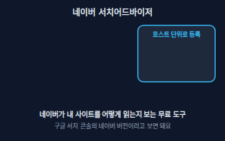</a> <b><a href="#naver-search-advisor--네이버-서치어드바이저">Naver Search Advisor</a></b> 네이버 서치어드바이저 네이버가 무료로 제공하는 웹마스터 도구와 가이드. 사이트를 등록·소유 확인한 뒤 사이트맵·RSS를 제출하고, 수집 요청과 노출·클릭·진단 리포트를 볼 수 있다. 사이트는 호스트 단위(blog.mysite.com은 가능, mysite.com/myid는 불가)로 등록하며, 검색로봇이 다녀간 뒤 최대 1주일 이내에 콘텐츠가 검색에 반영된다고 안내한다.</td>
</tr>
</table>

**동네 가게와 AI 검색 · Local & AI** (3)

<table>
<tr>
<td width="33%" valign="top"><a href="#google-business-profile--구글-비즈니스-프로필">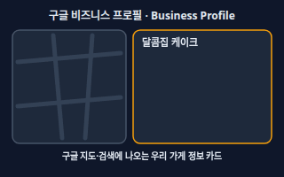</a> <b><a href="#google-business-profile--구글-비즈니스-프로필">Google Business Profile</a></b> 구글 비즈니스 프로필 구글 검색과 지도에 나오는 가게·사업장 정보(이름·주소·영업시간·사진·리뷰)를 사장님이 직접 등록·관리하는 무료 서비스. 정보가 정확하고 충실할수록 '내 근처' 검색에 나올 가능성이 높아진다.</td>
<td width="33%" valign="top"><a href="#naver-place--네이버-플레이스">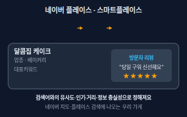</a> <b><a href="#naver-place--네이버-플레이스">Naver Place</a></b> 네이버 플레이스 네이버 지도·검색에 나오는 가게 정보 서비스. 사업주가 스마트플레이스에서 무료로 등록·관리한다. 등록 신청에는 사업자등록증 제출이 필수이고, 검토는 영업일 기준 2시간에서 최대 5일 걸리며, 대표키워드는 최대 5개까지 넣을 수 있다.</td>
<td width="33%" valign="top"><a href="#ai-search-visibility--ai-검색-노출-aeogeo">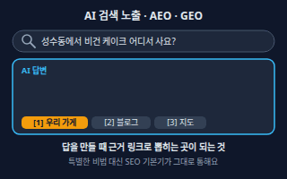</a> <b><a href="#ai-search-visibility--ai-검색-노출-aeogeo">AI Search Visibility</a></b> AI 검색 노출 (AEO·GEO) AI 요약 답변(구글 AI 개요·AI 모드 등)이나 챗봇 답변이 근거 링크로 우리 페이지를 보여 주게 하는 것. AEO(Answer Engine Optimization), GEO(Generative Engine Optimization)라고도 부른다. 구글은 AI 기능에 나오기 위한 추가 기술 요건이 따로 없고, 색인되어 스니펫을 보여 줄 수 있는 페이지면 대상이 된다고 안내한다.</td>
</tr>
</table>

<!-- overview:end -->

## 검색의 원리 · How Search Works

### SEO · 검색엔진 최적화

- **정의**: 검색엔진이 우리 사이트를 잘 이해하고, 검색한 사람에게 도움이 되는 결과로 보여 주도록 글과 사이트를 다듬는 일. 이 시트의 용어는 모두 이 일의 세부 부품이다.
- **원본**: [마케팅 · SEO](marketing.md#seo--검색엔진-최적화)

### Search Intent · 검색 의도

- **정의**: 검색창에 단어를 넣은 사람이 진짜 원하는 것. 같은 단어라도 '알고 싶다 / 비교하고 싶다 / 사고 싶다 / 어딘가로 가고 싶다'처럼 목적이 다르다.
- **AI에게 이렇게**: "'김치찌개 밀키트'로 검색하는 사람의 의도를 정보형·비교형·구매형으로 나누고, 우리 쇼핑몰 상품 페이지는 어느 의도를 노려야 하는지 알려줘."
- **언제**: 글 주제를 정하거나, 한 페이지가 어떤 질문에 답해야 하는지 정할 때
- **헷갈림**: 키워드 — 키워드는 입력한 '단어', 의도는 그 단어 뒤의 '목적'이다. 단어가 같아도 의도가 다르면 어울리는 페이지가 다르다.
- **관련**: Keyword Research, SERP, Landing Page
- **확인 질문**: 이 페이지를 본 방문자가 하길 바라는 행동은 무엇인가요(읽기·비교·구매·방문)? 지금 그 검색어로 첫 화면에 나오는 결과는 어떤 종류의 페이지인가요?

### Keyword Research · 키워드 조사

- **정의**: 손님이 실제로 검색할 말을 찾아 모으고, 그중 우리가 다룰 수 있는 말을 고르는 작업.
- **AI에게 이렇게**: "성수동에서 수제 케이크 가게를 해. 손님이 검색할 만한 말 30개를 의도별로 묶어 표로 만들고, 짧고 흔한 말과 길고 구체적인 말을 나눠줘."
- **언제**: 사이트·블로그를 새로 만들기 전, 새 글·페이지 주제를 정할 때
- **헷갈림**: 광고 키워드 — 광고 입찰용 키워드 목록과 비슷해 보이지만, SEO에서는 한 페이지가 한 가지 의도에 답하도록 짜는 것이 핵심이다. 도구가 알려 주는 검색량은 서로 다르니 대략 비교용으로만 본다.
- **관련**: Long-tail Keyword, Search Intent, SERP
- **확인 질문**: 손님이 가장 먼저 떠올릴 말(지역·업종·상품 이름)은 무엇인가요? 구글과 네이버 중 어디를 먼저 노릴 건가요?

### Long-tail Keyword · 롱테일 키워드

- **정의**: "케이크"처럼 짧고 흔한 말이 아니라 "성수동 비건 케이크 당일배송"처럼 길고 구체적인 검색어. 검색하는 사람은 적어도 경쟁이 덜하고 원하는 것이 분명하다.
- **AI에게 이렇게**: "'케이크' 대신 우리 가게가 이길 만한 롱테일 키워드 20개를 지역·용도·가격대 조합으로 만들고, 각각에 어울리는 글 제목을 붙여줘."
- **언제**: 작은 가게·새 사이트가 흔한 검색어로는 순위 경쟁이 어려울 때
- **헷갈림**: 긴 문장 억지로 잇기 — 롱테일은 사람이 실제로 검색할 법한 구체적인 표현이어야 한다. 단어를 억지로 이어 붙이면 키워드 도배가 된다.
- **관련**: Keyword Research, Search Intent, Spam Policies
- **확인 질문**: 손님이 문의할 때 가장 자주 쓰는 표현은 무엇인가요? 지역·용도·가격대 중 어떤 조건이 중요한가요?

### SERP · 검색 결과 페이지

- **정의**: Search Engine Results Page. 검색어를 넣으면 나오는 결과 화면. 광고, 지도, 일반 결과, 이미지 같은 칸이 섞여 있고 검색어마다 구성이 달라진다.
- **AI에게 이렇게**: "'성수동 케이크'를 검색했을 때 구글과 네이버 결과 화면에 어떤 칸(광고·지도·블로그·쇼핑)이 나오는지 정리하고, 우리가 들어갈 수 있는 칸을 알려줘."
- **언제**: 경쟁 상황을 보거나 어떤 칸을 노릴지 정할 때
- **헷갈림**: 순위 — SERP는 결과 화면 전체이고, 순위는 그 안에서 우리 결과의 위치다. 광고 칸에 나오는 것은 SEO 순위가 아니다.
- **관련**: Ranking, Rich Result, Smart Block, Google Business Profile
- **확인 질문**: 확인할 검색어는 무엇이고, PC와 모바일 중 어느 화면 기준인가요?
- **근거**: [Google 검색 작동 방식 (검색어에 따라 결과 화면의 구성이 달라짐)](https://developers.google.com/search/docs/fundamentals/how-search-works)
- **검증일**: 2026-11-02

### Smart Block · 스마트블록 (네이버)

- **정의**: 네이버가 검색 의도를 분석해, 한 검색어의 결과를 '캠핑요리·캠핑용품·캠핑장·캠핑카'처럼 세부 의도별 묶음(블록)으로 나눠 보여 주는 방식.
- **AI에게 이렇게**: "'성수동 데이트' 같은 검색어가 네이버에서 어떤 세부 블록으로 나뉘는지 살펴보고, 우리 가게 글이 들어갈 만한 블록 주제를 제안해줘."
- **언제**: 네이버 검색 결과 구성을 이해하거나, 블로그 글 주제를 세부 의도로 쪼갤 때
- **헷갈림**: 검색 순위 — 스마트블록은 한 줄로 늘어선 순위표가 아니라 주제별 묶음이다. 어느 블록에 어떤 글이 나올지는 네이버가 정하며 구성이 바뀔 수 있으니 직접 검색해 확인한다.
- **관련**: SERP, Search Intent, Naver Search Advisor
- **확인 질문**: 노리는 검색어를 네이버에서 직접 검색하면 어떤 블록 이름이 나오나요?

### Crawling · 크롤링

- **정의**: 검색엔진의 봇(구글 Googlebot, 네이버 Yeti)이 링크를 따라다니며 페이지를 찾아 내용을 가져가는 일. 먼저 읽혀야 검색에 오를 수 있다.
- **AI에게 이렇게**: "우리 사이트의 중요한 페이지가 모두 메뉴나 본문 링크로 이어져 있는지, 봇이 막혀 있지는 않은지 점검해줘."
- **언제**: 새 글이 검색에 안 나올 때 가장 먼저 의심할 단계
- **헷갈림**: 색인 — 크롤링은 '읽으러 오는 것', 색인은 '읽은 뒤 보관함에 넣는 것'이다. 읽혔다고 모두 색인되지는 않는다.
- **관련**: Indexing, robots.txt, sitemap.xml, Internal Link
- **확인 질문**: 문제가 있는 페이지 주소는 무엇인가요? 로그인이나 robots.txt 때문에 막혀 있지는 않나요?
- **근거**: [Google 검색 작동 방식 (크롤링)](https://developers.google.com/search/docs/fundamentals/how-search-works), [네이버 서치어드바이저 검색엔진 최적화의 목적 (검색로봇 Yeti)](https://searchadvisor.naver.com/guide/seo-basic-intro)
- **검증일**: 2026-11-02

### Indexing · 색인

- **정의**: 봇이 읽어 간 페이지를 분석해 검색엔진의 거대한 데이터베이스(색인)에 저장하는 단계. 색인에 들어가야 검색 결과에 나올 수 있고, 읽혔다고 해서 반드시 색인되지는 않는다.
- **AI에게 이렇게**: "이 글이 구글과 네이버 색인에 들어갔는지 확인하는 방법을 알려주고, 안 들어갔다면 의심할 이유를 순서대로 알려줘."
- **언제**: "글을 올렸는데 검색해도 안 나와요" 할 때
- **헷갈림**: 순위 — 색인은 입장권이고 순위는 그 안에서의 등수다. 색인되지 않으면 순위 자체가 없다.
- **관련**: Crawling, Ranking, noindex, Google Search Console
- **확인 질문**: 구글에서 site:주소 검색이나 Search Console의 URL 검사로 확인해 봤나요? 글을 올린 지 얼마나 됐나요?
- **근거**: [Google 검색 작동 방식 (색인은 보장되지 않음)](https://developers.google.com/search/docs/fundamentals/how-search-works), [네이버 서치어드바이저 사이트 진단 (색인 확인 방법)](https://searchadvisor.naver.com/guide/report-diagnosis)
- **검증일**: 2026-11-02

### Ranking · 검색 순위

- **정의**: 검색어에 맞춰 색인된 페이지 중 무엇을 먼저 보여 줄지 정하는 과정과 그 결과의 순서. 사용자의 위치·언어·기기에 따라서도 달라진다.
- **AI에게 이렇게**: "'성수동 케이크'로 우리 글이 몇 번째인지 한 번 보는 대신, 지난달과 비교해 노출·클릭이 어떻게 변했는지 Search Console 기준 보고서로 정리해줘."
- **언제**: 성과를 점검할 때 — 순위는 사람·장소·기기마다 달라서 한 번 본 숫자를 그대로 믿지 않는다
- **헷갈림**: 광고 순위 — 광고는 돈을 내고 입찰해 정해지는 위치이고, 자연 검색 순위는 돈을 내서 올릴 수 없다. '1위 보장'을 내세우는 곳은 의심한다.
- **관련**: SERP, Indexing, CTR, E-E-A-T
- **확인 질문**: 순위를 확인할 기기·지역·로그인 상태는 어떤가요? 순위보다 방문자·문의 수가 진짜 목표 아닌가요?
- **근거**: [Google 검색 작동 방식 (돈으로 순위를 살 수 없음, 위치·언어·기기에 따라 달라짐)](https://developers.google.com/search/docs/fundamentals/how-search-works)
- **검증일**: 2026-11-02

## 페이지 안 손보기 · On-page

### Meta Title · 메타 타이틀

- **정의**: HTML의 <title>에 적는 페이지 제목. 검색 결과의 파란 제목줄과 브라우저 탭에 쓰인다. 페이지마다 다르고 내용을 짧게 설명해야 한다.
- **AI에게 이렇게**: "내 카페 홈페이지 각 페이지의 <title>을 페이지마다 다르게 써줘. 지역명과 대표 메뉴가 들어가고 가게 이름으로 끝나게."
- **언제**: 새 페이지를 만들 때, 모든 페이지의 제목이 똑같을 때
- **헷갈림**: 제목 구조(H1) — title은 검색 결과와 탭에 보이는 제목이고 H1은 페이지 안의 큰 제목이다. 구글은 title이 내용과 맞지 않으면 다른 글로 바꿔 보여 주기도 한다.
- **관련**: Meta Description, Heading Structure, Open Graph
- **확인 질문**: 이 페이지의 핵심 검색어 한두 개는 무엇인가요? 가게 이름은 제목 앞과 뒤 중 어디에 넣을까요?
- **근거**: [Google 제목 링크(title link) 가이드](https://developers.google.com/search/docs/appearance/title-link), [네이버 서치어드바이저 SEO 기본 가이드](https://searchadvisor.naver.com/guide/seo-help)
- **검증일**: 2026-11-02

### Meta Description · 메타 디스크립션

- **정의**: 페이지를 요약하는 <meta name="description"> 태그. 검색 결과 제목 아래 설명 글(스니펫)에 쓰일 수 있지만, 구글은 검색어에 맞게 본문에서 다른 문장을 골라 보여 주기도 한다.
- **AI에게 이렇게**: "각 상품 페이지의 meta description을 두 문장 이내 요약으로 만들어줘. 상품 특징과 배송 정보를 넣고 과장 문구는 빼줘."
- **언제**: 검색 결과에서 클릭을 부르는 설명 문장을 직접 다듬고 싶을 때
- **헷갈림**: meta keywords — 예전에 쓰던 keywords 태그는 구글이 쓰지 않는다. 설명 글은 요약이지 키워드 나열 칸이 아니다.
- **관련**: Meta Title, Rich Result, CTR
- **확인 질문**: 이 페이지에서 방문자가 얻는 것은 무엇인가요? 가격·지역처럼 꼭 보여 줄 정보가 있나요?
- **근거**: [Google 스니펫·메타 디스크립션 가이드](https://developers.google.com/search/docs/appearance/snippet), [Google SEO 시작 가이드 (keywords 메타 태그 미사용)](https://developers.google.com/search/docs/fundamentals/seo-starter-guide)
- **검증일**: 2026-11-02

### Heading Structure · 제목 구조

- **정의**: 글을 큰 제목(H1)과 소제목(H2, H3)으로 목차처럼 나누는 HTML 구조. 사람은 훑어 읽기 쉽고, 봇은 글의 뼈대를 알아본다.
- **AI에게 이렇게**: "이 블로그 글 초안의 제목 구조를 H1과 H2·H3로 정리하고, 글자만 크게 만든 가짜 제목은 진짜 제목 태그로 바꿔줘."
- **언제**: 긴 글, 상품 상세, 가이드 페이지를 만들 때
- **헷갈림**: 글자 크기 — 글자를 크게 만든 것과 H 태그는 다르다. 눈에는 제목처럼 보여도 태그가 없으면 구조로 읽히지 않는다. H 번호는 크기가 아니라 단계다.
- **관련**: Meta Title, Alt Text, Accessibility
- **확인 질문**: 이 페이지의 주제를 한 문장으로 말하면 무엇인가요? 어떤 소주제로 나눌까요?
- **근거**: [Google SEO 시작 가이드 (제목으로 글 구조 잡기)](https://developers.google.com/search/docs/fundamentals/seo-starter-guide)
- **검증일**: 2026-11-02

### Alt Text · 대체 텍스트

- **정의**: 이미지를 볼 수 없는 사람·프로그램(화면낭독기, 검색 봇)을 위해 이미지 내용을 글로 적는 alt 속성. 구글은 alt와 주변 글로 이미지가 무엇인지 이해한다.
- **AI에게 이렇게**: "상품 이미지 20장의 alt 텍스트를 한국어로 써줘. 사진에 실제로 보이는 것을 한 문장으로 설명하고 키워드를 나열하지 마."
- **언제**: 메뉴·상품처럼 이미지가 중요한 페이지, 접근성을 높이고 싶을 때
- **헷갈림**: 파일 이름·캡션 — 파일명(cake.jpg), 캡션(화면에 보이는 설명), alt(보이지 않는 대체 글)는 서로 다르다. alt에 키워드를 나열하면 스팸으로 볼 수 있다. 글자를 이미지로만 만들면 봇이 못 읽으니 글로도 적는다.
- **관련**: Heading Structure, Accessibility, Structured Data
- **확인 질문**: 이 이미지는 장식인가요, 내용을 전달하나요? 사진 안에 글자가 들어 있나요?
- **근거**: [Google 이미지 SEO 모범 사례 (alt 텍스트)](https://developers.google.com/search/docs/appearance/google-images), [네이버 서치어드바이저 콘텐츠 가이드 (글자를 이미지로 만들지 않기)](https://searchadvisor.naver.com/guide/content-basic)
- **검증일**: 2026-11-02

### URL Structure · URL 구조

- **정의**: 페이지 주소를 shop.com/cake/strawberry처럼 읽을 수 있는 단어와 폴더 단계로 짓는 것. 사람과 봇이 주소만 보고도 내용을 짐작할 수 있다.
- **AI에게 이렇게**: "새 쇼핑몰의 주소 구조를 카테고리/상품이름 형태로 설계해줘. ?id=123 같은 숫자 파라미터만 있는 주소는 피해줘."
- **언제**: 사이트를 처음 만들거나 개편할 때 (주소는 한 번 공개하면 바꾸기 번거롭다)
- **헷갈림**: 도메인 — 도메인은 주소의 앞부분(shop.com)이고, URL 구조는 그 뒤의 경로다. 이미 공개한 주소를 바꾸면 옛 주소에서 새 주소로 301 리다이렉트가 필요하다.
- **관련**: 301 Redirect, Canonical URL, Domain and DNS
- **확인 질문**: 상품·글이 대략 몇 개이고 카테고리는 몇 단계인가요? 이미 공개된 주소를 바꾸는 건가요?
- **근거**: [Google URL 구조 모범 사례](https://developers.google.com/search/docs/crawling-indexing/url-structure), [네이버 서치어드바이저 검색 친화적인 URL 구축하기](https://searchadvisor.naver.com/guide/seo-advanced-url)
- **검증일**: 2026-11-02

### Open Graph · 오픈 그래프

- **정의**: 링크를 메신저·SNS에 붙였을 때 나오는 미리보기 카드(제목·설명·대표 이미지)를 정하는 og: 태그.
- **AI에게 이렇게**: "블로그 글 페이지에 og:title, og:description, og:image, og:url 태그를 넣어줘. 대표 이미지는 글마다 다르게."
- **언제**: 링크를 카톡·SNS로 공유할 일이 많은 가게·콘텐츠 사이트
- **헷갈림**: 메타 디스크립션 — 메타 디스크립션은 검색 결과용 설명이고, 오픈 그래프는 공유 미리보기용이다. 검색 순위를 올리려는 태그가 아니다.
- **관련**: Meta Title, Meta Description, Landing Page
- **확인 질문**: 공유 미리보기에 쓸 대표 이미지가 준비돼 있나요? 고쳤는데도 옛 미리보기가 남아 있나요?
- **근거**: [Open Graph protocol (필수 속성 og:title·og:type·og:image·og:url)](https://ogp.me/)
- **검증일**: 2026-11-02

## 봇 길 안내와 색인 제어 · Crawl & Index Control

### robots.txt · 로봇 배제 파일

- **정의**: 사이트 맨 위(example.com/robots.txt)에 두는 텍스트 파일로, 봇이 들어와도 되는 길과 안 되는 길을 안내한다. 봇의 접근 양을 조절하는 용도이지 비밀을 지키는 방법은 아니다.
- **AI에게 이렇게**: "robots.txt에서 관리자 페이지(/admin/)는 막고 나머지는 구글과 네이버 봇 모두 허용되게 작성하고, sitemap 위치도 넣어줘."
- **언제**: 관리자·장바구니 같은 불필요한 페이지로 봇이 몰리는 걸 줄일 때, 사이트 전체가 실수로 막혔는지 점검할 때
- **헷갈림**: noindex — robots.txt로 막아도 다른 곳의 링크 때문에 주소가 검색 결과에 나올 수 있다. 검색에서 빼려면 봇이 읽을 수 있는 noindex나 비밀번호가 필요하다.
- **관련**: noindex, sitemap.xml, Crawling
- **확인 질문**: 막고 싶은 폴더는 어디인가요? 지금 사이트 전체가 막혀 있지는 않은가요(Disallow: /)?
- **근거**: [Google robots.txt 소개](https://developers.google.com/search/docs/crawling-indexing/robots/intro), [네이버 서치어드바이저 검색엔진 최적화의 목적 (검색로봇 접근 허용)](https://searchadvisor.naver.com/guide/seo-basic-intro)
- **검증일**: 2026-11-02

### sitemap.xml · 사이트맵

- **정의**: 사이트의 중요한 주소를 한 파일에 모은 목록. 봇이 새 글을 더 잘 찾도록 돕지만, 제출했다고 색인이 보장되지는 않는다. 한 파일에는 최대 5만 개 주소(압축 전 50MB)까지 담을 수 있다.
- **AI에게 이렇게**: "내 사이트의 공개 페이지만 담은 sitemap.xml을 만들고, robots.txt에 위치를 적고, Search Console과 서치어드바이저에 제출하는 순서를 알려줘."
- **언제**: 새 사이트, 글이 많은 사이트, 링크로 닿기 어려운 페이지가 있을 때. 구글은 약 500쪽 이하이고 링크가 잘 이어진 작은 사이트라면 없어도 된다고 안내한다
- **헷갈림**: HTML 사이트맵 페이지 — 방문자가 보라고 만든 목차 페이지와 달리, sitemap.xml은 검색엔진용 목록 파일이다. 워드프레스·Wix 같은 서비스는 자동으로 만들어 주기도 한다.
- **관련**: robots.txt, Crawling, Google Search Console, Naver Search Advisor
- **확인 질문**: 사이트를 워드프레스·Wix·직접 개발 중 무엇으로 만들었나요? 이미 자동으로 만들어진 sitemap이 있나요?
- **근거**: [Google 사이트맵 개요 (작은 사이트 기준 약 500쪽)](https://developers.google.com/search/docs/crawling-indexing/sitemaps/overview), [Google 사이트맵 만들기 (파일당 50MB·5만 URL 한도)](https://developers.google.com/search/docs/crawling-indexing/sitemaps/build-sitemap), [네이버 서치어드바이저 검색엔진 최적화의 목적 (사이트맵·RSS 제출)](https://searchadvisor.naver.com/guide/seo-basic-intro)
- **검증일**: 2026-11-02

### noindex · 검색 제외 표시

- **정의**: 페이지에 '이 페이지는 검색 결과에 넣지 마세요'라고 붙이는 표시(meta robots 태그 또는 응답 헤더). 봇이 읽으면 그 페이지는 검색 결과에서 빠진다.
- **AI에게 이렇게**: "주문 완료 페이지, 테스트 페이지, 내부 검색 결과 페이지에만 noindex를 넣어줘. 공개해야 하는 페이지에 실수로 들어간 건 없는지도 점검해줘."
- **언제**: 검색에 나오면 안 되는 페이지가 있을 때, 갑자기 검색에서 사라졌을 때(개발 중 켜 둔 noindex가 남았는지 확인)
- **헷갈림**: robots.txt — 둘을 같이 쓰면 봇이 noindex를 읽지 못한다. 중복 페이지를 정리하려는 목적이라면 noindex보다 대표 URL(canonical)이 맞다.
- **관련**: robots.txt, Indexing, Canonical URL
- **확인 질문**: 이 페이지를 완전히 비공개로 해야 하나요, 검색에서만 빼면 되나요? 개발 중에 켜 둔 noindex가 남아 있지는 않나요?
- **근거**: [Google noindex로 색인 막기](https://developers.google.com/search/docs/crawling-indexing/block-indexing), [Google 중복 URL 통합 (noindex로 대표 URL을 고르는 것은 비권장)](https://developers.google.com/search/docs/crawling-indexing/consolidate-duplicate-urls), [네이버 서치어드바이저 검색엔진 최적화의 목적 (noindex 페이지는 검색 반영 제외)](https://searchadvisor.naver.com/guide/seo-basic-intro)
- **검증일**: 2026-11-02

### Canonical URL · 대표 URL

- **정의**: 같은 내용이 여러 주소로 열릴 때(http/https, www 유무, 광고 추적 파라미터 등) '이 주소가 대표'라고 알려 주는 것. <link rel="canonical"> 태그가 대표적인 방법이다.
- **AI에게 이렇게**: "상품이 /cake와 /cake?utm_source=ad 두 주소로 열려. 모든 페이지에 자기 자신을 가리키는 canonical 태그를 넣고, sitemap에는 대표 주소만 넣어줘."
- **언제**: 필터·정렬·광고 파라미터 때문에 같은 페이지의 주소가 여러 개 생길 때
- **헷갈림**: 301 리다이렉트 — canonical은 '대표가 이것'이라고 알려 주는 신호이고, 301은 방문자까지 실제로 새 주소로 옮겨 보낸다. 신호일 뿐이라 검색엔진이 다른 주소를 고를 수도 있다.
- **관련**: Duplicate Content, 301 Redirect, sitemap.xml
- **확인 질문**: 대표로 삼을 주소는 www가 있는 쪽인가요, 없는 쪽인가요? https인가요? 어떤 파라미터가 붙은 주소가 생기나요?
- **근거**: [Google 대표 URL 지정 방법 (리다이렉트·rel=canonical은 강한 신호, 사이트맵은 약한 신호)](https://developers.google.com/search/docs/crawling-indexing/consolidate-duplicate-urls)
- **검증일**: 2026-11-02

### Duplicate Content · 중복 콘텐츠

- **정의**: 같거나 매우 비슷한 내용이 여러 주소 또는 여러 사이트에 있는 상태. 검색엔진은 그중 하나를 골라 보여 주고 나머지는 묶는다. 남의 글을 복사해 올리면 가치가 낮은 글로 본다.
- **AI에게 이렇게**: "우리 사이트에서 거의 같은 내용으로 보이는 페이지(색상별 상품 페이지, 필터 조합)를 찾아 합치거나 canonical로 묶는 방법을 알려줘."
- **언제**: 같은 상품을 색상마다 별도 페이지로 만들었거나, 같은 블로그 글을 여러 곳에 똑같이 올릴 때
- **헷갈림**: 스팸 — 구글은 사이트 안의 중복을 스팸 정책 위반으로 보지는 않지만 크롤링을 낭비하게 만들 수 있다고 안내한다. 네이버는 남의 글을 복사하거나 같은 내용의 사이트를 여러 개 만드는 것을 불이익 대상으로 안내한다.
- **관련**: Canonical URL, 301 Redirect, Spam Policies
- **확인 질문**: 비슷한 페이지가 몇 개이고 왜 나뉘어 있나요? 다른 곳의 글을 가져온 부분이 있나요?
- **근거**: [Google SEO 시작 가이드 (중복 콘텐츠 줄이기)](https://developers.google.com/search/docs/fundamentals/seo-starter-guide), [네이버 서치어드바이저 콘텐츠 가이드 (복사하지 말고 자신의 이야기)](https://searchadvisor.naver.com/guide/content-basic), [네이버 서치어드바이저 검색엔진 최적화의 목적 (중복된 콘텐츠 확인)](https://searchadvisor.naver.com/guide/seo-basic-intro)
- **검증일**: 2026-11-02

### 301 Redirect · 301 리다이렉트

- **정의**: 옛 주소로 들어온 방문자와 봇을 새 주소로 자동으로 보내며 '영구히 이사했다'고 알리는 이동. 주소를 바꿀 때 검색 노출을 이어 가는 기본 방법이다. 구글 봇은 이동이 이어지면 보통 10단계까지 따라간다.
- **AI에게 이렇게**: "사이트 주소 구조를 바꿀 거야. 옛 주소 → 새 주소 목록으로 301 리다이렉트를 설정하고, 옛→중간→새처럼 여러 번 거치는 이동이 생기지 않는지 점검해줘."
- **언제**: 도메인 이전, 주소 구조 변경, http에서 https로 옮길 때, 페이지를 합칠 때
- **헷갈림**: 302 — 302는 '잠깐만 이동'이라 옛 주소가 검색에 남을 수 있다. 영구 이동은 301(또는 308)이다. 자바스크립트나 메타 리프레시 이동은 서버에서 하는 이동보다 인식이 덜 확실하다.
- **관련**: Status Code, URL Structure, Canonical URL, HTTPS
- **확인 질문**: 옛 주소 전체 목록이 있나요? 호스팅 서비스·Apache·Nginx 중 어디에서 설정하나요?
- **근거**: [Google 리다이렉트와 검색 (301·308은 영구, 서버 방식이 가장 확실)](https://developers.google.com/search/docs/crawling-indexing/301-redirects), [Google HTTP 상태 코드와 크롤러 (최대 10번 이동 추적)](https://developers.google.com/search/docs/crawling-indexing/http-network-errors)
- **검증일**: 2026-11-02

### 404 and Soft 404 · 404와 소프트 404

- **정의**: 404는 '그 주소에 페이지가 없다'는 서버의 정식 대답이다. 소프트 404는 화면에는 '없는 페이지예요'라고 써 놓고 상태 코드는 200(성공)으로 답하는 잘못된 경우로, 검색엔진이 헷갈린다.
- **AI에게 이렇게**: "삭제된 상품 페이지가 200으로 응답하는지 확인하고, 없는 페이지는 404, 다른 곳으로 옮긴 페이지는 301이 되도록 고쳐줘. 404 화면에는 홈으로 가는 링크도 넣어줘."
- **언제**: 지운 페이지가 검색에 계속 남거나, Search Console에 '소프트 404'가 뜰 때
- **헷갈림**: 에러 — 404는 장애가 아니라 정상적인 대답이다. 지운 페이지는 404로 두면 되고, 대신 보여 줄 새 페이지가 있을 때만 301로 보낸다.
- **관련**: Status Code, 301 Redirect, Google Search Console
- **확인 질문**: 지운 페이지를 대신할 새 페이지가 있나요? 사이트가 자바스크립트로 화면을 그리는 방식인가요(그러면 상태 코드를 못 바꾸는 경우가 있다)?
- **근거**: [Google 크롤링 오류 해결 (소프트 404)](https://developers.google.com/search/docs/crawling-indexing/troubleshoot-crawling-errors), [네이버 서치어드바이저 사이트 진단 (소프트 404 안내)](https://searchadvisor.naver.com/guide/report-diagnosis)
- **검증일**: 2026-11-02

### SSR vs CSR · 서버 렌더링과 클라이언트 렌더링

- **정의**: SSR은 서버가 내용을 채운 HTML을 보내는 방식, CSR은 빈 HTML을 보내고 브라우저가 자바스크립트로 나중에 채우는 방식. 구글은 자바스크립트를 실행해 보지만 모든 봇이 그런 것은 아니라서, 처음 받는 HTML에 내용이 있는 쪽이 안전하다.
- **AI에게 이렇게**: "React로 만든 우리 쇼핑몰이 검색에 잘 안 나와. 봇이 처음 받는 HTML에 상품명과 설명이 들어 있는지 확인하고, 필요하면 SSR이나 사전 렌더링 적용 방법을 알려줘."
- **언제**: AI로 만든 React·Vue 같은 앱형 사이트가 검색에 안 잡힐 때
- **헷갈림**: 그냥 '렌더링' — 여기서의 요점은 '내용이 HTML에 언제 채워지느냐'다. 링크도 자바스크립트 클릭 이벤트가 아니라 <a href> 형태여야 봇이 따라간다.
- **관련**: Crawling, Indexing, Internal Link, Core Web Vitals
- **확인 질문**: 사용한 프레임워크는 무엇인가요? '페이지 소스 보기'에서 본문 글자가 보이나요?
- **근거**: [Google 자바스크립트 SEO 기본 (서버 렌더링·사전 렌더링 권장)](https://developers.google.com/search/docs/crawling-indexing/javascript/javascript-seo-basics), [네이버 서치어드바이저 검색엔진 최적화의 목적 (자바스크립트로만 로딩되는 콘텐츠 점검)](https://searchadvisor.naver.com/guide/seo-basic-intro)
- **검증일**: 2026-11-02

### Status Code · 상태 코드

- **정의**: 서버가 요청에 대해 '성공(200)·이동(301)·없음(404)·서버 오류(500)'처럼 결과를 숫자로 알려 주는 코드. 검색엔진 봇도 이 숫자를 보고 판단한다.
- **원본**: [백엔드 · Status Code](backend.md#status-code--상태-코드)

### HTTPS · HTTPS

- **정의**: 웹 사이트와 방문자 사이의 통신을 암호화해 주는 보안 연결. 주소가 https://로 시작한다.
- **원본**: [백엔드 · HTTPS](backend.md#https--https)

### Domain and DNS · 도메인과 DNS

- **정의**: 사람이 읽는 사이트 주소(도메인)를 실제 서버 위치로 이어 주는 주소록 체계.
- **원본**: [백엔드 · Domain and DNS](backend.md#domain-and-dns--도메인과-dns)

## 검색 화면과 성능 · Appearance & Performance

### Structured Data · 구조화된 데이터

- **정의**: 페이지 내용을 '상품이고, 이름은 이것, 가격은 이것'처럼 표준 형식(주로 JSON-LD, schema.org 어휘)으로 정리해 봇에게 알려 주는 코드. 화면에 보이는 내용과 같아야 한다.
- **AI에게 이렇게**: "상품 페이지에 Product 구조화 데이터(JSON-LD)로 이름·가격·재고·평점을 넣어줘. 페이지에 실제로 보이는 값과 일치하게."
- **언제**: 상품, 가게 정보, 글, 행사, 레시피처럼 유형이 정해진 페이지
- **헷갈림**: 메타 디스크립션 — 메타 태그는 문장 요약이고, 구조화된 데이터는 항목별 정보(이름·가격·평점)다. 넣는다고 검색 결과가 꾸며지는 것이 보장되지는 않는다.
- **관련**: Rich Result, Meta Description, Google Business Profile
- **확인 질문**: 이 페이지는 상품·가게·글·행사 중 무엇인가요? 가격이나 평점 같은 값이 화면에도 실제로 보이나요?
- **근거**: [Google 구조화된 데이터 소개 (JSON-LD 권장)](https://developers.google.com/search/docs/appearance/structured-data/intro-structured-data), [Google AI 기능과 내 웹사이트 (구조화된 데이터는 화면의 글과 일치해야 함)](https://developers.google.com/search/docs/appearance/ai-features)
- **검증일**: 2026-11-02

### Rich Result · 리치 결과

- **정의**: 별점, 가격, 사진, 행사 일정처럼 일반 결과보다 풍부하게 꾸며져 나오는 검색 결과. 구조화된 데이터를 올바르게 달면 자격이 생기지만 반드시 나오는 것은 아니다.
- **AI에게 이렇게**: "우리 베이커리 상품 페이지가 구글 리치 결과(가격·평점) 대상이 될 수 있는지, 필요한 구조화 데이터 항목과 테스트 방법을 알려줘."
- **언제**: 상품·레시피·행사·구인처럼 형식이 정해진 콘텐츠로 눈에 띄고 싶을 때
- **헷갈림**: 광고 확장 — 광고에 붙는 별점·가격(광고 확장)과 달리, 리치 결과는 자연 검색 결과에 붙는 것이다.
- **관련**: Structured Data, SERP, CTR
- **확인 질문**: 어떤 유형(상품·레시피·행사 등)에 해당하나요? 별점 후기는 실제 고객이 남긴 것인가요?
- **근거**: [Google 지원 구조화 데이터 갤러리 (리치 결과 자격)](https://developers.google.com/search/docs/appearance/structured-data/search-gallery)
- **검증일**: 2026-11-02

### Mobile-first Indexing · 모바일 우선 색인

- **정의**: 구글이 휴대폰용 버전의 페이지를 기준으로 읽어 색인·순위에 쓰는 방식. 폰 화면에서 빠진 내용은 반영되지 않을 수 있다.
- **AI에게 이렇게**: "우리 사이트의 모바일 화면에도 PC와 같은 본문·이미지·구조화 데이터가 있는지 비교하고, 반응형으로 바꾸는 방법을 알려줘."
- **언제**: PC용과 모바일용 사이트를 따로 두었거나, 모바일에서 숨기거나 접어 둔 내용이 있을 때
- **헷갈림**: 반응형 디자인 — 반응형은 한 주소·한 HTML을 화면 크기에 맞춰 보여 주는 방식이고, 모바일 우선 색인은 구글이 어느 버전을 읽느냐의 이야기다. 구글은 반응형을 가장 권장한다.
- **관련**: Responsive Layout, Core Web Vitals, Indexing
- **확인 질문**: PC와 모바일이 같은 주소·같은 HTML인가요(반응형), 아니면 따로 있나요?
- **근거**: [Google 모바일 사이트와 모바일 우선 색인 모범 사례](https://developers.google.com/search/docs/crawling-indexing/mobile/mobile-sites-mobile-first-indexing)
- **검증일**: 2026-11-02

### Responsive Layout · 반응형 레이아웃

- **정의**: 화면 너비에 따라 배치가 자동으로 바뀌어 PC·태블릿·폰에서 모두 알맞게 보이는 레이아웃.
- **원본**: [UI 디자인 · Responsive Layout](ui-design.md#responsive-layout--반응형-레이아웃)

### Core Web Vitals · 핵심 웹 지표

- **정의**: 방문자가 느끼는 속도 품질을 재는 3가지 지표. LCP(가장 큰 내용이 뜨는 시간) 2.5초 이하, INP(누른 뒤 반응하는 시간) 200밀리초 이하, CLS(화면이 덜컥 밀리는 정도) 0.1 이하가 '좋음'이며, 실제 방문의 75%가 이 기준을 넘으면 통과로 본다.
- **AI에게 이렇게**: "우리 사이트 홈과 상품 페이지의 LCP·INP·CLS를 측정하고, 가장 큰 원인 3가지(큰 이미지·무거운 스크립트·레이아웃 흔들림)와 고치는 순서를 알려줘."
- **언제**: 사이트가 느리다는 불만이 있을 때, 이미지·스크립트를 많이 올린 뒤
- **헷갈림**: 도구의 속도 점수 — 도구가 시험 환경에서 재는 점수(랩 데이터)는 원인을 찾는 데 도움이 되지만, 핵심 웹 지표는 실제 방문자 데이터(현장 데이터)가 기준이다.
- **관련**: Mobile-first Indexing, SSR vs CSR, HTTPS
- **확인 질문**: 느린 곳이 PC인가요, 모바일인가요? 큰 이미지·동영상·광고 스크립트가 많이 들어 있나요?
- **근거**: [Google 핵심 웹 지표와 검색 결과 (LCP 2.5초, INP 200ms, CLS 0.1)](https://developers.google.com/search/docs/appearance/core-web-vitals), [web.dev Web Vitals (75번째 백분위 기준)](https://web.dev/articles/vitals)
- **검증일**: 2026-11-02

## 링크 · Links

### Internal Link · 내부 링크

- **정의**: 같은 사이트 안의 한 페이지에서 다른 페이지로 거는 링크. 사람이 다음 글을 찾는 길이자, 봇이 새 페이지를 발견하는 길이다.
- **AI에게 이렇게**: "블로그 글 30개를 주제별로 묶고, 각 글 끝에 관련 글 링크를 3개씩 넣는 계획을 짜줘. 링크 글자는 가는 곳을 설명하게."
- **언제**: 새 글을 올린 뒤, 어떤 메뉴에서도 닿지 않는 '고아 페이지'를 없앨 때
- **헷갈림**: 백링크 — 내부 링크는 우리 사이트 안의 길이고 백링크는 다른 사이트에서 오는 링크다. 자바스크립트 클릭 이벤트만 있는 링크는 봇이 따라가지 못하니 <a href>로 만든다.
- **관련**: Anchor Text, Crawling, Backlink
- **확인 질문**: 메뉴에서 닿지 않는 페이지가 있나요? 링크를 버튼(자바스크립트)으로 만들었나요, 일반 <a> 링크로 만들었나요?
- **근거**: [Google 링크 모범 사례 (크롤 가능한 링크)](https://developers.google.com/search/docs/crawling-indexing/links-crawlable), [Google AI 기능과 내 웹사이트 (내부 링크로 찾기 쉽게)](https://developers.google.com/search/docs/appearance/ai-features)
- **검증일**: 2026-11-02

### Backlink · 백링크

- **정의**: 다른 사이트에서 우리 사이트로 걸어 준 링크. 믿을 만한 곳이 자연스럽게 걸어 줄수록 좋은 신호가 된다. 링크를 사고팔거나 품앗이로 주고받는 것은 스팸 정책 위반이다.
- **AI에게 이렇게**: "우리 가게를 소개해 줄 만한 지역 블로그·상인회·지역 매체 후보 목록과, 정중한 소개 요청 메일 초안을 써줘. 링크를 사는 방법은 빼줘."
- **언제**: 새 사이트에 외부 소개가 거의 없을 때, 보도자료·제휴·협회 등재를 준비할 때
- **헷갈림**: 언급 — 링크 없이 이름만 나온 것은 백링크가 아니다. 개수보다 어디서(믿을 만한 곳인지) 걸렸는지가 중요하고, 일부러 만든 사이트에서의 링크는 오히려 불이익이 될 수 있다.
- **관련**: Internal Link, Anchor Text, Spam Policies, Link Attributes
- **확인 질문**: 링크를 걸어 줄 곳과 실제 관계가 있나요? 대가를 주고받는 링크는 아닌가요?
- **근거**: [Google 스팸 정책 (링크 스팸)](https://developers.google.com/search/docs/essentials/spam-policies), [Google 링크 모범 사례 (링크는 관련성 신호)](https://developers.google.com/search/docs/crawling-indexing/links-crawlable), [네이버 서치어드바이저 사이트 최적화 (외부 링크와 사이트 평판)](https://searchadvisor.naver.com/guide/report-seo)
- **검증일**: 2026-11-02

### Anchor Text · 앵커 텍스트

- **정의**: 링크에 걸린, 눈에 보이는 글자. 사람과 봇 모두 이 글자를 보고 링크가 어디로 가는지 짐작한다.
- **AI에게 이렇게**: "이 글의 '여기를 클릭' 같은 링크 글자를 가는 곳을 설명하는 짧은 말로 바꿔줘. 같은 키워드를 반복하지는 마."
- **언제**: 본문 속 링크, 메뉴, 버튼 문구를 쓸 때
- **헷갈림**: Alt Text — 이미지에 링크를 걸면 alt가 앵커 텍스트 역할을 한다. 글 링크는 링크 글자(앵커)가, 이미지 링크는 alt가 목적지를 설명한다.
- **관련**: Internal Link, Backlink, Alt Text, CTA
- **확인 질문**: 이 링크가 가는 페이지는 무엇인가요? 버튼 문구와 링크 글자를 따로 정해야 하나요?
- **근거**: [Google 링크 모범 사례 (좋은 앵커 텍스트)](https://developers.google.com/search/docs/crawling-indexing/links-crawlable), [네이버 서치어드바이저 사이트 최적화 (앵커 텍스트)](https://searchadvisor.naver.com/guide/report-seo)
- **검증일**: 2026-11-02

### Link Attributes · 링크 속성 (rel)

- **정의**: 링크 태그에 붙여 그 링크와의 관계를 알리는 값. 광고·협찬 링크는 sponsored, 댓글·게시판 등 이용자가 쓴 링크는 ugc, 그 밖에 따라가기를 원하지 않으면 nofollow.
- **AI에게 이렇게**: "블로그 댓글에서 나가는 링크에는 rel="ugc"를, 협찬받은 제품 소개 링크에는 rel="sponsored"를 자동으로 붙이도록 바꿔줘."
- **언제**: 광고·협찬 글, 댓글·후기 게시판, 믿기 어려운 사이트로 거는 링크
- **헷갈림**: 대가성 광고 표시 — rel 값은 검색엔진에게 알리는 표시일 뿐, 소비자에게 협찬을 알리는 법적 표시와는 별개다.
- **관련**: Backlink, Spam Policies, Sponsored Disclosure
- **확인 질문**: 이 링크는 돈이나 물품 같은 대가를 받고 건 것인가요? 방문자가 직접 쓴 글에서 나가는 링크인가요?
- **근거**: [Google 외부 링크 한정하기 (sponsored·ugc·nofollow)](https://developers.google.com/search/docs/crawling-indexing/qualify-outbound-links)
- **검증일**: 2026-11-02

## 신뢰와 품질 · Quality & Trust

### E-E-A-T · E-E-A-T

- **정의**: Experience(경험), Expertise(전문성), Authoritativeness(권위), Trustworthiness(신뢰성)의 머리글자. 글과 사이트가 믿을 만한지 가늠하는 관점으로, 누가 어떤 경험으로 썼는지가 드러나는 글이 유리하다.
- **AI에게 이렇게**: "우리 학원 소개 페이지에 글쓴이 소개, 자격·경력, 연락처, 출처 링크를 넣어 신뢰를 보여 주는 구성을 제안해줘. 없는 경력을 지어내지는 마."
- **언제**: 건강·돈·법처럼 믿고 따라야 하는 주제, 후기·리뷰·가이드 글
- **헷갈림**: 점수나 태그 — E-E-A-T는 코드에 넣는 설정이나 숫자 점수가 아니라, 글과 사이트가 보여 주는 신뢰의 모습이다. 가짜 후기·가짜 전문가 소개는 오히려 해가 된다.
- **관련**: Backlink, Spam Policies, Structured Data
- **확인 질문**: 글쓴이는 누구이고 어떤 경험이 있나요? 정보의 출처를 밝힐 수 있나요?
- **근거**: [Google 도움이 되는 사람 중심 콘텐츠 만들기 (출처·전문성·글쓴이 정보)](https://developers.google.com/search/docs/fundamentals/creating-helpful-content)
- **검증일**: 2026-11-02

### Spam Policies · 스팸 정책

- **정의**: 검색엔진을 속여 순위를 올리려는 꼼수(키워드 도배, 숨은 글자·링크, 링크 매매, 가치 없는 글 대량 생산 등)를 금지하는 규칙. 어기면 순위가 내려가거나 검색에서 빠질 수 있다.
- **AI에게 이렇게**: "우리 사이트 글에서 같은 키워드가 부자연스럽게 반복되는 곳, 숨은 텍스트, 의심스러운 외부 링크가 있는지 점검하고 스팸 정책에 걸릴 만한 부분을 고쳐줘."
- **언제**: AI로 글을 대량으로 만들 때, SEO 대행사와 계약하기 전, 순위가 갑자기 떨어졌을 때
- **헷갈림**: 어뷰징 — 네이버가 쓰는 표현으로, 같은 단어 반복·숨은 문자열·복사 글을 가리킨다. 이름은 달라도 같은 계열이다. AI로 쓴 글이라서 금지가 아니라, 사용자에게 가치 없이 많이 찍어내는 것이 문제다.
- **관련**: Duplicate Content, Backlink, Link Attributes, E-E-A-T
- **확인 질문**: 자동으로 만들 글이 몇 개 정도인가요? 대행사가 링크를 구매하거나 계정 여러 개로 글을 올리지는 않나요?
- **근거**: [Google 스팸 정책](https://developers.google.com/search/docs/essentials/spam-policies), [Google Search Essentials (스팸 정책 위반 시 순위 하락·검색 제외)](https://developers.google.com/search/docs/essentials), [네이버 서치어드바이저 콘텐츠 가이드 (반복 키워드·숨은 문자열)](https://searchadvisor.naver.com/guide/content-basic)
- **검증일**: 2026-11-02

## 측정 도구 · Tools

### Google Search Console · 구글 서치 콘솔

- **정의**: 구글이 무료로 제공하는 도구. 우리 사이트가 구글 검색에 얼마나 나오고 클릭됐는지, 색인에 문제가 없는지 알려 주고, 사이트맵 제출·URL 검사·재색인 요청을 할 수 있다. 가입하지 않아도 검색에는 나오지만, 문제를 알려면 필요하다.
- **AI에게 이렇게**: "Search Console에 우리 도메인을 등록하는 순서를 알려주고, 등록 뒤 일주일에 한 번 확인할 항목(검색어별 클릭·노출, 색인 오류, 사이트맵 상태)을 체크리스트로 만들어줘."
- **언제**: 사이트를 처음 공개한 직후부터, 순위나 방문자가 갑자기 변했을 때
- **헷갈림**: 구글 애널리틱스 — 서치 콘솔은 '검색에서 우리 사이트로 오는 길목'(노출·클릭·색인)을, 애널리틱스는 '방문한 뒤의 행동'을 본다. 둘은 함께 본다.
- **관련**: Naver Search Advisor, sitemap.xml, Indexing, CTR
- **확인 질문**: 사이트 소유를 확인할 권한(HTML 수정, DNS 설정 등)이 있나요? 사이트는 서비스(워드프레스·Wix)로 만들었나요?
- **근거**: [Google Search Console 소개](https://support.google.com/webmasters/answer/9128668), [Google AI 기능과 내 웹사이트 (Search Console에서 확인)](https://developers.google.com/search/docs/appearance/ai-features)
- **검증일**: 2026-11-02

### Naver Search Advisor · 네이버 서치어드바이저

- **정의**: 네이버가 무료로 제공하는 웹마스터 도구와 가이드. 사이트를 등록·소유 확인한 뒤 사이트맵·RSS를 제출하고, 수집 요청과 노출·클릭·진단 리포트를 볼 수 있다. 사이트는 호스트 단위(blog.mysite.com은 가능, mysite.com/myid는 불가)로 등록하며, 검색로봇이 다녀간 뒤 최대 1주일 이내에 콘텐츠가 검색에 반영된다고 안내한다.
- **AI에게 이렇게**: "네이버 서치어드바이저에 우리 사이트를 등록하고 소유 확인하는 방법, 사이트맵·RSS 제출, 수집 요청까지 순서대로 알려줘. 네이버 검색로봇(Yeti)이 막혀 있지 않은지도 점검해줘."
- **언제**: 네이버에서 홈페이지·쇼핑몰이 검색되게 하고 싶을 때
- **헷갈림**: 구글 서치 콘솔 — 역할은 비슷하지만 서로 다른 도구라, 구글에 등록했다고 네이버에 자동으로 등록되지는 않는다.
- **관련**: Google Search Console, robots.txt, sitemap.xml, Smart Block
- **확인 질문**: 등록할 주소(호스트)는 무엇인가요? HTML을 수정하거나 파일을 올릴 수 있나요? 방화벽이 네이버 검색로봇을 막고 있지는 않나요?
- **근거**: [네이버 서치어드바이저 검색엔진 최적화의 목적 (등록 단위, 반영 시점, 사이트맵·RSS)](https://searchadvisor.naver.com/guide/seo-basic-intro), [네이버 서치어드바이저 사이트 진단](https://searchadvisor.naver.com/guide/report-diagnosis)
- **검증일**: 2026-11-02

## 동네 가게와 AI 검색 · Local & AI

### Google Business Profile · 구글 비즈니스 프로필

- **정의**: 구글 검색과 지도에 나오는 가게·사업장 정보(이름·주소·영업시간·사진·리뷰)를 사장님이 직접 등록·관리하는 무료 서비스. 정보가 정확하고 충실할수록 '내 근처' 검색에 나올 가능성이 높아진다.
- **AI에게 이렇게**: "구글 비즈니스 프로필에 가게를 등록하는 순서와, 영업시간·카테고리·사진·메뉴를 어떻게 채워야 하는지 체크리스트로 알려줘. 공휴일 영업시간도 반영해줘."
- **언제**: 카페·미용실·학원 같은 오프라인 가게가 지도와 '근처' 검색에 나오게 하고 싶을 때
- **헷갈림**: 네이버 플레이스 — 같은 목적이지만 구글과 네이버가 각각 운영하는 서비스라 따로 등록해야 한다. 홈페이지 SEO와도 별개의 작업이다.
- **관련**: Naver Place, SERP, Structured Data
- **확인 질문**: 손님이 찾아오는 매장 주소가 있나요, 방문 서비스인가요? 사업장 소유 인증을 받을 수 있나요?
- **근거**: [Google 비즈니스 프로필 도움말 (현지 검색 순위 높이기)](https://support.google.com/business/answer/7091)
- **검증일**: 2026-11-02

### Naver Place · 네이버 플레이스

- **정의**: 네이버 지도·검색에 나오는 가게 정보 서비스. 사업주가 스마트플레이스에서 무료로 등록·관리한다. 등록 신청에는 사업자등록증 제출이 필수이고, 검토는 영업일 기준 2시간에서 최대 5일 걸리며, 대표키워드는 최대 5개까지 넣을 수 있다.
- **AI에게 이렇게**: "네이버 스마트플레이스에 가게를 등록하는 순서와, 대표키워드·사진·영업시간·메뉴 정보를 빠짐없이 채우는 체크리스트를 알려줘."
- **언제**: 동네 가게가 네이버 지도와 '근처' 검색에서 보이게 하고 싶을 때
- **헷갈림**: 순위 보장 업체 — 네이버는 검색어와 정보의 유사도, 업체·카테고리 인기도, 거리, 정보의 충실성 등을 종합해 순서를 정한다고 안내한다. '플레이스 순위 보장'을 내세우는 곳은 믿기 어렵다.
- **관련**: Google Business Profile, SERP, Smart Block
- **확인 질문**: 사업자등록증이 있나요? 업종·대표키워드·영업시간·메뉴와 가격 정보는 준비돼 있나요?
- **근거**: [네이버 스마트플레이스 업체 신규등록 방법](https://help.naver.com/service/30026/contents/20366), [네이버 스마트플레이스 업체 검색 순위를 높이는 방법 안내](https://help.naver.com/service/30026/contents/23473)
- **검증일**: 2026-11-02

### AI Search Visibility · AI 검색 노출 (AEO·GEO)

- **정의**: AI 요약 답변(구글 AI 개요·AI 모드 등)이나 챗봇 답변이 근거 링크로 우리 페이지를 보여 주게 하는 것. AEO(Answer Engine Optimization), GEO(Generative Engine Optimization)라고도 부른다. 구글은 AI 기능에 나오기 위한 추가 기술 요건이 따로 없고, 색인되어 스니펫을 보여 줄 수 있는 페이지면 대상이 된다고 안내한다.
- **AI에게 이렇게**: "우리 병원 홈페이지가 AI 검색 답변의 근거 링크로 나오게 하려면 점검할 것을 정리해줘. 봇 허용(robots.txt), 글로 적힌 핵심 정보, 구조화 데이터, 비즈니스 프로필 최신화를 중심으로."
- **언제**: 사람들이 검색 대신 AI에게 묻기 시작해 노출이 걱정될 때
- **헷갈림**: SEO — 새 비법이 따로 있는 것이 아니라 SEO 기본기가 그대로 적용된다. AEO·GEO는 업계에서 쓰는 이름이고, 특정 AI 챗봇에 나오게 해 준다는 보장은 없다.
- **관련**: SEO, Structured Data, E-E-A-T, Google Business Profile
- **확인 질문**: 어느 AI(구글 AI 개요, 챗봇 등)에서의 노출을 원하나요? 핵심 정보가 이미지가 아니라 글로 적혀 있나요?
- **근거**: [Google AI 기능과 내 웹사이트 (추가 요건 없음, SEO 기본기 적용)](https://developers.google.com/search/docs/appearance/ai-features)
- **검증일**: 2026-11-02

## 참고 자료

- [Google 검색 센터 · 검색 작동 방식](https://developers.google.com/search/docs/fundamentals/how-search-works)
- [Google 검색 센터 · SEO 시작 가이드](https://developers.google.com/search/docs/fundamentals/seo-starter-guide)
- [Google 검색 센터 · Search Essentials](https://developers.google.com/search/docs/essentials)
- [Google 검색 센터 · 스팸 정책](https://developers.google.com/search/docs/essentials/spam-policies)
- [Google 검색 센터 · 핵심 웹 지표](https://developers.google.com/search/docs/appearance/core-web-vitals)
- [web.dev · Web Vitals](https://web.dev/articles/vitals)
- [Google 검색 센터 · AI 기능과 내 웹사이트](https://developers.google.com/search/docs/appearance/ai-features)
- [Google Search Console 도움말](https://support.google.com/webmasters/answer/9128668)
- [Google 비즈니스 프로필 도움말](https://support.google.com/business/answer/7091)
- [네이버 서치어드바이저 · 웹마스터 가이드](https://searchadvisor.naver.com/guide)
- [네이버 서치어드바이저 · 검색엔진 최적화의 목적](https://searchadvisor.naver.com/guide/seo-basic-intro)
- [네이버 서치어드바이저 · 사이트 최적화 리포트](https://searchadvisor.naver.com/guide/report-seo)
- [네이버 스마트플레이스 사업주 고객센터 · 업체 신규등록 방법](https://help.naver.com/service/30026/contents/20366)
- [네이버 검색 블로그 · VIEW가 스마트블록으로 고도화함에 따라 탭 변화를 안내드립니다](https://m.blog.naver.com/naver_search/223339984506)
- [Open Graph protocol](https://ogp.me/)
