# 엑셀 · 스프레드시트 치트시트

> 매출표·재고표·명단을 AI에게 정리시키거나, 깨진 수식을 고치게 하거나, 대시보드를 만들게 할 때 펼치는 시트입니다. "이 칸을 저 칸에 맞춰서 합쳐줘" 대신 정확한 이름(절대 참조, 피벗 테이블, XLOOKUP …)으로 말하면 한 번에 원하는 파일이 나옵니다.

> **버전을 꼭 알려 주세요.** 엑셀(Excel)과 구글 시트(Google Sheets)는 메뉴 이름과 지원하는 함수가 조금씩 다르고, 엑셀도 2016·2019·2021·365마다 쓸 수 있는 함수가 다릅니다. 이 시트는 같은 개념이 두 프로그램에 모두 있을 때 그 차이를 `헷갈림`에 적었습니다. 2026-11 기준입니다.

## 이렇게 쓰세요

- **나 → AI**: "엑셀 365에서 쓸 거야. A열 날짜, B열 상품, C열 금액이 있는 매출 시트로 월별·상품별 합계 피벗 테이블과 막대 차트를 만들어줘."
- **AI → 나**: "엑셀과 구글 시트 중 어느 쪽인가요? 엑셀이면 2019 이하인가요, 2021·365인가요? XLOOKUP·FILTER 같은 함수는 버전에 따라 안 될 수 있어요."
- **나 → AI**: "D열 합계 수식을 아래까지 복사했더니 세율이 한 칸씩 밀려서 다 틀려. 세율이 있는 F1 칸이 고정되도록 고쳐줘."
- **AI → 나**: "수식에서 세율은 $F$1처럼 절대 참조로 고정하면 됩니다. 세율이 다른 시트에 있나요? 그럼 이름 정의로 '세율'이라고 이름 붙여 드릴까요?"
- **나 → AI**: "다른 시트의 상품 코드로 가격을 가져와서 채워줘. 코드가 가격표의 오른쪽 열에 있어."
- **AI → 나**: "코드 열이 가격 열보다 오른쪽이면 VLOOKUP은 못 가져와서 XLOOKUP이나 INDEX-MATCH를 써야 해요. 사용 중인 엑셀에 XLOOKUP이 있나요?"

## 한눈에 보기

<!-- overview:start -->
<!-- 이 구역은 자동 생성됩니다. 직접 고치지 말고 `cd mcp-server && npm run generate`를 실행하세요. -->

**기본 · Basics** (7)

<table>
<tr>
<td width="33%" valign="top"> <b><a href="#cell-reference--셀-참조-상대절대">Cell Reference</a></b> 셀 참조 (상대·절대) 수식이 어느 칸의 값을 쓸지 가리키는 주소(B2). 수식을 복사하면 주소가 같이 움직이는 것이 상대 참조이고, $B$2처럼 $를 붙여 움직이지 않게 잠그는 것이 절대 참조다.</td>
<td width="33%" valign="top"><a href="#fill-handle--채우기-핸들">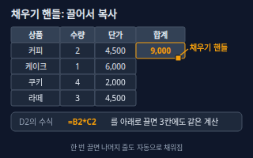</a> <b><a href="#fill-handle--채우기-핸들">Fill Handle</a></b> 채우기 핸들 선택한 칸의 오른쪽 아래 모서리에 있는 작은 네모. 끌어서 놓으면 수식·값·규칙(1월, 2월 …)이 옆이나 아래 칸으로 복사된다.</td>
<td width="33%" valign="top"><a href="#range--범위">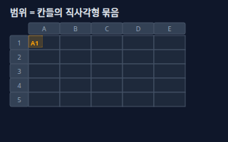</a> <b><a href="#range--범위">Range</a></b> 범위 칸 여러 개를 묶은 직사각형 영역. 왼쪽 위 칸과 오른쪽 아래 칸을 콜론으로 이어 A1:C4처럼 쓴다.</td>
</tr>
<tr>
<td width="33%" valign="top"><a href="#worksheet--workbook--시트와-통합-문서">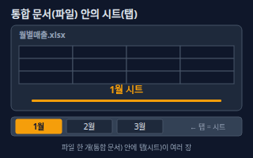</a> <b><a href="#worksheet--workbook--시트와-통합-문서">Worksheet &amp; Workbook</a></b> 시트와 통합 문서 통합 문서(Workbook)는 엑셀 파일 하나이고, 시트(Worksheet)는 그 안에 탭으로 나뉜 표 한 장이다. 한 파일에 시트를 여러 장 둘 수 있다.</td>
<td width="33%" valign="top"><a href="#table--표-테이블">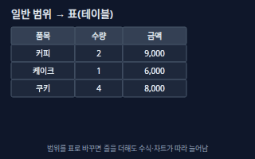</a> <b><a href="#table--표-테이블">Table</a></b> 표 (테이블) 범위를 '표'로 바꾼 것. 이름이 붙고, 머리글에 필터 화살표와 줄무늬가 생기며, 맨 아래에 줄을 더하면 표와 그 표를 쓰는 수식·차트가 따라 늘어난다.</td>
<td width="33%" valign="top"><a href="#freeze-panes--틀-고정">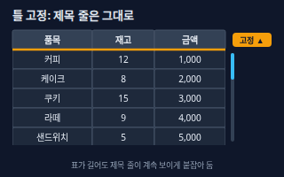</a> <b><a href="#freeze-panes--틀-고정">Freeze Panes</a></b> 틀 고정 위쪽 줄이나 왼쪽 열을 화면에 붙들어 두는 기능. 스크롤해도 제목 줄이 계속 보인다.</td>
</tr>
<tr>
<td width="33%" valign="top"><a href="#named-range--이름-정의">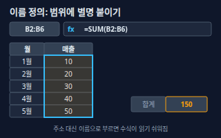</a> <b><a href="#named-range--이름-정의">Named Range</a></b> 이름 정의 칸이나 범위에 매출, 세율 같은 이름을 붙여 두는 기능. 수식에 B2:B6 대신 이름을 쓸 수 있어 읽기 쉽고 주소가 밀려도 안전하다.</td>
</tr>
</table>

**함수 · Functions** (8)

<table>
<tr>
<td width="33%" valign="top"><a href="#if--ifs--if-함수">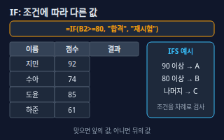</a> <b><a href="#if--ifs--if-함수">IF / IFS</a></b> IF 함수 조건이 맞으면 한 값, 아니면 다른 값을 돌려주는 함수. =IF(B2&gt;=80,&quot;합격&quot;,&quot;재시험&quot;). IFS는 조건 여러 개를 차례로 검사한다.</td>
<td width="33%" valign="top"><a href="#sumifs--countifs--조건부-합계개수">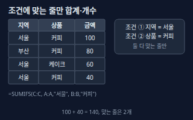</a> <b><a href="#sumifs--countifs--조건부-합계개수">SUMIFS / COUNTIFS</a></b> 조건부 합계·개수 여러 조건을 모두 만족하는 줄만 골라 합계(SUMIFS)나 개수(COUNTIFS)를 구하는 함수. 조건은 '범위, 조건' 쌍으로 이어 쓴다.</td>
<td width="33%" valign="top"><a href="#vlookup--세로-찾기">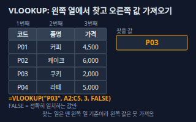</a> <b><a href="#vlookup--세로-찾기">VLOOKUP</a></b> 세로 찾기 표의 맨 왼쪽 열에서 값을 찾아, 같은 줄의 n번째 열 값을 가져오는 함수. =VLOOKUP(&quot;P03&quot;, A2:C5, 3, FALSE).</td>
</tr>
<tr>
<td width="33%" valign="top"><a href="#xlookup--엑스룩업">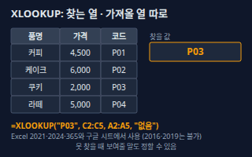</a> <b><a href="#xlookup--엑스룩업">XLOOKUP</a></b> 엑스룩업 찾을 열과 가져올 열을 따로 정해서 값을 찾는 함수. 가져올 열이 왼쪽이든 오른쪽이든 상관없고 못 찾았을 때 보여줄 말도 정할 수 있다. =XLOOKUP(&quot;P03&quot;, C2:C5, A2:A5, &quot;없음&quot;).</td>
<td width="33%" valign="top"><a href="#index-match--인덱스-매치">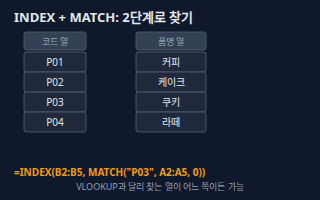</a> <b><a href="#index-match--인덱스-매치">INDEX-MATCH</a></b> 인덱스-매치 MATCH로 값이 몇 번째 줄에 있는지 찾고, INDEX로 그 번째 값을 꺼내는 두 함수 조합. 찾는 열과 가져올 열의 위치에 제한이 없다.</td>
<td width="33%" valign="top"> <b><a href="#text-functions--텍스트-함수">Text Functions</a></b> 텍스트 함수 글자를 자르고(LEFT·MID·RIGHT), 합치고(&amp;, CONCAT), 다듬고(TRIM), 숫자의 보이는 모양을 바꾸는(TEXT) 함수들.</td>
</tr>
<tr>
<td width="33%" valign="top"> <b><a href="#date-functions--날짜-함수">Date Functions</a></b> 날짜 함수 날짜를 더하고 빼고 요일을 알아내는 함수들. 날짜는 사실 숫자로 저장되어 있어서 =B2-A2처럼 빼면 일수가 나온다. TODAY()는 오늘, EDATE는 몇 달 뒤, WEEKDAY는 요일 번호.</td>
<td width="33%" valign="top"> <b><a href="#dynamic-arrays--동적-배열-filteruniquesort">Dynamic Arrays</a></b> 동적 배열 (FILTER·UNIQUE·SORT) 수식 한 칸을 쓰면 결과가 여러 칸에 아래·옆으로 자동으로 퍼지는(스필, spill) 기능. FILTER(조건에 맞는 줄만), UNIQUE(중복 없는 목록), SORT(정렬)가 대표다.</td>
</tr>
</table>

**정리 · Data Cleanup** (6)

<table>
<tr>
<td width="33%" valign="top"><a href="#filter--sort--필터와-정렬">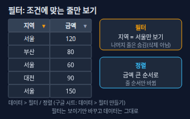</a> <b><a href="#filter--sort--필터와-정렬">Filter &amp; Sort</a></b> 필터와 정렬 필터는 조건에 맞는 줄만 보이게 하고 나머지는 숨기는 기능, 정렬은 값 기준으로 줄 순서를 바꾸는 기능이다. 필터는 데이터를 지우지 않는다.</td>
<td width="33%" valign="top"> <b><a href="#remove-duplicates--중복-제거">Remove Duplicates</a></b> 중복 제거 같은 값이 여러 줄에 나오면 첫 줄만 남기고 나머지를 지우는 기능. 어떤 열들이 모두 같아야 중복으로 볼지 고른다.</td>
<td width="33%" valign="top"> <b><a href="#text-to-columns--텍스트-나누기">Text to Columns</a></b> 텍스트 나누기 한 칸에 몰려 있는 글자를 쉼표·공백·탭 같은 구분 기호 기준으로 여러 칸으로 쪼개는 기능.</td>
</tr>
<tr>
<td width="33%" valign="top"> <b><a href="#data-validation--데이터-유효성-검사">Data Validation</a></b> 데이터 유효성 검사 칸에 입력할 수 있는 값을 목록이나 조건(숫자 범위, 날짜 등)으로 제한하는 기능. 드롭다운 목록이 가장 흔한 사용법이다.</td>
<td width="33%" valign="top"><a href="#conditional-formatting--조건부-서식">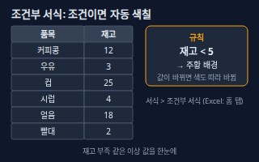</a> <b><a href="#conditional-formatting--조건부-서식">Conditional Formatting</a></b> 조건부 서식 값이 조건에 맞으면 칸 색·글자 색·아이콘이 자동으로 바뀌는 기능. 값이 바뀌면 색도 따라 바뀐다.</td>
<td width="33%" valign="top"> <b><a href="#error-values--오류-값">Error Values</a></b> 오류 값 수식이 계산하지 못할 때 칸에 나오는 #로 시작하는 오류 코드. 코드마다 원인이 다르다.</td>
</tr>
</table>

**분석 · Analysis** (4)

<table>
<tr>
<td width="33%" valign="top"> <b><a href="#pivot-table--피벗-테이블">Pivot Table</a></b> 피벗 테이블 긴 원본 표를 행·열·값 기준으로 묶어 합계·개수·평균을 한 장의 요약 표로 만드는 기능. 필드를 끌어다 놓으면 완성된다.</td>
<td width="33%" valign="top"><a href="#chart-types--차트-종류">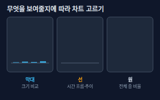</a> <b><a href="#chart-types--차트-종류">Chart Types</a></b> 차트 종류 데이터를 그림으로 보여주는 차트. 막대는 크기 비교, 선은 시간에 따른 흐름, 원은 전체 중 비율을 보여주는 데 쓴다.</td>
<td width="33%" valign="top"><a href="#slicer--슬라이서">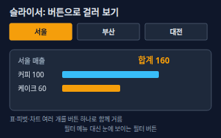</a> <b><a href="#slicer--슬라이서">Slicer</a></b> 슬라이서 눈에 보이는 버튼 모양의 필터. 서울·부산 같은 버튼을 누르면 연결된 피벗 테이블이나 표, 차트가 그 값만 보여준다.</td>
</tr>
<tr>
<td width="33%" valign="top"> <b><a href="#dashboard--대시보드">Dashboard</a></b> 대시보드 핵심 숫자 카드와 차트를 한 시트에 모아 한눈에 보게 만든 요약 화면. 원본 데이터가 바뀌면 숫자와 차트도 따라 바뀐다.</td>
</tr>
</table>

**자동화 · Automation** (3)

<table>
<tr>
<td width="33%" valign="top"> <b><a href="#macro--vba--매크로와-vba">Macro &amp; VBA</a></b> 매크로와 VBA 반복하는 클릭 동작을 녹화해 두고 버튼 한 번으로 다시 실행하는 기능이 매크로이고, 그 동작이 저장된 코드가 VBA(Visual Basic for Applications)다. 엑셀 전용이다.</td>
<td width="33%" valign="top"> <b><a href="#apps-script--앱스-스크립트">Apps Script</a></b> 앱스 스크립트 구글 시트 안에서 자바스크립트로 시트를 조작하고, 메뉴나 새 함수를 추가하고, 정해진 때 자동 실행(트리거)하게 만드는 구글의 자동화 도구.</td>
<td width="33%" valign="top"><a href="#power-query--파워-쿼리">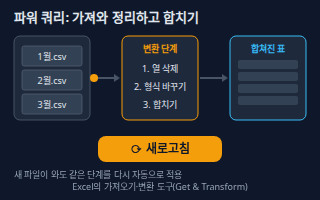</a> <b><a href="#power-query--파워-쿼리">Power Query</a></b> 파워 쿼리 외부 파일·표를 불러와 열 삭제, 형식 변경, 합치기 같은 정리 단계를 기록해 두고, 새로고침 한 번으로 같은 단계를 다시 적용하는 엑셀의 가져오기·변환 도구('데이터 가져오기 및 변환'이라고도 부름).</td>
</tr>
</table>

<!-- overview:end -->

## 기본 · Basics

### Cell Reference · 셀 참조 (상대·절대)

- **정의**: 수식이 어느 칸의 값을 쓸지 가리키는 주소(`B2`). 수식을 복사하면 주소가 같이 움직이는 것이 상대 참조이고, `$B$2`처럼 `$`를 붙여 움직이지 않게 잠그는 것이 절대 참조다.
- **AI에게 이렇게**: "D열 수식을 아래로 복사해도 세율이 들어 있는 F1 칸은 그대로 쓰도록 `$F$1` 절대 참조로 바꿔줘"
- **언제**: 한 줄에 쓴 수식을 전체 줄에 적용할 때, 세율·환율·기준값처럼 한 칸을 계속 가져다 쓸 때
- **헷갈림**: 혼합 참조 — `$B2`는 열만, `B$2`는 행만 고정한다. Named Range(이름 정의) — 주소 대신 이름으로 고정하는 다른 방법.
- **관련**: Fill Handle, Range, Named Range
- **확인 질문**: 수식을 복사해도 계속 같은 칸을 써야 하는 값(세율·환율·목표값)이 있나요? 어느 칸에 있나요?
- **근거**: [Microsoft Support — 상대·절대·혼합 참조 전환](https://support.microsoft.com/en-us/excel/switch-between-relative-absolute-and-mixed-references) (`$`를 붙이면 복사해도 그대로이고, 수식 입력 중 F4로 참조 유형을 바꾼다)
- **검증일**: 2026-11-02

### Fill Handle · 채우기 핸들

- **정의**: 선택한 칸의 오른쪽 아래 모서리에 있는 작은 네모. 끌어서 놓으면 수식·값·규칙(1월, 2월 …)이 옆이나 아래 칸으로 복사된다.
- **AI에게 이렇게**: "D2의 합계 수식을 D2부터 D500까지 채우기 핸들로 채운 것처럼 전부 적용해줘"
- **언제**: 같은 계산을 여러 줄에 반복할 때, 날짜·번호를 순서대로 채울 때
- **헷갈림**: 복사 붙여넣기 — 채우기는 규칙(상대 참조의 이동, 날짜 순서)을 이어서 계산한다. 값만 그대로 복사하려면 붙여넣기 옵션을 쓴다.
- **관련**: Cell Reference, Range
- **확인 질문**: 수식을 몇 번째 줄까지 채울까요? 중간에 빈 줄이나 합계 줄이 있나요?

### Range · 범위

- **정의**: 칸 여러 개를 묶은 직사각형 영역. 왼쪽 위 칸과 오른쪽 아래 칸을 콜론으로 이어 `A1:C4`처럼 쓴다.
- **AI에게 이렇게**: "B2:B100 범위의 금액만 합계 내줘. 맨 위 제목 줄은 빼고"
- **언제**: 함수에 계산할 대상을 알려줄 때, 서식·정렬·차트 대상을 정할 때
- **헷갈림**: 열 전체 `A:A`, 행 전체 `3:3` — 범위의 끝을 정하지 않아 데이터가 늘어도 따라온다. Table(표) — 이름이 붙고 스스로 늘어나는 범위.
- **관련**: Table, Named Range, Cell Reference
- **확인 질문**: 데이터가 몇 번째 줄까지 있나요? 앞으로 줄이 계속 늘어나나요(늘어나면 열 전체나 표를 쓰는 게 안전해요)?

### Worksheet & Workbook · 시트와 통합 문서

- **정의**: 통합 문서(Workbook)는 엑셀 파일 하나이고, 시트(Worksheet)는 그 안에 탭으로 나뉜 표 한 장이다. 한 파일에 시트를 여러 장 둘 수 있다.
- **AI에게 이렇게**: "'매출' 시트의 월별 합계를 '요약' 시트로 가져오는 수식을 만들어줘. 시트 이름은 그대로 두고"
- **언제**: 월별·지점별로 시트를 나누거나, 원본 시트와 요약 시트를 따로 둘 때
- **헷갈림**: 구글 시트는 파일 전체를 '스프레드시트', 아래 탭을 '시트'라고 부른다. 다른 시트를 부르는 수식은 `'매출'!B2`처럼 시트 이름을 앞에 붙인다.
- **관련**: Range, Cell Reference
- **확인 질문**: 시트 이름이 정확히 무엇인가요(띄어쓰기·특수문자 포함)? 시트마다 열 구성이 같은가요?
- **근거**: [Microsoft Support — Excel 사양과 한도](https://support.microsoft.com/en-us/office/excel-specifications-and-limits-1672b34d-7043-467e-8e27-269d656771c3) (워크시트 하나는 최대 1,048,576행 × 16,384열)
- **검증일**: 2026-11-02

### Table · 표 (테이블)

- **정의**: 범위를 '표'로 바꾼 것. 이름이 붙고, 머리글에 필터 화살표와 줄무늬가 생기며, 맨 아래에 줄을 더하면 표와 그 표를 쓰는 수식·차트가 따라 늘어난다.
- **AI에게 이렇게**: "A1:E200 데이터를 표(테이블)로 바꾸고 이름을 '매출표'로 지어줘. 수식은 열 이름으로 써줘"
- **언제**: 데이터를 계속 추가하는 장부, 피벗·차트의 원본
- **헷갈림**: 그냥 범위에 색을 칠한 것 — 보기엔 비슷해도 줄을 더할 때 따라 늘어나지 않는다. 구글 시트는 메뉴·기능이 엑셀과 다르니 사용하는 프로그램을 알려 주세요.
- **관련**: Range, Pivot Table, Filter & Sort
- **확인 질문**: 맨 윗줄이 제목(머리글)인가요? 비어 있는 줄이나 합쳐진 칸이 있나요(있으면 표로 바꾸기 전에 정리해야 해요)?

### Freeze Panes · 틀 고정

- **정의**: 위쪽 줄이나 왼쪽 열을 화면에 붙들어 두는 기능. 스크롤해도 제목 줄이 계속 보인다.
- **AI에게 이렇게**: "맨 윗줄과 A열(상품명)이 스크롤해도 보이도록 틀 고정을 걸어줘"
- **언제**: 줄이 수십 줄 넘는 표, 가로로 열이 많은 표
- **헷갈림**: 필터 — 필터는 줄을 숨기고, 틀 고정은 보이는 위치만 붙든다. 줄 숨기기와도 다르다.
- **관련**: Table, Filter & Sort
- **확인 질문**: 제목이 몇 번째 줄까지인가요? 왼쪽 열도 함께 고정할까요?
- **근거**: [Microsoft Support — 틀 고정](https://support.microsoft.com/en-US/Excel/get-started/freeze-panes-to-lock-rows-and-columns) (선택한 칸의 위쪽 행과 왼쪽 열이 고정된다)
- **검증일**: 2026-11-02

### Named Range · 이름 정의

- **정의**: 칸이나 범위에 `매출`, `세율` 같은 이름을 붙여 두는 기능. 수식에 `B2:B6` 대신 이름을 쓸 수 있어 읽기 쉽고 주소가 밀려도 안전하다.
- **AI에게 이렇게**: "F1 칸에 '세율'이라는 이름을 붙이고, D열 수식은 `=B2*세율`로 바꿔줘"
- **언제**: 여러 시트에서 같은 값을 쓸 때, 수식을 남이 읽어야 할 때
- **헷갈림**: 절대 참조(`$F$1`) — 둘 다 고정하지만 이름은 의미가 보이고 시트가 달라도 쓸 수 있다. Table의 열 이름과도 다르다.
- **관련**: Cell Reference, Range
- **확인 질문**: 이름은 한글로 해도 괜찮나요? 이름이 가리킬 범위는 어디까지인가요?

## 함수 · Functions

### IF / IFS · IF 함수

- **정의**: 조건이 맞으면 한 값, 아니면 다른 값을 돌려주는 함수. `=IF(B2>=80,"합격","재시험")`. IFS는 조건 여러 개를 차례로 검사한다.
- **AI에게 이렇게**: "점수가 90 이상이면 A, 80 이상이면 B, 나머지는 C가 나오도록 IFS(또는 IF 겹쳐 쓰기)로 등급 열을 만들어줘"
- **언제**: 합격·불합격 표시, 구간별 등급, 값에 따라 다른 문구를 보여줄 때
- **헷갈림**: IF와 IFS — 조건이 둘뿐이면 IF, 여럿이면 IFS(또는 IF를 겹쳐 씀). 조건부 서식 — IF는 값을 바꾸고, 조건부 서식은 칸 색만 바꾼다.
- **관련**: Conditional Formatting, SUMIFS / COUNTIFS
- **확인 질문**: 경계값(80점 '이상'인지 '초과'인지)은 어떻게 할까요? 어느 조건에도 안 맞을 때는 무엇을 보여줄까요?

### SUMIFS / COUNTIFS · 조건부 합계·개수

- **정의**: 여러 조건을 모두 만족하는 줄만 골라 합계(SUMIFS)나 개수(COUNTIFS)를 구하는 함수. 조건은 '범위, 조건' 쌍으로 이어 쓴다.
- **AI에게 이렇게**: "지역이 서울이고 상품이 커피인 줄의 금액 합계와 건수를 SUMIFS, COUNTIFS로 구해줘. 범위는 2행부터 500행까지"
- **언제**: 지역별·월별·상품별 합계, 조건에 맞는 주문 수 세기
- **헷갈림**: SUMIF/COUNTIF — 조건이 하나일 때. 피벗 테이블 — 모든 조합의 합계를 한 번에 보고 싶을 때는 피벗이 빠르다.
- **관련**: IF / IFS, Pivot Table, Range
- **확인 질문**: 조건이 모두 맞아야 하나요(AND), 하나만 맞아도 되나요(OR)? 날짜 조건이면 기간의 시작과 끝은 언제인가요?
- **근거**: [Google Docs 편집기 도움말 — COUNTIFS](https://support.google.com/docs/answer/3256550) (조건 범위들은 첫 범위와 행·열 수가 같아야 한다)
- **검증일**: 2026-11-02

### VLOOKUP · 세로 찾기

- **정의**: 표의 맨 왼쪽 열에서 값을 찾아, 같은 줄의 n번째 열 값을 가져오는 함수. `=VLOOKUP("P03", A2:C5, 3, FALSE)`.
- **AI에게 이렇게**: "주문 시트의 상품 코드로 가격표에서 단가를 가져와줘. VLOOKUP, 정확히 일치(FALSE)로"
- **언제**: 코드·이름으로 다른 표의 정보를 붙일 때(가격표, 거래처 명단)
- **헷갈림**: XLOOKUP — 찾는 열이 맨 왼쪽이어야 하는 VLOOKUP과 달리 찾는 열·가져올 열을 따로 고른다. 마지막 인수를 생략하면 근사 일치가 기본이라 정렬 안 된 표에서 엉뚱한 값이 나올 수 있어 `FALSE`를 꼭 쓴다.
- **관련**: XLOOKUP, INDEX-MATCH, Error Values
- **확인 질문**: 찾는 값이 있는 열이 표의 맨 왼쪽인가요? 일치하는 값이 없으면 빈칸과 '없음' 중 무엇을 보여줄까요?
- **근거**: [Microsoft Support — VLOOKUP 함수](https://support.microsoft.com/en-us/excel/functions/vlookup-function) (찾는 값이 반환 값보다 왼쪽에 있도록 표를 짜야 한다), [Google Docs 편집기 도움말 — VLOOKUP](https://support.google.com/docs/answer/3093318) (is_sorted를 생략하면 TRUE=근사 일치, 정확히 일치는 FALSE를 권장)
- **검증일**: 2026-11-02

### XLOOKUP · 엑스룩업

- **정의**: 찾을 열과 가져올 열을 따로 정해서 값을 찾는 함수. 가져올 열이 왼쪽이든 오른쪽이든 상관없고 못 찾았을 때 보여줄 말도 정할 수 있다. `=XLOOKUP("P03", C2:C5, A2:A5, "없음")`.
- **AI에게 이렇게**: "VLOOKUP 말고 XLOOKUP으로 상품 코드(C열)에서 품명(A열)을 가져오고, 못 찾으면 '없음'이 나오게 해줘"
- **언제**: 가져올 값이 찾는 열의 왼쪽에 있을 때, 정확히 일치가 기본이길 바랄 때
- **헷갈림**: VLOOKUP — 오래된 엑셀에도 있지만 맨 왼쪽 열만 기준이다. XLOOKUP은 Excel 2016·2019에는 없고 2021·2024·365와 구글 시트에 있다.
- **관련**: VLOOKUP, INDEX-MATCH, Dynamic Arrays
- **확인 질문**: 사용하는 엑셀 버전이 2021 이상(또는 365)인가요, 구글 시트인가요? 아니면 INDEX-MATCH로 만들까요?
- **근거**: [Microsoft Support — XLOOKUP 함수](https://support.microsoft.com/en-us/excel/functions/xlookup-function) (XLOOKUP은 Excel 2016과 2019에서 쓸 수 없다), [Microsoft Support — Excel 2021 새 기능](https://support.microsoft.com/en-us/excel/what-s-new-in-excel-2021-for-windows) (Excel 2021에 XLOOKUP 추가), [Google Docs 편집기 도움말 — XLOOKUP](https://support.google.com/docs/answer/12405947) (구글 시트에서 지원)
- **검증일**: 2026-11-02

### INDEX-MATCH · 인덱스-매치

- **정의**: MATCH로 값이 몇 번째 줄에 있는지 찾고, INDEX로 그 번째 값을 꺼내는 두 함수 조합. 찾는 열과 가져올 열의 위치에 제한이 없다.
- **AI에게 이렇게**: "엑셀 2019라서 XLOOKUP이 안 돼. INDEX와 MATCH를 합쳐서 코드로 품명을 가져오는 수식을 만들어줘"
- **언제**: XLOOKUP이 없는 엑셀에서 왼쪽 값을 가져올 때, 줄·열 위치를 둘 다 찾을 때
- **헷갈림**: VLOOKUP — 사용법이 간단하지만 왼쪽 열을 못 가져온다. XLOOKUP — 한 함수로 같은 일을 하지만 새 버전에서만 된다.
- **관련**: VLOOKUP, XLOOKUP, Error Values
- **확인 질문**: 찾는 값이 표에 중복으로 들어 있나요(MATCH는 첫 번째 것만 찾아요)? 정확히 일치로 찾을까요?

### Text Functions · 텍스트 함수

- **정의**: 글자를 자르고(LEFT·MID·RIGHT), 합치고(`&`, CONCAT), 다듬고(TRIM), 숫자의 보이는 모양을 바꾸는(TEXT) 함수들.
- **AI에게 이렇게**: "A열 주문번호(KR-2026-0042)에서 가운데 연도 4자리만 MID로 뽑아 B열에 넣어줘"
- **언제**: 코드에서 일부만 뽑을 때, 이름 앞뒤 공백을 지울 때, 숫자를 '25.6%'처럼 보이게 할 때
- **헷갈림**: 셀 서식 — TEXT는 결과가 글자가 되어 계산에 못 쓰고, 셀 서식은 숫자인 채 모양만 바꾼다. 날짜 모양 코드(`yyyy-mm-dd`)는 언어·지역 설정에 따라 다를 수 있다.
- **관련**: Date Functions, Text to Columns
- **확인 질문**: 자를 위치가 항상 같은 자리인가요(고정 길이)? 아니면 하이픈·쉼표 같은 구분 기호 기준인가요?

### Date Functions · 날짜 함수

- **정의**: 날짜를 더하고 빼고 요일을 알아내는 함수들. 날짜는 사실 숫자로 저장되어 있어서 `=B2-A2`처럼 빼면 일수가 나온다. `TODAY()`는 오늘, `EDATE`는 몇 달 뒤, `WEEKDAY`는 요일 번호.
- **AI에게 이렇게**: "계약 시작일에서 12개월 뒤 만료일을 EDATE로 계산하고, 오늘 기준 남은 일수를 옆 열에 보여줘"
- **언제**: 만기일·납기일 계산, 근속 일수, 요일별 집계
- **헷갈림**: 글자로 입력된 날짜 — "2026.11.02"처럼 점으로 쓴 건 날짜로 인식이 안 될 때가 있다. 그러면 계산이 안 되니 날짜 형식으로 바꿔야 한다.
- **관련**: Text Functions, Conditional Formatting
- **확인 질문**: 날짜가 진짜 날짜 형식인가요, 글자인가요? 주말·공휴일은 빼고 세야 하나요?

### Dynamic Arrays · 동적 배열 (FILTER·UNIQUE·SORT)

- **정의**: 수식 한 칸을 쓰면 결과가 여러 칸에 아래·옆으로 자동으로 퍼지는(스필, spill) 기능. FILTER(조건에 맞는 줄만), UNIQUE(중복 없는 목록), SORT(정렬)가 대표다.
- **AI에게 이렇게**: "지역 열에서 중복 없는 목록을 UNIQUE로 뽑고, 서울 줄만 FILTER로 따로 보여줘"
- **언제**: 목록을 자동으로 갱신하고 싶을 때, 드롭다운 목록 원본 만들기, 필터 결과를 수식으로 유지할 때
- **헷갈림**: 필터 기능(Filter & Sort) — 기능은 현재 표의 줄을 숨기고, FILTER 함수는 결과를 새 위치에 복사해 보여준다. 결과가 퍼질 칸이 비어 있어야 하고, 아니면 `#SPILL!` 오류가 난다. 조건에 맞는 줄이 없으면 엑셀은 `#CALC!`, 구글 시트는 `#N/A`가 나온다.
- **관련**: XLOOKUP, Filter & Sort, Remove Duplicates, Data Validation
- **확인 질문**: 엑셀 2021 이상(또는 365)이나 구글 시트인가요? 결과를 놓을 자리 아래·옆에 비어 있는 칸이 충분한가요?
- **근거**: [Microsoft Support — FILTER 함수](https://support.microsoft.com/en-us/excel/functions/filter-function) (Excel 2021·2024·365에서 지원, 빈 결과는 if_empty를 쓰지 않으면 #CALC!), [Google Docs 편집기 도움말 — FILTER](https://support.google.com/docs/answer/3093197) (조건에 맞는 값이 없으면 #N/A), [Microsoft Support — 동적 배열과 스필](https://support.microsoft.com/en-us/excel/dynamic-array-formulas-and-spilled-array-behavior)
- **검증일**: 2026-11-02

## 정리 · Data Cleanup

### Filter & Sort · 필터와 정렬

- **정의**: 필터는 조건에 맞는 줄만 보이게 하고 나머지는 숨기는 기능, 정렬은 값 기준으로 줄 순서를 바꾸는 기능이다. 필터는 데이터를 지우지 않는다.
- **AI에게 이렇게**: "표에 필터를 걸고 지역이 서울인 줄만 금액 큰 순서로 보여줘. 원본 순서는 바꾸지 말고 복사본 시트에서 해줘"
- **언제**: 특정 조건의 줄만 확인할 때, 순위·최근 순으로 볼 때
- **헷갈림**: 정렬 — 필터와 달리 줄 위치가 실제로 바뀐다. 한 열만 골라 정렬하면 다른 열과 짝이 어긋나므로 표 전체를 선택해야 한다. 줄 숨기기 — 직접 숨긴 줄은 필터를 풀어도 안 돌아온다.
- **관련**: Table, Dynamic Arrays, Pivot Table
- **확인 질문**: 어느 열 기준으로, 오름차순인가요 내림차순인가요? 정렬하면 원래 순서를 잃어도 되나요(순번 열을 먼저 만들까요)?
- **근거**: [Microsoft Support — 범위 또는 표 데이터 필터](https://support.microsoft.com/en-us/excel/get-started/filter-data-in-a-range-or-table-in-excel) (필터를 걸면 조건에 맞는 데이터만 보이고 나머지는 숨겨진다)
- **검증일**: 2026-11-02

### Remove Duplicates · 중복 제거

- **정의**: 같은 값이 여러 줄에 나오면 첫 줄만 남기고 나머지를 지우는 기능. 어떤 열들이 모두 같아야 중복으로 볼지 고른다.
- **AI에게 이렇게**: "이름과 전화번호가 둘 다 같은 줄만 중복으로 보고 첫 번째 줄만 남겨줘. 지우기 전에 중복된 줄이 몇 개인지 먼저 알려줘"
- **언제**: 고객 명단 합치기, 신청자 중복 확인
- **헷갈림**: 조건부 서식의 '중복 값 강조' — 지우지 않고 색만 칠한다. UNIQUE 함수 — 원본은 두고 중복 없는 결과를 새 자리에 만든다.
- **관련**: Conditional Formatting, Dynamic Arrays, Filter & Sort
- **확인 질문**: 어떤 열 조합이 같으면 중복인가요? 중복 중 어느 줄(첫 번째, 가장 최근)을 남길까요? 원본은 따로 저장해 두었나요?

### Text to Columns · 텍스트 나누기

- **정의**: 한 칸에 몰려 있는 글자를 쉼표·공백·탭 같은 구분 기호 기준으로 여러 칸으로 쪼개는 기능.
- **AI에게 이렇게**: "A열에 '홍길동,서울,1988'처럼 쉼표로 붙어 있는 값을 이름·지역·출생연도 세 열로 나눠줘"
- **언제**: 시스템에서 내려받은 한 덩어리 데이터를 열로 나눌 때, 이름과 성 분리
- **헷갈림**: 텍스트 함수(LEFT·MID) — 함수는 원본을 두고 수식으로 자르고, 이 기능은 원본 칸을 직접 덮어쓴다. 구글 시트에서는 메뉴 이름이 '텍스트를 열로 분할'이다.
- **관련**: Text Functions, Data Validation
- **확인 질문**: 구분 기호가 무엇인가요(쉼표·공백·탭)? 나눈 결과를 덮어쓸 오른쪽 칸이 비어 있나요?

### Data Validation · 데이터 유효성 검사

- **정의**: 칸에 입력할 수 있는 값을 목록이나 조건(숫자 범위, 날짜 등)으로 제한하는 기능. 드롭다운 목록이 가장 흔한 사용법이다.
- **AI에게 이렇게**: "상태 열(D2:D200)에 '진행중, 완료, 보류' 세 가지만 고를 수 있는 드롭다운을 만들고 다른 값은 입력이 안 되게 해줘"
- **언제**: 여러 사람이 같은 표를 채울 때, 오타 때문에 집계가 어긋나는 것을 막을 때
- **헷갈림**: 조건부 서식 — 유효성 검사는 입력 자체를 막거나 고르게 하고, 조건부 서식은 입력된 값에 색을 입힌다. UI의 드롭다운은 화면 부품이고, 여기서는 입력 제한 규칙이다.
- **관련**: Conditional Formatting, Dynamic Arrays, Named Range
- **확인 질문**: 허용할 값 목록이 무엇인가요? 목록 밖 값을 완전히 막을까요, 경고만 보여줄까요?
- **근거**: [Microsoft Support — 셀에 데이터 유효성 검사 적용](https://support.microsoft.com/en-us/excel/get-started/apply-data-validation-to-cells) (셀에 입력하는 데이터 종류나 값을 제한하며, 드롭다운 목록도 만들 수 있다)
- **검증일**: 2026-11-02

### Conditional Formatting · 조건부 서식

- **정의**: 값이 조건에 맞으면 칸 색·글자 색·아이콘이 자동으로 바뀌는 기능. 값이 바뀌면 색도 따라 바뀐다.
- **AI에게 이렇게**: "재고 열에서 5 미만인 칸은 주황 배경으로, 0인 칸은 빨간 글씨로 자동으로 칠해줘"
- **언제**: 재고 부족, 마감 임박, 목표 미달을 한눈에 보고 싶을 때
- **헷갈림**: 직접 칠한 색 — 값이 바뀌어도 색이 안 변한다. IF 함수 — IF는 다른 값을 만들고, 조건부 서식은 모양만 바꾼다.
- **관련**: IF / IFS, Data Validation, Date Functions
- **확인 질문**: 어떤 조건에 어떤 색을 칠할까요? 칠할 범위는 한 칸인가요, 그 줄 전체인가요?

### Error Values · 오류 값

- **정의**: 수식이 계산하지 못할 때 칸에 나오는 `#`로 시작하는 오류 코드. 코드마다 원인이 다르다.
- **AI에게 이렇게**: "이 칸에 #N/A가 떠. 원인이 뭔지 알려주고, 오류가 나면 빈칸으로 보이도록 고쳐줘"
- **언제**: 수식을 고칠 때, 다른 사람이 만든 파일이 깨졌을 때
- **헷갈림**: `#N/A`는 찾는 값이 없음, `#REF!`는 참조한 칸이 지워짐, `#DIV/0!`는 0으로 나눔, `#VALUE!`는 값 종류가 안 맞음, `#NAME?`은 함수·이름을 못 알아봄. 구글 시트에는 `#ERROR!`처럼 이름이 다른 오류도 있다.
- **관련**: VLOOKUP, XLOOKUP, INDEX-MATCH, Text Functions
- **확인 질문**: 오류가 난 칸의 수식을 보여줄 수 있나요? 오류가 나는 줄이 전체인가요, 일부인가요?

## 분석 · Analysis

### Pivot Table · 피벗 테이블

- **정의**: 긴 원본 표를 행·열·값 기준으로 묶어 합계·개수·평균을 한 장의 요약 표로 만드는 기능. 필드를 끌어다 놓으면 완성된다.
- **AI에게 이렇게**: "매출 표(A1:E500)로 지역을 행, 상품을 열, 금액 합계를 값으로 하는 피벗 테이블을 새 시트에 만들어줘"
- **언제**: 지역별·월별·상품별 합계를 빠르게 비교할 때
- **헷갈림**: SUMIFS — 칸마다 수식을 써서 직접 합계를 구한다. 피벗은 원본이 바뀌면 새로고침해야 갱신된다. 피벗은 Table(표)과 다르다.
- **관련**: Table, SUMIFS / COUNTIFS, Slicer, Chart Types
- **확인 질문**: 무엇을 행과 열로 놓을까요? 값은 합계인가요, 개수인가요, 평균인가요? 날짜는 월·분기로 묶을까요?

### Chart Types · 차트 종류

- **정의**: 데이터를 그림으로 보여주는 차트. 막대는 크기 비교, 선은 시간에 따른 흐름, 원은 전체 중 비율을 보여주는 데 쓴다.
- **AI에게 이렇게**: "월별 매출은 선 차트로, 지역별 매출은 막대 차트로 만들어줘. 제목과 축 이름도 붙여줘"
- **언제**: 숫자표를 보고서나 발표에 옮길 때
- **헷갈림**: 원 차트 — 항목이 많으면 읽기 어려워 막대 차트가 낫다. 선 차트 — 시간 순서가 있는 데이터에만 쓴다.
- **관련**: Pivot Table, Dashboard, Slicer
- **확인 질문**: 무엇을 비교하나요(크기, 추이, 비율)? 항목이 몇 개인가요?

### Slicer · 슬라이서

- **정의**: 눈에 보이는 버튼 모양의 필터. 서울·부산 같은 버튼을 누르면 연결된 피벗 테이블이나 표, 차트가 그 값만 보여준다.
- **AI에게 이렇게**: "피벗 테이블 옆에 지역 슬라이서를 붙여서, 버튼을 누르면 차트도 같이 바뀌게 해줘"
- **언제**: 보고서를 받는 사람이 직접 조건을 바꿔 보게 하고 싶을 때
- **헷갈림**: 일반 필터 — 필터는 표 머리글의 메뉴에 숨어 있지만 슬라이서는 화면에 버튼으로 항상 보인다. 구글 시트는 '데이터 > 슬라이서 추가'에서 만든다.
- **관련**: Filter & Sort, Pivot Table, Dashboard
- **확인 질문**: 어떤 열(지역·월 등)을 버튼으로 만들까요? 연결할 표·차트가 몇 개인가요?

### Dashboard · 대시보드

- **정의**: 핵심 숫자 카드와 차트를 한 시트에 모아 한눈에 보게 만든 요약 화면. 원본 데이터가 바뀌면 숫자와 차트도 따라 바뀐다.
- **AI에게 이렇게**: "총매출, 주문 수, 재고 부족 개수 카드 세 개와 지역별 막대 차트, 월별 선 차트가 있는 '대시보드' 시트를 만들어줘. 데이터는 '원본' 시트에서 가져와"
- **언제**: 매주·매월 같은 지표를 보고할 때, 사장님이 한 화면으로 상황을 보고 싶을 때
- **헷갈림**: 피벗 테이블 — 피벗은 표 하나이고, 대시보드는 여러 피벗·차트를 배치한 화면이다. KPI는 대시보드에 올리는 핵심 지표 이름이다.
- **관련**: Pivot Table, Chart Types, Slicer, KPI
- **확인 질문**: 가장 먼저 봐야 할 숫자 3~5개는 무엇인가요? 갱신 주기는 어떻게 되나요(매일, 매주)?

## 자동화 · Automation

### Macro & VBA · 매크로와 VBA

- **정의**: 반복하는 클릭 동작을 녹화해 두고 버튼 한 번으로 다시 실행하는 기능이 매크로이고, 그 동작이 저장된 코드가 VBA(Visual Basic for Applications)다. 엑셀 전용이다.
- **AI에게 이렇게**: "매주 월요일마다 하는 서식 정리, 합계 넣기, 정렬을 한 번에 하는 엑셀 VBA 매크로 코드를 만들어줘. 어디에 붙여넣는지도 알려줘"
- **언제**: 같은 정리 작업을 매번 손으로 반복할 때
- **헷갈림**: 구글 시트에는 VBA가 없고 앱스 스크립트를 쓴다. 매크로가 든 파일은 `.xlsm`으로 저장해야 하고, 출처를 모르는 매크로 파일은 열지 않는 게 안전하다.
- **관련**: Apps Script, Power Query
- **확인 질문**: 엑셀 데스크톱 앱을 쓰나요(웹 버전이나 구글 시트면 다른 방법이 필요해요)? 매크로가 지워도 되는 데이터가 있나요? 실행 전에 백업할까요?
- **근거**: [Microsoft Support — 매크로 저장](https://support.microsoft.com/en-us/excel/save-a-macro) (매크로가 있는 통합 문서는 `.xlsm` 형식으로 저장)
- **검증일**: 2026-11-02

### Apps Script · 앱스 스크립트

- **정의**: 구글 시트 안에서 자바스크립트로 시트를 조작하고, 메뉴나 새 함수를 추가하고, 정해진 때 자동 실행(트리거)하게 만드는 구글의 자동화 도구.
- **AI에게 이렇게**: "구글 시트에서 매일 아침 9시에 '주문' 시트의 새 줄을 '완료' 시트로 옮기는 앱스 스크립트를 만들고 트리거 설정 방법도 알려줘"
- **언제**: 구글 시트에서 반복 작업을 자동화할 때, 시트 데이터를 메일·캘린더 등 다른 구글 서비스와 연결할 때
- **헷갈림**: 엑셀 VBA 매크로 — 같은 목적이지만 언어(VBA ↔ 자바스크립트)와 실행 환경이 다르다. 한쪽 코드를 다른 쪽에 그대로 못 쓴다.
- **관련**: Macro & VBA, Power Query
- **확인 질문**: 코드를 언제 실행할까요(버튼, 메뉴, 시간)? 접근해야 하는 다른 시트나 메일이 있나요(권한 허용이 필요해요)?
- **근거**: [Google for Developers — Extend Google Sheets](https://developers.google.com/apps-script/guides/sheets) (Apps Script로 구글 시트에 사용자 지정 메뉴·대화상자·사이드바·함수를 추가하고 트리거를 쓸 수 있다)
- **검증일**: 2026-11-02

### Power Query · 파워 쿼리

- **정의**: 외부 파일·표를 불러와 열 삭제, 형식 변경, 합치기 같은 정리 단계를 기록해 두고, 새로고침 한 번으로 같은 단계를 다시 적용하는 엑셀의 가져오기·변환 도구('데이터 가져오기 및 변환'이라고도 부름).
- **AI에게 이렇게**: "폴더에 있는 월별 CSV 파일 12개를 Power Query로 하나의 표로 합치고, 날짜 열은 날짜 형식으로, 빈 줄은 삭제하게 만들어줘. 새 파일이 들어오면 새로고침만 하면 되게"
- **언제**: 매달 같은 형식의 파일을 받아 합칠 때, 시스템에서 내려받은 지저분한 데이터를 매번 같은 방식으로 정리할 때
- **헷갈림**: 매크로 — 매크로는 클릭 동작을 재생하고, 파워 쿼리는 데이터 정리 단계를 기록한다. 구글 시트에는 같은 이름의 도구가 없어서 비슷한 일은 함수나 앱스 스크립트로 한다.
- **관련**: Macro & VBA, Table, Text to Columns, Remove Duplicates
- **확인 질문**: 합칠 파일들의 열 구성이 같은가요? 새로고침할 때마다 원본 파일 위치가 같은가요?
- **근거**: [Microsoft Support — Excel의 파워 쿼리 정보](https://support.microsoft.com/en-us/excel/about-power-query-in-excel.) (외부 데이터를 가져와 열 삭제·형식 변경·표 병합 같은 변환을 하고 새로고침할 수 있다. Excel 2016 이상, Windows·Mac·웹에서 사용 가능)
- **검증일**: 2026-11-02

## 참고 자료

- [Microsoft Support — 상대·절대·혼합 참조 전환](https://support.microsoft.com/en-us/excel/switch-between-relative-absolute-and-mixed-references)
- [Microsoft Support — Excel 사양과 한도](https://support.microsoft.com/en-us/office/excel-specifications-and-limits-1672b34d-7043-467e-8e27-269d656771c3)
- [Microsoft Support — 틀 고정](https://support.microsoft.com/en-US/Excel/get-started/freeze-panes-to-lock-rows-and-columns)
- [Microsoft Support — VLOOKUP 함수](https://support.microsoft.com/en-us/excel/functions/vlookup-function)
- [Microsoft Support — XLOOKUP 함수](https://support.microsoft.com/en-us/excel/functions/xlookup-function)
- [Microsoft Support — Excel 2021 새 기능](https://support.microsoft.com/en-us/excel/what-s-new-in-excel-2021-for-windows)
- [Microsoft Support — FILTER 함수](https://support.microsoft.com/en-us/excel/functions/filter-function)
- [Microsoft Support — 동적 배열 수식과 스필](https://support.microsoft.com/en-us/excel/dynamic-array-formulas-and-spilled-array-behavior)
- [Microsoft Support — 범위 또는 표 데이터 필터](https://support.microsoft.com/en-us/excel/get-started/filter-data-in-a-range-or-table-in-excel)
- [Microsoft Support — 셀에 데이터 유효성 검사 적용](https://support.microsoft.com/en-us/excel/get-started/apply-data-validation-to-cells)
- [Microsoft Support — 매크로 저장](https://support.microsoft.com/en-us/excel/save-a-macro)
- [Microsoft Support — Excel의 파워 쿼리 정보](https://support.microsoft.com/en-us/excel/about-power-query-in-excel.)
- [Google Docs 편집기 도움말 — COUNTIFS](https://support.google.com/docs/answer/3256550)
- [Google Docs 편집기 도움말 — VLOOKUP](https://support.google.com/docs/answer/3093318)
- [Google Docs 편집기 도움말 — XLOOKUP](https://support.google.com/docs/answer/12405947)
- [Google Docs 편집기 도움말 — FILTER](https://support.google.com/docs/answer/3093197)
- [Google for Developers — Extend Google Sheets (Apps Script)](https://developers.google.com/apps-script/guides/sheets)
