# 창업 · 투자 유치 치트시트

> 처음 창업해 시드 투자를 받으려는 팀이 엔젤·VC·액셀러레이터와 대화하고, AI에게 지분표 계산·텀싯 읽기·IR 자료 만들기를 시키기 전에 펼치는 시트입니다. 계산 방법보다 "이 말이 무슨 뜻인지"를 먼저 맞추고, 숫자 예시는 모두 설명용입니다.

> ⚠️ **참고용이며 법률·세무·투자 자문이 아닙니다.** 대한민국 기준, 2026-11 기준입니다. 법령·세율·한도는 바뀔 수 있으니 실제 판단은 노무사·변호사·세무사 등 전문가와 확인하세요.

## 이렇게 쓰세요

- **나 → AI**: "창업자 둘이 5,000주와 3,000주를 가졌고 스톡옵션 풀이 2,000주야. 투자 전 기업가치 12억 원에 3억 원을 투자받으면 투자 후 지분율과 신주 수를 표로 계산해줘."
- **AI → 나**: "말씀하신 12억 원이 투자 전 가치인가요, 투자 후 가치인가요? 스톡옵션 풀과 전환사채·RCPS를 완전희석 기준으로 포함할까요?"
- **나 → AI**: "투자자가 보낸 텀싯을 읽고 창업자에게 불리할 수 있는 조항을 표시해줘. 청산 우선권, 희석 방지, 드래그얼롱이 있으면 쉬운 말로 풀어줘."
- **AI → 나**: "이 텀싯에서 법적 구속력이 있는 조항이 어디까지인지 확인했나요? 우선주 종류와 이사 선임권 조건도 알려 주세요."
- **나 → AI**: "우리 서비스 소개서를 바탕으로 12장짜리 IR 자료 목차를 만들고, 장마다 핵심 메시지 한 줄을 써줘. 번레이트와 런웨이 장도 넣어줘."
- **AI → 나**: "어느 단계(시드, 시리즈 A)에 쓰는 자료인가요? 월 매출·사용자 지표와 이번에 모으려는 금액, 사용처를 알려 주세요."

## 한눈에 보기

<!-- overview:start -->
<!-- 이 구역은 자동 생성됩니다. 직접 고치지 말고 `cd mcp-server && npm run generate`를 실행하세요. -->

**팀 · 지분 · Team & Equity** (9)

<table>
<tr>
<td width="33%" valign="top"><a href="#founder-agreement--공동창업자-계약">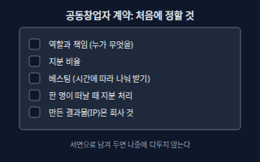</a> <b><a href="#founder-agreement--공동창업자-계약">Founder Agreement</a></b> 공동창업자 계약 공동창업자들이 역할, 지분 비율, 지분을 확정하는 방식, 한 명이 떠날 때의 처리를 서면으로 정해 두는 약속.</td>
<td width="33%" valign="top"><a href="#equity--지분주식">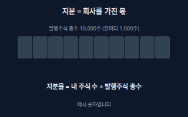</a> <b><a href="#equity--지분주식">Equity</a></b> 지분(주식) 회사를 가진 몫. 주식회사에서는 주식으로 나뉘고, 내 주식 수를 발행주식 총수로 나눈 값이 지분율이다.</td>
<td width="33%" valign="top"><a href="#cap-table--지분표">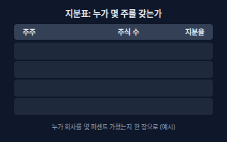</a> <b><a href="#cap-table--지분표">Cap Table</a></b> 지분표 주주별 주식 수, 주식의 종류, 지분율을 한 표에 정리한 것. 스톡옵션 풀과 투자 뒤 지분 변화를 미리 계산하는 데도 쓴다.</td>
</tr>
<tr>
<td width="33%" valign="top"><a href="#dilution--지분-희석">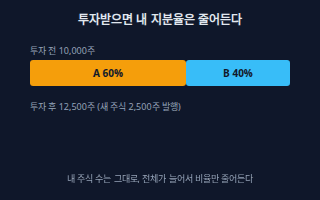</a> <b><a href="#dilution--지분-희석">Dilution</a></b> 지분 희석 새 주식이 발행되어 전체 주식 수가 늘면 내 지분율이 낮아지는 것. 내 주식 수는 그대로이고 비율만 줄어든다.</td>
<td width="33%" valign="top"><a href="#vesting--베스팅">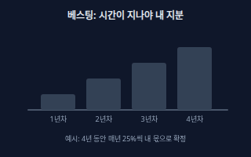</a> <b><a href="#vesting--베스팅">Vesting</a></b> 베스팅 약속한 지분을 한 번에 주지 않고, 일정 기간 계속 일해야 조금씩 내 것으로 확정되게 하는 방식. 중간에 떠나면 확정되지 않은 부분은 회사로 돌아간다.</td>
<td width="33%" valign="top"><a href="#cliff--클리프">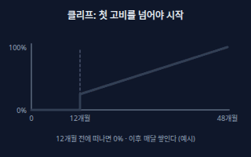</a> <b><a href="#cliff--클리프">Cliff</a></b> 클리프 베스팅을 시작한 뒤 정해 둔 첫 구간이 지나기 전에는 하나도 확정되지 않고, 그 구간이 끝나는 순간 한꺼번에 일부가 확정되는 규칙.</td>
</tr>
<tr>
<td width="33%" valign="top"><a href="#stock-option--주식매수선택권">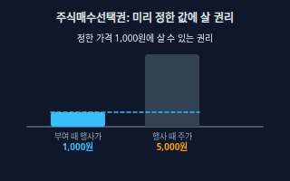</a> <b><a href="#stock-option--주식매수선택권">Stock Option</a></b> 주식매수선택권 회사의 임직원 등이 미리 정한 가격(행사가격)으로 나중에 회사 주식을 살 수 있는 권리. 상법상 일반 회사는 주주총회 특별결의로 부여하고, 발행주식 총수의 100분의 10을 넘길 수 없으며, 부여 결의일부터 2년 이상 재임·재직해야 행사할 수 있다.</td>
<td width="33%" valign="top"><a href="#venture-stock-option-rules--벤처기업-스톡옵션-특례">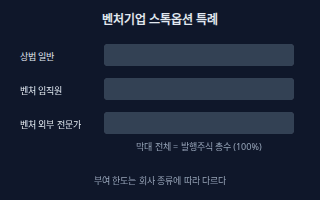</a> <b><a href="#venture-stock-option-rules--벤처기업-스톡옵션-특례">Venture Stock Option Rules</a></b> 벤처기업 스톡옵션 특례 벤처기업으로 확인된 주식회사는 벤처기업법에 따라 일반 상법보다 넓은 한도로 주식매수선택권을 줄 수 있다. 임직원에게는 발행주식 총수의 100분의 50까지, 외부 전문가에게는 100분의 10까지 줄 수 있다. 임직원은 부여 결의일부터 2년 이상 재직해야 행사할 수 있고, 외부 전문가는 2년이 지나고 시행령 요건을 충족해야 한다.</td>
<td width="33%" valign="top"><a href="#shareholders-agreement--주주간계약">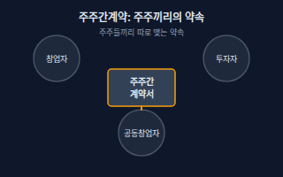</a> <b><a href="#shareholders-agreement--주주간계약">Shareholders Agreement</a></b> 주주간계약 주주들이 이사 선임, 주식을 팔 때의 조건, 정보 열람 같은 규칙을 따로 정해 맺는 계약. 투자계약과 함께 맺는 경우가 많다.</td>
</tr>
</table>

**기업가치 · 투자 라운드 · Valuation & Rounds** (3)

<table>
<tr>
<td width="33%" valign="top"><a href="#pre-money-vs-post-money-valuation--투자-전후-기업가치">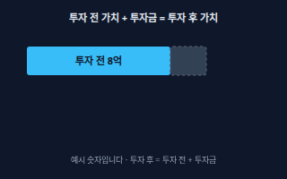</a> <b><a href="#pre-money-vs-post-money-valuation--투자-전후-기업가치">Pre-money vs Post-money Valuation</a></b> 투자 전·후 기업가치 투자 전 기업가치는 투자금이 들어오기 전 회사의 값이고, 투자 후 기업가치는 거기에 투자금을 더한 값이다. 투자자 지분율은 투자금을 투자 후 기업가치로 나눠 구한다.</td>
<td width="33%" valign="top"><a href="#funding-rounds--투자-라운드">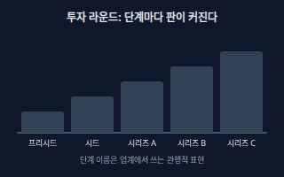</a> <b><a href="#funding-rounds--투자-라운드">Funding Rounds</a></b> 투자 라운드 회사가 성장 단계에 따라 차례로 받는 투자 차수. 보통 프리시드, 시드, 시리즈 A·B·C 순으로 이어지고 뒤로 갈수록 금액과 요구되는 성과가 커진다.</td>
<td width="33%" valign="top"><a href="#down-round--다운라운드">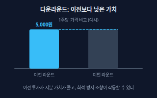</a> <b><a href="#down-round--다운라운드">Down Round</a></b> 다운라운드 이번 투자 라운드의 기업가치(또는 주당 가격)가 이전 라운드보다 낮은 것.</td>
</tr>
</table>

**투자자 · 지원 기관 · Investors & Programs** (4)

<table>
<tr>
<td width="33%" valign="top"><a href="#angel-investor--엔젤투자자">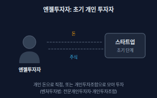</a> <b><a href="#angel-investor--엔젤투자자">Angel Investor</a></b> 엔젤투자자 아주 초기 회사에 자기 돈으로 투자하는 개인. 벤처투자법에는 투자 실적 등 요건을 갖춰 등록하는 전문개인투자자와, 개인들이 모아 만드는 개인투자조합이 있다.</td>
<td width="33%" valign="top"><a href="#accelerator--액셀러레이터">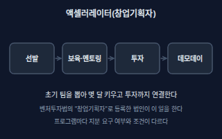</a> <b><a href="#accelerator--액셀러레이터">Accelerator</a></b> 액셀러레이터 초기 팀을 뽑아 일정 기간 멘토링과 공간 같은 보육을 하고 투자까지 하는 곳. 벤처투자법은 중소벤처기업부에 등록한 법인을 창업기획자(액셀러레이터)라 부르며, 상법상 회사는 자본금이 1억원 이상이어야 등록할 수 있다.</td>
<td width="33%" valign="top"><a href="#venture-capital--벤처캐피털">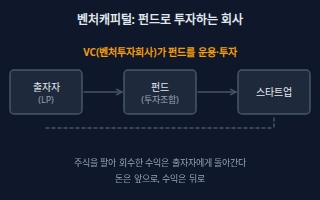</a> <b><a href="#venture-capital--벤처캐피털">Venture Capital</a></b> 벤처캐피털 투자자들에게서 모은 돈으로 펀드를 만들어 성장 가능성이 큰 회사에 투자하고, 나중에 주식을 팔아 수익을 내는 투자회사. 벤처투자법의 벤처투자회사는 중소벤처기업부에 등록한 회사다.</td>
</tr>
<tr>
<td width="33%" valign="top"><a href="#tips--팁스">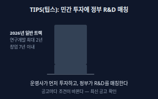</a> <b><a href="#tips--팁스">TIPS</a></b> 팁스 중소벤처기업부가 운영하는 프로그램으로, 민간 운영사가 먼저 투자·추천한 기술 창업기업에 정부가 연구개발 자금을 매칭해 준다. 2026년 공고의 일반 트랙은 운영사 투자 2억원 이상(비수도권 1억원 이상)에 연구개발비 최대 8억원, 사업 기간 최대 2년이다.</td>
</tr>
</table>

**투자 방식 · 계약 · Instruments & Deal Terms** (11)

<table>
<tr>
<td width="33%" valign="top"><a href="#class-shares--종류주식">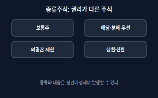</a> <b><a href="#class-shares--종류주식">Class Shares</a></b> 종류주식 배당, 잔여재산 분배, 의결권, 상환, 전환 같은 권리가 서로 다른 주식. 정관으로 각 종류의 내용과 수를 정해야 발행할 수 있고, 의결권 없는 종류주식은 발행주식 총수의 4분의 1을 넘을 수 없다.</td>
<td width="33%" valign="top"><b><a href="stocks.md#common-vs-preferred--보통주우선주">Common vs Preferred</a></b> 보통주·우선주 보통주는 기본 주식이고, 우선주는 배당 등에서 보통주보다 먼저 받는 권리가 붙은 주식이다. → stocks 시트</td>
<td width="33%" valign="top"><a href="#rcps--상환전환우선주">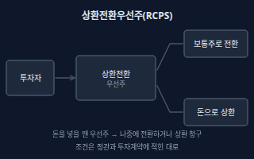</a> <b><a href="#rcps--상환전환우선주">RCPS</a></b> 상환전환우선주 투자자가 나중에 보통주로 바꾸거나(전환) 정해 둔 조건에서 회사에 상환을 요구할 수 있는 우선주로, 스타트업 투자에서 자주 쓰인다. 전환·상환 조건은 상법의 종류주식 규정에 따라 정관에 정해야 한다.</td>
</tr>
<tr>
<td width="33%" valign="top"><a href="#liquidation-preference--청산-우선권">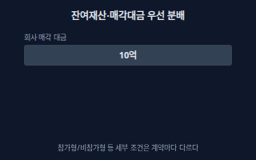</a> <b><a href="#liquidation-preference--청산-우선권">Liquidation Preference</a></b> 청산 우선권 회사를 청산하거나 매각할 때 다른 주주보다 먼저 정해진 금액(보통 투자금의 몇 배)을 가져가는 우선주의 권리. 상법은 잔여재산 분배에 관한 종류주식의 내용을 정관에 정하게 한다.</td>
<td width="33%" valign="top"><a href="#anti-dilution--희석-방지-조항">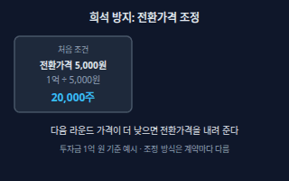</a> <b><a href="#anti-dilution--희석-방지-조항">Anti-dilution</a></b> 희석 방지 조항 다음 투자가 더 낮은 가격에 이뤄지면 기존 투자자의 전환가격을 낮춰 전환 때 받는 주식 수를 늘려 주는 보호 조항. 전환가격 조정, 리픽싱이라고도 한다.</td>
<td width="33%" valign="top"><a href="#convertible-bond--전환사채">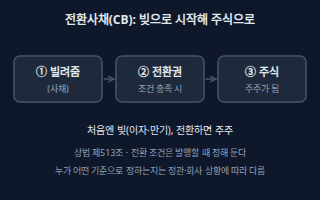</a> <b><a href="#convertible-bond--전환사채">Convertible Bond</a></b> 전환사채 처음에는 빌려준 돈(사채)이지만 정해 둔 조건에서 주식으로 바꿀 수 있는 권리가 붙은 채권. 전환 조건은 정관에 없으면 이사회가 정하고, 주주가 아닌 사람에게 발행할 때 정관에 규정이 없으면 주주총회 특별결의가 필요하다.</td>
</tr>
<tr>
<td width="33%" valign="top"><a href="#safe--조건부지분인수계약">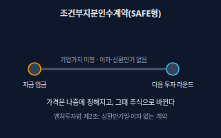</a> <b><a href="#safe--조건부지분인수계약">SAFE</a></b> 조건부지분인수계약 투자금을 먼저 받고, 기업가치가 정해지는 다음 투자 때 주식으로 바꾸기로 하는 계약. 벤처투자법은 상환만기일과 이자가 없고 중소벤처기업부령 요건을 충족하는 조건부지분인수계약을 벤처투자의 한 방식으로 인정한다.</td>
<td width="33%" valign="top"><a href="#term-sheet--텀싯">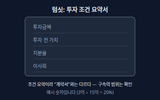</a> <b><a href="#term-sheet--텀싯">Term Sheet</a></b> 텀싯 투자자가 제안하는 핵심 조건(투자금액, 기업가치, 증권 종류, 이사회 권리, 우선권 등)을 본계약 전에 한 장 안팎으로 정리한 문서. 보통 일부 조항(비밀유지, 독점 협상 등)만 법적 구속력을 갖는다.</td>
<td width="33%" valign="top"><a href="#tag-along-and-drag-along--동반매도-참여권요구권">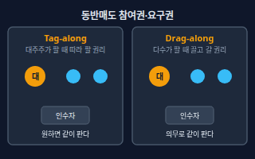</a> <b><a href="#tag-along-and-drag-along--동반매도-참여권요구권">Tag-along and Drag-along</a></b> 동반매도 참여권·요구권 동반매도 참여권(태그얼롱)은 대주주가 지분을 팔 때 다른 주주도 같은 조건으로 같이 팔 수 있는 권리이고, 동반매도 요구권(드래그얼롱)은 다수 주주가 회사를 팔 때 나머지 주주에게도 같이 팔라고 요구하는 권리다.</td>
</tr>
<tr>
<td width="33%" valign="top"><a href="#new-vs-existing-shares--신주와-구주">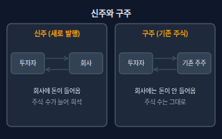</a> <b><a href="#new-vs-existing-shares--신주와-구주">New vs Existing Shares</a></b> 신주와 구주 신주는 회사가 새로 발행하는 주식이라 투자금이 회사로 들어가고 주식 수가 늘어난다. 구주는 이미 있는 주식을 주주끼리 사고파는 것이라 회사에는 돈이 들어오지 않는다.</td>
<td width="33%" valign="top"><b><a href="stocks.md#rights-offering--유상증자">Rights Offering</a></b> 유상증자 회사가 돈을 받고 새 주식을 발행해 자금을 모으는 것. → stocks 시트</td>
</tr>
</table>

**실사 · IR · Due Diligence & Pitch** (9)

<table>
<tr>
<td width="33%" valign="top"><a href="#due-diligence--실사">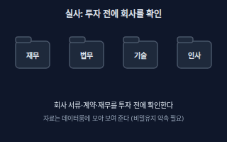</a> <b><a href="#due-diligence--실사">Due Diligence</a></b> 실사 투자하기 전에 투자자가 회사의 재무, 법무(계약·지분), 기술, 인사가 말한 대로인지 서류로 확인하는 절차. 자료를 모아 보여 주는 온라인 폴더를 데이터룸이라 한다.</td>
<td width="33%" valign="top"><a href="#ir-deck--ir-자료">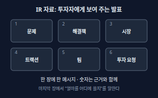</a> <b><a href="#ir-deck--ir-자료">IR Deck</a></b> IR 자료 투자자에게 회사를 소개하는 발표 자료. 문제, 해결책, 시장, 트랙션, 팀, 투자 요청(자금 사용 계획)을 한 흐름으로 보여 준다.</td>
<td width="33%" valign="top"><a href="#traction--트랙션">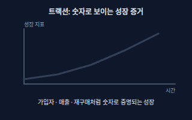</a> <b><a href="#traction--트랙션">Traction</a></b> 트랙션 제품이 시장에서 실제로 통한다는 숫자 증거. 가입자·활성 사용자, 매출, 재구매율, 계약 건수처럼 시간에 따라 늘어나는 지표.</td>
</tr>
<tr>
<td width="33%" valign="top"><a href="#mrr-and-arr--월연-반복-매출">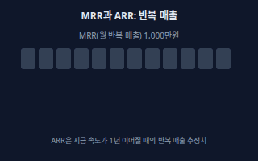</a> <b><a href="#mrr-and-arr--월연-반복-매출">MRR and ARR</a></b> 월·연 반복 매출 MRR은 구독·정기결제처럼 매달 반복해서 들어오는 매출의 월 합계이고, ARR은 MRR에 12를 곱한 연 환산 반복 매출이다.</td>
<td width="33%" valign="top"><a href="#pivot--피벗">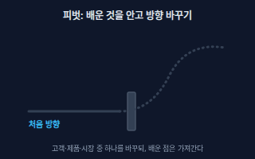</a> <b><a href="#pivot--피벗">Pivot</a></b> 피벗 지금 방식이 잘 안 풀릴 때 배운 것을 가지고 고객, 제품, 시장, 수익 모델 중 일부를 바꿔 새 방향으로 가는 것.</td>
<td width="33%" valign="top"><b><a href="accounting.md#burn-rate--번레이트">Burn Rate</a></b> 번레이트 아직 수익이 안 나는 회사가 한 달에 현금을 얼마나 태우는지. → accounting 시트</td>
</tr>
<tr>
<td width="33%" valign="top"><b><a href="accounting.md#runway--런웨이">Runway</a></b> 런웨이 지금 가진 현금으로 지금 속도대로 쓰면 몇 달 버틸 수 있는지. → accounting 시트</td>
<td width="33%" valign="top"><b><a href="accounting.md#unit-economics--유닛-이코노믹스">Unit Economics</a></b> 유닛 이코노믹스 고객 1명(또는 주문 1건) 기준으로 얼마를 벌고 얼마가 드는지 따지는 방식. → accounting 시트</td>
<td width="33%" valign="top"><b><a href="law.md#nda--비밀유지계약">NDA</a></b> 비밀유지계약 상대방에게 준 비밀 정보를 다른 곳에 알리거나 목적 밖으로 쓰지 않기로 하는 계약. → law 시트</td>
</tr>
</table>

**회사 · 지배구조 · Company & Governance** (8)

<table>
<tr>
<td width="33%" valign="top"><a href="#incorporation--주식회사-설립">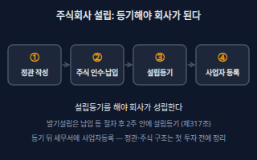</a> <b><a href="#incorporation--주식회사-설립">Incorporation</a></b> 주식회사 설립 발기인이 정관을 만들고 주식을 인수·납입한 뒤 본점 소재지에서 설립등기를 하면 주식회사가 성립한다. 발기인이 주식 전부를 인수하는 발기설립은 납입 등 절차가 끝난 날부터 2주 안에 설립등기를 해야 한다.</td>
<td width="33%" valign="top"><b><a href="law.md#sole-proprietor-vs-corporation--개인사업자와-법인">Sole Proprietor vs Corporation</a></b> 개인사업자와 법인 개인사업자는 사업자 개인이 곧 사업의 주체이고, 법인은 회사 자체가 권리·의무의 주체인 별도 인격이다. → law 시트</td>
<td width="33%" valign="top"><a href="#shareholders-meeting--주주총회">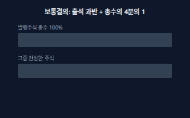</a> <b><a href="#shareholders-meeting--주주총회">Shareholders Meeting</a></b> 주주총회 주주들이 모여 이사 선임, 정관 변경 같은 회사의 중요한 일을 결의하는 회의. 보통결의는 출석 주식의 과반수와 발행주식 총수의 4분의 1 이상이 찬성해야 한다.</td>
</tr>
<tr>
<td width="33%" valign="top"><a href="#special-resolution--특별결의">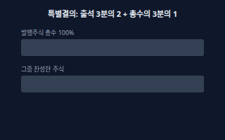</a> <b><a href="#special-resolution--특별결의">Special Resolution</a></b> 특별결의 출석한 주주 의결권의 3분의 2 이상이면서 발행주식 총수의 3분의 1 이상이 찬성해야 통과하는 무거운 결의. 정관 변경, 주식매수선택권 부여 같은 중요한 일에 요구된다.</td>
<td width="33%" valign="top"><a href="#board-of-directors--이사회">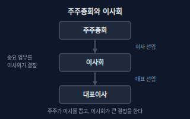</a> <b><a href="#board-of-directors--이사회">Board of Directors</a></b> 이사회 이사들이 모여 회사의 중요한 업무집행을 결정하고 이사의 직무를 감독하는 기관. 이사는 3명 이상이어야 하지만, 자본금 10억원 미만 회사는 1명 또는 2명으로 할 수 있고 그러면 이사회가 하던 일을 주주총회나 이사(대표이사)가 맡는다.</td>
<td width="33%" valign="top"><a href="#venture-certification--벤처기업-확인">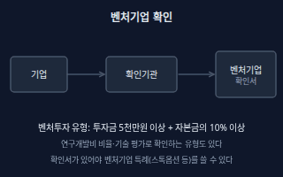</a> <b><a href="#venture-certification--벤처기업-확인">Venture Certification</a></b> 벤처기업 확인 기술성·성장성이 있거나 벤처투자를 받은 중소기업이 벤처기업확인기관에서 확인을 받아 벤처기업확인서를 받는 제도. 벤처투자 유형은 법에서 정한 투자자에게 받은 투자금 합계가 5천만원 이상이고 자본금의 10% 이상이어야 하며, 확인서 유효기간은 확인일부터 3년이다.</td>
</tr>
<tr>
<td width="33%" valign="top"><a href="#exit--엑시트">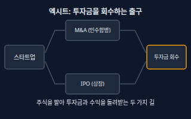</a> <b><a href="#exit--엑시트">Exit</a></b> 엑시트 투자자나 창업자가 가진 주식을 팔아 투자금과 수익을 회수하는 출구. 회사를 통째로 파는 M&amp;A(인수합병)와 증권시장에 상장하는 IPO(기업공개)가 대표적이다.</td>
<td width="33%" valign="top"><b><a href="stocks.md#kospi--kosdaq--코스피코스닥">KOSPI / KOSDAQ</a></b> 코스피·코스닥 코스피와 코스닥은 한국거래소가 운영하는 주식시장이다. 코스닥은 중소·벤처 성장기업 중심이다. → stocks 시트</td>
</tr>
</table>

<!-- overview:end -->

## 팀 · 지분 · Team & Equity

### Founder Agreement · 공동창업자 계약

- **정의**: 공동창업자들이 역할, 지분 비율, 지분을 확정하는 방식, 한 명이 떠날 때의 처리를 서면으로 정해 두는 약속.
- **AI에게 이렇게**: "공동창업자 3명이 지분을 40/30/30으로 나누려고 해. 역할, 베스팅, 한 명이 중간에 나갈 때 지분 처리, 결과물 권리 귀속을 넣은 공동창업자 계약 항목 체크리스트와 초안 목차를 만들어줘. 변호사에게 물어볼 질문 목록도 같이 줘."
- **언제**: 팀을 꾸린 직후, 법인을 세우거나 첫 투자를 받기 전
- **헷갈림**: Shareholders Agreement(주주간계약) — 공동창업자 계약은 창업팀끼리의 약속이고, 주주간계약은 투자자가 들어온 뒤 모든 주주 사이의 약속이다.
- **관련**: Vesting, Cliff, Equity, Shareholders Agreement, Work Made for Hire, Copyright Assignment
- **확인 질문**: 창업자는 몇 명이고 모두 풀타임인가요? 지분은 어떤 기준(아이디어, 현금, 시간)으로 나눴나요? 한 명이 나가면 그 지분을 어떻게 하기로 했나요?

### Equity · 지분(주식)

- **정의**: 회사를 가진 몫. 주식회사에서는 주식으로 나뉘고, 내 주식 수를 발행주식 총수로 나눈 값이 지분율이다.
- **AI에게 이렇게**: "발행주식 총수 10,000주 중 내가 4,000주를 가졌어. 지분율을 계산하고, 투자자에게 신주 2,500주를 발행하면 내 지분율이 얼마가 되는지도 알려줘."
- **언제**: 공동창업자끼리 지분을 나눌 때, 투자 협상, 임직원 보상을 정할 때
- **헷갈림**: 지분율과 의결권 — 종류주식이 있으면 주식 수 비율과 의결권 비율이 다를 수 있다. 스톡옵션은 행사하기 전에는 아직 주식이 아니다.
- **관련**: Cap Table, Dilution, Class Shares, Common vs Preferred
- **확인 질문**: 발행주식 총수와 각자 가진 주식 수가 주주명부와 맞나요? 우선주 같은 종류주식이 있나요?

### Cap Table · 지분표

- **정의**: 주주별 주식 수, 주식의 종류, 지분율을 한 표에 정리한 것. 스톡옵션 풀과 투자 뒤 지분 변화를 미리 계산하는 데도 쓴다.
- **AI에게 이렇게**: "창업자 A 5,000주, B 3,000주, 스톡옵션 풀 2,000주인 지분표를 만들어줘. 투자 전 기업가치 12억 원에 3억 원을 투자받으면 투자 후 지분율과 신주 수가 어떻게 되는지 표로 계산하고, 수식은 셀에 남겨줘."
- **언제**: 투자 협상 전, 실사 자료를 준비할 때, 스톡옵션을 설계할 때
- **헷갈림**: 주주명부 — 주주명부는 회사가 법적으로 갖추는 실제 주주 기록이고, 지분표는 옵션·전환증권까지 넣어 미래 지분을 계산하는 관리용 표다.
- **관련**: Dilution, Equity, Stock Option, Pre-money vs Post-money Valuation
- **확인 질문**: 스톡옵션·CB·RCPS처럼 아직 주식이 아닌 것도 넣을까요(전부 주식이 됐다고 치는 완전희석 기준)? 주식 수 기준인가요, 금액 기준인가요?

### Dilution · 지분 희석

- **정의**: 새 주식이 발행되어 전체 주식 수가 늘면 내 지분율이 낮아지는 것. 내 주식 수는 그대로이고 비율만 줄어든다.
- **AI에게 이렇게**: "지금 발행주식이 10,000주이고 A가 6,000주, B가 4,000주야. 투자자에게 신주 2,500주를 발행하면 모두의 지분율이 어떻게 되는지 표로 계산하고, 시리즈 A에서 신주를 한 번 더 20% 발행하면 어떻게 되는지도 이어서 보여줘."
- **언제**: 투자를 받을 때, 스톡옵션 풀을 늘릴 때, 전환사채나 RCPS가 주식으로 바뀔 때
- **헷갈림**: 가치 감소 — 희석은 비율이 줄어드는 것일 뿐이다. 회사 가치가 함께 커지면 줄어든 비율의 가치가 더 클 수도 있다.
- **관련**: Cap Table, Pre-money vs Post-money Valuation, Anti-dilution, Rights Offering
- **확인 질문**: 새로 발행되는 주식 수(또는 투자금과 기업가치)는 얼마인가요? 스톡옵션 풀 확대처럼 눈에 안 띄는 발행도 같이 계산할까요?

### Vesting · 베스팅

- **정의**: 약속한 지분을 한 번에 주지 않고, 일정 기간 계속 일해야 조금씩 내 것으로 확정되게 하는 방식. 중간에 떠나면 확정되지 않은 부분은 회사로 돌아간다.
- **AI에게 이렇게**: "창업자 3명에게 각각 3,000주를 4년 베스팅, 12개월 클리프, 이후 매월 균등 확정으로 적용하면 월별로 확정되는 주식 수를 표로 만들어줘. 중간에 퇴사하는 시점별로 확정 지분도 보여줘."
- **언제**: 공동창업자 계약, 스톡옵션 부여, 투자자가 창업자 이탈을 걱정할 때
- **헷갈림**: Stock Option — 스톡옵션은 주식을 살 수 있는 권리이고, 베스팅은 그 권리나 주식이 확정되는 시간표다. 상법의 주식매수선택권에는 재직 요건이 따로 있다(Stock Option 참고).
- **관련**: Cliff, Founder Agreement, Stock Option
- **확인 질문**: 베스팅은 언제부터 시작하나요(입사일, 법인 설립일)? 회사가 매각되면 남은 지분이 한 번에 확정되나요?

### Cliff · 클리프

- **정의**: 베스팅을 시작한 뒤 정해 둔 첫 구간이 지나기 전에는 하나도 확정되지 않고, 그 구간이 끝나는 순간 한꺼번에 일부가 확정되는 규칙.
- **AI에게 이렇게**: "12개월 클리프가 있는 4년 베스팅에서 7개월 만에 퇴사하면 확정 지분이 얼마이고, 14개월에 퇴사하면 얼마인지 비교표로 계산해줘."
- **언제**: 팀에 새로 합류하는 사람의 초기 몇 달 동안 단기 이탈을 걸러 낼 때
- **헷갈림**: Vesting — 클리프는 베스팅 안의 첫 문턱이다. 문턱을 넘어야 베스팅 지분이 처음 생긴다.
- **관련**: Vesting, Founder Agreement
- **확인 질문**: 클리프 기간은 몇 개월이고 그때 몇 %가 확정되나요? 클리프 기간 안에 회사가 인수되면 어떻게 하나요?

### Stock Option · 주식매수선택권

- **정의**: 회사의 임직원 등이 미리 정한 가격(행사가격)으로 나중에 회사 주식을 살 수 있는 권리. 상법상 일반 회사는 주주총회 특별결의로 부여하고, 발행주식 총수의 100분의 10을 넘길 수 없으며, 부여 결의일부터 2년 이상 재임·재직해야 행사할 수 있다.
- **AI에게 이렇게**: "우리는 벤처기업 확인을 받기 전인 주식회사야. 핵심 개발자 3명에게 스톡옵션을 주려는데, 상법 기준 한도와 필요한 주주총회 절차, 부여 계약서에 꼭 들어갈 항목을 체크리스트로 정리해줘."
- **언제**: 핵심 인재를 영입하는데 현금이 부족한 초기 스타트업
- **헷갈림**: 주식 자체 — 주식매수선택권은 행사하기 전에는 주주가 아니고, 타인에게 양도할 수 없다(사망 시 상속인은 행사 가능). 의결권 없는 주식을 뺀 발행주식 총수의 100분의 10 이상을 가진 주주와 회사 경영에 사실상 영향력을 행사하는 사람은 받을 수 없다.
- **관련**: Venture Stock Option Rules, Vesting, Cap Table, Special Resolution
- **확인 질문**: 벤처기업 확인을 받았나요(한도와 조건이 달라집니다)? 행사가격은 얼마로, 어떤 방식으로 평가하나요? 받을 사람이 큰 주주이거나 그 가족은 아닌가요?
- **근거**: [상법 제340조의2](https://www.law.go.kr/법령/상법/제340조의2), [상법 제340조의3](https://www.law.go.kr/법령/상법/제340조의3), [상법 제340조의4](https://www.law.go.kr/법령/상법/제340조의4)
- **검증일**: 2026-11-02

### Venture Stock Option Rules · 벤처기업 스톡옵션 특례

- **정의**: 벤처기업으로 확인된 주식회사는 벤처기업법에 따라 일반 상법보다 넓은 한도로 주식매수선택권을 줄 수 있다. 임직원에게는 발행주식 총수의 100분의 50까지, 외부 전문가에게는 100분의 10까지 줄 수 있다. 임직원은 부여 결의일부터 2년 이상 재직해야 행사할 수 있고, 외부 전문가는 2년이 지나고 시행령 요건을 충족해야 한다.
- **AI에게 이렇게**: "벤처기업 확인을 받은 우리 회사가 직원 5명과 외부 자문가 1명에게 스톡옵션을 주려고 해. 벤처기업법 기준 한도, 주주총회 결의와 중소벤처기업부 신고 절차, 직원이 받을 세금 특례(비과세·납부특례)를 구분해서 표로 정리해줘."
- **언제**: 벤처기업 확인서가 있는 회사가 인재를 영입할 때. 세제는 2027년 12월 31일 이전에 부여받은 옵션에 대해 행사이익 중 연 2억원 이내를 비과세하고, 벤처기업별 누적 5억원을 넘지 못하게 정한다.
- **헷갈림**: Stock Option — 같은 스톡옵션이어도 벤처기업의 주식매수선택권에는 벤처기업법이 상법보다 먼저 적용된다. 비과세와 납부특례는 시기·금액 한도가 있어 세무사와 꼭 확인한다.
- **관련**: Stock Option, Venture Certification, Special Resolution
- **확인 질문**: 확인서의 유효기간이 부여 시점에 살아 있나요? 받을 사람이 임직원인가요 외부 전문가인가요? 2027년 말 이후에 부여할 계획이라면 세제 특례가 연장됐는지도 확인할까요?
- **근거**: [벤처기업육성에 관한 특별법 제16조의3](https://www.law.go.kr/법령/벤처기업육성에관한특별법/제16조의3), [벤처기업육성에 관한 특별법 제16조의5](https://www.law.go.kr/법령/벤처기업육성에관한특별법/제16조의5), [벤처기업육성에 관한 특별법 제16조의6](https://www.law.go.kr/법령/벤처기업육성에관한특별법/제16조의6), [조세특례제한법 제16조의2](https://www.law.go.kr/법령/조세특례제한법/제16조의2), [조세특례제한법 제16조의3](https://www.law.go.kr/법령/조세특례제한법/제16조의3)
- **검증일**: 2026-11-02

### Shareholders Agreement · 주주간계약

- **정의**: 주주들이 이사 선임, 주식을 팔 때의 조건, 정보 열람 같은 규칙을 따로 정해 맺는 계약. 투자계약과 함께 맺는 경우가 많다.
- **AI에게 이렇게**: "시드 투자자 1명과 창업자 2명이 맺을 주주간계약의 주요 조항(이사 선임권, 동반매도, 우선매수권, 정보 제공)을 쉬운 말로 설명하고, 창업자가 협상 때 확인할 점을 정리해줘."
- **언제**: 투자자가 들어올 때, 주주가 늘어날 때
- **헷갈림**: 정관 — 정관은 회사 전체의 기본 규칙이고, 주주간계약은 서명한 주주들 사이의 계약이다. 어떤 내용은 정관에도 넣어야 하는지 변호사와 확인한다.
- **관련**: Founder Agreement, Tag-along and Drag-along, Term Sheet, Board of Directors
- **확인 질문**: 서명할 주주는 누구인가요? 정관에도 같이 넣어야 하는 조항이 있나요?

## 기업가치 · 투자 라운드 · Valuation & Rounds

### Pre-money vs Post-money Valuation · 투자 전·후 기업가치

- **정의**: 투자 전 기업가치는 투자금이 들어오기 전 회사의 값이고, 투자 후 기업가치는 거기에 투자금을 더한 값이다. 투자자 지분율은 투자금을 투자 후 기업가치로 나눠 구한다.
- **AI에게 이렇게**: "투자 전 기업가치 12억 원에 3억 원을 투자받으면 투자 후 기업가치, 투자자 지분율, 주당 가격, 신주 수를 계산해줘. 발행주식은 10,000주야. 스톡옵션 풀을 투자 전에 늘리는 경우와도 비교해줘."
- **언제**: 투자 조건을 협상할 때, 지분표를 시뮬레이션할 때
- **헷갈림**: 투자 전과 투자 후 — "기업가치 ○○에 투자받는다"가 투자 전 값인지 투자 후 값인지에 따라 지분율이 달라진다. 반드시 어느 쪽인지 되묻는다. 시가총액(Market Cap)은 상장회사의 값이라 다르다.
- **관련**: Cap Table, Dilution, Term Sheet, Market Cap
- **확인 질문**: 말씀하신 금액이 투자 전 값인가요, 투자 후 값인가요? 스톡옵션 풀이나 전환증권을 기업가치 계산에 포함하나요?

### Funding Rounds · 투자 라운드

- **정의**: 회사가 성장 단계에 따라 차례로 받는 투자 차수. 보통 프리시드, 시드, 시리즈 A·B·C 순으로 이어지고 뒤로 갈수록 금액과 요구되는 성과가 커진다.
- **AI에게 이렇게**: "우리는 베타 서비스를 낸 뒤 월 매출이 300만 원이야. 지금이 시드인지 시리즈 A 준비 단계인지 판단 기준을 설명하고, 라운드별로 투자자가 보는 지표를 표로 정리해줘."
- **언제**: 투자 계획을 세울 때, 투자자 대화에서 단계 이야기가 나올 때
- **헷갈림**: 법적 구분 — 시드·시리즈 A는 업계에서 쓰는 이름일 뿐 법이 정한 구분이 아니다. 금액 기준도 사람마다 다르다.
- **관련**: Pre-money vs Post-money Valuation, Angel Investor, Venture Capital, Down Round
- **확인 질문**: 지금까지 받은 투자와 매출·사용자 지표는 어떻게 되나요? 이번에 얼마를 받아 몇 개월 쓰려고 하나요?

### Down Round · 다운라운드

- **정의**: 이번 투자 라운드의 기업가치(또는 주당 가격)가 이전 라운드보다 낮은 것.
- **AI에게 이렇게**: "이전 라운드에서 주당 5,000원이었는데 이번에 주당 3,000원에 투자를 받으면 기존 투자자 지분 가치, 전환가격 조정(희석 방지), 창업자 지분율이 어떻게 달라지는지 시뮬레이션해줘."
- **언제**: 성장이 기대보다 느리거나 시장 분위기가 나쁠 때
- **헷갈림**: 플랫 라운드 — 가격이 이전과 같으면 플랫 라운드, 더 낮으면 다운라운드다. 다운라운드는 기존 투자자의 희석 방지 조항을 작동시킬 수 있다.
- **관련**: Anti-dilution, Dilution, Funding Rounds
- **확인 질문**: 이전 투자자 중 희석 방지 조항이 있는 곳이 있나요? 이전 투자자가 이번 라운드에도 참여하나요?

## 투자자 · 지원 기관 · Investors & Programs

### Angel Investor · 엔젤투자자

- **정의**: 아주 초기 회사에 자기 돈으로 투자하는 개인. 벤처투자법에는 투자 실적 등 요건을 갖춰 등록하는 전문개인투자자와, 개인들이 모아 만드는 개인투자조합이 있다.
- **AI에게 이렇게**: "엔젤투자자 3명에게서 각각 3,000만 원을 투자받는 상황이야. 직접 주식을 받는 방식과 개인투자조합을 통하는 방식의 차이, 각각 지분표에 어떻게 나타나는지 설명해줘."
- **언제**: 제품을 만들기 전후, 첫 외부 투자를 받을 때
- **헷갈림**: VC — 엔젤은 개인이 자기 돈으로, VC는 펀드를 운용하는 회사가 모은 돈으로 투자한다.
- **관련**: Venture Capital, Accelerator, Funding Rounds, TIPS
- **확인 질문**: 엔젤이 개인으로 직접 투자하나요, 개인투자조합인가요? 투자 방식은 주식인가요, 조건부지분인수계약 같은 계약인가요?
- **근거**: [벤처투자 촉진에 관한 법률 제2조](https://www.law.go.kr/법령/벤처투자촉진에관한법률/제2조), [벤처투자 촉진에 관한 법률 제9조](https://www.law.go.kr/법령/벤처투자촉진에관한법률/제9조), [벤처투자 촉진에 관한 법률 제12조](https://www.law.go.kr/법령/벤처투자촉진에관한법률/제12조)
- **검증일**: 2026-11-02

### Accelerator · 액셀러레이터

- **정의**: 초기 팀을 뽑아 일정 기간 멘토링과 공간 같은 보육을 하고 투자까지 하는 곳. 벤처투자법은 중소벤처기업부에 등록한 법인을 창업기획자(액셀러레이터)라 부르며, 상법상 회사는 자본금이 1억원 이상이어야 등록할 수 있다.
- **AI에게 이렇게**: "이 액셀러레이터 프로그램에 지원하려고 해. 지분을 얼마나 요구하는지, 투자 방식, 데모데이 이후 후속 투자 연결이 어떤지 물어볼 질문 리스트를 만들어줘."
- **언제**: 아이디어나 초기 제품 단계에서 멘토 네트워크와 첫 투자가 필요할 때
- **헷갈림**: 인큐베이터 — 보통 인큐베이터는 공간과 행정 지원이 중심이고, 액셀러레이터는 짧은 프로그램 기간의 집중 성장과 투자 연결이 중심이다.
- **관련**: Angel Investor, TIPS, Venture Capital
- **확인 질문**: 창업기획자로 등록된 곳인가요? 프로그램에 참가하면 지분을 넘기나요? 기간과 비용은 어떻게 되나요?
- **근거**: [벤처투자 촉진에 관한 법률 제2조](https://www.law.go.kr/법령/벤처투자촉진에관한법률/제2조), [벤처투자 촉진에 관한 법률 제24조](https://www.law.go.kr/법령/벤처투자촉진에관한법률/제24조)
- **검증일**: 2026-11-02

### Venture Capital · 벤처캐피털

- **정의**: 투자자들에게서 모은 돈으로 펀드를 만들어 성장 가능성이 큰 회사에 투자하고, 나중에 주식을 팔아 수익을 내는 투자회사. 벤처투자법의 벤처투자회사는 중소벤처기업부에 등록한 회사다.
- **AI에게 이렇게**: "VC가 보낸 투자 검토 메일의 요청 자료를 정리하고, 우리가 준비할 자료(재무, 지분표, 계약, 지표)를 체크리스트로 만들어줘. VC가 자주 묻는 질문도 같이 정리해줘."
- **언제**: 시드 이후 더 큰 성장 자금이 필요할 때
- **헷갈림**: 엔젤투자자 — VC는 펀드를 운용하는 법인이라 내부 투자심사 절차가 있고, 펀드 만기 때문에 회수 시점을 중요하게 본다.
- **관련**: Angel Investor, Term Sheet, Due Diligence, Exit
- **확인 질문**: 이 VC가 주로 투자하는 단계와 분야는 무엇인가요? 펀드의 남은 투자 여력은 어떤가요? 리드 투자인가요, 후속 참여인가요?
- **근거**: [벤처투자 촉진에 관한 법률 제2조](https://www.law.go.kr/법령/벤처투자촉진에관한법률/제2조), [벤처투자 촉진에 관한 법률 제37조](https://www.law.go.kr/법령/벤처투자촉진에관한법률/제37조)
- **검증일**: 2026-11-02

### TIPS · 팁스

- **정의**: 중소벤처기업부가 운영하는 프로그램으로, 민간 운영사가 먼저 투자·추천한 기술 창업기업에 정부가 연구개발 자금을 매칭해 준다. 2026년 공고의 일반 트랙은 운영사 투자 2억원 이상(비수도권 1억원 이상)에 연구개발비 최대 8억원, 사업 기간 최대 2년이다.
- **AI에게 이렇게**: "우리는 AI 소프트웨어를 만드는 창업 4년 차 팀이야. 2026년 TIPS 일반 트랙의 신청 자격, 운영사 투자 요건, 준비 서류와 진행 순서(운영사 추천 → 평가 → 협약)를 정리해줘."
- **언제**: 기술 기반 창업에서 민간 투자와 정부 연구개발 자금을 함께 받고 싶을 때
- **헷갈림**: 정부 지원사업 직접 신청 — TIPS는 팁스 운영사의 투자와 추천이 있어야 신청할 수 있다. 일반 트랙은 창업 7년 이내(신산업 분야는 10년 이내) 기업이 대상이고, 공고는 해마다 바뀐다.
- **관련**: Accelerator, Venture Capital, Angel Investor
- **확인 질문**: 창업한 지 몇 년이고 본사는 수도권인가요? 투자해 줄 팁스 운영사를 찾았나요? 이미 하고 있는 다른 정부 연구개발 과제가 있나요?
- **근거**: [중소벤처기업부 공고 제2026-188호 2026년 팁스 창업기업 지원계획 수정 공고](https://www.mss.go.kr/site/smba/ex/bbs/View.do?bcIdx=1066440&cbIdx=310&parentSeq=1066440), [TIPS 프로그램 지원내용 및 절차](https://jointips.or.kr/intro/support-process)
- **검증일**: 2026-11-02

## 투자 방식 · 계약 · Instruments & Deal Terms

### Class Shares · 종류주식

- **정의**: 배당, 잔여재산 분배, 의결권, 상환, 전환 같은 권리가 서로 다른 주식. 정관으로 각 종류의 내용과 수를 정해야 발행할 수 있고, 의결권 없는 종류주식은 발행주식 총수의 4분의 1을 넘을 수 없다.
- **AI에게 이렇게**: "우리 정관에 종류주식 규정이 있는지 확인하는 방법을 알려주고, 투자자에게 배당 우선권과 청산 우선권이 있는 우선주를 발행하려면 정관 변경과 주주총회에서 필요한 절차를 순서대로 정리해줘."
- **언제**: 투자자에게 우선주를 발행할 때
- **헷갈림**: Common vs Preferred — 보통주는 기본 주식이고 우선주는 어떤 권리에서 보통주보다 앞서는 종류주식이다. 우선주도 종류주식의 한 가지 모양이다.
- **관련**: RCPS, Liquidation Preference, Common vs Preferred, Special Resolution
- **확인 질문**: 정관에 종류주식 발행 근거가 이미 있나요? 어떤 권리(배당, 분배, 의결권, 상환, 전환)를 다르게 할 건가요?
- **근거**: [상법 제344조](https://www.law.go.kr/법령/상법/제344조), [상법 제344조의2](https://www.law.go.kr/법령/상법/제344조의2), [상법 제344조의3](https://www.law.go.kr/법령/상법/제344조의3)
- **검증일**: 2026-11-02

### Common vs Preferred · 보통주·우선주

- **정의**: 보통주는 기본 주식이고, 우선주는 배당 등에서 보통주보다 먼저 받는 권리가 붙은 주식이다.
- **원본**: [주식 · Common vs Preferred](stocks.md#common-vs-preferred--보통주우선주)

### RCPS · 상환전환우선주

- **정의**: 투자자가 나중에 보통주로 바꾸거나(전환) 정해 둔 조건에서 회사에 상환을 요구할 수 있는 우선주로, 스타트업 투자에서 자주 쓰인다. 전환·상환 조건은 상법의 종류주식 규정에 따라 정관에 정해야 한다.
- **AI에게 이렇게**: "RCPS로 투자를 받으려는데, 전환가격, 상환 청구 가능 시점, 상환 재원, 배당 우선 조건을 항목별로 설명하고 창업자에게 불리할 수 있는 조항을 짚어줘."
- **언제**: 투자자가 우선주를 요구하는 시드·시리즈 투자
- **헷갈림**: 전환사채(CB) — CB는 빌려준 돈(사채)이라 만기가 있고, RCPS는 주식이다. 다만 상환은 회사의 이익으로 주식을 소각하는 방식이라, 요구받아도 회사에 돈이 없으면 부담이 된다.
- **관련**: Class Shares, Convertible Bond, Liquidation Preference, Anti-dilution
- **확인 질문**: 전환 비율(전환가격)은 어떻게 정해지고 조정되나요? 상환 청구는 언제부터 가능하고, 그때 회사에 상환할 이익이 있을까요?
- **근거**: [상법 제344조](https://www.law.go.kr/법령/상법/제344조), [상법 제345조](https://www.law.go.kr/법령/상법/제345조), [상법 제346조](https://www.law.go.kr/법령/상법/제346조)
- **검증일**: 2026-11-02

### Liquidation Preference · 청산 우선권

- **정의**: 회사를 청산하거나 매각할 때 다른 주주보다 먼저 정해진 금액(보통 투자금의 몇 배)을 가져가는 우선주의 권리. 상법은 잔여재산 분배에 관한 종류주식의 내용을 정관에 정하게 한다.
- **AI에게 이렇게**: "회사가 10억 원에 매각되고, 투자자가 2억 원을 투자한 1배 청산 우선권(참가형)이 있다면 투자자와 창업자가 각각 얼마를 가져가는지 계산해줘. 비참가형이면 어떻게 달라지는지도 비교해줘."
- **언제**: 투자 조건을 협상할 때, 회사 매각 시나리오를 계산할 때
- **헷갈림**: 배당 — 배당은 이익을 나눠 주는 것이고, 청산 우선권은 회사를 팔거나 해산할 때 대금을 나누는 순서다.
- **관련**: Class Shares, RCPS, Exit, Term Sheet
- **확인 질문**: 우선 회수는 투자금의 몇 배인가요? 우선 회수 뒤 남은 몫도 지분대로 더 받는 참가형인가요, 아닌 비참가형인가요?
- **근거**: [상법 제344조의2](https://www.law.go.kr/법령/상법/제344조의2)
- **검증일**: 2026-11-02

### Anti-dilution · 희석 방지 조항

- **정의**: 다음 투자가 더 낮은 가격에 이뤄지면 기존 투자자의 전환가격을 낮춰 전환 때 받는 주식 수를 늘려 주는 보호 조항. 전환가격 조정, 리픽싱이라고도 한다.
- **AI에게 이렇게**: "RCPS 전환가격이 5,000원인데 다음 라운드가 4,000원이면 전환 주식 수가 얼마나 늘고 창업자 지분율이 몇 %p 줄어드는지 풀 래칫 방식과 가중평균 방식으로 각각 계산해줘."
- **언제**: 투자계약에 전환가격 조정 조항을 넣거나 검토할 때
- **헷갈림**: Dilution — 희석은 새 주식 때문에 비율이 줄어드는 현상이고, 희석 방지 조항은 그 피해를 투자자에게만 보정해 주는 장치다.
- **관련**: Dilution, Down Round, RCPS, Convertible Bond
- **확인 질문**: 전환가격을 내리는 방식은 풀 래칫인가요, 가중평균인가요? 전환가격이 내려갈 수 있는 하한이 있나요?

### Convertible Bond · 전환사채

- **정의**: 처음에는 빌려준 돈(사채)이지만 정해 둔 조건에서 주식으로 바꿀 수 있는 권리가 붙은 채권. 전환 조건은 정관에 없으면 이사회가 정하고, 주주가 아닌 사람에게 발행할 때 정관에 규정이 없으면 주주총회 특별결의가 필요하다.
- **AI에게 이렇게**: "CB로 1억 원을 투자받으려는데 이자율, 만기, 전환가격, 전환 청구 기간, 만기에 원금을 갚지 못할 때의 위험을 설명해줘. 주주총회 결의가 필요한지 확인할 체크리스트도 만들어줘."
- **언제**: 기업가치를 정하기 어려운 초기에 투자를 받을 때
- **헷갈림**: 조건부지분인수계약 — CB는 이자와 만기가 있는 빚이고 전환되기 전까지는 갚을 의무가 있다. 조건부지분인수계약은 상환만기일과 이자가 없는 계약이다.
- **관련**: SAFE, RCPS, Anti-dilution, Special Resolution
- **확인 질문**: 주주가 아닌 투자자에게 발행하나요? 정관에 전환사채 관련 규정이 있나요? 이자와 만기는 어떻게 정했나요?
- **근거**: [상법 제513조](https://www.law.go.kr/법령/상법/제513조), [상법 제434조](https://www.law.go.kr/법령/상법/제434조), [벤처투자 촉진에 관한 법률 제2조](https://www.law.go.kr/법령/벤처투자촉진에관한법률/제2조)
- **검증일**: 2026-11-02

### SAFE · 조건부지분인수계약

- **정의**: 투자금을 먼저 받고, 기업가치가 정해지는 다음 투자 때 주식으로 바꾸기로 하는 계약. 벤처투자법은 상환만기일과 이자가 없고 중소벤처기업부령 요건을 충족하는 조건부지분인수계약을 벤처투자의 한 방식으로 인정한다.
- **AI에게 이렇게**: "SAFE형 조건부지분인수계약으로 5,000만 원을 받으려고 해. 밸류에이션 캡과 할인율이 있을 때 다음 라운드에서 투자자가 받는 주식 수를 예시로 계산하고, 전환사채와 비교해줘."
- **언제**: 기업가치를 협상하기 이른 초기에 빠르게 투자를 받고 싶을 때
- **헷갈림**: 전환사채 — 전환사채는 이자와 만기가 있는 사채다. 미국 Y Combinator의 SAFE와 구조가 비슷하지만 한국에서는 벤처투자법의 요건(부령)에 맞는 계약인지 확인해야 한다. 무담보전환사채 발행을 미리 약정하는 조건부지분전환계약은 따로 정의돼 있다.
- **관련**: Convertible Bond, Funding Rounds, Pre-money vs Post-money Valuation, Dilution
- **확인 질문**: 밸류에이션 캡이나 할인율이 있나요? 다음 투자가 없으면 어떻게 되나요? 중소벤처기업부령 요건에 맞춘 계약서 양식인가요?
- **근거**: [벤처투자 촉진에 관한 법률 제2조](https://www.law.go.kr/법령/벤처투자촉진에관한법률/제2조)
- **검증일**: 2026-11-02

### Term Sheet · 텀싯

- **정의**: 투자자가 제안하는 핵심 조건(투자금액, 기업가치, 증권 종류, 이사회 권리, 우선권 등)을 본계약 전에 한 장 안팎으로 정리한 문서. 보통 일부 조항(비밀유지, 독점 협상 등)만 법적 구속력을 갖는다.
- **AI에게 이렇게**: "이 텀싯을 읽고 창업자에게 불리할 수 있는 조항(청산 우선권, 희석 방지, 이사 선임권, 독점 협상 기간)을 표시하고 일반적인 시드 조건과 비교해줘. 모르는 용어는 쉬운 말로 풀고, 변호사에게 확인할 질문 리스트로 정리해줘."
- **언제**: 투자자가 관심을 보이고 본계약 전에 조건을 협상할 때
- **헷갈림**: 투자계약서 — 텀싯은 조건을 요약한 문서이고, 투자계약서와 주주간계약서가 실제 권리와 의무를 정하는 본계약이다.
- **관련**: Pre-money vs Post-money Valuation, Liquidation Preference, Due Diligence, Shareholders Agreement
- **확인 질문**: 텀싯 중 법적 구속력이 있는 조항은 어디까지인가요? 독점 협상 기간이 있나요? 그동안 다른 투자자와 이야기해도 되나요?

### Tag-along and Drag-along · 동반매도 참여권·요구권

- **정의**: 동반매도 참여권(태그얼롱)은 대주주가 지분을 팔 때 다른 주주도 같은 조건으로 같이 팔 수 있는 권리이고, 동반매도 요구권(드래그얼롱)은 다수 주주가 회사를 팔 때 나머지 주주에게도 같이 팔라고 요구하는 권리다.
- **AI에게 이렇게**: "주주간계약의 태그얼롱과 드래그얼롱 조항을 읽고, 내가 소수 지분 창업자일 때 드래그얼롱이 어떻게 작동하는지, 발동 조건(최소 매각가, 찬성 비율)이 어떤지 쉽게 설명해줘."
- **언제**: 투자계약을 협상할 때, 회사 매각 시점
- **헷갈림**: 우선매수권 — 우선매수권은 팔려는 주식을 먼저 살 권리이고, 태그는 같이 팔 권리, 드래그는 같이 팔게 하는 권리다.
- **관련**: Shareholders Agreement, Exit, Term Sheet
- **확인 질문**: 드래그얼롱이 발동하는 찬성 비율과 최소 매각가가 있나요? 창업자도 태그얼롱 권리를 갖나요?

### New vs Existing Shares · 신주와 구주

- **정의**: 신주는 회사가 새로 발행하는 주식이라 투자금이 회사로 들어가고 주식 수가 늘어난다. 구주는 이미 있는 주식을 주주끼리 사고파는 것이라 회사에는 돈이 들어오지 않는다.
- **AI에게 이렇게**: "이번 라운드에서 신주 발행 2억 원과 창업자 구주 매각 5,000만 원이 섞여 있어. 회사에 들어오는 돈, 지분표 변화, 창업자가 확인할 세금 이슈 질문을 정리해줘."
- **언제**: 투자 구조에서 돈이 회사로 가는지 개인 주주로 가는지 볼 때
- **헷갈림**: 유상증자(Rights Offering) — 유상증자는 돈을 받고 신주를 발행하는 방식이다. 주주가 아닌 투자자에게 신주를 주려면 정관에 근거가 있어야 하고 신기술 도입·재무구조 개선 같은 경영상 목적이 필요하다.
- **관련**: Rights Offering, Cap Table, Dilution, Exit
- **확인 질문**: 투자금이 회사 계좌로 들어가나요, 주주 개인에게 가나요? 주주가 아닌 투자자에게 신주를 배정할 근거가 정관에 있나요?
- **근거**: [상법 제416조](https://www.law.go.kr/법령/상법/제416조), [상법 제418조](https://www.law.go.kr/법령/상법/제418조)
- **검증일**: 2026-11-02

### Rights Offering · 유상증자

- **정의**: 회사가 돈을 받고 새 주식을 발행해 자금을 모으는 것.
- **원본**: [주식 · Rights Offering](stocks.md#rights-offering--유상증자)

## 실사 · IR · Due Diligence & Pitch

### Due Diligence · 실사

- **정의**: 투자하기 전에 투자자가 회사의 재무, 법무(계약·지분), 기술, 인사가 말한 대로인지 서류로 확인하는 절차. 자료를 모아 보여 주는 온라인 폴더를 데이터룸이라 한다.
- **AI에게 이렇게**: "시드 투자 실사에서 투자자가 요구할 자료를 재무, 법무, 지분, 기술, 인사로 나눠 체크리스트로 만들고, 우리가 아직 준비하지 못했을 만한 항목을 질문해 줘."
- **언제**: 텀싯에 서명한 뒤 본계약을 맺기 전
- **헷갈림**: 회계감사 — 감사는 재무제표가 맞는지 외부가 의견을 내는 것이고, 실사는 투자 판단을 위해 법·지분·기술까지 폭넓게 점검하는 것이다.
- **관련**: Term Sheet, NDA, Cap Table, IR Deck
- **확인 질문**: 정관·주주명부·계약서·재무제표가 최신인가요? 비밀유지계약(NDA)을 먼저 맺었나요? 지분 변동 이력을 증빙할 서류가 있나요?

### IR Deck · IR 자료

- **정의**: 투자자에게 회사를 소개하는 발표 자료. 문제, 해결책, 시장, 트랙션, 팀, 투자 요청(자금 사용 계획)을 한 흐름으로 보여 준다.
- **AI에게 이렇게**: "우리 서비스 소개서를 바탕으로 12장짜리 IR 자료의 목차와 장별 핵심 메시지 한 줄, 그리고 투자 요청 장(투자금 3억 원: 개발 50%, 마케팅 30%, 운영 20%)의 표를 만들어줘."
- **언제**: 투자자 미팅, 액셀러레이터·TIPS 지원, 데모데이
- **헷갈림**: 사업계획서 — 사업계획서는 자세하게 적은 서면 계획이고, IR 자료는 짧은 시간에 설득하는 발표용 자료다.
- **관련**: Traction, MRR and ARR, Burn Rate, Runway
- **확인 질문**: 발표 시간은 얼마나 되나요? 투자자는 누구이고 어떤 단계·분야를 보나요? 숫자를 뒷받침할 근거 자료가 있나요?

### Traction · 트랙션

- **정의**: 제품이 시장에서 실제로 통한다는 숫자 증거. 가입자·활성 사용자, 매출, 재구매율, 계약 건수처럼 시간에 따라 늘어나는 지표.
- **AI에게 이렇게**: "우리 서비스의 최근 6개월 가입자·결제 데이터를 넣을 테니 투자자가 좋아할 트랙션 지표 3가지를 고르고 차트로 보여줘. 일회성이거나 부풀려질 수 있는 숫자는 따로 표시해줘."
- **언제**: IR 자료의 핵심 장, 시드~시리즈 A 협상
- **헷갈림**: 허영 지표 — 누적 가입자나 페이지뷰처럼 커 보여도 결제나 재방문과 연결되지 않는 숫자는 트랙션으로서 약하다.
- **관련**: MRR and ARR, Retention Rate, Unit Economics, North Star Metric
- **확인 질문**: 가장 중요하게 보는 지표는 무엇인가요? 집계 기간(월간·주간)과 기준(유료·무료, 중복 제거)은 어떻게 하나요?

### MRR and ARR · 월·연 반복 매출

- **정의**: MRR은 구독·정기결제처럼 매달 반복해서 들어오는 매출의 월 합계이고, ARR은 MRR에 12를 곱한 연 환산 반복 매출이다.
- **AI에게 이렇게**: "구독 고객 목록(결제일, 월 요금, 해지일)으로 월별 MRR을 계산하고, 신규·확장·이탈에 따라 MRR이 어떻게 변했는지 워터폴 차트로 보여줘. ARR도 같이 계산해줘."
- **언제**: 구독형 서비스(SaaS)를 운영하거나 IR 지표를 정리할 때
- **헷갈림**: 매출액(Revenue) — 일회성 구축비나 단발 판매는 반복 매출이 아니라서 MRR에 넣지 않는다. 연 선결제는 월로 나눠서 MRR을 계산한다.
- **관련**: Revenue, Unit Economics, Traction, Burn Rate
- **확인 질문**: 일회성 매출은 뺄까요? 연 결제와 할인은 월로 나눠 계산할까요? 무료 체험 고객은 포함하나요?

### Pivot · 피벗

- **정의**: 지금 방식이 잘 안 풀릴 때 배운 것을 가지고 고객, 제품, 시장, 수익 모델 중 일부를 바꿔 새 방향으로 가는 것.
- **AI에게 이렇게**: "우리가 B2C 앱으로 6개월간 사용자는 모았지만 결제가 없어. 지금까지 인터뷰와 지표를 정리하고, B2B로 피벗할 때 유지할 것과 바꿀 것을 표로 나눠줘. 투자자에게 피벗을 설명하는 3문장도 써줘."
- **언제**: 지표가 오래 정체될 때, 고객 인터뷰에서 다른 문제가 반복해서 나올 때
- **헷갈림**: 개선(iteration) — 피벗은 방향 자체의 큰 전환이고, 개선은 같은 방향 안에서의 조정이다.
- **관련**: Traction, MVP, Runway
- **확인 질문**: 무엇을 바꾸나요(고객, 문제, 제품, 수익 모델)? 남은 런웨이는 몇 개월인가요? 기존 투자자 동의가 필요한 조항이 있나요?

### Burn Rate · 번레이트

- **정의**: 아직 수익이 안 나는 회사가 한 달에 현금을 얼마나 태우는지.
- **원본**: [회계 · 세무 기초 · Burn Rate](accounting.md#burn-rate--번레이트)

### Runway · 런웨이

- **정의**: 지금 가진 현금으로 지금 속도대로 쓰면 몇 달 버틸 수 있는지.
- **원본**: [회계 · 세무 기초 · Runway](accounting.md#runway--런웨이)

### Unit Economics · 유닛 이코노믹스

- **정의**: 고객 1명(또는 주문 1건) 기준으로 얼마를 벌고 얼마가 드는지 따지는 방식.
- **원본**: [회계 · 세무 기초 · Unit Economics](accounting.md#unit-economics--유닛-이코노믹스)

### NDA · 비밀유지계약

- **정의**: 상대방에게 준 비밀 정보를 다른 곳에 알리거나 목적 밖으로 쓰지 않기로 하는 계약.
- **원본**: [법률 기초 · NDA](law.md#nda--비밀유지계약)

## 회사 · 지배구조 · Company & Governance

### Incorporation · 주식회사 설립

- **정의**: 발기인이 정관을 만들고 주식을 인수·납입한 뒤 본점 소재지에서 설립등기를 하면 주식회사가 성립한다. 발기인이 주식 전부를 인수하는 발기설립은 납입 등 절차가 끝난 날부터 2주 안에 설립등기를 해야 한다.
- **AI에게 이렇게**: "개발자 2명이 주식회사를 설립하려고 해. 정관에 꼭 적어야 하는 항목, 설립 절차 순서(정관 작성 → 납입 → 등기 → 사업자등록), 첫 투자를 대비해 처음부터 정리할 점(발행주식 수, 액면가, 주식양도 제한)을 체크리스트로 만들어줘."
- **언제**: 개인사업자에서 법인으로 바꾸거나 첫 투자를 받기 전. 액면주식은 1주의 금액을 100원 이상으로 정해야 한다.
- **헷갈림**: 개인사업자 — 법인은 등기로 성립하는 회사 자체가 권리·의무의 주체다. 개인사업자는 주식을 발행할 수 없어 지분 투자를 받기 어렵다.
- **관련**: Sole Proprietor vs Corporation, Shareholders Meeting, Board of Directors, Cap Table
- **확인 질문**: 발기인(공동창업자)은 누구이고 각자 몇 주를 인수하나요? 본점 주소는 어디인가요? 첫 투자를 대비해 정관에 넣어 둘 사항(주식 양도 제한, 종류주식)이 있나요?
- **근거**: [상법 제172조](https://www.law.go.kr/법령/상법/제172조), [상법 제289조](https://www.law.go.kr/법령/상법/제289조), [상법 제317조](https://www.law.go.kr/법령/상법/제317조), [상법 제329조](https://www.law.go.kr/법령/상법/제329조), [찾기쉬운 생활법령정보 법인의 설립](https://easylaw.go.kr/CSP/CnpClsMain.laf?popMenu=ov&csmSeq=632&ccfNo=3&cciNo=2&cnpClsNo=1)
- **검증일**: 2026-11-02

### Sole Proprietor vs Corporation · 개인사업자와 법인

- **정의**: 개인사업자는 사업자 개인이 곧 사업의 주체이고, 법인은 회사 자체가 권리·의무의 주체인 별도 인격이다.
- **원본**: [법률 기초 · Sole Proprietor vs Corporation](law.md#sole-proprietor-vs-corporation--개인사업자와-법인)

### Shareholders Meeting · 주주총회

- **정의**: 주주들이 모여 이사 선임, 정관 변경 같은 회사의 중요한 일을 결의하는 회의. 보통결의는 출석 주식의 과반수와 발행주식 총수의 4분의 1 이상이 찬성해야 한다.
- **AI에게 이렇게**: "우리 회사(자본금 3억 원, 주주 4명)가 유상증자와 스톡옵션 부여를 의결하려고 해. 필요한 주주총회 종류(정기·임시), 소집 통지 방법과 기한, 결의 요건, 의사록에 적을 항목을 순서대로 정리해줘. 주주 전원 서면동의로 대체할 수 있는지도 알려줘."
- **언제**: 정관 변경, 이사 선임, 투자 유치를 승인할 때. 소집은 주주총회일 2주 전에 통지하는 것이 원칙이고, 자본금 10억원 미만 회사는 10일 전으로 줄이거나 주주 전원이 동의하면 소집절차 없이 열 수 있다.
- **헷갈림**: 이사회 — 주주총회는 주인인 주주들의 결의이고, 이사회는 이사들이 업무집행을 결정하는 회의다. 신주 발행처럼 정관에 다른 정함이 없으면 이사회가 정하는 일도 있다.
- **관련**: Special Resolution, Board of Directors, Incorporation
- **확인 질문**: 자본금 총액이 10억 원 미만인가요? 주주 전원이 동의하나요(서면 결의 가능)? 정관에 다른 결의 요건이 있나요?
- **근거**: [상법 제363조](https://www.law.go.kr/법령/상법/제363조), [상법 제365조](https://www.law.go.kr/법령/상법/제365조), [상법 제368조](https://www.law.go.kr/법령/상법/제368조), [상법 제416조](https://www.law.go.kr/법령/상법/제416조)
- **검증일**: 2026-11-02

### Special Resolution · 특별결의

- **정의**: 출석한 주주 의결권의 3분의 2 이상이면서 발행주식 총수의 3분의 1 이상이 찬성해야 통과하는 무거운 결의. 정관 변경, 주식매수선택권 부여 같은 중요한 일에 요구된다.
- **AI에게 이렇게**: "발행주식 10,000주, 출석 7,000주, 찬성 5,000주인 주주총회에서 특별결의가 통과되는지 계산해줘. 같은 숫자로 보통결의라면 요건이 어떻게 달라지는지도 비교해줘."
- **언제**: 종류주식을 만들려고 정관을 바꿀 때, 스톡옵션을 부여할 때, 주주 외에게 전환사채를 발행하는데 정관에 정함이 없을 때
- **헷갈림**: 보통결의 — 보통결의는 출석 과반수와 총수의 4분의 1이라 문턱이 낮다. 특별결의를 거쳐야 할 일을 보통결의로 처리하면 결의에 하자가 생길 수 있다.
- **관련**: Shareholders Meeting, Stock Option, Class Shares, Convertible Bond
- **확인 질문**: 발행주식 총수와 출석·찬성 주식 수는 얼마인가요? 의결권 없는 주식이 있나요? 정관이 더 높은 요건을 정했나요?
- **근거**: [상법 제434조](https://www.law.go.kr/법령/상법/제434조), [상법 제433조](https://www.law.go.kr/법령/상법/제433조), [상법 제340조의2](https://www.law.go.kr/법령/상법/제340조의2), [상법 제513조](https://www.law.go.kr/법령/상법/제513조)
- **검증일**: 2026-11-02

### Board of Directors · 이사회

- **정의**: 이사들이 모여 회사의 중요한 업무집행을 결정하고 이사의 직무를 감독하는 기관. 이사는 3명 이상이어야 하지만, 자본금 10억원 미만 회사는 1명 또는 2명으로 할 수 있고 그러면 이사회가 하던 일을 주주총회나 이사(대표이사)가 맡는다.
- **AI에게 이렇게**: "이사가 창업자 2명뿐인 회사에 투자자가 이사 1명 선임권을 요구해. 이사가 3명이 되면 이사회가 필요한지, 대표이사 선임과 신주 발행 결정 권한이 어디로 가는지, 이사회 결의와 의사록 절차를 설명해줘."
- **언제**: 투자자가 이사 선임권을 요구할 때, 신주·CB 발행을 결정할 때, 대표이사를 뽑을 때
- **헷갈림**: 대표이사 — 대표이사는 이사회가 뽑아(정관으로 주주총회가 뽑게 할 수도 있다) 회사를 대표하고 업무를 집행하는 사람이고, 이사회는 그의 직무를 감독한다.
- **관련**: Shareholders Meeting, Shareholders Agreement, Special Resolution
- **확인 질문**: 지금 이사와 감사는 몇 명인가요? 자본금 총액이 10억 원 미만인가요? 투자자가 이사 선임을 원하나요, 참관만 원하나요?
- **근거**: [상법 제383조](https://www.law.go.kr/법령/상법/제383조), [상법 제393조](https://www.law.go.kr/법령/상법/제393조), [상법 제382조](https://www.law.go.kr/법령/상법/제382조), [상법 제389조](https://www.law.go.kr/법령/상법/제389조)
- **검증일**: 2026-11-02

### Venture Certification · 벤처기업 확인

- **정의**: 기술성·성장성이 있거나 벤처투자를 받은 중소기업이 벤처기업확인기관에서 확인을 받아 벤처기업확인서를 받는 제도. 벤처투자 유형은 법에서 정한 투자자에게 받은 투자금 합계가 5천만원 이상이고 자본금의 10% 이상이어야 하며, 확인서 유효기간은 확인일부터 3년이다.
- **AI에게 이렇게**: "우리 회사는 엔젤 한 곳에서 5,000만 원을 투자받았고 자본금은 3억 원이야. 벤처기업 확인 투자 유형 요건을 충족하는지 확인하는 방법과 신청 절차, 확인 뒤 쓸 수 있는 스톡옵션 특례를 정리해줘."
- **언제**: 스톡옵션 특례나 각종 세제·금융 지원을 받고 싶을 때
- **헷갈림**: 벤처투자를 받은 회사 — 투자를 받았다고 자동으로 벤처기업이 되지 않는다. 확인기관에 신청해 확인서를 받아야 하고, 유효기간이 지나면 다시 확인받아야 한다.
- **관련**: Stock Option, Venture Stock Option Rules, TIPS, Venture Capital
- **확인 질문**: 중소기업에 해당하나요? 투자한 곳이 법에서 정한 투자자(벤처투자회사·벤처투자조합·창업기획자 등)에 해당하나요? 연구개발 유형이나 기술 평가 유형이 더 맞지 않나요?
- **근거**: [벤처기업육성에 관한 특별법 제2조의2](https://www.law.go.kr/법령/벤처기업육성에관한특별법/제2조의2), [벤처기업육성에 관한 특별법 제25조](https://www.law.go.kr/법령/벤처기업육성에관한특별법/제25조), [벤처기업육성에 관한 특별법 시행령 제2조의3](https://www.law.go.kr/법령/벤처기업육성에관한특별법시행령/제2조의3), [벤처기업육성에 관한 특별법 시행령 제18조의4](https://www.law.go.kr/법령/벤처기업육성에관한특별법시행령/제18조의4), [찾기쉬운 생활법령정보 벤처기업 확인 신청](https://easylaw.go.kr/CSP/CnpClsMain.laf?ccfNo=2&cciNo=2&cnpClsNo=2&csmSeq=632&popMenu=ov)
- **검증일**: 2026-11-02

### Exit · 엑시트

- **정의**: 투자자나 창업자가 가진 주식을 팔아 투자금과 수익을 회수하는 출구. 회사를 통째로 파는 M&A(인수합병)와 증권시장에 상장하는 IPO(기업공개)가 대표적이다.
- **AI에게 이렇게**: "시드 투자자가 5년 안에 회수를 기대한다고 해. M&A와 IPO 경로별로 창업자 지분율, 청산 우선권, 드래그얼롱이 어떻게 작동하는지 시나리오 표로 비교해줘."
- **언제**: 투자 협상에서 회수 방식을 이야기할 때, 회사 인수 제안을 받았을 때
- **헷갈림**: 상장과 매각 — 상장은 회사를 시장에 올려 주식을 사고팔게 하는 것(소유는 이어짐)이고, M&A는 지배권이 다른 회사로 넘어가는 것이다.
- **관련**: KOSPI / KOSDAQ, Liquidation Preference, Tag-along and Drag-along
- **확인 질문**: 회수 목표 시기와 희망하는 방식은 무엇인가요? 창업자가 인수 뒤에도 남아 일하길 원하나요?

### KOSPI / KOSDAQ · 코스피·코스닥

- **정의**: 코스피와 코스닥은 한국거래소가 운영하는 주식시장이다. 코스닥은 중소·벤처 성장기업 중심이다.
- **원본**: [주식 · KOSPI / KOSDAQ](stocks.md#kospi--kosdaq--코스피코스닥)

## 참고 자료

- [국가법령정보센터 상법](https://www.law.go.kr/법령/상법)
- [국가법령정보센터 벤처기업육성에 관한 특별법](https://www.law.go.kr/법령/벤처기업육성에관한특별법)
- [국가법령정보센터 벤처기업육성에 관한 특별법 시행령](https://www.law.go.kr/법령/벤처기업육성에관한특별법시행령)
- [국가법령정보센터 벤처투자 촉진에 관한 법률](https://www.law.go.kr/법령/벤처투자촉진에관한법률)
- [국가법령정보센터 조세특례제한법](https://www.law.go.kr/법령/조세특례제한법)
- [중소벤처기업부 공고 제2026-188호 2026년 팁스 창업기업 지원계획 수정 공고](https://www.mss.go.kr/site/smba/ex/bbs/View.do?bcIdx=1066440&cbIdx=310&parentSeq=1066440)
- [TIPS 프로그램 — 팁스 사업 소개](https://jointips.or.kr/intro/about)
- [TIPS 프로그램 — 지원내용 및 절차](https://jointips.or.kr/intro/support-process)
- [찾기쉬운 생활법령정보 — 법인의 설립](https://easylaw.go.kr/CSP/CnpClsMain.laf?popMenu=ov&csmSeq=632&ccfNo=3&cciNo=2&cnpClsNo=1)
- [찾기쉬운 생활법령정보 — 벤처기업 확인 신청](https://easylaw.go.kr/CSP/CnpClsMain.laf?ccfNo=2&cciNo=2&cnpClsNo=2&csmSeq=632&popMenu=ov)
- [벤처확인종합관리시스템 — 벤처확인요건](https://www.venture.or.kr/home/kor/M968740331/contents.do)
- [Y Combinator — The SAFE (구조 참고)](https://www.ycombinator.com/safe)
- [NVCA Model Legal Documents (투자계약 구성 참고)](https://nvca.org/model-legal-documents/)
