# 주식 치트시트

> 국내 상장 주식을 처음 시작하거나, 증권앱 화면과 뉴스 속 낯선 말을 AI에게 물어보기 전에 펼치는 시트입니다. 계산 방법보다 "이 말이 무슨 뜻인지"를 먼저 맞추는 데 집중합니다.

> ⚠️ **참고용이며 투자 권유가 아닙니다.** 대한민국 기준, 2026-11 기준입니다. 제도·세율·한도는 바뀔 수 있으니 실제 판단은 금융사·세무사 등 전문가와 확인하세요.

## 이렇게 쓰세요

- **나 → AI**: "A 종목의 PER, PBR, ROE를 알려주고, 같은 업종 평균과 비교해서 쉬운 말로 설명해줘."
- **AI → 나**: "기준이 가장 최근 확정 실적인가요, 앞으로의 예상 실적인가요? 보통주만 볼까요, 우선주도 볼까요?"
- **나 → AI**: "배당 받으려면 언제까지 사야 하는지, 배당락일이 뭔지 알려줘. 이 종목의 배당 기준일은 DART 공시로 찾아줘."
- **AI → 나**: "어느 종목이고 배당 기준일이 언제인지 알고 계신가요? 증권사별 결제 방식에 따라 마지막 매수일이 다를 수 있으니 증권사 안내도 같이 확인해드릴까요?"
- **나 → AI**: "주식을 팔 때 거래세와 배당금에 붙는 세금이 각각 뭔지 표로 정리해줘."

## 한눈에 보기

<!-- overview:start -->
<!-- 이 구역은 자동 생성됩니다. 직접 고치지 말고 `cd mcp-server && npm run generate`를 실행하세요. -->

**종목 · 시장 · Securities & Markets** (4)

<table>
<tr>
<td width="33%" valign="top"><a href="#stock--주식">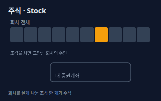</a> <b><a href="#stock--주식">Stock</a></b> 주식 회사를 잘게 나눈 지분 증서다. 주식을 사면 그 회사의 주주가 되어 이익 배당을 받고 주주총회에서 의결권을 행사할 수 있는 권리를 갖는다.</td>
<td width="33%" valign="top"><a href="#common-vs-preferred--보통주우선주">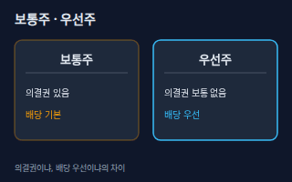</a> <b><a href="#common-vs-preferred--보통주우선주">Common vs Preferred</a></b> 보통주·우선주 보통주는 의결권이 있는 기본 주식이다. 우선주는 보통 의결권이 없는 대신 배당을 보통주보다 우선해서 받도록 정한 주식이다.</td>
<td width="33%" valign="top"><a href="#market-cap--시가총액">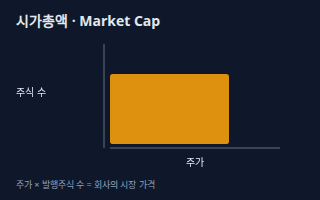</a> <b><a href="#market-cap--시가총액">Market Cap</a></b> 시가총액 주가에 발행주식 수를 곱한 값이다. 시장이 그 회사 전체에 매긴 현재 가격이라고 보면 된다.</td>
</tr>
<tr>
<td width="33%" valign="top"><a href="#kospi--kosdaq--코스피코스닥">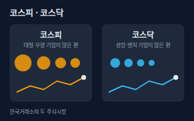</a> <b><a href="#kospi--kosdaq--코스피코스닥">KOSPI / KOSDAQ</a></b> 코스피·코스닥 한국거래소(KRX)가 운영하는 두 주식시장이다. 코스피(유가증권시장)에는 대형 우량 기업이, 코스닥에는 성장·벤처 기업이 상대적으로 많다. 시장 전체의 움직임을 숫자로 낸 지수도 같은 이름으로 부른다.</td>
</tr>
</table>

**주문 · Orders** (6)

<table>
<tr>
<td width="33%" valign="top"><a href="#market-vs-limit-order--시장가지정가">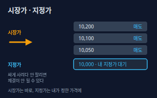</a> <b><a href="#market-vs-limit-order--시장가지정가">Market vs Limit Order</a></b> 시장가·지정가 시장가는 가격을 정하지 않고 지금 나와 있는 가장 유리한 호가에 바로 체결하는 주문이다. 지정가는 내가 정한 가격(또는 더 유리한 가격)에서만 체결되는 주문이다.</td>
<td width="33%" valign="top"><a href="#bid--ask--execution--호가체결">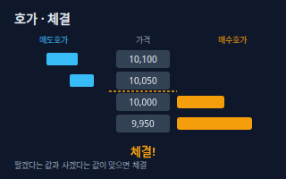</a> <b><a href="#bid--ask--execution--호가체결">Bid / Ask / Execution</a></b> 호가·체결 호가는 사겠다(매수호가), 팔겠다(매도호가)고 부른 가격과 수량이다. 체결은 사려는 가격과 팔려는 가격이 맞아 실제로 거래가 이루어지는 것이다.</td>
<td width="33%" valign="top"><a href="#price-limit--상한가하한가-가격제한폭">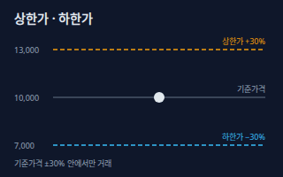</a> <b><a href="#price-limit--상한가하한가-가격제한폭">Price Limit</a></b> 상한가·하한가 (가격제한폭) 하루 동안 한 종목의 가격이 기준가격(보통 직전 거래일 종가) 대비 위아래 30%까지만 움직이도록 정한 한도다. 위쪽 끝이 상한가, 아래쪽 끝이 하한가다.</td>
</tr>
<tr>
<td width="33%" valign="top"><a href="#trading-hours--거래시간">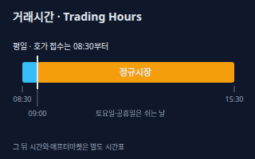</a> <b><a href="#trading-hours--거래시간">Trading Hours</a></b> 거래시간 한국거래소 정규시장은 평일 09:00부터 15:30까지 거래되고, 주문은 08:30부터 받는다. 정규시장 앞뒤로 시간외·애프터마켓 시간표가 따로 있고, 토요일·공휴일 등은 쉰다.</td>
<td width="33%" valign="top"><a href="#cash-balance--margin-purchase--예수금미수">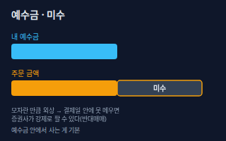</a> <b><a href="#cash-balance--margin-purchase--예수금미수">Cash Balance / Margin Purchase</a></b> 예수금·미수 예수금은 증권계좌에 들어 있는 현금으로 주식을 살 때 쓰는 돈이다. 미수는 현금이 모자란데도 외상으로 주문한 뒤 결제일까지 대금을 채우지 못하면 생기는 빚(미수금)이다.</td>
<td width="33%" valign="top"><a href="#settlement-t2--결제-t2">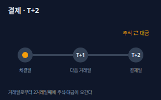</a> <b><a href="#settlement-t2--결제-t2">Settlement (T+2)</a></b> 결제 T+2 주식을 사고판 날(T)로부터 2거래일째(T+2)에 주식과 대금이 실제로 오가는 절차다. 체결되었다고 해서 판 돈을 바로 은행으로 출금할 수 있는 것은 아니다.</td>
</tr>
</table>

**지표 · Indicators** (7)

<table>
<tr>
<td width="33%" valign="top"><a href="#eps--주당순이익">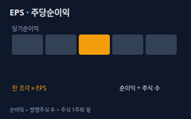</a> <b><a href="#eps--주당순이익">EPS</a></b> 주당순이익 당기순이익을 발행주식 수로 나눈 값이다. 주식 한 주가 한 해 동안 벌어들인 이익이라고 볼 수 있다.</td>
<td width="33%" valign="top"><a href="#per--주가수익비율">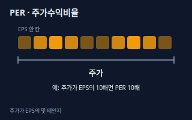</a> <b><a href="#per--주가수익비율">PER</a></b> 주가수익비율 주가를 EPS로 나눈 값이다. 현재 주가가 한 주당 이익의 몇 배인지 알려 주어서 이익에 비해 비싼지 싼지 가늠하게 한다.</td>
<td width="33%" valign="top"><a href="#price-to-book-ratio--주가순자산비율-pbr">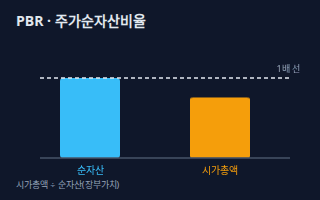</a> <b><a href="#price-to-book-ratio--주가순자산비율-pbr">Price-to-Book Ratio</a></b> 주가순자산비율 (PBR) 주가를 주당순자산으로 나눈 값, 즉 시가총액을 회사의 순자산(자본)으로 나눈 값이다. 1배면 장부가치와 같은 가격에, 1배보다 낮으면 장부가치보다 싸게 거래된다는 뜻이다.</td>
</tr>
<tr>
<td width="33%" valign="top"><a href="#roe--자기자본이익률">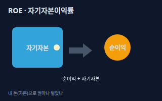</a> <b><a href="#roe--자기자본이익률">ROE</a></b> 자기자본이익률 당기순이익을 자기자본으로 나눈 비율이다. 주주의 돈으로 한 해에 얼마나 효율적으로 이익을 냈는지 보여준다.</td>
<td width="33%" valign="top"><a href="#dividend--배당">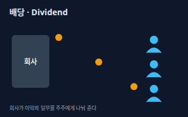</a> <b><a href="#dividend--배당">Dividend</a></b> 배당 회사가 번 이익의 일부를 주주에게 현금(또는 주식)으로 나눠 주는 것이다. 주식을 가진 만큼 받는다.</td>
<td width="33%" valign="top"><a href="#ex-dividend-date--배당락">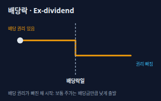</a> <b><a href="#ex-dividend-date--배당락">Ex-dividend Date</a></b> 배당락 배당받을 권리가 없어진 채로 거래가 시작되는 날(또는 그 시장 조치)이다. 이날부터 사는 사람은 그 해 배당을 받지 못해서 주가가 배당금만큼 낮게 시작하는 경향이 있다.</td>
</tr>
<tr>
<td width="33%" valign="top"><a href="#dividend-yield--배당수익률">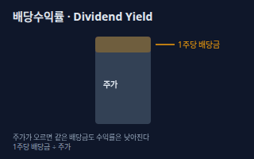</a> <b><a href="#dividend-yield--배당수익률">Dividend Yield</a></b> 배당수익률 한 주당 배당금을 현재 주가로 나눈 비율이다. 지금 주가로 산다고 가정할 때 배당만으로 한 해에 얼마나 돌려받는지 보여준다.</td>
</tr>
</table>

**공시 · 이벤트 · Disclosures & Events** (4)

<table>
<tr>
<td width="33%" valign="top"><a href="#dart-disclosure--dart-공시">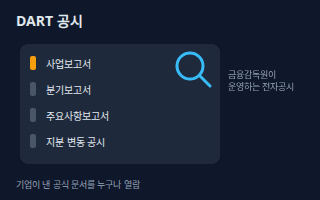</a> <b><a href="#dart-disclosure--dart-공시">DART Disclosure</a></b> DART 공시 상장회사가 투자자에게 알려야 하는 사업·재무·주요 사건 문서를 금융감독원 전자공시시스템(DART)에 올려 누구나 인터넷으로 열람하게 한 것이다.</td>
<td width="33%" valign="top"><a href="#rights-offering--유상증자">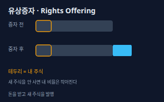</a> <b><a href="#rights-offering--유상증자">Rights Offering</a></b> 유상증자 회사가 사업 자금을 마련하려고 돈을 받고 새 주식을 발행하는 것이다. 새 주식을 사지 않으면 전체 주식에서 내 몫의 비율이 작아진다.</td>
<td width="33%" valign="top"><a href="#stock-split--액면분할">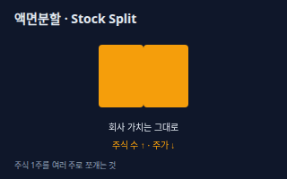</a> <b><a href="#stock-split--액면분할">Stock Split</a></b> 액면분할 주식 한 주의 액면가를 낮춰 주식 수를 늘리는 것이다. 회사 가치는 그대로이고 주가만 내려가 사기 쉬워진다.</td>
</tr>
<tr>
<td width="33%" valign="top"><a href="#short-selling--공매도">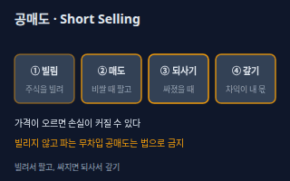</a> <b><a href="#short-selling--공매도">Short Selling</a></b> 공매도 주식을 빌려서 먼저 팔고, 값이 내려가면 싸게 되사서 갚아 차익을 얻는 거래다. 값이 오르면 손실이 된다. 빌리지 않고 파는 무차입 공매도는 법으로 금지되어 있다.</td>
</tr>
</table>

**세금 · 비용 · Tax & Costs** (4)

<table>
<tr>
<td width="33%" valign="top"><a href="#securities-transaction-tax--증권거래세">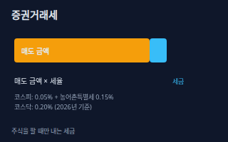</a> <b><a href="#securities-transaction-tax--증권거래세">Securities Transaction Tax</a></b> 증권거래세 주식을 팔 때 매도 금액에 붙는 세금이다. 2026년 기준 코스피는 거래세 0.05%에 농어촌특별세 0.15%, 코스닥은 0.20%이며, 사는 쪽에는 붙지 않는다.</td>
<td width="33%" valign="top"><a href="#dividend-income-tax--배당소득세">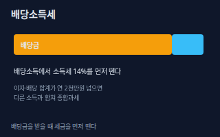</a> <b><a href="#dividend-income-tax--배당소득세">Dividend Income Tax</a></b> 배당소득세 배당금을 받을 때 내는 세금이다. 회사가 배당금을 지급할 때 소득세 14%를 미리 떼어 나라에 대신 내고, 이자와 배당을 합친 금융소득이 연 2천만원 이하면 그것으로 끝난다. 넘으면 다른 소득과 합쳐 종합과세한다.</td>
<td width="33%" valign="top"><a href="#major-shareholder-capital-gains-tax--대주주-양도세">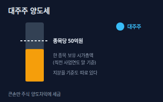</a> <b><a href="#major-shareholder-capital-gains-tax--대주주-양도세">Major Shareholder Capital Gains Tax</a></b> 대주주 양도세 장내에서 주식을 사고파는 일반 투자자의 차익에는 보통 양도소득세가 없지만, 대주주가 파는 차익에는 양도소득세가 붙는다. 한 종목을 시가총액 50억원 이상 보유하면 대주주이고, 지분율 기준(코스피 1%, 코스닥 2%)도 따로 있다.</td>
</tr>
<tr>
<td width="33%" valign="top"><b><a href="accounting.md#withholding-tax--원천징수">Withholding Tax</a></b> 원천징수 돈을 주는 쪽이 받는 사람의 세금을 미리 떼서 나라에 대신 내는 제도. 배당금을 받을 때도 같은 방식으로 세금이 먼저 빠진다. → accounting 시트</td>
</tr>
</table>

<!-- overview:end -->

## 종목 · 시장 · Securities & Markets

### Stock · 주식

- **정의**: 회사를 잘게 나눈 지분 증서다. 주식을 사면 그 회사의 주주가 되어 이익 배당을 받고 주주총회에서 의결권을 행사할 수 있는 권리를 갖는다.
- **AI에게 이렇게**: "A 회사 주식을 처음 사려는 초보야. 주식 한 주를 사면 내가 어떤 권리를 갖는지 쉬운 예시로 설명해줘."
- **언제**: 회사의 일부를 소유하고 그 회사의 성장과 이익에 함께 참여하고 싶을 때
- **헷갈림**: 채권 — 채권은 돈을 빌려주고 이자를 받는 증서이고, 주식은 지분을 사서 주인이 되는 증서다.
- **관련**: 보통주·우선주, 시가총액, 코스피·코스닥
- **확인 질문**: 국내 상장 주식인가요, 해외 주식인가요? 한 종목을 설명해 드릴까요, 시장 전체를 설명해 드릴까요?

### Common vs Preferred · 보통주·우선주

- **정의**: 보통주는 의결권이 있는 기본 주식이다. 우선주는 보통 의결권이 없는 대신 배당을 보통주보다 우선해서 받도록 정한 주식이다.
- **AI에게 이렇게**: "이 회사의 보통주와 우선주 가격이 왜 다른지, 배당과 의결권 관점에서 비교해서 알려줘."
- **언제**: 같은 회사 이름 뒤에 '우'가 붙은 종목을 만났을 때, 배당 목적으로 종목을 고를 때
- **헷갈림**: 종목 이름 — 같은 회사라도 보통주와 우선주는 서로 다른 종목이라 가격과 거래량이 따로 움직인다.
- **관련**: 배당, 배당수익률, 시가총액
- **확인 질문**: 어느 회사의 보통주와 우선주를 비교하나요? 배당이 목적인가요, 의결권이 중요한가요?

### Market Cap · 시가총액

- **정의**: 주가에 발행주식 수를 곱한 값이다. 시장이 그 회사 전체에 매긴 현재 가격이라고 보면 된다.
- **AI에게 이렇게**: "이 종목의 시가총액을 현재가와 발행주식 수로 계산하고, 같은 시장에서 비슷한 크기의 회사 세 곳을 알려줘."
- **언제**: 회사 크기를 비교하거나 대형주·중소형주를 나눌 때
- **헷갈림**: 매출이나 자산 — 시가총액은 주가로 정해지는 시장의 평가라서 회사가 실제로 가진 자산·매출과 다르다.
- **관련**: PBR, 코스피·코스닥, 대주주 양도세
- **확인 질문**: 보통주만 계산할까요, 우선주도 합칠까요? 어느 날짜의 주가를 기준으로 할까요?

### KOSPI / KOSDAQ · 코스피·코스닥

- **정의**: 한국거래소(KRX)가 운영하는 두 주식시장이다. 코스피(유가증권시장)에는 대형 우량 기업이, 코스닥에는 성장·벤처 기업이 상대적으로 많다. 시장 전체의 움직임을 숫자로 낸 지수도 같은 이름으로 부른다.
- **AI에게 이렇게**: "이 종목이 코스피인지 코스닥인지 알려주고, 두 시장의 규칙 차이 중 내가 알아야 할 것만 정리해줘."
- **언제**: 종목이 어느 시장에 속하는지 확인하거나, 시장 전체 분위기를 말할 때
- **헷갈림**: 코스피 지수와 코스피 시장 — 지수는 시장 전체의 평균적 움직임을 나타내는 숫자이고, 시장은 종목이 거래되는 장소다.
- **관련**: 시가총액, 거래시간, 증권거래세
- **확인 질문**: 시장 전체(지수)를 묻는 건가요, 한 종목의 소속 시장을 묻는 건가요?

## 주문 · Orders

### Market vs Limit Order · 시장가·지정가

- **정의**: 시장가는 가격을 정하지 않고 지금 나와 있는 가장 유리한 호가에 바로 체결하는 주문이다. 지정가는 내가 정한 가격(또는 더 유리한 가격)에서만 체결되는 주문이다.
- **AI에게 이렇게**: "A 종목을 지정가로 사려는데 호가창을 보고 얼마에 주문하면 좋을지, 시장가와 무엇이 다른지 알려줘."
- **언제**: 급하게 체결하고 싶으면 시장가, 가격을 지키고 싶으면 지정가
- **헷갈림**: 주문 가격과 체결 가격 — 호가가 얇을 때 시장가는 생각보다 불리한 가격에 체결될 수 있고, 지정가는 가격이 안 맞으면 아예 체결되지 않는다.
- **관련**: 호가·체결, 상한가·하한가
- **확인 질문**: 꼭 지금 체결돼야 하나요, 가격이 더 중요한가요? 거래가 활발하지 않은 종목인가요?

### Bid / Ask / Execution · 호가·체결

- **정의**: 호가는 사겠다(매수호가), 팔겠다(매도호가)고 부른 가격과 수량이다. 체결은 사려는 가격과 팔려는 가격이 맞아 실제로 거래가 이루어지는 것이다.
- **AI에게 이렇게**: "지금 호가창이 이렇게 생겼는데, 내가 지정가로 낸 주문이 왜 체결 안 됐는지 설명해줘."
- **언제**: 호가창을 읽을 때, 주문이 체결되지 않거나 일부만 체결된 이유를 볼 때
- **헷갈림**: 현재가 — 현재가는 마지막으로 체결된 가격일 뿐이고, 지금 당장 살 수 있는 값은 가장 낮은 매도호가다.
- **관련**: 시장가·지정가, 거래시간, 상한가·하한가
- **확인 질문**: 어느 종목의 어느 시각 호가창인가요? 주문 가격과 수량, 체결된 수량은 얼마인가요?

### Price Limit · 상한가·하한가 (가격제한폭)

- **정의**: 하루 동안 한 종목의 가격이 기준가격(보통 직전 거래일 종가) 대비 위아래 30%까지만 움직이도록 정한 한도다. 위쪽 끝이 상한가, 아래쪽 끝이 하한가다.
- **AI에게 이렇게**: "기준가격이 10,000원일 때 오늘의 상한가와 하한가를 계산해줘. 호가 단위도 같이 설명해줘."
- **언제**: 급등락하는 종목의 주문 가능한 가격 범위를 알고 싶을 때
- **헷갈림**: 가장 높은 주가 — 상한가는 그 종목이 역대 최고가라는 뜻이 아니라 그날 오를 수 있는 한도에 닿았다는 뜻이다.
- **관련**: 호가·체결, 거래시간, 시장가·지정가
- **확인 질문**: 기준가격(전날 종가)은 얼마인가요? 신규 상장이나 권리락처럼 기준가격을 따로 정하는 날인가요?
- **근거**: [한국거래소 기준가격/가격제한폭/상하한가](https://regulation.krx.co.kr/contents/RGL/03/03020201/RGL03020201.jsp)
- **검증일**: 2026-11-02

### Trading Hours · 거래시간

- **정의**: 한국거래소 정규시장은 평일 09:00부터 15:30까지 거래되고, 주문은 08:30부터 받는다. 정규시장 앞뒤로 시간외·애프터마켓 시간표가 따로 있고, 토요일·공휴일 등은 쉰다.
- **AI에게 이렇게**: "내 증권앱에서 장 마감 후에도 주문을 낼 수 있는 시간대가 어디까지인지, 정규시장과 무엇이 다른지 정리해줘."
- **언제**: 주문을 내는 시간대를 정할 때, 장 마감 뒤 뉴스에 대응하고 싶을 때
- **헷갈림**: 호가접수 시간과 거래 시간 — 08:30에 주문을 넣을 수는 있지만 거래가 시작되는 시각은 09:00이다.
- **관련**: 호가·체결, 결제 T+2, 상한가·하한가
- **확인 질문**: 어느 증권사 앱을 쓰나요? 정규시장 말고 시간외·애프터마켓 거래도 궁금한가요?
- **근거**: [한국거래소 유가증권시장 매매거래시간](https://regulation.krx.co.kr/contents/RGL/03/03010100/RGL03010100.jsp), [한국거래소 코스닥시장 시장의 개폐](https://regulation.krx.co.kr/contents/RGL/03/03020401/RGL03020401.jsp)
- **검증일**: 2026-11-02

### Cash Balance / Margin Purchase · 예수금·미수

- **정의**: 예수금은 증권계좌에 들어 있는 현금으로 주식을 살 때 쓰는 돈이다. 미수는 현금이 모자란데도 외상으로 주문한 뒤 결제일까지 대금을 채우지 못하면 생기는 빚(미수금)이다.
- **AI에게 이렇게**: "내 계좌에 예수금이 있는데 왜 출금이 안 되는지, 미수가 생기면 어떻게 되는지 쉽게 설명해줘."
- **언제**: 주문 가능 금액을 확인할 때, '미수 발생' 알림이 떴을 때
- **헷갈림**: 신용융자 — 미수는 결제일까지의 외상이고, 신용융자는 증권사에서 돈을 빌려 이자를 내며 투자하는 별도 상품이다.
- **관련**: 결제 T+2, 시장가·지정가
- **확인 질문**: 예수금 안에서만 주문하려는 건가요? 증권사의 증거금률과 미수 정책을 이미 확인하셨나요?

### Settlement (T+2) · 결제 T+2

- **정의**: 주식을 사고판 날(T)로부터 2거래일째(T+2)에 주식과 대금이 실제로 오가는 절차다. 체결되었다고 해서 판 돈을 바로 은행으로 출금할 수 있는 것은 아니다.
- **AI에게 이렇게**: "월요일에 주식을 팔았는데 그 돈을 실제로 언제 출금할 수 있는지, 결제일 기준으로 알려줘."
- **언제**: 판 돈의 출금 가능일, 배당 받기 위한 마지막 매수일, 미수 상환일을 계산할 때
- **헷갈림**: 체결과 결제 — 체결은 거래가 성립한 순간이고, 결제는 그 거래의 주식과 돈이 실제로 이동하는 것이다.
- **관련**: 예수금·미수, 배당락, 거래시간
- **확인 질문**: 거래일이 언제이고 중간에 휴장일이 끼어 있나요? 결제주기를 줄이는 논의가 있으니 증권사 공지의 최신 내용도 확인했나요?
- **근거**: [금융위원회 금융용어 T+2일 결제제도](https://www.fsc.go.kr/in090301/view?dicId=1831), [한국거래소 ETF 결제제도](https://regulation.krx.co.kr/contents/RGL/03/03060102/RGL03060102.jsp)
- **검증일**: 2026-11-02

## 지표 · Indicators

### EPS · 주당순이익

- **정의**: 당기순이익을 발행주식 수로 나눈 값이다. 주식 한 주가 한 해 동안 벌어들인 이익이라고 볼 수 있다.
- **AI에게 이렇게**: "이 회사의 최근 사업연도 EPS가 얼마인지, 3년간 어떻게 변했는지 DART 자료로 정리해줘."
- **언제**: PER을 계산하기 전 기본값을 확인하거나 이익 추세를 볼 때
- **헷갈림**: 배당금 — EPS는 회사가 번 이익을 주식 수로 나눈 값이고, 실제로 주주에게 나눠 준 돈은 따로 있다.
- **관련**: PER, ROE, 배당, 당기순이익
- **확인 질문**: 확정된 실적 기준인가요, 증권사 예상 기준인가요? 보통주 기준인가요, 우선주 포함인가요?

### PER · 주가수익비율

- **정의**: 주가를 EPS로 나눈 값이다. 현재 주가가 한 주당 이익의 몇 배인지 알려 주어서 이익에 비해 비싼지 싼지 가늠하게 한다.
- **AI에게 이렇게**: "A 종목의 PER이 같은 업종 평균보다 높은 이유를 이익 성장과 연결해서 설명해줘."
- **언제**: 같은 업종 안에서 종목끼리 가격이 이익에 비해 어떤지 비교할 때
- **헷갈림**: PBR — PER은 이익 대비, PBR은 순자산 대비 주가다. PER이 낮다고 무조건 싼 것은 아니며 이익이 일시적일 수 있다.
- **관련**: EPS, PBR, ROE
- **확인 질문**: 최근 확정 이익 기준인가요, 예상 이익 기준인가요? 적자 회사처럼 PER 계산이 어려운 경우도 포함하나요?

### Price-to-Book Ratio · 주가순자산비율 (PBR)

- **정의**: 주가를 주당순자산으로 나눈 값, 즉 시가총액을 회사의 순자산(자본)으로 나눈 값이다. 1배면 장부가치와 같은 가격에, 1배보다 낮으면 장부가치보다 싸게 거래된다는 뜻이다.
- **AI에게 이렇게**: "이 종목의 PBR이 1배보다 낮은 이유로 흔히 거론되는 것들을 업종 특성과 함께 설명해줘."
- **언제**: 자산이 많은 업종(금융·제조 등)을 비교하거나 장부가치보다 싼지 볼 때
- **헷갈림**: PER — PBR은 순자산 대비, PER은 이익 대비다. 두 지표가 다른 이야기를 할 수 있다.
- **관련**: PER, ROE, 시가총액
- **확인 질문**: 어느 시점의 순자산을 쓸까요(최근 분기 기준)? 비교할 업종 평균이 필요한가요?

### ROE · 자기자본이익률

- **정의**: 당기순이익을 자기자본으로 나눈 비율이다. 주주의 돈으로 한 해에 얼마나 효율적으로 이익을 냈는지 보여준다.
- **AI에게 이렇게**: "ROE가 높은 회사 중 부채가 많아서 높은 곳을 가려내려면 무엇을 같이 봐야 하는지 알려줘."
- **언제**: 돈을 잘 버는 회사인지, 같은 업종 경쟁사와 비교할 때
- **헷갈림**: 영업이익률 — ROE는 주주 돈 대비 최종 이익이고, 영업이익률은 매출 대비 본업 이익이다. 빚이 많으면 ROE가 부풀려질 수 있다.
- **관련**: PER, PBR, EPS, 재무상태표
- **확인 질문**: 최근 사업연도 기준인가요, 여러 해 평균인가요? 부채비율도 함께 볼까요?

### Dividend · 배당

- **정의**: 회사가 번 이익의 일부를 주주에게 현금(또는 주식)으로 나눠 주는 것이다. 주식을 가진 만큼 받는다.
- **AI에게 이렇게**: "이 종목의 최근 배당금과 배당 기준일을 DART 공시로 찾아서, 내가 100주 있으면 얼마를 받는지 계산해줘."
- **언제**: 주식에서 이익을 시세차익뿐 아니라 꾸준한 현금으로도 받고 싶을 때
- **헷갈림**: 배당수익률 — 배당은 받는 돈의 금액이고, 배당수익률은 그 돈이 주가의 몇 퍼센트인지다.
- **관련**: 배당락, 배당수익률, 배당소득세, 우선주
- **확인 질문**: 배당금을 알고 싶은 종목과 기준 연도는 어디인가요? 중간배당·분기배당도 포함할까요?

### Ex-dividend Date · 배당락

- **정의**: 배당받을 권리가 없어진 채로 거래가 시작되는 날(또는 그 시장 조치)이다. 이날부터 사는 사람은 그 해 배당을 받지 못해서 주가가 배당금만큼 낮게 시작하는 경향이 있다.
- **AI에게 이렇게**: "이 종목의 이번 배당을 받으려면 마지막으로 언제까지 사야 하는지, 배당락일이 언제인지 알려줘."
- **언제**: 배당을 받기 위해 매수 시점을 정할 때, 배당락 때문에 주가가 갑자기 내려간 이유를 알고 싶을 때
- **헷갈림**: 배당기준일 — 기준일은 주주명부에 이름이 올라 있어야 하는 날이고, 배당락일은 그 권리 없이 사게 되는 첫날이다. 결제 시간 때문에 둘은 다르다.
- **관련**: 배당, 결제 T+2, 배당수익률, 유상증자
- **확인 질문**: 어느 종목이고 배당 기준일(권리확정일)은 언제인가요? 연말 배당인가요, 분기·중간 배당인가요?
- **근거**: [한국거래소 배당락/권리락](https://regulation.krx.co.kr/contents/RGL/03/03010401/RGL03010401.jsp)
- **검증일**: 2026-11-02

### Dividend Yield · 배당수익률

- **정의**: 한 주당 배당금을 현재 주가로 나눈 비율이다. 지금 주가로 산다고 가정할 때 배당만으로 한 해에 얼마나 돌려받는지 보여준다.
- **AI에게 이렇게**: "배당수익률이 높은 종목 후보를 고를 때 함정이 될 수 있는 점(주가 하락, 일회성 배당)을 같이 알려줘."
- **언제**: 배당 목적으로 여러 종목을 비교할 때
- **헷갈림**: 배당성향 — 배당성향은 순이익 중 배당으로 나가는 비율이고, 배당수익률은 주가 대비 비율이다. 주가가 떨어지면 수익률이 올라 보인다.
- **관련**: 배당, 우선주, 배당소득세
- **확인 질문**: 최근 배당금 기준인가요, 예상 배당 기준인가요? 세금을 떼기 전 금액인가요?

## 공시 · 이벤트 · Disclosures & Events

### DART Disclosure · DART 공시

- **정의**: 상장회사가 투자자에게 알려야 하는 사업·재무·주요 사건 문서를 금융감독원 전자공시시스템(DART)에 올려 누구나 인터넷으로 열람하게 한 것이다.
- **AI에게 이렇게**: "이 회사의 DART 공시에서 최근에 낸 주요사항보고서가 있는지 찾아서, 투자자가 눈여겨볼 내용만 요약해줘."
- **언제**: 실적, 유상증자, 대주주 지분 변동 같은 소식의 원문을 확인할 때
- **헷갈림**: 뉴스 — 뉴스는 기자가 해석한 글이고, 공시는 회사가 직접 낸 공식 원문이다.
- **관련**: 유상증자, 액면분할, EPS
- **확인 질문**: 회사 이름이나 종목코드는 무엇인가요? 정기 보고서가 필요한가요, 최근 이벤트 공시가 필요한가요?

### Rights Offering · 유상증자

- **정의**: 회사가 사업 자금을 마련하려고 돈을 받고 새 주식을 발행하는 것이다. 새 주식을 사지 않으면 전체 주식에서 내 몫의 비율이 작아진다.
- **AI에게 이렇게**: "이 회사가 유상증자를 공시했는데, 기존 주주에게 어떤 영향이 있고 신주를 받으려면 무엇을 해야 하는지 알려줘."
- **언제**: 회사가 증자를 공시했을 때, 주가가 갑자기 흔들린 이유를 확인할 때
- **헷갈림**: 무상증자 — 유상증자는 투자자가 돈을 내고 새 주식을 받는 것이고, 무상증자는 돈을 받지 않고 주식을 더 나눠 주는 것이다.
- **관련**: 배당락, DART 공시, 액면분할
- **확인 질문**: 주주배정인가요, 일반공모인가요? 신주 배정 기준일은 언제인가요?

### Stock Split · 액면분할

- **정의**: 주식 한 주의 액면가를 낮춰 주식 수를 늘리는 것이다. 회사 가치는 그대로이고 주가만 내려가 사기 쉬워진다.
- **AI에게 이렇게**: "이 종목이 액면분할을 한다는데, 내 보유 주식 수와 평균 단가가 어떻게 바뀌는지 계산 방법을 알려줘."
- **언제**: 주가가 너무 높아 거래가 적을 때 회사가 분할을 결정한 공시를 볼 때
- **헷갈림**: 무상증자 — 둘 다 주식 수가 늘지만, 액면분할은 액면가가 줄어들고 무상증자는 회사의 자본금이 늘어난다.
- **관련**: 유상증자, DART 공시, 시가총액
- **확인 질문**: 분할 비율은 어떻게 되나요? 내 보유 수량과 평균 매입 단가를 알고 있나요?

### Short Selling · 공매도

- **정의**: 주식을 빌려서 먼저 팔고, 값이 내려가면 싸게 되사서 갚아 차익을 얻는 거래다. 값이 오르면 손실이 된다. 빌리지 않고 파는 무차입 공매도는 법으로 금지되어 있다.
- **AI에게 이렇게**: "공매도가 주가에 어떤 영향을 준다고 하는지, 찬반 의견과 함께 중립적으로 정리해줘."
- **언제**: 뉴스에서 공매도 재개·금지 이야기가 나올 때, 하락장 원인을 들을 때
- **헷갈림**: 대차거래 — 대차거래는 주식을 빌려주고 빌리는 거래 자체이고, 공매도는 빌린 주식을 시장에 파는 행위다.
- **관련**: 시장가·지정가, 거래시간, DART 공시
- **확인 질문**: 제도를 알고 싶은가요, 특정 종목의 공매도 현황을 알고 싶은가요? 개인이 직접 하는 방법이 궁금한가요?
- **근거**: [자본시장과 금융투자업에 관한 법률 제180조](https://www.law.go.kr/법령/자본시장과금융투자업에관한법률/제180조)
- **검증일**: 2026-11-02

## 세금 · 비용 · Tax & Costs

### Securities Transaction Tax · 증권거래세

- **정의**: 주식을 팔 때 매도 금액에 붙는 세금이다. 2026년 기준 코스피는 거래세 0.05%에 농어촌특별세 0.15%, 코스닥은 0.20%이며, 사는 쪽에는 붙지 않는다.
- **AI에게 이렇게**: "내가 코스피 주식을 천만 원어치 팔면 증권거래세가 얼마인지, 증권사 수수료와 구분해서 계산해줘."
- **언제**: 사고팔 때 드는 비용을 계산하거나 수익이 얼마나 남는지 따질 때
- **헷갈림**: 증권사 수수료 — 수수료는 사고팔 때 증권사에 내는 돈이고, 증권거래세는 팔 때만 나라에 내는 세금이다.
- **관련**: 배당소득세, 대주주 양도세, 코스피·코스닥
- **확인 질문**: 어느 시장(코스피·코스닥)에서 판 주식인가요? 매도 금액과 매도한 날짜는 언제인가요?
- **근거**: [증권거래세법 시행령 제5조](https://www.law.go.kr/법령/증권거래세법시행령/제5조), [증권거래세법 제9조](https://www.law.go.kr/법령/증권거래세법/제9조), [정책브리핑 2026년부터 이렇게 달라집니다(증권거래세율 조정)](https://www.korea.kr/fcatalog/access/ecatalogt.jsp?Dir=1199&callmode=normal&catimage&eclang=ko&start=46&um=s)
- **검증일**: 2026-11-02

### Dividend Income Tax · 배당소득세

- **정의**: 배당금을 받을 때 내는 세금이다. 회사가 배당금을 지급할 때 소득세 14%를 미리 떼어 나라에 대신 내고, 이자와 배당을 합친 금융소득이 연 2천만원 이하면 그것으로 끝난다. 넘으면 다른 소득과 합쳐 종합과세한다.
- **AI에게 이렇게**: "올해 받은 배당금과 예금 이자를 합치면 금융소득종합과세 대상인지, 확인하는 방법을 알려줘."
- **언제**: 배당금이 입금될 때 생각보다 적은 이유를 알고 싶을 때, 연말에 금융소득을 점검할 때
- **헷갈림**: 배당소득과 양도소득 — 배당소득세는 배당금에 붙는 세금이고, 양도소득세는 주식을 팔아 번 차익에 붙는 세금이다.
- **관련**: 배당, 원천징수, 종합소득세, 증권거래세
- **확인 질문**: 올해 받은 이자와 배당의 합계는 얼마인가요? ISA나 연금계좌 안에서 받은 배당인가요?
- **근거**: [소득세법 제129조](https://www.law.go.kr/법령/소득세법/제129조), [소득세법 제14조](https://www.law.go.kr/법령/소득세법/제14조), [찾기쉬운 생활법령 주식투자자: 양도소득세·증권거래세 및 배당소득세](https://www.easylaw.go.kr/CSP/CnpClsMainBtr.laf?ccfNo=2&cciNo=3&cnpClsNo=1&csmSeq=1701&menuType=cnpcls&popMenu=ov)
- **검증일**: 2026-11-02

### Major Shareholder Capital Gains Tax · 대주주 양도세

- **정의**: 장내에서 주식을 사고파는 일반 투자자의 차익에는 보통 양도소득세가 없지만, 대주주가 파는 차익에는 양도소득세가 붙는다. 한 종목을 시가총액 50억원 이상 보유하면 대주주이고, 지분율 기준(코스피 1%, 코스닥 2%)도 따로 있다.
- **AI에게 이렇게**: "내가 한 종목에 이만큼 보유하고 있을 때 대주주 양도세 대상이 되는지, 판단에 필요한 기준을 정리해줘."
- **언제**: 한 종목에 큰 금액을 담고 있는데 연말에 팔지 말지 고민될 때
- **헷갈림**: 증권거래세 — 증권거래세는 누구나 팔 때 내는 거래세이고, 대주주 양도세는 대주주에게만 붙는 차익 과세다.
- **관련**: 증권거래세, 시가총액, 종합소득세
- **확인 질문**: 한 종목의 보유 금액(직전 사업연도 말 기준)과 지분율은 얼마인가요? 가족 합산 여부도 확인했나요?
- **근거**: [소득세법 시행령 제157조](https://www.law.go.kr/법령/소득세법시행령/제157조), [찾기쉬운 생활법령 주식투자자: 양도소득세·증권거래세 및 배당소득세](https://www.easylaw.go.kr/CSP/CnpClsMainBtr.laf?ccfNo=2&cciNo=3&cnpClsNo=1&csmSeq=1701&menuType=cnpcls&popMenu=ov)
- **검증일**: 2026-11-02

### Withholding Tax · 원천징수

- **정의**: 돈을 주는 쪽이 받는 사람의 세금을 미리 떼서 나라에 대신 내는 제도. 배당금을 받을 때도 같은 방식으로 세금이 먼저 빠진다.
- **원본**: [회계 · 세무 기초 · Withholding Tax](accounting.md#withholding-tax--원천징수)

## 참고 자료

- [한국거래소 규정/제도 — 유가증권시장 매매거래시간](https://regulation.krx.co.kr/contents/RGL/03/03010100/RGL03010100.jsp)
- [한국거래소 규정/제도 — 기준가격/가격제한폭/상하한가](https://regulation.krx.co.kr/contents/RGL/03/03020201/RGL03020201.jsp)
- [한국거래소 규정/제도 — 배당락/권리락](https://regulation.krx.co.kr/contents/RGL/03/03010401/RGL03010401.jsp)
- [한국거래소 규정/제도 — 코스닥시장 시장의 개폐](https://regulation.krx.co.kr/contents/RGL/03/03020401/RGL03020401.jsp)
- [금융위원회 금융용어설명 — T+2일 결제제도](https://www.fsc.go.kr/in090301/view?dicId=1831)
- [국가법령정보센터 증권거래세법 시행령 제5조](https://www.law.go.kr/법령/증권거래세법시행령/제5조)
- [국가법령정보센터 소득세법 시행령 제157조](https://www.law.go.kr/법령/소득세법시행령/제157조)
- [국가법령정보센터 자본시장법 제180조](https://www.law.go.kr/법령/자본시장과금융투자업에관한법률/제180조)
- [찾기쉬운 생활법령 — 주식투자자](https://www.easylaw.go.kr/CSP/CnpClsMainBtr.laf?ccfNo=2&cciNo=3&cnpClsNo=1&csmSeq=1701&menuType=cnpcls&popMenu=ov)
- [정책브리핑 2026년부터 이렇게 달라집니다](https://www.korea.kr/fcatalog/access/ecatalogt.jsp?Dir=1199&callmode=normal&catimage&eclang=ko&start=46&um=s)
- [금융감독원 전자공시시스템 DART](https://dart.fss.or.kr/)
- [경향신문 — 결제주기 T+2를 T+1로 줄이는 논의(참고)](https://www.khan.co.kr/article/202603191722001)
