# UI 디자인 치트시트

> 바이브 코딩으로 웹·앱 화면을 만들 때 '그 느낌 있잖아요'를 정확한 이름으로 바꿔 주는 시트입니다. 그림에서 모양을 찾고, 이름과 요청 문장을 그대로 AI에게 보내세요.

## 이렇게 쓰세요

- **나 → AI**: "첫 화면 맨 위는 Hero Section으로, 위쪽에는 Sticky Header를 붙이고, 아래에는 Card Layout으로 상품 3개를 보여줘. 카드에는 Hover Effect를 넣고 Stagger Animation으로 차례로 나타나게 해줘."
- **AI → 나**: "Hero Section의 배경은 단색·이미지·영상 중 무엇인가요? 카드 3개는 폰에서 세로 1칸으로 쌓는 Responsive Layout이면 될까요?"
- **나 → AI**: "삭제 버튼을 누르면 Modal로 한 번 확인받고, 삭제가 끝나면 Toast로 '삭제되었습니다'를 3초 보여줘."
- **AI → 나**: "Modal 바깥을 눌러도 닫히게 할까요? Toast는 화면 어느 모서리에 띄울까요?"
- **팁**: 이름이 헷갈리면 '헷갈림' 줄을 보세요. 비슷한 용어와의 차이를 정리해 두었습니다. 요청에 이름과 함께 숫자(몇 개, 몇 초, 몇 px)를 붙이면 AI가 되묻는 횟수가 줄어듭니다.

## 한눈에 보기

<!-- overview:start -->
<!-- 이 구역은 자동 생성됩니다. 직접 고치지 말고 `cd mcp-server && npm run generate`를 실행하세요. -->

**레이아웃 · Layout** (7)

<table>
<tr>
<td width="33%" valign="top"><a href="#hero-section--히어로-섹션">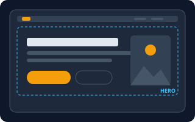</a> <b><a href="#hero-section--히어로-섹션">Hero Section</a></b> 히어로 섹션 웹페이지 첫 화면 맨 위를 크게 차지하는 대표 영역입니다. 큰 제목, 한 줄 설명, 핵심 버튼, 이미지가 들어갑니다.</td>
<td width="33%" valign="top"><a href="#responsive-layout--반응형-레이아웃">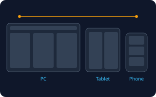</a> <b><a href="#responsive-layout--반응형-레이아웃">Responsive Layout</a></b> 반응형 레이아웃 화면 폭에 맞춰 배치가 저절로 바뀌는 레이아웃입니다. PC에서는 3칸이던 것이 폰에서는 1칸으로 쌓입니다.</td>
<td width="33%" valign="top"><a href="#card-layout--카드-레이아웃">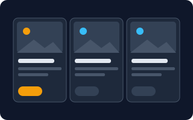</a> <b><a href="#card-layout--카드-레이아웃">Card Layout</a></b> 카드 레이아웃 정보를 사각형 카드 단위로 묶어 나란히 늘어놓는 배치입니다. 카드 하나에 이미지·제목·설명·버튼이 한 세트로 들어갑니다.</td>
</tr>
<tr>
<td width="33%" valign="top"><a href="#bento-grid--벤토-그리드">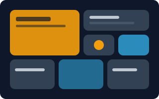</a> <b><a href="#bento-grid--벤토-그리드">Bento Grid</a></b> 벤토 그리드 크기가 다른 칸들을 도시락(벤토)처럼 빈틈없이 맞춰 넣은 배치입니다. 중요한 칸은 크게, 덜 중요한 칸은 작게 둡니다.</td>
<td width="33%" valign="top"><a href="#sidebar-layout--사이드바-레이아웃">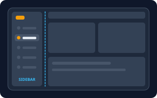</a> <b><a href="#sidebar-layout--사이드바-레이아웃">Sidebar Layout</a></b> 사이드바 레이아웃 화면 한쪽 옆에 세로 메뉴 띠를 두고 나머지를 본문으로 쓰는 배치입니다.</td>
<td width="33%" valign="top"><a href="#sticky-header--고정-헤더">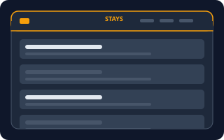</a> <b><a href="#sticky-header--고정-헤더">Sticky Header</a></b> 고정 헤더 페이지를 아래로 내려도 화면 맨 위에 계속 붙어 따라오는 헤더입니다.</td>
</tr>
<tr>
<td width="33%" valign="top"><a href="#split-layout--분할-레이아웃">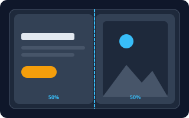</a> <b><a href="#split-layout--분할-레이아웃">Split Layout</a></b> 분할 레이아웃 화면을 좌우 두 구역으로 나눠 한쪽엔 글과 버튼, 다른 쪽엔 이미지나 폼을 두는 배치입니다.</td>
</tr>
</table>

**내비게이션 · Navigation** (6)

<table>
<tr>
<td width="33%" valign="top"><a href="#navbar--내비게이션-바">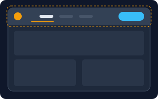</a> <b><a href="#navbar--내비게이션-바">Navbar</a></b> 내비게이션 바 사이트 맨 위에 가로로 놓인 메뉴 띠입니다. 로고, 페이지 이동 링크, 로그인 같은 버튼이 들어갑니다.</td>
<td width="33%" valign="top"><a href="#breadcrumb--브레드크럼">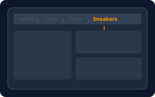</a> <b><a href="#breadcrumb--브레드크럼">Breadcrumb</a></b> 브레드크럼 지금 있는 페이지가 사이트의 어디쯤인지 '홈 &gt; 쇼핑 &gt; 신발'처럼 경로로 보여주는 작은 한 줄입니다.</td>
<td width="33%" valign="top"><a href="#pagination--페이지네이션">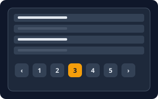</a> <b><a href="#pagination--페이지네이션">Pagination</a></b> 페이지네이션 목록이 길 때 페이지 번호 버튼으로 나눠서 보여주는 방식입니다.</td>
</tr>
<tr>
<td width="33%" valign="top"><a href="#bottom-tab-bar--하단-탭-바">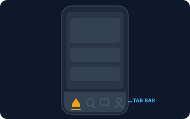</a> <b><a href="#bottom-tab-bar--하단-탭-바">Bottom Tab Bar</a></b> 하단 탭 바 모바일 앱 화면 맨 아래에 아이콘 3~5개가 놓인 고정 메뉴입니다. 엄지로 누르기 쉬워서 자주 쓰는 화면 이동에 씁니다.</td>
<td width="33%" valign="top"><a href="#hamburger-menu--햄버거-메뉴">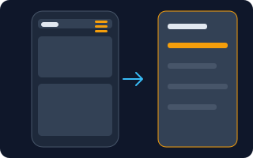</a> <b><a href="#hamburger-menu--햄버거-메뉴">Hamburger Menu</a></b> 햄버거 메뉴 줄 세 개(☰) 아이콘을 눌러야 메뉴가 나타나는 방식입니다. 좁은 화면에서 메뉴를 숨겨 공간을 아낍니다.</td>
<td width="33%" valign="top"><a href="#tabs--탭">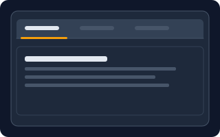</a> <b><a href="#tabs--탭">Tabs</a></b> 탭 여러 내용을 제목 줄로 나눠 두고, 누른 제목의 내용만 보여주는 방식입니다. 한 번에 한 탭만 열려 있습니다.</td>
</tr>
</table>

**컴포넌트 · Components** (14)

<table>
<tr>
<td width="33%" valign="top"><a href="#accordion--아코디언">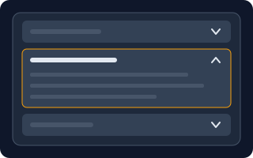</a> <b><a href="#accordion--아코디언">Accordion</a></b> 아코디언 제목 줄을 누르면 내용이 아래로 펼쳐지고, 다시 누르면 접히는 목록입니다.</td>
<td width="33%" valign="top"><a href="#modal--dialog--모달--다이얼로그">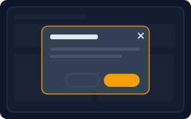</a> <b><a href="#modal--dialog--모달--다이얼로그">Modal / Dialog</a></b> 모달 / 다이얼로그 화면 위에 떠서 배경을 어둡게 만들고 사용자의 선택을 먼저 받는 작은 창입니다. 닫기 전까지 뒤 화면은 누를 수 없습니다.</td>
<td width="33%" valign="top"><a href="#drawer--드로어">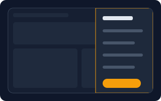</a> <b><a href="#drawer--드로어">Drawer</a></b> 드로어 화면 가장자리에서 밀려 나오는 패널입니다. 메뉴, 필터, 장바구니 같은 보조 내용을 담습니다.</td>
</tr>
<tr>
<td width="33%" valign="top"><a href="#dropdown--드롭다운">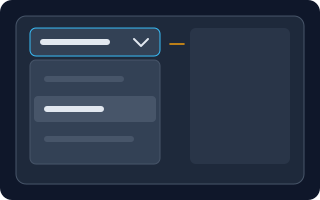</a> <b><a href="#dropdown--드롭다운">Dropdown</a></b> 드롭다운 버튼을 누르면 아래로 선택지 목록이 펼쳐지고 그중 하나를 고르는 요소입니다.</td>
<td width="33%" valign="top"> <b><a href="#tooltip--툴팁">Tooltip</a></b> 툴팁 버튼이나 아이콘에 마우스를 올리면 잠깐 나타나는 짧은 설명 말풍선입니다.</td>
<td width="33%" valign="top"><a href="#toast--토스트"></a> <b><a href="#toast--토스트">Toast</a></b> 토스트 작업이 끝났다는 걸 화면 모서리에 잠깐 띄웠다가 저절로 사라지는 알림 상자입니다.</td>
</tr>
<tr>
<td width="33%" valign="top"><a href="#carousel--캐러셀">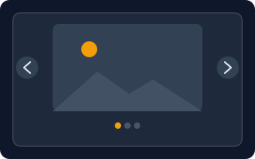</a> <b><a href="#carousel--캐러셀">Carousel</a></b> 캐러셀 사진이나 카드를 한 줄로 두고 좌우로 넘겨 가며 보여주는 슬라이드입니다.</td>
<td width="33%" valign="top"><a href="#badge--배지">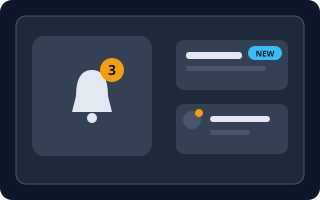</a> <b><a href="#badge--배지">Badge</a></b> 배지 아이콘이나 글자 모서리에 붙는 작은 표시입니다. 새 알림 숫자나 NEW 같은 상태를 알립니다.</td>
<td width="33%" valign="top"><a href="#skeleton--스켈레톤">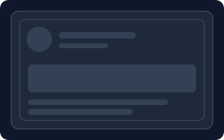</a> <b><a href="#skeleton--스켈레톤">Skeleton</a></b> 스켈레톤 내용이 로딩되는 동안 글자와 사진이 들어올 자리를 회색 뼈대로 먼저 보여주는 방식입니다.</td>
</tr>
<tr>
<td width="33%" valign="top"><a href="#empty-state--빈-상태-화면">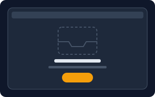</a> <b><a href="#empty-state--빈-상태-화면">Empty State</a></b> 빈 상태 화면 목록이나 검색 결과에 보여줄 것이 하나도 없을 때 대신 보여주는 안내 화면입니다. 그림, 설명, 다음 행동 버튼으로 이루어집니다.</td>
<td width="33%" valign="top"><a href="#toggle--토글-스위치">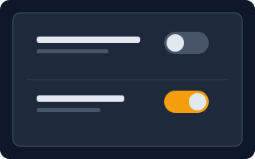</a> <b><a href="#toggle--토글-스위치">Toggle</a></b> 토글 스위치 켜짐과 꺼짐 두 상태를 스위치로 바꾸는 요소입니다. 누르면 바로 적용됩니다.</td>
<td width="33%" valign="top"><a href="#stepper--스테퍼">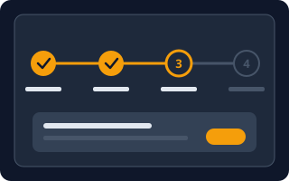</a> <b><a href="#stepper--스테퍼">Stepper</a></b> 스테퍼 여러 단계 중 지금 몇 번째인지 보여주는 진행 표시입니다. 끝낸 단계, 현재 단계, 남은 단계를 구분합니다.</td>
</tr>
<tr>
<td width="33%" valign="top"><a href="#progress-bar--프로그레스-바">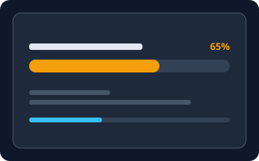</a> <b><a href="#progress-bar--프로그레스-바">Progress Bar</a></b> 프로그레스 바 작업이 얼마나 진행됐는지 채워진 막대로 보여주는 요소입니다.</td>
<td width="33%" valign="top"><a href="#chip--칩">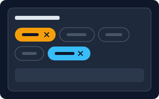</a> <b><a href="#chip--칩">Chip</a></b> 칩 짧은 단어를 알약 모양으로 만든 작은 버튼입니다. 필터 선택, 태그 표시, 입력한 항목 표시에 씁니다.</td>
</tr>
</table>

**효과 · Effects** (9)

<table>
<tr>
<td width="33%" valign="top"><a href="#hover-effect--호버-효과">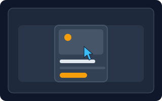</a> <b><a href="#hover-effect--호버-효과">Hover Effect</a></b> 호버 효과 마우스를 올리면 모양이 바뀌는 효과입니다. 버튼이 밝아지거나 카드가 살짝 떠오르는 식입니다.</td>
<td width="33%" valign="top"><a href="#scroll-reveal--스크롤-리빌">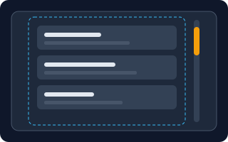</a> <b><a href="#scroll-reveal--스크롤-리빌">Scroll Reveal</a></b> 스크롤 리빌 스크롤해서 화면에 들어오는 순간 요소가 흐릿하게 아래에서 떠오르며 나타나는 효과입니다.</td>
<td width="33%" valign="top"><b><a href="motion-design.md#stagger--스태거">Stagger Animation</a></b> 스태거 애니메이션 카드·메뉴처럼 여러 요소를 한꺼번에가 아니라 조금씩 시간 차를 두고 차례로 나타나게 하는 효과. → motion-design 시트</td>
</tr>
<tr>
<td width="33%" valign="top"><a href="#smooth-transition--부드러운-전환">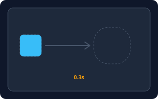</a> <b><a href="#smooth-transition--부드러운-전환">Smooth Transition</a></b> 부드러운 전환 색, 크기, 위치가 순간적으로 바뀌지 않고 짧은 시간 동안 이어서 자연스럽게 바뀌게 하는 효과입니다.</td>
<td width="33%" valign="top"><a href="#glassmorphism--글래스모피즘">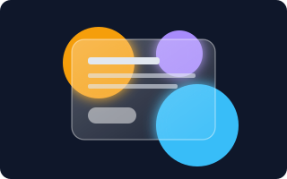</a> <b><a href="#glassmorphism--글래스모피즘">Glassmorphism</a></b> 글래스모피즘 반투명하고 뒤가 흐릿하게 비치는 유리판 같은 디자인입니다. 얇은 밝은 테두리가 특징입니다.</td>
<td width="33%" valign="top"><a href="#parallax-scrolling--패럴랙스-스크롤">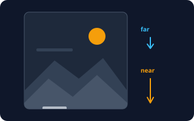</a> <b><a href="#parallax-scrolling--패럴랙스-스크롤">Parallax Scrolling</a></b> 패럴랙스 스크롤 스크롤할 때 앞쪽 층은 빠르게, 뒤쪽 층은 느리게 움직여 깊이감을 주는 효과입니다.</td>
</tr>
<tr>
<td width="33%" valign="top"><a href="#scroll-snap--스크롤-스냅">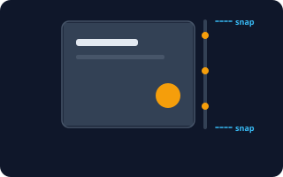</a> <b><a href="#scroll-snap--스크롤-스냅">Scroll Snap</a></b> 스크롤 스냅 스크롤을 멈추면 가까운 구역의 경계에 딱 맞춰 달라붙는 효과입니다. 한 번에 한 화면씩 넘기는 느낌입니다.</td>
<td width="33%" valign="top"><a href="#micro-interaction--마이크로-인터랙션"></a> <b><a href="#micro-interaction--마이크로-인터랙션">Micro-interaction</a></b> 마이크로 인터랙션 버튼 하나에 생기는 아주 작은 반응입니다. 좋아요를 누르면 하트가 톡 커지거나 저장되면 체크가 그려지는 식입니다.</td>
<td width="33%" valign="top"><b><a href="motion-design.md#ease-in-out--이즈-인-아웃">Ease-in-out</a></b> 이징 (천천히-빠르게-천천히) 천천히 시작해 중간에 빨라지고 끝에서 다시 천천히 멈추는 속도 곡선. 화면 움직임을 자연스럽게 만든다. → motion-design 시트</td>
</tr>
</table>

<!-- overview:end -->

## 레이아웃 · Layout

### Hero Section · 히어로 섹션

- **정의**: 웹페이지 첫 화면 맨 위를 크게 차지하는 대표 영역입니다. 큰 제목, 한 줄 설명, 핵심 버튼, 이미지가 들어갑니다.
- **AI에게 이렇게**: "랜딩 페이지 맨 위에 큰 제목, 한 줄 부제, '무료로 시작' 버튼, 오른쪽에 제품 이미지가 있는 히어로 섹션을 만들어줘"
- **언제**: 서비스 소개 페이지나 제품 출시 페이지의 첫인상
- **헷갈림**: Banner(배너) — 배너는 공지·광고용 얇은 띠이고, 히어로는 페이지의 주인공 영역입니다.
- **관련**: CTA, Split Layout, Sticky Header
- **확인 질문**: 배경은 단색·그라데이션·이미지·영상 중 무엇인가요? 버튼은 몇 개이고 어떤 행동을 유도하나요?

### Responsive Layout · 반응형 레이아웃

- **정의**: 화면 폭에 맞춰 배치가 저절로 바뀌는 레이아웃입니다. PC에서는 3칸이던 것이 폰에서는 1칸으로 쌓입니다.
- **AI에게 이렇게**: "카드 3개를 PC에서는 가로 3칸, 태블릿에서는 2칸, 폰에서는 세로 1칸으로 배치되는 반응형 레이아웃으로 만들어줘"
- **언제**: 한 사이트를 PC와 폰 모두에서 쓰게 해야 할 때
- **헷갈림**: Adaptive(적응형) — 반응형은 폭이 바뀌면 연속적으로 변하고, 적응형은 미리 정한 몇 가지 화면 모양 중 하나로 갈아탑니다.
- **관련**: Breakpoint, Card Layout, Bento Grid
- **확인 질문**: 폰·태블릿·PC 중 어느 화면을 가장 우선하나요? 화면이 바뀌는 기준 폭(브레이크포인트)이 정해져 있나요?

### Card Layout · 카드 레이아웃

- **정의**: 정보를 사각형 카드 단위로 묶어 나란히 늘어놓는 배치입니다. 카드 하나에 이미지·제목·설명·버튼이 한 세트로 들어갑니다.
- **AI에게 이렇게**: "상품 6개를 카드 레이아웃으로 보여줘. 카드마다 이미지, 상품명, 가격, '담기' 버튼이 있고 한 줄에 3개씩 놓아줘"
- **언제**: 상품 목록, 블로그 글 목록, 팀원 소개처럼 같은 종류의 항목이 여러 개일 때
- **헷갈림**: Bento Grid — 카드 레이아웃은 크기가 모두 같고, 벤토 그리드는 크기가 제각각입니다.
- **관련**: Grid, Responsive Layout, Badge
- **확인 질문**: 카드 한 장에 어떤 정보가 들어가나요? 카드 전체를 클릭하게 할까요, 버튼만 클릭하게 할까요?

### Bento Grid · 벤토 그리드

- **정의**: 크기가 다른 칸들을 도시락(벤토)처럼 빈틈없이 맞춰 넣은 배치입니다. 중요한 칸은 크게, 덜 중요한 칸은 작게 둡니다.
- **AI에게 이렇게**: "기능 소개 섹션을 벤토 그리드로 만들어줘. 핵심 기능은 큰 칸, 나머지 6개는 작은 칸으로 하고 모서리는 둥글게 해줘"
- **언제**: 제품의 여러 기능을 한 화면에 보기 좋게 보여주고 싶을 때
- **헷갈림**: Card Layout — 카드 레이아웃은 같은 크기를 반복하고, 벤토는 크기 차이로 강약을 줍니다.
- **관련**: Card Layout, Grid, Responsive Layout
- **확인 질문**: 가장 강조할 칸은 무엇인가요? 칸은 몇 개이고, 폰에서는 한 줄로 쌓아도 되나요?

### Sidebar Layout · 사이드바 레이아웃

- **정의**: 화면 한쪽 옆에 세로 메뉴 띠를 두고 나머지를 본문으로 쓰는 배치입니다.
- **AI에게 이렇게**: "왼쪽에 로고와 메뉴 5개가 있는 고정 사이드바를 만들고, 오른쪽을 본문 영역으로 하는 대시보드 레이아웃으로 짜줘"
- **언제**: 관리자 페이지, 대시보드, 문서 사이트처럼 메뉴가 많은 화면
- **헷갈림**: Drawer — 사이드바는 항상 보이는 고정 메뉴이고, 서랍(Drawer)은 필요할 때만 밀고 나오는 패널입니다.
- **관련**: Navbar, Drawer, Hamburger Menu
- **확인 질문**: 사이드바는 왼쪽·오른쪽 중 어디인가요? 폰에서는 접어서 숨길까요?

### Sticky Header · 고정 헤더

- **정의**: 페이지를 아래로 내려도 화면 맨 위에 계속 붙어 따라오는 헤더입니다.
- **AI에게 이렇게**: "스크롤해도 맨 위에 고정되는 헤더를 만들어줘. 스크롤하면 배경이 살짝 불투명해지고 그림자가 생기게 해줘"
- **언제**: 언제든 메뉴나 로그인 버튼에 닿아야 하는 긴 페이지
- **헷갈림**: Fixed vs Sticky — 둘 다 붙어 있지만, sticky는 원래 자리에 있다가 스크롤하면 붙고 fixed는 처음부터 화면에 박혀 있습니다.
- **관련**: Navbar, Glassmorphism, Smooth Transition
- **확인 질문**: 헤더 높이는 얼마인가요? 아래로 스크롤하면 숨기고 위로 올리면 다시 보이게 할까요?

### Split Layout · 분할 레이아웃

- **정의**: 화면을 좌우 두 구역으로 나눠 한쪽엔 글과 버튼, 다른 쪽엔 이미지나 폼을 두는 배치입니다.
- **AI에게 이렇게**: "화면을 좌우 50%로 나눠서 왼쪽에는 로그인 폼, 오른쪽에는 큰 이미지를 넣는 분할 레이아웃으로 만들어줘"
- **언제**: 로그인·회원가입 화면, 제품 소개처럼 글과 그림을 함께 보여줄 때
- **헷갈림**: Sidebar Layout — 사이드바는 좁은 메뉴 띠와 넓은 본문이고, 분할은 두 구역이 비슷한 비중입니다.
- **관련**: Hero Section, Responsive Layout
- **확인 질문**: 좌우 비율은 50:50인가요, 40:60인가요? 폰에서는 위아래로 쌓을 때 어느 쪽이 위에 오나요?

## 내비게이션 · Navigation

### Navbar · 내비게이션 바

- **정의**: 사이트 맨 위에 가로로 놓인 메뉴 띠입니다. 로고, 페이지 이동 링크, 로그인 같은 버튼이 들어갑니다.
- **AI에게 이렇게**: "맨 위에 왼쪽 로고, 가운데 메뉴 4개(소개·가격·블로그·문의), 오른쪽 '로그인' 버튼이 있는 내비게이션 바를 만들어줘"
- **언제**: 사이트 전체에서 페이지를 오갈 때
- **헷갈림**: Header — 헤더는 상단 영역 전체이고, 내비게이션 바는 그 안의 메뉴 부분입니다.
- **관련**: Sticky Header, Hamburger Menu, Dropdown
- **확인 질문**: 메뉴 항목은 몇 개이고 이름이 무엇인가요? 현재 페이지는 어떻게 표시할까요?

### Breadcrumb · 브레드크럼

 쇼핑 > 신발처럼 지금 위치를 경로로 보여주는 한 줄" width="320">

- **정의**: 지금 있는 페이지가 사이트의 어디쯤인지 '홈 > 쇼핑 > 신발'처럼 경로로 보여주는 작은 한 줄입니다.
- **AI에게 이렇게**: "상품 상세 페이지 제목 위에 '홈 > 쇼핑 > 신발 > 스니커즈' 형태의 브레드크럼을 넣어줘. 마지막 항목은 강조하고 나머지는 클릭되게 해줘"
- **언제**: 단계가 깊은 쇼핑몰, 문서 사이트
- **헷갈림**: Navbar — 내비게이션 바는 어디로 갈지 고르는 메뉴이고, 브레드크럼은 내가 어디 있는지 알려주는 표시입니다.
- **관련**: Navbar, Tabs
- **확인 질문**: 경로 단계는 최대 몇 단계인가요? 폰에서 경로가 길면 일부를 줄여서(...) 보여줘도 되나요?

### Pagination · 페이지네이션

- **정의**: 목록이 길 때 페이지 번호 버튼으로 나눠서 보여주는 방식입니다.
- **AI에게 이렇게**: "게시글 목록 아래에 이전·다음 화살표와 페이지 번호 1~5가 있는 페이지네이션을 넣어줘. 현재 페이지 번호는 강조색으로 표시해줘"
- **언제**: 게시판, 검색 결과처럼 항목이 많은 목록
- **헷갈림**: Infinite Scroll(무한 스크롤) — 페이지네이션은 번호로 끊어 보여주고, 무한 스크롤은 내리면 계속 이어 붙입니다.
- **관련**: Tabs, Stepper
- **확인 질문**: 한 페이지에 몇 개씩 보여줄까요? 번호 방식인가요, '더보기' 버튼 방식인가요?

### Bottom Tab Bar · 하단 탭 바

- **정의**: 모바일 앱 화면 맨 아래에 아이콘 3~5개가 놓인 고정 메뉴입니다. 엄지로 누르기 쉬워서 자주 쓰는 화면 이동에 씁니다.
- **AI에게 이렇게**: "모바일 화면 맨 아래에 홈·검색·알림·내 정보 아이콘이 있는 하단 탭 바를 고정해줘. 현재 탭은 노란색으로 표시해줘"
- **언제**: 폰에서 주요 화면 3~5개를 자주 오갈 때
- **헷갈림**: Tabs — 탭은 화면 안의 내용을 바꾸고, 하단 탭 바는 앱 전체의 큰 화면을 바꿉니다.
- **관련**: Navbar, Hamburger Menu, Badge
- **확인 질문**: 탭은 몇 개이고 아이콘과 글자 중 무엇을 쓰나요? 알림 숫자(배지)가 붙는 탭이 있나요?

### Hamburger Menu · 햄버거 메뉴

- **정의**: 줄 세 개(☰) 아이콘을 눌러야 메뉴가 나타나는 방식입니다. 좁은 화면에서 메뉴를 숨겨 공간을 아낍니다.
- **AI에게 이렇게**: "폰 화면에서는 메뉴를 숨기고 오른쪽 위에 햄버거 아이콘만 보이게 해줘. 누르면 오른쪽에서 메뉴 패널이 밀려 나오게 해줘"
- **언제**: 폰처럼 좁은 화면에서 메뉴가 많을 때
- **헷갈림**: Drawer — 햄버거는 메뉴를 여는 버튼이고, 서랍은 열려서 나오는 패널입니다. 보통 짝으로 쓰입니다.
- **관련**: Drawer, Navbar, Responsive Layout
- **확인 질문**: 햄버거 아이콘은 왼쪽·오른쪽 중 어디에 둘까요? 열리면 어떤 방향에서 나오고, 아이콘은 X로 바뀔까요?

### Tabs · 탭

- **정의**: 여러 내용을 제목 줄로 나눠 두고, 누른 제목의 내용만 보여주는 방식입니다. 한 번에 한 탭만 열려 있습니다.
- **AI에게 이렇게**: "상품 상세 아래에 '설명·리뷰·배송' 탭 3개를 만들어줘. 선택된 탭은 밑줄을 긋고 아래 내용이 바뀌게 해줘"
- **언제**: 한 화면에서 같은 층위의 내용 여러 개를 오갈 때
- **헷갈림**: Accordion — 탭은 한 번에 하나만 보이고 가로로 나열하며, 아코디언은 세로로 접고 펴며 여러 개를 열 수도 있습니다.
- **관련**: Accordion, Bottom Tab Bar, Breadcrumb
- **확인 질문**: 탭은 몇 개이고 처음에 열려 있는 탭은 무엇인가요? 폰에서 탭이 넘치면 좌우로 밀어서 볼까요?

## 컴포넌트 · Components

### Accordion · 아코디언

- **정의**: 제목 줄을 누르면 내용이 아래로 펼쳐지고, 다시 누르면 접히는 목록입니다.
- **AI에게 이렇게**: "자주 묻는 질문 5개를 아코디언으로 만들어줘. 질문을 누르면 답이 펼쳐지고 오른쪽 화살표가 돌아가게 해줘"
- **언제**: FAQ, 긴 설명을 접어 두고 필요한 것만 읽게 할 때
- **헷갈림**: Tabs — 아코디언은 세로로 접고 펴며 여러 개를 동시에 열 수 있습니다. 탭은 가로로 하나씩만 봅니다.
- **관련**: Tabs, Smooth Transition
- **확인 질문**: 한 번에 하나만 열리게 할까요, 여러 개를 동시에 열 수 있게 할까요? 처음에는 모두 접어 둘까요?

### Modal / Dialog · 모달 / 다이얼로그

- **정의**: 화면 위에 떠서 배경을 어둡게 만들고 사용자의 선택을 먼저 받는 작은 창입니다. 닫기 전까지 뒤 화면은 누를 수 없습니다.
- **AI에게 이렇게**: "삭제 버튼을 누르면 화면 가운데에 '정말 삭제할까요?' 모달이 뜨게 해줘. 취소와 삭제 버튼이 있고 바깥을 누르면 닫히게 해줘"
- **언제**: 삭제 확인, 로그인 창처럼 꼭 답을 받아야 할 때
- **헷갈림**: Toast — 모달은 화면을 막고 선택을 요구하고, 토스트는 막지 않고 잠깐 알려만 줍니다. Popover는 버튼 옆에 작게 뜨는 말풍선형 창입니다.
- **관련**: Drawer, Toast, Tooltip
- **확인 질문**: 바깥 영역을 눌러도 닫히게 할까요? 닫기 X 버튼과 ESC 키 닫기도 필요한가요?

### Drawer · 드로어

- **정의**: 화면 가장자리에서 밀려 나오는 패널입니다. 메뉴, 필터, 장바구니 같은 보조 내용을 담습니다.
- **AI에게 이렇게**: "오른쪽에서 슬라이드로 나오는 드로어를 만들어줘. 장바구니 목록과 하단 '결제하기' 버튼이 있고 배경은 어둡게 해줘"
- **언제**: 메뉴·필터·장바구니를 화면을 가리지 않고 잠깐 보여줄 때
- **헷갈림**: Modal / Dialog — 모달은 가운데에 뜨고, 드로어는 옆면에서 나옵니다. Sidebar는 항상 떠 있습니다.
- **관련**: Hamburger Menu, Sidebar Layout, Modal / Dialog
- **확인 질문**: 어느 쪽 가장자리에서 나오나요? 폭은 얼마이고, 열린 동안 뒤 화면을 어둡게 할까요?

### Dropdown · 드롭다운

- **정의**: 버튼을 누르면 아래로 선택지 목록이 펼쳐지고 그중 하나를 고르는 요소입니다.
- **AI에게 이렇게**: "'정렬' 버튼을 누르면 최신순·인기순·가격순이 아래로 펼쳐지는 드롭다운을 만들어줘. 선택한 항목은 버튼에 표시해줘"
- **언제**: 옵션이 많아 화면에 다 펼쳐 놓기 어려울 때
- **헷갈림**: Select(선택 상자) — Select는 하나를 고르는 폼 입력이고, 드롭다운은 메뉴나 동작 목록까지 포함한 넓은 말입니다.
- **관련**: Navbar, Tooltip
- **확인 질문**: 선택지는 몇 개이고 하나만 고르나요? 검색창이 붙어야 하나요?

### Tooltip · 툴팁

- **정의**: 버튼이나 아이콘에 마우스를 올리면 잠깐 나타나는 짧은 설명 말풍선입니다.
- **AI에게 이렇게**: "저장 아이콘에 마우스를 올리면 위쪽에 '저장하기'라는 작은 말풍선이 0.2초 뒤 나타나는 툴팁을 달아줘"
- **언제**: 글자 없는 아이콘 버튼이 무슨 일을 하는지 알려줄 때
- **헷갈림**: Popover — 툴팁은 글자만 짧게 보여주고 눌러도 안 됩니다. 팝오버는 버튼 같은 내용도 담고 클릭으로 엽니다.
- **관련**: Hover Effect, Dropdown
- **확인 질문**: 말풍선은 어느 방향(위·아래·옆)에 뜨나요? 폰에서는 마우스가 없는데 길게 눌러서 보여줄까요?

### Toast · 토스트

- **정의**: 작업이 끝났다는 걸 화면 모서리에 잠깐 띄웠다가 저절로 사라지는 알림 상자입니다.
- **AI에게 이렇게**: "저장 성공하면 오른쪽 아래에 체크 아이콘과 '저장되었습니다'가 있는 토스트가 아래에서 올라와 3초 뒤 사라지게 해줘"
- **언제**: 저장 완료, 복사됨처럼 사용자를 방해하지 않고 알릴 때
- **헷갈림**: Modal / Dialog — 토스트는 화면을 막지 않고 저절로 사라집니다. 모달은 사용자가 답해야 닫힙니다.
- **관련**: Modal / Dialog, Badge, Micro-interaction
- **확인 질문**: 화면 어느 모서리에 몇 초 동안 띄울까요? 성공·실패·경고 색을 나눌까요?

### Carousel · 캐러셀

- **정의**: 사진이나 카드를 한 줄로 두고 좌우로 넘겨 가며 보여주는 슬라이드입니다.
- **AI에게 이렇게**: "메인 배너에 이미지 3장이 5초마다 자동으로 옆으로 넘어가는 캐러셀을 만들어줘. 좌우 화살표와 아래 점 표시도 넣어줘"
- **언제**: 배너, 제품 사진 여러 장, 후기 모음
- **헷갈림**: Scroll Snap — 캐러셀은 슬라이드를 넘기는 컴포넌트이고, 스크롤 스냅은 스크롤이 칸에 딱 멈추는 기술입니다.
- **관련**: Scroll Snap, Smooth Transition, Hero Section
- **확인 질문**: 자동으로 넘길까요, 사용자가 직접 넘길까요? 마지막 슬라이드 다음에 처음으로 돌아가나요?

### Badge · 배지

- **정의**: 아이콘이나 글자 모서리에 붙는 작은 표시입니다. 새 알림 숫자나 NEW 같은 상태를 알립니다.
- **AI에게 이렇게**: "종 아이콘 오른쪽 위에 읽지 않은 알림 개수를 보여주는 빨간 동그라미 배지를 달아줘. 99개가 넘으면 99+로 표시해줘"
- **언제**: 읽지 않은 알림 수, 새 상품, 상태 표시
- **헷갈림**: Chip — 배지는 정보를 알리기만 하고, 칩은 선택하거나 지울 수 있는 작은 알약 버튼입니다.
- **관련**: Chip, Toast, Bottom Tab Bar
- **확인 질문**: 숫자를 보여줄까요, 점만 보여줄까요? 색은 무엇이고 0개일 때는 숨길까요?

### Skeleton · 스켈레톤

- **정의**: 내용이 로딩되는 동안 글자와 사진이 들어올 자리를 회색 뼈대로 먼저 보여주는 방식입니다.
- **AI에게 이렇게**: "프로필 카드가 로딩되는 동안 동그란 사진과 글 줄 모양의 회색 스켈레톤이 은은하게 깜빡이게 해줘"
- **언제**: 서버에서 데이터를 불러오는 몇 초 동안 빈 화면 대신
- **헷갈림**: Spinner(빙글빙글 로딩) — 스피너는 기다리는 중이라는 사실만 알리고, 스켈레톤은 곧 나올 화면의 모양을 미리 보여줍니다.
- **관련**: Progress Bar, Empty State, Micro-interaction
- **확인 질문**: 어떤 화면의 로딩에 쓰나요? 실제 완성 화면과 같은 모양으로 맞출까요?

### Empty State · 빈 상태 화면

- **정의**: 목록이나 검색 결과에 보여줄 것이 하나도 없을 때 대신 보여주는 안내 화면입니다. 그림, 설명, 다음 행동 버튼으로 이루어집니다.
- **AI에게 이렇게**: "장바구니가 비었을 때 상자 일러스트와 '아직 담은 상품이 없어요' 문구, '쇼핑하러 가기' 버튼을 보여주는 빈 상태 화면을 만들어줘"
- **언제**: 새 계정의 첫 화면, 검색 결과 없음, 모두 삭제한 목록
- **헷갈림**: Error State(오류 화면) — 빈 상태는 정말 아무것도 없는 정상 상황이고, 오류 화면은 뭔가 잘못되어 못 보여주는 상황입니다.
- **관련**: Skeleton, Toast, Hero Section
- **확인 질문**: 빈 이유는 처음이라서인가요, 검색 결과가 없어서인가요? 이어서 하게 할 행동 버튼이 있나요?

### Toggle · 토글 스위치

- **정의**: 켜짐과 꺼짐 두 상태를 스위치로 바꾸는 요소입니다. 누르면 바로 적용됩니다.
- **AI에게 이렇게**: "설정 화면에 '알림 받기' 토글 스위치를 만들어줘. 켜지면 노란색으로 바뀌고 동그란 손잡이가 부드럽게 오른쪽으로 움직이게 해줘"
- **언제**: 알림 켜기, 다크 모드처럼 바로 적용되는 설정
- **헷갈림**: Checkbox(체크박스) — 토글은 누르는 즉시 적용되고, 체크박스는 보통 '저장' 버튼을 눌러야 적용됩니다.
- **관련**: Micro-interaction, Smooth Transition
- **확인 질문**: 누르면 즉시 저장되나요, 저장 버튼을 따로 누르나요? 기본값은 켜짐인가요?

### Stepper · 스테퍼

- **정의**: 여러 단계 중 지금 몇 번째인지 보여주는 진행 표시입니다. 끝낸 단계, 현재 단계, 남은 단계를 구분합니다.
- **AI에게 이렇게**: "회원가입을 '정보 입력 → 인증 → 약관 → 완료' 4단계 스테퍼로 만들어줘. 끝난 단계는 체크, 현재 단계는 강조해줘"
- **언제**: 결제, 가입, 설문처럼 순서가 있는 여러 화면
- **헷갈림**: Progress Bar — 스테퍼는 이름 붙은 단계를 보여주고, 프로그레스 바는 퍼센트만 보여줍니다.
- **관련**: Progress Bar, Tabs, Pagination
- **확인 질문**: 단계는 몇 개이고 이름이 무엇인가요? 이미 끝낸 단계로 돌아갈 수 있나요?

### Progress Bar · 프로그레스 바

- **정의**: 작업이 얼마나 진행됐는지 채워진 막대로 보여주는 요소입니다.
- **AI에게 이렇게**: "파일 업로드 중 진행률을 보여주는 가로 프로그레스 바를 만들어줘. 오른쪽에 퍼센트 숫자를 표시하고 채워질 때 부드럽게 늘어나게 해줘"
- **언제**: 업로드, 설치, 학습 진도처럼 끝까지 가는 과정
- **헷갈림**: Stepper — 프로그레스 바는 연속적인 양, 스테퍼는 구분된 단계를 보여줍니다.
- **관련**: Stepper, Skeleton, Smooth Transition
- **확인 질문**: 진행률을 정확히 알 수 있나요, 모르면 계속 흐르는 막대로 할까요? 100%가 되면 어떻게 되나요?

### Chip · 칩

- **정의**: 짧은 단어를 알약 모양으로 만든 작은 버튼입니다. 필터 선택, 태그 표시, 입력한 항목 표시에 씁니다.
- **AI에게 이렇게**: "검색 결과 위에 '신발·가방·모자' 칩을 한 줄로 놓아줘. 선택된 칩은 강조색으로 채우고 x를 누르면 선택이 해제되게 해줘"
- **언제**: 필터 선택, 태그 입력, 카테고리 고르기
- **헷갈림**: Badge — 칩은 누르거나 지울 수 있고, 배지는 보기만 합니다.
- **관련**: Badge, Dropdown, Tabs
- **확인 질문**: 여러 개를 동시에 선택할 수 있나요? 칩이 많으면 줄바꿈할까요, 옆으로 밀어서 볼까요?

## 효과 · Effects

### Hover Effect · 호버 효과

- **정의**: 마우스를 올리면 모양이 바뀌는 효과입니다. 버튼이 밝아지거나 카드가 살짝 떠오르는 식입니다.
- **AI에게 이렇게**: "카드에 마우스를 올리면 8px 위로 떠오르고 그림자와 테두리 색이 부드럽게 바뀌는 호버 효과를 줘"
- **언제**: 누를 수 있는 요소라는 걸 알려주고 싶을 때
- **헷갈림**: Active/Focus — 호버는 마우스가 올라간 상태, active는 누르는 순간, focus는 키보드로 선택된 상태입니다. 폰에는 호버가 없습니다.
- **관련**: Smooth Transition, Micro-interaction, Tooltip
- **확인 질문**: 어떤 요소에 어떤 변화(색·크기·그림자·위치)를 줄까요? 폰에서는 호버가 없는데 어떻게 대체할까요?

### Scroll Reveal · 스크롤 리빌

- **정의**: 스크롤해서 화면에 들어오는 순간 요소가 흐릿하게 아래에서 떠오르며 나타나는 효과입니다.
- **AI에게 이렇게**: "각 섹션이 화면에 들어올 때 투명도 0에서 1로, 아래 20px에서 제자리로 올라오는 스크롤 리빌을 넣어줘. 한 번만 재생해줘"
- **언제**: 긴 소개 페이지에서 읽는 흐름에 리듬을 줄 때
- **헷갈림**: Parallax Scrolling — 리빌은 요소가 나타나는 효과이고, 패럴랙스는 층마다 다른 속도로 움직이는 효과입니다.
- **관련**: Stagger Animation, Parallax Scrolling, Smooth Transition
- **확인 질문**: 한 번만 나타나게 할까요, 올 때마다 다시 나타나게 할까요? 움직임 줄이기 설정을 쓰는 사용자는 어떻게 처리할까요?

### Stagger Animation · 스태거 애니메이션

- **정의**: 카드·메뉴처럼 여러 요소를 한꺼번에가 아니라 조금씩 시간 차를 두고 차례로 나타나게 하는 효과.
- **원본**: [모션 디자인 · Stagger](motion-design.md#stagger--스태거)

### Smooth Transition · 부드러운 전환

- **정의**: 색, 크기, 위치가 순간적으로 바뀌지 않고 짧은 시간 동안 이어서 자연스럽게 바뀌게 하는 효과입니다.
- **AI에게 이렇게**: "버튼의 색과 크기가 바뀔 때 0.3초 동안 ease-in-out으로 부드럽게 전환되게 해줘"
- **언제**: 거의 모든 UI 변화를 자연스럽게 만들고 싶을 때
- **헷갈림**: Animation(애니메이션) — 전환은 A 상태에서 B 상태로 가는 한 번의 변화이고, 애니메이션은 여러 단계를 거치거나 반복하는 움직임입니다.
- **관련**: Ease-in-out, Hover Effect, Accordion
- **확인 질문**: 걸리는 시간은 얼마인가요? 어떤 속성(색·크기·위치)만 움직일까요?

### Glassmorphism · 글래스모피즘

- **정의**: 반투명하고 뒤가 흐릿하게 비치는 유리판 같은 디자인입니다. 얇은 밝은 테두리가 특징입니다.
- **AI에게 이렇게**: "배경에 컬러 그라데이션 원들을 깔고, 그 위에 배경이 흐릿하게 비치는 반투명 유리 카드(글래스모피즘)를 올려줘"
- **언제**: 화려한 배경 위에 카드나 메뉴를 가볍게 띄우고 싶을 때
- **헷갈림**: Drop Shadow(그림자) — 글래스모피즘은 투명하게 비치고 뒤를 흐리게 하는 것이고, 그림자는 떠 있는 느낌만 줍니다.
- **관련**: Sticky Header, Modal / Dialog, Bento Grid
- **확인 질문**: 뒤에 깔 배경은 무엇인가요? 글자가 잘 읽히도록 충분히 진하게 해야 하는데 괜찮은가요?

### Parallax Scrolling · 패럴랙스 스크롤

- **정의**: 스크롤할 때 앞쪽 층은 빠르게, 뒤쪽 층은 느리게 움직여 깊이감을 주는 효과입니다.
- **AI에게 이렇게**: "히어로 영역의 배경 이미지는 스크롤 속도의 절반으로, 앞쪽 글자는 정상 속도로 움직이는 패럴랙스 스크롤을 만들어줘"
- **언제**: 분위기 있는 소개 페이지, 스토리텔링 사이트
- **헷갈림**: Scroll Reveal — 패럴랙스는 층마다 속도가 달라 깊이를 만들고, 리빌은 나타남입니다.
- **관련**: Hero Section, Scroll Reveal, Scroll Snap
- **확인 질문**: 몇 겹의 층을 어떤 속도 비율로 움직일까요? 폰에서는 끊김이 있을 수 있는데 꺼도 되나요?

### Scroll Snap · 스크롤 스냅

- **정의**: 스크롤을 멈추면 가까운 구역의 경계에 딱 맞춰 달라붙는 효과입니다. 한 번에 한 화면씩 넘기는 느낌입니다.
- **AI에게 이렇게**: "섹션마다 화면 전체 높이로 만들고 스크롤하면 한 섹션씩 딱 맞춰 멈추는 스크롤 스냅을 적용해줘"
- **언제**: 풀스크린 슬라이드형 소개 페이지, 가로로 넘기는 사진 목록
- **헷갈림**: Carousel — 스크롤 스냅은 스크롤 위치를 맞추는 기술이고, 캐러셀은 슬라이드 UI 전체입니다.
- **관련**: Carousel, Parallax Scrolling, Hero Section
- **확인 질문**: 세로 스냅인가요, 가로 스냅인가요? 구역 안 내용이 화면보다 길 때는 어떻게 할까요?

### Micro-interaction · 마이크로 인터랙션

- **정의**: 버튼 하나에 생기는 아주 작은 반응입니다. 좋아요를 누르면 하트가 톡 커지거나 저장되면 체크가 그려지는 식입니다.
- **AI에게 이렇게**: "좋아요 하트를 누르면 0.3초 동안 커졌다가 돌아오고 주변에 작은 불꽃이 퍼지는 마이크로 인터랙션을 넣어줘"
- **언제**: 사용자의 행동에 즉각적인 피드백을 주고 싶을 때
- **헷갈림**: Hover Effect — 호버는 올려 둔 상태의 변화이고, 마이크로 인터랙션은 누름·완료 같은 행동에 대한 응답입니다.
- **관련**: Hover Effect, Toggle, Toast
- **확인 질문**: 어떤 행동에 반응하나요? 소리나 진동도 같이 줄까요, 시각 효과만 줄까요?

### Ease-in-out · 이징 (천천히-빠르게-천천히)

- **정의**: 천천히 시작해 중간에 빨라지고 끝에서 다시 천천히 멈추는 속도 곡선. 화면 움직임을 자연스럽게 만든다.
- **원본**: [모션 디자인 · Ease-in-out](motion-design.md#ease-in-out--이즈-인-아웃)
