# UX 치트시트

> "화면이 예쁘게"가 아니라 "사용자가 막힘없이 목표에 닿게" 만들고 싶을 때 펼치는 시트입니다. 조사 → 흐름·구조 설계 → 평가 → 원리 순서로, 사용자를 이해하고 AI에게 UX 작업을 정확히 시키는 단어를 맞춥니다. 버튼·카드·모달 같은 화면 부품과 레이아웃은 UI 디자인 시트에 있습니다.

## 이렇게 쓰세요

- **나 → AI**: "신규 가입자 5명 인터뷰 질문지를 만들어줘. 유도 질문은 빼고, '최근에 ~했던 때를 말해주세요' 같은 열린 질문 8개로."
- **AI → 나**: "누구를 인터뷰할까요(기존 사용자, 잠재 사용자)? 인터뷰 내용을 녹음해도 되는지 동의를 받을 수 있나요?"
- **나 → AI**: "회원가입부터 첫 주문까지 사용자 흐름을 그려줘. 로그인 여부와 결제 실패 같은 갈림길도 넣고, 그 흐름에 맞는 로파이 와이어프레임을 3장 만들어줘."
- **AI → 나**: "모바일과 PC 중 어느 화면부터 그릴까요? 꼭 들어가야 하는 요소가 있나요?"
- **나 → AI**: "이 프로토타입으로 사용성 테스트 계획을 써줘. 참가자 5명, 과제 3개, 과제 성공률 기준까지."

기획 문서(PRD, 유저 스토리)는 기획 시트에, A/B 테스트·전환율은 마케팅 시트에 있습니다.

## 한눈에 보기

<!-- overview:start -->
<!-- 이 구역은 자동 생성됩니다. 직접 고치지 말고 `cd mcp-server && npm run generate`를 실행하세요. -->

**리서치 · Research** (6)

<table>
<tr>
<td width="33%" valign="top"><a href="#user-interview--사용자-인터뷰">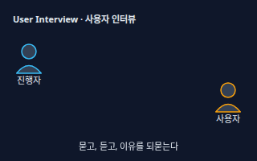</a> <b><a href="#user-interview--사용자-인터뷰">User Interview</a></b> 사용자 인터뷰 사용자와 일대일로 대화하며 경험, 습관, 불편, 그리고 그 이유를 직접 듣는 조사.</td>
<td width="33%" valign="top"><a href="#survey--설문조사">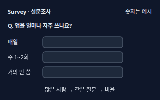</a> <b><a href="#survey--설문조사">Survey</a></b> 설문조사 많은 사람에게 같은 질문을 보내 선택 비율과 의견을 숫자로 모으는 조사.</td>
<td width="33%" valign="top"><a href="#persona--페르소나">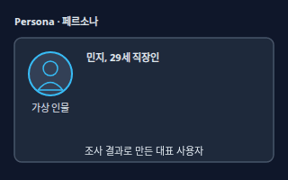</a> <b><a href="#persona--페르소나">Persona</a></b> 페르소나 조사로 알게 된 사용자 집단의 목표·불편·습관을 한 명의 가상 인물 카드로 정리한 것. 상상이 아니라 조사 자료에서 나와야 한다.</td>
</tr>
<tr>
<td width="33%" valign="top"><a href="#card-sorting--카드-소팅">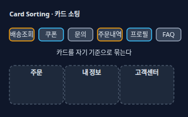</a> <b><a href="#card-sorting--카드-소팅">Card Sorting</a></b> 카드 소팅 메뉴나 항목 이름이 적힌 카드를 참가자가 자기 생각대로 묶고 이름 붙이게 해서, 사용자가 기대하는 분류를 알아내는 조사.</td>
<td width="33%" valign="top"><a href="#quantitative-vs-qualitative--정량정성-조사">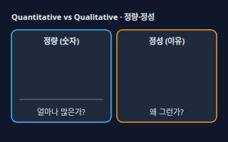</a> <b><a href="#quantitative-vs-qualitative--정량정성-조사">Quantitative vs Qualitative</a></b> 정량·정성 조사 정량 조사는 &quot;얼마나 많은가&quot;를 숫자로(방문자 수, 설문 비율), 정성 조사는 &quot;왜 그런가&quot;를 말과 관찰로(인터뷰, 사용성 테스트) 알아보는 방법.</td>
<td width="33%" valign="top"><a href="#empathy-map--공감-지도">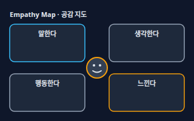</a> <b><a href="#empathy-map--공감-지도">Empathy Map</a></b> 공감 지도 사용자가 말하는 것, 생각하는 것, 하는 행동, 느끼는 감정을 네 칸으로 나눠 쓰고 속마음을 읽어 보는 표.</td>
</tr>
</table>

**흐름·구조 · Flow & Structure** (6)

<table>
<tr>
<td width="33%" valign="top"><a href="#user-journey-map--사용자-여정-지도">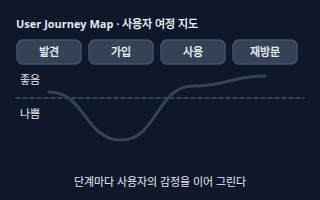</a> <b><a href="#user-journey-map--사용자-여정-지도">User Journey Map</a></b> 사용자 여정 지도 사용자가 제품을 알게 되는 순간부터 쓰고 다시 찾기까지, 단계별 행동·생각·감정을 시간 순서로 그린 지도. 불편한 순간이 한눈에 보인다.</td>
<td width="33%" valign="top"><a href="#user-flow--사용자-흐름">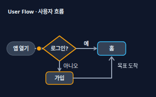</a> <b><a href="#user-flow--사용자-흐름">User Flow</a></b> 사용자 흐름 사용자가 목표(예: 주문)에 닿을 때까지 거치는 화면과 선택(예/아니오 갈림길)을 순서대로 그린 흐름도.</td>
<td width="33%" valign="top"><a href="#information-architecture--정보-구조">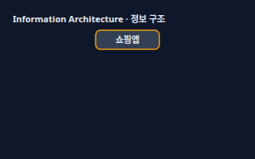</a> <b><a href="#information-architecture--정보-구조">Information Architecture</a></b> 정보 구조 콘텐츠와 기능을 사용자가 찾기 쉽게 묶고, 이름 붙이고, 단계로 배치하는 구조 설계. 흔히 메뉴 트리로 그린다.</td>
</tr>
<tr>
<td width="33%" valign="top"><a href="#fidelity--완성도로파이하이파이">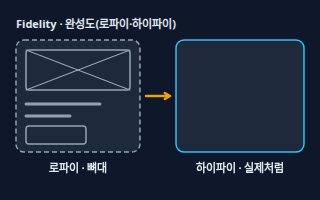</a> <b><a href="#fidelity--완성도로파이하이파이">Fidelity</a></b> 완성도(로파이·하이파이) 설계 화면이 얼마나 실제처럼 완성됐는지의 정도. 로파이(Low-fidelity)는 선과 상자뿐인 뼈대, 하이파이(High-fidelity)는 색·글꼴·실제 문구까지 갖춘 모습.</td>
<td width="33%" valign="top"><a href="#wireframe--와이어프레임">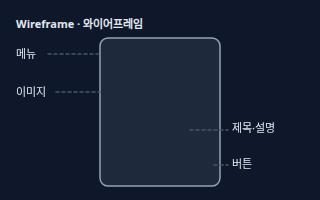</a> <b><a href="#wireframe--와이어프레임">Wireframe</a></b> 와이어프레임 색과 꾸밈 없이 화면에 무엇이 어디에 놓이는지만 선과 상자로 그린 설계도.</td>
<td width="33%" valign="top"><a href="#prototype--프로토타입">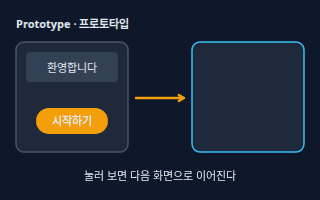</a> <b><a href="#prototype--프로토타입">Prototype</a></b> 프로토타입 화면을 누르면 다음 화면으로 넘어가는 식으로, 실제 제품처럼 눌러 보며 흐름을 확인할 수 있게 만든 시제품. 실제 서비스가 아니라 체험용이다.</td>
</tr>
</table>

**평가 · Evaluation** (5)

<table>
<tr>
<td width="33%" valign="top"><a href="#usability-test--사용성-테스트">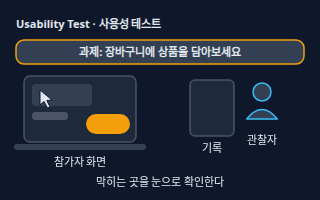</a> <b><a href="#usability-test--사용성-테스트">Usability Test</a></b> 사용성 테스트 실제 사용자(또는 비슷한 사람)에게 과제를 주고 해 보게 하면서 어디서 막히는지 관찰하는 평가. 의견이 아니라 행동을 본다. 소규모 테스트를 여러 번 되풀이하는 편이 좋다.</td>
<td width="33%" valign="top"><a href="#task-success-rate--과제-성공률">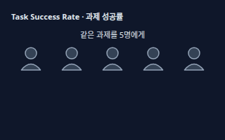</a> <b><a href="#task-success-rate--과제-성공률">Task Success Rate</a></b> 과제 성공률 같은 과제를 시킨 사람 중 끝까지 해낸 사람의 비율. 5명 중 4명이 성공하면 80%.</td>
<td width="33%" valign="top"><a href="#think-aloud--생각-말하기">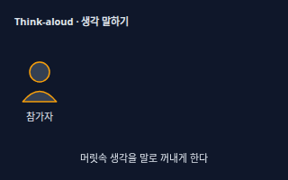</a> <b><a href="#think-aloud--생각-말하기">Think-aloud</a></b> 생각 말하기 참가자가 화면을 쓰는 동안 떠오르는 생각을 소리 내어 말하게 하는 방법. 사용성 테스트에서 &quot;왜 망설였는지&quot;를 바로 알 수 있다.</td>
</tr>
<tr>
<td width="33%" valign="top"><a href="#heuristic-evaluation--휴리스틱-평가">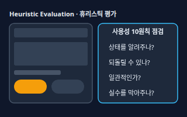</a> <b><a href="#heuristic-evaluation--휴리스틱-평가">Heuristic Evaluation</a></b> 휴리스틱 평가 UX 전문가가 사용성 원칙 목록(대표적으로 Jakob Nielsen의 10가지)에 비추어 화면을 하나씩 점검하며 문제를 찾아내는 평가. 사용자를 모으지 않아도 할 수 있다.</td>
<td width="33%" valign="top"><a href="#accessibility--접근성">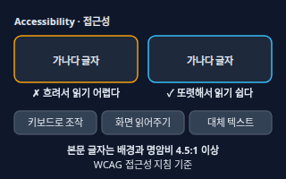</a> <b><a href="#accessibility--접근성">Accessibility</a></b> 접근성 시력·청력·손 움직임·인지 상황이 달라도 누구나 쓸 수 있게 만드는 것. 웹은 W3C의 WCAG 지침을 기준으로 삼는다. 예를 들어 일반 크기 본문 글자는 배경과 명암비 4.5:1 이상이어야 한다(AA).</td>
</tr>
</table>

**원리 · Principles** (5)

<table>
<tr>
<td width="33%" valign="top"><a href="#affordance--어포던스">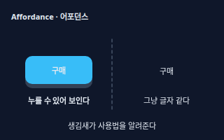</a> <b><a href="#affordance--어포던스">Affordance</a></b> 어포던스 생김새가 어떻게 쓰는지 알려 주는 단서. 입체감 있는 버튼은 &quot;누를 수 있다&quot;를, 손잡이는 &quot;당긴다&quot;를 말해 준다.</td>
<td width="33%" valign="top"><a href="#cognitive-load--인지-부하">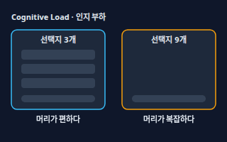</a> <b><a href="#cognitive-load--인지-부하">Cognitive Load</a></b> 인지 부하 화면을 이해하고 고르는 데 사용자가 한꺼번에 써야 하는 머리 사용량. 정보와 선택지가 많을수록 커진다.</td>
<td width="33%" valign="top"><a href="#feedback--피드백">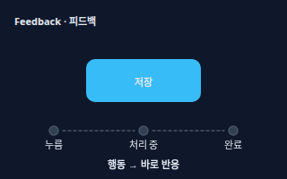</a> <b><a href="#feedback--피드백">Feedback</a></b> 피드백 사용자가 한 행동(누름, 입력, 저장)에 화면이 바로 보여 주는 반응. 눌림 표시, 로딩, &quot;저장됨&quot;처럼 &quot;시스템이 알아들었다&quot;를 알려 준다.</td>
</tr>
<tr>
<td width="33%" valign="top"><a href="#consistency--일관성">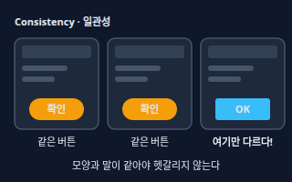</a> <b><a href="#consistency--일관성">Consistency</a></b> 일관성 같은 동작은 어느 화면에서나 같은 모양, 같은 위치, 같은 말로 보이게 하는 원칙.</td>
<td width="33%" valign="top"><a href="#hicks-law--힉의-법칙">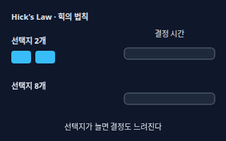</a> <b><a href="#hicks-law--힉의-법칙">Hick's Law</a></b> 힉의 법칙 선택지가 많아질수록 고르는 데 걸리는 시간이 길어진다는 법칙. 선택지를 줄이거나 단계로 나누면 결정이 빨라진다.</td>
</tr>
</table>

<!-- overview:end -->

## 리서치 · Research

### User Interview · 사용자 인터뷰

- **정의**: 사용자와 일대일로 대화하며 경험, 습관, 불편, 그리고 그 이유를 직접 듣는 조사.
- **AI에게 이렇게**: "신규 가입자 5명 인터뷰 질문지를 만들어줘. 유도 질문은 피하고 '최근에 ~했던 때를 말해주세요' 형태의 열린 질문 8개와 후속 질문 예시를 넣어줘."
- **언제**: 문제를 처음 이해할 때, 설문 결과의 이유가 궁금할 때
- **헷갈림**: Survey(설문조사) — 인터뷰는 적은 사람에게서 깊은 이유를 듣고, 설문은 많은 사람에게서 비율을 모은다
- **관련**: Persona, Empathy Map, Think-aloud, Survey
- **확인 질문**: 누구를 인터뷰할까요(기존 사용자, 잠재 사용자)? 녹음 동의를 받을 수 있나요?

### Survey · 설문조사

- **정의**: 많은 사람에게 같은 질문을 보내 선택 비율과 의견을 숫자로 모으는 조사.
- **AI에게 이렇게**: "앱 만족도 설문지를 10문항 이내로 만들어줘. 객관식 위주로 하고 마지막에 자유 의견 1개를 넣고, 질문이 한쪽으로 유도하지 않는지도 점검해줘."
- **언제**: 이미 세운 가설을 많은 사람에게 확인할 때
- **헷갈림**: A/B Test(마케팅 시트) — 설문은 사람들이 "말한" 것이고, A/B 테스트는 실제로 "행동한" 것을 비교한다
- **관련**: User Interview, Quantitative vs Qualitative, A/B Test
- **확인 질문**: 몇 명에게 어떤 경로로 보낼까요? 응답자가 실제 사용자인지 확인할 방법이 있나요?

### Persona · 페르소나

- **정의**: 조사로 알게 된 사용자 집단의 목표·불편·습관을 한 명의 가상 인물 카드로 정리한 것. 상상이 아니라 조사 자료에서 나와야 한다.
- **AI에게 이렇게**: "아래 인터뷰 요약을 바탕으로 페르소나 2명을 만들어줘. 이름, 나이, 목표, 불편, 사용 습관을 적고 근거가 된 인터뷰 번호도 붙여줘."
- **언제**: 팀이 같은 사용자를 떠올리며 결정해야 할 때
- **헷갈림**: Target Audience(타깃 고객, 마케팅 시트) — 타깃은 팔고 싶은 집단이고, 페르소나는 그 안에서 쓰는 사람의 행동과 목표를 그린 인물
- **관련**: User Interview, Empathy Map, User Journey Map
- **확인 질문**: 근거로 쓸 인터뷰나 데이터가 있나요? 핵심 사용자 유형이 몇 가지로 나뉘나요?

### Card Sorting · 카드 소팅

- **정의**: 메뉴나 항목 이름이 적힌 카드를 참가자가 자기 생각대로 묶고 이름 붙이게 해서, 사용자가 기대하는 분류를 알아내는 조사.
- **AI에게 이렇게**: "쇼핑앱 메뉴 항목 24개로 카드 소팅 조사를 설계해줘. 그룹 이름을 참가자가 정하는 방식으로, 진행 순서와 결과 분석 방법을 알려줘."
- **언제**: 메뉴 구조를 새로 짜거나 고칠 때
- **헷갈림**: Information Architecture — 카드 소팅은 구조를 찾는 조사 방법이고, 정보 구조는 그 결과로 만든 구조 자체
- **관련**: Information Architecture, User Interview
- **확인 질문**: 참가자가 그룹 이름도 정하는 방식인가요, 정해진 그룹에 넣기만 하나요? 카드로 쓸 항목은 몇 개인가요?

### Quantitative vs Qualitative · 정량·정성 조사

- **정의**: 정량 조사는 "얼마나 많은가"를 숫자로(방문자 수, 설문 비율), 정성 조사는 "왜 그런가"를 말과 관찰로(인터뷰, 사용성 테스트) 알아보는 방법.
- **AI에게 이렇게**: "클릭이 줄었다는 숫자를 봤어. 정량 데이터로 어느 화면에서 줄었는지 찾는 방법과, 정성 조사로 이유를 알아낼 질문을 둘 다 제안해줘."
- **언제**: 숫자는 봤는데 원인을 모를 때
- **헷갈림**: 서로 대신하는 것이 아니라 짝이다 — 숫자로 위치를 찾고(정량), 말과 관찰로 이유를 찾는다(정성)
- **관련**: Survey, User Interview, Usability Test
- **확인 질문**: 지금 알고 싶은 것이 "얼마나"인가요, "왜"인가요? 이미 있는 숫자 자료가 있나요?

### Empathy Map · 공감 지도

- **정의**: 사용자가 말하는 것, 생각하는 것, 하는 행동, 느끼는 감정을 네 칸으로 나눠 쓰고 속마음을 읽어 보는 표.
- **AI에게 이렇게**: "인터뷰 기록 3개를 바탕으로 공감 지도를 만들어줘. 말한다·생각한다·행동한다·느낀다 네 칸을 실제 발언을 인용해서 채워줘."
- **언제**: 인터뷰 직후 팀이 사용자를 같이 이해할 때
- **헷갈림**: Persona — 공감 지도는 한 사용자의 마음을 네 칸으로 읽고, 페르소나는 사용자 유형 전체를 요약한다
- **관련**: Persona, User Journey Map, User Interview
- **확인 질문**: 어느 사용자(또는 어느 인터뷰)에 대한 지도인가요? 실제 발언이 기록돼 있나요?

## 흐름·구조 · Flow & Structure

### User Journey Map · 사용자 여정 지도

- **정의**: 사용자가 제품을 알게 되는 순간부터 쓰고 다시 찾기까지, 단계별 행동·생각·감정을 시간 순서로 그린 지도. 불편한 순간이 한눈에 보인다.
- **AI에게 이렇게**: "신규 가입자의 여정 지도를 표로 만들어줘. 단계는 발견·가입·첫 사용·재방문으로 하고, 각 단계마다 행동, 감정(좋음/보통/나쁨), 불편한 점, 개선 아이디어를 적어줘."
- **언제**: 이탈하는 지점을 찾을 때, 서비스 전체 경험을 점검할 때
- **헷갈림**: User Flow — 여정 지도는 감정과 제품 밖 상황까지 포함한 전체 경험이고, 사용자 흐름은 화면 안에서의 이동 경로
- **관련**: Persona, User Flow, Empathy Map
- **확인 질문**: 어느 페르소나의 여정인가요? 시작과 끝은 어디인가요?

### User Flow · 사용자 흐름

- **정의**: 사용자가 목표(예: 주문)에 닿을 때까지 거치는 화면과 선택(예/아니오 갈림길)을 순서대로 그린 흐름도.
- **AI에게 이렇게**: "회원가입부터 첫 주문까지 사용자 흐름을 mermaid 다이어그램으로 그려줘. 로그인 여부와 결제 실패 같은 갈림길도 넣어줘."
- **언제**: 화면을 그리기 전에 빠진 단계가 없는지 확인할 때
- **헷갈림**: Information Architecture — 정보 구조는 메뉴가 어떻게 묶였는지(정적인 구조)이고, 사용자 흐름은 사용자가 어떻게 이동하는지(움직이는 길)
- **관련**: Wireframe, User Journey Map, Information Architecture
- **확인 질문**: 사용자의 시작점과 목표는 무엇인가요? 실패(결제 오류, 입력 실수) 갈림길도 그릴까요?

### Information Architecture · 정보 구조

- **정의**: 콘텐츠와 기능을 사용자가 찾기 쉽게 묶고, 이름 붙이고, 단계로 배치하는 구조 설계. 흔히 메뉴 트리로 그린다.
- **AI에게 이렇게**: "쇼핑앱의 정보 구조를 메뉴 트리로 만들어줘. 1단계 메뉴는 5개 이하로 하고, 이름은 일상 용어로, 카드 소팅 결과가 있으면 반영해줘."
- **언제**: "메뉴가 많아서 찾기 어렵다"는 말이 나올 때
- **헷갈림**: Navbar(내비게이션 바, UI 디자인 시트) — 정보 구조는 눈에 안 보이는 설계도이고, 내비게이션 바는 그 구조를 화면에 보여 주는 부품
- **관련**: Card Sorting, User Flow, Wireframe, Hick's Law
- **확인 질문**: 콘텐츠 종류가 얼마나 많은가요? 처음 오는 사람이 가장 먼저 찾는 것은 무엇인가요?

### Fidelity · 완성도(로파이·하이파이)

- **정의**: 설계 화면이 얼마나 실제처럼 완성됐는지의 정도. 로파이(Low-fidelity)는 선과 상자뿐인 뼈대, 하이파이(High-fidelity)는 색·글꼴·실제 문구까지 갖춘 모습.
- **AI에게 이렇게**: "먼저 로파이 와이어프레임으로 구성안 3가지를 보여줘. 색과 이미지는 넣지 말고 상자와 글자 이름만 써줘."
- **언제**: 초기에는 로파이로 빠르게 방향을 잡고, 확정되면 하이파이로 다듬을 때
- **헷갈림**: Mockup(목업, 그래픽·브랜딩 시트) — 목업은 꾸며서 보여 주는 시안이고, 로파이·하이파이는 와이어프레임과 프로토타입 모두에 붙는 "완성 정도"를 가리키는 말
- **관련**: Wireframe, Prototype
- **확인 질문**: 지금은 방향을 정하는 단계인가요, 개발에 넘길 단계인가요? 브랜드 색과 글꼴이 이미 정해져 있나요?

### Wireframe · 와이어프레임

- **정의**: 색과 꾸밈 없이 화면에 무엇이 어디에 놓이는지만 선과 상자로 그린 설계도.
- **AI에게 이렇게**: "로그인 화면 와이어프레임을 그려줘. 로고, 이메일·비밀번호 입력칸, 로그인 버튼, 비밀번호 찾기 링크를 모바일 세로 화면에 배치하고 색은 쓰지 마."
- **언제**: 화면 디자인에 들어가기 전, 구성에 대해 합의할 때
- **헷갈림**: Prototype — 와이어프레임은 멈춰 있는 설계도이고, 프로토타입은 눌러 볼 수 있는 시제품
- **관련**: Prototype, Fidelity, User Flow, Responsive Layout(UI 디자인 시트)
- **확인 질문**: 모바일과 PC 중 어느 화면부터 그릴까요? 꼭 들어가야 하는 요소는 무엇인가요?

### Prototype · 프로토타입

- **정의**: 화면을 누르면 다음 화면으로 넘어가는 식으로, 실제 제품처럼 눌러 보며 흐름을 확인할 수 있게 만든 시제품. 실제 서비스가 아니라 체험용이다.
- **AI에게 이렇게**: "이 와이어프레임 3장을 클릭하면 이동하는 프로토타입으로 만들어줘. '시작하기' 버튼을 누르면 주문 완료 화면으로 넘어가게."
- **언제**: 개발 전에 사용성 테스트를 하거나 의견을 모을 때
- **헷갈림**: MVP(기획 시트) — 프로토타입은 눌러 보는 체험용이고, MVP는 실제 사용자가 실제로 쓰는 제품
- **관련**: Wireframe, Usability Test, Fidelity
- **확인 질문**: 어느 흐름까지 눌러 보게 할까요? 사용자 테스트용인가요, 발표용인가요?

## 평가 · Evaluation

### Usability Test · 사용성 테스트

- **정의**: 실제 사용자(또는 비슷한 사람)에게 과제를 주고 해 보게 하면서 어디서 막히는지 관찰하는 평가. 의견이 아니라 행동을 본다. 소규모 테스트를 여러 번 되풀이하는 편이 좋다.
- **AI에게 이렇게**: "회원가입 프로토타입으로 사용성 테스트 계획을 써줘. 참가자 5명, 과제 3개(가입, 상품 담기, 결제), 성공 기준과 관찰 메모 양식을 포함해줘."
- **언제**: 출시 전, 이탈이 많은 화면을 고치기 전
- **헷갈림**: QA(기획 시트) — QA는 "정해진 대로 동작하나"를 확인하고, 사용성 테스트는 "사람이 쉽게 쓰나"를 확인한다
- **관련**: Think-aloud, Task Success Rate, Prototype, Heuristic Evaluation
- **확인 질문**: 어떤 과제를 시킬까요? 참가자가 실제 사용자 유형과 비슷한가요?
- **근거**: [Nielsen Norman Group — Why You Only Need to Test with 5 Users](https://www.nngroup.com/articles/why-you-only-need-to-test-with-5-users/), [NN/g — Usability (User) Testing 101](https://www.nngroup.com/articles/usability-testing-101/)
- **검증일**: 2026-11-02

### Task Success Rate · 과제 성공률

- **정의**: 같은 과제를 시킨 사람 중 끝까지 해낸 사람의 비율. 5명 중 4명이 성공하면 80%.
- **AI에게 이렇게**: "사용성 테스트 결과표로 과제별 성공률을 계산해줘. 성공·부분 성공·실패로 나누고, 실패한 사람이 막힌 지점도 정리해줘."
- **언제**: 화면을 고치기 전과 후를 비교할 때
- **헷갈림**: Conversion Rate(전환율, 마케팅 시트) — 과제 성공률은 테스트 중 과제 완수 비율이고, 전환율은 실제 방문자가 원하는 행동을 한 비율
- **관련**: Usability Test, Think-aloud
- **확인 질문**: "성공"의 기준은 무엇인가요(도움 없이 끝까지, 시간 제한 안에)? 부분 성공도 세나요?

### Think-aloud · 생각 말하기

- **정의**: 참가자가 화면을 쓰는 동안 떠오르는 생각을 소리 내어 말하게 하는 방법. 사용성 테스트에서 "왜 망설였는지"를 바로 알 수 있다.
- **AI에게 이렇게**: "생각 말하기 방식의 사용성 테스트 진행 대본을 써줘. 시작할 때 참가자에게 할 설명과, 침묵이 길어질 때 던질 중립적인 질문 예시를 넣어줘."
- **언제**: 사용성 테스트 중, 인터뷰하며 화면을 보여 줄 때
- **헷갈림**: User Interview — 인터뷰는 지나간 경험을 돌아보며 말하게 하고, 생각 말하기는 쓰는 바로 그 순간의 생각을 말하게 한다
- **관련**: Usability Test, User Interview
- **확인 질문**: 화면과 음성을 녹화해도 된다는 동의를 받았나요? 진행자가 힌트를 주지 않고 기다려도 되나요?

### Heuristic Evaluation · 휴리스틱 평가

- **정의**: UX 전문가가 사용성 원칙 목록(대표적으로 Jakob Nielsen의 10가지)에 비추어 화면을 하나씩 점검하며 문제를 찾아내는 평가. 사용자를 모으지 않아도 할 수 있다.
- **AI에게 이렇게**: "이 화면 스크린샷을 닐슨의 10가지 사용성 휴리스틱으로 평가해줘. 문제마다 어느 원칙을 어겼는지, 심각도(높음/중간/낮음), 개선안을 표로 정리해줘."
- **언제**: 빠르게 문제를 찾고 싶을 때, 사용자 테스트 전에 미리 점검할 때
- **헷갈림**: Usability Test — 휴리스틱 평가는 평가자가 원칙으로 점검하고, 사용성 테스트는 실제 사용자의 행동을 관찰한다
- **관련**: Usability Test, Consistency, Feedback
- **확인 질문**: 어느 화면이나 흐름을 대상으로 할까요? 평가자는 몇 명인가요?
- **근거**: [Nielsen Norman Group — 10 Usability Heuristics for User Interface Design](https://www.nngroup.com/articles/ten-usability-heuristics/)
- **검증일**: 2026-11-02

### Accessibility · 접근성

- **정의**: 시력·청력·손 움직임·인지 상황이 달라도 누구나 쓸 수 있게 만드는 것. 웹은 W3C의 WCAG 지침을 기준으로 삼는다. 예를 들어 일반 크기 본문 글자는 배경과 명암비 4.5:1 이상이어야 한다(AA).
- **AI에게 이렇게**: "이 화면의 접근성을 점검해줘. 글자 명암비, 키보드만으로 조작할 수 있는지, 이미지 대체 텍스트, 터치 영역 크기를 확인하고 고칠 점을 알려줘."
- **언제**: 모든 화면을 만들 때. 법적 요구가 있는 서비스는 전문가와 확인
- **헷갈림**: Usability(사용성) — 사용성은 모두가 쉽게 쓰는 정도이고, 접근성은 장애나 환경 때문에 쓰지 못하는 사람이 없게 하는 것
- **관련**: Heuristic Evaluation, Consistency, Color(UI 디자인 시트)
- **확인 질문**: 지켜야 할 기준(WCAG 2.2 AA 등)이 정해져 있나요? 스크린 리더로 써 보는 사용자가 있나요?
- **근거**: [W3C WAI — Understanding SC 1.4.3 Contrast (Minimum)](https://www.w3.org/WAI/WCAG22/Understanding/contrast-minimum.html), [W3C WAI — Introduction to Web Accessibility](https://www.w3.org/WAI/fundamentals/accessibility-intro/)
- **검증일**: 2026-11-02

## 원리 · Principles

### Affordance · 어포던스

- **정의**: 생김새가 어떻게 쓰는지 알려 주는 단서. 입체감 있는 버튼은 "누를 수 있다"를, 손잡이는 "당긴다"를 말해 준다.
- **AI에게 이렇게**: "이 화면에서 버튼처럼 보이지 않지만 눌러야 하는 요소를 찾아줘. 눌러도 되는 것과 아닌 것이 모양으로 구분되게 고치는 안을 줘."
- **언제**: 사용자가 어디를 눌러야 할지 못 찾을 때, 납작한 디자인이 헷갈릴 때
- **헷갈림**: Feedback — 어포던스는 행동하기 전에 주는 단서이고, 피드백은 행동한 뒤에 주는 반응
- **관련**: Feedback, Consistency, Cognitive Load
- **확인 질문**: 사용자가 눌러야 하는 요소는 무엇인가요? 지금 버튼과 그냥 글자가 모양으로 구분되나요?

### Cognitive Load · 인지 부하

- **정의**: 화면을 이해하고 고르는 데 사용자가 한꺼번에 써야 하는 머리 사용량. 정보와 선택지가 많을수록 커진다.
- **AI에게 이렇게**: "이 화면의 인지 부하를 줄여줘. 한 번에 보여 주는 정보를 우선순위로 나누고, 덜 중요한 것은 접거나 다음 단계로 미뤄줘."
- **언제**: 입력 항목, 메뉴, 설정 화면이 복잡하다는 말이 나올 때
- **헷갈림**: Hick's Law — 힉의 법칙은 선택지 수가 결정 시간에 미치는 영향이고, 인지 부하는 그것을 포함한 머리의 전체 부담
- **관련**: Hick's Law, Information Architecture, Consistency
- **확인 질문**: 사용자가 이 화면에서 꼭 해야 할 일이 한 가지로 정리되나요? 기억해야 하는 정보가 있나요?

### Feedback · 피드백

- **정의**: 사용자가 한 행동(누름, 입력, 저장)에 화면이 바로 보여 주는 반응. 눌림 표시, 로딩, "저장됨"처럼 "시스템이 알아들었다"를 알려 준다.
- **AI에게 이렇게**: "저장 버튼을 누르면 '저장 중…'이 보이고, 끝나면 '저장됨'이 뜨고, 실패하면 이유와 다시 시도 버튼이 나오게 해줘."
- **언제**: 처리가 오래 걸릴 때, 성공과 실패를 알려야 할 때
- **헷갈림**: Toast(토스트, UI 디자인 시트) — 토스트는 피드백을 보여 주는 화면 부품 하나이고, 피드백은 그 바탕이 되는 원리
- **관련**: Affordance, Consistency, Heuristic Evaluation
- **확인 질문**: 처리 시간이 얼마나 걸리나요? 실패하면 무엇을 알려 줄까요?

### Consistency · 일관성

- **정의**: 같은 동작은 어느 화면에서나 같은 모양, 같은 위치, 같은 말로 보이게 하는 원칙.
- **AI에게 이렇게**: "앱 전체에서 확인 버튼의 이름이 '확인', 'OK', '완료'로 섞여 있는지 찾아서 하나로 통일해줘."
- **언제**: 화면이 늘면서 서로 모양과 말이 달라질 때
- **헷갈림**: Design System(디자인 시스템) — 일관성은 지켜야 할 원칙이고, 디자인 시스템은 그것을 지키려고 만든 부품과 규칙 모음
- **관련**: Heuristic Evaluation, Affordance, Feedback
- **확인 질문**: 기준이 될 기존 화면이 있나요? 버튼 이름과 용어를 정리한 목록이 있나요?

### Hick's Law · 힉의 법칙

- **정의**: 선택지가 많아질수록 고르는 데 걸리는 시간이 길어진다는 법칙. 선택지를 줄이거나 단계로 나누면 결정이 빨라진다.
- **AI에게 이렇게**: "메뉴 항목이 12개인데 힉의 법칙에 맞게 줄이거나 묶어줘. 가장 많이 쓰는 3개를 앞에 두고 나머지는 '더보기'로 보내줘."
- **언제**: 메뉴, 요금제, 옵션 선택 화면을 정리할 때
- **헷갈림**: Cognitive Load — 힉의 법칙은 "선택지 수"만 다루고, 인지 부하는 머리가 지는 모든 부담을 가리킨다
- **관련**: Cognitive Load, Information Architecture
- **확인 질문**: 가장 많이 쓰는 항목은 무엇인가요(통계가 있나요)? 모든 선택지가 한 화면에 꼭 있어야 하나요?

## 참고 자료

- [Nielsen Norman Group — 10 Usability Heuristics for User Interface Design](https://www.nngroup.com/articles/ten-usability-heuristics/)
- [Nielsen Norman Group — Why You Only Need to Test with 5 Users](https://www.nngroup.com/articles/why-you-only-need-to-test-with-5-users/)
- [Nielsen Norman Group — Usability (User) Testing 101](https://www.nngroup.com/articles/usability-testing-101/)
- [Nielsen Norman Group — Card Sorting: Definition](https://www.nngroup.com/articles/card-sorting-definition/)
- [Nielsen Norman Group — Thinking Aloud: The #1 Usability Tool](https://www.nngroup.com/articles/thinking-aloud-the-1-usability-tool/)
- [Nielsen Norman Group — Journey Mapping 101](https://www.nngroup.com/articles/journey-mapping-101/)
- [Nielsen Norman Group — Minimize Cognitive Load to Maximize Usability](https://www.nngroup.com/articles/minimize-cognitive-load/)
- [W3C WAI — Understanding SC 1.4.3 Contrast (Minimum)](https://www.w3.org/WAI/WCAG22/Understanding/contrast-minimum.html)
- [W3C WAI — Introduction to Web Accessibility](https://www.w3.org/WAI/fundamentals/accessibility-intro/)
- [W3C WAI — Accessibility Principles](https://www.w3.org/WAI/fundamentals/accessibility-principles/)
- [Laws of UX — Hick's Law](https://lawsofux.com/hicks-law/)
