# 영상 촬영 · 편집 치트시트

> "멋있게 찍어줘", "좀 더 쫀득하게 편집해줘"만으로는 AI도 편집자도 무엇을 바꿔야 하는지 알 수 없습니다. 이 시트의 용어로 **어떤 크기로 담고(샷) → 어떻게 움직이고(카메라) → 어떻게 이어 붙이고(편집) → 색과 소리를 어떻게 다듬고 → 어떤 설정으로 내보낼지(플랫폼)** 를 말하면 한 번에 통합니다.
> 순서는 촬영 → 편집 → 마무리 → 업로드 순이라 영상 챕터 순서와 같습니다. 그림은 GitHub에서 직접 움직입니다.

> **참고용입니다.** 유튜브 권장 업로드 설정·쇼츠 규칙은 바뀔 수 있습니다. 숫자가 나오는 용어에는 2026-11-02에 YouTube 도움말에서 확인한 근거를 붙였으니, 올리기 전 최신 도움말을 한 번 더 확인하세요. 노출·조리개·셔터·화이트밸런스 같은 카메라 설정은 사진 촬영 시트에서 다룹니다.

## 이렇게 쓰세요

- **나 → AI**: "인터뷰 영상 편집 계획을 세워줘. 대화 장면은 미디엄 샷, 표정이 중요한 순간은 클로즈업, 말 사이사이는 B-roll을 덮고 J-cut으로 소리를 먼저 들려줘."
- **AI → 나**: "촬영 때 Log로 찍으셨나요, 일반 색(Rec.709)으로 찍으셨나요? Log면 LUT를 먼저 입히고 색보정을 하겠습니다."
- **나 → AI**: "쇼츠로 올릴 9:16 영상이야. 자막은 Safe Area 안쪽에 두고, 핵심 단어만 크게 보이게 편집해줘."
- **AI → 나**: "올릴 곳이 일반 영상(16:9)인가요, 쇼츠(9:16)인가요? 해상도는 1080p로 할까요, 4K로 할까요?"
- **나 → AI**: "내보내기 설정은 MP4, H.264, 촬영한 프레임레이트 그대로, 1080p로 맞춰줘. 비트레이트는 유튜브 권장값을 따라줘."

## 한눈에 보기

<!-- overview:start -->
<!-- 이 구역은 자동 생성됩니다. 직접 고치지 말고 `cd mcp-server && npm run generate`를 실행하세요. -->

**샷 · Shots** (4)

<table>
<tr>
<td width="33%" valign="top"><a href="#wide-shot--와이드-샷">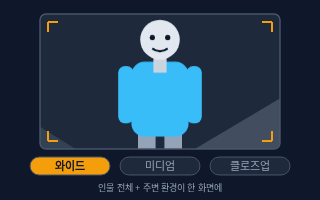</a> <b><a href="#wide-shot--와이드-샷">Wide Shot</a></b> 와이드 샷 인물 전체와 주변 환경이 한 화면에 들어오는 넓은 화면. 롱 샷이라고도 부른다.</td>
<td width="33%" valign="top"><a href="#medium-shot--미디엄-샷">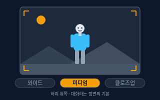</a> <b><a href="#medium-shot--미디엄-샷">Medium Shot</a></b> 미디엄 샷 인물의 허리 위쪽을 담는 화면. 표정과 몸짓이 함께 보여서 대화·설명 장면의 기본으로 쓴다.</td>
<td width="33%" valign="top"><a href="#close-up--클로즈업">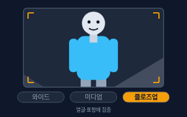</a> <b><a href="#close-up--클로즈업">Close-up</a></b> 클로즈업 얼굴이나 사물의 작은 부분을 화면 가득 담는 화면. 표정과 디테일에 시선을 모은다.</td>
</tr>
<tr>
<td width="33%" valign="top"><a href="#high-angle-and-low-angle--하이-앵글--로우-앵글">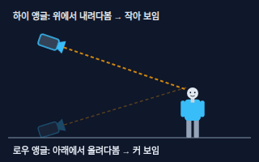</a> <b><a href="#high-angle-and-low-angle--하이-앵글--로우-앵글">High Angle and Low Angle</a></b> 하이 앵글 / 로우 앵글 카메라 높이로 인상을 바꾸는 방법. 위에서 내려다보면 하이 앵글(작고 약해 보임), 아래에서 올려다보면 로우 앵글(크고 강해 보임)이다.</td>
</tr>
</table>

**카메라 움직임 · Camera Moves** (6)

<table>
<tr>
<td width="33%" valign="top"><a href="#pan--팬">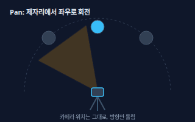</a> <b><a href="#pan--팬">Pan</a></b> 팬 카메라 위치는 그대로 두고 방향만 좌우로 돌리는 움직임.</td>
<td width="33%" valign="top"><a href="#tilt--틸트">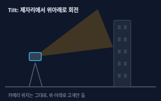</a> <b><a href="#tilt--틸트">Tilt</a></b> 틸트 카메라 위치는 그대로 두고 위아래로 고개를 들거나 숙이는 움직임.</td>
<td width="33%" valign="top"><a href="#dolly--돌리">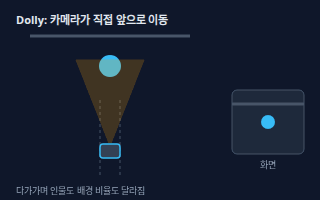</a> <b><a href="#dolly--돌리">Dolly</a></b> 돌리 카메라 자체를 레일이나 바퀴 위에서 앞뒤·좌우로 직접 옮기는 움직임. 인물을 따라가며 찍는 트래킹도 같은 계열이다.</td>
</tr>
<tr>
<td width="33%" valign="top"><a href="#zoom--줌">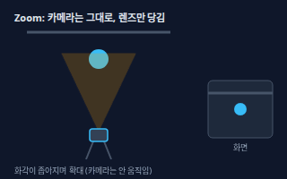</a> <b><a href="#zoom--줌">Zoom</a></b> 줌 카메라는 그대로 두고 렌즈의 초점거리를 바꿔서 화면을 확대하거나 축소하는 것. 시야각이 좁아지면 줌 인이다.</td>
<td width="33%" valign="top"><a href="#dolly-zoom--돌리-줌">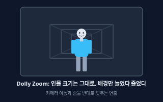</a> <b><a href="#dolly-zoom--돌리-줌">Dolly Zoom</a></b> 돌리 줌 카메라가 앞뒤로 움직이는 만큼 렌즈 줌을 반대로 맞춰서, 인물 크기는 그대로인데 배경만 늘었다 줄었다 하게 만드는 연출. 현기증 나는 느낌을 준다.</td>
<td width="33%" valign="top"><a href="#handheld-and-gimbal--핸드헬드--짐벌">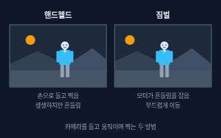</a> <b><a href="#handheld-and-gimbal--핸드헬드--짐벌">Handheld and Gimbal</a></b> 핸드헬드 / 짐벌 핸드헬드는 카메라를 손으로 들고 찍는 방식(흔들림이 생생하다). 짐벌은 모터로 흔들림을 잡아주는 받침대(부드러운 움직임).</td>
</tr>
</table>

**편집 · Editing** (6)

<table>
<tr>
<td width="33%" valign="top"><a href="#cut--컷">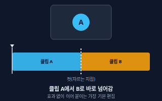</a> <b><a href="#cut--컷">Cut</a></b> 컷 한 클립에서 다음 클립으로 효과 없이 바로 넘어가는 가장 기본적인 편집. 또는 클립을 자르는 동작 자체를 말한다.</td>
<td width="33%" valign="top"><a href="#jump-cut--점프-컷">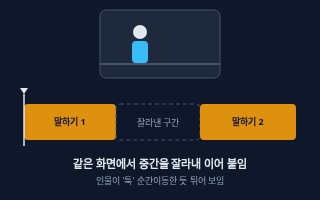</a> <b><a href="#jump-cut--점프-컷">Jump Cut</a></b> 점프 컷 같은 카메라 위치에서 중간 시간을 잘라 이어 붙여서 인물이 &quot;툭&quot; 순간이동한 것처럼 보이게 하는 컷.</td>
<td width="33%" valign="top"><a href="#j-cut-and-l-cut--j컷--l컷">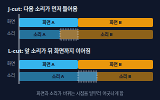</a> <b><a href="#j-cut-and-l-cut--j컷--l컷">J-cut and L-cut</a></b> J컷 / L컷 화면과 소리가 바뀌는 시점을 일부러 어긋나게 하는 편집. J컷은 다음 장면의 소리가 화면보다 먼저 나오고, L컷은 앞 장면의 소리가 다음 화면까지 이어진다.</td>
</tr>
<tr>
<td width="33%" valign="top"><a href="#b-roll--비롤">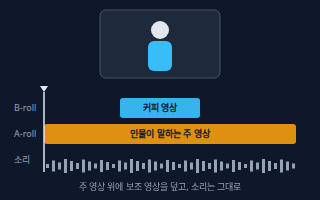</a> <b><a href="#b-roll--비롤">B-roll</a></b> 비롤 주된 영상(A-roll, 인물이 말하는 장면) 위에 덮어서 보여주는 보조 화면. 말하는 내용을 보충하거나 자른 자리를 가린다.</td>
<td width="33%" valign="top"><a href="#transition--트랜지션">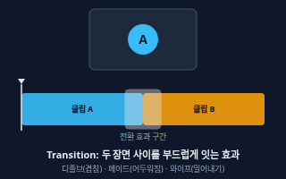</a> <b><a href="#transition--트랜지션">Transition</a></b> 트랜지션 두 장면 사이에 넣는 전환 효과. 디졸브(서서히 겹침), 페이드(어두워졌다 밝아짐), 와이프(밀어내기) 등이 있다.</td>
<td width="33%" valign="top"><a href="#timeline--타임라인">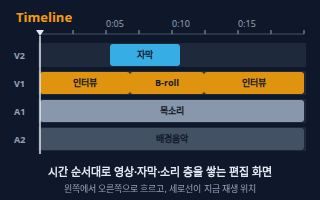</a> <b><a href="#timeline--타임라인">Timeline</a></b> 타임라인 편집 화면에서 영상·자막·소리 클립을 시간 순서대로 가로로 늘어놓은 작업대. 재생선(플레이헤드)이 지금 위치를 보여준다.</td>
</tr>
</table>

**색 · 소리 · Color & Sound** (5)

<table>
<tr>
<td width="33%" valign="top"><a href="#log--로그">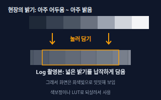</a> <b><a href="#log--로그">Log</a></b> 로그 밝은 곳과 어두운 곳의 정보를 최대한 많이 담도록 납작하게 기록하는 촬영 방식. 그대로 보면 회색빛으로 밋밋하다.</td>
<td width="33%" valign="top"><a href="#color-grading--컬러-그레이딩">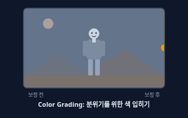</a> <b><a href="#color-grading--컬러-그레이딩">Color Grading</a></b> 컬러 그레이딩 영상의 색과 밝기를 의도한 분위기(따뜻하게, 차갑게, 영화처럼)로 바꾸는 작업. 색을 단순히 맞추는 보정(Color Correction)과 구분한다.</td>
<td width="33%" valign="top"><a href="#lut--룩업-테이블">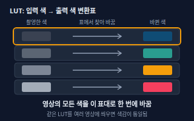</a> <b><a href="#lut--룩업-테이블">LUT</a></b> 룩업 테이블 입력 색을 출력 색으로 바꿔주는 변환표 파일. 한 번 입히면 Log 영상의 색감을 한꺼번에 바꾼다. 보통 .cube 파일로 배포된다.</td>
</tr>
<tr>
<td width="33%" valign="top"><a href="#audio-levels--오디오-레벨">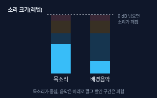</a> <b><a href="#audio-levels--오디오-레벨">Audio Levels</a></b> 오디오 레벨 소리의 크기. 0 dB를 넘으면 소리가 깨지므로(클리핑), 목소리가 가장 크고 배경음악은 그 아래에 깔리게 맞춘다.</td>
<td width="33%" valign="top"><a href="#room-tone--룸-톤">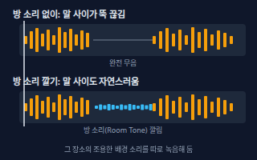</a> <b><a href="#room-tone--룸-톤">Room Tone</a></b> 룸 톤 말하지 않을 때도 그 장소에 깔려 있는 조용한 배경 소리(에어컨, 공기 소리 등). 따로 녹음해 두었다가 말 사이 빈틈에 깐다.</td>
</tr>
</table>

**내보내기 · Export & Platform** (8)

<table>
<tr>
<td width="33%" valign="top"><a href="#aspect-ratio--화면-비율">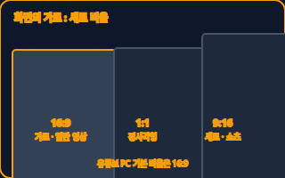</a> <b><a href="#aspect-ratio--화면-비율">Aspect Ratio</a></b> 화면 비율 화면의 가로와 세로 길이의 비율. 일반 유튜브 영상은 16:9(가로), 쇼츠·릴스는 9:16(세로), 정사각형은 1:1이다.</td>
<td width="33%" valign="top"><a href="#video-resolution--영상-해상도">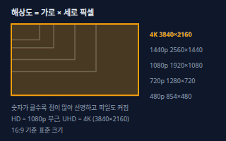</a> <b><a href="#video-resolution--영상-해상도">Video Resolution</a></b> 영상 해상도 화면을 이루는 점(픽셀)의 가로×세로 개수. 숫자가 클수록 선명하고 파일도 커진다. 16:9에서 1080p는 1920×1080, 4K는 3840×2160이다.</td>
<td width="33%" valign="top"><a href="#bitrate--비트레이트">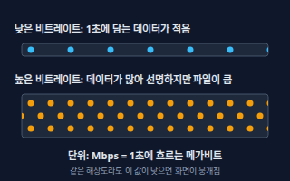</a> <b><a href="#bitrate--비트레이트">Bitrate</a></b> 비트레이트 영상 1초를 표현하는 데이터의 양. 단위는 Mbps(1초당 메가비트). 높을수록 선명하지만 파일이 크다.</td>
</tr>
<tr>
<td width="33%" valign="top"><a href="#codec--코덱">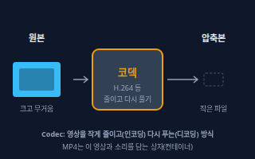</a> <b><a href="#codec--코덱">Codec</a></b> 코덱 영상과 소리를 작게 줄여 저장하고(인코딩) 다시 풀어서 재생하는(디코딩) 방식. 영상은 H.264, 소리는 AAC가 널리 쓰인다.</td>
<td width="33%" valign="top"><a href="#thumbnail--썸네일">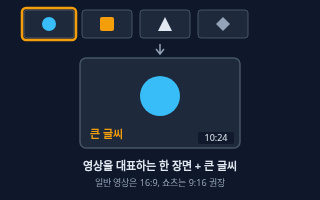</a> <b><a href="#thumbnail--썸네일">Thumbnail</a></b> 썸네일 영상 목록에서 보이는 대표 그림. 영상의 한 장면을 쓰거나 직접 만든 이미지를 올린다.</td>
<td width="33%" valign="top"><a href="#subtitle-and-caption--자막">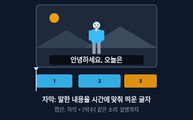</a> <b><a href="#subtitle-and-caption--자막">Subtitle and Caption</a></b> 자막 말한 내용을 시간에 맞춰 화면에 띄우는 글자. 소리를 못 듣는 시청자나 다른 언어 시청자를 위한 것이고, 캡션은 [박수]처럼 소리 설명까지 담는다.</td>
</tr>
<tr>
<td width="33%" valign="top"><a href="#safe-area--화면-안전-영역">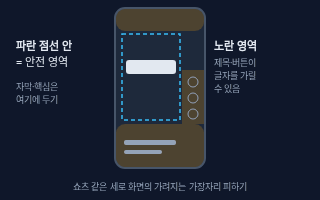</a> <b><a href="#safe-area--화면-안전-영역">Safe Area</a></b> 화면 안전 영역 세로 영상에서 앱의 제목·버튼·진행 바에 가려지지 않는, 화면 안쪽의 안전한 영역. 자막과 핵심 글자는 이 안에 둔다.</td>
<td width="33%" valign="top"><b><a href="motion-design.md#frame-rate--프레임레이트-fps">Frame Rate</a></b> 프레임레이트 (FPS) 1초에 보여주는 장면(프레임)의 수. 숫자가 클수록 부드럽고 작을수록 뚝뚝 끊긴다. 영상은 촬영한 프레임레이트 그대로 내보내는 것이 기본이다. → motion-design 시트</td>
</tr>
</table>

<!-- overview:end -->

## 샷 · Shots

### Wide Shot · 와이드 샷

- **정의**: 인물 전체와 주변 환경이 한 화면에 들어오는 넓은 화면. 롱 샷이라고도 부른다.
- **AI에게 이렇게**: "영상 시작 부분은 카페 전체가 보이는 와이드 샷으로 시작하고, 그다음 컷에서 사장님 미디엄 샷으로 들어가는 샷 리스트를 짜줘."
- **언제**: 장소를 처음 보여줄 때, 인물과 공간의 관계를 알려줄 때, 영상 오프닝
- **헷갈림**: Close-up — 와이드는 "어디서, 누가 있나", 클로즈업은 "무슨 표정인가"를 보여준다. 와이드만 계속 쓰면 표정이 안 보이고 밋밋하다.
- **관련**: Medium Shot, Close-up, Aspect Ratio, Focal Length(사진 촬영 시트)
- **확인 질문**: 장소 전체를 보여주는 게 목적인가요, 인물이 어디에 있는지가 중요한가요? 와이드로 찍어도 소리가 또렷하게 녹음되나요?

### Medium Shot · 미디엄 샷

- **정의**: 인물의 허리 위쪽을 담는 화면. 표정과 몸짓이 함께 보여서 대화·설명 장면의 기본으로 쓴다.
- **AI에게 이렇게**: "진행자가 설명하는 부분은 전부 미디엄 샷으로 잡고, 중요한 한마디가 나올 때만 클로즈업으로 바꿔줘."
- **언제**: 인터뷰, 브이로그에서 말하는 장면, 강의·설명 영상
- **헷갈림**: Wide Shot / Close-up — 이 셋은 "얼마나 가까이 담느냐"의 순서(와이드 → 미디엄 → 클로즈업)다. 정해진 mm 값이 아니라 화면에 담긴 범위로 부른다.
- **관련**: Wide Shot, Close-up, Over-the-Shoulder(어깨 너머 샷)
- **확인 질문**: 말하는 사람이 몇 명인가요? 손동작도 같이 보여야 하나요?

### Close-up · 클로즈업

- **정의**: 얼굴이나 사물의 작은 부분을 화면 가득 담는 화면. 표정과 디테일에 시선을 모은다.
- **AI에게 이렇게**: "감정이 터지는 대사 부분에서 클로즈업으로 바꾸고, 제품 설명에서는 버튼과 로고를 클로즈업으로 보여주는 컷을 넣어줘."
- **언제**: 감정이 중요한 대사, 제품 디테일, 음식 질감을 보여줄 때
- **헷갈림**: Zoom — 클로즈업은 "그렇게 담은 화면"의 이름이고, 줌은 렌즈를 당기는 "동작"이다. 줌으로도, 가까이 가서 찍어도 클로즈업이 된다.
- **관련**: Medium Shot, Wide Shot, Depth of Field(사진 촬영 시트)
- **확인 질문**: 클로즈업할 대상이 얼굴인가요, 사물인가요? 초점이 흐려지지 않게 가까이서 다시 찍을 수 있나요?

### High Angle and Low Angle · 하이 앵글 / 로우 앵글

- **정의**: 카메라 높이로 인상을 바꾸는 방법. 위에서 내려다보면 하이 앵글(작고 약해 보임), 아래에서 올려다보면 로우 앵글(크고 강해 보임)이다.
- **AI에게 이렇게**: "주인공이 자신감을 얻는 장면은 로우 앵글로, 혼자 남겨진 장면은 하이 앵글로 찍는 걸 가정하고 샷 리스트를 써줘."
- **언제**: 인물의 힘·감정을 연출할 때, 책상 위 작업을 위에서 보여줄 때
- **헷갈림**: Eye Level(아이 레벨) — 눈높이로 평범하게 찍는 기본 각도다. 앵글은 카메라 "높이·각도"이고, 샷 크기(와이드·클로즈업)는 "얼마나 가까운가"라서 따로 정한다.
- **관련**: Wide Shot, Close-up, Gimbal, Rule of Thirds(사진 촬영 시트)
- **확인 질문**: 인물이 강해 보이길 원하나요, 작고 외로워 보이길 원하나요? 카메라를 높이/낮게 놓을 삼각대나 공간이 있나요?

## 카메라 움직임 · Camera Moves

### Pan · 팬

- **정의**: 카메라 위치는 그대로 두고 방향만 좌우로 돌리는 움직임.
- **AI에게 이렇게**: "광장 전체를 보여주기 위해 왼쪽에서 오른쪽으로 천천히 팬하는 샷을 장면 하나로 넣어줘."
- **언제**: 넓은 풍경을 훑을 때, 움직이는 인물을 따라가며 찍을 때
- **헷갈림**: Dolly — 팬은 "제자리에서 고개를 돌리기", 돌리는 "카메라가 걸어가기"다. 팬은 카메라가 한 점에 있어서 원근감이 바뀌지 않는다.
- **관련**: Tilt, Dolly, Handheld and Gimbal
- **확인 질문**: 어느 방향으로, 얼마나 천천히 돌릴까요? 삼각대(또는 짐벌)를 쓰나요?

### Tilt · 틸트

- **정의**: 카메라 위치는 그대로 두고 위아래로 고개를 들거나 숙이는 움직임.
- **AI에게 이렇게**: "건물 맨 아래에서 맨 위까지 천천히 틸트 업으로 보여주고, 마지막에 하늘에서 멈추는 컷으로 만들어줘."
- **언제**: 키 큰 건물·나무를 보여줄 때, 발끝에서 얼굴까지 인물을 훑을 때
- **헷갈림**: Pan — 팬은 좌우, 틸트는 상하. 카메라 몸통이 위로 올라가는 건 틸트가 아니라 Pedestal(페디스털)이다.
- **관련**: Pan, Dolly, High Angle and Low Angle
- **확인 질문**: 위로(틸트 업) 향하나요, 아래로(틸트 다운) 향하나요? 처음과 끝에서 무엇이 보여야 하나요?

### Dolly · 돌리

- **정의**: 카메라 자체를 레일이나 바퀴 위에서 앞뒤·좌우로 직접 옮기는 움직임. 인물을 따라가며 찍는 트래킹도 같은 계열이다.
- **AI에게 이렇게**: "인물이 걸어갈 때 카메라가 일정한 거리를 유지하며 따라가는 돌리 샷 느낌으로 장면을 묘사해줘."
- **언제**: 걷는 사람을 따라갈 때, 인물에게 천천히 다가가 긴장을 만들 때
- **헷갈림**: Zoom — 돌리는 카메라가 움직여서 배경과의 거리감(원근)이 달라지고, 줌은 렌즈만 바꿔서 화면이 그냥 커진다.
- **관련**: Zoom, Dolly Zoom, Gimbal
- **확인 질문**: 장비(레일, 짐벌, 바퀴 달린 의자)가 있나요? 다가가기(in)인가요, 멀어지기(out)인가요?

### Zoom · 줌

- **정의**: 카메라는 그대로 두고 렌즈의 초점거리를 바꿔서 화면을 확대하거나 축소하는 것. 시야각이 좁아지면 줌 인이다.
- **AI에게 이렇게**: "강조하고 싶은 단어가 나올 때 1초 정도 천천히 줌 인하는 효과를 넣어줘. 너무 빠르지 않게."
- **언제**: 말하는 도중 은근히 집중시킬 때, 편집에서 디지털 줌으로 지루함을 깰 때
- **헷갈림**: Dolly — 줌은 카메라가 안 움직이고 렌즈만 바꾼다. 영상 편집 프로그램에서 키우는 디지털 줌은 화면을 잘라 키우는 것이라 화질이 떨어질 수 있다.
- **관련**: Dolly, Dolly Zoom, Focal Length(사진 촬영 시트)
- **확인 질문**: 촬영 중 렌즈로 줌할까요, 편집에서 디지털로 확대할까요? 4K로 찍어 1080p로 내보내면 확대 여유가 있습니다 — 해당하나요?

### Dolly Zoom · 돌리 줌

- **정의**: 카메라가 앞뒤로 움직이는 만큼 렌즈 줌을 반대로 맞춰서, 인물 크기는 그대로인데 배경만 늘었다 줄었다 하게 만드는 연출. 현기증 나는 느낌을 준다.
- **AI에게 이렇게**: "주인공이 충격받는 순간에 돌리 줌 효과를 넣어서 배경이 뒤로 빨려 들어가는 느낌으로 연출을 제안해줘."
- **언제**: 충격·공포·깨달음처럼 심리를 극적으로 보여줄 때(영화 느낌)
- **헷갈림**: Zoom / Dolly — 줌 하나나 돌리 하나만으로는 이 효과가 안 난다. 둘을 동시에 반대 방향으로 맞춰야 한다. 실제 촬영이 어려우면 편집 프로그램의 합성 효과로 흉내 내기도 한다.
- **관련**: Zoom, Dolly, Close-up
- **확인 질문**: 줌 렌즈와 이동할 공간이 있나요? 아니면 편집 효과로 흉내 내도 괜찮을까요?

### Handheld and Gimbal · 핸드헬드 / 짐벌

- **정의**: 핸드헬드는 카메라를 손으로 들고 찍는 방식(흔들림이 생생하다). 짐벌은 모터로 흔들림을 잡아주는 받침대(부드러운 움직임).
- **AI에게 이렇게**: "다큐처럼 현장감 있게 핸드헬드로 시작하고, 걷는 장면은 짐벌로 찍는다고 가정하고 촬영 계획을 써줘."
- **언제**: 다큐·브이로그 현장감(핸드헬드), 걸으며 찍는 매끈한 장면(짐벌)
- **헷갈림**: 삼각대 — 삼각대는 고정해서 흔들림이 없다. 핸드헬드는 일부러 생생함을 위해 손으로 들고, 짐벌은 손으로 들되 흔들림만 줄인다. 편집의 "흔들림 보정"과도 다르다.
- **관련**: Pan, Dolly, Stabilization(손떨림 보정)
- **확인 질문**: 현장감을 원하나요, 안정감을 원하나요? 짐벌 장비가 있나요? 이미 흔들린 영상이면 편집에서 흔들림 보정을 쓸까요?

## 편집 · Editing

### Cut · 컷

- **정의**: 한 클립에서 다음 클립으로 효과 없이 바로 넘어가는 가장 기본적인 편집. 또는 클립을 자르는 동작 자체를 말한다.
- **AI에게 이렇게**: "말이 길어지는 부분을 4초 이내 컷 단위로 나눠서 타임라인에 올릴 컷 리스트를 만들어줘."
- **언제**: 거의 모든 편집(컷이 가장 자연스러운 전환)
- **헷갈림**: Transition — 컷은 효과 없이 바로 바뀌고, 트랜지션은 사이에 디졸브·와이프 같은 효과를 넣는다. 초보가 효과를 남발하는 것보다 컷이 대부분 더 깔끔하다.
- **관련**: Jump Cut, Transition, Timeline
- **확인 질문**: 한 컷의 평균 길이를 어느 정도로 할까요? 장면이 바뀌는 곳마다 컷으로만 이을까요?

### Jump Cut · 점프 컷

- **정의**: 같은 카메라 위치에서 중간 시간을 잘라 이어 붙여서 인물이 "툭" 순간이동한 것처럼 보이게 하는 컷.
- **AI에게 이렇게**: "말 사이에 쉬는 구간과 '음…' 같은 군더더기를 점프 컷으로 잘라내서 리듬 있게 만들어줘."
- **언제**: 브이로그·유튜브 토크 영상에서 템포를 빠르게 만들 때
- **헷갈림**: Cut — 컷은 일반적으로 장면이나 각도가 바뀌는 연결이고, 점프 컷은 같은 화면에서 시간만 건너뛴다. 의도하지 않으면 어색한 실수로 보이기도 한다.
- **관련**: Cut, B-roll, Pacing(리듬)
- **확인 질문**: 군더더기를 모두 잘라낼까요, 호흡이 필요한 곳은 남길까요? 자른 자리를 B-roll로 가릴까요?

### J-cut and L-cut · J컷 / L컷

- **정의**: 화면과 소리가 바뀌는 시점을 일부러 어긋나게 하는 편집. J컷은 다음 장면의 소리가 화면보다 먼저 나오고, L컷은 앞 장면의 소리가 다음 화면까지 이어진다.
- **AI에게 이렇게**: "인터뷰 장면을 바꿀 때 다음 사람의 목소리를 1초 먼저 들려주는 J컷으로 연결해줘. 이전 사람의 반응 장면은 L컷으로 처리해줘."
- **언제**: 대화·인터뷰 장면 연결, 자연스러운 흐름 만들기
- **헷갈림**: Cut — 일반 컷은 화면과 소리가 동시에 바뀐다. J·L은 타임라인에서 소리 막대가 J, L 모양으로 어긋나서 붙은 이름이다.
- **관련**: Cut, Timeline, B-roll
- **확인 질문**: 어긋나는 시간을 얼마나 줄까요? 오디오와 비디오를 따로 움직일 수 있게 분리해도 되나요?

### B-roll · 비롤

- **정의**: 주된 영상(A-roll, 인물이 말하는 장면) 위에 덮어서 보여주는 보조 화면. 말하는 내용을 보충하거나 자른 자리를 가린다.
- **AI에게 이렇게**: "사장님이 '원두를 직접 볶는다'고 말하는 5초 구간에는 원두 볶는 B-roll을 덮고, 목소리는 그대로 이어지게 해줘."
- **언제**: 말만 계속되는 영상이 지루할 때, 점프 컷으로 자른 자리를 감출 때, 설명하는 대상을 보여줄 때
- **헷갈림**: A-roll — A-roll은 이야기를 끌고 가는 주 영상, B-roll은 보조. 컷어웨이(cutaway)와 거의 같은 뜻으로 쓰인다.
- **관련**: Jump Cut, J-cut and L-cut, Timeline
- **확인 질문**: B-roll 소스(촬영본·스톡 영상)가 있나요? 말하는 내용과 어떤 장면을 맞출까요?

### Transition · 트랜지션

- **정의**: 두 장면 사이에 넣는 전환 효과. 디졸브(서서히 겹침), 페이드(어두워졌다 밝아짐), 와이프(밀어내기) 등이 있다.
- **AI에게 이렇게**: "챕터가 바뀌는 곳에만 0.5초 크로스 디졸브를 넣고, 나머지는 전부 일반 컷으로 이어줘."
- **언제**: 시간·장소가 크게 바뀔 때, 챕터 구분, 분위기 전환
- **헷갈림**: Cut — 컷은 효과가 없다. 트랜지션을 너무 자주 쓰면 아마추어처럼 보이므로 구분이 필요한 곳에만 쓴다.
- **관련**: Cut, Timeline, Montage(몽타주)
- **확인 질문**: 어떤 종류(디졸브·페이드·와이프)로 할까요? 길이는 어느 정도로 할까요? 전체에 쓸까요, 챕터 구분에만 쓸까요?

### Timeline · 타임라인

- **정의**: 편집 화면에서 영상·자막·소리 클립을 시간 순서대로 가로로 늘어놓은 작업대. 재생선(플레이헤드)이 지금 위치를 보여준다.
- **AI에게 이렇게**: "타임라인 구성을 알려줘. V1에는 인터뷰, V2에는 자막, A1에는 목소리, A2에는 배경음악이 올라가는 식으로 정리해줘."
- **언제**: 편집 프로그램(프리미어, 다빈치 리졸브, 캡컷 등)에서 모든 작업을 할 때
- **헷갈림**: 시퀀스(프로젝트) — 타임라인은 시퀀스를 편집하는 작업 화면이고, 시퀀스는 한 편의 영상 설정(해상도·프레임레이트) 덩어리다.
- **관련**: Cut, B-roll, J-cut and L-cut
- **확인 질문**: 어떤 편집 프로그램을 쓰나요? 한 타임라인에 층(트랙)이 몇 개나 필요한가요?

## 색 · 소리 · Color & Sound

### Log · 로그

- **정의**: 밝은 곳과 어두운 곳의 정보를 최대한 많이 담도록 납작하게 기록하는 촬영 방식. 그대로 보면 회색빛으로 밋밋하다.
- **AI에게 이렇게**: "S-Log로 찍은 영상이라 회색빛이야. 색보정 순서(Log → 노출 맞추기 → LUT → 미세 조정)를 단계별로 알려줘."
- **언제**: 색보정을 제대로 할 때, 밝은 하늘과 어두운 실내를 한 장면에 담을 때
- **헷갈림**: LUT — Log는 "찍는 방식(원본이 납작함)", LUT는 "그걸 보기 좋게 바꾸는 변환표"다. Log 영상에 LUT를 입히지 않으면 밋밋한 채로 보인다.
- **관련**: LUT, Color Grading, RAW(사진 촬영 시트), Histogram(사진 촬영 시트)
- **확인 질문**: 카메라 모델의 Log 이름(S-Log, C-Log 등)이 무엇인가요? Log 전용 LUT가 있나요?

### Color Grading · 컬러 그레이딩

- **정의**: 영상의 색과 밝기를 의도한 분위기(따뜻하게, 차갑게, 영화처럼)로 바꾸는 작업. 색을 단순히 맞추는 보정(Color Correction)과 구분한다.
- **AI에게 이렇게**: "카페 브이로그를 따뜻하고 부드러운 분위기로 색보정하고 싶어. 그림자는 살짝 올리고 피부톤은 자연스럽게 유지하는 설정값을 알려줘."
- **언제**: 컷마다 색이 다를 때 통일, 영상의 분위기를 만들 때
- **헷갈림**: Color Correction(색 보정) — 보정은 흰색이 흰색으로 보이게 하는 등 "맞추기", 그레이딩은 분위기를 "입히기"다. 화이트밸런스는 촬영 때 설정하며 사진 촬영 시트에서 다룬다.
- **관련**: Log, LUT, White Balance(사진 촬영 시트)
- **확인 질문**: 원하는 분위기(따뜻함/차가움/영화 느낌)의 참고 영상이 있나요? 유튜브 업로드용이라면 일반 SDR이면 되나요?
- **근거**: [YouTube 도움말 · 권장 업로드 인코딩 설정(색 공간)](https://support.google.com/youtube/answer/1722171)
- **검증일**: 2026-11-02

> 확인한 내용: YouTube는 SDR 업로드의 표준 색 공간으로 BT.709를 권장합니다. 전체 범위(full range) 색은 제한 범위(limited range)로 변환되고, 높은 비트 심도가 필요한 BT.2020 같은 색 공간은 HDR 전송 함수 없이 올리면 BT.709(8비트)로 변환됩니다.

### LUT · 룩업 테이블

- **정의**: 입력 색을 출력 색으로 바꿔주는 변환표 파일. 한 번 입히면 Log 영상의 색감을 한꺼번에 바꾼다. 보통 .cube 파일로 배포된다.
- **AI에게 이렇게**: "Log 영상에 카메라 제조사 LUT를 먼저 적용하고, 그 위에 따뜻한 느낌의 필름 LUT를 강도 60%로 얹는 순서로 설명해줘."
- **언제**: Log 영상을 빠르게 보정할 때, 여러 영상의 색감을 한 번에 통일할 때
- **헷갈림**: Color Grading — LUT는 "한 번에 입히는 프리셋", 그레이딩은 "컷마다 손으로 다듬는 작업"이다. LUT 하나로 끝내면 노출이 다른 컷에서 어색해진다.
- **관련**: Log, Color Grading, Preset(프리셋)
- **확인 질문**: 어떤 카메라·Log 프로파일용 LUT인가요? 강도(세기)는 얼마로 할까요?

### Audio Levels · 오디오 레벨

- **정의**: 소리의 크기. 0 dB를 넘으면 소리가 깨지므로(클리핑), 목소리가 가장 크고 배경음악은 그 아래에 깔리게 맞춘다.
- **AI에게 이렇게**: "목소리가 가장 잘 들리도록 배경음악은 목소리보다 낮게 깔고, 목소리가 나올 때만 음악이 자동으로 작아지게(덕킹) 설정하는 방법을 알려줘."
- **언제**: 편집 마무리 단계, 영상마다 소리 크기가 들쭉날쭉할 때
- **헷갈림**: 볼륨 — 시청자 볼륨은 재생기에서 정하고, 오디오 레벨은 영상 파일 안에 담긴 소리의 세기다. 레벨을 못 맞추면 시청자가 매번 볼륨을 조절해야 한다.
- **관련**: Room Tone, Timeline, Bitrate
- **확인 질문**: 목소리가 마이크마다 다르게 녹음되었나요? 배경음악은 영상 내내 깔리나요, 일부 구간만인가요?

### Room Tone · 룸 톤

- **정의**: 말하지 않을 때도 그 장소에 깔려 있는 조용한 배경 소리(에어컨, 공기 소리 등). 따로 녹음해 두었다가 말 사이 빈틈에 깐다.
- **AI에게 이렇게**: "촬영 때 따로 녹음한 룸 톤을 말 사이 빈 곳과 컷 이어붙인 곳에 깔아서 소리가 끊기지 않게 하는 순서를 알려줘."
- **언제**: 컷으로 말 사이를 잘라냈을 때, 장면마다 배경 소리가 다를 때
- **헷갈림**: 무음 — 완전한 무음(0)은 오히려 어색하게 들린다. 룸 톤은 "조용하지만 소리가 있는" 상태를 이어 준다. 소음 제거와도 다르다.
- **관련**: Audio Levels, Jump Cut, J-cut and L-cut
- **확인 질문**: 촬영 현장에서 룸 톤을 따로 녹음해 두셨나요? 장소마다 소리가 다른가요?

## 내보내기 · Export & Platform

### Aspect Ratio · 화면 비율

- **정의**: 화면의 가로와 세로 길이의 비율. 일반 유튜브 영상은 16:9(가로), 쇼츠·릴스는 9:16(세로), 정사각형은 1:1이다.
- **AI에게 이렇게**: "이 16:9 영상을 쇼츠용 9:16으로 바꾸고 싶어. 인물이 가운데 오도록 자르는 방법과 주의할 점을 알려줘."
- **언제**: 프로젝트(시퀀스)를 처음 만들 때, 영상을 다른 플랫폼에 다시 올릴 때
- **헷갈림**: Resolution(해상도) — 비율은 "모양"(가로:세로), 해상도는 "점의 개수"(예: 1920×1080)다. 같은 16:9라도 720p, 1080p, 4K는 해상도가 다르다.
- **관련**: Video Resolution, Safe Area, Thumbnail
- **확인 질문**: 올릴 곳이 일반 영상인가요, 쇼츠인가요? 하나의 촬영본을 여러 비율로 만들 건가요?
- **근거**: [YouTube 도움말 · 동영상 해상도 및 가로세로 비율](https://support.google.com/youtube/answer/6375112), [YouTube 도움말 · 권장 업로드 인코딩 설정](https://support.google.com/youtube/answer/1722171)
- **검증일**: 2026-11-02

> 확인한 내용: 컴퓨터의 YouTube 표준 비율은 16:9이고, 세로·정사각형 등 다른 비율은 플레이어가 영상에 맞게 크기를 바꿉니다. 영상에 검은 띠·여백을 직접 넣지 않는 것이 좋다고 안내합니다.

### Video Resolution · 영상 해상도

- **정의**: 화면을 이루는 점(픽셀)의 가로×세로 개수. 숫자가 클수록 선명하고 파일도 커진다. 16:9에서 1080p는 1920×1080, 4K는 3840×2160이다.
- **AI에게 이렇게**: "유튜브에 올릴 영상은 1080p 16:9로 내보내려고 해. 4K로 찍은 원본을 1080p로 줄여서 내보내는 설정을 알려줘."
- **언제**: 내보내기 전에 크기를 정할 때, 촬영 전 카메라 설정을 고를 때
- **헷갈림**: Bitrate — 해상도는 "점의 수", 비트레이트는 "1초에 담는 데이터량"이다. 해상도만 높이고 비트레이트가 낮으면 뭉개져 보인다.
- **관련**: Aspect Ratio, Bitrate, Frame Rate
- **확인 질문**: 시청자 대부분이 모바일인가요, TV인가요? 편집 컴퓨터가 4K를 부드럽게 돌리나요?
- **근거**: [YouTube 도움말 · 동영상 해상도 및 가로세로 비율](https://support.google.com/youtube/answer/6375112)
- **검증일**: 2026-11-02

> 확인한 내용(16:9 기준): 4320p(8K) 7680×4320, 2160p(4K) 3840×2160, 1440p 2560×1440, 1080p 1920×1080, 720p 1280×720, 480p 854×480, 360p 640×360, 240p 426×240.

### Bitrate · 비트레이트

- **정의**: 영상 1초를 표현하는 데이터의 양. 단위는 Mbps(1초당 메가비트). 높을수록 선명하지만 파일이 크다.
- **AI에게 이렇게**: "1080p 30fps 유튜브 업로드용으로 비트레이트를 몇으로 내보내야 하는지 권장값을 알려주고, 내보내기 창의 어느 항목에서 바꾸는지도 알려줘."
- **언제**: 내보내기 설정, 화질과 파일 크기를 조절할 때
- **헷갈림**: Video Resolution — 해상도는 점의 수, 비트레이트는 데이터량이다. 또 영상 비트레이트와 오디오 비트레이트(소리 데이터량)는 별개다.
- **관련**: Video Resolution, Codec, Frame Rate
- **확인 질문**: 해상도와 프레임레이트가 무엇인가요? SDR인가요, HDR인가요? 파일 크기 제한이 있나요?
- **근거**: [YouTube 도움말 · 권장 업로드 인코딩 설정](https://support.google.com/youtube/answer/1722171)
- **검증일**: 2026-11-02

> 확인한 내용(SDR 업로드, 참고용 권장값): 프레임레이트 24·25·30 기준 — 2160p(4K) 35–45 Mbps, 1440p 16 Mbps, 1080p 8 Mbps, 720p 5 Mbps. 48·50·60 기준 — 4K 53–68 Mbps, 1440p 24 Mbps, 1080p 12 Mbps, 720p 7.5 Mbps. 비트레이트 제한은 필수가 아니며(가변 비트레이트), 오디오는 스테레오 384 kbps를 권장합니다.

### Codec · 코덱

- **정의**: 영상과 소리를 작게 줄여 저장하고(인코딩) 다시 풀어서 재생하는(디코딩) 방식. 영상은 H.264, 소리는 AAC가 널리 쓰인다.
- **AI에게 이렇게**: "유튜브 업로드용으로 MP4 컨테이너에 영상은 H.264, 소리는 AAC로 내보내는 설정을 편집 프로그램 기준으로 알려줘."
- **언제**: 내보내기 형식을 고를 때, 파일이 재생 안 되거나 지나치게 클 때
- **헷갈림**: MP4(컨테이너) — MP4는 영상·소리·자막을 담는 "상자", H.264·AAC는 상자 속 영상·소리를 줄이는 "방식"이다. 상자 이름만 알아서는 안에 뭐가 들었는지 모른다.
- **관련**: Bitrate, Video Resolution, Frame Rate
- **확인 질문**: 어떤 편집 프로그램인가요? 올릴 곳이 유튜브인가요, 다른 플랫폼인가요? 오디오는 스테레오인가요?
- **근거**: [YouTube 도움말 · 권장 업로드 인코딩 설정](https://support.google.com/youtube/answer/1722171)
- **검증일**: 2026-11-02

> 확인한 내용: 컨테이너는 MP4, 영상 코덱은 H.264(순차 주사, High 프로파일, 크로마 서브샘플링 4:2:0 등), 오디오 코덱은 AAC-LC 또는 Opus 등이며 샘플링 레이트는 48kHz가 권장됩니다.

### Thumbnail · 썸네일

- **정의**: 영상 목록에서 보이는 대표 그림. 영상의 한 장면을 쓰거나 직접 만든 이미지를 올린다.
- **AI에게 이렇게**: "이 영상의 썸네일 문구 후보를 6자 이내로 5개 제안해줘. 얼굴 클로즈업 위에 큰 글씨가 들어가는 구성으로 레이아웃도 설명해줘."
- **언제**: 업로드할 때, 클릭률이 낮을 때 다시 만들 때
- **헷갈림**: 미리보기 장면 — 영상이 자동으로 뽑는 추천 이미지는 임시이고, 직접 올린 커스텀 썸네일이 우선한다. 쇼츠는 비율이 다르다.
- **관련**: Close-up, Aspect Ratio, Safe Area
- **확인 질문**: 일반 영상인가요, 쇼츠인가요? 얼굴을 넣을까요, 제품을 넣을까요? 문구는 몇 자 이내로 할까요?
- **근거**: [YouTube 도움말 · 맞춤 썸네일 추가](https://support.google.com/youtube/answer/72431)
- **검증일**: 2026-11-02

> 확인한 내용: 영상은 16:9, 쇼츠는 9:16 비율의 썸네일을 올리도록 안내하며, 직접 올리려면 계정 인증이 필요합니다. 쇼츠 맞춤 썸네일은 컴퓨터의 YouTube 스튜디오에서만 추가할 수 있습니다.

### Subtitle and Caption · 자막

- **정의**: 말한 내용을 시간에 맞춰 화면에 띄우는 글자. 소리를 못 듣는 시청자나 다른 언어 시청자를 위한 것이고, 캡션은 [박수]처럼 소리 설명까지 담는다.
- **AI에게 이렇게**: "이 대본으로 SRT 자막 파일을 만들어줘. 한 줄은 두 줄 이내로, 시작·끝 시간을 포함해줘. 소리 설명은 [박수]처럼 괄호로 넣어줘."
- **언제**: 소리 없이 보는 시청자(모바일)를 위해, 번역 자막을 제공할 때
- **헷갈림**: 자막을 영상에 박아 넣기(번인) vs 별도 자막 파일 — 번인은 끄고 켤 수 없고 수정이 어렵지만 어디서든 똑같이 보인다. 파일 자막은 플레이어가 켜고 끌 수 있고 번역도 쉽다.
- **관련**: Timeline, Safe Area, Aspect Ratio
- **확인 질문**: 번인 자막인가요, 파일 자막인가요? 어떤 언어로 만들까요? 자동 생성 자막을 고쳐 쓸까요?
- **근거**: [YouTube 도움말 · 자막 추가](https://support.google.com/youtube/answer/2734796)
- **검증일**: 2026-11-02

> 확인한 내용: YouTube 스튜디오에서 파일 업로드(시간 정보 포함/미포함), 자동 싱크, 직접 입력으로 자막을 추가할 수 있습니다. 자막 파일에는 말한 내용과 표시 시간이 들어 있고, 직접 입력 때는 [박수]·[천둥] 같은 소리 설명을 넣으라고 안내합니다. 자동 자막은 영상의 기본 언어로만 만들어집니다.

### Safe Area · 화면 안전 영역

- **정의**: 세로 영상에서 앱의 제목·버튼·진행 바에 가려지지 않는, 화면 안쪽의 안전한 영역. 자막과 핵심 글자는 이 안에 둔다.
- **AI에게 이렇게**: "9:16 쇼츠 자막 레이아웃을 짜줘. 제목·좋아요 버튼·채널명에 가려지지 않게 화면 위·아래·오른쪽 가장자리를 비워줘."
- **언제**: 쇼츠·릴스·틱톡용 세로 영상의 자막, 로고, 중요한 글자를 놓을 때
- **헷갈림**: Aspect Ratio — 비율은 영상 전체의 모양이고, 안전 영역은 그 안에서 글자를 둬도 되는 범위다. 플랫폼마다 가려지는 범위가 달라서 정확한 숫자 대신 여유를 넉넉히 둔다.
- **관련**: Aspect Ratio, Subtitle and Caption, Thumbnail
- **확인 질문**: 어느 플랫폼(유튜브 쇼츠, 인스타 릴스, 틱톡)에 올리나요? 한 영상을 여러 곳에 올릴 건가요?
- **근거**: [YouTube 도움말 · 3분 길이 쇼츠 이해하기](https://support.google.com/youtube/answer/15424877)
- **검증일**: 2026-11-02

> 확인한 내용: 2024-10-15 이후 업로드된 정사각형 또는 세로 영상은 3분 이하일 때 쇼츠로 분류됩니다. 안전 영역의 구체 수치는 공식 안내에서 확인하지 못해 적지 않았습니다.

### Frame Rate · 프레임레이트 (FPS)

- **정의**: 1초에 보여주는 장면(프레임)의 수. 숫자가 클수록 부드럽고 작을수록 뚝뚝 끊긴다. 영상은 촬영한 프레임레이트 그대로 내보내는 것이 기본이다.
- **원본**: [모션 디자인 · Frame Rate](motion-design.md#frame-rate--프레임레이트-fps)

## 참고 자료

- [YouTube 도움말 · 권장 업로드 인코딩 설정](https://support.google.com/youtube/answer/1722171)
- [YouTube 도움말 · 동영상 해상도 및 가로세로 비율](https://support.google.com/youtube/answer/6375112)
- [YouTube 도움말 · 맞춤 썸네일 추가](https://support.google.com/youtube/answer/72431)
- [YouTube 도움말 · 자막 추가](https://support.google.com/youtube/answer/2734796)
- [YouTube 도움말 · 3분 길이 쇼츠 이해하기](https://support.google.com/youtube/answer/15424877)
- [Wikipedia · Shot (filmmaking)](https://en.wikipedia.org/wiki/Shot_(filmmaking))
- [Berkeley CASN · Camera Movement Terms (PDF)](https://casn.berkeley.edu/wp-content/uploads/resource_files/CameraMovementterms.pdf)
- [Adobe · J cuts and L cuts](https://adobe.com/creativecloud/video/post-production/cuts-in-film/l-and-j-cut.html)
- [Video University · The Log vs the LUT](https://videouniversity.com/articles/log-vs-lut)
